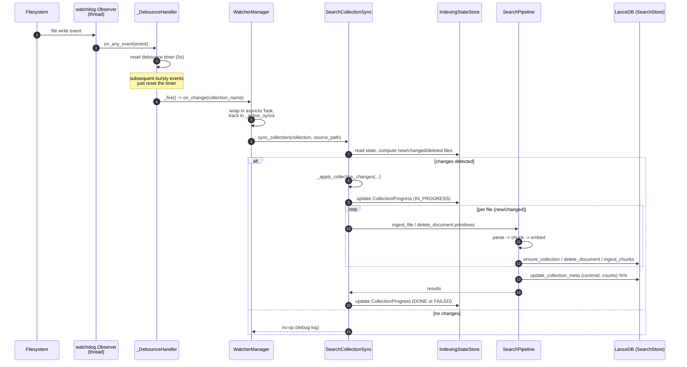

**Purpose**: Document how clients integrate with `archon-search` synchronously (REST, MCP) and how internal asynchronous flows (watcher, jobs) hang together.
**Audience**: Engineers integrating clients; engineers debugging long-running ingest/reindex flows.
**Status**: Draft
**Last reviewed**: 2026-10-17
**Next review**: 2026-11-07

# Services and Integration Architecture

`archon-search` exposes two synchronous transports — FastAPI HTTP and FastMCP HTTP — and runs two asynchronous internal integrations — the watchdog filesystem observer and the persistent job store. Both transports use the same `APIKeyMiddleware` class (each app factory adds its own instance); both async flows feed back into the same `SearchPipeline`. In the production run path (`run_server`), the FastAPI app is started under uvicorn **and** mounts the MCP Starlette wrapper at `/mcp` on the same port (D9) — a single uvicorn process, single port (8765 default), shared event loop. Layering and module roles are in [110_component_catalog_and_layer_breakdown.md](110_component_catalog_and_layer_breakdown.md); the topology is in [100_system_architecture_overview.md](100_system_architecture_overview.md).

## Principles

1. **One middleware class, two transports.** REST and MCP each instantiate `APIKeyMiddleware` (`server/middleware_auth.py`). `_EXEMPT_PATHS` is `{"/health", "/ready"}`; `/docs`, `/openapi.json` and `/redoc` (`DOCS_PATHS`) join the exempt set only when `[server].docs_enabled = true`. As of D9 both factories are wired with `namespaces=config.namespaces`, so per-namespace TOML keys authenticate identically over REST and MCP.
2. **Sync edges write to the same state as async edges.** A watcher-triggered reindex and a `POST /collections/{name}/reindex` end up calling the same pipeline code paths.
3. **OpenAPI is the contract.** `GET /openapi.json` is authoritative for REST; breaking changes are recorded in `BREAKING.md`. See [600_api_reference_or_public_interface.md](600_api_reference_or_public_interface.md).
4. **Long-running work is jobified.** Anything that can exceed an HTTP timeout (ingest, add-collection, reindex) returns `202 Accepted` with a `job_id` instead of blocking.
5. **Telemetry never sees the query.** Telemetry entry factories take no `query` parameter; raw queries cannot be logged by construction.

## Synchronous integrations

### FastAPI HTTP control plane

Built by `archon_search.server.app.create_app`. The lifespan handler connects `SearchStore`, runs `migrate_namespace` + `migrate_acl` + `migrate_per_collection_model`, and then spawns `collection_sync.sync()` on all configured collections (detecting chunk-size changes and triggering auto-reindex when `auto_reindex_on_chunk_size_change = true`) as a background task via `asyncio.create_task`. It is deliberately **not** awaited: uvicorn binds the listening socket only after lifespan startup returns, so awaiting a full corpus sync would leave clients with `ConnectError` for its entire duration instead of a served response. The startup sync is best-effort — a failure logs WARNING and never blocks REST startup — and the task handle is kept on `app.state._startup_sync_task`. The task opens a `SyncJob` of its own (`_start_startup_sync_job`, namespace `default`) and drives it to a terminal status on every exit path — `DONE` on success, `FAILED` on per-collection errors, timeout or crash, `CANCELLED` when server shutdown cancels the task — so the startup sync is visible in `GET /jobs` and, more importantly, leaves a `RUNNING` row behind if the process is killed mid-sync. A job-store write failure there logs a WARNING and the sync runs unmarked; it never fails startup. **Crash-loop guard:** the task is not created at all when `JobStore.crashed_ingest_on_load` is true (loading the job store rewrote an ingest-family job to `FAILED / "process_restart"`, i.e. the previous process died mid-ingest) **or** the sticky suppression sentinel file (`archon-search-sync-suppressed.json`, written by `sync_suppression.py`) already exists under the data dir from an earlier boot — suppression survives a process restart until it is explicitly cleared; the lifespan logs a WARNING naming the manual resume path, leaves `app.state._startup_sync_task` at its `None` default, (re)writes the sentinel, and sets `app.state.sync_result = "suppressed"` instead of `"pending"` (surfaced as `checks.sync: "warn"` on `/ready`, which still answers 200). Without it, an ingest that kills the machine is re-entered unattended on every restart under launchd/systemd auto-restart; without the SyncJob above, the guard would only break a loop whose *first* iteration was a job-backed ingest, never one that dies inside the startup sync itself. `_sync_task` (`routes_sync.py`, via `_clear_degraded_sync_state`) is the only `sync_result` write outside the lifespan: a manual `POST /sync` that completes with no exception and no per-collection errors moves `sync_result` from **either** `"suppressed"` **or** `"failed"` to `"done"`, clears `app.state._startup_sync_failed`, and deletes the sentinel file — clearing is symmetric across both degraded states so `/ready` and `/status` never disagree. **C1**: an `EmbedderCache` (LRU, capacity `config.embedder_cache_size`, default 3) is constructed in the lifespan and injected into `SearchPipeline` so per-collection embedder instances are shared across requests rather than reconstructed per call. Routes are registered as separate `APIRouter`s and grouped by resource. The authoritative wire contract is `GET /openapi.json` (BearerAuth applied to every non-exempt path).

| Group | File | Endpoints |
|---|---|---|
| Health | `server/routes_health.py` | `GET /health` |
| Status | `server/routes_status.py` | `GET /status` |
| State | `server/routes_state.py` | `GET /indexing-state` |
| Search | `server/routes_search.py` | `POST /search` (single-collection or multi-collection fan-out — see below) |
| Route | `server/routes_route.py` | `POST /route` |
| Collections | `server/routes_collections.py` | `GET /collections/`, `POST /collections/` (202), `GET /collections/{name}`, `DELETE /collections/{name}`, `PATCH /collections/{name}`, `POST /collections/{name}/reindex` (202) |
| Jobs / Ingest | `server/routes_jobs.py` | `POST /ingest` (202), `GET /jobs` (D1/D2), `GET /jobs/{job_id}`, `DELETE /jobs/{job_id}`, `POST /jobs/{job_id}/resume` (202, D1/D2) |
| Export / Import | `server/routes_export.py` | `POST /collections/{name}/export` (202, D1/D2), `POST /collections/{name}/import` (202, D1/D2) |
| Telemetry | `server/routes_telemetry.py` | `GET /telemetry/stats`, `GET /telemetry/entries` |

Error envelopes use `schemas.ErrorDetail`. 401 returns `WWW-Authenticate: Bearer` from the middleware. Job-issuing routes return `schemas.JobResponse`.

### Multi-collection search fan-out (B3)

`POST /search` and the MCP `search` tool accept either `collection` (single-collection, unchanged) or `collections: list[str]` (a fan-out across an explicit set of collections in one request). The two are mutually exclusive — the request validator rejects both-or-neither. When `collections` is present, the route delegates to `SearchPipeline.search_many`; `POST /explain` / MCP `explain` route the multi-collection case to `SearchPipeline.explain(collections=...)`. B3 is the **execution primitive only** — the caller supplies the collection set explicitly. Supplying the *right* shortlist (collection-selection intelligence) is B4's job; see [`Documentation/Completed/B4-stronger-collection-routing-plan.md`](../Completed/B4-stronger-collection-routing-plan.md). B3 and B4 compose: B4 produces the shortlist that B3's `collections` parameter consumes.

The fan-out path (`pipeline.search_many`, implemented via the shared `_fanout_merge_acl` helper) is:

1. **Embed once.** A single `embed_one(query)` produces one query vector reused by every leg — N collections cost one embedding, not N.
2. **Metadata lookup + partition.** Load all namespace-scoped collection metas. In `search_many`, requested names missing from the namespace raise `CollectionNotFoundError` (→ HTTP 404 — no cross-namespace existence leak). Collections whose stored `embedding_model` differs from the live embedder are dropped and reported in `excluded_collections` (reason `embedding_model_mismatch`). If *every* requested collection is excluded, the result is an empty list with a populated `excluded_collections` (a valid HTTP 200, not an error). **S340**: `pipeline.explain`'s fan-out diverges here — a missing name is reported in `excluded_collections` with `reason="not_found"` and the surviving legs still run; `CollectionNotFoundError` is raised only when *every* requested name is missing (no leg left to fan out over). The no-existence-leak property is preserved either way: a caller can only probe names inside its own namespace.
3. **Parallel legs.** Each in-scope collection runs `store.hybrid_search_with_trace` (candidate depth `max(top_k_retrieve * 3, 20)`) as a task inside an `asyncio.TaskGroup`, the whole group wrapped in an `asyncio.timeout(fanout_timeout_seconds)`.
4. **Per-leg RRF trim.** Each leg's candidates are sorted by `(-rrf_score, chunk_id)` and trimmed to `fanout_leg_trim`. This trim is a hard recall ceiling — the reranker cannot recover candidates dropped here.
5. **Deterministic merge.** Trimmed legs are concatenated in **ascending collection-name order**, so the merged pool is reproducible.
6. **Single ACL pass.** `apply_acl_filter` runs once over the merged pool (pre-rerank). `acl_filtered` is a pool-wide boolean — it does not say which collection was filtered.
7. **Single global rerank.** One cross-encoder pass over the merged pool produces globally comparable scores; survivors are converted to `SearchResult`, each tagged with its source `collection` (provenance set at the row-to-`SearchResult` site, so `search_with_context` inherits it). **S288**: the `/search` route, the MCP `search` tool and the `/v1` shim's fan-out branch all pass `rerank=False` when the cross-encoder is still cold after a bounded warm-up wait — this pass is then skipped and the merged pool is ordered by its (cross-collection incomparable) RRF scores instead, tie-broken on `chunk_id` so the degraded ordering is still deterministic. A degraded ordering returned promptly beats a request that blocks past the client's read timeout; the cold build continues in the background and later requests get the full pass.

Failure mapping (verified against `routes_search.py` / `routes_explain.py`):

- Whole-fan-out timeout (`FanoutTimeoutError` from the `asyncio.timeout` context) → **504** `{"detail": "Search timed out"}`.
- Any single leg raising → siblings are cancelled by the `TaskGroup`; the first leg exception is re-raised as a plain exception so the route's existing **500** mapping fires.
- Metadata-lookup failure (`MetadataLookupError`) → **503** `{"detail": "service unavailable"}`.
- Model-mismatched collections are **not** an error — they are excluded and reported in `excluded_collections`.
- Unknown collection names (`CollectionNotFoundError`) → **404** `{"detail": "collection not found"}` on `/search` for *any* missing name; on `/explain` only when *every* requested name is missing (**S340**), otherwise a `200` with `reason="not_found"` entries in `excluded_collections`.

Telemetry for the fan-out path uses `TelemetryEntry.from_search_multi_result` (`EndpointKind.search_multi`): it records `collections`, `fanout_count` (legs actually searched after exclusions), `result_count`, and `excluded_count` — never the query text (the no-raw-query invariant holds).

### MCP endpoint

`server/mcp.py` builds a FastMCP app. `create_mcp_http_app` wraps it in a Starlette app and adds its **own** `APIKeyMiddleware` instance. As of D9 this wrapper **is** mounted onto the FastAPI app inside `create_app()`'s async lifespan: `app.mount("/mcp", create_mcp_http_app(...))`, after entering `mcp_starlette.router.lifespan_context(app)`. It runs in the same uvicorn process on the same port (8765 default) and shares the event loop — it is **not** a separate process. The mount is gated on `config.mcp.enabled` (default `true`); when `false`, no `/mcp` is mounted and the `mcp` field on `GET /status` / `GET /health` is `null`. The mount is best-effort: a failure to enter the lifespan context or mount logs a WARNING and never blocks the REST control plane from starting.

The factory now receives, from the lifespan, the full `config` and internally passes `config.namespaces` to its `APIKeyMiddleware` (D9 asymmetry fix #1 — previously the middleware was constructed with a hardcoded `{}`, so TOML namespace tokens were invisible to MCP auth; now they authenticate). `namespaces` is **not** a parameter of `create_mcp_http_app` — it is extracted from `config` inside the factory. The factory also receives the lifespan-constructed `writer` (telemetry — so MCP writes telemetry identically to REST) and `key_store` (D9 asymmetry fix #3 — so the key-management tools register). MCP tools are pipeline-shaped, not REST-shaped — they wrap `SearchPipeline` directly.

**Search-budget and warm-up parity (S286/S288/S290).** The MCP `search` tool and the `/v1` shim's `chat_completions` drive the same `SearchPipeline` as `POST /search`, so they share its timing policy through one module, `server/_search_budget.py` — not per-transport copies. All six search call sites (single-collection and fan-out × REST, MCP, `/v1`) `await warmup_for_search(pipeline[, embedder])` **before** entering the budget — reranker leg bounded at `RERANKER_WARMUP_WAIT_SECONDS = 0.5`, embedder leg at `EMBEDDER_WARMUP_WAIT_SECONDS = 0.5` (S290) — and thread its `SearchWarmup(rerank, fts_only)` return through as `rerank=` / `fts_only=`. All six then wrap the pipeline call in `run_within_budget(..., timeout=SEARCH_TIMEOUT_SECONDS)` (30 s). Only the error envelope differs at the edge: `SearchBudgetExceeded` becomes `504 {"detail": "Search timed out"}` on REST, `{"error": "search timed out", "code": "timeout"}` on MCP, and the OpenAI-shaped `504 Request timeout.` on `/v1`. Consequence for MCP and `/v1` clients: exactly as on REST, `reranker_score` may be `null` and the ordering RRF-fused during a cold window on a reranker-configured deployment, and during a cold-embedder window the ranking comes from the FTS leg alone.

**Namespace propagation (D9 asymmetry fix #2).** Each tool closure resolves the caller namespace at request time via `_get_request_namespace()`, which calls FastMCP's `get_http_request()` and reads `request.state.namespace` (set by the shared `APIKeyMiddleware`). Previously every tool except `update_collection` hardcoded `DEFAULT_NAMESPACE`; now all tools are namespace-correct. See [ADR-09](../ADRs/09_mcp_http_mount_and_namespace_propagation.md).

Tools registered in `server/mcp.py` (17 total; verified against source):

| Tool | Pipeline method | Notes |
|---|---|---|
| `search` | `SearchPipeline.search` / `SearchPipeline.search_many` | Returns `{results, acl_filtered, excluded_collections}`. Passing `collections` (instead of `collection`) routes to the multi-collection fan-out (`search_many`). |
| `search_with_context` | `SearchPipeline.search_with_context` | Returns each hit plus `context_before` / `context_after`. |
| `explain` | `SearchPipeline.explain` | Per-stage score breakdown (`results` + `near_misses`) plus the routing decision; mirrors REST `POST /explain`. Accepts `collections` for a multi-collection fan-out (routing is bypassed; legs are merged into one reranked pool). |
| `ingest_file` | `SearchPipeline.ingest_file`, inside `SearchStore.collection_writer` | Synchronous from the client's view. Creates no job; registers as a writer of the collection for the call (under the collection lock; a timeout is `store_busy`), so `DELETE /collections/{name}` answers `503` meanwhile. |
| `ingest_directory` | `SearchPipeline.ingest_directory`, inside `SearchStore.collection_writer` | Streams progress via an inner `progress_cb`. Creates no job; registers as a writer of the collection for the whole call — minutes for a large directory — so `DELETE /collections/{name}` answers `503` until it returns. |
| `list_collections` | `SearchPipeline.list_collections` | |
| `get_collections_meta` | `SearchPipeline.get_all_collections_meta` | Used by `MultiCollectionRouter.fetch_metadata`. |
| `get_collection_meta` | `SearchPipeline.get_collection_meta` | |
| `list_documents` | `SearchPipeline.list_documents` | |
| `delete_document` | `SearchPipeline.delete_document` | |
| `update_collection` | `SearchStore.locked_collection_meta` + `update_collection_meta(_locked_by_caller=True)` | **C1** — 11th tool. Accepts `collection_name: str` and `embedding_model: str`; implements the per-collection model state machine (same logic as `PATCH /collections/{name}`). Returns the updated `CollectionMeta` dict or `{error, code}`. |
| `export_collection` | `JobStore.create_export` (direct) | **D1/D2** — 12th tool. Non-blocking; creates a QUEUED export job. Returns `job_to_dict(job)` or `{error, code}`. |
| `import_collection` | `JobStore.create_import` (direct) | **D1/D2** — 13th tool. Non-blocking; pre-validates archive and creates a QUEUED import job. Returns `job_to_dict(job)` or `{error, code}`. |
| `create_key` | `KeyStore.create` (direct) | **D7** — registers only when `key_store` is present. Mirrors REST `POST /keys`. Returns the raw token once, then the `KeyRecord` metadata. |
| `list_keys` | `KeyStore.list_keys` (direct) | **D7** — registers only when `key_store` is present. Mirrors REST `GET /keys`. Never returns raw tokens or hashes. |
| `revoke_key` | `KeyStore.revoke` (direct) | **D7** — registers only when `key_store` is present. Mirrors REST `DELETE /keys/{id}`. |
| `rotate_key` | `key_manager.rotate_and_persist_default_key` (direct; writes `.search.env`, then `KeyStore.record_rotation`) | **D7** — registers only when `key_store` is present. Mirrors REST `POST /keys/rotate`, and is serialized against it: the use case runs under `KeyStore.rotation_lock`, and the mounted MCP app receives the REST app's `KeyStore` instance (`app.state.key_store`). Both transports read the key to retire from `app.state.api_key` and publish the new key there only after `.search.env` and `keys.json` are written: `create_mcp_http_app` receives `api_key_state=app.state` and hands it to `create_app` (the tool) and `APIKeyMiddleware`, so `/mcp` accepts the same current default key as REST immediately after a rotation through either transport. Without `api_key_state` (a standalone `create_app`), the tool re-reads `.search.env` (`load_or_generate_key`) and publishes nothing. The lock serializes rotations only within one process. |

### Shared authentication

`APIKeyMiddleware` reads `Authorization: Bearer <token>`, then resolves a namespace:

- Iterates `config.namespaces` with `secrets.compare_digest` (no early exit, to avoid timing leakage).
- Falls back to the single default key, read per request from `app.state.api_key` (set from `key_manager.load_or_generate_key()` at startup and replaced by each rotation).
- Validates the resolved namespace and attaches it to `request.state.namespace`.

Both app factories add this middleware to their respective apps. They remain **separate instances**, but as of D9 both are constructed with `namespaces=config.namespaces` (full multi-tenant resolution) — per-namespace keys now authenticate over MCP just as they do over REST. In production (`run_server`), the FastAPI app is started under uvicorn and the MCP wrapper is mounted at `/mcp` inside its lifespan (when `config.mcp.enabled`). Both instances read the legacy default key from the REST app's `app.state.api_key` on every request (the MCP instance through its `api_key_state` argument), so a live key rotation cuts over REST and `/mcp` together; see [160_operational_readiness_monitoring_and_reliability.md](160_operational_readiness_monitoring_and_reliability.md). The threat model and key-rotation story are in [150_security_and_privacy_architecture.md](150_security_and_privacy_architecture.md).

## Asynchronous integrations

### Watchdog filesystem observer

`archon_search/watcher.py` wraps a `watchdog.Observer` per collection in `CollectionWatcher`, and `WatcherManager` keeps a registry. `_DebounceHandler` coalesces a burst of filesystem events into a single coroutine call after `debounce_seconds` (default 5 s). The coroutine target is `SearchCollectionSync.sync_collection`. The FastAPI server constructs and starts a `WatcherManager` in its lifespan (`server/app.py`, stored on `app.state.watcher_manager` and stopped on shutdown) for every collection with `watch = true`; the callback (`_sync_watched_collection`) skips collections whose startup ingest is still blocked, then registers as a writer of the collection (`SearchStore.collection_writer`, under the collection lock; `DELETE /collections/{name}` answers `503` while it runs), skips a path that is no longer in the live config (the watcher keeps its startup `{collection: path}` snapshot after a `DELETE`, so a deleted collection is not re-created; the observer itself keeps running until shutdown), and calls `sync_collection`. Chunks it writes are tagged `ingested_by = "watcher"` unless a genuine reindex is in progress (see [Reindex semantics](130_data_architecture_and_persistence.md#reindex-semantics)). `sync_collection` does not call `ingest_directory` — it computes new/changed/deleted files and routes them through `_apply_collection_changes`, which uses per-file pipeline primitives.

Failure modes (see source: `archon_search/watcher.py`):

- Observer thread can't be scheduled or started — logged at WARNING, watcher silently inactive.
- Stopping observer fails — best-effort join with 5 s timeout; thread-leak logged.
- `WatcherManager._shutting_down` short-circuits new callbacks; in-flight syncs get 10 s to drain before cancellation.

### Job store

`archon_search/jobs/store.py` is the durable state machine for long-running work. `JobStatus` values are `PENDING`, `QUEUED` (D1/D2 — bulk jobs waiting for a scheduler slot), `RUNNING`, `DONE`, `FAILED`, `FAILED_EXPIRED`, `CANCELLING`, `CANCELLED` — there is no `SUCCEEDED`. The `types.py` module defines `IngestJob` as the base, plus `ReindexJob`, `DeleteJob`, `ExportJob` (D1/D2), `ImportJob` (D1/D2), `CommunityRebuildJob` (GBC110), `SyncJob` (CSP120), and `MetadataReindexJob` (CSP120) subclasses. `SyncJob` and `MetadataReindexJob` carry a `kind: JobKind` field (`JobKind.sync` / `JobKind.metadata_reindex`), emitted as `kind` in `job_to_dict()` via `getattr(job, "kind", None).value`. Jobs are serialised as JSON to `~/.archon-search/archon-search-jobs.json` with atomic-rename writes. Every `create*` method funnels through `create_job`, which on a failed persist removes the job from memory and re-raises. `atomic_write_json` (`archon_search/_durable_io.py`) can raise after its `os.replace`, from the parent-directory fsync, so the job may already be in the file: `create_job` therefore rewrites the file from memory (best-effort) before re-raising. Only if that corrective rewrite fails too does the job stay in the file — the next successful write of any job drops it again, but a restart before that loads it with its initial status (a `RUNNING` one as `FAILED` `process_restart`). `update` (and `update_progress`) on a failed persist keeps the update in memory and re-raises; the next successful write of any job persists it. `transition`, a compare-and-set claim built on `update`, instead restores the job's old status in memory and makes the same best-effort corrective rewrite before re-raising, so the file's content matches memory (the claim never happened) unless that rewrite fails too; durability across a crash is not guaranteed: after a failed directory fsync, a later fsync that succeeds does not prove the earlier rename reached the disk (`_durable_io.py`: do not retry fsync), so a crash can still leave either version. The routes that run their job themselves (migrate rewrite, reindex-metadata, rebuild-communities), and the lifespan's startup-sync task, create it `RUNNING` in one write (`create_migration(status=RUNNING)`; `create_sync` / `create_metadata_reindex` / `create_community_rebuild` always create `RUNNING`) instead of claiming a `QUEUED` row. If the process restarts before such a write, the last-saved status is what `_load` reads back — a `RUNNING`/`CANCELLING` one becomes `FAILED` `process_restart` (below), any other status is kept as saved. Crash recovery: any `RUNNING` or `CANCELLING` job loaded from disk is rewritten to `FAILED` with `error="process_restart"` (`PROCESS_RESTART_ERROR`, the exact text `MaintenanceLoop` reads as "never retry"); a `CANCELLING` job whose `DELETE /jobs/{id}` landed while it was still `PENDING` (`IngestJob.cancelled_before_start`: its task had not claimed it `RUNNING`, and never will) never ran, so it is completed as `CANCELLED` instead — no `error`, no crash marker, no crash-loop guard (`cancelled_before_start` is a job-file key only, written when true; a non-boolean value loads `false`, which keeps the crash reading); a base ingest or reindex job loaded `PENDING` lost the task spawned at its creation (a shutdown cancels a reindex's task while it loads its embedding model), so it is rewritten to `FAILED` with `error="never started; the server restarted before it ran"` (`NOT_STARTED_BEFORE_RESTART_DETAIL`) — nothing ran, so this neither arms the crash-loop guard nor stops a maintenance retry of an ingest (a reindex is never retried), and a reindex no longer blocks `DELETE /collections/{name}`; other kinds keep a saved `PENDING`. A row whose stored `ingest_options` is unusable (not an object, an unknown or missing key, or a wrong-typed value: `chunk_scopes` not a list of strings, `submitted_path` or `ingested_by` not a string, `chunk_ttl_seconds` not an integer) loads without them, logged at WARNING — it is never retried, and the rest of the file loads (any other malformed row still resets the whole file, logged at ERROR). A stored `cancel_requested` that is not a JSON boolean is tolerated the same way: logged at WARNING and loaded `false` (no client's cancel), so a truthy `"false"` cannot end a retry chain. `QUEUED` jobs survive crashes; only `ExportJob` / `ImportJob` / `MigrationJob` ones re-enter the scheduler queue on the next tick (`list_queued_bulk`) — nothing schedules a `QUEUED` job of any other kind, so a community-rebuild, metadata-reindex or sync job loaded `QUEUED` (only an older server wrote those: its route died before claiming the job) is rewritten to `FAILED` with the same `NOT_STARTED_BEFORE_RESTART_DETAIL` (`_NEVER_SCHEDULED_ON_LOAD_JOB_TYPES`), without arming the crash-loop guard (nothing ran, even for a sync), and so is terminal — `DELETE /jobs/{id}` answers it and eviction reclaims it. When such a rewrite hits an **ingest-family** job (`job_type` `ingest` or `sync` — the two that (re)ingest a corpus), the store exposes it as the read-only `JobStore.crashed_ingest_on_load` property, which the lifespan's crash-loop guard reads (alongside the sticky sentinel file) to suppress the automatic startup sync — for that boot and every boot after until a clean `POST /sync` clears it (see the FastAPI section above). Jobs older than 7 days are evicted — but only terminal jobs (`DONE`, `FAILED`, `FAILED_EXPIRED`, `CANCELLED`); non-terminal jobs (including `QUEUED`, `PENDING`, `RUNNING`, `CANCELLING`) are never evicted regardless of age (D1/D2 eviction guard). `JobStore.transition(job_id, from_statuses, to_status, **fields)` exists and enforces a from-status guard, writing any extra job *fields* in the same write (`DELETE /jobs/{id}` sets the off-wire `cancel_requested` this way as it moves a job to `CANCELLING`, telling a client's cancel from a `CANCELLED` a shutdown writes); the ingest and reindex runners claim `RUNNING` through it (`PENDING → RUNNING`), so a job `DELETE /jobs/{id}` cancels before that claim ends `CANCELLED` without running (see [140 — Job error handling](140_error_handling_strategy.md#job-error-handling)). `update_progress(job_id, processed, total, phase, **fields)` updates the `progress: dict | null` field on any job, plus any extra job *fields* in the same atomic write — the import worker keeps a job's own resume state this way, while it revokes other jobs' claims with plain `update`. The store also owns `DELETE /collections/{name}`'s job guard, which an import's `force_overwrite` drop applies too (see Fresh imports below): `find_active_collection_job(collection, namespace, *, excluding_job_id=None)` returns a job on the collection, in any namespace, whose kind and status mean it may still write it (`COLLECTION_WRITING_JOB_STATUSES`, applied by `may_write_collection`; `ExportJob` / `DeleteJob` / `SyncJob` are `NEVER_BLOCKING_JOB_KINDS`, and an unclassified kind counts while not terminal), and the route refuses with `503` `store_busy` while one exists — checked under the collection lock, under which the reindex, reindex-metadata and rebuild-communities routes also create their jobs (`server/_collection_job.py`).

Import resume (`_import_task`, `archon_search/server/routes_export.py`):

- **Resume state.** `ImportJob.lines_consumed` is the archive lines read (imported or skipped), written at each `ingesting` checkpoint, at the `indexing` write and by the claim write. `ImportJob.collection_claimed` is set by the claim write (`_claim_collection`), right before a run's first ingest write to the collection — after the first-valid-document scan, the ownership check, the collection-exists guard and any `force_overwrite` drop — so a run rejected earlier claims nothing. That write also clears the job's own `collection_claim_revoked` and sets `lines_consumed` and `progress.processed` to the run's resume point (0 on a restart from scratch); just before it, it sets `collection_claim_revoked` on every other `ImportJob` with the same `collection` — any namespace (chunk tables are shared across namespaces), any status — not yet revoked, passing over one evicted meanwhile. All three fields are persisted in the jobs file but not exposed by `job_to_dict()`.
- **Ownership check.** A run is a resume when its job has `collection_claimed` set or `progress.processed > 0`. It continues into the collection only while `_owns_collection` holds: (a) the stored job's `collection_claim_revoked` is unset — no other import has claimed the collection since this job last did — and (b) the archive's first valid document (the first one that decodes, found with the job's `on_error` semantics; it also sets the embedding dimension) is stored there as archived — the same `chunk_id` and `indexed_at` (`SearchStore.get_chunks_by_ids`). The `chunk_id` alone is not enough: it derives from the source path and chunk index (`pipeline.py`), so re-ingesting the archived files under the name stores it again, with a new `indexed_at`; the stored document alone is not enough either: another import of the same archive stores that very row, which rule (a) catches. Other rows deleted since (a document delete, a TTL prune of later rows) do not stop it; losing or rewriting that very first document does. `MaintenanceLoop` orphan cleanup does not cause that loss: `_decode_chunk` stamps every imported chunk with `IMPORTED_CHUNK_METADATA_KEY` (`_imported` = `"true"`), and the sweep never deletes a marked chunk. Rows imported before that marker existed carry none — including rows a job wrote before the upgrade and resumes after it — so for them the sweep (when enabled) deletes the rows of every file-backed `source_path` that does not exist on this host — for an archive exported from another machine nearly every row, the first document included.
- **Restart from scratch.** When the check fails, the run logs a WARNING and restarts from scratch, and never drops the collection: with no collection meta row in the job's namespace and no rows in the table it imports the whole archive; anything there (a foreign collection, or a meta row whose table was dropped) fails `collection '<name>' already exists and was not written by this import; start a new import with force_overwrite=true`, even when the job has `force_overwrite=true`. A resume never drops a collection — it may hold another import's data — and the refusal never writes into an unverified collection.
- **Never-claimed jobs.** A job that failed before its claim write with `progress.processed == 0` (e.g. its archive was rejected during `validating`) is not a resume: `_resume_point` returns `_FRESH_START`, so its next run is a fresh import, with a fresh import's exists guard and `force_overwrite` drop.
- **Fresh imports.** A non-resume run keeps `collection '<name>' already exists; use force_overwrite=true to overwrite`, or drops the collection under `force_overwrite=true` (the only drop an import makes), and runs that exists guard before scanning the archive for its first valid document, so its error precedence is unchanged. The drop (`_ensure_collection_absent`) runs in the job, not in the route, so the route answers `202` regardless: it holds `lock_for(collection)` across the existence check, the table drop and the meta-row delete (`acquire_collection_lock_or_503`, then `drop_collection(_locked_by_caller=True)`), and applies the `DELETE` guard — `find_active_collection_job(collection, namespace, excluding_job_id=<the import's own job>)`, since the scheduler has already marked the import `RUNNING` — before dropping. While another job may still write the collection, or when the lock is not acquired within `INGEST_LOCK_TIMEOUT_S`, the job ends `FAILED` without claiming the collection and drops nothing (`error` `force_overwrite refused: job <id> is in progress; retry after it completes`, `force_overwrite refused: a job is in progress on this collection; retry after it completes` for another namespace's job, or `force_overwrite refused: collection is busy with another write; retry after it completes`); a failed job is retried by `POST /jobs/{id}/resume` as a fresh import. A failed job rather than a `503` because no request waits at that point. Two concurrent imports of the same collection are both `RUNNING`, so the one that reaches its drop second — and, if they reach it together, each — refuses. An import of a collection that does not exist drops nothing and is never refused.
- **Per-document validation.** `_decode_chunk` refuses a document whose vector is missing, empty, not base64-encoded float32 or holds a NaN component (LanceDB refuses NaN for the whole batch; it stores infinities), whose string fields are neither strings nor null, whose `acl` / `scopes` / `acl_warning` are not lists of strings or null, whose `doc_id`, `text`, `source_path`, `indexed_at`, `file_type`, `language`, `updated_at`, `acl_source`, `acl_sidecar_path` or `acl` / `scopes` / `acl_warning` item holds a lone surrogate (not UTF-8-encodable; `normalize_ingested_by` maps such an `ingested_by` to `cli`, and `metadata` is stored JSON-escaped), whose `metadata` string is not valid JSON, or which `validate_chunk_record` (`store.py`, the per-chunk checks `ingest_chunks` itself runs: `chunk_id` form, metadata dict and limits, `custom_score` float conversion, `expires_at` ISO-8601 normalization) rejects, so a bad document is refused — or skipped under `on_error="skip"` — on its own instead of failing its whole batch inside `ingest_chunks`. `indexed_at` and `updated_at` are not parsed: a string is stored as archived, and an empty or null `updated_at` as the row's `indexed_at`. A non-empty vector that decodes in full to another number of floats than the first valid document's raises `_VectorDimensionError` (checked before NaN components), which `_ingest_docs` never skips: the job fails even under `on_error="skip"`. An empty vector, or one whose byte length is not a multiple of 4, is refused as `missing or not base64-encoded float32` instead, and skipped under `on_error="skip"`.
- **Continuing.** A continuing resume skips `max(lines_consumed, processed)` archive lines and drops from its batches the chunks already stored (`stored_chunk_ids`, an unindexed `chunk_id` scan), so a batch committed before its checkpoint is not appended twice; since commits follow archive order, it stops checking after the first batch with no stored chunk. Accepted limitation: a resume with a smaller `checkpoint_interval` than the failed run, whose overlap rows were deleted since, stops checking early and can re-append part of one old batch.
- **Failed resumes.** A resumed import's `validating` writes, and a continuing resume's claim write, carry the checkpoint forward, so a resume that fails before its first new checkpoint (e.g. embedding-model mismatch) stays resumable instead of losing the checkpoint. A resume that restarts from scratch resets the checkpoint at its claim write.

Routes that issue jobs: `POST /ingest`, `POST /collections/`, `POST /collections/{name}/reindex`, `POST /collections/{name}/reindex-metadata` (CSP120), `POST /sync` (CSP120), `POST /collections/{name}/export` (D1/D2), `POST /collections/{name}/import` (D1/D2), `POST /graph/{collection}/rebuild-communities` (GBC110). The client then polls `GET /jobs/{job_id}` or lists all jobs with `GET /jobs` (D1/D2). A FAILED export or import job can be resumed via `POST /jobs/{job_id}/resume` (D1/D2).

### CLI write commands as HTTP proxies (CSP120)

**CSP120** generalised the GBC110 proxy pattern to all CLI write operations. Every write command (`collection add`, `collection remove`, `collection reindex`, `collection reindex-metadata`, `ingest`, `sync`) is now a thin `httpx` proxy that submits a job to the running server and returns immediately with a job ID. The pattern mirrors `migrate_cmd` in `collection.py`: catch `_CONNECT_FAIL` (`_helpers.py`'s `(httpx.ConnectError, httpx.ConnectTimeout)` tuple — refused and bound-but-not-listening both mean "server absent or still starting"; prints whatever `_server_connect_fail_msg(base_url)` returns — see the next paragraph — and exits 1) before the broader `httpx.HTTPError`; on non-202 responses print status + body to stderr and exit 1; on 202 print the job ID and an `archon-search jobs status <job_id>` hint. All write commands add `--api-url` and `--api-key`; all except `remove` add `--wait` (which polls `GET /jobs/{id}` every 2 s, recognises all four terminal statuses, exits 0 on DONE, exits 1 otherwise). The shared poll loop is extracted into `_poll_job(job_id, base_url, headers)` in `archon_search/cli/_helpers.py`.

**Connect-failure messages are conditional.** Every connect failure — both job *submission* paths and the `--wait` poll loop — routes through `_server_connect_fail_msg(base_url)` (`cli/_helpers.py`). Given a `base_url` it probes `GET {base_url}/ready`: a `503` whose body carries `checks.models == "pending"` **and** `checks.storage == "ok"` means the server is up and still loading models, so it prints `_SERVER_STARTING_MSG` = `"archon-search is starting up. Please wait for it to finish loading models, then retry."`. Because `/ready` is served by the process itself (not a service manager), this diagnosis works for **every** launch mode, including a foreground `archon-search serve`. A `503` with a usable `checks` object that does *not* match that pattern (e.g. `storage: "fail"`) prints `_SERVER_NOT_RUNNING_MSG` directly. Any outcome where the probe itself is unusable — a `ConnectError`/`ConnectTimeout` on `/ready`, a non-JSON body, or a `"checks": null` payload — carries no signal at all, so it **falls through** to the legacy managed-service path: `_get_service().status().running` (launchd / systemd / Windows), with any exception there (unsupported platform, missing `launchctl`/`systemctl`) swallowed and defaulting to `_SERVER_NOT_RUNNING_MSG`. Called without a `base_url`, the helper goes straight to that managed-service path. Either way the command exits 1.

Two new server endpoints were built for CSP120: `POST /sync` (`routes_sync.py`, backed by `SearchCollectionSync.sync()`) and `POST /collections/{name}/reindex-metadata` (`routes_collections.py`, backed by `SearchStore.reindex_metadata()`). Both return 202 with a RUNNING job, never QUEUED: like `rebuild_communities`, each creates its job RUNNING in one write (`create_sync` and `create_metadata_reindex` always create `RUNNING`). A new `jobs status <job_id>` CLI subcommand (`jobs_cmd.py`) provides a one-shot status check matching what the submit-command success message instructs.

**`POST /sync` also 409s for the whole lifespan startup-sync window.** `app.state.sync_lock` is not exclusive to this route: the lifespan backgrounds its own startup `collection_sync.sync()` over all configured collections (see `160_operational_readiness_monitoring_and_reliability.md`) and holds `sync_lock` for that call's entire duration. A `POST /sync` (or `archon-search sync`) arriving before the startup sync finishes gets the same `409` as a genuinely concurrent sync request — including right after an earlier `POST /sync` releases the lock while the startup sync is still queued for it: the route answers `409` whenever the lock is held or another acquirer is queued, so it never waits on the lock. Once it holds the lock, it marks every legacy `QUEUED`/`PENDING` `SyncJob` (only older servers wrote those) `FAILED` with `"never started; superseded by a newer request"` (best-effort) before creating its own. No sync can be cancelled: `DELETE /jobs/{id}` on any non-terminal `SyncJob` (startup or manual) answers `409` `{"detail": "a sync cannot be cancelled"}`, so a manual sync ends `DONE` or `FAILED` (`CANCELLED` only when the server shuts down mid-sync).

`collection add` no longer writes `archon-search.toml` locally — `POST /collections/` already calls `_maybe_save_config()` server-side during every successful request. Read-only commands (`collection list`, `collection info`) keep the direct-store path and work offline.

### Community rebuild job + CLI proxy (GBC110)

`archon-search graph build-communities <collection>` used to run **in-process**: the CLI opened `GraphStore`/`SearchStore` directly and called `CommunityBuilder.build`, racing with a running server writing the same LanceDB files with no coordination. It is now a thin HTTP proxy (`archon_search/cli/graph_cmd.py`) over `POST /graph/{collection}/rebuild-communities` (`server/routes_graph.py`, function `rebuild_communities`), reusing `cli/collection.py`'s `_resolve_api_key`/`_DEFAULT_API_URL`/`_POLL_INTERVAL_SECONDS`/`_TERMINAL_STATUSES`. The route mirrors `migrate_collection`'s shape: validate an explicit `?namespace=` against the token's namespace and graph-enabled with a connected graph store (422) → without a search store answer `503` `"service not ready"` → read the collection's meta row (404 without one) and reject an already-in-progress rebuild via the persisted `CollectionMeta.community_rebuild_job_id` guard on it (409, `"community rebuild already in progress for this collection"`), without waiting for any lock → take the collection lock (`server/_collection_job.py` `create_collection_job`; a timeout answers `503` `store_busy`) → re-read the meta row under it and run both checks again (404 when a `DELETE /collections/{name}` dropped the collection meanwhile, 409 when a concurrent request recorded its rebuild) → `job_store.create_community_rebuild(collection, namespace)` — created RUNNING in one write, so the `202` body never reports `QUEUED` → write `community_rebuild_job_id` and release the lock → spawn `_community_rebuild_task` into `app.state._background_tasks` → return the full `JobResponse` body.

`_community_rebuild_task` constructs a fresh `CommunityBuilder` and awaits `build(collection, ns)`; success maps to `DONE` with `result={"communities_built": N}`, and any exception maps to `FAILED`: the builder's curated message for `NoGraphNodesError` (logged as a WARNING, no traceback); the fixed `COMMUNITY_DEPENDENCY_DETAIL` for `CommunityDependencyError` (a missing `leidenalg`/`igraph` install surfaces this way — see `[graph] config section` notes; the message with the receipt-derived install command, which can carry index credentials, is logged as a WARNING only); else the fixed `COMMUNITY_REBUILD_FAILED_DETAIL` (`"community rebuild failed; see the server log for details"`) with the exception in the server log. Both terminal writes are best-effort (`_persist_job_status`): a persist failure is logged and suppressed, never escaping the task. On every terminal exit the task actively clears `community_rebuild_job_id` on `CollectionMeta`, before its terminal status write (own `try/except`, swallowed on failure); the route's guard also treats the field as stale — the new job's id overwrites it — when the referenced job is found missing, terminal, or a never-run legacy `QUEUED`/`PENDING` row from an older server (marked `FAILED` with `"never started; superseded by a newer request"` (`JOB_SUPERSEDED_DETAIL`), best-effort) — this lazy path is what unwedges a collection after a server crash mid-rebuild, since `JobStore._load`'s crash-status flip (above) never touches `CollectionMeta`.

Concurrent rebuilds on the same `(namespace, collection)` — including a `MaintenanceLoop`-triggered GC rebuild (below) — serialise via a **module-level `asyncio.Lock` registry** in `community_builder.py` (`_rebuild_locks: dict[tuple[str, str], asyncio.Lock]`), acquired for the whole `CommunityBuilder.build` call. This lock is deliberately separate from `SearchStore.lock_for` (which `update_collection_meta` also acquires) — holding the ingest lock across the build would self-deadlock the terminal-exit clear, and would leave the GC rebuild path (which acquires no lock of its own) unserialised against the route. Because the GC path never sets `community_rebuild_job_id`, a user request arriving mid-GC-rebuild passes the `409` guard and returns `202`, then its task blocks on the shared lock until the GC rebuild finishes — a `202`-then-block trade-off, not a corruption risk.

CLI: `--wait` delegates to the shared `_poll_job` helper, which polls `GET /jobs/{job_id}` recognising all four terminal statuses (`DONE`/`FAILED`/`CANCELLED`/`FAILED_EXPIRED`), exiting `0` on `DONE` and non-zero otherwise. A connection failure is caught as `_CONNECT_FAIL`, printing `"archon-search serve is not running. Start it first with: archon-search serve"` on submit (or, inside `_poll_job`, the `_server_connect_fail_msg()` variant described above) and exiting non-zero — distinct from a reachable server returning a non-2xx status, which prints the generic `"server returned {code}: {text}"`.

### Bulk job scheduler (D1/D2)

`archon_search/jobs/scheduler.py` contains `JobScheduler`, a background service that promotes QUEUED bulk jobs (export/import/migration) to RUNNING when concurrency slots are available. It runs a 5-second tick loop as an `asyncio.Task` in the FastAPI lifespan, alongside the existing `SearchStore` connection and `EmbedderCache`. On each tick, the scheduler:

1. Counts active (non-done) bulk tasks.
2. Computes available slots: `max(0, max_concurrent_bulk - active_running)`.
3. Promotes QUEUED jobs in FIFO (`created_at` ascending) order via `store.transition(job_id, {QUEUED}, RUNNING)`. A failed persist of that claim is logged and the job left `QUEUED` for a later tick; the tick goes on to the next job. Under a persistent write failure each failed claim costs one extra write attempt (the store's corrective rewrite) and one store WARNING line (no traceback) per tick, plus the scheduler's own line (a traceback only on the first failure of a streak).
4. Calls the dispatch closure for each promoted job; on dispatch failure, logs the exception with its traceback and transitions the job to FAILED with the fixed `error` `dispatch_failed; see the server log for details` (`DISPATCH_FAILED_DETAIL`).

The dispatch closure is reassigned to `scheduler.dispatch_fn` inside `create_app()`'s lifespan (after `search_store`, `pipeline`, `embedder_cache`, and `job_store` are ready) so it can close over real runtime state instead of being a startup-time no-op. The closure creates an asyncio.Task for `_export_task()` or `_import_task()` and calls `scheduler.register_task(task)`. Existing ingest/reindex/delete jobs are unaffected — they dispatch immediately via `asyncio.create_task()` without going through the scheduler. `list_queued_bulk()` sorts by `(0 if source == "user" else 1, created_at)`, so backup-sourced jobs always yield to user-sourced jobs already in the queue.

### Backup loop (D2)

`archon_search/jobs/backup_loop.py` contains `BackupLoop`, an in-process orchestrator that turns the export pipeline into a scheduled backup feature. `create_app()` instantiates it in lifespan alongside `JobScheduler`, stores it on `app.state.backup_loop`, and starts `BackupLoop.run()` as a background task. `run()` is `await asyncio.gather(self._trigger_loop(), self._completion_loop())`:

- **Trigger loop** — returns immediately when `backup.interval_hours <= 0` (no ticks, no overdue check). Otherwise reads `~/.archon-search/.backup-state.json`, fires an immediate tick if any persisted collection is overdue, then sleeps `interval_hours * 3600` seconds between ticks. Each tick enumerates collections via `SearchStore.list_collections()`, groups by namespace, filters with `_is_excluded()`, then runs a synchronous two-part dedup (`is_collection_in_flight()` + `JobStore.list_queued_bulk()` source=backup match) before calling `job_store.create_export(..., source="backup")` and `track(job_id, ns, col)`. The completion loop runs regardless so any in-flight jobs from a prior session drain.
- **Completion loop** — every 60 seconds, iterates `_in_flight`, looks up each job, and on `DONE` updates `last_backup_at` in the state file and calls `_rotate(ns, col)` (keeps the most recent `backup.keep` archives, never rotates when `keep == 0`); on `FAILED` logs ERROR and removes the job from tracking without updating `last_backup_at`; on `CANCELLED` removes silently.

`POST /backup/trigger` reuses the same dedup checks to enumerate-and-enqueue once on demand; `GET /status` reads `_last_tick_at` and the state file to expose `BackupStatusDetail`. The CLI `archon-search backup status` works offline by reading the state file directly.

### Maintenance loop (D5)

`archon_search/jobs/maintenance_loop.py` contains `MaintenanceLoop`, an in-process maintenance orchestrator. `create_app()` instantiates it in lifespan alongside `BackupLoop`, stores it on `app.state.maintenance_loop`, and starts `MaintenanceLoop.run()` as an asyncio background task. Unlike `BackupLoop` (which has two loops), `MaintenanceLoop` has a single `_trigger_loop`:

- **Trigger loop** — uses `asyncio.wait_for(self._trigger_event.wait(), timeout=interval_seconds if interval_hours > 0 else None)`. When `interval_hours = 0` (default), `timeout=None` means the loop waits indefinitely — no scheduled passes fire, but a `POST /maintenance/trigger` can still unblock it. On interval timeout (`asyncio.TimeoutError`) or on `_trigger_event.set()`, the loop fires `_run_one_pass()`. After the pass completes (including `_save_state()`), the loop clears `_trigger_event`.

Each `_run_one_pass()` execution:
1. Calls `store.list_collections()` to enumerate all `(namespace, collection)` pairs.
2. Filters out excluded collections (bare name or `{ns}/{col}` patterns from `maintenance.exclude`).
3. For each non-excluded collection, runs `_run_fts_optimize` and `_run_orphan_cleanup` under separate per-policy lock acquisitions (not shared, to avoid reentrant-lock deadlocks). `_run_orphan_cleanup` deletes the documents whose local `source_path` does not exist, skipping URLs, and never deletes a chunk `_is_not_disk_ingested` flags — one whose metadata carries a `NOT_DISK_INGESTED_CHUNK_MARKERS` entry (`constants.py`): `_inline` = `"true"` from inline ingest (S293) or `_imported` = `"true"` from `import`, which was not ingested from a file on this host (its `source_path` may name a file on the exporting host, or a file here after a same-host restore). Deletion goes through `delete_by_source_path`, so it removes only the `doc_id` derived from the path as resolved here (`store.doc_id_for_source_path`); the full per-path rules are in [Orphan cleanup rules](../OperatorGuide/50_maintenance_and_jobs.md#orphan-cleanup-rules). Disk re-ingest replaces imported rows with unmarked ones only when the path resolves to the archived `doc_id` — typically a same-host restore — and the ingest writes chunks (`_ingest_text` returns before its delete when a file yields no chunks or graph extraction fails fatally); `sync.py` re-ingests only files new or changed since their recorded mtime while that state survives and the embedding model and chunk size are unchanged (`_check_collection_changes`; otherwise it re-ingests every file), so an unchanged restored file keeps its imported rows until an explicit `POST /ingest` or `POST /collections/{name}/reindex`. Under any other path the imported rows stay, still marked. The exemption is the sweep's only: `sync.py` still deletes a tracked file's document when the file disappears.
4. Calls `_run_failed_ingest_retry()` **once** at the pass level (not per-collection) to re-enqueue FAILED `IngestJob`s across all non-excluded namespaces and collections within `retry_max_age_hours` and `retry_max_attempts`, skipping a FAILED job superseded by a newer `PENDING`/`RUNNING`/`DONE`/`FAILED` job, or one a client cancelled (`cancel_requested`), for the same `{namespace}/{collection}/{source_path}`; the age limit counts from the retry chain's original request, and the attempt count is the highest `retry_count` among the maintenance retries created since that request, whatever their status (no loop state) — a shutdown-interrupted retry uses its attempt too, so `retry_max_attempts` is a hard bound — and a client's re-submission starts a new chain. A job without `ingest_options` (its original request is unknown), one a client asked to cancel, or one failed `process_restart` is never retried; that, an aged-out chain or exhausted attempts expire every FAILED job of the key (`_end_retry_chain`; each write best-effort — a failed one is logged at WARNING and retried next pass). Each new retry job carries the failed job's `ingest_options` and its attempt number as `retry_count`, and is handed to the required, constructor-injected `dispatch_retry` callback — `make_retry_dispatcher(app.state)` (`routes_jobs.py`), wired in the lifespan startup so `jobs/` never imports `server/` — which spawns `_run_maintenance_retry` for it (tracked in `app.state._background_tasks`): it waits for the collection lock, with no time limit, before the `PENDING -> RUNNING` claim, then runs the same task `POST /ingest` runs. Cancelled by the lifespan shutdown while it waits, it completes only a cancel a client requested (`CANCELLING -> CANCELLED`) and otherwise leaves the job `PENDING` for the next start's recovery, so a shutdown never ends a retry chain. A dispatch that raises is logged at ERROR and the retry job is written `FAILED` with `RETRY_DISPATCH_FAILED_DETAIL`.
5. Writes `.maintenance-state.json` atomically (write-to-temp + rename).

`POST /maintenance/trigger` sets `_trigger_event` on `app.state.maintenance_loop` for an immediate pass; returns `{"status": "triggered"}` (202) or `{"status": "already_triggered"}` (202) when a pass is already pending or running. `GET /status` reads the state file (via `_build_maintenance_status()` in `routes_status.py`) to expose `MaintenanceStatusDetail` (namespace-scoped `collection_health`). The CLI `archon-search maintenance status` works offline by reading `.maintenance-state.json` directly.

**GC-triggered community rebuild (GBC110):** orphan cleanup can trigger `_rebuild_communities_async`, which constructs its own `CommunityBuilder` and calls `build()` — this is fire-and-forget (no `JobStore` entry, unlike the user-triggered `POST /graph/{collection}/rebuild-communities` route above) but now serialises against a concurrent user-triggered rebuild via the same module-level rebuild-lock registry in `community_builder.py`, closing the race where both paths could write the community table at once.

### Background model validation (D6)

Unlike `BackupLoop` and `MaintenanceLoop` (long-lived loops), D6 model validation is a **one-shot** background task. In the lifespan, `create_app()` sets `app.state.model_validation = None`, then spawns `validate_models_async(config, config.validation_timeout_seconds, embedder=<pipeline embedder backend>, reranker=<pipeline reranker backend>)` via `asyncio.create_task` once the warm-up task has finished — the probe runs the pipeline's own instances, so no throwaway second copy of a model is loaded (startup peak with bge-large + bge-reranker-base on `mps`: 5.7 GB → 3.3 GB; on `cpu`: 3.2 GB → 2.5 GB RSS) — tracks it in `app.state._background_tasks`, and attaches `task.add_done_callback(app.state._background_tasks.discard)` (the same pattern as the backup/maintenance tasks). Startup never awaits the task — boot stays sub-2-second and the lazy-load contract is preserved.

`validate_models_async` (in `model_validation.py`) first runs its startup probes — the llama-server reachability probe, the graph NER importability check and the graph extraction-model probe, each with its own gate and bound (listed under [`validation_timeout_seconds`](../UserManual/30_configuration.md#database)) — and then runs the synchronous `validate_device` (embedder and reranker probes on `[database].device`) under `asyncio.to_thread` + `asyncio.wait_for(timeout=validation_timeout_seconds)`. It never raises: a timeout, `CancelledError`, or any other failure yields a `ModelValidationResult` with both `ok` flags `False` and a descriptive `provider_warnings` entry — except a failure or timeout of the split-provider check, which sets only `reranker_ok` to `False`. The lifespan wrapper additionally catches any other `BaseException`, logs it with its traceback, and stores `failed_result(VALIDATION_TASK_FAILED_WARNING, config)`: both `ok` flags `False`, and `provider_warnings` holding the graph NER status warnings (none when `[graph]` is disabled) followed by `"validation task failed unexpectedly; see the log for details"`; at shutdown it catches `asyncio.CancelledError`, logs "validation cancelled during shutdown", and re-raises.

The result drives two read-only surfaces: `GET /status` exposes it as `model_validation: ModelValidationStatus | null` (always populated — the all-null pending object, `validated_at: null`, while pending; S488), and `GET /ready` maps it to `checks.models: CheckStatus` (strict priority FAIL > WARN > OK; PENDING while unset). A `"warn"`/`"fail"` *validation* result never gates `ready: bool`, but a validation still pending (bounded as listed under [`validation_timeout_seconds`](../UserManual/30_configuration.md#database)) does: `ready` is `false` (503) while `checks.models = "pending"` (S631). (`ready` is gated on storage, a pending `checks.models` — model warm-up or validation — and the lifespan's startup collection sync — see the `/ready` row in [160_operational_readiness_monitoring_and_reliability.md](160_operational_readiness_monitoring_and_reliability.md); a pending warm-up outranks the validation result and forces `checks.models = "pending"`, a failed warm-up forces `"fail"` even while validation is still pending, and a running startup sync forces `ready: false` with its own `checks.sync = "pending"`.) Validation runs once at startup; configuration drift after startup (e.g. a CUDA driver update) is not re-checked until the next restart.

## Sequence: watcher-triggered sync

This is the canonical end-to-end async flow. The watcher detects a change, debounces, and schedules a sync coroutine. Important: watcher-triggered syncs do **not** create a `JobStore` job — they only update the `IndexingStateStore` and call per-file pipeline primitives via `_apply_collection_changes`. Job records are created only by the REST routes (`POST /ingest`, `POST /collections/`, `POST /collections/{name}/reindex`).

Notes on the diagram:

- `IndexingStatus` values are `pending`, `in_progress`, `done`, `failed` — there is no `INDEXING` or `READY` status.
- No `JobStore` participant appears because `sync_collection` does not import or touch `JobStore`.
- `rebuild_fts_index` ordering relative to per-file ingest in `_apply_collection_changes` was not re-verified in this review. #Unverified

Error paths and their handling are in [140_error_handling_strategy.md](140_error_handling_strategy.md). Persistence semantics for LanceDB and the jobs file are in [130_data_architecture_and_persistence.md](130_data_architecture_and_persistence.md).
