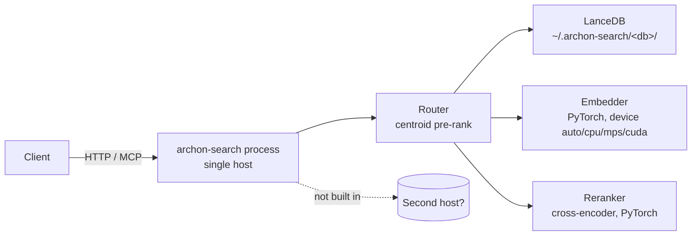

**Purpose**: State the performance targets `archon-search` does and does not promise, the scalability envelope of the single-process design, and the knobs and tools available when latency or throughput need attention.
**Audience**: Operators sizing a deployment, maintainers tuning the router, and reviewers evaluating a performance-sensitive change.
**Status**: Draft
**Last reviewed**: 2026-05-20
**Next review**: 2026-08-20

# Performance and Scalability

`archon-search` is a single-process local service. Performance is bounded by what one host can do; scalability beyond that host is **not built in**. This document pins down what the latency numbers in the repo actually mean, where the boundaries are, and which configuration values move the needle.

## Principles

1. **No production SLA.** The latency p50/p95 figures captured by the eval harness and the routing benchmark are **regression guards**, not service-level agreements. They exist so a refactor that doubles routing latency fails review — they are not a promise to callers.
2. **Single-process, single-host.** One `archon-search` process owns one LanceDB directory. There is no built-in horizontal scaling, no replication, no sharding across hosts.
3. **Local I/O is the scaling unit.** Throughput is driven by disk, CPU, and (when configured) GPU on the host running the daemon. Scaling up means picking a bigger host; scaling out is not a v1 affordance.
4. **Tune the router before you tune the model.** The cheapest latency wins come from `routing_shortlist_size` and `routing_confidence_threshold`. Model swaps are expensive and have to clear the eval harness.
5. **Measure with the committed tools, not with new ones.** `tests/benchmark_routing_latency.py` and the eval harness are the agreed measurement surfaces. New benchmarks need to live alongside them, not replace them.

## Performance targets

| Surface                              | Number                                                                                                                          | Source                                              | Status                              |
| ------------------------------------ | ------------------------------------------------------------------------------------------------------------------------------- | --------------------------------------------------- | ----------------------------------- |
| Eval-harness retrieval latency       | p50 / p95 captured per run                                                                                                      | `tests/eval/baselines/baseline.json`                | **Report-only** — latency ceilings are intentionally unset in `tests/eval/thresholds.toml` for v1 (see header note). |
| Routing latency over HTTP            | p50 ≤ 30 ms, p95 ≤ 150 ms over localhost, 100 iterations, `POST /route`                                                          | `tests/benchmark_routing_latency.py`                | **Regression guard** for the benchmark itself. Not a production SLA. |
| Real-model search steady-state p95   | Asserted ≤ `steady_state_p95_ms` in `live_thresholds.toml` (`[real_model_search]`)                                              | `tests/eval/live_benchmark/test_real_model_search_benchmark.py` | **Hard CI gate** — fails PR if regression detected. Uses the real PyTorch embedder and cross-encoder reranker on CPU. |
| Real-model cold-load p90             | Asserted ≤ `cold_load_p90_ms` in `live_thresholds.toml` (`[real_model_search]`)                                                 | `tests/eval/live_benchmark/test_real_model_search_benchmark.py` | **Hard CI gate** — measures model construction cost (N=10, p90). |
| Graph NER ingest throughput          | Median of `_THROUGHPUT_RUNS = 3` `ingest_directory` runs over `tests/eval/corpus/docs/` (`_BASELINE_CORPUS_FILE_COUNT = 17` files, pinned by count, byte total and content SHA-256 prefix so a mutated corpus invalidates the comparison loudly), asserted ≤ `THROUGHPUT_BASELINE_MS * REGRESSION_MULTIPLIER` = `1335.3 ms × 10.0` | `tests/test_graph_ner_real_artifact_lane.py::test_graph_ner_throughput_within_budget` | **Hard CI gate** in the `graph_real_artifact` lane (both workflows) — real GLiNER checkpoint, embedder and reranker backends stubbed. Carries no `xfail`: the comparison blocks. **CPU configuration only**; an accelerator via `[graph].device` is permitted but unmeasured. The baseline is a provisional dev-machine capture (macOS arm64, 2026-09-06), so the multiplier is deliberately wide: at 10.0 this catches catastrophic regressions — a lost batch, a per-chunk model reload, a serialized forward pass — and **not** a 2–3× slowdown. `measured_ms` is recorded into the step's `--junitxml` so the first green CI run yields the figure that replaces the constant. |
| Graph NER steady-state memory        | RSS growth after warm-up (`_WARMUP_CHUNKS = 16`) across ≥ `_MIN_CHUNKS = 1000` prose chunks in one process, asserted < `_RSS_GROWTH_BUDGET_MIB = 600` MiB; a `_RSS_CEILING_MIB = 6000` MiB host-safety abort and a `_RUN_BUDGET_S = 900` s wall-clock cap sit alongside it | `tests/test_graph_ner_real_artifact_lane.py::test_graph_ner_memory_budget` | **Non-blocking today** — the final numeric comparison carries `xfail(strict=False)` ("provisional spike-derived budget; replaced by the first green CI measurement"); the host-safety and wall-clock checks in the same function use `pytest.exit()` precisely so `xfail` cannot absorb them. A **growth** ceiling, not a no-trend assertion (CPython arena reclaim is non-deterministic), and it does **not** bound the transient peak inside a single sub-batch forward pass — that is bounded only by `GRAPH_NER_SUB_BATCH_SIZE`. **CPU configuration only.** The always-blocking non-vacuity half is a separate, unmarked test (`test_graph_ner_lane_non_vacuity`) so a vacuous extraction can never report as an expected failure. |

Eval-harness numbers are measured against **deterministic eval backends**; do not quote them to callers. Real-model benchmark numbers are measured on CI runners (ubuntu-latest) using actual PyTorch inference. They guard against regressions in the PyTorch embedder/reranker path that the deterministic harness cannot detect.

If the benchmark reports `p95 > 150 ms`, the recorded mitigation is the **co-located embedder** pattern: the host application embeds the query locally and posts the vector to `/route`, removing the embedding round-trip inside the server. The decision must be recorded in `Documentation/ADRs/` (see the printed message in `benchmark_routing_latency.py`).

## Scalability boundaries

What is *not* in the box:

- **No horizontal scale-out.** Two `archon-search` processes cannot share a LanceDB directory safely. There is no replication, no sharding, no leader election.
- **No external orchestration.** The supervisor is `launchd` or `systemd --user` (see `Architecture/160_operational_readiness_monitoring_and_reliability.md`). Restart-on-crash is the OS's job; that is the entire HA story.
- **No backpressure for ingestion.** Ingestion runs on the same process as serving; large reindexes will compete with query latency. Use `archon_search status` (`processed_files`, `eta_seconds`) to monitor. One exception: docling parsing (PDF and image OCR) is dispatched to a single-worker child process — that CPU and its memory sit outside the server process, though the awaiting ingest task still occupies a thread in it (`parser.py::parse` dispatches via `asyncio.to_thread`, which blocks in `DocumentParser._parse_with_docling`). That single worker is also a global serialization point: one `SearchPipeline` holds one `DocumentParser` holds one `max_workers=1` pool, so every concurrent ingest job, watcher sync, and bulk job funnels all PDF/image parsing through it one file at a time — `[jobs] max_concurrent_bulk > 1` does not buy parallelism for docling formats.

Scaling *up* a single deployment is supported by GPU detection at install time (`platform/runtime.py::SearchRuntime.detect_gpu_type` → `GpuType.CUDA` on Linux with `nvidia-smi`, `GpuType.METAL` on ARM macOS; `install/installer.py` then validates the accepted accelerator and writes `[database].device = "auto"` (cuda, then mps, then cpu at runtime) when it works, or `"cpu"` when it does not) and by the systemd unit's `CPUQuota=50%` / `Nice=10` defaults, which can be raised in `~/.config/systemd/user/archon-search.service` for dedicated hosts.

## Profiling and load tools

### `tests/benchmark_routing_latency.py` — `uv run pytest -m benchmark`

`POST /route` over 100 iterations with 3 warmups against `http://127.0.0.1:8765`, authenticated with the exported `ARCHON_SEARCH_API_KEY`; run with `-n 0` (see `200_testing_strategy.md`). Prints p50, p95, min and max. It needs at least one ingested collection to exercise embedding and ranking: with none, `/route` returns immediately and the figures only measure the HTTP layer.

- Auto-skips when `/health` does not answer — safe to leave in CI.
- Asserts that at least 90% of HTTP iterations returned 200; below that the benchmark fails rather than reporting bogus percentiles.
- When `p95 > 150 ms` it prints the co-located embedder recommendation. Recording the decision in an ADR is part of the mitigation, not optional.

### Eval harness latency capture

`tests/eval/` records p50 / p95 alongside quality metrics for every run. These are stored in `baselines/baseline.json` and currently *not* gated (latency ceilings unset). They are useful for trending across PRs even though they do not fail a build.

### Real-model latency gate (`live_benchmark` marker, C16)

`tests/eval/live_benchmark/` contains two **hard CI gates** that run the real PyTorch `BAAI/bge-small-en-v1.5` embedder and `Xenova/ms-marco-MiniLM-L-6-v2` cross-encoder reranker on CPU — the same models and code path used in production. Unlike the deterministic eval harness, these tests catch regressions in model loading and inference, `torch` / `transformers` upgrades, and reranker path changes.

**Two thresholds (both in `tests/eval/live_thresholds.toml` under `[real_model_search]`)**:
- `steady_state_p95_ms` — end-to-end p95 of 100 `pipeline.search()` calls after 5 warmups. Guards the hot-path: embedding → vector+FTS retrieval → RRF → rerank.
- `cold_load_p90_ms` — p90 of 10 fresh embedder+reranker constructions (model loading only). Guards against model-initialization regressions; N=10 uses p90 instead of p95 to avoid fitting to the single worst value.

**Calibration procedure**:
1. Trigger `workflow_dispatch` on `archon-search-pr.yml` (or a dedicated calibration PR) 10 times on ubuntu-latest. Record the printed p95/p90 from each run.
2. Compute `steady_state_p95_ms = median × 2` and `cold_load_p90_ms = median × 3`. The 2× / 3× multipliers absorb CI noise while still blocking large regressions.
3. Add a provenance comment (date, runner, 10 raw samples) above the values in `live_thresholds.toml`.

**Important**: calibration must be done on ubuntu-latest. Darwin/aarch64 (Apple Silicon) is typically faster than the CI runners; thresholds derived from it will be too tight for CI runners. The current placeholders in `live_thresholds.toml` include a provenance comment documenting the measurement source.

These thresholds are loaded by `load_benchmark_thresholds(path: Path) -> BenchmarkThresholds` from `archon_search/eval/runner.py`. Unlike `load_live_thresholds()`, this function raises `ValueError` if the `[real_model_search]` section is absent — the gate cannot operate in report-only mode; explicit thresholds are required.

The CI step (`archon-search-pr.yml`, `Run real-model latency benchmark`) runs with `timeout-minutes: 3`, uses `--no-cov` (coverage overhead biases latency), and is followed by a `Verify benchmark tests ran` step that fails if the model cache was missing and all tests were skipped.

### Embedder and reranker runtime (PyTorch)

`ModelEmbedder` and `ModelReranker` run on PyTorch; `[database].device` (`auto` | `cpu` | `mps` | `cuda`, default `auto`: cuda, then mps, then cpu) picks the device, and `[graph].device` (default `cpu`) does the same for the graph model. An accelerator the host lacks steps down to CPU with a warning. Two properties matter for performance:

- **Token-budget batching** (`archon_search/text_batching.py`). Texts (or query/document pairs) are sorted by token length and grouped so that `batch size × longest item` stays within `DEFAULT_TOKEN_BUDGET = 4096` padded tokens, with at most `DEFAULT_MAX_ITEMS = 256` items per batch; an item longer than the budget gets a batch of its own. Sorting keeps padding small, and the budget bounds accelerator memory. The module's comment records the measurement on multilingual-e5-large on the Apple GPU: 4096 tokens gave the best throughput at 3.2 GB of accelerator memory, while 65536 tokens was 32% slower and peaked at 7.7 GB.
- **No process-wide thread pin.** The graph engine no longer calls `torch.set_num_threads(1)`: the embedder, reranker and graph model share the process's intra-op thread pool, and the pin had made PyTorch CPU embedding about 3× slower (`tests/test_prose_extraction_backend.py` guards that loading the graph model leaves the thread count unchanged).

Measured evidence behind the runtime choice is in [ADR 18](../ADRs/18_pytorch_runtime_replaces_fastembed.md), measured on an Apple M4 Pro (ADR dated 2026-10-24), not on CI runners, and the ADR notes the machine was loaded: embedding throughput in passages per second (32 passages of 60–200 words; fastembed CPU / PyTorch CPU / PyTorch `mps`) was 52.8 / 133 / 329 for bge-small, 16.7 / 47.5 / 108 for bge-base and 7.7 / 13.0 / 27.5 for multilingual-e5-large; reranking 45 pairs with `ms-marco-MiniLM-L-6-v2` took 0.298 / 0.185 / 0.080 s. Peak resident size for e5-large on CPU was 2.19 GB against 1.88 GB for fastembed, and `import torch, transformers` takes about 1.8 s, which is why those imports stay lazy. CPU throughput on Linux x86_64 and Windows is checked by the manually triggered `archon-search-runtime-bench.yml` workflow (`scripts/bench_runtime.py`, fails when PyTorch falls below 0.9× fastembed on any profile model). Its x86_64 and Windows runs have not been made; the only Linux result is the arm64 one below.

### Linux arm64 CPU speed gate (2026-10-25)

Measured in the `linux/arm64` Docker VM on an Apple M4 Pro (14 vCPUs), torch 2.14.1+cpu, onnxruntime 1.31.0, fastembed 0.9.0, with `scripts/bench_runtime.py --runtime both` (every runtime timed once per round, order flipped each round, best of 10 rounds; host load average 17–19 throughout, so absolute numbers are low). Embedders are passages/s, rerankers pairs/s; the gate passes at ratio ≥ 0.9:

| Model | fastembed | PyTorch | Ratio | Gate |
|---|---:|---:|---:|---|
| bge-small-en-v1.5 | 81.94 | 63.08 | 0.77 | **fail** |
| bge-base-en-v1.5 | 25.68 | 22.77 | 0.89 | **fail** |
| bge-large-en-v1.5 | 5.53 | 5.76 | 1.04 | pass |
| paraphrase-multilingual-MiniLM-L12-v2 | 145.55 | 105.66 | 0.73 | **fail** |
| paraphrase-multilingual-mpnet-base-v2 | 14.42 | 17.67 | 1.23 | pass |
| multilingual-e5-large | 3.43 | 4.11 | 1.20 | pass |
| ms-marco-MiniLM-L-6-v2 | 86.08 | 111.81 | 1.30 | pass |
| ms-marco-MiniLM-L-12-v2 | 43.33 | 59.90 | 1.38 | pass |
| bge-reranker-base | 10.42 | 14.76 | 1.42 | pass |
| jina-reranker-v2-base-multilingual | 9.68 | 15.56 | 1.61 | pass |

7 of 10 pass; the three small embedders fail (0.77, 0.89, 0.73). An earlier non-interleaved run on the same VM gave bge-small 1.14 (pass), bge-base 0.81 and MiniLM-L12 0.66, so the small models sit around the 0.9 line and move with machine load. The likely cause is that fastembed's ONNX artifacts for these models hold float16 weights with ORT-fused `Attention`/`SkipLayerNormalization`/`FastGelu` nodes, which ORT runs as fp16 GEMM on arm64, while PyTorch runs the stock fp32 eager graph; this was not isolated by an experiment. The decision (ADR 18, dated verification note) is to keep PyTorch and judge the pass rule per platform; x86_64, Windows, NVIDIA CUDA and Intel Macs are unmeasured. The run's raw JSON is the `both.json` artifact format `scripts/bench_runtime.py compare` reads.

### Memory, threads and disk growth (measured 2026-10-25, Apple M4 Pro)

- **Startup peak.** Model validation probes the pipeline's own embedder and reranker (after warm-up) instead of loading throwaway copies. bge-large + bge-reranker-base: `mps` peak footprint 5721 MB → 3307 MB (GPU 4549 → 2377 MB), `cpu` peak RSS 3200 → 2469 MB; bge-small + MiniLM change little (1697 → 1673 MB `mps`, 503 → 496 MB `cpu`). The default embedder is also no longer loaded twice (the embedder cache is seeded with the pipeline's instance): live GPU tensors 342 → 214 MB on bge-small. A startup WARNING (`memory_budget.py`) fires when the estimate — weights × 1.5 + 1536 MB runtime baseline, for the pinned default embedder, other embedders up to `embedder_cache_size`, and the reranker — exceeds the cgroup limit or system RAM; it never refuses to start.
- **Embedder cache.** The pinned default embedder is never evicted and does not count towards `[database].embedder_cache_size`. Evicting a warm embedder now releases its memory (`release_model_memory`): with `embedder_cache_size=2` and four models, `mps` GPU memory stayed at 2289 MB before and returns to about 1057 MB (process total 3069 → 1765 MB).
- **LanceDB caches.** `lance_session.py` caps the metadata cache at 64 MiB and the index cache at 512 MiB (LanceDB defaults: 1 GiB and 6 GiB; one meta-table write added ~12 KiB to the cache, reproduced with plain LanceDB: +54 MB over 3000 writes). cpu, 40 ingest+delete cycles of 300 chunks: footprint 631 → 961 MB before the fix, 628 → 669 MB after (plateau by cycle ~10); `mps`: 1865 → 1938 MB, GPU flat at 1097 MB. 1000 searches: +32 MB in the first 200, about +12 MB over the next 800.
- **Table versions.** Every ingest batch and every collection-meta write commits a LanceDB table version. A meta write used to commit two (write plus a no-op legacy-orphan delete); it now commits one (files after 41 cycles: 16075 → 9679). `[maintenance].version_retention_hours` (default 24, ≥1) deletes superseded versions in each maintenance pass; it only runs when passes run (`interval_hours > 0` or `POST /maintenance/trigger`, default off). After 40 ingest+delete cycles (300 chunks each): no pruning 26,406 files / 91.7 MiB; a pass with 0 h retention 7 files / ~0 MiB; a pass with the default 24 h retention removes nothing yet, so growth plateaus only after 24 h.
- **Threads.** Python threads stay bounded (asyncio executor 18 = min(32, 14+4); 21 Python threads at 40 clients). OS threads scale with concurrent load because of the native pools (182 `lancedb-tokio-worker`, 13 `lance-cpu` and about 200 unnamed at the peak sample; the unnamed ones were not identified as torch/OpenMP teams): 72 idle, 82 at 1 client, 226 at 5, 504 at 20 (flat for 30+ s), 415 at 40, back to about 215 thirty seconds after the load stops (14-core host). The lance runtime has no knob in `lancedb`, so no default was changed.
- **Concurrency under load.** 20 clients for 120 s on `mps` (mixed search/create/ingest/delete/list/route, 1,300+ requests): no 5xx other than the by-design `503 store_busy` on delete while a job ran, no request over 30 s, shutdown afterwards 0.54 s. Search p50 2.6 s / p99 3.4 s, because the `mps` lock serialises GPU work.
- **The `mps` accelerator lock stays.** One search spends about 90% of its time reranking 45 chunks under the lock (655 of 709 ms at 1 client), and four or eight threads give no throughput over one (6.3 vs 6.2–6.7 rps in-process). Without the lock, 52 hangs and 33 SIGSEGVs occurred in 90 cold-start runs of the three failing model sets (0 failures in 140 with it). Narrowing it to loads plus each model's first forward had 0 failures in 280 runs but only re-divides a saturated GPU: search p50 during an ingest 5–8% lower, ingest 12% slower, throughput unchanged, measured at a load average of 12–14. What would lower latency is reranking fewer candidates or capping tokens per chunk, not a different lock; neither was changed.
- **Parse timing.** docling runs on the CPU on macOS: about 2.1 s per page and 3.8 s per MiB of scanned PDF measured, so a 100 MiB scan needs about 380 s, over a 300 s base bound — hence `[ingest].parse_timeout_seconds_per_mb` (default 10), which scales a positive `parse_timeout_seconds`. The default `parse_timeout_seconds = 0` sets no bound at all, so a slow conversion is never abandoned, but a wedged one holds the parse worker and (for REST ingest) its admission slot until restart. In the Docker image the docling layout and table models are prefetched at build time (`scripts/prefetch-parse-models.py`, `HF_HUB_CACHE=/opt/hf-cache`, +530 MB), so a scanned-PDF ingest under `--read-only` took 6 s instead of about 71 s and parsing needs no network.

### In-process stage-latency measurement (B1)

`archon_search/observability.py` provides `StageRecorder` / `record_stage()` / `bind_stage_recorder()`, a lightweight in-process surface for capturing per-stage wall times without external tooling.

Each handled request (REST `/search`, `/route`, `/explain`; MCP `search`, `search_with_context`, `explain`, `ingest_file`, `ingest_directory`) wraps its pipeline call with `bind_stage_recorder()`. Individual stages — `embed`, `route`, `vector`, `fts`, `fuse`, `rerank`, `context`, and ingest stages (`parse`, `persist`) — call `record_stage("<name>")`. At the end of the request the times are emitted in the structured log line as `stage_timings_ms`. HyDE (`hyde=true`) is not a retrieval stage: every call site resolves it under `paused_stage_recorder()`, which records nothing inside — not even the hypothesis `embed` — and subtracts its wall time from `total` (`StageRecorder.record_total`, which only subtracts the part of a pause inside its own window), so the LLM call never shows in `stage_timings_ms`. That paused time includes any cold-model build the hypothesis embed waits on (`search_with_context` / `explain` do not skip HyDE for a cold model), so a cold first request there can under-report `total`; the bounded `warmup_for_search` wait is never paused (on single-collection `POST /search` it stays in `total`). The `total` window differs by transport, and HyDE is outside it on every one: single-collection REST `POST /search` starts it after the meta lookup, so it covers the collection-embedder handoff, `warmup_for_search`, the paused HyDE span (subtracted) and `pipeline.search`; REST `POST /explain` and the MCP `explain` tool (single-collection and routed) start it before the meta lookup, so it also covers routing, with HyDE paused inside it; the MCP `search` and `search_with_context` tools time `pipeline.search` / `pipeline.search_with_context` only, having resolved the embedder, the warm-up and HyDE before the window opens. The REST `/search` and MCP `search` fan-outs record no stage timings; REST `/explain`'s fan-out times the whole branch, MCP `explain`'s fan-out records none.

For `POST /explain` and the `explain` MCP tool, `stage_timings_ms` is also returned in the response body when `[observability].stage_timings_enabled = true` (the default). Set `stage_timings_enabled = false` in `archon-search.toml` to suppress the field from responses.

**Important caveat**: the recorded durations are **blocked-coroutine wall time**, not pure CPU time. They include event-loop scheduling latency that accumulates when the event loop is busy. Use these numbers to identify which stage dominates end-to-end latency on a given query; do not use them as CPU profiles or compare them directly to benchmark figures measured under isolated conditions.

All stage-timing numbers are **report-only**. There are no latency ceilings enforced on individual stages in v1; they serve as observability breadcrumbs, not SLA gates.

## Multi-collection fan-out concurrency (B3)

`POST /search` / `POST /explain` (and their MCP equivalents) accept `collections: list[str]` to fan a single query out across several collections in one request (`SearchPipeline.search_many` for search; `SearchPipeline.explain(collections=...)` for explain — both share the `_fanout_merge_acl` helper). The end-to-end flow and error mapping are in [`120_services_and_integration_architecture.md`](120_services_and_integration_architecture.md) ("Multi-collection search fan-out"); the cost model is below.

What the fan-out buys:

- **Embed once.** One `embed_one(query)` is shared by all N legs — N collections cost one embedding, not N (the dominant win over assembling multi-collection queries client-side).
- **Parallel retrieval.** Per-collection hybrid retrieval runs concurrently inside an `asyncio.TaskGroup`, so leg latency overlaps rather than serializes.
- **Single rerank pass.** One cross-encoder pass scores the merged candidate pool, producing globally comparable scores (vs. per-collection reranking, which yields incomparable local rank spaces).

Known constraints (cost / recall):

- **The reranker serializes concurrent fan-out requests.** There is a single `Reranker` instance reranking on one thread (`asyncio.to_thread`). Retrieval legs parallelize, but the rerank pass does not — concurrent multi-collection requests queue at that one instance. B1 stage timings (`rerank`) make the cost measurable.
- **`fanout_leg_trim` is a hard recall ceiling.** Each leg is trimmed to its top `fanout_leg_trim` candidates (default 40) by RRF score *before* the merge and ACL pass; the reranker cannot recover anything dropped here. Trim-before-ACL means that if the top-N-by-RRF all fail ACL, lower-ranked ACL-passing candidates are unreachable — set `fanout_leg_trim` generously under fine-grained ACL policies.
- **Per-leg retrieval is ~3× single-collection cost.** Each leg retrieves `max(top_k_retrieve * 3, 20)` candidates (`candidate_depth`) — a wider net than the `top_k_retrieve` used by single-collection `search()` — to compensate for merge loss. This is 3× more retrieval work per leg.

Config knobs (all under `[search]` in `archon-search.toml`; parsed and validated in `config.py`, must be ≥ 1 / > 0):

| Knob | Type | Default | Effect |
|---|---|---|---|
| `max_fanout` | `int` | `8` | Maximum collections per fan-out request. Enforced at request time in the route handler body and MCP tool body by reading `config.max_fanout` directly; raising `max_fanout` in TOML takes effect immediately with no code change required. |
| `fanout_leg_trim` | `int` | `40` | Per-leg candidate cap fed into the merge + rerank pool — the hard recall ceiling above. |
| `fanout_timeout_seconds` | `float` | `30.0` | Whole-fan-out wall-clock budget (`asyncio.timeout`). Exceeding it → HTTP 504. |

## Routing knobs

All values live in `~/.archon-search/archon-search.toml` (see `archon-search.toml.example`). The router is `archon_search/router.py::MultiCollectionRouter`. `POST /route` builds a fresh `MultiCollectionRouter` per request (`routes_route._build_router`), so server-path routing never drifts on stale centroids — a regression test pins this lifecycle. `MultiCollectionRouter` also exposes `invalidate()` and an `initial_metadata` constructor param for future long-lived router consumers (A6, `CON-2`).

| Knob                            | Effect                                                                                                                                                       | When to tune                                                                                                |
| ------------------------------- | ------------------------------------------------------------------------------------------------------------------------------------------------------------ | ----------------------------------------------------------------------------------------------------------- |
| `routing_shortlist_size`        | How many collections survive centroid pre-ranking. Smaller → faster `/route` (fewer per-collection queries downstream); larger → higher recall when the router is unsure. | Raise when routing accuracy is low and the eval suite shows lost positives. Lower when `/route` latency dominates and the router is confident. |
| `routing_confidence_threshold`  | All-or-nothing gate on the top centroid similarity. If `max(similarity)` across scored collections is below the threshold, `MultiCollectionRouter.rank` returns an empty shortlist; otherwise the ranked list is truncated to `routing_shortlist_size` and individual sub-threshold collections are **not** pruned independently (see `archon_search/router.py::MultiCollectionRouter.rank`). | Raise to be stricter (router falls back to empty shortlist more often, forcing callers to handle "no confident route"). Lower to keep returning a shortlist even when the router is unsure. |

Before changing any of these in a release, re-run `uv run pytest -m eval --thresholds-path tests/eval/thresholds.toml tests/eval/test_eval_suite.py` to confirm `routing_accuracy` does not drop below the floor. Knob changes are eval-gated, not just benchmark-gated.

### FTS maintenance cost (C6)

As of C6, ingest and delete FTS maintenance is O(delta-size), not O(collection-size):

- **`ingest_file`** (add path): calls `store.optimize_fts(collection)` once at batch end. `optimize()` incorporates only the newly added/deleted rows into the FTS index. A 10-chunk update into a 50,000-chunk collection completes in milliseconds.
- **`delete_document`** (standalone delete): calls `optimize_fts` after the LanceDB `table.delete()` (after lock release). Callers that batch-delete before adding (e.g., `ingest_file` re-ingesting a changed document) pass `skip_fts_optimize=True` to suppress per-file FTS and issue a single batch-end optimize.
- **`ingest_directory`** and **sync watcher** (`sync.py`): call `optimize_fts` once per batch/cycle, not per file — N files → 1 optimize call.
- **`reindex_metadata`**: no FTS call at all (metadata-only columns; `text` is unchanged).
- **`rebuild_fts_index`**: retained for operator-initiated FTS repair, available via `archon-search collection reindex`. Not called from normal ingest paths.

The C6 ingest latency regression guard lives in `tests/eval/thresholds.toml` under `[ingest_latency]` (`single_file_p95_ms`). It is a **hard CI gate** — a regression above the threshold fails the eval run (see `tests/eval/test_eval_suite.py::test_ingest_latency_p95_single_file_on_large_corpus`).

**Trade-offs and limitations (C6)**:
- BM25 scores after N incremental `optimize()` calls may differ numerically from a freshly rebuilt index. Operators requiring strict score reproducibility should run `archon-search collection reindex` periodically.
- Concurrent `optimize()` on the same table raises a LanceDB commit conflict; callers must serialize per collection. The production code paths do not issue parallel optimize calls on the same collection.
- If `optimize_fts` fails, the ingest path falls back to `rebuild_fts_index` and logs a warning. If both fail, the ingest data is persisted but FTS may be inconsistent — repair via `archon-search collection reindex`.

### Centroid maintenance cost (B5)

As of B5, centroid maintenance cost is no longer O(chunks) on every ingest:

- **Ingest**: O(batch) — `(centroid_sum, chunk_count)` is updated incrementally from the newly ingested vectors only. The existing centroid sum is read once from `_archon_collection_meta`, the batch contribution is added, and the result is written back.
- **Delete**: O(chunks-in-document) — deleting a document subtracts only that document's chunk vectors from the running sum. No full collection scan is needed.
- **Full recompute** (`recompute_collection_meta`): O(chunks) — retained for explicit calls: `archon-search collection reindex <name>`, crash recovery (when `needs_recompute = True`), and periodic drift-reset checkpoints. This path is not triggered by normal ingest or delete.

As of D4, the incremental path is unconditional — `centroid_incremental_enabled` has been removed. The B5 incremental path is always used. See `archon_search/store.py` and `CON-4` in `530_technical_debt_refactoring_roadmap.md` for the full rationale.

### `compute_impact` BFS traversal cost (E2g)

`GraphStore.compute_impact` is a depth-capped BFS over `_archon_graph_{ns}__{col}_edges`. Cost model:

- **Per-hop fan-out**: each BFS frontier expansion reads `get_neighbours(collection, frontier_ids, ns)` and `get_edges_for_nodes(collection, frontier_ids, ns)` — two LanceDB scans per hop.
- **Hard cap**: `MAX_IMPACT_DEPTH = 5` limits traversal to at most 5 hops regardless of the requested `depth`; `MAX_IMPACT_GROUP_SIZE = 50` caps the live frontier at each hop, so fan-out from a hub symbol never causes an unbounded scan.
- **Result-set cap**: each `ImpactGroup` (direct + indirect) is capped at `MAX_IMPACT_GROUP_SIZE` entries total; excess entries are reported via `omitted_count` (never silently dropped).
- **PageRank ordering**: results are sorted by persisted `pagerank_score` (nulls-last). No re-computation happens at query time — scores are pre-persisted by `PageRankBuilder`.

No per-query `compute_impact` latency ceiling is enforced in v1; the BFS traversal cost is proportional to the graph size and depth cap, bounded by `MAX_IMPACT_DEPTH=5` and `MAX_IMPACT_GROUP_SIZE=50`.

### Code-lane eval gate (E2g)

The code-lane eval gate (`tests/eval/test_e2e_graph_eval_gate_v2.py`) adds two new fixture collections measured independently:

- `code_chunking_recall_at_5` — Recall@5 on the chunk-boundary-sensitive corpus (`code-chunking/`). **Report-only, no gated floor** — see `tests/eval/README.md` for the rationale (the gated vs. no-feature comparison is apples-to-oranges at the aggregate level; non-vacuity is proved by `test_codeChunkingRecall_nonVacuous` comparing both arms at the same `chunk_size=65`).
- `code_defref_recall_at_5` — Recall@5 on the connection-sensitive corpus (`code-defref/`). **Gated floor: 1.0** (strict above the measured no-feature baseline of 0.6667) — a regression that disables `DefRefExtractor` wiring reproduces the 0.6667 baseline and fails the gate.

Latency p50/p95 for both code-lane collections are captured in `baselines/baseline.json` alongside the existing retrieval latency fields. No ceiling is enforced in v1.

## Sizing a model prompt to the window

Every prompt sent to a model is sized ahead of the call (S9, S11); nothing is checked after it. The client's `input_budget(template, think)` (`think` defaults to `ThinkSetting.DEFAULT`) is the window minus the 1024-token answer reserve (`ANSWER_RESERVE_TOKENS`) minus the template's own count: exact for `llama_cpp` (the server's chat template, rendered with the thinking switch the calls send, and `/tokenize`), the token estimate plus a 20% margin for `ollama` (the estimate is `TokenCounter.count`: gpt2 tokens, with a charge of one token per ASCII digit plus one per digit run, four per character outside the Basic Multilingual Plane, three per lone surrogate (gpt2 refuses to encode one) and 13 per `<|endoftext|>` literal, a literal re-formed by removing another included, the one text gpt2 reads as a single special token that Llama and Qwen vocabularies split), and unbounded for `anthropic`, `openai` and `claude_cli`, whose prompts therefore go whole (no setting, no trimming). A window with no room for template and reserve gives a budget of 0. What differs per feature is the variable part that is cut to the budget:

| Feature | Fixed part (the template) | Variable part, and how it is cut | Window with no room |
|---|---|---|---|
| HyDE | `HYDE_PROMPT_TEMPLATE` with an empty query | the user's query: the head that fits, cut before a space or, without spaces, on a character-cluster boundary (`llm_client.fit`); the search keeps the original query | HyDE is skipped for that call (`hyde_applied: false`), one WARNING per process names the window |
| RAG Fusion | `RAG_FUSION_PROMPT_TEMPLATE` for the configured `num_queries` | the same | single-query search (`rag_fusion_applied: false`), one WARNING per process names the window |
| Graph community summaries | `SUMMARIZE_PROMPT_TEMPLATE`; the budget also gives up any `extraction_token_budget` above 1024 | the entity names first, in group order (all of them when they fit the budget, which leaves the passages what is left, possibly nothing; else the longest prefix that fits, held to `NAMES_CUT_SHARE_PERCENT` (half) of the budget when passages follow, so they keep the rest, and to the whole budget when there is no passage or when the first name alone is larger than that share: a community the splitter could not cut can have hundreds. The names are first cut to `MAX_CHARS_PER_TOKEN` (16) characters per token of the room, as `fit_text_to_budget` cuts a head, so no count is of a text far longer than the room and one `/tokenize` request is never made for a 100,000-name community; the cut list is counted once and a prefix bisection then takes at most `ceil(log2(names))` more counts, again for the share when passages follow; one WARNING per process names the cut), then as many representative passages as fit in what is left, in MMR order (`CommunityBuilder._fit_to_budget`) | the community is built without a summary when not even its first entity name fits, one WARNING per process |
| Collection descriptions | the description template with the retry reminder (its longest form) | evenly spaced chunk excerpts: the sample shrinks until it fits (`DescriptionGenerator._fit`, which logs one INFO line with `N of M` excerpts and the room when the budget cut it) beside the thinking headroom (`min(3072, budget // 2)` unless `think` is false; the whole budget when no excerpt fits beside it) | the generation fails (`callFailed`) and names the window |

**What the assumed 4096 window leaves on `ollama`** (measured 2026-11-01 with the pinned gpt2 tokenizer on chunks of 512 gpt2 tokens: the first 512 tokens of this repository's own prose and code, a random 6-column digit table, a URL list and an emoji text). The budgets in estimate tokens are 2528 (HyDE), 2493 (RAG Fusion with 3 variants), 2474 (graph summaries) and 2445 (descriptions). HyDE keeps the head of a long query that fits: about 7,900 characters of prose, 7,000 of code, 4,000 of URLs, 4,400 of emoji text and 2,800 of a digit table, and any query is accepted (the first word of a query needs a window of 1064 tokens for HyDE and 1106 for RAG Fusion). A graph community with 10 entity names keeps all 3 passages of prose, code, URLs or emoji and 2 of the digit table. A description sends 2 excerpts of prose or code and 1 of digit-heavy, URL or emoji text beside the thinking headroom (with `think = false`: 4 of prose or code, 2 of the digit table, 3 of URLs or emoji text; before the digit and emoji surcharges the same window sent 2 of each, or 4 with `think = false`): the real tokenizers cost up to 1.68 times the plain gpt2 count on digits, so the charge is a deliberate loss of sample, not a defect, and the INFO line of the generator is the only trace of it. A 2048 window leaves 738 estimate tokens for a description: one prose, code or URL chunk without the headroom, and no digit-heavy or emoji chunk of 512 gpt2 tokens (`callFailed` naming the window; a smaller chunk of the same collection is not tried, because the sample is the deterministic evenly spaced pick and a window that cannot hold it is reported, not worked around). Set `ollama_context_tokens` to 8192 or more for descriptions.

**Cost of the query step.** A cloud provider pays nothing: no count, no extra request. The fixed template is counted once per client (`TemplateCostCache`, kept until the server may have changed or the cache is full): for `ollama` one token-estimate count in a worker thread (the tokenizer is fetched once; see the air-gapped note in the wizard manual), for `llama_cpp` two requests to the local server (`/apply-template`, then `/tokenize`), together bounded by one 10-second deadline (`SIZING_DEADLINE_SECONDS`; a failed or timed-out sizing is not remembered, so every search against a wedged server pays up to that long again, inside the search budget; a failure names its request, `POST /apply-template: HTTP 404: File Not Found`, and so does the deadline, which names the request it was waiting on: `POST /tokenize: sizing the template took longer than 10s`), kept per template and thinking setting, after which a search reads the cached count: no request and, for `ollama`, no thread hop (the cache sits in front of the thread). The cache is for one event loop (no lock), keeps at most 64 templates and drops the oldest one when a new template arrives at the cap, so only the dropped template is counted again; two first requests of one template that arrive together each count it. What is cached is the template's token count, not a budget, so the budget is recomputed from the window of the moment and a window resolved after start-up (BE-10) is never served a budget made under the assumed 4096; a successful `/props` probe also empties the `llama_cpp` cache (the server that answers may be another model), and a count that was in flight when the probe cleared it is not stored. That probe runs once, at boot, so a llama-server restarted with another model keeps the old template count until this process restarts. A query is not counted at all when its request-free ceiling is within the budget (`TokenBoundingClient.token_ceiling`; `TokenBoundingClient` extends `TokenCountingClient`, which has only `count_tokens`; the fit step asks for `TokenBoundingClient`, the community builder and the description generator, which count every time, for `TokenCountingClient`): a token covers at least one byte of the UTF-8 text, so a byte-level or byte-fallback tokenizer cannot produce more tokens than the text has bytes. The ceiling is the byte length plus a client surcharge: `llama_cpp` adds 1 (a SentencePiece vocabulary may spend a token on its dummy prefix; `/tokenize` adds no BOS because `add_special` defaults to false), `ollama` adds one per digit run (its estimate charges each run its digits plus a placeholder). The caveat is any tokenizer that adds tokens per request, such as a BOS the server is told to insert, or spends more than one token per input byte; no byte-level or byte-fallback vocabulary known to the authors does either (not measured on every family), and the ceiling is a property of the client, so such a client states its own. Only a query that fails the fast path (`len(query) <= budget and token_ceiling(query) <= budget`, in `llm_client.fit.fit_query_to_window`) goes through the counting loop: one whose UTF-8 length plus the surcharge exceeds the budget, so a query shorter than the budget in bytes still counts when the surcharge tips it over (`llama_cpp` with a budget equal to the byte length, `ollama` with digit runs), and its head is counted with `/tokenize` alone for `llama_cpp` (the framed count is the template's only). Further counts of the query come only when it has to be cut, for both providers: one or two for a text whose cost grows steadily with its length, at most 10 in all (`MAX_FIT_COUNTS`). The step runs before the provider call, outside the feature's `timeout_seconds`; the search budget that already caps HyDE (S582) bounds it (RAG Fusion has no cap of its own: it runs inside the route's search budget, whose expiry is a `504`), and a count already running in an `ollama` worker thread finishes unused if that cap fires. The head considered is never longer than 16 characters per budget token (`MAX_CHARS_PER_TOKEN`), so a query of many megabytes (the request-size limit `[server].max_request_body_mb`, 32 MiB by default, is the only other bound on it: `BodySizeLimitMiddleware` refuses a larger request body with 413, pinned by `tests/server/test_request_hardening.py` and, for a `/search` query, by `tests/integration/test_lcd_gap2_query_sizing_e2e.py`) is cut without being counted whole. A failed count (server down, tokenizer not fetchable) is an ordinary provider failure of that feature: one WARNING per process and the plain-query fallback.

## CLI startup latency

**Goal (feature 190):** lightweight commands (`config show`, `config get`, `status`, `stop`, `key list`) start without loading the ML/agent stack.

**Import-boundary design:** Three module-level imports were moved into the function bodies that actually use them, using the repo's established `# noqa: PLC0415` lazy-import convention:

| File | Import deferred | Benefit |
|---|---|---|
| `cli/serve.py` | `from archon_search.server.app import run_server` → inside `serve()` | `torch`/`transformers` no longer load at CLI group-build time (the embedder, reranker and model-validation modules defer their PyTorch imports into the model loaders) |
| `cli/collection.py` | `from archon_search.pipeline import create_pipeline` → inside `list_cmd._run()` and `info._run()` | pipeline not constructed for lightweight commands |
| `pipeline.py` | `from archon_search.description_lifecycle import GenerationKind` → inside `finalize_collection_change()`, only when a description lifecycle was injected | the shared `llm_client` package is not loaded by pipeline importers that never generate (the server's pipeline gets one only while `[description]` is enabled (`create_app` builds it, BE-25); the CLI, eval and installer pipelines never get one); the Claude SDK that this row once deferred is no longer used by the module |

**Remaining floor (after feature 190):** Lightweight store-free commands approach the Python interpreter + Click startup floor (~0.23 s median on a warm machine). Commands that open LanceDB (`collection list`, `collection info`) faced an additional ~900 ms first-import floor from `lancedb` plus the GPT-2 tokenizer cost (~1 s) — both were accepted floors not yet addressed by feature 190.

**Feature 210 (`_make_store` for `collection list`/`info`):** `list_cmd` and `info` now open `SearchStore(cfg.db_path)` directly via a `_make_store()` helper instead of calling `create_pipeline()`. This eliminates the GPT-2 tokenizer cost (~1 s) from these commands. The remaining floor is the `lancedb` first-import (~900 ms), which is irreducible without a precompiled binary and is documented in release notes. The import is at module level in `collection.py` (not lazy); lancedb opens the connection only on `store.connect()`. See brief [2026-07-15-210-cli-store-commands-slow-brief.md](../../Documentation/Completed/2026-07-15-210-cli-store-commands-slow-brief.md) and debt entry CLI-1 (resolved) in [530_technical_debt_refactoring_roadmap.md](./530_technical_debt_refactoring_roadmap.md).

**Import-boundary regression guard (`tests/test_cli_startup_latency.py`):** Spawns a fresh Python subprocess running `archon-search config show` and asserts that `claude_agent_sdk`, `torch`, `transformers` and every `archon_search.llm_client` module (the shared LLM client package is imported by the callers that call a model, not by a command that never does) are absent from `sys.modules`, as are the `anthropic`, `openai` and `ollama` SDKs; a second subprocess imports every `archon_search.llm_client` module and the composition root (`server/llm_composition.py`) and asserts that no SDK is loaded either, since the wrappers import theirs on the first call. This is the only reliable automated proof — in-process CliRunner shares `sys.modules` with the test runner and cannot prove absence (see plan Q4). The test is in the default CI suite (not smoke) and is serialised via `xdist_group("startup_latency")`. A positive-control assertion (`archon_search.cli.main` and `archon_search.cli.serve` present in `sys.modules`) prevents vacuous passes if the subprocess output is malformed. If either absence assertion fails, the import was promoted back to module scope in one of the three edited files.

**Note on `mcp`:** `mcp` is NOT guarded by the regression test. It enters only via `server/mcp.py` (a lazy FastMCP mount at serve time) and was never present in `sys.modules` for lightweight commands before or after feature 190.

## See also

- `Architecture/100_system_architecture_overview.md` — the pipeline these knobs affect.
- `Architecture/140_error_handling_strategy.md` — how degraded performance is surfaced as `error_count` and `eta_seconds`.
- `Architecture/160_operational_readiness_monitoring_and_reliability.md` — observability surface used to monitor latency in production.
- `Architecture/510_release_and_environment_strategy.md` — how performance regressions interact with the release process.
- `tests/eval/README.md` — eval harness maintenance, including the latency-caveat section.
