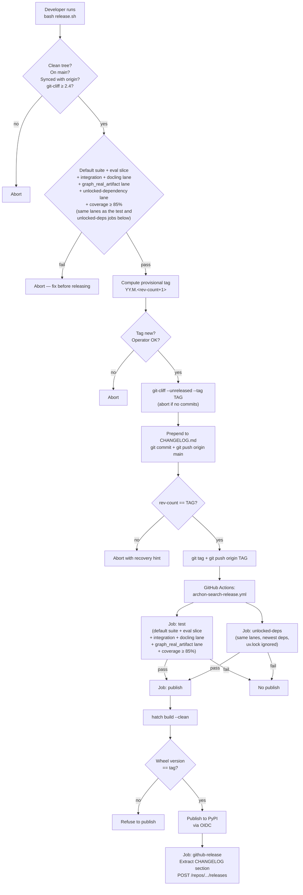

**Purpose**: Describe how `archon-search` is versioned, released, and deployed — including CI workflows, the runtime environment layout, and the compatibility contract.
**Audience**: Maintainers cutting releases, operators deploying the server, and contributors changing build / CI / packaging behaviour.
**Status**: Draft
**Last reviewed**: 2026-10-09
**Next review**: 2027-01-09

# Release and Environment Strategy

`archon-search` is a single-process, locally-installed server distributed as a PyPI wheel. Releases are manual, tag-driven, and time-versioned. There is exactly one runtime environment — the developer's or operator's machine — and all state lives under `~/.archon-search/`.

## Principles

1. **CalVer encodes time, not compatibility.** Version segments tell you *when* a release was cut; `BREAKING.md` tells you whether it breaks you.
2. **Tags drive releases.** Plain pushes to `main` never publish. A release is a tag push, and the tag push is what runs the publish workflow.
3. **No hardcoded versions.** The wheel's version is derived from `git describe` via `hatch-vcs`. There is no `__version__ = "..."` literal anywhere in the package.
4. **One runtime, one state directory.** Everything the server needs — config, key, vector index, FTS index, telemetry logs — lives under `~/.archon-search/`. There is no "staging" vs. "prod" layout.
5. **OIDC, not stored secrets.** PyPI publishing uses GitHub's OIDC integration with PyPI's trusted publisher. There are no long-lived API tokens stored in CI.

## Versioning

### CalVer formula

```
YY.M.<commit-count>
```

- `YY` — two-digit UTC year (e.g. `26` for 2026).
- `M` — UTC month with no leading zero (e.g. `5`, not `05`).
- `<commit-count>` — `git rev-list --count HEAD`, the total number of commits in the history at tag time.

`release.sh` computes this tag and pushes it; `hatch-vcs` reads it back from the checkout at build time.

### Why `no-guess-dev` + `no-local-version`

From `pyproject.toml`:

```toml
[tool.hatch.version]
source = "vcs"
raw-options.version_scheme = "no-guess-dev"
raw-options.local_scheme = "no-local-version"
raw-options.fallback_version = "0.0.0+local"
```

- `no-guess-dev`: between tags, the version becomes `<tag>.post{N}` (commit distance) rather than the default "guess the next version" behaviour. This produces deterministic, PyPI-compatible strings.
- `no-local-version`: drops the `+gXXXXX` local-version identifier. PyPI rejects local version identifiers on upload, so this strip is necessary for publish to succeed.
- `fallback_version`: used only when there is no git history (e.g. building from an exported tarball with no `.git`). It will never appear on a real release.

### No hardcoded versions

The package reads its own version at runtime via `importlib.metadata.version("archon-search")` (see `archon_search/server/app.py` and `archon_search/cli/main.py`). If installation metadata is missing, both call sites fall back to a sentinel (`"dev"` or `"0.0.0+source"`) — never a literal release number. Do not introduce a `__version__` constant.

## Release Flow

Releases are cut from `main` using `release.sh`. The script is the only sanctioned way to start a release.

```bash
bash release.sh           # interactive: prints the computed tag, asks to confirm
bash release.sh -y        # non-interactive: tag + push without prompting
bash release.sh --dry-run # show what would happen; do not tag or push
```

### What `release.sh` does

1. **Pre-flight**: refuses to run unless the working tree is clean, the current branch is `main`, `HEAD` matches `origin/main`, and `git-cliff >= 2.4` is available in `PATH`. Then runs every lane `archon-search-release.yml` gates publish on — the `test` job's default suite, eval slice, integration suite, docling parser lane (with its non-vacuity check) and graph_real_artifact lane (prefetch + lane + non-vacuity check), plus the `unlocked-deps` job's lane (`bash scripts/test-unlocked-deps.sh`, see [Locked vs unlocked dependencies](#locked-vs-unlocked-dependencies)) — then enforces `coverage >= 85%` over the `test`-job lanes the same way. A lane broken on `main` fails here, before the tag is created, instead of only after it is pushed. Skippable only via `RELEASE_SH_TEST_MODE` (the script's own self-test harness).
2. **Compute the provisional tag**: `YY.M.<git rev-list --count HEAD + 1>` — the `+1` accounts for the CHANGELOG.md commit added in the next step.
3. **Confirm the tag is new**: rejects if the tag already exists locally or on the origin remote.
4. **Confirm with the operator** (unless `-y` / `--yes`). In `--dry-run` mode, prints the provisional tag, the git-cliff notes, and the GitHub Releases API payload — then exits without writing anything.
5. **Invoke git-cliff** (`--unreleased --tag $TAG`) to generate the changelog section for this release. Aborts if no conventional commits are found.
6. **Prepend to `CHANGELOG.md`**: inserts the generated section after the `# Changelog` header, commits as `chore(release): update CHANGELOG.md for $TAG`, and pushes the commit to `origin/main`.
7. **Verify commit count**: asserts that `git rev-list --count HEAD` now equals the provisional tag's commit segment. Fails with a recovery hint if the counts diverge (e.g. after a partial run).
8. **`git tag $TAG` + `git push origin $TAG`**.

Once the tag lands on the origin remote, `archon-search-release.yml` takes over.

### What the release workflow does

`.github/workflows/archon-search-release.yml` is the only workflow that publishes. It is triggered by `push: tags: "*"` and by `workflow_dispatch:` (the dispatch trigger has no `inputs:` block; the "Resolve tag name" step nonetheless requires a tag context and errors out if none can be resolved). It runs five jobs:

1. **`test`**: clean install via `uv sync --dev`, default test suite with coverage, eval slice with thresholds, integration suite, then the `docling` lane (real PDF/image OCR via RapidOCR, with a non-vacuity check against the JUnit output), then the `graph_real_artifact` lane (prefetches the real GLiNER checkpoint and fails on a vacuous extraction — GRAPH-4), then `coverage report --fail-under=85`. The `graph_real_artifact` lane has no `actions/cache` step here on purpose: GitHub scopes caches by ref, so a tag run could never restore the PR gate's cache — every release pays a cold ~1.2 GB fetch.
2. **`unlocked-deps`** (in parallel with `test`): calls `archon-search-unlocked-deps.yml`, which installs the tagged source with the newest dependency versions its published metadata allows — `uv.lock` ignored — and runs the same lanes as `test` against them. See [Locked vs unlocked dependencies](#locked-vs-unlocked-dependencies).
3. **`publish`** (`needs: [test, unlocked-deps]`):
   - Resolves the tag name from `GITHUB_REF` (or `git describe --exact-match` for `workflow_dispatch`).
   - Builds wheel and sdist with `hatch build --clean`.
   - **Verifies wheel version matches the pushed tag**. The wheel filename is parsed and compared to the tag; if they drift, the job fails before uploading anything.
   - Publishes to PyPI via `pypa/gh-action-pypi-publish` (pinned to the commit of v1.14.2) using OIDC. No stored secrets.
4. **`docker`** (`needs: [test, unlocked-deps]`, tag pushes only): builds and pushes the CPU and GPU images to GHCR from the tagged tree. The Dockerfile's `pip install .` resolves the newest dependency versions too, which is why the image waits for `unlocked-deps`.
5. **`github-release`** (runs after `publish`, tag pushes only):
   - Checks out the repository at the tag (the `CHANGELOG.md` prepend commit is already on `main` and included).
   - Extracts the first changelog section from `CHANGELOG.md` using `awk` (content between the first and second `## ` headings).
   - Creates a GitHub Release via the GitHub REST API (`POST /repos/{owner}/{repo}/releases`), setting the release name and body to the extracted changelog section. Idempotent: a `422 already_exists` response is treated as success.

### Flow diagram



### What does NOT trigger a release

- Plain pushes to `main` — handled by `archon-search-pr.yml` for PRs only.
- Branch pushes other than tag refs.
- Re-pushing a tag that already exists on `origin` — git rejects the push outright. (Note: manually re-invoking the workflow via `workflow_dispatch` against an existing tag *does* re-run the workflow; it will fail at the PyPI upload step because the version already exists, but the workflow itself executes.)

## CI Workflows

Seven workflows live under `.github/workflows/`. Each has a single, narrow purpose.

| Workflow file                  | Trigger                              | Purpose                                                                                                                                                                                                |
| ------------------------------ | ------------------------------------ | ------------------------------------------------------------------------------------------------------------------------------------------------------------------------------------------------------ |
| `archon-search-pr.yml`         | `pull_request`, `workflow_dispatch`  | PR gate. Installs with `uv sync --dev`, runs the default test suite with coverage append, then the eval slice with thresholds, then the integration suite (`-m integration` on a disk-backed `/var/tmp` basetemp because GHA `/tmp` is tmpfs), then the `docling`, `live_benchmark` and `graph_real_artifact` real-model lanes, then enforces `coverage report --fail-under=85`. All `--cov` pytest steps use `--cov-append` against a single `.coverage` file; there is no `coverage combine` step. |
| `archon-search-release.yml`    | `push: tags: "*"`, `workflow_dispatch` | Manual release. Job `test` re-runs the default suite + eval slice + integration suite (same disk-backed-basetemp pattern as the PR gate) plus the `docling` and `graph_real_artifact` lanes (GRAPH-4), and enforces the coverage floor; job `unlocked-deps` runs `archon-search-unlocked-deps.yml` in parallel; `publish` (after both) builds the wheel, verifies the wheel version matches the pushed tag, and publishes to PyPI via OIDC; `docker` (after both) pushes the GHCR images; `github-release` extracts the first section from `CHANGELOG.md` and creates a GitHub Release via the REST API. |
| `archon-search-unlocked-deps.yml` | `workflow_call` (release), `schedule` (daily 04:17 UTC), `pull_request` touching `pyproject.toml` / `uv.lock` / the lane's own files, `workflow_dispatch` | Transitive-drift guard. Installs with the newest dependency versions the published metadata allows (`uv.lock` ignored) and runs the full default suite plus the `docling` and `graph_real_artifact` lanes. Gates the release; see [Locked vs unlocked dependencies](#locked-vs-unlocked-dependencies). |
| `archon-search-eval-live.yml`  | `push: tags: "*"`, `workflow_dispatch` | Live model eval. Runs `pytest -m live_eval tests/eval/live/` with real PyTorch embedder + cross-encoder weights, prefetched (`python -m tests._live_model_cache`) at their pinned revisions into `<data-dir>/models` (default `~/.archon-search/models`) and cached across runs. Runs **concurrently** with `archon-search-release.yml` on tag push — it does not block the release. The test step uses `continue-on-error: true` and always uploads the `live-eval-report` artifact. In v1 the `live_thresholds.toml` is a comment-only stub, so this workflow is **report-only** (no gates fire) until the baseline is calibrated and thresholds are added. |
| `archon-search-runtime-parity.yml` | `schedule` (daily 03:41 UTC), `workflow_dispatch` | Real-weights parity lane of ADR 18. Runs `pytest -m runtime_parity tests/runtime_parity/` on a runner's CPU against the frozen reference outputs in `tests/fixtures/runtime_parity/`, downloading every profile model (~5 GB) into a fresh `ARCHON_RUNTIME_PARITY_DATA_DIR` on each run — which is why it is not a PR gate. |
| `archon-search-runtime-bench.yml` | `workflow_dispatch` | CPU throughput gate of ADR 18 (`scripts/bench_runtime.py`). Per OS (`ubuntu-latest`, `windows-latest`) it measures the ten profile models through the PyTorch runtime and through fastembed 0.9.0 (installed ad hoc with `uv run --with`, the only place fastembed still runs) and fails when any model's torch throughput is below 0.9x fastembed's. |
| `backfill-release-notes.yml`   | `workflow_dispatch`                  | Maintenance. Regenerates every GitHub Release body from `git-cliff` ranges between consecutive tags. |

**Every `uses:` line in `.github/workflows/` is pinned to a full commit SHA** with a trailing `# <tag>` comment (for example `astral-sh/setup-uv@c771a70e… # v9.0.0`, `actions/checkout@3d3c42e5… # v7.0.1`; the pypi-publish SHA is the dereferenced annotated tag); `tests/test_workflow_action_pinning_lint.py` fails on an unpinned ref. The PR gate's first step after install is `uvx ruff@0.17.2 check .` (zero findings; the rule set is pinned in `pyproject.toml`). The bench workflow now runs one interleaved `--runtime both` step and uploads `both.json`. Every workflow that installs Python pins 3.12 and uses `astral-sh/setup-uv` (v9.0.0) to install `uv`. The release workflow additionally installs `hatch` out-of-band via `uv tool install hatch` for the build step — `hatch` is not a declared project dependency (only `hatchling` and `hatch-vcs` appear in `[build-system].requires`). The `github-release` job uses `curl` and `jq` (both available on the GitHub-hosted runner) to call the GitHub REST API; no additional action is needed. `git-cliff >= 2.4` is a **local** prerequisite for the developer running `release.sh`, which generates the `CHANGELOG.md` commit and pushes it to `main` before the tag push triggers the workflow; CI downloads its own `git-cliff` only to backfill older release notes (`github-release` job, `backfill-release-notes.yml`).

## Locked vs unlocked dependencies

`uv.lock` pins every transitive dependency, and every test job installs it (`uv sync --dev`). End users never see it: `pip install archon-search`, `uv tool install archon-search` and the Dockerfile's `pip install .` resolve the newest versions the wheel's metadata allows at install time. A transitive release can therefore break users while CI stays green — S671 shipped that way (the lock pinned `huggingface_hub` 1.26.0 while user installs resolved 1.33 and every multilingual `max`-profile ingest failed). The unlocked-dependency lane closes that gap.

**What it installs** (`scripts/test-unlocked-deps.sh install`): a fresh Python 3.14 venv, then `uv pip install --no-config --no-sources --resolution highest . --group dev`. The flags reproduce the published metadata and nothing else. The resolver is uv's; `pip install archon-search` and the Dockerfile's `pip install .` pick the same newest compatible versions unless a resolution has to backtrack, where pip and uv can settle differently.

- `--no-config` drops `[tool.uv] constraint-dependencies`. It is uv project configuration, not wheel metadata, so no end-user install applies it. On 2026-10-09 this alone moved `transformers` from 5.13.1 (constrained) to 5.16.1: `gliner` 0.2.29 no longer caps it below 5.14, so the constraint only binds `uv sync`.
- `--no-sources` drops `[tool.uv.sources]` (the PyTorch CPU-index pin) for the same reason. On every Linux architecture (x86_64 and arm64) the script adds `--torch-backend cpu` instead, and `[tool.uv.sources]` pins the PyTorch CPU index for `sys_platform == 'linux'`, not just x86_64. That selects the `+cpu` torch build the Docker image installs (S269). PyPI's Linux torch 2.14.1 pulls 15 `nvidia-*`/`cuda-*`/`triton` packages a CPU runner cannot use (it resolved `+cpu` and the CUDA stack disappeared from `uv.lock` when the pin was widened to arm64). Every other platform keeps PyPI torch, exactly as `[tool.uv.sources]` scopes it. That is a deliberate departure from the published metadata. A plain `pip install archon-search` or `uv tool install archon-search` on Linux resolves PyPI's CUDA torch, which the lane does not exercise. See `../UserManual/10_installation.md` → *Linux: install the CPU-only PyTorch build* for the CPU-only commands users run instead.
- `--group dev` supplies pytest and the other test dependencies; its `archon-search[...]` self-reference pulls every extra and resolves to the local checkout, not to PyPI — the step fails if the installed `archon-search` did not come from the checkout.

The step then prints every installed distribution whose version `uv.lock` does not pin (92 of 208 on 2026-10-09, among them `onnxruntime` 1.30.0 → 1.31.0, `lancedb` 0.36.0 → 0.40.0, `openai` 2.52.0 → 3.26.1 and `anthropic` 0.120.2 → 1.12.1), so a red run names its suspects up front.

**What it runs**: the full default suite (`pyproject.toml` `addopts`: unit + integration + eval with thresholds, the 85% coverage floor, a disk-backed basetemp), then the `docling` lane and the `graph_real_artifact` lane with the same non-vacuity checks as the release workflow. The default suite stubs the embedder and reranker backends (`tests/conftest.py::_stub_model_backends`; tests marked `real_torch_backends` opt out), so the lane exercises the newest `torch`, `transformers` and `huggingface_hub` only through those opt-out tests. Each lane also fails if it changed the venv it tests: a test that runs a real package install re-resolves the environment from the repo root — with the `[tool.uv]` constraints — and would swap the versions under test. Five tests did exactly that until the lane first ran.

**Triggers and failure policy** (`.github/workflows/archon-search-unlocked-deps.yml`):

- **Release gate.** The release workflow's `unlocked-deps` job calls it, and both `publish` and `docker` need it. Drift does not wait for a commit here, so a scheduled run alone cannot stop a release that users would install broken; gating the publish can. `release.sh` runs the same script (lane 6) so a red lane fails before the tag exists. There is deliberately no bypass, hotfixes included: a red lane means users installing that release hit the failure the day it ships, and the remedy — a bound in `[project] dependencies` — ships in the same release. First use: the `rapidocr>=3.9.1,<3.10` cap (2026-10-09), after rapidocr 3.10.0 broke docling's RapidOCR stage for every fresh install ([docling#4702](https://github.com/docling-project/docling/issues/4702)).
- **Daily schedule.** Upstream releases land without any commit here; the nightly run surfaces them between releases. GitHub sends the failure notification to the user who last modified the workflow's cron line, and in a public repository disables scheduled workflows after 60 days without repository activity ([GitHub docs](https://docs.github.com/en/actions/reference/workflows-and-actions/events-that-trigger-workflows)).
- **Pull requests touching `pyproject.toml`, `uv.lock`, the script or the workflow**, so a bound change is proven against the newest versions before merge. Not every PR: the PR gate already runs the locked suite, and the nightly run reaches every other change within a day.
- **`workflow_dispatch`**, to re-check by hand after a fix.

**Fixing a red lane**: the fix must reach end users, so it belongs in `[project] dependencies` (a bound or a raised floor) or in the code — never only in `[tool.uv] constraint-dependencies` or `uv.lock`, which no end-user install reads.

**Not covered**: the lane runs on `ubuntu-latest` with Python 3.14 only, the platform and version every workflow and the Dockerfile pin; users on macOS, Windows, linux/arm64 or Python ≥ 3.15 can resolve different wheels. It resolves the all-extras + dev-group superset, so an install with fewer extras can land on different versions — on 2026-10-09 the base dependencies alone (no extras, linux/x86_64) resolved `transformers` 5.19.0, the lane 5.16.1 (`gliner`, in the `graph` extra, caps it below 5.17). The GPU image's CUDA torch and the container entrypoint's runtime `pip install .[extras]` are not exercised either. Run it locally with `bash scripts/test-unlocked-deps.sh` (set `ARCHON_SEARCH_DATA_DIR` for the graph lane's checkpoint; see the script header).

## Environment

There is one runtime environment: the operator's machine. The server is single-process and owns all of its on-disk state.

### State directory layout

All persistent state lives under `~/.archon-search/`:

- `archon-search.toml` — user configuration (see `archon-search.toml.example`).
- `.search.env` — the API key, mode `600`. Auto-generated by `key_manager.py` on first start if absent.
- LanceDB tables (vector + FTS) under the configured `db_path`.
- `search-logs/` — JSONL telemetry, only when `[telemetry].enabled = true`.

### Environment variable overrides

- `ARCHON_SEARCH_API_KEY` — overrides the on-disk key entirely. When set, no key file is read or generated.
- `ARCHON_SEARCH_KEY_FILE` — redirects the key file location away from the default `~/.archon-search/.search.env`.

See `150_security_and_privacy_architecture.md` for the full auth model, including how the bearer token is bootstrapped and rotated.

### Configuration

`config.py` loads `<data-dir>/archon-search.toml` (default `~/.archon-search/archon-search.toml`; `ARCHON_SEARCH_CONFIG` overrides) and validates it against the `SearchConfig` schema. A starter file ships as `archon-search.toml.example` at the repository root. Selected fields:

- `[database].top_k_retrieve`, `[database].top_k_return` — pipeline shortlist and final cut-off.
- `[server].host`, `[server].port` — defaults bind to `127.0.0.1`.
- `[telemetry].enabled` — opt-in, default off. `[telemetry].export_enabled = true` is coerced to `false` at config load with a warning in v1 (reserved for a future release).
- `[jobs].max_concurrent_bulk` (D1/D2) — maximum concurrent export/import jobs; default 1.
- `[jobs].checkpoint_interval` (D1/D2) — documents between progress checkpoints; default 100.

**Queued D1/D2 BREAKING.md entries for the next release:**
- `JobResponse` now includes optional `progress: dict | null` (default `null` for all existing job types).
- `JobStatus` now includes `QUEUED` as a valid value. Clients that exhaustively switch on status must add a `QUEUED` case.
- Two new MCP tools added: `export_collection`, `import_collection` (tool count 11 → 13; additive).

## Compatibility Contract

`BREAKING.md` IS the compatibility contract. CalVer segments encode time only; they do not signal whether a release breaks consumers.

The rule, restated from `BREAKING.md`:

> Every release that removes or changes an existing API contract MUST add an entry here describing: what changed, the migration path, and from which release the deprecated form was announced. Consumers should subscribe to changes in this file, not interpret CalVer segments.

The codebase does not carry backward-compatibility shims. When a contract changes, the old form is removed in the same release that documents the change.

## Related Documents

- Day-to-day development workflow and PR expectations: `500_development_workflows_and_conventions.md`
- API surface and contract discipline: `520_api_design_and_contracts.md`
- Endpoint reference: `600_api_reference_or_public_interface.md`
- Test layout, eval harness, and the coverage floor: `200_testing_strategy.md`
- Auth model, key bootstrap, and telemetry privacy: `150_security_and_privacy_architecture.md`
- Compatibility log: `../../BREAKING.md`
