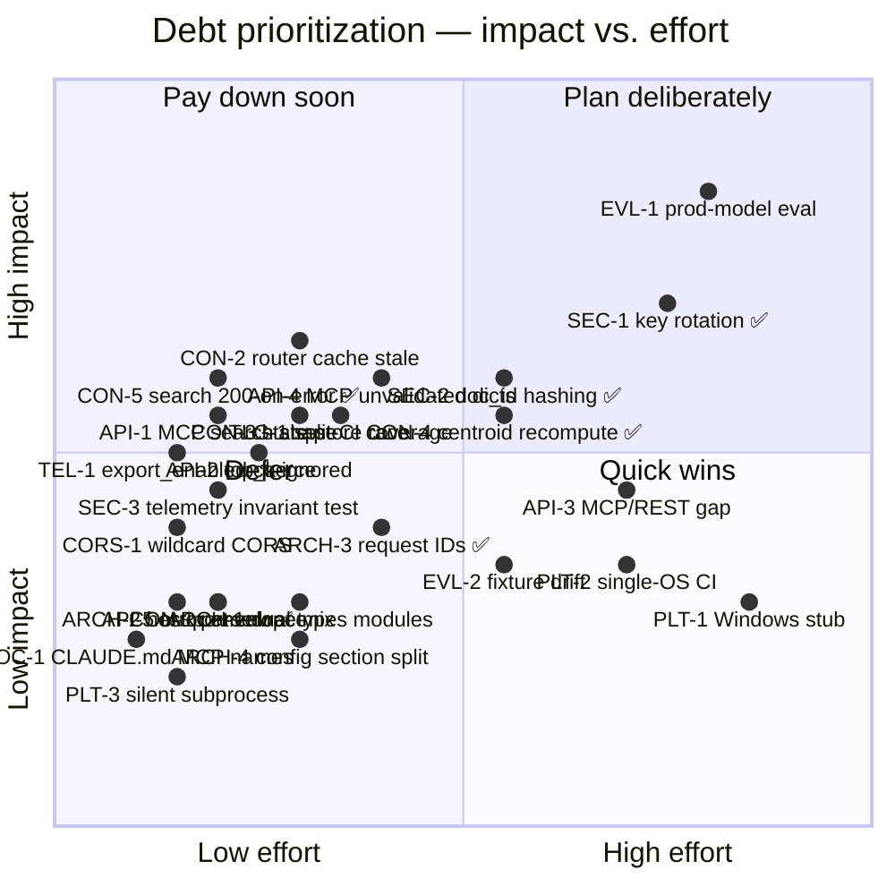

**Purpose**: Catalog known technical debt in `archon-search`, with severity, triggers, and refactor candidates, so maintainers can decide what to pay down and when.
**Audience**: Maintainers and backend engineers.
**Status**: Accepted
**Last reviewed**: 2026-10-20 / **Next review**: 2027-04-12

# Technical Debt and Refactoring Roadmap

This document is the canonical register of accepted compromises in `archon-search`. It complements the per-release [`BREAKING.md`](../../BREAKING.md) (which records contract changes that already shipped or are queued) by tracking debt that has **not yet been scheduled**.

For architectural context, see [`100_system_architecture_overview.md`](./100_system_architecture_overview.md). For the security and privacy invariants debt is measured against, see [`150_security_and_privacy_architecture.md`](./150_security_and_privacy_architecture.md). For the release flow that ships paydowns, see [`510_release_and_environment_strategy.md`](./510_release_and_environment_strategy.md).

## Principles

1. **Debt is a forecast, not a moral failing.** Every entry below was a deliberate trade-off at the time. The register exists to surface *triggers* — the conditions under which a trade-off stops paying.
2. **Every entry has a trigger and a reference.** If an item cannot point to a file path, a `BREAKING.md` entry, or a documented invariant, it does not belong here. Ungrounded debt is rumor.
3. **The eval harness is the regression gate.** Debt that bypasses [`tests/eval/`](../../tests/eval/README.md) — for example, a refactor without a metric to defend it — is high-risk by default. See [`200_testing_strategy.md`](./200_testing_strategy.md).
4. **Bias toward shipping over polishing absent measurable user pain.** A debt item without a trigger event (user report, eval regression, security finding) stays Low severity.
5. **Out-of-scope items are recorded, not hidden.** Deliberate non-goals (single-process server, no horizontal scale) live in [Out of scope](#out-of-scope) so they are not re-litigated as debt.

## Debt register

### API contract drift

| ID | Item | Category | Severity | Trigger | Refs |
| --- | --- | --- | --- | --- | --- |
| API-1 | MCP `search` tool response shape change (bare list → `{results, acl_filtered}`) is announced but not yet released. Consumers may still depend on the old shape. | API contract | Med | Tag pushed before consumers migrate. | [`BREAKING.md`](../../BREAKING.md) "[next release] — MCP `search` tool response shape"; `archon_search/server/mcp.py` |
| API-2 | REST `/search` `top_k` field still accepted by the Pydantic schema but ignored at the route. The schema documents a parameter that has no effect. | API contract | Med | Confused user report or external integration relying on per-request `top_k`. | [`BREAKING.md`](../../BREAKING.md) "[next release] — REST `/search` per-request `top_k` no longer honored"; `archon_search/server/routes_search.py`, `schemas.py` |
| API-3 | MCP-mirrors-REST aspiration is partial. MCP exposes the tools listed in [`05_mcp_integration.md`](../DeveloperGuide/05_mcp_integration.md#principles) (including D7's `create_key`, `list_keys`, `revoke_key`, `rotate_key`); REST also surfaces `state`, `status`, `route`, `jobs` (list + resume), `telemetry`, and collection `reindex`/`add`/`remove`. The `GET /jobs` list and `POST /jobs/{id}/resume` endpoints have no MCP mirror yet. The naming gap compounds the drift. **D9 (shipped)** mounted the MCP HTTP app at `/mcp` on the REST port — the transport is now reachable on the shipped server and namespace-correct, but the tool-set asymmetry above is unchanged. See `Documentation/Completed/mcp-wiring-team-plan.md`. | API contract | Low | New REST endpoint added; downstream MCP client requests parity. | `archon_search/server/mcp.py`, `archon_search/server/app.py`, [`520_api_design_and_contracts.md`](./520_api_design_and_contracts.md) |
| ~~API-4~~ | ~~MCP tools return raw `dataclasses.asdict(...)` payloads without a Pydantic response model.~~ **Resolved in C7.** The 11 search, ingest, collection, and document MCP tools now validate return values through explicit Pydantic schemas (`archon_search/server/mcp_schemas.py`, or `ExplainResponse` in `routes_explain.py` for `explain`; `extra='forbid'`). Schema drift surfaces as `{"error": "...", "code": "schema_validation_error"}`. See `BREAKING.md` C7 entries and `mcp_schemas.py`. | API contract | ~~Med~~ Resolved | — | `archon_search/server/mcp_schemas.py`, `archon_search/server/mcp.py` |
| API-5 | REST error responses are inconsistent: most failures raise `HTTPException` (FastAPI-serialized `{"detail": ...}`), but `routes_search.py` and `routes_collections.py` mix in hand-built `JSONResponse({"detail": ...}, status_code=...)`. Same shape today by convention, but the two paths can diverge silently. (A3 removed the mix from the pipeline-failure and timeout paths; the meta-lookup 503 and 404 paths at `routes_search.py:484-494` still use `JSONResponse`.) | API contract / Reliability | Low | Error envelope is extended (e.g., add `code` field) in one path and not the other. | `archon_search/server/routes_search.py:417-424, 484-494`, `routes_collections.py`, `routes_jobs.py`; [`140_error_handling_strategy.md`](./140_error_handling_strategy.md) |
| ~~API-6~~ | ~~**The shared lock-timeout `503` says "reindex in progress" on routes and waits that have nothing to do with a reindex.** `acquire_collection_lock_or_503` answers every caller's lock timeout with the one body `{"detail": "reindex in progress; retry after Retry-After seconds", "code": "store_busy"}` (`archon_search/server/_ingest_lock.py:62`), and since the `DELETE /collections/{name}` "any job may still write the collection" entry in `BREAKING.md` (NR-34) it has six callers — `POST /ingest`, `DELETE /collections/{name}`, `POST /collections/{name}/reindex`, `POST /collections/{name}/reindex-metadata`, `POST /graph/{collection}/rebuild-communities` (the last three through `server/_collection_job.py:128`) plus `POST /collections/`, which replaces the body — while the lock holder may be any write (an ingest, a DELETE, another job's creation). Clients branch on `code`, so nothing breaks, but the `detail` misleads operators. Rewording it is a wire change (BREAKING.md + every quoting doc and guard test).~~ **Resolved 2026-10-22**: the detail names no operation, since the lock holder may be any write. `acquire_collection_lock_or_503` (`archon_search/server/_ingest_lock.py`) now answers its timeout with the constant `STORE_BUSY_DETAIL` = `"collection is busy with another write; retry after Retry-After seconds"` through `store_busy_503`; `code` `store_busy`, status `503` and `Retry-After` (`INGEST_LOCK_TIMEOUT_S`, read live) are unchanged, and the `POST /collections/` body stays its own. The OpenAPI `503` descriptions that said "reindex in progress" are fixed too (`POST /ingest`: `STORE_BUSY_503_DESCRIPTION`, `routes_jobs.py` `_INGEST_ERRORS`; `POST /collections/`: `routes_collections.py` `_ERROR_400_401_409_503`) and both OpenAPI snapshots regenerated. Verified caller set: `POST /ingest` (`routes_jobs.py`), `DELETE /collections/{name}` and `POST /collections/` (`routes_collections.py`), and `create_collection_job` (`_collection_job.py`) for `POST /collections/{name}/reindex`, `/reindex-metadata` and `POST /graph/{collection}/rebuild-communities`; `routes_sync.py` and MCP do not use it. Wire change recorded in `BREAKING.md` (2026-10-22 entry, MigrationGuide NR-35); every doc quoting the old body migrated; guarded by `tests/test_routes_ingest_503.py::test_lock_timeout_detail_names_no_reindex` and the DELETE / reindex / reindex-metadata / rebuild-communities / ingest 503 tests. | API contract | ~~Low~~ **Resolved** | A user or operator acts on the "reindex" wording (e.g. looks for a reindex job that does not exist), or the body is normalised with `POST /collections/`'s (A5c "normalisation deferred"). | `archon_search/server/_ingest_lock.py:44-62`; [`150_security_and_privacy_architecture.md`](./150_security_and_privacy_architecture.md) → "Ingest concurrency" |

### Privacy and security

| ID | Item | Category | Severity | Trigger | Refs |
| --- | --- | --- | --- | --- | --- |
| ~~SEC-1~~ | ~~Auth middleware supports a single default key plus an optional `namespaces` map of static keys. There is no rotation, expiry, or revocation primitive — restart with a new key file is the only path.~~ **Resolved by D7**: `KeyStore` in `key_manager.py` adds durable multi-key store with `create`, `revoke`, `list_keys`, `active_keys`, `record_rotation` (driven by `rotate_and_persist_default_key`). `POST /keys/rotate`, `DELETE /keys/{id}`, `archon-search key rotate/revoke` provide live rotation and revocation without server restart. | Security | ~~Med~~ **Resolved** | — | `archon_search/key_manager.py`, `archon_search/server/routes_keys.py`, `archon_search/cli/key_cmd.py`; [`150_security_and_privacy_architecture.md`](./150_security_and_privacy_architecture.md) |
| ~~SEC-2~~ | ~~Telemetry `doc_id` is path-derived. With telemetry enabled, the JSONL log under `~/.archon-search/search-logs/` reveals filesystem paths. Documented as accepted risk; a hashed-doc-id mode is planned.~~ **Resolved by D8**: `[telemetry] hash_doc_ids = true` enables HMAC-SHA256 hashing of `result_doc_ids` before JSONL write. Salt stored at `get_data_dir()/.telemetry-salt` (mode 0600). `doc_ids_hashed: bool` field in every entry. `GET /status` exposes `telemetry.hash_doc_ids_enabled`. See `archon_search/telemetry/hasher.py`, ADR-05 Amendment. | Security | ~~Med~~ **Resolved** | — | `archon_search/telemetry/hasher.py`, `archon_search/telemetry/entry.py`, `archon_search/server/routes_status.py`; ADR [`05_opt_in_local_telemetry_no_raw_query.md`](../ADRs/05_opt_in_local_telemetry_no_raw_query.md) |
| SEC-3 | Telemetry retains the structural no-raw-query invariant; enforcement is backed by a dedicated structural test (`tests/telemetry/test_entry_factories.py::test_factory_signatures_reject_raw_query_argument`) that introspects every `TelemetryEntry` factory and forbids `{"query", "query_text", "body", "request"}` kwargs. The residual debt is that the invariant lives outside the type system — a maintainer who bypasses the factories (e.g., constructs `TelemetryEntry` directly with a renamed field) would not be caught. | Security | Low | New telemetry field requested for debugging that does not go through the factories. | `archon_search/telemetry/entry.py`; `tests/telemetry/test_entry_factories.py`; [`CLAUDE.md`](../../CLAUDE.md) "Structural invariant" |
| ~~CORS-1~~ | **Resolved 2026-10-25 (security batch):** no CORS middleware is mounted by default; `[server].cors_origins` takes explicit `scheme://host[:port]` origins (`*` is a `ConfigError`, no credentials, fixed methods and headers), and the body-limit `413` carries the CORS headers for a listed origin. Historical finding: FastAPI `CORSMiddleware` was mounted with `allow_origins=["*"]`, `allow_methods=["*"]`, `allow_headers=["*"]` and no config knob. Because the middleware short-circuits OPTIONS preflight **before** `APIKeyMiddleware` runs, CORS is the only layer governing whether arbitrary remote origins can attempt cross-origin requests on a non-loopback bind. Acceptable while the server binds to `127.0.0.1` only; becomes a CSRF/exfiltration surface as soon as the bind moves off loopback without a reverse proxy that overrides CORS headers. | Security | Low | Bind address moves off `127.0.0.1` without a hardening reverse proxy. | `archon_search/server/app.py:1002`; [`Documentation/SecurityGuide/05_network_exposure_and_tls.md`](../SecurityGuide/05_network_exposure_and_tls.md); [`150_security_and_privacy_architecture.md`](./150_security_and_privacy_architecture.md) |
| ~~SEC-4~~ | ~~`pipeline.py`'s parse-failure handler does `IngestResult(..., error=str(e), code="parse_error")` where `e` is a caught `ParseError` — a wire-facing `detail`/`error` field built from `str(exc)` on a caught exception whose message can embed internals, in violation of the root `CLAUDE.md` invariant ("Never put `str(exc)` in a wire-facing `detail` or job `error` field..."). The sanitized `code="parse_error"` field already exists alongside it, so callers have a stable machine-readable signal; `error` is the free-text field that leaks. `IngestResult.error` is MCP-visible via `IngestResultSchema.from_result` (`server/mcp_schemas.py`). Found during the 2026-08-19 OCR-memory-fix cycle-1 review (C1-B-3); deliberately **not fixed** in that cycle — `IngestResult.error` is an observable wire field, so sanitizing it needs its own brief plus a `BREAKING.md` entry, not a drive-by change. The fix's own new `BrokenProcessPool` failure text was kept off this leak at the source instead (`parser.py::PARSE_WORKER_LOST_DETAIL`), so this row is scoped to the pre-existing general case.~~ **Resolved 2026-10-20**: the handler logs the `ParseError` with its traceback and returns `error=PARSE_FAILED_TEMPLATE.format(path=path, reason=e.detail)` (`Failed to parse <absolute path>: <detail>`) with `code=PARSE_ERROR_CODE`. `ParseError.detail` (`parser.py`) is wire-safe text — `PARSE_FAILED_DETAIL` unless the raise site curated its own (`PARSE_WORKER_LOST_DETAIL`, `MARKITDOWN_MISSING_DETAIL`) — and `str(e)` stays in the log. `tests/test_no_wire_str_exc.py` now scans `pipeline.py` and `parser.py` (`_GUARDED_FILES`). See `BREAKING.md` "[next release] — collection-sync errors, ingest parse errors, model-validation `provider_warnings` and def/ref ingest warnings report fixed text, not exception text (2026-10-20)". | Reliability / Security | ~~Low~~ **Resolved** | — | `archon_search/pipeline.py` (parse-failure branch); `archon_search/parser.py` (`ParseError.detail`, `PARSE_FAILED_DETAIL`); `archon_search/server/mcp_schemas.py` (`IngestResultSchema.from_result`); `tests/server/test_no_internal_error_leak_mcp.py` |
| ~~SEC-5~~ | ~~Three job runners still write `str(exc)` into the wire-facing job `error` (served by `GET /jobs/{id}`), in violation of the root `CLAUDE.md` invariant: `_migration_task` and `_reindex_metadata_task` (`routes_collections.py`, any `Exception`), and `_community_rebuild_task`'s `ValueError`/`ImportError`/`RuntimeError` branch (`routes_graph.py`; its other exceptions already get the fixed `COMMUNITY_REBUILD_FAILED_DETAIL`). The first two also guard their `FAILED` write with only `(KeyError, OSError)`, so another persist failure (e.g. a serialization `TypeError`) escapes the task. Found during the 2026-10-20 job-store persist-failure review; deliberately **not fixed** there — the `error` text is observable, so sanitizing it needs its own fixed `*_DETAIL` constants and a `BREAKING.md` entry.~~ **Resolved 2026-10-21** (integration of the sanitized-wire-text and job-store persist-failure fixes): `_migration_task` writes `MIGRATION_FAILED_DETAIL` (only `NoPendingRewriteMigrationError` keeps its curated message), `_reindex_metadata_task` writes `METADATA_REINDEX_FAILED_DETAIL`, and `_community_rebuild_task` writes `COMMUNITY_REBUILD_FAILED_DETAIL` (only `NoGraphNodesError` keeps its curated message; `CommunityDependencyError` records `COMMUNITY_DEPENDENCY_DETAIL`), each exception logged; all three `FAILED` writes go through `routes_jobs._persist_job_status`, which logs any persist failure with its traceback and never raises. | Reliability / Security | ~~Low~~ **Resolved** | An operator reports a migration, metadata-reindex or rebuild `error` containing an internal path or library detail. | `archon_search/server/routes_collections.py` (`_migration_task`, `_reindex_metadata_task`); `archon_search/server/routes_graph.py` (`_community_rebuild_task`); [`CLAUDE.md`](../../CLAUDE.md) "wire-facing detail" invariant |

### Telemetry / config contract

| ID | Item | Category | Severity | Trigger | Refs |
| --- | --- | --- | --- | --- | --- |
| TEL-1 | `[telemetry].export_enabled = true` is **silently coerced to `false` with a warning**, not rejected at config load. Code and [`CLAUDE.md`](../../CLAUDE.md) agree on the silent-coerce behavior; the residual debt is that this is a warn-and-continue path rather than a hard config-load failure, and downstream docs/ADRs that describe "external transmission" semantics need to be checked against the actual no-op v1 implementation. #Unverified — ADR-05 wording was not re-opened during this audit. | Reliability / Docs | Med | User reports unexpected silent demotion, or contract is cited in an audit. | `archon_search/config.py` lines 775–783; [`CLAUDE.md`](../../CLAUDE.md) "Telemetry"; [`150_security_and_privacy_architecture.md`](./150_security_and_privacy_architecture.md) |

### Platform

| ID | Item | Category | Severity | Trigger | Refs |
| --- | --- | --- | --- | --- | --- |
| PLT-1 | Windows service lifecycle is a stub. Every method on `WindowsSearchService` (`start`, `stop`, `restart`, `register`, `unregister`) raises `NotImplementedError`; only `status()` returns a `not running` shape. CLI `install`/`start`/`stop` on Windows surface the `NotImplementedError`. | Architecture | Low | First Windows user request, or a CI runner added for `win32`. | `archon_search/platform/windows.py`; `archon_search/platform/service.py` |
| PLT-2 | CI runs only on `ubuntu-latest`. macOS branches are exercised via `patch("sys.platform", "darwin")` mocks; the Windows branch is the explicit stub (PLT-1) and has no native test. The launchd/systemd integration paths are never exercised against the real OS in CI. | Testing / Reliability | Low | Native-OS regression that mocks miss (e.g., a `launchctl` flag change). | `.github/workflows/`, `archon_search/platform/{macos,linux,windows}.py`, `tests/test_service_*.py` |
| PLT-3 | `install_cmd.py` invokes `launchctl`/`systemctl` with `subprocess.run(..., check=False, capture_output=True)` and discards the result. If the helper is missing or fails, the uninstall path silently no-ops with no warning logged. | Reliability | Low | User reports an install/uninstall that "did nothing" and there is no log to triage. | `archon_search/cli/install_cmd.py` (uninstall path) |
| PLT-4 | The fasttext degrade-to-English-only path flips `is_multilingual = False` but leaves `prof` holding the multilingual profile it was resolved from. On the **reinstall** branch only, `persist_reinstall_config` → `_write_profile_config` then writes multilingual model names alongside `multilingual = false`. The fresh branch is unaffected — it re-derives via `_profile_toml(profile_name, is_multilingual, features)` and never reads `prof`. **The obvious fix is wrong and was tried and reverted:** re-resolving `prof` to the English profile makes `_check_reinstall_guard` compare an existing multilingual index against a now-English embedder, raise `NeedsForceDeleteError`, and abort the install — destroying the S11 guarantee that this path degrades rather than aborts. A correct fix has to decide what an existing multilingual index degrades to, which is an index-migration decision, not a wizard-copy one. | Reliability | Medium | A user reinstalls a multilingual install whose `lid.176.ftz` download fails, and gets a config whose embedder and `multilingual` flag disagree. | `archon_search/install/installer.py` (fasttext degrade block, `persist_reinstall_config`); `archon_search/install/prewarm.py::_check_reinstall_guard`; `Documentation/Backlog/2026-08-19-035-multilingual-graph-ner-tasks.md` BE-13 / T-4 |

### Concurrency and runtime state

| ID | Item | Category | Severity | Trigger | Refs |
| --- | --- | --- | --- | --- | --- |
| CON-1 | `archon_search/parser.py:_docling_pool` lazy-creates `self._pool` with an acknowledged check-then-set race (in-code comment, paraphrased at the time this row was written: "NOT THREAD SAFE … the RAG pipeline is sequential, so this is an accepted limitation"). The risk is dormant only as long as ingest stays single-threaded. **Restated** by the 2026-08-19 OCR-memory fix: what the race can duplicate is now the single-worker `ProcessPoolExecutor`, not the in-process `DocumentConverter` it replaced — a duplicate costs a second worker process rather than a second docling model stack inside the server process. **Update 2026-08-19 (cycle-1 review):** the "sequential pipeline" premise was found to be false — `Documentation/Backlog/2026-08-19-060-ingest-job-level-lock-dropped-brief.md` item 3 documents that concurrent ingest jobs call `parser.parse()` from multiple `asyncio.to_thread` workers today, because job-scope exclusivity is released before dispatch (`server/routes_jobs.py`). The quoted in-code comment above no longer exists verbatim; `_docling_pool` now guards the check-then-set with a double-checked `threading.Lock` (`self._pool_lock`), and `_parse_with_docling`'s `BrokenProcessPool` handler compares pool identity before clearing `self._pool` so it cannot orphan a replacement another thread already installed. This row's race is resolved; see `archon_search/parser.py::_docling_pool` for the current comment. | Reliability | Low | Parallel ingest path added (e.g., `asyncio.gather` over images). | `archon_search/parser.py` `_docling_pool` |
| CON-6 | `DocumentParser.parse` dispatches every handler through `asyncio.to_thread`, so a docling parse now blocks a thread of the event loop's **shared default** `ThreadPoolExecutor` for its queue wait *plus* its parse, behind a `max_workers=1` pool. Before the 2026-08-19 OCR-memory fix, N concurrent parses did N concurrent conversions; now they serialize, so thread occupancy is N x per-file parse time rather than 1x — on the same pool (`min(32, cpu_count+4)`) every other `asyncio.to_thread` caller draws from, including the search path. Found in the cycle-2 review (C2-B-6) and deliberately **not fixed**: the remedy restructures `parse()`'s dispatch to special-case two of five formats, and exposure is bounded today (~18 threads here, `[jobs].max_concurrent_bulk` defaults to 1). Distinct from the declined `.result()`-timeout question — this is about *where the wait is parked*, not how long it may last. | Performance | Low | Ingest concurrency raised (`[jobs].max_concurrent_bulk > 1`), or a corpus of large scanned PDFs stalling unrelated request handling. | Candidate remedy: `await asyncio.wrap_future(pool.submit(...))` from `parse()` for the docling formats, or give `DocumentParser` its own small `ThreadPoolExecutor`. `archon_search/parser.py` `parse` / `_parse_with_docling` |
| ~~CON-7~~ | ~~**A sync bypasses `DELETE /collections/{name}`'s job guard in both directions.** A `SyncJob` names no collection (`collection` is always `""`), so it is in `NEVER_BLOCKING_JOB_KINDS` (`archon_search/jobs/store.py:115-121`) and `JobStore.find_active_collection_job` never returns it. Yet a `RUNNING` sync writes every collection of the list it started with through `pipeline.ingest_directory` (`archon_search/sync.py:621`, under the sync's own lock `sync.py:567`, with `lock_for` held per store write only), and `ensure_collection` re-creates a missing table (`store.py:624-640`) — so a `DELETE` that drops a collection mid-sync can see it re-created. Conversely the sync's own drop of a collection gone from the config (`sync.py:174`, `store.drop_collection`) consults no job, so it can drop a collection a reindex, import or migration is still writing. Pre-existing; out of scope of the NR-34 `DELETE` job guard (`BREAKING.md`), which covers collection-scoped jobs only.~~ **Resolved 2026-10-22**: `SearchCollectionSync.sync()` now guards both directions (`BREAKING.md` NR-39). **`DELETE` vs a sync**: each collection's write — `_ingest_collection` (Step 6 new, Step 6.5 resume) and `_apply_collection_changes` (Step 7) — runs through `_write_collection` (`archon_search/sync.py`), which registers in `SearchStore.collection_writer(name)` (the CON-12 registry, no third mechanism) for that one write, then checks the path against the live config (resolved paths compared) and skips a collection whose path is gone, so `DELETE` answers `503` `store_busy` (`COLLECTION_WRITER_IN_PROGRESS_DETAIL`, reworded to name "a collection sync") for the collection being written and `DELETE` of any other collection is unaffected; a collection `DELETE` removed before the sync reached it is not re-created, reported in no result list and kept out of the manifest. `create_app` wires the one `SearchCollectionSync` both entry points share (the lifespan's `_run_startup_sync` and `POST /sync`; `archon-search sync` is `POST /sync`; the watcher callback keeps its own CON-12 registration and config check, which `sync()` does not nest) with `job_store` and a `configured_paths` reader over `config.pinned_collections` + `config.collections`, read per call because `DELETE` replaces those lists. A collection whose lock is not acquired within `INGEST_LOCK_TIMEOUT_S` is skipped and reported as `collection_sync_busy_detail(name)`; a `ValueError` for an invalid name falls through to the pipeline's own per-collection failure, as before. **The sync's own drop**: `_drop_if_idle` holds `SearchStore.locked_collection(name)` (new; `collection_writer` is rebuilt on it) across the check and the drop — as `DELETE` does — and refuses when `JobStore.find_active_collection_job` (any namespace, via the new optional `job_store`) or `has_active_writer` finds one, or the lock times out: the table is kept, WARNING is logged, `collection_drop_deferred_detail(name)` goes to `SyncResult.errors`, and the collection stays in the manifest (`_load_manifest` now returns the paths too) so the next sync retries the drop. **Design**: (a) registering for the whole sync was rejected — it would refuse `DELETE` of every unrelated collection for as long as a sync runs (hours on a large corpus); (b) job-backing, or letting `SyncJob` name its collection, was rejected for the CON-12 reasons and because a sync spans many collections; (c) re-reading the config inside `sync.py` was rejected — the core layer takes it as an injected `configured_paths` callable, `None` (the `archon-search install` bootstrap sync) meaning the sync's own list is trusted; (d) a path comparison, not `build_desired` names, because removing one of two colliding paths renames the other; (e) failing the sync on a refused drop was rejected — the rest of the sync is independent — and skipping it silently was rejected too: Step 9 rewrites the manifest from `desired`, which would have left the collection unmanaged and never retried, hence the retention; (f) no live-config re-check before the drop: re-adding a collection of that name needs `POST /collections/`, which answers `409` while its meta row exists. **Corrections to the entry as filed**: a running sync writes through three sites, not one — `pipeline.ingest_directory` in `_ingest_collection` (`archon_search/sync.py:615-`, also the Step 6.5 resume) and `pipeline.ingest_file` / `delete_by_source_path` in `_apply_collection_changes` (`:766-`, Step 7, which is also the watcher's path) — and the lock `lock_for` is held for per store write only, as filed; the startup sync and `POST /sync` run the same `sync()` under `app.state.sync_lock`, which serialises only those two. **Not fixed**: `archon-search install`'s one-off bootstrap sync (`install/installer.py`) and a second server process on the same data directory share no registry or job store with a running server; the one-time legacy `archon-history` → `sessions` rename in `_maybe_migrate` takes only `rename_collection`'s own lock; a sync still writes into a collection a running reindex, import or migration is writing (only its drop is guarded); and the sync's drop never deletes the dropped collection's meta row (only `DELETE` and an import overwrite do), so a collection removed from the config leaves its row behind. Tests: `tests/test_sync_collection_writer.py`, `tests/integration/test_con7_sync_vs_delete.py`, `tests/test_sanitized_wire_text_docs.py`. | Reliability | ~~Low~~ **Resolved** | A collection reappears after `DELETE` while a startup or `POST /sync` ran, or a sync removes a collection that a running job then partially re-creates. | Candidate remedy: record the collections a sync is writing — `SearchStore.collection_writer`, the registry CON-12 added for the MCP ingest tools and the watcher sync, is the one to use, around each collection's ingest in `sync()` — (or check `find_active_collection_job` per collection before `sync.py:174`'s drop and skip a collection DELETE removed before each ingest). `archon_search/sync.py:170-185, 567, 621`; `archon_search/jobs/store.py:115-121` |
| ~~CON-8~~ | ~~**An import's `force_overwrite` drop consults no job and takes no route-level lock.** `_ensure_collection_absent` (`archon_search/server/routes_export.py:464-483`) drops the target table (`drop_collection`, which locks only for its own call, `:479`) and deletes its meta row (`:483`) without checking `JobStore.find_active_collection_job`, so an import with `force_overwrite=true` can drop a collection while a reindex, migration, metadata reindex, community rebuild or another ingest still writes it — the very race `DELETE /collections/{name}` now refuses. (A `QUEUED` import that later creates a collection a `DELETE` removed is by design: an import creates its target.)~~ **Resolved 2026-10-22**: the drop does not run in the route (`import_collection` only creates a `QUEUED` `ImportJob` and answers `202`) but in `_import_task` once the scheduler has run the job (`routes_export.py:676`), so the guard sits there and a refusal fails the job: nobody waits on a request at that point. `_ensure_collection_absent` now takes the job store and, for a drop, holds `lock_for(collection)` (`acquire_collection_lock_or_503`) across the existence check, `drop_collection(_locked_by_caller=True)` and the meta-row delete, and refuses — before dropping — while `JobStore.find_active_collection_job(collection, namespace, excluding_job_id=<the import's own job>)` returns a job (the exclusion is new: the scheduler marks the import `RUNNING` first, and `ImportJob` `RUNNING` is a writing status, so the import would refuse itself; any other import `RUNNING` on the collection blocks, in any namespace, as for `DELETE`). A refusal ends the job `FAILED`, unclaimed, with `error` `force_overwrite refused: job <id> is in progress; retry after it completes` (`force_overwrite refused: a job is in progress on this collection; retry after it completes` for another namespace's job; `COLLECTION_JOB_IN_PROGRESS_DETAIL[_TEMPLATE]` and `collection_job_in_progress_detail` moved from `routes_collections.py` to `server/_ingest_lock.py`, shared with `DELETE`) or, when the lock wait exceeds `INGEST_LOCK_TIMEOUT_S`, `force_overwrite refused: collection is busy with another write; retry after it completes`; `POST /jobs/{id}/resume` retries it as a fresh import (never-claimed job). An absent collection is never refused (nothing to drop), and without `force_overwrite` nothing changes (no lock; the `already exists` refusal as before). Wire change recorded in `BREAKING.md` (2026-10-22 entry, MigrationGuide NR-36); docs 110, 120, 140, 150, 600, UserManual 90/160, OperatorGuide 40/90 and DeveloperGuide 06 updated; guarded by the `test_import_force_overwrite_*` tests in `tests/test_import_worker.py` and `tests/test_job_store.py::test_find_active_collection_job_never_returns_the_excluded_job`. | Reliability | ~~Low~~ **Resolved** | An import with `force_overwrite` is run against a collection that has an active job. | Candidate remedy: hold `lock_for(collection)` across the check, drop and meta delete, and refuse (job `FAILED` with a fixed detail) while `find_active_collection_job` returns another job. `archon_search/server/routes_export.py:473-522`; `archon_search/server/_ingest_lock.py:37-51` |
| ~~CON-9~~ | ~~**Synchronous meta read-modify-writes made without the collection lock can re-insert a dropped collection's meta row.** `update_collection_meta` locks only around its own upsert, and the upsert is a `merge_insert(...).when_not_matched_insert_all()` (`archon_search/store.py:1545-1548`), so a caller that read the row before a concurrent `DELETE /collections/{name}` dropped the collection writes it back afterwards. Three such callers remain: the in-place `POST /collections/{name}/migrate` path (`SearchStore.apply_in_place_migrations` reads the row at `store.py:1276` and writes `schema_version` at `:1279`; called from `routes_collections.py:1224, 1266`), `PATCH /collections/{name}` (reads at `routes_collections.py:776`, writes at `:812-849`) and the MCP `update_collection` tool, which mirrors `PATCH` (reads at `archon_search/server/mcp.py:1531`, writes at `:1571-1593`). The NR-34 `DELETE` job guard (`BREAKING.md`) closed this only for the reindex, reindex-metadata and rebuild-communities routes (`server/_collection_job.py` writes their pointer under the lock).~~ **Resolved 2026-10-22**: the three callers now change the row inside the new `SearchStore.locked_collection_meta(name, namespace)` (`archon_search/store.py:1481`), an async context manager that acquires `lock_for(name)` (`StoreBusyError` after `INGEST_LOCK_TIMEOUT_S`), yields the row read under the lock (`None` when a concurrent `DELETE` dropped the collection) and, on exit, releases the lock and discards the lock entry of a gone collection (as `create_collection_job` does); they write with `update_collection_meta(..., _locked_by_caller=True)`. `PATCH` (`routes_collections.py:765`) keeps its early meta read (so `404` still precedes `422`) and the model validation outside the lock (a model load can be slow), then re-reads the row, runs the `409` guard and the state machine and writes under the lock; the MCP tool (`mcp.py:1506`) does the same; `apply_in_place_migrations` (`store.py:1247`) runs the idempotent migration methods outside the lock and records `schema_version` under it, and now returns `False` for a gone row (it returned `None` silently), which the route's `_apply_in_place_or_refusal` (`routes_collections.py:1136`) answers `404` — before a rewrite migration's job is created. Why not only a conditional upsert (a `must_exist` flag on `update_collection_meta`): it would stop the resurrection but not a delete-and-recreate between read and write (the stale row would overwrite the new collection's row) nor the lost update against a concurrent writer's change to the row (an ingest's centroid refresh), and it needs an opt-in flag because the creation paths legitimately insert (the stub row of `POST /collections/` and `POST /ingest`, `SearchPipeline.recompute_collection_meta`'s first write) — those still call `update_collection_meta` unchanged. A lock timeout is now `503` `store_busy` (MCP `store_busy`): `PATCH` let `StoreBusyError` escape as an unhandled `500`, `migrate` answered its sanitized `500`, MCP `internal_error`. Wire change recorded in `BREAKING.md` (2026-10-22 entry, MigrationGuide NR-37; both OpenAPI snapshots regenerated: a `503` on `PATCH` and `migrate`); docs 120, 140, 150, 600, UserManual 50 and DeveloperGuide 05/06 updated; guarded by `tests/test_collection_meta_rmw_race.py` (a real `SearchStore`; a real `DELETE` interleaved after each caller's unlocked read; the race, lost-update and lock-timeout tests fail without the fix). Row corrections: the cited line numbers were stale (the upsert is `store.py:1582`, not `1545-1548`; the migrate re-read and write were `store.py:1266`/`1269`, its calls `routes_collections.py:1235, 1277`; PATCH writes `:810-847`); "three callers" is the complete set of request-path read-modify-writes, but not of unlocked `update_collection_meta` read-modify-writes: the job tasks clearing their meta pointer (`_reindex_task`, `_reindex_metadata_task`, `_community_rebuild_task`) and `apply_rewrite_migration`'s `schema_version` write stay covered by the `DELETE` job guard (`COLLECTION_WRITING_JOB_STATUSES`), while `SearchPipeline.recompute_collection_meta` (after every ingest: `pipeline.py:883, 1223`; `sync.py:857`; `routes_export.py:730`) still reads and upserts the row without the lock, so a jobless writer or a sync can re-insert a dropped collection's row (CON-7 / CON-12). | Reliability | ~~Low~~ **Resolved** | A `PATCH`, MCP `update_collection` or in-place migrate of a collection races its `DELETE`: the dropped collection's meta row reappears with no table behind it. | Candidate remedy: run the three read-modify-writes under `lock_for(name)` with `update_collection_meta(..., _locked_by_caller=True)`, answering `404` (MCP: `not_found`) when the re-read row is gone. `archon_search/store.py:1256-1279, 1545-1548`; `archon_search/server/routes_collections.py:763-849`; `archon_search/server/mcp.py:1506-1593` |
| ~~CON-10~~ | ~~**A dry-run metadata reindex blocks `DELETE /collections/{name}` although it writes nothing.** `COLLECTION_WRITING_JOB_STATUSES` keys on the job kind alone (`MetadataReindexJob: RUNNING/CANCELLING`, `archon_search/jobs/store.py:105`), and `MetadataReindexJob` carries no `dry_run` field (`archon_search/types.py:155-157`); the route creates the same `RUNNING` job for a dry run, skipping only the meta pointer (`routes_collections.py:1453`). So `DELETE` answers `503` `store_busy` for the duration of a read-only preview. Fail-safe (over-blocking, never under-blocking).~~ **Resolved 2026-10-22**: `MetadataReindexJob` now carries `dry_run` (`archon_search/types.py`; persisted in the jobs file, `False` for a row saved before the field existed, not served by `GET /jobs`), `POST /collections/{name}/reindex-metadata` records the request's `dry_run` on the job it creates, and `may_write_collection` (`archon_search/jobs/store.py`) never counts a dry-run job as writing, in any status; a non-dry-run metadata reindex still blocks as before. Residual: a `DELETE` still waits for the collection lock that the dry run's scan holds (`SearchStore.reindex_metadata`), so it answers the lock-timeout `503` `store_busy` when the scan outlasts `INGEST_LOCK_TIMEOUT_S` — the job-store refusal removed here only ever answered a `DELETE` that got the lock outside the scan (before the task took it, or after the scan and before the task recorded `DONE`). | Reliability | ~~Low~~ **Resolved** | Operators report `DELETE` refused while only a `reindex-metadata --dry-run` ran. | Candidate remedy: persist `dry_run` on `MetadataReindexJob` and exempt it in `may_write_collection`. `archon_search/jobs/store.py:100-107, 117-136`; `archon_search/types.py:155-157` |
| ~~CON-11~~ | ~~**Cancelling a legacy `PENDING` metadata-reindex or community-rebuild job blocks `DELETE` until the next restart.** Older servers created those kinds `QUEUED`/`PENDING`; nothing schedules or runs such a row. `DELETE /jobs/{id}` moves any `PENDING` job to `CANCELLING` (`archon_search/server/routes_jobs.py:40, 1062`), but no task exists to settle it to `CANCELLED`, and `COLLECTION_WRITING_JOB_STATUSES` counts `CANCELLING` for both kinds (`archon_search/jobs/store.py:112-113`), so `DELETE /collections/{name}` answers `503` `store_busy` until a restart rewrites the row `FAILED` `process_restart` (`jobs/store.py:617-626`, `_CRASH_STATUSES` `:34`). A new reindex-metadata / rebuild request supersedes only a `QUEUED`/`PENDING` legacy row (`JOB_SUPERSEDED_DETAIL`), not a `CANCELLING` one. Needs a pre-upgrade jobs file to trigger.~~ **Withdrawn 2026-10-22 — not reproducible.** No server version ever wrote a `PENDING` `MetadataReindexJob` or `CommunityRebuildJob`: `c8b775fd` (`create_community_rebuild`) and `31dfeb28` (`create_metadata_reindex`) created them `QUEUED`, and the routes claimed them with `transition({QUEUED}, RUNNING)`; `PENDING` appears for these kinds only in defensive status sets (`_LEGACY_NEVER_RUN_STATUSES` in `server/_collection_job.py`, `_ACTIVE_STATUSES` in `routes_jobs.py`). A real pre-upgrade file can hold only a `QUEUED` row, which `COLLECTION_WRITING_JOB_STATUSES` does not count, so it never blocks `DELETE /collections/{name}`; what such a row does leave behind is CON-13. | Reliability | ~~Low~~ **Withdrawn** | An operator cancels such a leftover row and then cannot delete its collection. | Candidate remedy: in `delete_job`, write a task-less legacy row (`MetadataReindexJob` / `CommunityRebuildJob` not `RUNNING`) straight to `CANCELLED`, or fail such rows at `JobStore._load`. `archon_search/server/routes_jobs.py:1047-1075`; `archon_search/jobs/store.py:112-113, 611-620` |
| ~~CON-12~~ | ~~**Writers that create no job are invisible to `DELETE /collections/{name}`'s job guard.** The guard consults the job store only (`JobStore.find_active_collection_job`, `archon_search/server/routes_collections.py:544-546`), but two writers create no job: the MCP `ingest_file` / `ingest_directory` tools call `pipeline.ingest_file` / `pipeline.ingest_directory` directly (`archon_search/server/mcp.py:1308, 1370`), and the filesystem watcher calls `SearchCollectionSync.sync_collection` (`archon_search/server/app.py:863`; `archon_search/sync.py:302`) for each collection in the snapshot it took at startup — a `DELETE` does not remove the collection's watch (nothing in `routes_collections.py` touches `app.state.watcher_manager`). Each locks per store write only (`ingest_chunks`, `store.py:2055-2058`), and the pipeline re-creates a missing table (`ensure_collection`, `pipeline.py:850`) and upserts the meta row, so a `DELETE` that drops the collection while one of them runs sees it re-created. Pre-existing; out of scope of the NR-34 `DELETE` job guard (`BREAKING.md`), which covers job-backed writers only.~~ **Resolved 2026-10-22**: a writer that creates no job now registers in `SearchStore.collection_writer(name)` (`archon_search/store.py`) — a counted, per-collection-name registry, entered under `lock_for(name)` with the lock released before the block runs, released in a `finally` however the writer ends (error, client disconnect, cancellation) — and `DELETE /collections/{name}` reads `SearchStore.has_active_writer(name)` under the same lock, after the job check, and answers `503` `store_busy` (`COLLECTION_WRITER_IN_PROGRESS_DETAIL`, `archon_search/server/_ingest_lock.py`; `BREAKING.md` NR-38). Registered: the MCP `ingest_file` / `ingest_directory` tools around their pipeline call (`archon_search/server/mcp.py`; an `ingest_directory` refuses `DELETE` for its whole run, which can be minutes) and the watcher's sync (`_sync_watched_collection`, `archon_search/server/app.py`). The registration is made under the lock a `DELETE` holds across its check, config edit and drop, so a writer starting meanwhile waits and either finds the collection gone (and creates it anew, as a first ingest does) or is seen. The watcher callback also re-checks the live config after registering, so a collection `DELETE` removed from the config is no longer re-created from the startup `{collection: path}` snapshot — the row's second half: a change under the deleted path made `sync_collection` re-ingest whatever the stale indexing state called changed into a re-created table. **Design**: (a) job-backing the writers was rejected — a job per MCP call or per watcher event would show in `GET /jobs` and `readiness.jobs`, an `IngestJob` left `RUNNING` by a crash is rewritten `FAILED` `process_restart` and arms the crash-loop guard (`JobStore.crashed_ingest_on_load`), suppressing the next boot's startup sync; (c) a writer-side existence re-check under the lock was rejected — a writer cannot tell a collection deleted mid-run from the first ingest of a new one (`ensure_collection` creating the table is by design), and the re-creating calls (`ensure_collection` lock-free, the unlocked `recompute_collection_meta` upsert) are several; the registry mirrors the existing job guard, and `DELETE` removing the watch was replaced by the config re-check because it also covers a callback already queued behind the `DELETE`'s lock. **Corrections to the entry as filed**: the table is re-created by the *next* file's `ensure_collection` (`pipeline.py:850`) — a drop mid-file makes that file's `ingest_chunks` fail on `open_table` — and by the unlocked meta upserts of `recompute_collection_meta` / `_finalize_batch_ingest`; the MCP `delete_document` tool and the maintenance orphan sweep write nothing that can re-create a collection (`SearchStore.delete_document` opens the table under the lock and returns `0` for a dropped one), so they were never part of the gap. **Not fixed here, fixed by CON-7**: a sync run by `POST /sync` or at startup registered nowhere (now wrapped per collection in `sync()` with `SearchStore.collection_writer`); the watcher's observer thread and its `readiness.watcher.watching` entry outlive the `DELETE` until shutdown (the callback ignores the path, nothing is removed). Tests: `tests/test_store_collection_writer.py`, `tests/test_mcp_jobless_writer_registration.py`, `tests/test_watch_sync_guard.py`, `tests/integration/test_con12_jobless_writers_vs_delete.py`, `tests/test_routes_collections.py`. | Reliability | ~~Low~~ **Resolved** | A collection reappears after `DELETE` while an MCP ingest of it ran, or after a file under its configured path changed. | Candidate remedy: register MCP ingests as jobs (or hold `lock_for(name)` across the whole call), and remove a deleted collection's watch in `DELETE` before its drop. `archon_search/server/mcp.py:1286-1380`; `archon_search/server/app.py:845-866`; `archon_search/sync.py:302` |
| ~~CON-13~~ | ~~**A legacy `QUEUED` metadata-reindex or community-rebuild row can be neither cancelled nor evicted.** Older servers created these two kinds `QUEUED` and claimed them with `transition({QUEUED}, RUNNING)`; a crash between create and claim leaves a `QUEUED` row in `archon-search-jobs.json` that nothing schedules. `JobStore._load` rewrites only `RUNNING`/`CANCELLING` (`_CRASH_STATUSES`) and `PENDING` ingest/reindex rows, so the row stays `QUEUED`; `DELETE /jobs/{id}` answers `500` `Unknown job status: QUEUED` (`delete_job`'s final `else`, `archon_search/server/routes_jobs.py`), and it is never evicted because eviction needs a terminal status. Only a new request on the collection supersedes it (`refuse_active_job_or_fail_legacy`, `server/_collection_job.py`, when a meta pointer still names it). Found while withdrawing CON-11.~~ **Resolved 2026-10-22**: `JobStore._load` (`archon_search/jobs/store.py`, `_NEVER_SCHEDULED_ON_LOAD_JOB_TYPES`) rewrites a community-rebuild, metadata-reindex or sync job loaded `QUEUED` to `FAILED` with `NOT_STARTED_BEFORE_RESTART_DETAIL`; it arms no crash-loop guard (that latches in the `RUNNING`/`CANCELLING` branch only), so `DELETE /jobs/{id}` answers the idempotent `200` and eviction reclaims the row 7 days later. A `QUEUED` export, import or migration job, which `JobScheduler` re-dispatches, is left as it was. Corrections to the entry as filed: a `SyncJob` was created `QUEUED` and claimed the same way (`31dfeb28`), so it had the stuck state too (`DELETE` answered `409`, not `500`; only the next `POST /sync` marked it `FAILED`); and no path superseded the other two kinds — the old routes set the meta pointer only after the claim (`57090195^`), so a row left `QUEUED` by a crash before it was never named by a pointer, and `refuse_active_job_or_fail_legacy` never saw it. `DeleteJob` was never created by any server code, so it has no such rows. The `QUEUED` entries of `_LEGACY_NEVER_RUN_STATUSES` (`server/_collection_job.py`) and `_LEGACY_SYNC_STATUSES` (`server/routes_sync.py`) are now unreachable outside tests; they were left in place. | Reliability | ~~Low~~ **Resolved** | An operator lists jobs after upgrading from a server that crashed mid-claim and sees a `QUEUED` row that `DELETE /jobs/{id}` rejects with `500`. | Candidate remedy: fail these kinds' `QUEUED` rows at `JobStore._load` (they can never run), which makes the existing idempotent terminal `200` apply. `archon_search/jobs/store.py` (`_load`, `_NOT_STARTED_ON_LOAD_JOB_TYPES`); `archon_search/server/routes_jobs.py` (`delete_job`); `archon_search/server/_collection_job.py:44` |
| ~~CON-14~~ | ~~**A job cancelled before it started loads as a crash after a restart and arms the startup-sync crash-loop guard.** `DELETE /jobs/{id}` moves a `PENDING` job to `CANCELLING` (`delete_job`, `_ACTIVE_STATUSES` in `archon_search/server/routes_jobs.py`) and leaves its task to refuse the `PENDING → RUNNING` claim and write `CANCELLED`; `JobStore._load` reads every `CANCELLING` job as one the process died running (`_CRASH_STATUSES`, `archon_search/jobs/store.py`), rewriting it `FAILED` `process_restart` and, for an ingest, latching `crashed_ingest_on_load`, which the lifespan (`archon_search/server/app.py`) turns into a suppressed startup sync and the sticky sentinel until a clean `POST /sync`. A job loaded still `PENDING` is the opposite case — `FAILED` `never started`, no guard — so a restart in the window between the cancel and the task's claim suppressed the startup sync for a job that never ran: a `MaintenanceLoop` retry parked on the collection lock with no time limit (`_run_maintenance_retry`), a retry left `PENDING` after both its dispatch and the write recording that failed (`_start_retry_job`), a reindex still loading its embedder. Pinned as a "known limit" by `test_delete_job_on_parked_retry_then_crash_loads_as_process_restart` (`tests/test_routes_jobs.py`, since replaced). Found checking the "crash-loop miscount after a cancel" report.~~ **Resolved 2026-10-22**: `delete_job` records `IngestJob.cancelled_before_start` (`archon_search/types.py`) in the same write as the `CANCELLING` when the job was `PENDING`, and `JobStore._load` completes such a cancel — `CANCELLED`, no `error`, no `crashed_ingest_on_load` — before it reaches the crash branch. A job cancelled while `RUNNING` is untouched: `DELETE` does not interrupt its task, so a death while it is `CANCELLING` is a crash of the workload and still arms the guard. The flag is a job-file key written only when true; `_flag_from_json` loads a non-boolean as `false`, so a corrupted value keeps the crash reading and can never disarm the guard. Wire-visible after a restart (`CANCELLED` instead of `FAILED` `process_restart`; the path's older `FAILED` ingest jobs stay `FAILED` instead of expiring, as when the task finishes the cancel) and on a downgrade (an older server resets a job file holding the key): see `BREAKING.md` and `MigrationGuide/03_breaking_changes_index.md` NR-40. **Checked, by design, no change:** a clean shutdown leaves no `RUNNING`/`CANCELLING` ingest-family row (`_default_ingest_task`, `_default_ingest_task_with_lock`, `_run_maintenance_retry`, `_sync_task` and `_run_startup_sync` write `CANCELLED` on `CancelledError`); a sync is never `CANCELLING` (`delete_job` answers it `409`; the `409` rationale in `BREAKING.md`, `routes_jobs.py` and the cancellable-sync brief wrongly called the arming of a killed `CANCELLING` sync "never a crash" and is corrected — that sync was running); `readiness.jobs.running` excludes `CANCELLING` (documented on `JobCounts`: `running: 0` can show while a cancelled job still writes); a retry's attempt count and a client cancel ending its chain are pinned by tests (`_RetryKeyHistory`); `failed_expired_ingest_count` counts a job that failed after a client cancelled it, as `UserManual/160_troubleshooting.md` says. Accepted residual: when the `CANCELLED` write itself fails (disk full) the row keeps its old status and the next boot reads it as the crash it resembles (logged by `_persist_job_status`). | Reliability | ~~Low~~ **Resolved** | An operator cancels a not-yet-started ingest or reindex, or the server stops while a cancelled retry waits for the collection lock, and the next boot reports `sync_result: "suppressed"` with no workload having run. | Candidate remedy: record that the cancel landed before the job started, and let the load complete it. `archon_search/jobs/store.py` (`_load`, `_flag_from_json`, `_write_atomic`); `archon_search/types.py` (`IngestJob`); `archon_search/server/routes_jobs.py` (`delete_job`); `tests/test_job_store.py`, `tests/test_routes_jobs.py`, `tests/test_c1_bug_repros.py` |
| CON-2 | **Addressed by A6.** `MultiCollectionRouter` now exposes `invalidate()` (clears `_cached_metadata`; idempotent) and an `initial_metadata` constructor param; the eval harness injects metadata via the constructor instead of writing the private `_cached_metadata`. The originally documented "stale centroids until restart" symptom does **not** occur in the FastAPI `/route` path, which builds a fresh router per request (`routes_route._build_router`) — now pinned by a regression test. `invalidate()` ships as pre-emptive API for a future shared-router migration; the in-flight-fetch TOCTOU residual is documented on the method. | Reliability | Med (resolved) | A future shared, long-lived router instance must call `invalidate()` after collection mutations or the stale-centroid symptom reappears. | `archon_search/router.py` (`invalidate`, `initial_metadata`, `_cached_metadata`, `fetch_metadata`); [`210_performance_and_scalability.md`](./210_performance_and_scalability.md) |
| CON-3 | **Closed by A6.** `IndexingStateStore` (`progress.py`) is now thread-safe: `write` / `update_collection` / `remove_collection` / `set_trigger` and the new `reset_in_progress(predicate)` are serialized by an internal `threading.RLock`; `read()` is an unlocked snapshot. The cross-collection lost-update race on the shared `.indexing_state.json` is gone — concurrent collection writers no longer clobber each other. `sync._reset_stale_in_progress` now delegates to the locked `reset_in_progress(...)` (no more call-site read→modify→write). **Durability under power-loss is still open** (owned by A7/fsync); A6 fixed consistency only. | Reliability | Med (resolved; durability tracked by A7) | Two collections sync concurrently; previously one writer overwrote the other's update — now serialized. | `archon_search/progress.py` (`IndexingStateStore.write`, `update_collection`, `remove_collection`, `set_trigger`, `reset_in_progress`); `archon_search/sync.py` (`_reset_stale_in_progress`) |
| CON-4 | **Resolved by B5.** Three concrete defects existed: (1) ingest performed a batch-only centroid overwrite — the centroid was recomputed from all vectors on every ingest batch, costing O(chunks); (2) delete did not update the centroid at all, leaving the routing centroid stale after deletions; (3) the watcher-sync hot path triggered a full O(chunks) rescan on every sync cycle. B5 fixes all three: ingest is now O(batch) via `(centroid_sum, chunk_count)` incremental maintenance; delete updates the centroid O(chunks-in-document); the O(chunks) full scan is retained only for explicit `recompute_collection_meta` calls (reindex, crash recovery, periodic drift reset). The `centroid_incremental_enabled` feature flag (removed in D4) was the escape hatch; it is no longer needed. | Performance | Med (resolved) | Reopen if incremental maintenance introduces centroid drift beyond the accepted threshold; trigger is `needs_recompute = True` on more than a configurable fraction of collections. | `archon_search/store.py` (`_meta_schema`, `update_collection_meta`, `delete_document`); `archon_search/pipeline.py` (`recompute_collection_meta`); [`210_performance_and_scalability.md`](./210_performance_and_scalability.md) |
| CON-5 | **Resolved in A3**: `routes_search.py` previously returned **200 OK with empty `results`** when a pipeline stage raised an exception — pipeline failure was logged at `warning` and silently downgraded to `SearchResponse(results=[], acl_filtered=False)`, so clients could not distinguish "no hits" from "search broke". Now returns HTTP 500 on pipeline stage failure (bare re-raise) and HTTP 504 on timeout; telemetry is emitted on both failure paths. (resolved in A3; see [`BREAKING.md`](../../BREAKING.md) `[next release]` — `POST /search` pipeline-exception behavior) | Reliability / API contract | ~~Med~~ Done | Would have caused silent empty-result regressions before the A3 fix — a downstream LanceDB/embedder fault produced user-visible recall drops with no error signal. | `archon_search/server/routes_search.py`; [`140_error_handling_strategy.md`](./140_error_handling_strategy.md) |

### Eval and CI

| ID | Item | Category | Severity | Trigger | Refs |
| --- | --- | --- | --- | --- | --- |
| EVL-1 | The eval harness uses deterministic, label-blind, SHA-256-derived embedder and reranker backends (`EvalEmbedderBackend`). Latency p50/p95 thresholds are a regression guard, not a production SLA, and recall/NDCG are computed against stub scoring — production-model evaluation is **not** in CI. | Testing | High | Production-model regression that the harness misses; any change to ranking heuristics. | `archon_search/eval/backends.py`; [`tests/eval/README.md`](../../tests/eval/README.md); [`210_performance_and_scalability.md`](./210_performance_and_scalability.md) |
| EVL-2 | Eval fixtures (`documents.jsonl`, `queries.jsonl`, `labels.jsonl`) and `thresholds.toml` evolve by waiver. The maintenance burden grows with corpus size and there is no automated drift check between fixture corpus and production-shape corpora. | Testing | Low | Fixture set grows past the point a human can review threshold deltas confidently. | `tests/eval/README.md` ("threshold-lowering policy, waivers") |
| TLG-1 | `--cov-fail-under=85` is enforced only on the default `pytest` invocation. Split-CI matrices must `coverage combine` before applying the threshold; the discipline is convention, not a check. A future split-CI workflow that forgets to combine silently reports false-green coverage. | Tooling | Med | New CI matrix added (OS, Python version) without a combine step. | `pyproject.toml` (`addopts` comment lines 158–163); [`CLAUDE.md`](../../CLAUDE.md) "Repository conventions"; [`200_testing_strategy.md`](./200_testing_strategy.md) |
| TLG-2 | The `archon-search-pr.yml` real-model cache steps (live-lane model snapshots, graph NER) each hardcode their model name/revision into the `actions/cache` `key`, guarded only by an adjacent comment ("update whenever X changes") — for the graph NER step no repo-guard test asserts the key still matches the live constant (the live-lane model cache step is now guarded by `tests/test_workflow_model_cache_lint.py`, which asserts its key changes with the revisions pinned in `model_specs.py`). A revision bump in `archon_search/paths.py` without a matching workflow edit silently restores stale cached weights every run (the key still matches, so the cache is never invalidated or re-saved). The two existing cache steps also use two different key-versioning conventions (a manual `-v1` suffix vs. baking the full revision hash into the key), which should converge on one. Found reviewing T-8's graph-NER cache step (2026-09-06); the live-lane model cache predated it with the same unguarded pattern, until the lint test above guarded it. | Reliability | Med | A pinned model name or revision constant changes without the matching cache `key:` line changing in lockstep. | `.github/workflows/archon-search-pr.yml` (model cache ~line 41, graph NER cache ~line 126); `archon_search/paths.py` (`GRAPH_NER_MODEL_NAME`/`GRAPH_NER_MODEL_REVISION`) |
| TLG-3 | `archon-search-pr.yml`'s two model-prefetch steps (live-lane models, graph NER) duplicate an identical 13-line retry-with-backoff shell block verbatim — only the inner `python -c` payload differs — and the live-lane models step is still labeled "exponential backoff" (the graph NER step's label now says "linear") while the sleep schedule (`attempt * 5` → 5/10/15s) is actually linear. Their paired "verify tests ran" junitxml-parsing one-liners are two hand-written variants of one check (the benchmark one counts non-skipped tests; the graph NER one asserts `test_graph_ner_lane_non_vacuity` by name). The retry block exists twice; a third lane would make it three. Not introduced by T-8's graph-NER steps — they mirror the pre-existing `live_benchmark` steps per that task's explicit "mirror `live_benchmark`" instruction — but it is real, growing duplication worth extracting (e.g. a shared `.github/scripts/prefetch-with-retry.sh` and a shared junitxml-check script, or composite actions) the next time either pair needs to change. | Code Quality | Low | A third real-model prefetch lane is added, or either step pair's logic needs a fix. | `.github/workflows/archon-search-pr.yml` (model prefetch ~line 60 / graph NER prefetch ~line 138; benchmark junitxml-check ~line 125 / graph NER junitxml-check ~line 188) |
| DEP-1 | **`rapidocr>=3.9.1,<3.10` caps a transitive dependency in `[project] dependencies`.** rapidocr 3.10.0 removed `PP_OCRV6_LANGS` from `rapidocr.utils.model_resolver`; docling 2.135.0 imports it (`docling/models/stages/ocr/rapid_ocr_model.py:190`) while allowing `rapidocr<4.0.0`, so every fresh install's RapidOCR image / scanned-PDF OCR raised `ImportError` (reproduced by the unlocked lane's `docling` step on 2026-10-09: 3 failed with 3.10.0, 8 passed with 3.9.2). The cap holds archon back from every rapidocr fix after 3.9.x. | Dependency | Med | A docling release that stops importing `PP_OCRV6_LANGS` ([docling#4702](https://github.com/docling-project/docling/issues/4702) proposes `list_supported_langs`): raise the `docling` floor to it, drop the cap, and confirm with `bash scripts/test-unlocked-deps.sh`. | `pyproject.toml` (comment above the cap); [`510_release_and_environment_strategy.md`](./510_release_and_environment_strategy.md) "Locked vs unlocked dependencies" |
| DEP-2 | **`mcp>=1.30.0` floors a transitive dependency in `[project] dependencies`.** archon never imports `mcp`; it arrives via `fastmcp>=3.4,<4` → `fastmcp-slim` 3.4.x (`mcp>=1.24.0,<2.0`). mcp ≤1.29.x closed the SSE response stream of a Streamable HTTP POST only on error, so every SSE-answered POST to `/mcp` leaked one unclosed anyio `MemoryObjectReceiveStream` (a `ResourceWarning` per request); 1.30.0 closes it in a `finally:` ([python-sdk#3426](https://github.com/modelcontextprotocol/python-sdk/pull/3426)). The line is a second declaration of a dependency archon does not use directly, kept in step with fastmcp's own constraint by hand. It holds nothing back — it only excludes the leaking releases. | Dependency | Low | A `fastmcp` release whose own `mcp` floor is `>=1.30.0`: raise the `fastmcp` floor to it, drop the `mcp` line, and confirm with `bash scripts/test-unlocked-deps.sh`. | `pyproject.toml` (comment above the floor); `tests/server/test_mcp_http_transport.py::test_sse_post_closes_its_response_stream`; [python-sdk#3426](https://github.com/modelcontextprotocol/python-sdk/pull/3426), commit [`92120b4`](https://github.com/modelcontextprotocol/python-sdk/commit/92120b4b0f50385af096592d7cee932fc1d994e7), [v1.30.0 release](https://github.com/modelcontextprotocol/python-sdk/releases/tag/v1.30.0); [`510_release_and_environment_strategy.md`](./510_release_and_environment_strategy.md) "Locked vs unlocked dependencies" |
| TLG-4 | The `docling` / `graph_real_artifact` non-vacuity checks and the graph-NER prefetch retry loop now exist in four copies — `archon-search-pr.yml`, `archon-search-release.yml`, `release.sh` and `scripts/test-unlocked-deps.sh` — kept in step by hand (the TLG-3 duplication, one level up). Renaming a lane test or changing a retry budget in one copy leaves the others checking a stale name. | Maintainability | Low | A lane test rename, or any change to a non-vacuity check or prefetch budget. | the four files named; TLG-3, TEST-4 |
| TLG-5 | The unlocked-dependency lane resolves only the all-extras + dev-group superset on `ubuntu-latest` / Python 3.14 with uv's resolver. Base installs without extras (e.g. `transformers` 5.19.0 vs the lane's 5.16.1 on 2026-10-09), macOS / Windows / linux-arm64 / Python ≥ 3.15 users, pip's own resolution, the GPU image (CUDA torch) and the container entrypoint's runtime extras install are not exercised. | Testing | Med | A user-reported failure on one of those install shapes that the lane stayed green on. | `scripts/test-unlocked-deps.sh`; `.github/workflows/archon-search-unlocked-deps.yml`; PLT-2 |
| TLG-6 | **The default suite escalates every `ResourceWarning` to an error.** `pyproject.toml` `filterwarnings` holds `error::ResourceWarning` and `error::pytest.PytestUnraisableExceptionWarning` — both, because a `ResourceWarning` is almost always raised from `__del__`, where Python cannot propagate it, so pytest re-reports it as an unraisable-exception warning. The second entry also fails any other exception Python cannot propagate (one raised in a `__del__` or a GC/weakref callback), not only re-reported `ResourceWarning`s. Unlike the `StarletteDeprecationWarning` escalation (archon's own API usage), this binds the suite to third-party resource hygiene: a leak inside any dependency fails the suite, and the failure lands on whichever test the garbage collector ran in — possibly a later test in the same xdist worker, not the leaker. Validated clean on 2026-10-10 by two full default runs on macOS / Python 3.13 and the unlocked lane on Python 3.12; CI / Linux not yet observed. Severity Low: an escalated leak fails loudly instead of hiding, unlike TLG-1's silent false-green. | Testing | Low | A `ResourceWarning` from a dependency with no fixed release, or the first Linux CI run of the default suite failing on a `ResourceWarning` / unraisable exception — then decide per case: close it from archon's side, cap/floor to a non-leaking release, or add a message-scoped `ignore` filter that carries its upstream issue link and its own debt row. | `pyproject.toml` (`filterwarnings` + comment); DEP-2; `tests/server/test_mcp_http_transport.py::test_sse_post_closes_its_response_stream` |

### Schema versioning

| ID | Item | Category | Severity | Trigger | Refs |
| --- | --- | --- | --- | --- | --- |
| SCH-1 | The LanceDB metadata table has no `schema_version` column. Column-absent rows are tolerated at read time by treating missing columns as `None` (e.g., `description_embedding` added in B4, previously `acl`, `centroid`, `description`). Each new optional column adds another "absent = None" tolerance site with no version invariant to gate on. B4 adds one more such site (`description_embedding`); B5 (incremental centroid `sum`/`count`) and B6 may add more. Once two or more columns are absent-tolerant simultaneously, a `schema_version` marker becomes a prerequisite for safe migration ordering and for detecting partially migrated stores. | Architecture / Data | Low | B5 or B6 ship a new column; the absent-column list exceeds two entries; or a store-migration bug silently leaves a store in an intermediate state with no detectable version signal. | `archon_search/collection_meta.py` (`description_embedding`), `archon_search/store.py` (metadata table reads); `Documentation/Architecture/130_data_architecture_and_persistence.md` |
| SCH-2 | **Nothing durable records that a chunk was imported except the `_imported` metadata marker, so imports from before the marker — and the pre-upgrade part of an import resumed across it — stay exposed to orphan cleanup, and the server cannot mark them itself.** `_decode_chunk` (`archon_search/server/routes_export.py:360-426`) stamps `_imported` = `"true"` on every chunk it decodes, and the sweep's only test is that key (`_is_not_disk_ingested`, `archon_search/jobs/maintenance_loop.py:198-204`; `_should_delete_orphan`, `:215-235`); a document with no marked chunk at a missing path is deleted. Nothing else tells an imported row from a native one: `source_path` is the exporter's absolute path (the same shape as a native one), `ingested_by`, `indexed_at` and `updated_at` are the archived values, and `CollectionMeta` (`archon_search/collection_meta.py`) has no provenance field. The only other trace, the `ImportJob` record (`collection`, `archive_path`, `collection_claimed`, `lines_consumed`; `archon_search/types.py:92-110`), lives in the jobs file, where `JobStore._evict_old` (`archon_search/jobs/store.py:701-710`, `_EVICTION_DAYS = 7`) drops every terminal job (`DONE`, `FAILED`, `CANCELLED`, `FAILED_EXPIRED`) 7 days after its `updated_at` — so a collection imported more than a week before the upgrade has no record anywhere, and a `FAILED` import resumable across the upgrade is recoverable for a week at most. **Why no automatic backfill was built.** Marking by job record would mark every row of the named collection, including native rows ingested into it after the import (nothing prevents that) or into a same-named collection created after the original was dropped, which orphan cleanup would then never remove. Matching rows against the archive's `chunk_id` + `indexed_at` (the identity `_owns_collection` uses, `routes_export.py:447-470`) needs the archive file to still exist at `archive_path` (an operator may have moved or deleted it), misses rows whose `indexed_at` `reindex_metadata` rewrote (the limit `_owns_collection` documents), would rewrite every matched row in place under the collection lock (`SearchStore.reindex_metadata` issues one `table.update` per row), and would leave a migration for a one-release window in the code for good. Both leave the rows they cannot identify unprotected, so the remedy is the one `BREAKING.md` names: `force_overwrite=true` re-import (of the archive, or of an export of the collection made on this host before a sweep runs), or `[maintenance].exclude`. The exposure needs a sweep to run: `[maintenance].interval_hours` is `0` by default (`archon_search/config.py:105`), so only a configured schedule, `POST /maintenance/trigger` or `archon-search maintenance run` triggers it, with `orphan_cleanup` on (the default). | Data / Upgrade | Med | An operator reports a pre-marker import's rows deleted by a maintenance pass, or a durable import provenance field (a chunk column or a collection-meta flag set by `import`) is added for another reason — a backfill can then be built on it instead of on jobs that expire. | [`BREAKING.md`](../../BREAKING.md) "[next release] — export/import: imported chunks carry the metadata marker `_imported`" (Migration, "Imports resumed across the upgrade"); `archon_search/server/routes_export.py`, `archon_search/jobs/maintenance_loop.py`, `archon_search/jobs/store.py` |

### Internal architecture

| ID | Item | Category | Severity | Trigger | Refs |
| --- | --- | --- | --- | --- | --- |
| ARCH-1 | Two parallel domain-types modules: `archon_search/_types.py` (search/ingest results) and `archon_search/types.py` (jobs/queries/collection facade). Importers must remember which symbols live where, and there is no rule that distinguishes them. Consolidation is low-risk (incremental re-export). | Architecture / Docs | Low | New domain type lands in the wrong module and triggers an import-shuffle PR. | `archon_search/_types.py`, `archon_search/types.py`; [`110_component_catalog_and_layer_breakdown.md`](./110_component_catalog_and_layer_breakdown.md) |
| ARCH-2 | **Resolved in C9 (Task 1.1).** `load_config()` now reads `ARCHON_SEARCH_HOST` (any non-empty string) and `ARCHON_SEARCH_PORT` (int 1–65535) env vars; precedence is env > TOML > default. The `FileNotFoundError` early-return was converted to a fall-through so env vars apply even when no TOML file is mounted (the standard container path). See `archon_search/config.py` (`load_config`, `_apply_env_overrides`) and `tests/test_config_env_overrides.py`. | Operations / Architecture | ~~Low~~ Done | — | `archon_search/config.py` (`_apply_env_overrides`); [`160_operational_readiness_monitoring_and_reliability.md`](./160_operational_readiness_monitoring_and_reliability.md) |
| ARCH-2a | `load_config(path, *, serve: bool = False)` accepts a CLI-layer concern (`serve` mode flips the host default to `0.0.0.0` — only when `ARCHON_SEARCH_CONTAINER=1`; native `serve` binds `127.0.0.1` — before TOML/env processing) in the config layer. This is an intentional short-cut for C9 to keep the foreground/container path one line; the cleaner alternative is a sentinel for "was this value explicitly set?" applied by the caller after `load_config()` returns. | Architecture / Config | Low | Another deployment mode needs a different host default (e.g., systemd socket activation), forcing a second kwarg. | `archon_search/config.py` (`load_config` `serve` kwarg); `archon_search/cli/serve.py` (`load_config(config_path, serve=True)`) |
| ARCH-3 | **Resolved in B1 (2026-05-26).** `RequestContextMiddleware` (`server/middleware_context.py`) now mints or validates an `X-Request-ID` on every HTTP request and writes the correlation ID into a `ContextVar`. Structured log lines emitted by `/search`, `/route`, `/explain`, and the MCP tools carry `correlation_id`; the `TelemetryEntry` schema also records it. `bind_stage_recorder()` + `record_stage()` accumulate per-stage wall-time timings available via `StageRecorder.stage_timings_ms`. See `archon_search/observability.py`. | Observability | ~~Low~~ Done | — | `archon_search/observability.py`, `archon_search/server/middleware_context.py`; [`160_operational_readiness_monitoring_and_reliability.md`](./160_operational_readiness_monitoring_and_reliability.md) |
| ARCH-4 | Search-execution config keys are split across two TOML sections. `top_k_retrieve` / `top_k_return` (which also drive the multi-collection per-leg `candidate_depth = max(top_k_retrieve * 3, 20)`) live under `[database]`, while B3's fan-out keys (`max_fanout`, `fanout_leg_trim`, `fanout_timeout_seconds`) live under `[search]`. Operators tuning fan-out recall/latency must edit two sections, and the split obscures that `[database]` keys govern retrieval behavior, not storage. A future cleanup should migrate all search-execution parameters under `[search]` (with back-compat reads from `[database]`). | Architecture / Config | Low | Operator confusion tuning fan-out, or a new search-execution key lands in the "wrong" section. | `archon_search/config.py` (`[database]` block parsing `top_k_*`, `[search]` block parsing `max_fanout`/`fanout_leg_trim`/`fanout_timeout_seconds`); [`210_performance_and_scalability.md`](./210_performance_and_scalability.md) |
| ARCH-5 | **Resolved in T21 (2026-10-10).** `install_deps`, `check_deps` and `_SEARCH_PACKAGES` (with its `archon_search/install/__init__.py` re-export) were deleted with their tests in `tests/test_install.py`, when the wizard gained its CUDA probe ([ADR 16](../ADRs/16_wizard_validates_cuda_before_writing.md)). The two-importable-ONNX-runtimes conflict no longer exists: the embedder and reranker run on PyTorch, so the wizard has no `onnxruntime-gpu` step ([ADR 18](../ADRs/18_pytorch_runtime_replaces_fastembed.md); `UserManual/10_installation.md` → "NVIDIA GPU: run embedding and reranking on CUDA" covers the CUDA torch build). Original finding: **`install_deps` and `check_deps` had no production caller.** `archon_search/install/installer.py` declares `check_deps` twice (the `InstallerProtocol` stub and the `BaseInstaller` implementation) and `install_deps` four times (protocol stub, an abstract redeclaration, and two concrete implementations). A repository-wide grep over `archon_search/` returns **only those six declaration lines** — nothing in the package calls either method; every invocation and every `patch.object` lives in `tests/test_install.py`. So the tests certify a code path the shipped wizard never takes. Two consequences worth naming: the coverage they contribute is coverage of dead code, and `install_deps`'s CUDA branch is the thing that would have to be revived (and reordered ahead of `_install_multilingual_extra` / `_install_query_expansion_extras`) to close the two-importable-ONNX-runtimes conflict at the source rather than merely detecting it. Predates this feature and is deliberately not fixed here — deleting it is a wizard-scoped change with its own test fallout. | Architecture / Dead code | Low | The ONNX-runtime conflict is closed at the source, or the installer package is refactored and the dead branch is either wired up or deleted. | `archon_search/install/installer.py` (`check_deps` `:129`/`:178`; `install_deps` `:131`/`:388`/`:1101`/`:1209`); `tests/test_install.py` |
| ~~ARCH-6~~ | ~~`SearchStore.hybrid_search` has no production caller: every search path runs through `_hybrid_search_with_trace` (via `hybrid_search_with_trace`), and only tests call `hybrid_search`. It is still maintained — it decodes rows through the shared `decode_row_common_fields` / `decode_row_acl_fields` — so it costs upkeep and can mislead readers into treating it as the live search path.~~ **Resolved 2026-10-22**: verified at `HEAD` — no caller in `archon_search/` (eval, server, MCP, CLI) or `scripts/`, no `getattr` use and no string patch target; 18 test modules called it and 3 more only stubbed it on mocks. `SearchStore.hybrid_search` is deleted; `hybrid_search_with_trace` / `_hybrid_search_with_trace` is the one search entry point. Orphans removed with it: `store_filters._compute_fetch` (and its test), `store._has_date_filter`, `store._FIXED_WIDTH_PATTERN` (a duplicate of the live `_FIXED_WIDTH_TS_RE`, which `tests/test_types.py` now guards instead) and the `SearchResult` / `fnmatch` imports in `store.py`. The shared decoders stay: `row_to_scored_candidate` and `fetch_adjacent_chunks` still use them. Tests that pinned behavior the production path also has were ported to `hybrid_search_with_trace` (`candidate_depth` replaces `top_k`; results are `ScoredSearchCandidate`): filter `.where()` on both legs and never `.postfilter()`, `language` / ACL / ACL provenance / metadata decoding, FTS freshness after optimize / delete / sync, stage recording, tie-break order, date-range semantics, the not-connected error. Deleted because only `hybrid_search` did it: the store-level `source_path_glob` post-filter tests (the glob filter lives in `pipeline.py` and is covered by `tests/pipeline/test_e0e_be2_search_many_filters.py` and `tests/integration/test_s302_zero_match_glob.py`), the `_compute_fetch` wiring tests, the `top_k=0` test (`candidate_depth=0` is a LanceDB error; the pipeline's depth is never below 20), and the glob-shrink and legacy-format-row date-filter `WARNING` tests. Corrections to the row: `hybrid_search` was not a mirror of the production path — it applied the glob post-filter, the over-fetch and those two `WARNING`s inside the store, none of which `_hybrid_search_with_trace` does, so the `WARNING`s never fired in production and are now gone from the code (the legacy-timestamp boundary problem itself is unchanged and still handled by `reindex-metadata --normalize-timestamps`). [`130_data_architecture_and_persistence.md`](./130_data_architecture_and_persistence.md) described the over-fetch as store-side `_compute_fetch`; it is `pipeline.py`'s `candidate_depth`, and only `search_many` multiplies it by `GLOB_OVERFETCH_FACTOR` for a glob (single-collection `search` does not) — the doc is corrected. No `BREAKING.md` entry: no REST, MCP or CLI contract changes. | Architecture | ~~Low~~ **Resolved** | — | `archon_search/store.py` (`SearchStore.hybrid_search_with_trace`, `_hybrid_search_with_trace`), `archon_search/store_filters.py`, `tests/test_store.py` and 17 other test modules |

### CLI performance

| ID | Item | Category | Severity | Trigger | Refs |
| --- | --- | --- | --- | --- | --- |
| CLI-1 | ~~**RESOLVED (feature 210):** `collection list` and `collection info` now open `SearchStore` directly via `_make_store()` instead of calling `create_pipeline()`, eliminating the GPT-2 tokenizer cost (~1 s). The remaining floor is the `lancedb` first-import (~900 ms). Lazy chunker init in `SearchPipeline` is still deferred (wider blast-radius) but no longer blocks these commands.~~ | Performance | Resolved | — | `archon_search/cli/collection.py` (`_make_store`, `list_cmd`, `info`); [2026-07-15-210-cli-store-commands-slow-brief.md](../../Documentation/Completed/2026-07-15-210-cli-store-commands-slow-brief.md) |

### CLI job polling

| ID | Item | Category | Severity | Trigger | Refs |
| --- | --- | --- | --- | --- | --- |
| ~~CLI-2~~ | ~~`import --wait` is out of step with `export --wait` and `backup --now --wait`: it has no `--timeout` (it polls until the job is terminal), its private poller `_poll_import_job` duplicates the shared `_helpers._poll_job` loop, and it exits `1` on `FAILED`/`FAILED_EXPIRED`/`CANCELLED` where export and backup exit `2`. Unifying them means one poller with a timeout and a single exit-code contract, which changes `import`'s exit code — a `BREAKING.md` entry.~~ **Resolved 2026-10-22**: `import --wait` now takes `--timeout SECONDS` (default `300`, minimum `1`) and follows the `export` / `backup --now` contract: exit `0` on `DONE` or on a timeout (recovery hint on stderr, the job keeps running), exit `2` on `FAILED`/`FAILED_EXPIRED`/`CANCELLED`, exit `1` on connection, auth or HTTP errors. `export` and `import` share one poller, `_wait_for_terminal_job` in `archon_search/cli/export_cmd.py`; `_poll_job` (export) and `_poll_import_job` are now only the per-command outcome reporters, and `_EXIT_IMPORT_UNSUCCESSFUL` is gone. Correction to the row above: `_poll_import_job` duplicated `export_cmd.py`'s own `_poll_job`, not `_helpers._poll_job` — `export` and `backup` never called the `_helpers` one. Residual, deliberately not changed: `_helpers._poll_job` (used by `ingest`, `sync`, `collection add`/`reindex`/`reindex-metadata`/`migrate --apply`, `graph build-communities` and `jobs show --wait`) still exits `1` on `FAILED`/`FAILED_EXPIRED`/`CANCELLED`, so the exit-code contract is shared by `export`, `import` and `backup --now` only, not by every `--wait` command. The change is a `BREAKING.md` amendment (CLI `--wait` exit codes entry, index row NR-20). | Maintainability | ~~Low~~ **Resolved** | A script or operator report needing a bounded `import --wait`, or the next change to the CLI exit-code contract | `archon_search/cli/export_cmd.py` (`_poll_import_job`, `_EXIT_IMPORT_UNSUCCESSFUL`), `archon_search/cli/_helpers.py` (`_poll_job`), [`BREAKING.md`](../../BREAKING.md) (CLI `--wait` exit codes entry) |

### Query expansion provider matrix

| ID | Item | Category | Severity | Trigger | Refs |
| --- | --- | --- | --- | --- | --- |
| ~~QE-1~~ | ~~HyDEGenerator and RAGFusionGenerator were coupled to a single provider (`AnthropicQueryExpansionProvider`) — operators had no way to use a local or alternative LLM without patching source code.~~ **Resolved in G10, extended by C15/LLCP.** `QueryExpansionProvider` protocol defined in `query_expansion_protocol.py`; `OllamaQueryExpansionProvider` (BE-3), `OpenAIQueryExpansionProvider` (BE-6), `ClaudeCLIQueryExpansionProvider` (subprocess-based, uses Claude Code's own login, no API key), and `LlamaCppQueryExpansionProvider` (LLCP BE-2; local llama-server via `httpx`, no API key) all added in `archon_search/providers/`; `[hyde].provider` / `[rag_fusion].provider` TOML fields route to the correct adapter at startup via a single authoritative `_PROVIDER_REGISTRY` in `config.py` (LLCP BE-1 centralization); wizard (`archon-search wizard`) prompts for provider, model, and Ollama/llama-server base URL; `ConfigError` raised at startup when the required package is missing; `GET /status` exposes `hyde.provider` and `rag_fusion.provider` plus `llama_cpp_ok` (LLCP BE-9 non-blocking reachability probe). Setting `provider = "ollama"` or `"llama_cpp"` achieves zero-transmission operation (query text never leaves the host). | Architecture / Ops | ~~Med~~ **Resolved** | — | `archon_search/query_expansion_protocol.py`; `archon_search/providers/`; `archon_search/config.py` (`HyDEConfig.provider`, `RAGFusionConfig.provider`, `_PROVIDER_REGISTRY`); `archon_search/server/app.py` (`_check_provider_deps`, `_build_query_expansion_provider`); `archon_search/install/config_writer.py` (`WizardFeatures`); `archon_search/server/schemas.py` (`HydeStatusDetail.provider`, `RagFusionStatusDetail.provider`) |

### Graph retrieval

| ID | Item | Category | Severity | Trigger | Refs |
| --- | --- | --- | --- | --- | --- |
| ~~GRAPH-1~~ | ~~Naive graph expansion (`graph_mode="naive"`) had no upper bound on the number of first-degree neighbour names appended to the query. Very high-degree graph nodes ("god" entities connected to hundreds of nodes) produced unbounded FTS queries, degrading precision and increasing latency.~~ **Resolved in E2h BE-8.** `GraphExpander` now caps the neighbour-name list at `[graph].naive_max_expansion_terms` (default `20`) before deduplication. See `BREAKING.md` "[next release] — E2h BE-8: naive graph expansion is now capped". | Performance / Reliability | ~~Med~~ **Resolved** | — | `archon_search/graph_expander.py` (`_naive_max_expansion_terms`); `archon_search/config.py` (`GraphConfig.naive_max_expansion_terms`); `BREAKING.md` E2h BE-8 entry |
| ~~GRAPH-2~~ | ~~`LLMEnrichmentClientProtocol` and its sole concrete adapter (`AnthropicEnrichmentClient`, from E2i BE-0) were orphaned — no factory constructed it, and both call sites were stubs: `CommunityBuilder._generate_llm_summary` raised `NotImplementedError` (caught and logged, falling back to MMR-only summaries), and `GraphExtractor.extract`'s inline LLM-relationship path logged a WARNING and fell back to co-occurrence-only edges from the then-current NER engine — so LLM-backed graph enrichment was unreachable in v1 despite having a tested client.~~ **Resolved in LLCP BE-7.** `EnrichmentClientFactory` (`archon_search/enrichment/factory.py`) routes the new discrete `[graph].provider` field to one of four concrete adapters (`archon_search/enrichment/`: `anthropic.py`, `ollama.py`, `openai.py`, `llama_cpp.py`) and is injected into both `CommunityBuilder` and `GraphExtractor` at startup (`server/app.py`). `provider=None` (default) or `"claude_cli"` (no v1 HTTP enrichment client) both return `None` — enrichment silently skipped, air-gap preserved. **Superseded in part by BE-17:** the LLM relationship-labelling half was removed — `label_relationships`, its `GraphExtractor` call site, and the `enrichment_client` injection into `GraphExtractor` are deleted; the factory now injects into `CommunityBuilder` only, and typed relationship edges are produced locally by the graph engine (see ADR 12). | Architecture | ~~Med~~ **Resolved** | — | `archon_search/graph_enrichment_protocol.py`; `archon_search/enrichment/`; `archon_search/community_builder.py` (`_generate_llm_summary`); `archon_search/server/app.py` |
| ~~GRAPH-3~~ | ~~**The prose graph NER seam was a silent production no-op** — real documents yielded zero entities and zero relations while the ingest reported success, so every graph mode ran against an empty graph. Two defects on the same seam, both in the prompt label lists sent to `gliner`. **(1) The `"other"` decoy dominated inference.** `_ENTITY_LABELS` appended a bare `"other"` label (Q3) alongside the four descriptive real labels; against the pinned checkpoint that bare label absorbed nearly every real span, which the `_REAL_ENTITY_LABELS` filter then correctly — and fatally — discarded. **(2) Descriptive relation labels returned nothing.** `_RELATION_LABELS` was built with `_labels_with_descriptions(...)`, i.e. the `label <> description` form; the pinned checkpoint returns ZERO relations for that form, so even entity-bearing chunks produced no typed edges. Neither defect was reachable by the unit suite: every test stubs `gliner` at the module boundary and asserts the adapter's own filtering, so the label strings' effect on real inference was never exercised. The spike had in fact already recorded the decoy over-triggering under a description-carrying prompt form (tasks file, K2c findings, 2026-08-23), but that observation was attributed to the ONNX export and did not block the shipped configuration.~~ **Resolved 2026-09-06.** `_ENTITY_LABELS` drops the decoy (descriptive real labels only) and `_RELATION_LABELS = list(_RELATION_LABEL_DESCRIPTIONS)` prompts relations **bare**; that combination was measured against the pinned checkpoint to yield real entities *and* typed relations where the shipped configuration yielded zero relations. `_RELATION_LABEL_DESCRIPTIONS` is retained as the documented meaning of each label, no longer as prompt text. Guarded by `tests/test_graph_ner_real_artifact_lane.py::test_graph_ner_lane_non_vacuity`, which drives the real model and fails on a vacuous extraction. **Filed retroactively:** a prior task (T-8) reported filing this entry but never did — the row is recorded here so the defect has a permanent home even though it shipped fixed. | Correctness / Graph | ~~High~~ **Resolved** | — | `archon_search/prose_extraction_backend.py` (`_ENTITY_LABELS`, `_RELATION_LABELS`, `_REAL_ENTITY_LABELS`, `_labels_with_descriptions`); `archon_search/graph_extractor.py`; `tests/test_graph_ner_real_artifact_lane.py`; [`2026-08-19-035-multilingual-graph-ner-team-plan.md`](../Backlog/2026-08-19-035-multilingual-graph-ner-team-plan.md) Q3 |
| ~~GRAPH-4~~ | ~~The `graph_real_artifact` lane — the only guard that drives the real GLiNER checkpoint and fails on a vacuous extraction (`tests/test_graph_ner_real_artifact_lane.py::test_graph_ner_lane_non_vacuity`) — runs in the PR gate only ([`archon-search-pr.yml`](../../.github/workflows/archon-search-pr.yml)`:133`, trigger `pull_request`). The release workflow excludes the marker at both of its pytest steps ([`archon-search-release.yml`](../../.github/workflows/archon-search-release.yml)`:51`, `:62`) and adds no lane step, so a tag pushed from a commit that never went through a PR publishes to PyPI with zero real-model coverage. This is the exact gap that let GRAPH-3 ship silently. Not fixed inline with GRAPH-3 because adding the lane to release is a CI cost/policy decision (a ~1.2 GB artifact download and 3-5 min per run on the release path, and a new way for a publish to block), not a code fix.~~ **Resolved 2026-09-06.** The release workflow's `test` job now runs the lane between the integration step and the coverage floor: prefetch with backoff, then `-m graph_real_artifact --no-cov -n0 --junitxml=...`, then a did-it-actually-run assertion. It is guarded by `test_both_workflows_run_the_graph_real_artifact_lane` — the PRESENCE anchor the three pre-existing marker-*exclusion* guards lacked, which is why all three passed throughout this gap. **The release job deliberately has NO `actions/cache` step**, unlike the PR gate: GitHub scopes caches by ref, PR-run caches live on `refs/pull/N/merge` and are restorable only by re-runs of that PR, runs "cannot restore caches created for different tag names", and no workflow here runs on push to `main` — so a cache step on the tag ref could never hit, and would only write ~1.2 GB per release into the repo's 10 GB LRU budget, evicting the caches the PR gate depends on. **The cost is therefore a cold ~1.2 GB fetch on every release** (prefetch bounded at 30 min, lane at 45), accepted in exchange for a publish path that cannot ship a vacuous graph engine. **Fixing this exposed a second, pre-existing defect** (T-8): `tests/conftest.py`'s function-scoped autouse `_archon_isolated_data_dir` ran *after* the lane's module-scoped `_lane_data_dir` and re-pointed `ARCHON_SEARCH_DATA_DIR` at a throwaway per-worker dir, while `GLiNER.from_pretrained` reads `get_graph_models_dir()` lazily at first extract (`prose_extraction_backend.py:230`) — so the PR gate's artifact cache had **never** been used and the lane re-downloaded ~1.2 GB every run, invisibly. The fixture now skips tests carrying the marker, and `test_graph_ner_lane_non_vacuity` asserts the data dir survived into the test body. Supersedes the team plan's contrary decision (`2026-08-19-035-multilingual-graph-ner-team-plan.md`, Documentation checklist: "`archon-search-release.yml` … gains **no** step of its own for the new lane"). | Testing / Release | ~~High~~ **Resolved** | — | [`archon-search-release.yml`](../../.github/workflows/archon-search-release.yml) (`test` job, "Run graph real-artifact lane"); [`archon-search-pr.yml`](../../.github/workflows/archon-search-pr.yml); `tests/test_graph_ner_real_artifact_lane.py`; `tests/test_removed_engine_repo_guard.py` (GRAPH-4 presence + cache-revision guards); `tests/conftest.py` (`_archon_isolated_data_dir` marker skip) |
| GRAPH-5 | **One unbounded, uncached, permanently-resident model — a deliberate deviation from the house pattern, recorded rather than hidden.** Every other resident model in this codebase is bounded + LRU + lazy + off-the-event-loop with the bound exposed as a config knob (`EmbedderCache`, ADR 08/11). `ProseExtractionBackend` keeps the lazy and off-the-event-loop halves but drops the other two: one `gliner.GLiNER` instance per process, constructed on first `load()`, never evicted, with no size knob and no cache tier. It was accepted because the feature has exactly one checkpoint, so an LRU over a population of one buys nothing, and because the alternative — reusing docling's `ProcessPoolExecutor` parse pool — would reload the model every `[ingest].max_tasks_per_child` files (default 25, `constants.py`), which is far worse for a ~1.2 GB artifact. This is a **known ceiling, not an open bug**: what polices it is `test_graph_ner_memory_budget` in the `graph_real_artifact` lane (`_RSS_GROWTH_BUDGET_MIB = 600` growth after warm-up over ≥1,000 chunks, plus a `_RSS_CEILING_MIB = 6000` host-safety abort). Two limits of that guard, stated: it is a **steady-state growth** ceiling — the transient peak inside a single sub-batch forward pass is bounded only by `GRAPH_NER_SUB_BATCH_SIZE`, never asserted — and it binds the **CPU configuration only**; an accelerator via `[graph].device` is permitted but unmeasured. The escalation path, if the budget is ever breached, is a dedicated never-recycled worker process, not the docling pool. | Architecture / Memory | Low (accepted) | The memory budget test fails on a real CI measurement, a second graph checkpoint is introduced (which would make an LRU meaningful), or an accelerator configuration needs a measured budget of its own. | `archon_search/prose_extraction_backend.py`; `tests/test_graph_ner_real_artifact_lane.py` (`test_graph_ner_memory_budget`); [`ADRs/12_local_prose_relations_enrichment_narrowed.md`](../ADRs/12_local_prose_relations_enrichment_narrowed.md); [`210_performance_and_scalability.md`](./210_performance_and_scalability.md) |
| CFG-1 | **`_apply_toml` is one ~590-line function with ~170 `if` branches.** `_apply_toml` in `archon_search/config.py` reads all 19 TOML sections in a single flat body — from `doc.get("server", {})` through `doc.get("openai_shim", {})` — with per-key coercion, range validation and deprecation handling inlined for every field. `[graph]` alone (from `doc.get("graph", {})` to `doc.get("openai_shim", {})`) is ~150 lines. Nothing is broken: it is straight-line, it is well covered, and no bug is attributed to it. The cost is maintainability — adding a config key means editing the middle of a function far past any reviewable size, and the per-section blocks are invisible to a reader scanning for one of them. Suggested remedy: extract one `_apply_<section>(config, doc)` helper per TOML section (the section boundaries are already unambiguous at each `doc.get(...)` line), leaving `_apply_toml` as a ~20-line dispatcher. Predates this feature — T-14's documentation pass touched only a docstring in `config.py` — and is deliberately not refactored as a side effect of a documentation task. | Architecture / Maintainability | Low | A new config section is added, a config-parsing bug is traced to the wrong section's block, or the core-module complexity refactor ([`../Backlog/2026-09-05-core-module-complexity-refactor.md`](../Backlog/2026-09-05-core-module-complexity-refactor.md)) reaches `config.py`. | `archon_search/config.py` (`_apply_toml`) |
| GRAPH-6 | **Dead client-side node/edge caps in the graph viewer.** `archon_search/server/graph_viewer.html:108-109` assigns `const maxNodes = __ARCHON_MAX_NODES__;` / `const maxEdges = __ARCHON_MAX_EDGES__;` — `routes_graph.py:411-412` really does substitute `[graph].max_inspection_nodes` / `max_inspection_edges` into those placeholders, so the values arrive correct — but neither constant is read anywhere else in the page. The caps that actually take effect are the server-side ones applied before the payload is built; the client copies are inert. Predates this feature (the MGE viewer change only touched edge colouring and arrowheads) and is left in place rather than removed opportunistically. Low risk, but actively misleading: a reader edits the client constant expecting the viewer to truncate differently and nothing happens. | Frontend / Dead code | Low | Someone tries to change viewer truncation behaviour from the client side, or the truncation banner is reworked. | `archon_search/server/graph_viewer.html:108-109`; `archon_search/server/routes_graph.py:411-412` |

### Documentation

| ID | Item | Category | Severity | Trigger | Refs |
| --- | --- | --- | --- | --- | --- |
| DOC-1 | The MCP tool surface is documented in three places (`mcp.py`, `CLAUDE.md`, and the API reference at [`600_api_reference_or_public_interface.md`](./600_api_reference_or_public_interface.md)). As of D1/D2 all three agree on the 13 tool names. The residual debt is that this consistency is convention, not enforced — any new MCP tool added to `mcp.py` without updating `CLAUDE.md` and the API reference re-introduces the drift. | Docs | Low | New MCP tool added without updating `CLAUDE.md` and the API reference. | `archon_search/server/mcp.py`; [`CLAUDE.md`](../../CLAUDE.md) "MCP tools" |
| DOC-3 | **Stale plan reference to a deleted module.** [`2026-08-19-035-multilingual-graph-ner-team-plan.md`](../Backlog/2026-08-19-035-multilingual-graph-ner-team-plan.md):595 states that `tests/eval/_graph_ner_throughput_baseline.py` "is likewise kept as-is and removed as a follow-up if the gate fails permanently". T-9 deleted that module — it moved `THROUGHPUT_BASELINE_MS` / `REGRESSION_MULTIPLIER` into `tests/test_graph_ner_real_artifact_lane.py`, which is what the same plan's line 591 and Done-when line 869 always described. Line 595's spike-gate paragraph was not updated in step. The plan file is append-only context for the in-flight MGE feature and was explicitly out of T-9's editable scope, so the stale reference is recorded here rather than fixed in place. Found reviewing T-9 (2026-09-07). | Docs | Low | Someone reads the spike-gate paragraph as a live disposition and looks for the deleted module, or the MGE plan is revised for any other reason (fix it then). | [`2026-08-19-035-multilingual-graph-ner-team-plan.md`](../Backlog/2026-08-19-035-multilingual-graph-ner-team-plan.md):591, 595, 869; `tests/test_graph_ner_real_artifact_lane.py` (`THROUGHPUT_BASELINE_MS`, `REGRESSION_MULTIPLIER`) |
| ~~DOC-2~~ | ~~**E2a: `scope_filter` validation is triplicated** — `_check_scope_filter` is implemented independently in `routes_search.py`, `routes_explain.py`, and a parallel `_validate_scope_filter` in `mcp.py`. Any change to the validation rule must be applied in all three locations — a missed site silently creates an inconsistency between REST and MCP.~~ **Resolved 2026-07-03** (commit `280b3ad5`): the rule lives once in `validate_scope_filter` (`archon_search/server/_validators.py`); `routes_search.py` and `routes_explain.py` import it as `_check_scope_filter`, and `mcp.py`'s `_validate_scope_filter` only wraps its message into an `McpErrorResponse` with `code=INVALID_SCOPE_FILTER_CODE` (`"invalid_scope_filter"`, `server/schemas.py`). | Code Quality | ~~Low~~ **Resolved** | — | `archon_search/server/_validators.py` (`validate_scope_filter`); `archon_search/server/routes_search.py`; `archon_search/server/routes_explain.py`; `archon_search/server/mcp.py` (`_validate_scope_filter`) |

### Test guards

| ID | Item | Category | Severity | Trigger | Refs |
| --- | --- | --- | --- | --- | --- |
| TEST-4 | **The lane's did-it-actually-run assertion names only one of its four blocking tests.** Both workflows' "Verify the blocking non-vacuity test actually ran" step parses `graph-real-artifact-results.xml` for a single `testcase` named `test_graph_ner_lane_non_vacuity`. That was exact when the lane had one blocking test; it now has four (`test_graph_ner_lane_non_vacuity`, `test_graph_ner_throughput_within_budget` from T-9, and `test_graph_ner_determinism_across_processes` + `test_graph_ner_french_spans_with_offsets` from T-10). If any of the other three is renamed, moved out of the `-m graph_real_artifact` selection, or loses its marker, both workflows stay green with no signal — the named sentinel still runs. The structural guards do not close this: `test_every_graph_real_artifact_test_is_pinned_to_its_xdist_group` only checks that tests **carrying** the marker also carry the xdist group, so a test that lost its marker is invisible to it. Not fixed in T-10 because the fix is a design choice about the verification step's shape (enumerate every blocking test name, or assert a minimum non-skipped count that every future lane test must then update) and it is duplicated across two workflows that TEST-3 already records as unguarded for drift. Found reviewing T-10 (2026-09-07). | Testing / Reliability | Med | A lane test is renamed or its marker changed, or a sixth lane test is added. | `.github/workflows/archon-search-pr.yml` / `archon-search-release.yml` ("Verify the blocking non-vacuity test actually ran" steps); `tests/test_graph_ner_real_artifact_lane.py`; `tests/test_removed_engine_repo_guard.py` (`test_every_graph_real_artifact_test_is_pinned_to_its_xdist_group`) |
| TEST-3 | **No guard asserts parity of the `graph_real_artifact` lane STEP between the two workflows.** `test_both_workflows_exclude_the_new_marker_on_the_same_filter_line` (`tests/test_removed_engine_repo_guard.py:133`) checks only that both workflows carry the marker on the same `-m` filter line; the lane's own step — its `timeout-minutes`, its pytest flags, its `--junitxml` verification — is duplicated verbatim in `archon-search-pr.yml` and `archon-search-release.yml` with nothing comparing the two. That is not theoretical: T-9 raised the release workflow's step budget to 60 minutes for the third lane test and left `archon-search-pr.yml` at 25, and the drift went unnoticed until review (pr.yml had in fact already violated the "step budget must exceed the tests' own `_RUN_BUDGET_S` caps" rule at two tests). Both are now 70 — T-10 added the fourth and fifth lane tests and raised both in lockstep, by hand, which is exactly the manual discipline this entry says is unguarded. Nothing stops them diverging again. Found reviewing T-9 (2026-09-07); a parity guard was deliberately declined as scope creep for that task. | Testing / Reliability | Med | A fourth lane test, a `_RUN_BUDGET_S` change, or any edit to one workflow's lane step. | `tests/test_removed_engine_repo_guard.py:133` (`test_both_workflows_exclude_the_new_marker_on_the_same_filter_line`); `.github/workflows/archon-search-pr.yml` / `archon-search-release.yml` ("Run graph real-artifact lane" steps); `tests/test_graph_ner_real_artifact_lane.py` (`_RUN_BUDGET_S`) |
| TEST-2 | `find_marker_tests_missing_xdist_group` (and its sibling `assert_marker_excluded_on_step_lines`) live in `tests/test_parser_ocr_memory.py` — a module about docling OCR memory behavior — and are imported cross-module by `tests/test_removed_engine_repo_guard.py` for the `graph_real_artifact` lane's own guard. A third lane would add a third cross-module import. Separately, the scan matches only an exact `@pytest.mark.<marker>` line (`line.strip() != decorator`); a commented, parenthesized (`@pytest.mark.<marker>()`), or module-level `pytestmark = [...]` form is invisible to it and would pass vacuously — pre-existing in the `docling` guard this was generalized from, not introduced by T-8, but now covers the more expensive (`~1.2 GB`) miss too. Found reviewing T-8 (2026-09-06). | Code Quality | Low | A third xdist-group-guarded lane is added, or a marked test uses a non-bare-decorator form and the guard needs to actually catch it. | `tests/test_parser_ocr_memory.py` (`find_marker_tests_missing_xdist_group`, `assert_marker_excluded_on_step_lines`); `tests/test_removed_engine_repo_guard.py` |
| ~~TEST-1~~ | ~~**The English-only wording has no guard in the graph-enabled configurations.** MGE S57 deleted four `ENGLISH_ONLY_DISCLOSURE`-pinning tests from `test_install_ui.py` on the stated basis that "the absence of English-only wording in any configuration is S42(1)'s repository-wide scan to prove". S42(1) does not prove it: `_ENGINE_PATTERN` (`tests/test_removed_engine_repo_guard.py`) is a case-insensitive alternation over the removed engine's own package name, model name and mapping-table identifier — it never matches `English-only` or `ENGLISH_ONLY_DISCLOSURE`. The only surviving assertion is `test_wizard_summary_no_english_only_note_when_graph_disabled`, which covers the graph-**disabled** summary alone — the graph-**enabled** configurations, where the deleted disclosure actually rendered, are unguarded.~~ **Resolved in MGE T-6.** `test_e2e_rendered_transcript_names_no_removed_engine` (`tests/test_e2e_wizard_optional_features.py`) asserts the deleted disclosure's own phrase — `"prose entity extraction is English-only"`, verbatim from the FE-3 deletion (commit `5838760a`) — absent from the **rendered** transcript of a graph-enabled wizard run, parametrized over both the multilingual and the English profile, and anchored on FE-3's replacement bullet being present so the absence cannot pass on a transcript where the summary never rendered. It deliberately does **not** pin the bare substring `English-only`, which two live legitimate strings also contain (`render.py:187`, `config_writer.py:583`) and which would therefore fire on a fasttext failure instead. The S42 pattern is left unwidened: it stays the removed-engine scan, and the English-only property is guarded where it is actually rendered. **Scope of the closure, stated rather than overclaimed:** this guards the disclosure's *rendering site* (`_render_summary`'s graph bullets), which is where it lived and where a reintroduction would land. It does not re-create the four deleted unit assertions one-for-one, and the original text rendered only under `if multilingual:` — so the English-profile leg guards FE-3's de-nesting rather than the original conditional. Raised and narrowed during T-6 review. | Testing | ~~Low~~ **Resolved** | — | `tests/test_e2e_wizard_optional_features.py` (`test_e2e_rendered_transcript_names_no_removed_engine`); `tests/test_graph_ner_model_visibility.py` (`test_wizard_summary_no_english_only_note_when_graph_disabled`, the graph-disabled half); [`2026-08-19-035-multilingual-graph-ner-team-plan.md`](../Backlog/2026-08-19-035-multilingual-graph-ner-team-plan.md) S57 |
| TEST-5 | **A local eval run silently skips its gated tests when `--thresholds-path` is omitted.** `tests/eval/conftest.py`'s session-scoped `thresholds_path` fixture branches on the `CI` env var: under `CI` a missing `--thresholds-path` is a `pytest.fail` (loud, correct), but on a local run it is a `pytest.skip` with guidance. **Scope this narrowly** — it is *not* "a gated test can pass by never running", because CI hard-fails and CI is what gates a merge; `addopts` also passes `--thresholds-path tests/eval/thresholds.toml` by default, so the skip only fires on a run that overrides `addopts` (`-o addopts=`) without re-supplying the flag. The residual risk is exactly one scenario: a developer running the eval slice that way locally reads a green result that contains zero gated assertions, and believes a threshold regression is clear when it was never measured. Predates this feature; surfaced while documenting the lane's own `-o addopts=` invocations, which are the runs most likely to hit it. | Testing / Eval | Low | A developer reports a threshold regression that "passed locally", or the eval lane's local invocation is documented as a supported workflow. | `tests/eval/conftest.py` (`thresholds_path`, the `CI` hard-fail and the local `pytest.skip` branch); `pyproject.toml` `addopts` |
| ~~TEST-6~~ | ~~**26 local `_FakeFastMCP` / `_FakeApp` stand-in pairs in 25 MCP test modules duplicate the shared `tests/_fastmcp_stub.py`.** One per module, except `tests/server/test_routes_explain.py`, which nests a pair inside each of two tests. They predate the shared `StubFastMCP` (`stubbed_fastmcp()` / `stub_mcp_tool()`) and install their copy through a scoped `patch("archon_search.server.mcp.FastMCP", ...)`, so they do not leak — but the copies drift: every local `_FakeApp.tool()` takes no arguments, while the shared `StubFastMCP.tool()` honours `name=` as the real `FastMCP.tool` does, so the first `@app.tool(name=...)` in `create_app` breaks all 26 local copies with a `TypeError` and only the shared one keeps working. Fixing a stub behavior (that `name=` gap, or a new FastMCP decorator `create_app` starts using) means editing 27 copies (26 local + the shared one). Consolidate onto `tests/_fastmcp_stub.py` (one install path) module by module. Found reviewing the leaking-FastMCP-stub fix (2026-10-20).~~ **Resolved 2026-10-22**: re-verified before migrating — the debt count was one short: 26 modules (not 25) carried a local copy, 27 pairs (not 26; `tests/server/test_routes_explain.py` nests two, and `tests/server/test_no_internal_error_leak_mcp.py` had one the row missed), plus one `_CapturingFastMCP` in that same module. All 26 modules now build the app through the shared `tests/_fastmcp_stub.py` (`stubbed_fastmcp()` / `stub_mcp_tools()`; `StubFastMCP` as the return annotation), with every test's assertions unchanged, and every local `_FakeApp` / `_FakeFastMCP` / `_CapturingFastMCP` is deleted. `_CapturingFastMCP` recorded the constructor keywords to prove `create_app` passes `mask_error_details=True`; that was the one capability the shared stub lacked, so `StubFastMCP` now records them in `init_kwargs` (tested in `tests/test_fastmcp_stub.py::test_stub_records_constructor_keywords`) and the test reads `app.init_kwargs`. Guard: `tests/test_no_leaked_fastmcp_stub.py::test_no_test_module_defines_a_local_fastmcp_stand_in` fails the build on any class outside `tests/_fastmcp_stub.py` that defines `custom_route`, the method only a FastMCP stand-in carries (the leak guard's AST patterns cannot catch this: a local copy installed with `patch.object` is a sanctioned, non-leaking form). Remaining `FakeApp` classes in `tests/test_c1_bug_repros.py` and `tests/test_warmup_gaps_repro.py` are FastAPI `app.state` holders, not FastMCP stand-ins, and stay. | Code Quality / Testing | ~~Low~~ **Resolved** | `create_app` registers a tool with `@app.tool(name=...)`, or starts using a FastMCP API the stubs do not implement. | `tests/_fastmcp_stub.py` (`StubFastMCP`, `init_kwargs`); `tests/test_no_leaked_fastmcp_stub.py` (`test_no_test_module_defines_a_local_fastmcp_stand_in`) |
| ~~TEST-7~~ | ~~**The `xdist_group("mcp")` co-location on 57 test files is legacy.** It was added so that modules which swapped `sys.modules["fastmcp"]` for a stub and reloaded `archon_search.server.mcp` could not contaminate real-FastMCP tests on other workers. No test mutates `sys.modules` for fastmcp any more (the AST guard `tests/test_no_leaked_fastmcp_stub.py` fails the build on it), so the group's original reason is gone; the dedicated `mcp_stub` (`tests/test_mcp.py`, `tests/test_keystore_be9.py`) and `mcp_stub_be9` (`tests/test_e1b_be9_mcp_search_graph_mode.py`) groups were removed for that reason. The 61 `mcp` marks were kept only because no ungrouped run has yet proved they hide no *other* shared state, and they serialize ~57 files onto one worker, lengthening the default run's tail. Remove the marks (49 module-level `pytestmark` in 49 files, 12 per-test decorators in the other 8) after several ungrouped `-n 8` runs of those files in shuffled order stay green (pytest-randomly is not a dev dependency, so shuffle with a throwaway install or by permuting the file arguments). Found reviewing the leaking-FastMCP-stub fix (2026-10-20).~~ **Resolved 2026-10-22**: all 64 marks are gone — 52 module-level `pytestmark` in 52 files (25 plain; 27 as `[pytest.mark.integration, pytest.mark.xdist_group("mcp")]`, which keep `pytest.mark.integration`) and 12 per-test decorators in the other 8 files — plus the four `import pytest` lines the removal orphaned. The row's counts were stale: `HEAD` carried **64** marks in **60** files (568 tests), not 61 in 57, and `tests/integration/test_e2b_be11_mcp_graph_integration.py` assigned `pytestmark` twice, the second silently replacing the first (now once). **Proof the group hid no other shared state** (`--no-cov -q -p no:cacheprovider` over the 60 files; `pytest-randomly` is not installed, so a throwaway ~20-line `pytest_collection_modifyitems` plugin — `PYTHONPATH=<dir> TEST7_SHUFFLE_SEED=<n> TEST7_SHUFFLE_MODE=hier|flat uv run pytest -p test7_shuffle ...`, `hier` shuffling modules then tests, `flat` all items, seeded so every worker collects one order — stood in): *before* the removal, `--dist=load` (which ignores `xdist_group`) at `-n 8` — 3 default-order, 5 `hier`, 3 `flat` runs; *after* it, the real `-n 8 --dist=loadgroup` config — 3 default-order and 3 `hier` runs; one process (`-n0`) — 3 `flat` runs: **568 passed every time**. Static scan of the 60 files: no `os.environ` write outside `monkeypatch`, no `chdir`, no port, socket, subprocess or thread, no logging-handler or level change; `tests/test_no_leaked_fastmcp_stub.py` and `tests/test_fastmcp_stub.py` pass (136 tests). Three shuffled **full-suite** runs (marks gone, same flags, no file arguments): seed 503 `flat` — 11296 passed; seeds 501 `flat` and 502 `hier` — 2 and 1 failures, none in an MCP file: `tests/test_code_enricher.py::TestCodeEnricherPrepare::test_prepare_warning_cap_downgraded_to_debug_after_k10`, `tests/test_routes_status_backup.py::test_status_collection_status_includes_never_backed_up`, `tests/integration/test_be11_code_parsers_status.py::test_e2e_gracefulDegradation_missingCodeParsers`. These are pre-existing order dependences, not a cost of the removal: shuffled full runs with all 60 files `--ignore`d (seeds 501, 502, 701, 702) between them fail the same three tests plus `tests/test_code_enricher.py::TestEnrichChunk::test_enrich_empty_scope_table_returns_module_path_only` and `tests/test_routes_backup.py::test_trigger_backup_namespace_scoped`; ten `-n0` `flat` shuffles of the 60 files with `tests/test_code_enricher.py` and `tests/integration/test_be11_code_parsers_status.py` all pass; and the backup one reproduces from two tests of its own file (`uv run pytest -n0 --no-cov tests/test_routes_status_backup.py::test_status_last_backup_at_reflects_state_file tests/test_routes_status_backup.py::test_status_collection_status_includes_never_backed_up` — the per-worker `ARCHON_SEARCH_DATA_DIR` keeps the `.backup-state.json` the first writes). The default order is green. **Wall-clock**: the 60 files take 34.1–36.0 s with the group at `-n 8` and 13.9–16.0 s without; the full suite (`--no-cov`, default order) took 187.9 s / 182.2 s with the group re-created by a throwaway plugin and 192.8 s / 180.8 s without — no measurable full-suite change (the group's ~35 s hides under the ~180 s tail of the pipeline tests), so the row's "lengthening the default run's tail" did not hold at full-suite level. Final `uv run pytest -q`: 11296 passed, 24 skipped, 1 xfailed in 188.3 s, coverage 95.34%. `200_testing_strategy.md` (xdist-groups bullet) is rewritten to match, and the `learnings.md` / `learnings-archive.md` lines that told authors MCP tests need the group are corrected. No `BREAKING.md` entry: test-only. | Testing / Performance | ~~Low~~ **Resolved** | — | `tests/test_no_leaked_fastmcp_stub.py`; `tests/_fastmcp_stub.py`; [`200_testing_strategy.md`](./200_testing_strategy.md) "Parallelism"; `grep -rn 'xdist_group("mcp")' tests` (now empty) |

### In-code debt markers

A repository-wide `grep -RIn "TODO\|FIXME\|XXX\|HACK" archon_search/` returns one match as of 2026-05-22: `archon_search/server/routes_search.py:15` — `# TODO: make configurable via config.py (see /route for parity)` — for the `_SEARCH_TIMEOUT_SECONDS = 30.0` constant (added in A3). This is ARCH-2-adjacent (no env override for a timeout constant). The only in-code self-warning predating A3 is the `# NOT THREAD SAFE` comment in `parser.py` captured as CON-1 above. The items above otherwise derive from documented contracts, configuration coercion, stub modules, or runtime patterns surfaced by audit rather than from `TODO`-style markers.

## Prioritization matrix

Resolved by A6: **CON-2** (router cache invalidation API + per-request lifecycle pinned), **CON-3** (state-store RLock; durability still tracked under A7). Resolved by B1: **ARCH-3** (correlation ID + stage-latency surface). Resolved by T21: **ARCH-5** (dead `install_deps`/`check_deps` deleted). Resolved 2026-10-22: **ARCH-6** (dead `SearchStore.hybrid_search` deleted, its tests ported to `hybrid_search_with_trace`). Resolved by B5: **CON-4** (incremental centroid maintenance; three defects fixed). Resolved by C9: **ARCH-2** (host/port env overrides), and the C9 brief's separate "ARCH-3" relocatable-path-root item (delivered as `paths.get_data_dir()` + lazy accessors in `key_manager`, `jobs`, `language_detector`, `cli/ingest.py`, and `config.load_config()`). Quick wins (low effort, mid-to-high impact): **TEL-1**, **DOC-1**, ~~**CON-5**~~ (resolved in A3), **API-1/API-2** (already on the next-release queue). Plan deliberately (high effort, high impact): **EVL-1**, ~~**SEC-1**~~ (resolved by D7), ~~**SEC-2**~~ (resolved by D8), **API-3**, **API-4**. Defer until a trigger fires: **PLT-1**, **PLT-2**, **PLT-3**, **CON-1**, **EVL-2**, **ARCH-1**.

## Planned refactors

- **Decide whether `export_enabled = true` should hard-fail at config load** (TEL-1). Current behavior (warn + coerce to `false`) is what `CLAUDE.md` describes; if ADR-05 prescribes "reject at load", reconcile in a single PR.
- **Ship the queued breaking changes** (API-1, API-2). Both are already in [`BREAKING.md`](../../BREAKING.md); they paydown on the next tagged release via [`release.sh`](../../release.sh).
- ~~**Hashed `doc_id` mode for telemetry** (SEC-2). Track in [`Backlog/`](../Backlog/) once a concrete request arrives; ADR-05 is the design anchor.~~ **Resolved by D8** — `[telemetry] hash_doc_ids = true` applies HMAC-SHA256 to `result_doc_ids` before JSONL write. See `archon_search/telemetry/hasher.py` and ADR-05 Amendment.
- **Production-model eval lane in CI** (EVL-1). Likely a `live`-marker job that runs on tag pushes only, gated by [`tests/eval/thresholds.toml`](../../tests/eval/thresholds.toml). See the long-form plan in [`Backlog/03_world_class_roadmap.md`](../Backlog/03_world_class_roadmap.md) (graph track E2b–E2j complete as of 2026-07-12).
- ~~**Multi-key auth with rotation** (SEC-1). Builds on the existing `namespaces` map in `middleware_auth.py`; needs a key-file format that supports expiry and revocation.~~ **Resolved by D7** — see `archon_search/key_manager.py` (`KeyStore`), `routes_keys.py`, `cli/key_cmd.py`.
- **Lint/test that gates MCP tool name parity across `mcp.py`, `CLAUDE.md`, and the API reference** (DOC-1). Pair with API-3 review.
- ~~**Decide search-failure semantics** (CON-5). Either propagate a 5xx with the standard error envelope, or document that empty `results` + `acl_filtered=false` is the failure signal. Whichever wins, encode it in `routes_search.py` and a test.~~ **Done in A3** — pipeline exceptions now return HTTP 500 / 504; see [`BREAKING.md`](../../BREAKING.md) `[next release]` — `POST /search` pipeline-exception behavior.
- ~~**Invalidate `MultiCollectionRouter._cached_metadata` after collection mutations** (CON-2).~~ **Addressed by A6**: `invalidate()` and `initial_metadata` shipped, the eval path no longer writes the private cache, and the FastAPI per-request router lifecycle is pinned by a regression test. Wiring `invalidate()` into a future shared, long-lived router is the remaining follow-up.
- ~~**Close the cross-collection race on `.indexing_state.json`** (CON-3).~~ **Closed by A6**: `IndexingStateStore` now serialises all mutating methods with an internal `threading.RLock`, and `sync._reset_stale_in_progress` delegates to the locked `reset_in_progress(...)`. Durability under power-loss (fsync) remains open and is tracked under A7.
- **Wrap MCP responses in Pydantic models** (API-4). Reuse the REST `response_model` schemas (`SearchResponse`, `CollectionMeta`, etc.) so that MCP and REST share the validation gate.
- ~~**Incremental centroid update** (CON-4).~~ **Resolved by B5**: ingest is O(batch) via `(centroid_sum, chunk_count)` incremental maintenance; delete updates the centroid O(chunks-in-document); O(chunks) full scan retained only for explicit `recompute_collection_meta` (reindex, crash recovery, drift reset). The `centroid_incremental_enabled` escape-hatch flag was removed in D4; the incremental path is now unconditional.

- **Resolved with the PyTorch runtime change (INST-1): `ProvisionFailureKind.conflicting_onnx_runtimes` no longer exists.** It had been overloaded as a generic "device unavailable" category by `install/device_probe.py`, so a step-down on a host with no accelerator was indistinguishable from S33's dual-ONNX-runtime conflict. With the ONNX conflict gone, the enum (`provisioning.py`, frozen against contract C4) carries `device_unavailable` instead, and `device_probe.py` reports that. Raised during FE-5 review; the overload predates FE-5 and was introduced with the probe itself (BE-14).
- **Wizard functions past the maintainability threshold** (INST-2). `installer.py::BaseInstaller.run` (~510 lines), `wizard.py::_prompt_optional_features` (~289 lines, 40+ branches), and `prewarm.py::_execute_force_reinstall` (18+ branches) are all well over the limits [`2026-09-05-core-module-complexity-refactor.md`](../Backlog/2026-09-05-core-module-complexity-refactor.md) applies to the core modules; that backlog item does not cover `install/`. Raised during FE-5 review — FE-5 added ~15 lines to `run()` but none of these functions crossed a threshold because of it.
- **The graph device-probe failure renders a category with no remedy** (INST-3). `installer.py::_configure_graph_device` reports its failure as a bare `logger.warning("Graph accelerator not validated (%s) …", result.failure)` — the raw enum token, no remedy. Every other provisioning category goes through `render.py::_render_provision_failure` (`:182-189`), which attaches a distinct sanitized remedy from `_PROVISION_REMEDIES`; that map has no `device_unavailable` entry at all. The team plan's Presentation "Done when" (`2026-08-19-035-multilingual-graph-ner-team-plan.md:776`) lists S33 among the scenarios whose categories must render "sanitized, **remedy-bearing**", so the sanitized half holds and the remedy half does not. Raised during T-6 review; the gap is FE-4/FE-5 production behaviour, not test scope — T-6 is a tester task and asserts only that the category reaches the operator (S33, plan `:846`). Fixing it means one `_PROVISION_REMEDIES` entry plus routing that warning through the shared renderer.
- **Component catalog is missing the newer install modules** (DOC-1). `110_component_catalog_and_layer_breakdown.md` has no dedicated rows for `install/device_probe.py` or `install/provisioning.py` (`device_probe.py` is described inside the `install/` row; `torch_device.py` no longer exists — `torch_runtime.py` replaced it and has its own row). Raised during FE-5 review; all three landed with earlier tasks (BE-3/BE-14), so backfilling them belongs with that feature's close-out doc sweep rather than a single frontend task.

## Out of scope

The following look like debt but are deliberate design choices. They are recorded here so they are not re-opened without a new ADR.

- **Single-process local server, no horizontal scale.** Runtime state under `~/.archon-search/` is local-only; LanceDB is opened by a single process. See ADR [`01_lancedb_as_local_vector_store.md`](../ADRs/01_lancedb_as_local_vector_store.md) and [`210_performance_and_scalability.md`](./210_performance_and_scalability.md).
- **Opt-in, local-only telemetry.** No external transmission, no third-party sinks. See ADR [`05_opt_in_local_telemetry_no_raw_query.md`](../ADRs/05_opt_in_local_telemetry_no_raw_query.md).
- **CalVer with no compatibility signal in the version string.** [`BREAKING.md`](../../BREAKING.md) is the compatibility contract; the version is time-only by design.
- **Two-stage retrieval (dense + cross-encoder).** Replacing the second stage is a design change, not debt. See ADR [`03_cross_encoder_reranker_second_stage.md`](../ADRs/03_cross_encoder_reranker_second_stage.md).
- **Centroid pre-ranking for multi-collection routing.** Alternative routers are an open design space, not unpaid debt. See ADR [`04_multi_collection_router_with_centroid_preranking.md`](../ADRs/04_multi_collection_router_with_centroid_preranking.md).

## Related documents

- [`100_system_architecture_overview.md`](./100_system_architecture_overview.md) — pipeline context.
- [`140_error_handling_strategy.md`](./140_error_handling_strategy.md) — how contract drift surfaces at runtime.
- [`150_security_and_privacy_architecture.md`](./150_security_and_privacy_architecture.md) — invariants behind the SEC-* and TEL-* entries.
- [`200_testing_strategy.md`](./200_testing_strategy.md) — coverage and eval gates.
- [`510_release_and_environment_strategy.md`](./510_release_and_environment_strategy.md) — how paydowns ship.
- [`../BREAKING.md`](../../BREAKING.md) — already-queued contract changes.
- [`../Backlog/03_world_class_roadmap.md`](../Backlog/03_world_class_roadmap.md) and [`../Backlog/`](../Backlog/) — where planned refactors land.
