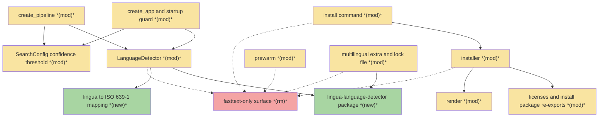
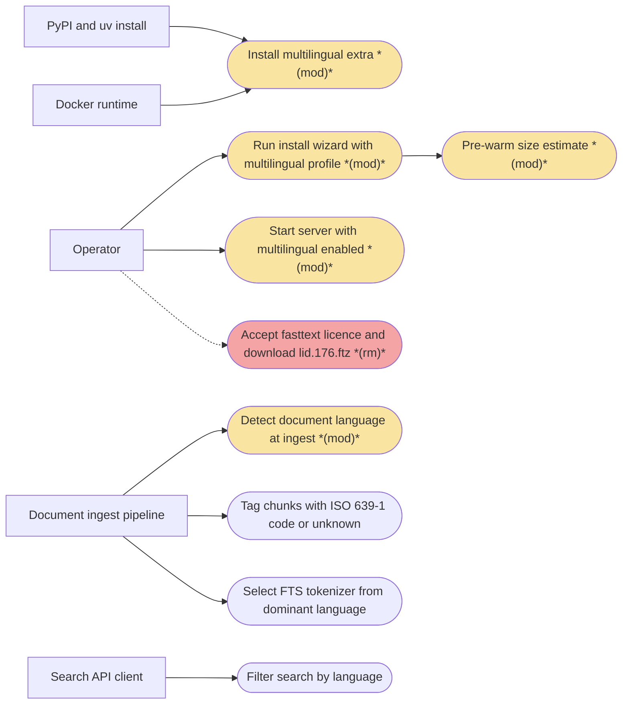
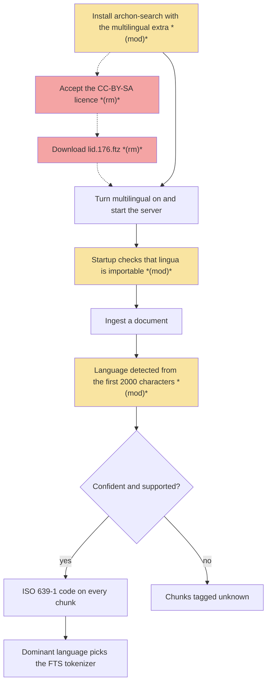
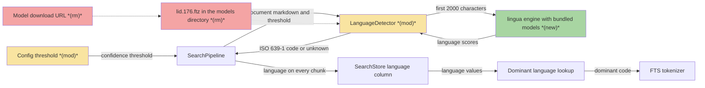
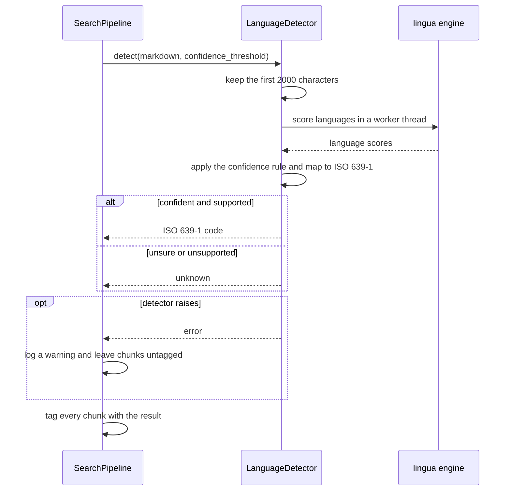
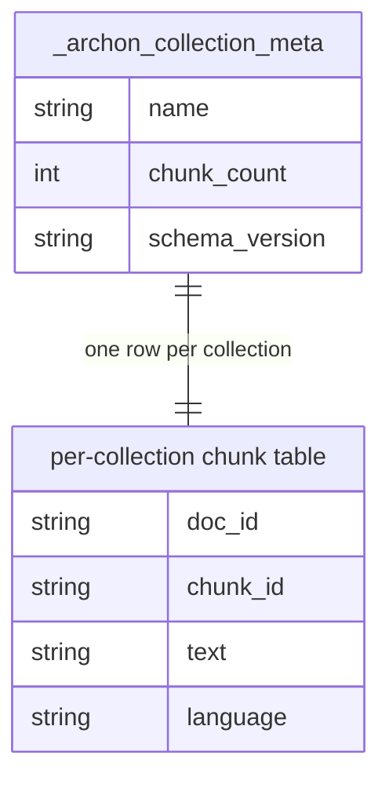

# LLD · Replace fasttext-predict with lingua for language detection — Team Plan

**How to read this file**
- **Architecture approach:** Clean Architecture — the default; no override skill was requested. **Layers:** Presentation · Use Cases · Interface Adapters · Entities · Frameworks & Drivers. The repository is one flat Python package, not folders named after these layers; the layer of each component is inferred from [110_component_catalog_and_layer_breakdown.md](../Architecture/110_component_catalog_and_layer_breakdown.md) (Q19).
- The **Frontend, Backend, and Tester** sections are the **depth view** — each role's scope, grouped by layer. This is a single-tier product (one Python process serving HTTP, MCP and CLI): there is no UI frontend, so "Frontend" here means the operator-facing Presentation layer (the install command, the wizard output and the server's startup surface).
- **Contracts** are logical, in **TypeSpec** (version 1.13.0): five internal logical seams, each a core-construct `.tsp` file in `api-contracts/` checked with `tsp compile <file> --no-emit`. There is no HTTP or API seam in this feature, so this plan creates no HTTP service contract and no `openapi.yaml`.
- **Role tags** (`#frontend-role`, `#backend-role`, `#tester-role`) mark each role-owned section — filter a tag (e.g. in Obsidian) to see one role's whole scope.
- IDs (`S#` scenarios, `C#` contracts, `Q#` questions) are the traceability thread; search the file for an ID to find where it is defined.
- **Tasks** are not in this file — task breakdown is a separate downstream step that consumes this plan.
- **Rule:** change a contract only by team agreement.

---

## Background

With `[database].multilingual = true`, ingestion detects each document's language with `fasttext-predict` and the `lid.176.ftz` model, tags every chunk with an ISO 639-1 code (or `unknown`), and picks the full-text-search tokenizer from the collection's dominant language. The package's public source repository is gone (404 on 2026-10-29), its last release is 2024-11-23, it has no CPython 3.14 wheel, and its only successor is used by almost nobody. The wizard also has to download the model and show a CC-BY-SA licence prompt before the feature works.

---

## Goal

Language detection runs on `lingua-language-detector` (Apache-2.0, wheels for CPython 3.13 and 3.14 on Linux, macOS and Windows). Installing the `multilingual` extra is the only provisioning step: no compiler, no model download, no licence prompt. Documents ingested with multilingual on still get the same kind of ISO 639-1 code on every chunk, and the full-text-search tokenizer is still chosen from the dominant language.

---

## Scope

### In Scope
- Replace the `fasttext-predict` implementation behind `LanguageDetector.detect(text, *, confidence_threshold)` with lingua, keeping the contract: async, first 2000 characters, ISO 639-1 result or `unknown`.
- Map lingua's results to the ISO 639-1 codes the store already expects, including Norwegian Bokmål (`nb`) and Nynorsk (`nn`).
- Recalibrate the confidence threshold for lingua's confidence scale and keep it configurable as it is today.
- Remove what only existed for fasttext: the `lid.176.ftz` download, the CC-BY-SA licence prompt, the `--accept-fasttext-license` flag, the fasttext models directory accessor, the model-size estimate in pre-warm, and the wizard bullet naming fasttext.
- Update the `multilingual` extra in [pyproject.toml](../../pyproject.toml) and [uv.lock](../../uv.lock), the Docker image and compose files if they reference fasttext, and every error message and doc that names fasttext.
- Update tests, documentation, [BREAKING.md](../../BREAKING.md) and the migration index.

### Out of Scope
- Detecting more languages than lingua supports (75); other languages are tagged `unknown`.
- Per-chunk or per-paragraph detection — detection stays document-level.
- Re-tagging documents already ingested with fasttext — they keep their stored codes until re-ingested.
- Changing the Python floor (stays 3.13 or later) or the Docker base image.
- Model2Vec, GlotLID, OpenLID, py3langid and langdetect — evaluated and rejected.

---

## Acceptance criteria
- With multilingual on, an ingested English, French, Hungarian, Bokmål or Nynorsk document has its ISO 639-1 code (`en`, `fr`, `hu`, `nb`, `nn`) on every chunk.
- Text the detector is not confident about, or in a language lingua does not support, is tagged `unknown`; empty text is tagged `unknown`.
- Only the first 2000 characters of a document decide its language.
- The dominant language of a collection still selects the full-text-search tokenizer.
- The confidence threshold is configurable under `[database]` as today, and its default was calibrated on real sample documents including Hungarian.
- One detector is built per process and reused; it is safe to call from `asyncio.to_thread`.
- With multilingual on and the package missing, startup fails with a message that names the `multilingual` extra and does not mention fasttext; no model file is checked.
- The wizard shows no licence prompt and downloads nothing for language detection; `--accept-fasttext-license` no longer exists; pre-warm no longer counts a fasttext artifact.
- `pyproject.toml` and `uv.lock` carry lingua instead of fasttext-predict; the extra installs from a ready-made wheel on Python 3.13 with no compiler.
- No active source file, error message or document names fasttext, apart from the archive and historical records; the drop from 176 to 75 languages is documented.
- Existing installs keep working: a leftover `lid.176.ftz` is ignored, earlier language codes stay readable and filterable.
- The full release gate re-runs green.

---

## What does NOT change
- The `detect` call shape, the 2000-character window, document-level detection, and the rule that a detector failure leaves chunks untagged without aborting ingest ([pipeline.py](../../archon_search/pipeline.py) `ingest_file`).
- The three-state `language` contract (`""` untagged, `"unknown"`, a code), the LanceDB schema (no `STORE_SCHEMA_VERSION` bump, no migration, no backfill) and the REST and MCP `language` filter shape.
- The keys of the tokenizer map in [store.py](../../archon_search/store.py) (only the comments that name fasttext are reworded).
- The config keys `[database].multilingual` and `[database].language_detection_confidence_threshold`.
- The shared models root `get_models_dir()` in [paths.py](../../archon_search/paths.py) (embedder, reranker and graph models keep using it) and the Jina licence gate in [licenses.py](../../archon_search/install/licenses.py).
- The wizard's extra-install step and its revert of `multilingual` to off when the install fails.
- The Docker mechanism: [docker-entrypoint.sh](../../scripts/docker-entrypoint.sh) and [docker-compose.override.yml](../../docker-compose.override.yml) name only the `multilingual` extra and no fasttext string appears in [Dockerfile](../../Dockerfile), [Dockerfile.test](../../Dockerfile.test) or [docker-compose.yml](../../docker-compose.yml) (checked by search), so nothing in them changes unless Q5 renames the extra.
- The Python floor and the Docker base image. A leftover `lid.176.ftz` on disk is never read and never deleted.

---

## Known limitations / accepted trade-offs
- Coverage drops from 176 to 75 languages; text in any other language is tagged `unknown` instead of the nearest supported language. This regression must be documented — no document states the language count today.
- The lingua wheel is about 166 MB and detection takes about 1 ms per 2000-character document instead of 0.08 ms.
- lingua's confidence scale differs from fastText's probabilities, so the old 0.7 default cannot be carried over.
- Lingua languages outside the 20 keys of the tokenizer map fall back to English stemming with a warning, exactly as unmapped codes do today.
- A collection mixing fasttext-era and lingua-era tags can hold `no`, `nb` and `nn` as separate votes for the dominant language (the vote already treats them as separate codes).
- Because the dev dependency group pulls every feature extra ([pyproject.toml](../../pyproject.toml)), the lingua wheel lands in every CI `uv sync --dev` ([200_testing_strategy.md](../Architecture/200_testing_strategy.md)).
- Extras installed at container start are not hash-pinned ([01_threat_model.md](../SecurityGuide/01_threat_model.md)); a lingua wheel pulled through `ARCHON_EXTRAS` is subject to the same note.

---

## Approach & architecture

The change swaps the engine behind one adapter, `LanguageDetector`, and keeps its call shape so the ingest pipeline, the store and the REST and MCP surface do not move. Everything that only existed to fetch, license and locate the fasttext model — a Frameworks & Drivers download, a Use Cases wizard step, a Presentation flag and prompt — is deleted rather than shimmed, in line with the repository's clean-cutover rule.

### Architecture

_Scope limited to changed nodes only: the full component set is about 35 components and the 1-hop expansion (the ingest pipeline, the store, the extra-install helper, the Docker entrypoint) would reach 17 nodes, over the limit. Unchanged anchors omitted but load-bearing: `SearchPipeline` (calls the detector and passes the threshold), `SearchStore` and its tokenizer map (consume the code), `ChunkRecord.language`, the extra-install helper in [extras.py](../../archon_search/install/extras.py) (docstring wording only), [config_writer.py](../../archon_search/install/config_writer.py) (comment wording only), and [docker-entrypoint.sh](../../scripts/docker-entrypoint.sh). The `fasttext-only surface` node collapses the seven removed pieces listed in the table; dotted edges are their last known connections._

| Component | Change | Why |
|-----------|--------|-----|
| `LanguageDetector` in [language_detector.py](../../archon_search/language_detector.py) | modified | Engine becomes lingua; constructor takes no model path; the module-level fasttext import, `FASTTEXT_MODEL_FILENAME`, `_FASTTEXT_ISO_MAP` and `_normalize_lang_code` go; `detect` contract unchanged |
| lingua to ISO 639-1 mapping | new | Maps lingua's language values to the two-letter codes the store expects, Bokmål to `nb`, Nynorsk to `nn`; replaces the three-letter-to-two-letter map |
| `lingua-language-detector` package | new | The engine, with its language models bundled in the wheel; the only dependency of the `multilingual` extra |
| `create_pipeline` in [pipeline.py](../../archon_search/pipeline.py) | modified | Builds the detector without a model path or fasttext models directory |
| `create_app` and `_check_multilingual_deps` in [app.py](../../archon_search/server/app.py) | modified | Builds the detector without a model path; the guard checks only that lingua is importable; messages name lingua and the extra; `_import_fasttext` and `_multilingual_model_path` go |
| `SearchConfig.language_detection_confidence_threshold` in [config.py](../../archon_search/config.py) | modified | Default recalibrated for lingua; the duplicated default in the `SearchPipeline` constructor is consolidated; docstrings drop fasttext |
| `BaseInstaller` and `run` in [installer.py](../../archon_search/install/installer.py) | modified | The licence gate plus download step, the `download_fasttext_model` method (abstract, dry-run and real) and the `accept_fasttext_license` parameter go; extra install and revert stay |
| [licenses.py](../../archon_search/install/licenses.py) and [install/__init__.py](../../archon_search/install/__init__.py) | modified | Fasttext prompt, URL, artifact descriptor, download function and their re-exports go; the Jina gate stays |
| [prewarm.py](../../archon_search/install/prewarm.py) | modified | The fasttext size term leaves the pre-warm estimate |
| [render.py](../../archon_search/install/render.py) | modified | The fasttext bullet is renamed or dropped (Q5); the fasttext download-failure renderer has no remaining caller and goes |
| [install_cmd.py](../../archon_search/cli/install_cmd.py) | modified | The `--accept-fasttext-license` option, its parameter and its forwarding go |
| `multilingual` extra in [pyproject.toml](../../pyproject.toml) and [uv.lock](../../uv.lock) | modified | Dependency becomes `lingua-language-detector`; lock regenerated with uv, never by hand |
| `fasttext-predict` dependency | removed | Source repo gone, no 3.14 wheel |
| `lid.176.ftz` model download | removed | The model ships inside the lingua wheel |
| CC-BY-SA licence prompt | removed | Gate existed only for the downloaded model (licence review of lingua's data is Q2) |
| `--accept-fasttext-license` flag | removed | Nothing left to accept; clean cutover, recorded in [BREAKING.md](../../BREAKING.md) |
| `get_fasttext_models_dir` in [paths.py](../../archon_search/paths.py) | removed | Identical to `get_models_dir()`; callers in the installer, the app and the pipeline go; the shared models root stays |
| Fasttext size term in pre-warm | removed | Nothing is downloaded |
| Wizard bullet naming fasttext | removed | Names a package that is gone (replacement wording is Q5) |

**Layer map (and role mapping)**

| Layer | Role | Components |
|-------|------|-----------|
| Presentation | **Frontend** | [install_cmd.py](../../archon_search/cli/install_cmd.py), [render.py](../../archon_search/install/render.py), `create_app` and its startup guard in [app.py](../../archon_search/server/app.py) |
| Use Cases | Backend | `SearchPipeline` and `create_pipeline` in [pipeline.py](../../archon_search/pipeline.py), [installer.py](../../archon_search/install/installer.py), [prewarm.py](../../archon_search/install/prewarm.py) |
| Interface Adapters | Backend | `LanguageDetector` and the lingua to ISO 639-1 mapping in [language_detector.py](../../archon_search/language_detector.py), `SearchConfig` in [config.py](../../archon_search/config.py), [paths.py](../../archon_search/paths.py), [config_writer.py](../../archon_search/install/config_writer.py), [install/__init__.py](../../archon_search/install/__init__.py) |
| Entities | Backend | `ChunkRecord.language` in [_types.py](../../archon_search/_types.py), `InstallProfile` in [profiles.py](../../archon_search/profiles.py) |
| Frameworks & Drivers | Backend | `SearchStore` and its tokenizer map in [store.py](../../archon_search/store.py), [licenses.py](../../archon_search/install/licenses.py), [extras.py](../../archon_search/install/extras.py), the lingua package, [pyproject.toml](../../pyproject.toml), [uv.lock](../../uv.lock), Docker files |

**What changes**
- The detector's engine and construction (Interface Adapters): lingua, built once, no model path, a new code mapping, a recalibrated confidence rule.
- Both composition roots (`create_app` and `create_pipeline`) build the detector the same way, without a path (Presentation and Use Cases).
- The startup guard shrinks from two checks to one: the package is importable (Presentation).
- The install path loses its licence gate, download, degrade-to-English branch, flag, pre-warm term and failure renderer (Presentation, Use Cases, Frameworks & Drivers).
- The packaging swaps the extra's dependency and regenerates the lock file (Frameworks & Drivers).
- Docs, error messages and tests that name fasttext are updated (see Documentation update).

**Key decisions (from the brief, fixed for this change)**
- lingua over fasttext-predict-v2 (2,149 versus 2.83 million downloads a month), over fasttext-predict (source gone, no 3.14 wheel), over langdetect (last release 2021, 55 languages, `zh-cn` and `zh-tw`, no `nb` or `nn`, unstable on short text) and over py3langid (one maintainer, accuracy figures cover an unreleased model).
- Accepted costs: 166 MB wheel, 75 languages instead of 176, about 1 ms instead of 0.08 ms per document, a different confidence scale. Hungarian is supported.
- Detection stays document-level on the first 2000 characters; unsupported or unsure means `unknown`.
- Clean cutover: the flag, prompt, download and accessors are removed, not accepted-and-ignored.

### Actors & Use Cases

### Flows

#### User Flow

#### Data Flow

#### Sequence

### Prior decisions

No ADR mentions fasttext, lingua, language detection or the licence gate; the fasttext decisions live in non-ADR documents (the archived C2 brief and the FTS tokenizer spike). These accepted ADRs constrain the change.

| Decision | Rationale | Constraint |
|----------|-----------|------------|
| [08_per_collection_embedder_lru_cache.md](../ADRs/08_per_collection_embedder_lru_cache.md) — heavy models load once per process and are called through `asyncio.to_thread`, never per request | Per-request loads stall the loop or duplicate model instances in memory on a laptop-class host | Build one lingua detector per process (today built in both `create_app` and `create_pipeline`) and call it only through `asyncio.to_thread`; the embedder cache itself is not needed |
| [11_embedder_cache_bounded_waiter_timeout.md](../ADRs/11_embedder_cache_bounded_waiter_timeout.md) — a waiter on a deduplicated loader is bounded by a timeout | An unbounded wait on a slow load blocks requests | Informational: lingua's model build is slow, so build at startup or construction, never inside a request |
| [12_local_prose_relations_enrichment_narrowed.md](../ADRs/12_local_prose_relations_enrichment_narrowed.md) — one always-resident model instance, no LRU | One model makes cache machinery pointless | Precedent for one resident lingua instance with its memory budgeted; detection only tags and never gates ([220_accessibility_and_internationalization.md](../Architecture/220_accessibility_and_internationalization.md)) |
| [13_graph_device_probe_two_stage_and_memory_guardrail.md](../ADRs/13_graph_device_probe_two_stage_and_memory_guardrail.md) — pre-warm is non-fatal for the graph model; a guardrail polices memory growth | A skipped or failed pre-warm is not a validation signal | Removing the fasttext size term must not change those semantics; a resident lingua detector (all 75 languages) adds memory, so check the memory lane thresholds before choosing all languages (Q3, Q21) |
| [14_wizard_prewarm_loads_models.md](../ADRs/14_wizard_prewarm_loads_models.md) — pre-warm loads each model through the service's own backend; only the embedder failure is fatal | A model that downloads but cannot load must fail the install, not leave a service whose ingests fail | Delete only the fasttext size term; keep a load-time check through detector construction at startup; adding a fatal lingua pre-warm step would be a new decision the brief does not make |
| [18_pytorch_runtime_replaces_fastembed.md](../ADRs/18_pytorch_runtime_replaces_fastembed.md) — models come through a pinned registry; install sizes derive from specs | Parity and one source of truth for model size | lingua's in-wheel models bypass the registry by design; its size is the display-only kind (a pip-resolved extra) in [provisioning.py](../../archon_search/install/provisioning.py), not a downloaded artifact |
| [01_lancedb_as_local_vector_store.md](../ADRs/01_lancedb_as_local_vector_store.md) — `SearchStore` owns tables, FTS and migrations | Zero-service, file-backed storage | Lingua codes must fall inside the tokenizer map's key space (two-letter codes, `nb` and `nn` included); no schema change or migration is justified |

### Contradictions

**Code vs. docs**
- [README.md](../../README.md) says language is detected per chunk; the code runs one detection per document and copies the result to every chunk (`ingest_file`), and the brief keeps it document-level. Owner: **doc needs updating**.
- [55_chunk_metadata_and_enrichment.md](../UserManual/55_chunk_metadata_and_enrichment.md) says `language` is not populated by ingest yet; the code populates it when multilingual is on. Owner: **doc needs updating**.
- [110_component_catalog_and_layer_breakdown.md](../Architecture/110_component_catalog_and_layer_breakdown.md) says the detector lazy-loads its model; the code loads it eagerly in the constructor. Owner: **doc needs updating** (the row is rewritten for lingua anyway).
- [2026-08-19-070-fasttext-numpy2-language-detection-brief.md](2026-08-19-070-fasttext-numpy2-language-detection-brief.md) is still marked Open and names `fasttext-wheel`; the code already swapped to `fasttext-predict` and this change removes fasttext entirely. Owner: **doc needs updating**; what to do with it is Q20.

**Brief vs. reality**
- The brief says the container image grows by about 166 MB; the entrypoint installs extras into the `/pip-packages` volume at first start, and the Docker guide says the same, so the growth lands in the volume, not the image layers. Owner: **open question** (Q18).
- The brief says to keep the Hungarian samples in the tests; no detection test uses a Hungarian sample today, and the existing "Hello world is unknown at 0.7" case is a mock-based test with no real-model accuracy test behind it. New real fixtures are needed. Owner: **open question** (Q16).
- The brief says the result is an ISO 639-1 code or `unknown`; the code and the docs also allow three-letter ISO 639-3 passthrough, and the filter regex and its descriptions accept two or three letters. Owner: **open question** (Q12).

---

## Contracts / seams

Boundaries where roles must agree. **Logical, not code.** TypeSpec is the tooling (core constructs only, each file checked clean with `tsp compile <file> --no-emit`). There is no client-to-server API change — the REST and MCP `language` filter and the `language` field on responses keep their shape — so there is no HTTP service `.tsp` and no `openapi.yaml` for this feature. Changing one requires team agreement.

**C1 — Language detector**  *(Use Cases ↔ Interface Adapters)*
The pipeline calls the detector once per document and gets an ISO 639-1 code or `unknown`; only the first 2000 characters count; the call never blocks the event loop; one detector per process is shared. Construction no longer takes a model path. A detector that cannot run raises and the pipeline leaves chunks untagged. The confidence rule, accuracy mode and language subset are open (Q1, Q3, Q4) — see [the C1 contract](api-contracts/2026-10-29-010-replace-fasttext-with-lingua-language-detection-c1-language-detector.tsp).

**C2 — Multilingual startup check**  *(Presentation ↔ Interface Adapters)*
With multilingual on, startup verifies one thing: the lingua package is importable. The only failure names the `multilingual` extra and its install remedy and never mentions fasttext or a model file. Both composition roots build the detector the same way — see [the C2 contract](api-contracts/2026-10-29-010-replace-fasttext-with-lingua-language-detection-c2-multilingual-startup-check.tsp).

**C3 — Detection confidence-threshold configuration**  *(Interface Adapters ↔ Use Cases)*
The `[database]` key keeps its name and stays configurable; its default is recalibrated for lingua and owned in one place, not two; an out-of-range value is a config error that names the key. Whether the accepted range and the gate rule change is open (Q1, Q7) — see [the C3 contract](api-contracts/2026-10-29-010-replace-fasttext-with-lingua-language-detection-c3-detection-threshold-config.tsp).

**C4 — Multilingual install provisioning**  *(Presentation ↔ Use Cases ↔ Frameworks & Drivers)*
Provisioning language detection means installing the `multilingual` extra and nothing else: no licence prompt, no download, no acceptance flag in any mode. If the extra install fails, `multilingual` is written as off and the server boots English-only (existing behaviour). The flag is removed outright — see [the C4 contract](api-contracts/2026-10-29-010-replace-fasttext-with-lingua-language-detection-c4-multilingual-provisioning.tsp).

**C5 — Stored language value**  *(Interface Adapters ↔ Frameworks & Drivers)*
New ingests write only two-letter ISO 639-1 codes (or `unknown`; `""` stays the untagged state), all inside the tokenizer map's key space. Rows written earlier keep their codes, possibly three-letter or `no`, and every reader must keep working on mixed collections. No schema or version change — see [the C5 contract](api-contracts/2026-10-29-010-replace-fasttext-with-lingua-language-detection-c5-stored-language-value.tsp).

---

## Data

The database is the embedded LanceDB store (no SQL server, no ORM). **No schema change is needed**: `language` is already a free-form string column, lingua's two-letter codes fit it, and the value domain only narrows for new ingests (C5). The diagram shows the entities that carry or consume the value; none changes, so none carries a suffix.

_Columns shown are the subset relevant to this feature._

**Migration notes**
- None. No `STORE_SCHEMA_VERSION` bump, no `MigrationSpec`, no backfill; documents ingested with fasttext keep their stored codes until re-ingested (brief, Out of Scope).
- The release must record the breaking surface changes (the removed flag and the changed extra) in [BREAKING.md](../../BREAKING.md) and the migration index [03_breaking_changes_index.md](../MigrationGuide/03_breaking_changes_index.md); [test_removed_engine_repo_guard.py](../../tests/test_removed_engine_repo_guard.py) fails the build when a BREAKING heading has no index row.

**Entity model changes**
- `language` on the chunk table: same type and states; new ingests carry only two-letter codes. Earlier rows may carry three-letter codes or `no`; the tokenizer lookup keeps `no`, `nb` and `nn`, all mapped to Norwegian.
- `_archon_collection_meta` has no language field and does not change.
- The dominant-language lookup counts `no`, `nb` and `nn` as separate codes today; whether to fold them is Q13.

---

## Scenarios #tester-role

Behavioural only — step-level detail is produced by the tasks that follow this plan. Hungarian and other real-text fixtures are new work (Q16).

| id | Scenario (Given / When / Then) |
|----|--------------------------------|
| **S1** | **Given** multilingual on and an English document · **When** it is ingested · **Then** every chunk carries `en` |
| **S2** | **Given** multilingual on and a French document · **When** it is ingested · **Then** every chunk carries `fr` |
| **S3** | **Given** multilingual on and a Hungarian document · **When** it is ingested · **Then** every chunk carries `hu` |
| **S4** | **Given** any language the detector supports, including Norwegian Bokmål and Nynorsk · **When** it is detected · **Then** the result is a two-letter ISO 639-1 code (`nb` for Bokmål, `nn` for Nynorsk), never a three-letter code |
| **S5** | **Given** very short text (one or two words, e.g. "Hello world") · **When** it is detected · **Then** the result is `unknown` |
| **S6** | **Given** text in a language lingua does not support · **When** it is detected · **Then** the result is `unknown`, not the nearest supported language |
| **S7** | **Given** empty or whitespace-only text · **When** it is detected · **Then** the result is `unknown` |
| **S8** | **Given** a document longer than 2000 characters whose later text is in another language · **When** it is detected · **Then** only the first 2000 characters decide the result |
| **S9** | **Given** the detector raises during ingest · **When** the document is ingested · **Then** ingest continues, a warning is logged and the chunks stay untagged (`""`) |
| **S10** | **Given** multilingual off · **When** a document is ingested · **Then** no detection runs, chunks stay untagged and startup performs no multilingual check |
| **S11** | **Given** a collection whose chunks are mostly Hungarian (or Bokmål and Nynorsk) · **When** the FTS index is rebuilt · **Then** the Hungarian (or Norwegian) tokenizer is chosen, and a code outside the tokenizer map falls back to English with a warning |
| **S12** | **Given** multilingual on and the lingua package not importable · **When** the server starts · **Then** startup fails with a message that names the `multilingual` extra and its install command and does not mention fasttext or a model file |
| **S13** | **Given** multilingual on, lingua installed and no model file anywhere on disk · **When** the server starts and a document is ingested · **Then** the server starts and the document is tagged |
| **S14** | **Given** multilingual off and the lingua package absent · **When** the server starts · **Then** it starts normally |
| **S15** | **Given** several ingests running concurrently · **When** documents are detected · **Then** one detector instance serves all of them and results are correct under concurrent calls from worker threads |
| **S16** | **Given** a detection in progress · **When** other requests arrive · **Then** the event loop stays responsive because detection runs off the loop |
| **S17** | **Given** the detector loaded with the chosen accuracy mode and language set · **When** resident memory and per-document time on a 2000-character document are measured · **Then** both figures are recorded for the release gate and stay within the memory guardrail |
| **S18** | **Given** a valid `[database].language_detection_confidence_threshold` · **When** detection runs · **Then** that value gates every call, and config and pipeline share one default |
| **S19** | **Given** a threshold outside the accepted range · **When** the config loads · **Then** loading fails with an error that names the key |
| **S20** | **Given** the wizard with a multilingual profile · **When** it runs interactively · **Then** there is no licence prompt for language detection, nothing is downloaded, the extra installs, and the summary does not name fasttext |
| **S21** | **Given** the wizard with a multilingual profile and no acceptance flags · **When** it runs non-interactively · **Then** it completes without needing any language-detection flag |
| **S22** | **Given** a script passing `--accept-fasttext-license` · **When** it runs the install command · **Then** the command rejects the option as unknown, and [BREAKING.md](../../BREAKING.md) says so |
| **S23** | **Given** the `multilingual` extra install fails · **When** the wizard finishes · **Then** `multilingual` is written as off and the server boots English-only |
| **S24** | **Given** the multilingual extra selected · **When** the pre-warm size estimate is computed · **Then** it contains no fasttext term |
| **S25** | **Given** an existing install with a leftover `lid.176.ftz` · **When** the server runs · **Then** the file is neither read nor deleted, and the shared models directory still serves the embedder and reranker |
| **S26** | **Given** a collection holding both fasttext-era codes (e.g. `no` or a three-letter code) and lingua-era codes · **When** the operator filters by an old code, asks for the dominant language, or opens `/status` · **Then** old-code filters still return their rows, the dominant language is computed, and the untagged warning counts only `""` rows |
| **S27** | **Given** a clean Python 3.13 environment · **When** `archon-search[multilingual]` is installed · **Then** it installs from ready-made wheels with no compiler and no model download |
| **S28** | **Given** the Docker image run with `ARCHON_EXTRAS` containing `multilingual` · **When** the container starts · **Then** the entrypoint installs the extra, the server starts and detection works |
| **S29** | **Given** a calibration corpus of real documents including Hungarian · **When** the chosen confidence rule is applied · **Then** full documents get the right code and short or ambiguous text gets `unknown`, and the corpus is frozen as test fixtures |
| **S30** | **Given** the repository after the change · **When** active source, error messages and documents are searched for fasttext · **Then** none name it apart from the archive and historical records, and the 176-to-75 language coverage change is documented |
| **S31** | **Given** a real server with multilingual on · **When** a French and a Hungarian document are ingested through the REST API · **Then** their chunks are tagged `fr` and `hu` and filtering by each code returns them |

---

## Frontend — Presentation (operator surface) #frontend-role

**Scope:** the operator-facing Presentation layer only: the `install` command's options, the wizard's output, and the server's startup guard and detector wiring. There is no UI frontend in this product (the only HTML asset, [graph_viewer.html](../../archon_search/server/graph_viewer.html), is not affected). Role boundary: Q19.
**Owns layer:** Presentation.

**Done when**
- [ ] `--accept-fasttext-license` is gone from [install_cmd.py](../../archon_search/cli/install_cmd.py) (option, parameter and forwarding); passing it is an unknown-option error — S22
- [ ] The wizard shows no licence prompt and downloads nothing for language detection; the summary bullet in [render.py](../../archon_search/install/render.py) no longer names fasttext (wording per Q5) — S20, S21
- [ ] The fasttext download-failure renderer in [render.py](../../archon_search/install/render.py) is deleted with its only caller — S20
- [ ] The startup guard in [app.py](../../archon_search/server/app.py) checks only that lingua is importable and its message names the `multilingual` extra, not fasttext or a model file — S12, S13, S14
- [ ] `create_app` builds the detector without a model path, once, and `_import_fasttext` and `_multilingual_model_path` are gone — S13, S15
- [ ] Multilingual off performs no multilingual check and builds no detector — S10

---

## Backend — Entities · Use Cases · Adapters · Frameworks #backend-role

**Scope:** the detector, its code mapping and confidence rule, the pipeline wiring, the installer flow, pre-warm, config, paths, storage-side wording, packaging and Docker. Writes both unit and integration tests for its tasks, including real-lingua fixtures for English, French and Hungarian. Tests to update or delete (dev-owned): [test_language_detector.py](../../tests/test_language_detector.py), [test_language_detector_paths.py](../../tests/test_language_detector_paths.py), [test_install_fasttext_download.py](../../tests/test_install_fasttext_download.py), [test_install_fasttext_gate.py](../../tests/test_install_fasttext_gate.py), [test_install_provisioning_descriptors.py](../../tests/test_install_provisioning_descriptors.py), [test_install_disk_space.py](../../tests/test_install_disk_space.py), [test_install_license_rule.py](../../tests/test_install_license_rule.py), [test_install_dry_run.py](../../tests/test_install_dry_run.py), [test_install_run.py](../../tests/test_install_run.py), [test_install_cmd.py](../../tests/test_install_cmd.py), [test_install.py](../../tests/test_install.py), [test_install_config_writer.py](../../tests/test_install_config_writer.py), [test_extra_install_hints.py](../../tests/test_extra_install_hints.py), [test_app.py](../../tests/server/test_app.py), [test_pipeline_ingest.py](../../tests/pipeline/test_pipeline_ingest.py), [test_routes_status.py](../../tests/test_routes_status.py), [test_no_hardcoded_path_home.py](../../tests/test_no_hardcoded_path_home.py), [test_http_filters_round_trip.py](../../tests/integration/test_http_filters_round_trip.py). The brief counts 29 test files; a read-only search confirms 29 Python files under `tests/` that name fasttext, `lid.176` or the detector (the 225 figure in one investigation counted compiled caches and non-Python files).
**Owns layers:** Entities, Use Cases, Interface Adapters, Frameworks & Drivers.

**Done when**
- [ ] The detector keeps its contract with lingua behind it: async, 2000 characters, ISO 639-1 or `unknown`, empty text unknown — S1, S2, S3, S5, S6, S7, S8, S31
- [ ] The mapping emits two-letter codes for every supported language, Bokmål as `nb` and Nynorsk as `nn`; the fasttext map, three-letter passthrough and filename constant are deleted — S4
- [ ] The confidence rule and default are calibrated on real documents including Hungarian, owned in one place (config), and the accepted range is settled — S18, S19, S29
- [ ] One detector is built per process, reused, thread-safe and called through `asyncio.to_thread`; its memory and time are measured — S15, S16, S17
- [ ] `create_pipeline` builds the detector without a model path, and a detector failure still leaves chunks untagged — S9, S10
- [ ] Stored codes stay inside the tokenizer map's key space, the dominant-language tokenizer still works, the map's fasttext comments are reworded, and mixed old and new codes keep working — S11, S26
- [ ] The installer's licence-plus-download step, the `download_fasttext_model` method and the `accept_fasttext_license` parameter are removed; the extra install and its revert stay — S21, S23
- [ ] The pre-warm estimate loses its fasttext term without changing its non-fatal semantics — S24
- [ ] `get_fasttext_models_dir` and its callers are removed while the shared models root and its users are untouched; a leftover `lid.176.ftz` is ignored — S25
- [ ] The extra in [pyproject.toml](../../pyproject.toml) is `lingua-language-detector`, [uv.lock](../../uv.lock) is regenerated with uv (never by hand), the extra installs on Python 3.13 from a wheel, and the Docker extras path installs it — S27, S28
- [ ] No active source, error message or docstring names fasttext — S30
- [ ] [BREAKING.md](../../BREAKING.md) and the migration index carry the new entry — S22

---

## Tester #tester-role

**Scope:** the tester owns **e2e and manual** tests plus the project close-out. **Unit and integration** tests belong to the implementing dev, in each implementation task's `Tests` block. There are no device-only behaviours (interruptions, route changes, permissions) in this product, so none is manual for that reason. In this repository "e2e" means Click `CliRunner` and FastAPI `TestClient` tests in the default lane (for example [test_e2e_wizard_optional_features.py](../../tests/test_e2e_wizard_optional_features.py)) plus the real-process smoke lane ([conftest.py](../../tests/smoke/conftest.py), [test_rest.py](../../tests/smoke/test_rest.py)); "manual" means the smoke, Docker and unlocked-dependencies lanes run by hand before a release by [release.sh](../../release.sh) or the operator ([test_docker_smoke.py](../../tests/test_docker_smoke.py), [test-unlocked-deps.sh](../../scripts/test-unlocked-deps.sh)).

**Automatability answers**
- Real lingua detection on English, French and Hungarian is automatable in process (integration, dev-owned) because the dev dependency group pulls every extra; the default lane has no real detector today.
- The startup guard and the wizard flag and licence removal are automatable with `TestClient` and `CliRunner`, with no network.
- The Docker image with lingua is automatable only in the Docker lane (needs a daemon and network), so it is manual in practice; entrypoint mechanics are already testable offline in [test_entrypoint_extras_install.py](../../tests/test_entrypoint_extras_install.py).
- Threshold calibration on real documents and the memory and time measurement are manual and exploratory, then frozen as automated fixtures.
- The server smoke test needs a multilingual-enabled server; the smoke fixture currently isolates the operator config on purpose (Q17).
- No data migration exists to test; existing-install behaviour (leftover model file, old codes) is testable with a pre-seeded store in a temporary data directory.

**Allocation** — each scenario at the cheapest level that proves it *(unit + integration are dev-written; e2e + manual are the tester's tasks)*

| Scenario | Cheapest level |
|----------|----------------|
| S4, S7, S8, S10, S14, S16, S18, S19, S24, S30 | unit |
| S1, S2, S3, S5, S6, S9, S11, S12, S13, S21, S22, S23, S25, S26 | integration |
| S15 | unit + integration |
| S20 | e2e |
| S31 | e2e (smoke lane, run by hand before release) |
| S17, S27, S29 | manual (S29 is frozen into integration fixtures afterwards) |
| S28 | manual (Docker lane; entrypoint mechanics are integration) |

---

## Documentation update

Docs the feature touches — the tasks file's close-out task works through this list. [CHANGELOG.md](../../CHANGELOG.md) is generated by git-cliff and its fasttext mentions are historical commit text, so it needs no edit. [Documentation/Completed/](../Completed/C2-multilingual-retrieval-brief.md) is an archive and is off-limits for editing, although about 35 files there mention fasttext.

- [ ] [2026-10-29-010-replace-fasttext-with-lingua-language-detection-brief.md](./2026-10-29-010-replace-fasttext-with-lingua-language-detection-brief.md) — *no change needed* (source brief; only the References back-link is added)
- [ ] [2026-10-29-010-replace-fasttext-with-lingua-language-detection-team-plan.md](./2026-10-29-010-replace-fasttext-with-lingua-language-detection-team-plan.md) — *new feature* (this file)
- [ ] [README.md](../../README.md) — *contradiction with code* — says per-chunk detection with fastText; code is per-document; the models-directory row names the fastText model
- [ ] [55_chunk_metadata_and_enrichment.md](../UserManual/55_chunk_metadata_and_enrichment.md) — *contradiction with code* — says `language` is not populated by ingest
- [ ] [110_component_catalog_and_layer_breakdown.md](../Architecture/110_component_catalog_and_layer_breakdown.md) — *contradiction with code* — says the model lazy-loads (code loads eagerly); rewrite the `language_detector.py`, `paths.py` and `licenses.py` rows
- [ ] [2026-08-19-070-fasttext-numpy2-language-detection-brief.md](2026-08-19-070-fasttext-numpy2-language-detection-brief.md) — *contradiction with code* — stale Open status naming fasttext-wheel (action per Q20)
- [ ] [archon-search.toml.example](../../archon-search.toml.example) — *new feature* — threshold comment names fasttext; update for lingua's scale and default
- [ ] [BREAKING.md](../../BREAKING.md) — *new feature* — new `[next release]` entry: removed flag, changed extra, coverage 176 to 75, new confidence scale; existing entries stay (append-only; the brief asks for its own release after the current one)
- [ ] [03_breaking_changes_index.md](../MigrationGuide/03_breaking_changes_index.md) — *new feature* — new row after the latest one (NR-52 today; renumber at merge per [learnings.md](../../learnings.md))
- [ ] [05_data_migration.md](../MigrationGuide/05_data_migration.md) — *new feature* — the models tree names a "language-ID model"
- [ ] [10_installation.md](../UserManual/10_installation.md) — *new feature* — extras table, upgrade receipt note, the licence-and-download paragraph, the `--accept-fasttext-license` and `--skip-preload` rows, the models file table
- [ ] [20_wizard.md](../UserManual/20_wizard.md) — *new feature* — licence section, extra-install step, `--skip-preload` notes, flag row, defaults table, example command
- [ ] [30_configuration.md](../UserManual/30_configuration.md) — *new feature* — `multilingual` requirement and threshold rows
- [ ] [60_searching.md](../UserManual/60_searching.md) — *new feature* — three-state `language` text; add the 75-language coverage statement
- [ ] [140_running_with_docker.md](../UserManual/140_running_with_docker.md) — *new feature* — models volume tree and upgrade notes that say to keep `lid.176.ftz`; size note for the extras volume (Q18)
- [ ] [150_multi_instance_setup.md](../UserManual/150_multi_instance_setup.md) — *new feature* — "Model cache (embedder, reranker, fasttext)"
- [ ] [160_troubleshooting.md](../UserManual/160_troubleshooting.md) — *new feature* — quotes the old startup error
- [ ] [100_upgrading.md](../OperatorGuide/100_upgrading.md) — *new feature* — enabling multilingual no longer downloads `lid.176.ftz`; extras guidance
- [ ] [100_system_architecture_overview.md](../Architecture/100_system_architecture_overview.md) — *new feature* — ingest flow, Docker topology and installer step 3 text
- [ ] [130_data_architecture_and_persistence.md](../Architecture/130_data_architecture_and_persistence.md) — *new feature* — models row, accessor list, durable-write table row for the download, `language` column wording (639-1 or 639-3)
- [ ] [150_security_and_privacy_architecture.md](../Architecture/150_security_and_privacy_architecture.md) — *new feature* — lists the removed accessor
- [ ] [160_operational_readiness_monitoring_and_reliability.md](../Architecture/160_operational_readiness_monitoring_and_reliability.md) — *new feature* — the data volume is described as holding fasttext and graph models
- [ ] [200_testing_strategy.md](../Architecture/200_testing_strategy.md) — *new feature* — Python 3.14 wheel note; CI pulls the lingua wheel through the dev group
- [ ] [220_accessibility_and_internationalization.md](../Architecture/220_accessibility_and_internationalization.md) — *new feature* — keep the invariant that detection tags and never gates; change the engine named
- [ ] [530_technical_debt_refactoring_roadmap.md](../Architecture/530_technical_debt_refactoring_roadmap.md) — *new feature* — PLT-4 (degrade-to-English path) loses its trigger; TEST-4 pins text about the failure path
- [ ] [600_api_reference_or_public_interface.md](../Architecture/600_api_reference_or_public_interface.md) — *new feature* — `language` filter text (639-3, "fasttext-processed"), wizard prompt order and the removed flag (Q12)
- [ ] [990_documentation_index_and_contribution_guide.md](../Architecture/990_documentation_index_and_contribution_guide.md) — *new feature* — only if a new ADR is written (Q11): add its row to the ADR index
- [ ] [C2-fts-tokenizer-spike.md](../Architecture/spikes/C2-fts-tokenizer-spike.md) — *no change needed* — completed historical spike; reword only if Q22 says so
- [ ] [03_world_class_roadmap.md](03_world_class_roadmap.md), [01_competitive_analysis_field.md](01_competitive_analysis_field.md), [02_competitive_analysis_marveen.md](02_competitive_analysis_marveen.md), [2026-08-19-000-oom-crash-incident-report.md](2026-08-19-000-oom-crash-incident-report.md), [2026-08-19-030-graph-spacy-download-retry-and-ingest-abort-brief.md](2026-08-19-030-graph-spacy-download-retry-and-ingest-abort-brief.md), [2026-08-19-035-multilingual-graph-ner-brief.md](2026-08-19-035-multilingual-graph-ner-brief.md), [2026-08-19-035-multilingual-graph-ner-tasks.md](2026-08-19-035-multilingual-graph-ner-tasks.md), [2026-08-19-035-multilingual-graph-ner-team-plan.md](2026-08-19-035-multilingual-graph-ner-team-plan.md), [2026-08-19-035-multilingual-graph-ner-c4-model-artifact-provisioning.tsp](2026-08-19-035-multilingual-graph-ner-c4-model-artifact-provisioning.tsp), [interactive-tui-setup-wizard-c1-wizard-choices.tsp](api-contracts/interactive-tui-setup-wizard-c1-wizard-choices.tsp) — *no change needed* — historical planning records of past decisions (Q22)

**Consulted (read-only)**
- [C2-multilingual-retrieval-brief.md](../Completed/C2-multilingual-retrieval-brief.md) and [C2-multilingual-retrieval-plan.md](../Completed/C2-multilingual-retrieval-plan.md) — the original fasttext decisions and the three-state `language` contract to preserve (archive)
- [500_development_workflows_and_conventions.md](../Architecture/500_development_workflows_and_conventions.md) — never hand-edit the lock file
- [510_release_and_environment_strategy.md](../Architecture/510_release_and_environment_strategy.md), [010_engineering_principles_and_constraints.md](../Architecture/010_engineering_principles_and_constraints.md) — release and dependency conventions, no fasttext mention
- [210_performance_and_scalability.md](../Architecture/210_performance_and_scalability.md), [80_capacity_and_performance.md](../OperatorGuide/80_capacity_and_performance.md) — no detector time or memory figure exists to amend
- [10_deployment_topologies.md](../OperatorGuide/10_deployment_topologies.md) — states the `ARCHON_EXTRAS` default; the extra name is unchanged
- [01_threat_model.md](../SecurityGuide/01_threat_model.md) — extras installed at container start are not hash-pinned
- The ADRs listed in Prior decisions

---

## Open questions

Resolve before committing (status moves `draft → planned`). Q1 to Q6 are copied verbatim from the brief; Q7 onward come from the investigation.

| id | Area | Question |
|----|------|----------|
| **Q1** | design | What confidence threshold replaces 0.7, and does lingua's relative confidence need a different rule (for example a minimum distance between the top two languages)? |
| **Q2** | design | Does removing the CC-BY-SA licence gate need a licence review of lingua's bundled language data (training-data terms were not verified)? |
| **Q3** | design | Should the detector be limited to a configured subset of languages to reduce memory, or always load all 75? |
| **Q4** | design | Which lingua accuracy mode (high or low) fits the 2000-character document-level use? |
| **Q5** | design | Does the `multilingual` extra keep its name, and does the wizard keep a separate "language detection" step now that nothing is downloaded? |
| **Q6** | scope | Should Python 3.14 support return now that lingua ships 3.14 wheels (separate change)? |
| **Q7** | design | Does the accepted range (0.0, 1.0] for the threshold stay valid for lingua's scale, and does the config error text change? |
| **Q8** | design | Are lingua's language models preloaded when the detector is built (slower startup, fail-fast) or loaded lazily on first use? ADR 11 and ADR 14 favour paying the cost at construction, not in a request. |
| **Q9** | design | Is the lingua detector safe for concurrent use from several worker threads? The repository does not verify this and the brief requires it. |
| **Q10** | design | If the licence review (Q2) requires a notice, should the wizard print a one-line disclosure (the existing disclose-only rule), or no notice at all? |
| **Q11** | docs | Should the decision be recorded as a new ADR (next number 19, with a row in the documentation index), given the brief's Key Decisions are not in the ADR folder and no ADR covers language detection? |
| **Q12** | design | Should the `language` filter keep accepting two or three letters and the wording "ISO 639-1 or ISO 639-3" (in filters, MCP descriptions, the OpenAPI file and the API reference), since older rows may hold three-letter codes? |
| **Q13** | design | Should the dominant-language lookup fold `no`, `nb` and `nn` into one vote? Lingua is expected to emit `nb` and `nn` separately (unverified, see Q23), and fasttext-era rows hold `no`. |
| **Q14** | scope | Export manifests never write a `language` key while import reads one, so the FTS tokenizer on import is always English (a pre-existing defect, [routes_export.py](../../archon_search/server/routes_export.py)). Fix it in this change or leave it? |
| **Q15** | scope | After the fasttext artifact goes, the generic artifact descriptor and the licence-disposition type are used only by `apply_license_rule`, which has no production caller (it is only re-exported). Delete them with their tests now, or keep them for a future downloaded artifact? |
| **Q16** | tests | Who supplies and curates the real-text samples (Hungarian and others) for tests and for threshold calibration? No Hungarian detection sample and no calibration corpus exist in the repository. |
| **Q17** | tests | Should the smoke lane gain a multilingual-enabled server fixture, given [conftest.py](../../tests/smoke/conftest.py) deliberately isolates the operator config today? |
| **Q18** | docs | The brief says the image grows by about 166 MB; the entrypoint installs extras into the extras volume at first start. Which size claim do the docs use, and is a Docker smoke run with the real wheel (network, +166 MB) acceptable as a manual pre-release step? |
| **Q19** | architecture | The repository has no frontend and no folders named after Clean Architecture layers. Is assigning the Presentation layer (the install command, wizard output, server startup surface) to the Frontend role acceptable, with everything else Backend? |
| **Q20** | docs | What happens to the stale Open brief [2026-08-19-070-fasttext-numpy2-language-detection-brief.md](2026-08-19-070-fasttext-numpy2-language-detection-brief.md): close it, mark it superseded by this change, or move it? Its note about per-file WARNING volume in `ingest_file` still applies. |
| **Q21** | tests | Does a resident lingua detector change the readings or thresholds of the memory lane and guardrail (ADR 13)? |
| **Q22** | docs | Which historical documents that name fasttext (the tokenizer spike, the roadmap, earlier Backlog plans and analyses) are reworded and which stay frozen as records? This plan assumes frozen. |
| **Q23** | design | Does every one of lingua's 75 languages have an ISO 639-1 code, and does the engine name Bokmål, Nynorsk, Greek and Hungarian so they map to `nb`, `nn`, `el` and `hu` (the tokenizer map's keys)? Not verifiable here: lingua is not installed in the repository environment. |

*Resolved in this revision: migration index location (it is [03_breaking_changes_index.md](../MigrationGuide/03_breaking_changes_index.md)); test-file count (29 is right, 225 counted compiled caches); Docker and compose files hold no fasttext string; both composition roots stay and build the detector without a path; `get_fasttext_models_dir` goes while `get_models_dir()` stays; `--accept-fasttext-license` is removed outright, not accepted-and-ignored (clean cutover); the pre-warm fasttext term is removed, not replaced; the result domain for new ingests is ISO 639-1 only, so the three-letter passthrough goes; the fasttext failure renderer in the wizard has no other caller and goes, while the provisioning failure kinds stay because the device probe uses them; lingua reaches the dev environment through the dev group's extras and the lock file is regenerated with uv; the BREAKING entry is a new one (the brief wants its own release); the wizard's "licenses" step keeps its name because the Jina gate stays; "manual" test convention is the smoke, Docker and live lanes run by hand before release.*

---

## References

- **Brief:** [2026-10-29-010-replace-fasttext-with-lingua-language-detection-brief.md](./2026-10-29-010-replace-fasttext-with-lingua-language-detection-brief.md)
