# LCD · Provider-based collection descriptions and a shared LLM client — Task Breakdown

**How to read this file**
- This is the **order view** for [2026-10-30-010-llm-collection-descriptions-team-plan.md](./2026-10-30-010-llm-collection-descriptions-team-plan.md) — every task is a single-role checkbox in execution order, opening with a dependency graph.
- **Phases are vertical slices**: each delivers a working end-to-end increment, not a horizontal layer. No separate "integrate" phase. Sliced with the `vertical-slicer` skill. Phases 1–3 follow the plan's agreed group A order (Q6): the shared client is built once and each consuming feature is cut over in its own slice, because the clean cutover forbids running two provider stacks per feature; group A has no data model, so the description data foundation arrives with the description walking skeleton in Phase 4 (the plan moved the columns into group B).
- Each task carries the **role tag at the end of its title line**, then sub-bullets: **layer · estimate** (decimal hours), **needs · completes**, and a **Tests** block. **needs** = predecessor tasks; **completes** = the scenario `S#` (from the plan) it makes true, or the contract `C#` (from the plan) it realises.
- **Tests** are tagged by level. **Unit and integration tests belong to the implementing dev** (test-first); **e2e and manual tests are the tester's tasks**. The close-out task writes no tests. Every manual test either has an e2e companion in its task or carries a `(non-automatable: <reason>)` note.
- IDs (`BE-#`/`FE-#`/`T-#`/`K#`) are this file's traceability thread; `S#`/`C#`/`Q#` are defined in the plan. Decisions and plan corrections found while writing this file are listed at the end.
- **Rule:** edit your own tasks freely.

---

## References

- **Plan:** [2026-10-30-010-llm-collection-descriptions-team-plan.md](./2026-10-30-010-llm-collection-descriptions-team-plan.md) — the full team plan (contracts, scenarios, architecture, allocation). **Always read the plan before you start planning the next task** — it holds the context this file only cites (`S#`/`C#`/`Q#`).
- **Brief:** [2026-10-30-010-llm-collection-descriptions-brief.md](./2026-10-30-010-llm-collection-descriptions-brief.md) — the source feature brief behind the plan.

---

## Task Breakdown

Single-role tasks in execution order, grouped into **vertical slices**.

### Dependency graph

```mermaid
flowchart LR
  K1([K1 · align])
  subgraph P1["Phase 1 · Expand queries with HyDE through the shared client on any provider"]
    BE1["BE-1 ctx key"]
    BE2["BE-2 client port"]
    BE3["BE-3 gpt2 counter"]
    BE4["BE-4 sizing"]
    BE5["BE-5 ollama wrapper"]
    BE6["BE-6 llama_cpp wrapper"]
    BE7["BE-7 cloud wrappers"]
    BE8["BE-8 claude_cli wrapper"]
    BE9["BE-9 suite guard"]
    BE10["BE-10 hyde composition"]
    BE11["BE-11 hyde migration"]
    FE1["FE-1 ollama ctx wizard"]
    T1["T-1 e2e hyde"]
    T2["T-2 manual real windows"]
  end
  subgraph P2["Phase 2 · Expand queries with RAG Fusion through the shared client"]
    BE12["BE-12 rag migration"]
    BE13["BE-13 old adapters out"]
    T3["T-3 e2e rag"]
  end
  subgraph P3["Phase 3 · Summarise graph communities through the shared client on all five providers"]
    BE14["BE-14 graph limiter"]
    BE15["BE-15 graph migration"]
    BE16["BE-16 graph guard + removal"]
    FE2["FE-2 graph claude_cli prompt"]
    FE3["FE-3 graph extra + revert"]
    FE4["FE-4 registry sync"]
    T4["T-4 e2e graph"]
  end
  subgraph P4["Phase 4 · Get a generated description from a local model after the first ingest"]
    BE17["BE-17 description config"]
    BE18["BE-18 entity + columns"]
    BE19["BE-19 guarded write"]
    BE20["BE-20 write operation"]
    BE21["BE-21 sample port reads"]
    BE22["BE-22 generation"]
    BE23["BE-23 lifecycle"]
    BE24["BE-24 pipeline off ingest"]
    BE25["BE-25 app wiring"]
    BE26["BE-26 read exposure"]
    BE27["BE-27 router escaping"]
    BE28["BE-28 SDK removal"]
    FE5["FE-5 info source/status"]
    T5["T-5 e2e first description"]
    T6["T-6 e2e + manual migration"]
  end
  subgraph P5["Phase 5 · Get a usable description from reasoning models and messy output"]
    BE29["BE-29 output rules"]
    BE30["BE-30 think + restricted"]
    T7["T-7 e2e output + manual live"]
  end
  subgraph P6["Phase 6 · Turn on collection descriptions in the install wizard"]
    FE6["FE-6 description writer"]
    FE7["FE-7 wizard step"]
    FE8["FE-8 extras + secrets"]
    FE9["FE-9 config + template"]
    T8["T-8 manual wizard"]
  end
  subgraph P7["Phase 7 · Set or clear a description by hand"]
    BE31["BE-31 PUT/DELETE routes"]
    BE32["BE-32 MCP tools"]
    FE10["FE-10 set/clear verbs"]
    T9["T-9 e2e manual set/clear"]
  end
  subgraph P8["Phase 8 · Describe a collection on demand as a job"]
    BE33["BE-33 description job"]
    BE34["BE-34 describe route"]
    FE11["FE-11 describe verb"]
    T10["T-10 e2e describe"]
  end
  subgraph P9["Phase 9 · Fill existing collections at startup"]
    BE35["BE-35 probe + backfill"]
    T11["T-11 e2e backfill"]
  end
  subgraph P10["Phase 10 · Know why descriptions are not working"]
    BE36["BE-36 startup validator"]
    BE37["BE-37 status block"]
    FE12["FE-12 status block render"]
    T12["T-12 e2e visibility"]
  end
  subgraph P11["Phase 11 · Keep descriptions in backups"]
    BE38["BE-38 export v2"]
    BE39["BE-39 ADR + BREAKING"]
    T13["T-13 e2e export"]
  end
  T14([T-14 · close-out])
  K1 --> BE1
  BE1 --> BE2
  K1 --> BE3
  BE2 & BE3 --> BE4
  BE2 & BE4 --> BE5
  BE2 & BE4 & BE5 --> BE6
  BE2 --> BE7
  BE2 --> BE8
  BE5 & BE6 & BE7 & BE8 --> BE9
  BE1 & BE9 --> BE10
  BE10 --> BE11
  BE1 --> FE1
  BE11 & BE5 --> T1
  BE10 & BE8 & BE6 --> T2
  BE10 --> BE12
  BE11 & BE12 --> BE13
  BE12 & BE13 --> T3
  BE7 & BE8 --> BE14
  BE10 & BE14 --> BE15
  BE15 & BE13 --> BE16
  BE16 --> FE2
  FE2 --> FE3
  FE2 --> FE4
  BE16 & FE3 --> T4
  BE1 --> BE17
  K1 --> BE18
  BE18 --> BE19
  BE19 & BE17 --> BE20
  BE18 --> BE21
  BE17 & BE21 & BE4 & BE5 --> BE22
  BE20 & BE22 --> BE23
  BE23 --> BE24
  BE23 & BE24 & BE10 --> BE25
  BE18 & BE23 --> BE26
  K1 --> BE27
  BE22 & BE24 --> BE28
  BE26 --> FE5
  BE25 & BE26 & FE5 --> T5
  BE18 & BE28 --> T6
  BE22 --> BE29
  BE29 & BE5 & BE6 & BE21 --> BE30
  BE29 & BE30 & BE25 --> T7
  BE17 --> FE6
  FE1 & FE6 --> FE7
  FE7 & FE3 --> FE8
  BE17 --> FE9
  FE8 & FE9 & BE25 --> T8
  BE20 & BE26 --> BE31
  BE31 --> BE32
  BE31 --> FE10
  BE32 & FE10 & T5 --> T9
  BE23 --> BE33
  BE33 & BE26 --> BE34
  BE34 & FE10 --> FE11
  BE34 & FE11 --> T10
  BE25 & BE23 --> BE35
  BE35 --> T11
  BE25 & BE35 --> BE36
  BE25 & BE35 --> BE37
  BE37 --> FE12
  BE36 & BE37 & FE12 --> T12
  BE20 --> BE38
  BE38 & BE32 & BE34 --> BE39
  BE38 --> T13
  BE27 & BE39 & FE4 & T1 & T10 & T11 & T12 & T13 & T2 & T3 & T4 & T6 & T7 & T8 & T9 --> T14
```

### Phase 0 · Kickoff *(prerequisite; the one cross-cutting step)*
- [x] **K1** — Agree Contracts C1–C12 and the Scenarios with the team, and confirm the decisions and plan corrections listed at the end of this file #team
    - — · 2.0h
    - completes C1, C2, C3, C4, C5, C6, C7, C8, C9, C10, C11, C12
    - Tests

### Phase 1 · Expand queries with HyDE through the shared client on any provider *(the walking skeleton of group A: the shared client with all five wrappers, HyDE cut over; no data model exists in group A, the description data foundation arrives in Phase 4 by the plan's decision (Q6))*
- [x] **BE-1** — Add `ollama_context_tokens` to `HyDEConfig`, `RAGFusionConfig` and `GraphConfig` and their parsers in `config.py` #backend-role
    - Entity · 2.0h
    - needs K1 · completes S67
    - Tests
        - #unit_test — `test_ollama_context_tokens_parsed_in_all_three_sections` — the key loads from `[hyde]`, `[rag_fusion]` and `[graph]`
        - #unit_test — `test_ollama_context_tokens_rejects_non_positive` — zero, negative and non-integer values are rejected like the other bounded ints
        - #unit_test — `test_config_defaults_keyset_includes_context_key` — the defaults key-set trip-wire in `test_config_defaults.py` lists the new key
- [x] **BE-2** — Define the consumer-owned shared LLM client interface (one user message in, text out, `think` on the request, context window and input budget, raised failure type that keeps timeout apart from other errors), the C1 constants, the warn-once helper (one WARNING per caller per process), and re-home `provider_key_available` (returns `bool`) in a new lazily imported client package #backend-role
    - Use Cases · 4.0h
    - needs BE-1 · completes C1, S13
    - Tests
        - #unit_test — `test_warn_once_logs_single_warning_per_process_key` — many failing calls log one WARNING per process; tests reset the state through a fixture
        - #unit_test — `test_failure_type_distinguishes_timeout_from_other` — the probe can tell a timeout from any other provider failure
        - #unit_test — `test_provider_key_available_returns_bool` — the re-homed helper returns a real bool, not `str | None`
- [x] **BE-3** — Add the gpt2-based token counter as a new component with a pinned snapshot (`paths.py` constants, `model_store.ensure_pinned_snapshot`, `install/prewarm.py`, Dockerfile prefetch) and a stub for tests #backend-role
    - Frameworks & Drivers · 4.0h
    - needs K1 · completes S11
    - Tests
        - #unit_test — `test_counter_counts_tokens_with_stub_tokenizer` — the counter returns the stub tokenizer's count for a text
        - #unit_test — `test_counter_not_imported_at_cli_start` — importing the client package does not load the tokenizer (start-up latency guard)
        - #unit_test — `test_pinned_snapshot_has_revision_and_files` — the gpt2 pin names a repo, a revision and its files
- [x] **BE-4** — Size every prompt ahead of the call: exact count for `llama_cpp`, gpt2 estimate plus the 20% margin for `ollama`, none for cloud; budget covers answer reserve, template and the retry reminder #backend-role
    - Use Cases · 3.0h
    - needs BE-2, BE-3 · completes S9, S11
    - Tests
        - #unit_test — `test_cloud_budget_is_unbounded_and_51k_prompt_sent_whole` — a cloud client reports no limit and never trims a 51k-token prompt
        - #unit_test — `test_ollama_budget_applies_20_percent_margin_and_reserve` — the Ollama input budget is window minus answer reserve minus template, with the margin on the estimate
        - #unit_test — `test_llama_cpp_budget_uses_exact_count` — the `llama_cpp` budget uses the exact token count from its tokenize callback
        - #unit_test — `test_budget_reserves_room_for_retry_reminder` — the template used for sizing includes the retry reminder
- [x] **BE-5** — Ollama wrapper on the native `ollama` SDK (`AsyncClient.chat`, `num_ctx` only when configured, `think`, model maximum from `show`) plus the new loopback fake model server `tests/_fake_model_server.py` (Ollama `/api/chat`, `/api/show`; llama.cpp `/props`, `/tokenize`, `/v1/chat/completions`) #backend-role
    - Interface Adapters · 5.0h
    - needs BE-2, BE-4 · completes S6, S7
    - Tests
        - #unit_test — `test_ollama_wrapper_sends_num_ctx_when_configured` — a configured window is sent as `num_ctx`
        - #unit_test — `test_ollama_wrapper_omits_num_ctx_when_unset` — an unset window assumes 4096 and sends nothing
        - #unit_test — `test_consecutive_calls_send_one_user_message_each` — the second call shares no history with the first
        - #integration_test — `test_ollama_wrapper_round_trips_against_fake_server` — the real SDK talks to the fake loopback server and the request carries `num_ctx`
- [x] **BE-6** — `llama_cpp` wrapper over `httpx`: window from `GET /props`, exact count through tokenize, chat completions; a failed probe assumes 4096 and logs a WARNING #backend-role
    - Interface Adapters · 4.0h
    - needs BE-2, BE-4, BE-5 · completes S8
    - Tests
        - #unit_test — `test_llama_cpp_window_read_from_props` — the probed window becomes the client's context window with source `probed`
        - #unit_test — `test_llama_cpp_probe_failure_assumes_4096_and_warns` — a failed probe assumes 4096 and logs one WARNING
        - #integration_test — `test_llama_cpp_wrapper_against_fake_server` — props, tokenize and chat completions work end to end against the fake server
- [x] **BE-7** — `anthropic` and `openai` wrappers: SDK client built lazily on first call, key guard line kept for `test_anthropic_key_guards.py`, no trimming, `think` ignored #backend-role
    - Interface Adapters · 4.0h
    - needs BE-2 · completes S6
    - Tests
        - #unit_test — `test_anthropic_wrapper_builds_client_lazily_on_first_call` — constructing the wrapper never instantiates the SDK client
        - #unit_test — `test_openai_wrapper_raises_when_key_missing` — a missing key is a raised failure, not a swallowed one
        - #unit_test — `test_cloud_wrappers_send_one_user_message_no_history` — each call is one user message
- [x] **BE-8** — `claude_cli` wrapper: prompt on standard input, tools disabled, no session, no slash commands or MCP servers, `--max-turns 1`, `--safe-mode`, neutral working directory, allowlisted environment, child killed on timeout and on cancellation, transport retry only when the caller asks (HyDE, RAG Fusion), plus the real-subprocess fake `claude` harness `tests/_fake_claude.py` recording argv, environment and stdin; keep the dev-container `claude` wrapper (`scripts/claude-container-wrapper`, `scripts/claude-proxy.py`) working, because it drops stdin and needs proxy variables the environment allowlist excludes #backend-role
    - Interface Adapters · 6.0h
    - needs BE-2 · completes S12, S79
    - Tests
        - #unit_test — `test_argv_has_lockdown_flags_and_no_prompt` — the argv carries every lockdown flag and none of the prompt
        - #unit_test — `test_environment_holds_only_allowlisted_variables` — no `CLAUDECODE`, API key or bearer token reaches the child
        - #unit_test — `test_child_killed_on_timeout_and_on_cancellation` — both paths kill the subprocess
        - #integration_test — `test_fake_claude_gets_large_prompt_on_stdin_and_records_argv_env` — a real subprocess receives a very large prompt on stdin with the locked-down argv and environment
- [x] **BE-9** — Extend the session guards in `tests/conftest.py` to the `openai` and `ollama` clients, model-host `httpx` calls and `claude` spawns keyed on the resolved binary path, give the integration anthropic stub `AsyncAnthropic`, and rewrite the stale comment around line 180 #backend-role
    - Frameworks & Drivers · 3.0h
    - needs BE-5, BE-6, BE-7, BE-8 · completes C1
    - Tests
        - #unit_test — `test_guard_blocks_openai_and_ollama_client_construction` — constructing either SDK client in a test raises
        - #unit_test — `test_guard_blocks_claude_spawn_for_unresolved_binary` — a `claude` spawn from an unresolved path raises
        - #unit_test — `test_guard_allows_fake_claude_on_resolved_path` — the fake binary of `BE-8` passes the guard
- [x] **BE-10** — Compose the HyDE client from `[hyde]` in `server/app.py` (provider, model, host, context), resolve each client's window asynchronously (Ollama `show`, `llama_cpp` props, per client), and log the startup WARNINGs for an unset Ollama window, an oversized one and a failed `llama_cpp` probe; `llama_cpp_ok` unchanged #backend-role
    - Frameworks & Drivers · 6.0h
    - needs BE-1, BE-9 · completes S5, S67, S68
    - Tests
        - #integration_test — `test_unset_ollama_window_warns_at_startup_and_assumes_4096` — an Ollama feature with no value logs one WARNING and sends no `num_ctx`
        - #integration_test — `test_oversized_ollama_window_warns_with_model_maximum` — a window above the model maximum read from `show` logs a WARNING and the server boots
        - #integration_test — `test_hyde_and_graph_keep_their_own_provider_model_and_host` — two features on different providers each call their own
        - #unit_test — `test_each_llama_cpp_client_probes_its_own_host` — two `llama_cpp` features with different hosts probe different URLs
- [x] **BE-11** — Move `HyDEGenerator` onto the shared client: template and `max_tokens=200` move in, failure raises then is caught for `hyde_applied: false`, one WARNING per process with the query fingerprint only, generator-level rate bucket kept, `is_key_available` kept for `/status`; rewrite the HyDE-pinned tests and `_hyde_stubs.py` #backend-role
    - Use Cases · 4.0h
    - needs BE-10 · completes S1, S2, S15
    - Tests
        - #unit_test — `test_hyde_failure_returns_no_document_and_flags_not_applied` — a raising client yields `hyde_applied: false` and the search still answers
        - #unit_test — `test_hyde_logs_one_warning_per_process_without_query_text` — many failures log one WARNING and no line holds the query or hypothesis
        - #integration_test — `test_hyde_search_through_shared_client_over_http` — `test_http_hyde_rag_fusion.py` HyDE path returns the hypothetical document as before
        - #integration_test — `test_hyde_per_collection_embedder_with_shared_client` — the per-collection embedder test runs on the new composition
- [x] **FE-1** — Ask the Ollama context window per feature in the wizard (HyDE, RAG Fusion, graph): suggest 8192, offer the previous value, warn when two features share a model with different values; `WizardFeatures` fields, `config_writer` reconcile, installer defaults, revert strips the key #frontend-role
    - Presentation · 6.0h
    - needs BE-1 · completes S48, S71
    - Tests
        - #unit_test — `test_context_prompt_suggests_8192` — the question offers 8192 when no previous value exists
        - #unit_test — `test_context_default_is_previous_value` — a stored value becomes the prompt default
        - #unit_test — `test_shared_model_with_different_context_warns` — two Ollama features on one model with different values print the reload warning
        - #unit_test — `test_revert_strips_ollama_context_tokens` — a failed install removes the key from the reverted sections
        - #integration_test — `test_wizard_writes_ollama_context_per_feature` — the wizard end-to-end writes each feature's value into its own section
- [x] **T-1** — e2e: HyDE search through the real app on a fake Ollama server, including the provider-down fallback #tester-role
    - — · 4.0h
    - needs BE-11, BE-5 · completes S1, S2, S7
    - Tests
        - #e2e_test — `test_e2e_hyde_through_shared_client_sends_num_ctx` — a HyDE search returns the hypothetical document and the fake server saw the configured `num_ctx`
        - #e2e_test — `test_e2e_hyde_provider_down_falls_back_with_one_warning` — the search answers, `hyde_applied` is false, one WARNING appears and no log line holds the query
- [x] **T-2** — Manual checklist `tests/integration/test_lcd_t2_manual_checklist.md`: real Ollama, llama-server and claude windows and ratios #tester-role
    - — · 4.0h
    - needs BE-10, BE-8, BE-6 · completes S8, S11, S68, S79
    - Tests
        - #manual_test — Real llama-server window — `GET /props` and tokenize against a real `llama-server` give the window and exact counts (non-automatable: needs a real llama-server; the endpoints are exercised nowhere in the repository)
        - #manual_test — Estimate margin on real text — gpt2 estimate versus real Ollama tokens on English, Python code, Hungarian, Chinese, Japanese, emoji and digit-heavy text (non-automatable: needs a real Ollama tokenizer)
        - #manual_test — Real Ollama model maximum — `show` model details against the oversized-window WARNING (non-automatable: needs a real Ollama model)
        - #manual_test — Real claude login — stdin prompt, `--safe-mode` and `--max-turns 1` accepted, billed to the login (non-automatable: needs a real `claude` login)

### Phase 2 · Expand queries with RAG Fusion through the shared client *(RAG Fusion cut over, the old query-expansion adapters removed)*
- [x] **BE-12** — Move `RAGFusionGenerator` onto the shared client: decomposition template, `max_tokens=150*num_queries`, variant parsing and `_validate_variant` move in and become live, fallback to the single query, one WARNING per process; rewrite `test_rag_fusion.py` and `test_integration_rag_fusion.py` #backend-role
    - Use Cases · 4.0h
    - needs BE-10 · completes S3, S15
    - Tests
        - #unit_test — `test_variants_validated_and_trimmed_to_num_queries` — over-long, control-character and surplus variants are dropped
        - #unit_test — `test_rag_failure_falls_back_to_single_query` — a raising client gives `rag_fusion_applied: false`
        - #unit_test — `test_rag_logs_one_warning_per_process_without_query_text` — one WARNING for many failures and no query text in logs
        - #integration_test — `test_rag_fusion_through_shared_client_over_http` — the HTTP search path still fuses variants
- [x] **BE-13** — Cut over: remove `archon_search/providers/`, `query_expansion_protocol.py` and `_build_query_expansion_provider`, keep HyDE and RAG Fusion refusing to start on a missing package, delete or replace the adapter-pinned tests, re-point `test_no_query_log_in_llama_cpp_provider.py` and `test_anthropic_key_guards.py`; check whether `HyDEDependencyError` and `RAGFusionDependencyError` are still reachable once providers are injected, and remove their paths if not #backend-role
    - Interface Adapters · 5.0h
    - needs BE-11, BE-12 · completes S65
    - Tests
        - #integration_test — `test_hyde_missing_package_refuses_to_start` — a masked `ollama`, `openai` or `anthropic` package stops startup with the existing error naming it
        - #integration_test — `test_rag_fusion_missing_package_refuses_to_start` — the same refusal for RAG Fusion
        - #unit_test — `test_no_query_text_logged_in_llm_client_wrappers` — the source-scan guard covers the new wrapper modules
- [x] **T-3** — e2e: RAG Fusion fallback and the refuse-to-start rule through the real app #tester-role
    - — · 3.0h
    - needs BE-12, BE-13 · completes S3, S65
    - Tests
        - #e2e_test — `test_e2e_rag_fusion_provider_down_single_query_one_warning` — the search runs the single query, `rag_fusion_applied` is false, one WARNING
        - #e2e_test — `test_e2e_hyde_and_rag_fusion_missing_package_refuse_boot` — masking the package makes the app refuse to start, unlike graph

### Phase 3 · Summarise graph communities through the shared client on all five providers *(graph cut over, `claude_cli` added for graph, `archon_search/enrichment/` removed)*
- [x] **BE-14** — Move the graph rate limiter into the client layer for `anthropic` and `claude_cli` (`extraction_rate_limit_rpm`, fixed window as in `enrichment/anthropic.py`), keep other graph providers and HyDE/RAG `claude_cli` unthrottled, transport retry off for graph #backend-role
    - Interface Adapters · 3.0h
    - needs BE-7, BE-8 · completes S64
    - Tests
        - #unit_test — `test_graph_limiter_applies_to_anthropic_and_claude_cli` — calls beyond the configured rpm raise the exhausted failure
        - #unit_test — `test_limiter_not_applied_to_hyde_claude_cli_or_other_graph_providers` — HyDE, RAG Fusion and `llama_cpp`, `ollama`, `openai` graph stay unthrottled
- [x] **BE-15** — Move `community_builder.py` summarisation onto the shared client (summarisation-only surface, template moves in, community chunk texts sized to the budget, one WARNING per process instead of per community), rename the injected client through `maintenance_loop.py`, `routes_graph.py` and `app.state`, rewire `_probe_extraction_model` in `model_validation.py`; for `claude_cli` the startup probe only checks that the `claude` program exists, and only when graph is configured to use it (no model call) #backend-role
    - Use Cases · 6.0h
    - needs BE-10, BE-14 · completes S4, S64
    - Tests
        - #unit_test — `test_community_chunks_sized_to_budget` — the chunks sent fit window minus reserve minus template
        - #unit_test — `test_graph_failure_keeps_no_summary_and_one_warning` — the build completes, communities have no summary, one WARNING per process
        - #integration_test — `test_graph_on_claude_cli_sends_stdin_prompt_and_throttles` — a fake `claude` receives the prompt on stdin and the rpm cap applies
        - #integration_test — `test_extraction_probe_classifies_timeout_through_shared_failure_type` — a timeout still reads as a possible reasoning model
        - #unit_test — `test_claude_cli_graph_probe_checks_presence_only_and_only_when_configured` — no model call is made, and nothing is probed when graph does not use `claude_cli`
- [x] **BE-16** — Graph package guard (C12): a missing `openai` or `ollama` package is a WARNING with the install hint, graph stays off and the server starts; build the five-provider graph client in `app.py`; remove `archon_search/enrichment/`, `graph_enrichment_protocol.py` and `EnrichmentClientFactory`; rewrite the enrichment-pinned tests and re-point `test_no_content_log_in_enrichment.py` #backend-role
    - Frameworks & Drivers · 4.0h
    - needs BE-15, BE-13 · completes C12, S16
    - Tests
        - #integration_test — `test_graph_missing_ollama_package_warns_and_boots_with_graph_off` — the WARNING names the package and install command
        - #integration_test — `test_graph_missing_openai_package_warns_and_boots_with_graph_off` — same for `openai`
        - #unit_test — `test_no_chunk_text_logged_in_graph_client_modules` — the source-scan guard covers the new graph path
- [x] **FE-2** — Offer `claude_cli` in the wizard graph prompt (all five providers): CLI presence check and model pick, generalised wording, docstring rewrite; a blank `claude_cli` model is accepted for graph as it is for HyDE #frontend-role
    - Presentation · 3.0h
    - needs BE-16 · completes S71
    - Tests
        - #unit_test — `test_graph_prompt_offers_claude_cli_with_model_pick` — choosing `claude_cli` runs the presence check and the model prompt
        - #unit_test — `test_graph_claude_cli_writes_provider_and_model` — the writer stores provider and model for graph
        - #integration_test — `test_wizard_graph_claude_cli_leg_end_to_end` — the wizard end-to-end writes a `claude_cli` graph section
- [x] **FE-3** — Install the graph provider's extra and revert on failure: extend the extras pass with the graph section (`hyde`, `openai-provider`, `ollama`), gate on `features.graph_provider` in `installer.py`, section-aware failure labels, `_revert_graph_enrichment_flags` on a failed install #frontend-role
    - Presentation · 4.0h
    - needs FE-2 · completes S16, S71
    - Tests
        - #unit_test — `test_graph_extra_installed_once_with_hyde_dedup` — a shared extra is installed once across sections
        - #unit_test — `test_failed_graph_install_reverts_graph_flags` — a failed install strips the graph section keys
        - #integration_test — `test_wizard_graph_install_failure_reverts_end_to_end` — failure, disk-space and decline-Proceed paths revert the graph section
- [x] **FE-4** — Add the graph-provider-set guard to `tests/test_provider_registry_sync.py` (extractor plus equality with the registry), refresh its docstring and the stale comments in `cli/status.py` and `wizard.py` (the plan's "four of five" is only a stale docstring: no test asserts the graph set today) #frontend-role
    - Presentation · 1.0h
    - needs FE-2 · completes S14
    - Tests
        - #unit_test — `test_graph_prompt_provider_set_equals_registry` — the graph prompt offers exactly the five registered providers
        - #unit_test — `test_graph_extractor_detects_drift` — the extractor fails when a provider is dropped from the prompt
- [x] **T-4** — e2e: graph build on `claude_cli` through a fake `claude`, and the provider-down build; manual large prompt on a real login #tester-role
    - — · 5.0h
    - needs BE-16, FE-3 · completes S4, S64
    - Tests
        - #e2e_test — `test_e2e_graph_build_on_claude_cli_stdin_prompt_and_rpm_throttle` — a very large community prompt arrives on stdin and the rpm cap throttles
        - #e2e_test — `test_e2e_graph_provider_down_communities_without_summary` — the build completes with no summary text and one WARNING
        - #manual_test — Large community on a real claude login — graph enrichment on `claude_cli` with a very large prompt (non-automatable: needs a real `claude` login)

### Phase 4 · Get a generated description from a local model after the first ingest *(the walking skeleton of the description feature: config by hand, stored state, sampling, one generation, background lifecycle, read exposure, SDK gone)*
- [x] **BE-17** — Add `DescriptionConfig` and its parser in `config.py` (C4 keys, `think` as bool or `default`, `timeout_seconds` 30, `max_sample_chunks` 100) with the named constants `maxDescriptionChars` 600, `maxQueuedGenerations` 64, `embedWaitSeconds` 120 #backend-role
    - Entity · 3.0h
    - needs BE-1 · completes C4
    - Tests
        - #unit_test — `test_description_defaults_match_c4` — every default equals the contract's value
        - #unit_test — `test_think_accepts_default_true_false_and_rejects_other` — other values are rejected at load
        - #unit_test — `test_description_section_rejects_wrong_types` — the type-reject table in `test_config.py` covers the section
        - #unit_test — `test_config_defaults_keyset_includes_description` — the defaults trip-wire lists the section
- [x] **BE-18** — Add `description_source` and `description_status` to `CollectionMeta` and the store: schema, row reader with legacy defaults, both `merge_insert` writer dicts, the 10 store and 2 pipeline `CollectionMeta(` sites moved to `dataclasses.replace`, `_migrate_description_columns` plus `migrate_default_ttl_seconds()` in `_run_startup_migrations`, the eval runner openers, the `STORE_SCHEMA_VERSION` comment; extend the stale old-schema builders in `test_store.py` and `test_pre_d3_startup_migration_e2e.py`; `installer._bootstrap_collections` calls the migrations too (it has no production caller today; nothing is deleted) #backend-role
    - Entity · 6.0h
    - needs K1 · completes S42, S73, S78
    - Tests
        - #unit_test — `test_row_with_every_field_non_default_survives_every_writer` — a writer that drops any field fails the test
        - #unit_test — `test_legacy_row_reads_generated_ok_and_empty_reads_none` — a description reads `generated`/`ok`, an empty one reads empty
        - #unit_test — `test_older_writer_dict_without_new_keys_leaves_stored_values` — a merge without the new keys keeps stored source and status
        - #integration_test — `test_old_store_gets_columns_and_default_ttl_at_startup` — a store lacking the columns starts and accepts a metadata write
        - #integration_test — `test_eval_runner_stores_run_startup_migrations` — both eval runner stores migrate after `connect()`
- [x] **BE-19** — Guarded store write in `store.py` beside `update_description`: takes the collection lock itself, re-reads the row, applies keep, set or clear per field, refuses a generated write over a manual row (`refusedManual`) or over a changed row (`refusedStale`), reports `written`, `lockTimeout`, `collectionMissing`; whitelist it in `test_no_unlocked_direct_call.py` #backend-role
    - Frameworks & Drivers · 5.0h
    - needs BE-18 · completes C3, S22, S74
    - Tests
        - #unit_test — `test_generated_write_refused_over_manual_row` — a manual set during a slow step is never overwritten
        - #unit_test — `test_stale_write_and_recorded_failure_refused_after_clear` — a clear is not undone and no `failed` lands on a cleared row
        - #integration_test — `test_manual_set_during_slow_step_survives_interleave` — a deterministic interleave with `tests/_parked_lock.py` ends in one serial outcome
        - #integration_test — `test_lock_timeout_is_reported_not_swallowed` — the outcome is `lockTimeout`, which the caller records as failed
- [x] **BE-20** — Shared write-description operation (C11): one use case for generate, set, clear and import that embeds with the collection's own embedder from the cache under `embedWaitSeconds`, writes text and vector in one guarded step, keeps the text without a vector on embedding failure with a WARNING; the metadata recompute in `pipeline.py` carries the stored vector and computes one only for a legacy description when the model matches; the read-outside-lock whole-row writers carry the locked fields #backend-role
    - Use Cases · 8.0h
    - needs BE-19, BE-17 · completes C11, S43, S69, S88
    - Tests
        - #unit_test — `test_embedding_failure_or_timeout_keeps_description_without_vector` — the text is stored, no vector, one WARNING
        - #unit_test — `test_recompute_carries_stored_vector_for_other_model` — a vector from the collection's model is never replaced by the global embedder's
        - #unit_test — `test_recompute_computes_vector_only_for_matching_model` — a legacy description gets a vector only when the model matches
        - #integration_test — `test_vector_follows_generate_set_and_clear` — the routing vector is written, replaced and removed with the text
- [x] **BE-21** — Store port reads for the sample in `store.py`: `list_chunk_ids` sorted by `chunk_id` with open meaning `acl is None` exactly, `read_excerpts` in requested order, raising on store error, empty for an absent table; replaces `sample_chunk_texts` #backend-role
    - Frameworks & Drivers · 4.0h
    - needs BE-18 · completes S55, S82
    - Tests
        - #unit_test — `test_list_chunk_ids_excludes_acl_and_deny_all_chunks` — chunks with any ACL including `[]` are never listed
        - #unit_test — `test_list_chunk_ids_sorted_by_chunk_id_after_compaction` — the order is the id order whatever the row order
        - #integration_test — `test_store_read_error_raises_not_empty` — a failing read raises instead of reading as no chunks
- [x] **BE-22** — Rewrite `description_generator.py` onto the shared client: deterministic evenly spaced sample fitted to the budget (stated shrink loop, window-too-small failure naming the window), typed outcome, one call with the unchanged prompt wording, failure never replaces a description, `_should_regenerate` kept; `_ENV_LOCK`, the `CLAUDECODE` mutation and the SDK import removed; source-scan guard for the module #backend-role
    - Use Cases · 8.0h
    - needs BE-17, BE-21, BE-4, BE-5 · completes C2, S10, S18, S20, S57, S76, S82
    - Tests
        - #unit_test — `test_sample_evenly_spaced_over_all_open_chunks_and_identical_each_run` — the same ids on every run, spread over the whole collection
        - #unit_test — `test_small_window_fits_large_window_larger_and_both_capped_at_100` — the 4k sample is smaller than the 200k one and neither exceeds 100
        - #unit_test — `test_no_open_chunk_fails_without_provider_call` — outcome `noUnrestrictedChunks`, no call
        - #unit_test — `test_sample_read_error_is_sample_read_failed_not_no_open_chunks` — a store error has its own reason
        - #unit_test — `test_regeneration_rule_fires_at_20_percent_either_direction` — growth or shrink of 20% regenerates, less does not
        - #unit_test — `test_no_excerpt_or_description_text_in_logs_of_description_modules` — the source-scan guard stays green
- [x] **BE-23** — Description lifecycle service (C5 core, new Use Cases module): `requestGeneration` for the ingest rule, per-collection single-flight (`alreadyRunning`), process slot of one for the sample read and model call only, prioritised bounded queue (describe, ingest, backfill; 64), in-memory `pending` and last attempt with the overlay, manual short-circuit, `closed` flag, tracked tasks and drain #backend-role
    - Use Cases · 8.0h
    - needs BE-20, BE-22 · completes C5, S23, S24, S80
    - Tests
        - #unit_test — `test_second_request_for_one_collection_settles_already_running` — single-flight per collection
        - #unit_test — `test_only_one_generation_runs_in_the_process_at_a_time` — the slot serialises across collections
        - #unit_test — `test_waiting_requests_served_describe_then_ingest_then_backfill` — queue priority order
        - #unit_test — `test_queue_over_bound_drops_ingest_and_fails_describe` — the bound is 64 with the stated outcomes
        - #integration_test — `test_slot_released_before_embedding_so_slow_lock_does_not_stall_others` — a collection stuck on a lock does not delay another
- [x] **BE-24** — Move generation off the ingest path in `pipeline.py`: `_finalize_batch_ingest` marks `pending` and requests generation in the background, the unreachable `force_regenerate_description` parameter is removed, the `last_indexed` write goes through a guarded path, no lifecycle means silent; rewrite the pipeline tests that patch `generate_description` and delete the shuffle pins in `test_e0c_be1_sample_shuffle.py` #backend-role
    - Use Cases · 5.0h
    - needs BE-23 · completes S25
    - Tests
        - #integration_test — `test_ingest_returns_before_the_provider_finishes` — with a parked provider the ingest result is already returned
        - #integration_test — `test_ingest_without_lifecycle_requests_no_generation` — eval and installer pipelines stay silent
        - #unit_test — `test_manual_source_collection_is_not_marked_pending` — the rule does not enqueue for a manual description
- [x] **BE-25** — Wire the lifecycle in `server/app.py`: build it in the lifespan before the MCP mount, pass it to the pipeline and the MCP app, build the description client from `[description]` (window resolution, unset-Ollama WARNING arm), build nothing when disabled, close then drain in two phases (closed before the cancel gather, drain after, before the stores disconnect) #backend-role
    - Frameworks & Drivers · 6.0h
    - needs BE-23, BE-24, BE-10 · completes S5, S17, S19, S35, S67, S85
    - Tests
        - #integration_test — `test_disabled_description_sends_nothing_and_starts_no_task` — `_background_tasks` stays empty and no provider is touched
        - #integration_test — `test_shutdown_cancels_in_flight_generation_before_stores_disconnect` — order oracle in the style of `test_c1_bug_repros.py`
        - #integration_test — `test_request_after_shutdown_began_is_refused` — a cancelled ingest asking late gets `closed` and starts nothing
        - #integration_test — `test_description_feature_uses_its_own_provider_model_and_host` — the description arm of the per-feature provider check
        - #integration_test — `test_live_local_model_generates_description_when_model_is_pulled` — an auto-skipping lane in the style of `test_llama_cpp_e2e.py` that skips unless the Ollama model is present, not only when the port answers
- [x] **BE-26** — Expose `description_source` and `description_status` in the REST list and detail (`schemas.py`) and the three MCP collection schemas (`mcp_schemas.py`, labelled as data derived from document content), with the `pending` overlay from the lifecycle (tolerant of its absence), a shared detail builder replacing the hand copies, regenerated OpenAPI snapshots #backend-role
    - Interface Adapters · 5.0h
    - needs BE-18, BE-23 · completes C6, C8, S40, S70
    - Tests
        - #unit_test — `test_pending_overlaid_on_stored_status_and_never_stored` — `pending` appears only while a run is in flight
        - #unit_test — `test_detail_and_summary_include_source_and_status` — both shapes carry the two fields
        - #integration_test — `test_mcp_collection_tools_return_source_and_status` — the three MCP tools carry them
        - #integration_test — `test_openapi_snapshots_regenerated_match` — `--update-openapi-snapshot` output equals the pinned files
- [x] **BE-27** — Collapse whitespace and escape `<` and `>` in every description the router renders into `<search_collections>` (`router.py` `_build_block`) #backend-role
    - Interface Adapters · 2.0h
    - needs K1 · completes S77
    - Tests
        - #unit_test — `test_closing_tag_in_description_is_escaped` — `</search_collections>` cannot close the block
        - #unit_test — `test_multiline_description_collapsed_no_forged_row` — a `- other:` line inside text cannot forge a row
        - #unit_test — `test_router_ignores_new_metadata_fields` — the routing-field filter drops source and status
- [x] **BE-28** — Remove `claude-agent-sdk` from `pyproject.toml` and the three `uv.lock` spots, rewrite the SDK assertion and docstrings in `test_cli_startup_latency.py`, update `GUARD_FILES` in `test_anthropic_key_guards.py` #backend-role
    - Frameworks & Drivers · 2.0h
    - needs BE-22, BE-24 · completes S49
    - Tests
        - #unit_test — `test_sdk_not_declared_in_pyproject_or_lock` — neither file names the package
        - #integration_test — `test_server_and_cli_boot_with_sdk_module_masked` — masking the module still boots the server and `config show`
        - #integration_test — `test_lightweight_cli_start_does_not_import_sdk` — the start-up latency guard no longer expects the SDK
- [x] **FE-5** — Show `description_source` and `description_status` in `collection info` (omitted when null); strip terminal control characters from the untrusted text as `jobs_cmd._clean` does #frontend-role
    - Presentation · 1.5h
    - needs BE-26 · completes S40
    - Tests
        - #unit_test — `test_info_shows_source_and_status` — both lines print when present
        - #unit_test — `test_info_omits_source_and_status_when_null` — an empty description keeps `description` out of the output
- [x] **T-5** — e2e: description appears after the first ingest on a fake local model, read through REST, MCP and the CLI; builds the CLI-to-TestClient bridge `tests/_cli_testclient_bridge.py` #tester-role
    - — · 8.0h
    - needs BE-25, BE-26, FE-5 · completes S17, S19, S23, S40, S55
    - Tests
        - #e2e_test — `test_e2e_first_ingest_returns_then_description_appears_generated_ok` — with a held fake provider the ingest is DONE while status reads `pending`, then `ok` with source `generated`
        - #e2e_test — `test_e2e_description_read_through_rest_mcp_and_cli_info` — list, detail, `get_collection_meta` and `collection info` show source and status
        - #e2e_test — `test_e2e_restart_loses_pending_and_next_ingest_regenerates` — a new app on the same store reads the stored value, not `pending`
        - #e2e_test — `test_e2e_only_open_chunks_reach_the_model` — chunks with an ACL never appear in the fake server's request
        - #e2e_test — `test_e2e_disabled_description_sends_nothing` — with the section absent the fake server sees no request
- [x] **T-6** — e2e on a synthetic old-schema store, plus manual checks on a real data directory and a clean install #tester-role
    - — · 5.0h
    - needs BE-18, BE-28 · completes S42, S73, S49
    - Tests
        - #e2e_test — `test_e2e_old_store_migrates_columns_and_default_ttl_at_startup` — an old-schema table gains the columns, descriptions read `generated`/`ok`, and a metadata write succeeds
        - #manual_test — Real data directory upgrade — copy `~/.archon-search` and start the new version; collections open and described ones read `generated`/`ok`
        - #manual_test — Clean-environment install without claude-agent-sdk — server and CLI work and the package is not importable (non-automatable: an install test is forbidden in the default and unlocked-deps lanes, and a stale dev venv still holds the package)

### Phase 5 · Get a usable description from reasoning models and messy output *(output rules, retry, trim, `think`, restricted-chunk switch)*
- [x] **BE-29** — Output rules in `description_generator.py`: strip thinking tags, one line, at most 600 characters, one automatic retry with the same single message plus a limit reminder (a provider error is not retried), trim to the last full sentence, nothing usable becomes `failed` keeping the old text with the reasoning-model WARNING; generous answer ceiling #backend-role
    - Use Cases · 6.0h
    - needs BE-22 · completes C2, S11, S21, S53
    - Tests
        - #unit_test — `test_overlong_answer_retried_once_then_trimmed_to_last_sentence` — the second over-long answer is trimmed within 600 characters
        - #unit_test — `test_thinking_only_output_after_retry_is_failed_with_think_hint` — nothing stored, status `failed`, WARNING points to `think`
        - #unit_test — `test_provider_error_is_not_retried` — a raised failure settles `failed` after one call
        - #unit_test — `test_retry_prompt_fits_a_small_window` — the sample was sized for the retry reminder
- [ ] **BE-30** — `think` sending (`default` sends nothing, `true`/`false` to Ollama and the verified `llama_cpp` switch, ignored for cloud and `claude_cli`, clear WARNING for `true` on a model without thinking) and `include_restricted_chunks` honoured for `ollama` and `llama_cpp` only in the sampler #backend-role
    - Interface Adapters · 4.0h
    - needs BE-29, BE-5, BE-6, BE-21 · completes S54, S56
    - Tests
        - #unit_test — `test_think_default_sends_no_thinking_control` — the request carries no thinking field
        - #unit_test — `test_think_true_and_false_sent_to_ollama` — the native `think` option follows the setting
        - #unit_test — `test_think_true_on_non_thinking_model_warns` — a clear WARNING names the model
        - #unit_test — `test_restricted_chunks_sampled_only_for_local_providers` — cloud and `claude_cli` ignore the switch
        - #integration_test — `test_llama_cpp_think_switch_against_fake_server` — the request body carries the switch the wrapper chose
- [ ] **T-7** — e2e on bad model output, plus manual live-provider checks #tester-role
    - — · 7.0h
    - needs BE-29, BE-30, BE-25 · completes S50, S53, S54
    - Tests
        - #e2e_test — `test_e2e_thinking_only_output_stores_failed_keeps_old_description` — status `failed`, the earlier description is untouched
        - #e2e_test — `test_e2e_overlong_answer_stored_trimmed_to_one_line_within_600` — the stored text is one line of at most 600 characters
        - #e2e_test — `test_e2e_cloud_retry_sends_excerpts_twice` — the fake server counts two requests carrying the sample
        - #manual_test — Live descriptions on every provider — `ollama`, `llama_cpp`, `claude_cli`, `anthropic`, `openai` give sensible text, a changed Ollama context reloads the model but calls work (non-automatable: needs real models, a real `claude` login and cloud keys)
        - #manual_test — Real `think` behaviour — `true`, `false` and `default` on a real reasoning model such as `qwen3.6:35b-a3b-128k` (non-automatable: needs a real reasoning model)

### Phase 6 · Turn on collection descriptions in the install wizard *(the wizard step, its config section, extras, secrets and template)*
- [ ] **FE-6** — `WizardFeatures` description fields and the `[description]` writer in `config_writer.py` (`enabled = false` on no, blank `claude_cli` model omitted), extend `_assert_features_persisted`, settle the re-run key handling; `description.enabled` follows HyDE's re-run key handling #frontend-role
    - Presentation · 4.0h
    - needs BE-17 · completes C4, S46
    - Tests
        - #unit_test — `test_description_section_written_and_keys_stay_in_secrets` — answers land in `[description]`, no API key in the config
        - #unit_test — `test_answering_no_writes_enabled_false` — a no answer is written explicitly
        - #unit_test — `test_assert_features_persisted_requires_description` — a missing section fails the post-write check
        - #integration_test — `test_overwrite_detection_managed_keys_include_description` — the re-run hand-edit lists agree
- [ ] **FE-7** — Wizard description step in `_prompt_optional_features`: own gate (asked whenever interactive, even with `--enable-hyde` or `--enable-rag-fusion`), privacy banner, provider, model, host, Ollama context through the `FE-1` helper, backfill (default no); installer defaults from `cfg.description`; no install flag; rewrite the pinned prompt order, the 19 stdin sites and the roughly 45 call sites #frontend-role
    - Presentation · 8.0h
    - needs FE-1, FE-6 · completes S44, S45, S48, S71
    - Tests
        - #unit_test — `test_description_question_defaults_no_and_shows_privacy_banner` — the banner says excerpts leave the machine for three providers
        - #unit_test — `test_yes_path_asks_provider_model_host_context_and_backfill` — each follow-up appears in order, context suggests 8192
        - #unit_test — `test_description_asked_even_when_enable_hyde_flag_given` — the flag does not skip the question
        - #integration_test — `test_e2e_wizard_description_flow_writes_section` — the dev-written wizard end-to-end for S44, S45, S46, S48, S71 in `test_e2e_wizard_optional_features.py`
        - #integration_test — `test_wizard_help_has_no_enable_description_flag` — `install --help` lists no such flag
- [ ] **FE-8** — Description provider extra and shared revert path, `.secrets.env` gate and message for description and graph providers, the post-install key tip, and the install summary bullets for description and graph #frontend-role
    - Presentation · 6.0h
    - needs FE-7, FE-3 · completes C4, S47, S71
    - Tests
        - #unit_test — `test_revert_description_flags_strips_all_keys` — a failed install removes every description key and writes `enabled = false`
        - #unit_test — `test_secrets_env_created_for_description_provider_needing_key` — the file is created and the message names the feature
        - #unit_test — `test_summary_shows_description_and_graph_bullets` — the summary lists both when configured
        - #integration_test — `test_description_install_failure_disk_space_and_decline_all_revert` — the three failure paths revert the section end-to-end
- [ ] **FE-9** — `config` command default sections include `description`, `config set description.enabled true` validates, and the `archon-search.toml.example` template gains `[description]` (all keys incl. `think`, `include_restricted_chunks`, privacy header), `ollama_context_tokens` in the other three sections and the corrected graph `claude_cli` comment #frontend-role
    - Presentation · 3.0h
    - needs BE-17 · completes C4, S72
    - Tests
        - #unit_test — `test_default_toml_includes_description_enabled_false` — the generated default lists the section
        - #unit_test — `test_config_set_description_enabled_validates` — `config set` accepts the key and rejects a wrong type
        - #integration_test — `test_fresh_config_resolves_like_its_fully_defaulted_twin` — the defaulted twin round-trip includes `description`
- [ ] **T-8** — Manual checklist `tests/integration/test_lcd_t8_manual_checklist.md`: a real wizard walk for the description step, and verification of the dev-written wizard run #tester-role
    - — · 3.0h
    - needs FE-8, FE-9, BE-25 · completes S44, S45, S46, S47, S48, S71
    - Tests
        - #manual_test — Real wizard walk — description question, banner, provider, host, 8192 suggestion, backfill, the `[description]` section, a forced failed install reverts it (non-automatable: the end-to-end patches the byte-moving steps and a real extras install is forbidden in the default and unlocked-deps lanes)

### Phase 7 · Set or clear a description by hand *(manual wins; REST, MCP and CLI for the namespace owner)*
- [ ] **BE-31** — `PUT` and `DELETE /collections/{name}/description` in `routes_collections.py` with `SetDescriptionBody` (422 for empty, multi-line, control-character or over-600 text), namespace-owner check by `get_collection_meta`, write called without the collection lock, 200 `CollectionDetail`, 404 for a foreign namespace, 503 `store_busy`, `PUT` added to `_CORS_ALLOWED_METHODS`, clear resets text, source, status, last-described and baseline and starts nothing; regenerated snapshots #backend-role
    - Interface Adapters · 6.0h
    - needs BE-20, BE-26 · completes C6, S26, S27, S28, S30, S61, S74
    - Tests
        - #unit_test — `test_set_rejects_empty_multiline_control_and_overlong_text` — 422 and never trimmed
        - #unit_test — `test_clear_resets_baseline_and_starts_no_generation` — nothing is requested from the lifecycle
        - #integration_test — `test_namespace_owner_sets_manual_description_on_meta_only_collection_without_admin` — no config-path entry is needed
        - #integration_test — `test_foreign_namespace_set_and_clear_return_not_found` — the caller cannot see the collection
        - #integration_test — `test_ingest_and_describe_never_overwrite_manual_description` — a later ingest leaves the manual text and source
- [ ] **BE-32** — MCP `set_collection_description` and `clear_collection_description` registered before the key-store gate (`mcp.py`), with the existing error vocabulary and schema labels; update every count pin and the README counts that `test_readme_contract.py` guards (22 total, 18 without key tools) #backend-role
    - Interface Adapters · 4.0h
    - needs BE-31 · completes C8, S60
    - Tests
        - #unit_test — `test_mcp_set_rejects_invalid_text_with_validation_error` — empty, multi-line and over-long text are refused
        - #integration_test — `test_mcp_tool_count_is_22_with_key_store_and_18_without` — `test_mcp_slice1_be3.py`, `test_mcp_export.py`, `test_mcp_update_collection.py` pins move
        - #integration_test — `test_mcp_set_and_clear_work_on_meta_only_collection_without_admin` — a non-admin namespace key succeeds
- [ ] **FE-10** — CLI `set-description` and `clear-description` in `cli/collection.py`: client-side validation with the shared 600 limit, 404, 422 and 503 messages, lock-waiting request timeout, hint after clear; strip terminal control characters from printed text #frontend-role
    - Presentation · 3.0h
    - needs BE-31 · completes S26, S28, S60, S62
    - Tests
        - #unit_test — `test_set_description_puts_body_and_prints_manual_source` — the PUT body and the printed result
        - #unit_test — `test_set_description_rejects_multiline_before_calling_server` — no request is made for invalid text
        - #unit_test — `test_clear_description_prints_describe_hint` — the hint names `collection describe <name>`
        - #unit_test — `test_description_verbs_use_lock_waiting_timeout` — the timeout parametrisation includes both verbs
- [ ] **T-9** — e2e: set, clear and protection of a manual description through REST, MCP and CLI #tester-role
    - — · 6.0h
    - needs BE-32, FE-10, T-5 · completes S26, S27, S28, S30, S60, S61, S62
    - Tests
        - #e2e_test — `test_e2e_namespace_key_sets_and_clears_on_meta_only_collection_over_rest_mcp_cli` — a non-admin namespace token works on all three surfaces
        - #e2e_test — `test_e2e_foreign_namespace_key_gets_not_found` — set, clear and describe are refused like an invisible collection
        - #e2e_test — `test_e2e_manual_description_survives_ingest_and_clear_then_regenerates_on_next_ingest` — manual text is protected, clear starts nothing, the next qualifying ingest regenerates
        - #e2e_test — `test_e2e_invalid_manual_text_rejected_on_every_surface` — 422 on REST, validation error on MCP and CLI

### Phase 8 · Describe a collection on demand as a job *(`collection describe` with `--wait` and `--all`)*
- [ ] **BE-33** — `DescriptionJob(IngestJob)` with no extra fields: `_job_type`, job store load, dump and restart-recovery branches (a crash-left running job loads `FAILED` without arming the crash-loop guard), RUNNING creator, `NEVER_BLOCKING_JOB_KINDS`, `_KIND_TYPE_MAP`, and the `DELETE /jobs/{id}` 409 branch with its OpenAPI text #backend-role
    - Interface Adapters · 6.0h
    - needs BE-23 · completes C10, S81, S87
    - Tests
        - #unit_test — `test_persisted_description_job_holds_only_base_ingest_fields` — an older loader can rebuild it as an ingest job
        - #unit_test — `test_description_job_classified_never_blocking` — the delete-guard classification test stays exhaustive
        - #unit_test — `test_running_description_job_at_crash_loads_failed_without_arming_guard` — `process_restart` and no crash-loop count
        - #integration_test — `test_older_loader_reads_description_job_as_plain_ingest_job` — the jobs file loads and other jobs are untouched
        - #integration_test — `test_delete_job_answers_409_and_generation_continues` — the job delete is refused
- [ ] **BE-34** — Lifecycle forced entry `generateNow` and `POST /collections/{name}/describe`: 202 `JobResponse` with result `{outcome, description_status}`, tracked task with a cancellation handler ending the job `FAILED` ("the server is shutting down"), 409 for a manual description, 409 with the setup message when descriptions are not configured, namespace check, `?kind=description` #backend-role
    - Interface Adapters · 8.0h
    - needs BE-33, BE-26 · completes C6, C10, S29, S32, S58, S59, S80, S85, S87
    - Tests
        - #unit_test — `test_generate_now_forces_over_existing_generated_description` — a generated, failed or empty description is regenerated
        - #unit_test — `test_generate_now_over_manual_is_refused` — outcome `refusedManual`
        - #integration_test — `test_describe_returns_202_and_job_settles_done_with_outcome` — status `DONE` and the outcome in the result
        - #integration_test — `test_describe_not_configured_returns_409_setup_message_and_creates_no_job` — `detail` carries the setup message
        - #integration_test — `test_describe_provider_down_settles_done_with_outcome_failed` — a down provider is not a 409
        - #integration_test — `test_collection_delete_not_blocked_by_running_describe_job` — the generation finds the collection gone and writes nothing
- [ ] **FE-11** — CLI `describe <name> [--wait]` and `describe --all`: non-exiting job poll, outcome to exit code per C10, 409 manual and not-configured messages, `--all` fills empty or `failed` collections of the caller's namespace and lists the skipped ones, stops on the first not-configured 409; strip terminal control characters from printed text, and skip collections with no documents as S18 does for generation #frontend-role
    - Presentation · 6.0h
    - needs BE-34, FE-10 · completes S29, S31, S32, S58, S59
    - Tests
        - #unit_test — `test_describe_exit_code_per_outcome` — generated and alreadyRunning exit 0, the rest exit 1
        - #unit_test — `test_describe_all_fills_empty_or_failed_and_skips_manual_and_ok` — the skip rule and the printed list
        - #unit_test — `test_describe_all_stops_on_not_configured_409` — exit 1 after the first setup message
        - #unit_test — `test_describe_manual_409_prints_clear_first_and_exits_1` — the message says to clear it first
- [ ] **T-10** — e2e: `describe` and `describe --all` through REST and the CLI bridge #tester-role
    - — · 6.0h
    - needs BE-34, FE-11 · completes S29, S31, S32, S58, S59, S80, S87
    - Tests
        - #e2e_test — `test_e2e_describe_generates_then_forces_fresh_generation` — first run fills, second replaces a generated description
        - #e2e_test — `test_e2e_describe_all_on_mixed_states_fills_only_empty_or_failed` — manual, described-ok, failed and empty collections each end as specified
        - #e2e_test — `test_e2e_describe_not_configured_409_and_provider_down_job_failed` — the two cases are told apart
        - #e2e_test — `test_e2e_two_callers_one_generation_and_manual_set_between_409_check_and_run` — `alreadyRunning` and `refusedManual` with exit 1
        - #e2e_test — `test_e2e_describe_request_during_shutdown_is_refused` — the job ends `FAILED` and nothing writes to the closed store

### Phase 9 · Fill existing collections at startup *(reachability probe and backfill task)*
- [ ] **BE-35** — Reachability probe task (once at startup, result on an `app.state` handle, never blocks boot) and the cancellable backfill task: waits for the startup sync in any end state and for the probe, skipped with one INFO when the sync is suppressed or the provider is down, one collection at a time across every namespace through `get_all_collections_meta`, only collections with no description and stored status not `failed`, skipping those in progress; no task when disabled; for `claude_cli` the reachability probe only checks that the `claude` program exists, and only when description is configured to use it #backend-role
    - Frameworks & Drivers · 7.0h
    - needs BE-25, BE-23 · completes C5, S33, S34, S35, S86
    - Tests
        - #unit_test — `test_backfill_selects_only_empty_unfailed_non_manual_collections` — described, manual and failed collections are never picked
        - #integration_test — `test_backfill_waits_for_sync_and_probe_then_fills_one_at_a_time` — order and serialisation across namespaces
        - #integration_test — `test_backfill_skipped_with_one_info_when_startup_sync_suppressed` — no provider call under `SUPPRESSED`
        - #integration_test — `test_backfill_cancelled_cleanly_at_shutdown` — a mid-run cancel leaves no half-written description
        - #integration_test — `test_provider_down_boots_and_skips_backfill` — the server boots, a WARNING is logged, backfill never starts
        - #unit_test — `test_claude_cli_reachability_is_presence_check_without_model_call` — no model call, and no check when description does not use `claude_cli`
- [ ] **T-11** — e2e: backfill across namespaces, provider down, suppressed sync and shutdown mid-backfill #tester-role
    - — · 5.0h
    - needs BE-35 · completes S33, S34, S35, S86
    - Tests
        - #e2e_test — `test_e2e_backfill_fills_only_unfailed_empty_collections_across_namespaces` — one at a time, after the sync and the probe
        - #e2e_test — `test_e2e_backfill_with_provider_down_boots_and_skips` — the server boots and backfill is skipped
        - #e2e_test — `test_e2e_backfill_skipped_when_startup_sync_suppressed` — a seeded RUNNING ingest job suppresses it; a clean sync lets the next start run it
        - #e2e_test — `test_e2e_shutdown_mid_backfill_cancels_and_kills_claude_child` — the lifespan cancel ends the run and the fake `claude` child is killed

### Phase 10 · Know why descriptions are not working *(startup validation, notices and the status block)*
- [ ] **BE-36** — Startup validator that never blocks boot or raises and is silent when disabled: unusable provider WARNING, description package guard (C12: WARNING with hint, generation then fails visibly, backfill skipped), `think` ignored WARNING, restricted-chunk WARNINGs naming provider and host, privacy INFO, the off-notice when `ANTHROPIC_API_KEY` is set and `[description]` is absent, the hybrid-without-descriptions WARNING; one loopback function (`urlsplit`, `ipaddress`) with its table test #backend-role
    - Frameworks & Drivers · 8.0h
    - needs BE-25, BE-35 · completes C5, C12, S36, S37, S38, S51, S54, S56, S75, S84
    - Tests
        - #unit_test — `test_is_loopback_host_table` — the S84 table of loopback and non-loopback hosts
        - #unit_test — `test_off_notice_only_when_key_set_and_section_absent` — `enabled = false` silences it
        - #integration_test — `test_enabled_but_unusable_provider_warns_and_boots` — unreachable, key missing and every provider down all boot
        - #integration_test — `test_privacy_info_for_cloud_and_non_loopback_hosts_only` — a loopback Ollama gets no INFO
        - #integration_test — `test_hybrid_without_descriptions_warns_centroid_fallback` — the WARNING names the fallback
        - #integration_test — `test_missing_description_package_warns_and_generation_fails_visibly` — status `failed`, one WARNING per process
- [ ] **BE-37** — `/status` description block: `DescriptionStatusDetail` and a nullable additive `StatusResponse.description` in `schemas.py`, builder beside `_build_hyde_status` in `routes_status.py` (provider, key availability, reachability null until probed, effective context tokens and source, backfill flag, last attempt), never in `/ready` or `provider_warnings`; regenerated snapshots #backend-role
    - Interface Adapters · 4.0h
    - needs BE-25, BE-35 · completes C7, S39, S52, S66
    - Tests
        - #unit_test — `test_status_description_block_is_null_when_disabled` — null when the feature is off
        - #unit_test — `test_status_reachability_null_until_probed` — before and after the startup probe
        - #integration_test — `test_ready_unaffected_when_description_provider_down` — `/ready` ignores description health
        - #integration_test — `test_status_response_additive_for_existing_consumers` — existing fields and parsing are unchanged
- [ ] **FE-12** — CLI `status` renders the description block (nothing when null) with its own key-warning wording #frontend-role
    - Presentation · 2.5h
    - needs BE-37 · completes S39, S66
    - Tests
        - #unit_test — `test_status_prints_description_block_fields` — provider, key, reachability, window and source, backfill, last attempt
        - #unit_test — `test_status_prints_nothing_when_block_null` — a disabled feature adds no lines
        - #unit_test — `test_status_description_key_warning_wording` — the missing-key message does not talk about query expansion
- [ ] **T-12** — e2e: startup notices, `/status` before and after the probe and an attempt, every provider down, missing package #tester-role
    - — · 6.0h
    - needs BE-36, BE-37, FE-12 · completes S36, S37, S38, S39, S51, S52, S66, S75
    - Tests
        - #e2e_test — `test_e2e_notices_and_warnings_for_enabled_unusable_and_hybrid_setups` — caplog shows the off-notice, hybrid WARNING and privacy INFO as specified
        - #e2e_test — `test_e2e_status_description_block_before_and_after_probe_and_attempt` — null reachability, then probed, then last attempt; `/ready` unaffected
        - #e2e_test — `test_e2e_every_llm_provider_down_boots_normally` — the server boots with all providers failing
        - #e2e_test — `test_e2e_missing_description_package_fails_visibly` — masked package: WARNING, status `failed`, provider not reachable, backfill skipped

### Phase 11 · Keep descriptions in backups *(export manifest version 2 and the import rules; ADR and BREAKING entries for the whole feature)*
- [ ] **BE-38** — Export manifest version 2 (`EXPORT_SCHEMA_VERSION` in `export_archive.py`, covers `routes_export.py` and `mcp.py`) carrying `description` and `description_source`; import restores through the write operation (sourceless becomes `generated`, `manual` stays, status `ok`, baseline unset), normalises text to one line of at most 600 characters, handles the empty-archive path, refuses version 1 unless `ignore_schema_version`; update the pinned version tests #backend-role
    - Interface Adapters · 7.0h
    - needs BE-20 · completes C9, S41, S63, S83
    - Tests
        - #unit_test — `test_import_text_normalised_trimmed_and_empty_becomes_no_description` — control characters, forged rows and over-length text
        - #unit_test — `test_v1_archive_refused_without_ignore_schema_version` — the embedding-model check is not bypassed
        - #integration_test — `test_manual_description_round_trips_through_export_and_import` — text and source restored, status `ok`
        - #integration_test — `test_bypassed_v1_description_imports_generated_and_normalised` — a sourceless description imports as `generated`
        - #integration_test — `test_empty_archive_description_written_on_its_own` — no recompute is needed
- [ ] **BE-39** — Write the new ADR (next free number, 19 today), the `BREAKING.md` entries with their mandatory `03_breaking_changes_index.md` rows, and the `990_documentation_index_and_contribution_guide.md` index row; the entries cover off-by-default, SDK removal, graph packages, Ollama WARNING, export version 2, startup `default_ttl_seconds` migration, MCP counts and the new routes #backend-role
    - Frameworks & Drivers · 4.0h
    - needs BE-38, BE-32, BE-34 · completes C6, C9
    - Tests
        - #integration_test — `test_breaking_md_headings_have_index_rows` — every new heading has an index row and none names the removed graph engine
- [ ] **T-13** — e2e: export then import of a manual description, version 1 refusal and bypass #tester-role
    - — · 5.0h
    - needs BE-38 · completes S41, S63, S83
    - Tests
        - #e2e_test — `test_e2e_manual_description_export_import_round_trip_stays_protected` — restored with source `manual`, status `ok`
        - #e2e_test — `test_e2e_v1_archive_refused_then_imported_with_ignore_schema_version` — a tampered manifest, model check still enforced
        - #e2e_test — `test_e2e_imported_legacy_text_normalised_and_router_block_stays_well_formed` — a forged `- name:` line cannot appear in the router block

### Phase 12 · Close-out
- [ ] **T-14** — Project close-out & acceptance fact-check #tester-role
    - — · 8.0h
    - needs all prior tasks · completes (acceptance gate)
    - Tests
    - Duties
        - Update all documentation per [2026-10-30-010-llm-collection-descriptions-team-plan.md](./2026-10-30-010-llm-collection-descriptions-team-plan.md)'s "Documentation update" section — project docs, user manuals, architecture docs, `CLAUDE.md`, `AGENTS.md`, etc.; the new ADR and `BREAKING.md` entries (`BE-39`), the TOML template (`FE-9`) and the README counts (`BE-32`) are already done, so check them, do not redo them; `CHANGELOG.md` is generated by git-cliff at release (`release.sh`), so do not hand-edit it.
        - Fix all build / compiler warnings, if any.
        - Run the full test suite; fix every failing test, including any unrelated to this feature.
        - Validate every Acceptance criterion one-by-one (from the plan) with a fact check — no assumptions; confirm each is genuinely done, and check that no pinned test was merely re-pinned (the plan's Tester section lists them).

**Critical path:** K1 → BE-1 → BE-2 → BE-4 → BE-5 → BE-22 → BE-23 → BE-24 → BE-25 → BE-35 → BE-36 → T-12 → T-14 (72.0h). Frontend work and the tester's e2e and manual tasks run alongside their backend dependencies; Phases 6, 7 and 8 can overlap once `BE-25` and `BE-26` land.

**Open questions**

None. Grounding raised 33 candidate questions; each was checked against the code, plan, brief and ADRs. Thirty-one were already answered there or are engineering details, now written into the owning tasks. One was decided by the product owner (below), and one is a coordination note.

**Decisions**
- **Startup check for `claude_cli`** (product owner): graph on `claude_cli` gets a free check that the `claude` program exists, and only when it is configured; no model call and no usage spent at start. The same rule is applied to the description reachability probe for `claude_cli` (`BE-35`); an extension of the decision, easy to reverse.

**Coordination note**
- The planned cockpit wizard ([interactive-tui-setup-wizard-team-plan.md](./interactive-tui-setup-wizard-team-plan.md)) is unstarted, keeps the optional-feature prompts as they are until a screen needs them (its Q2 and Q7), and still cites the removed `install.py`. The wizard tasks here (`FE-1`, `FE-2`, `FE-3`, `FE-6` to `FE-9`) proceed on today's wizard; whichever plan lands second adapts to the shared answer sheet (`WizardFeatures` becoming `WizardChoices`).

**Plan corrections found while grounding** (fix in the plan; not questions)
- The registry sync test does not assert a graph provider set today, so "four of five to all five" is a stale docstring; `FE-4` adds the guard.
- C2 says the sample goes through the store's SQL filter helpers, but none exist for ACL (reads are Python-side); `BE-21` builds the open-chunk read, where "open" means `acl is None` exactly.
- The Documentation update list says the `03_breaking_changes_index.md` entry applies "if the index lists them"; it is mandatory (a test fails without a row for each new `BREAKING.md` heading), and `CHANGELOG.md` is generated at release, not hand-edited.
- Q39 names the installer's collection bootstrap as a migration opener, but `_bootstrap_collections` has no production caller today (`BE-18` still adds the call).

