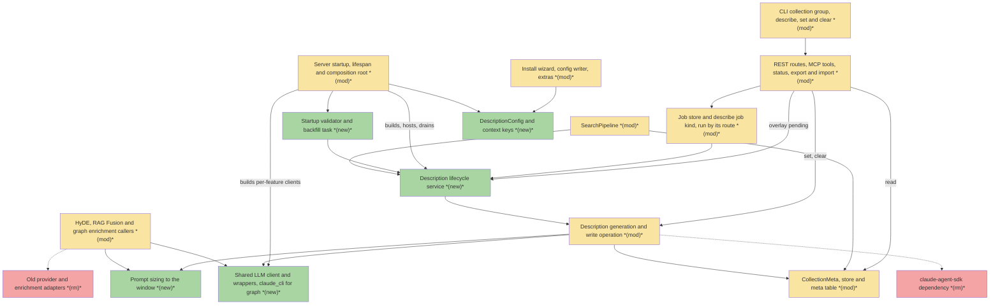
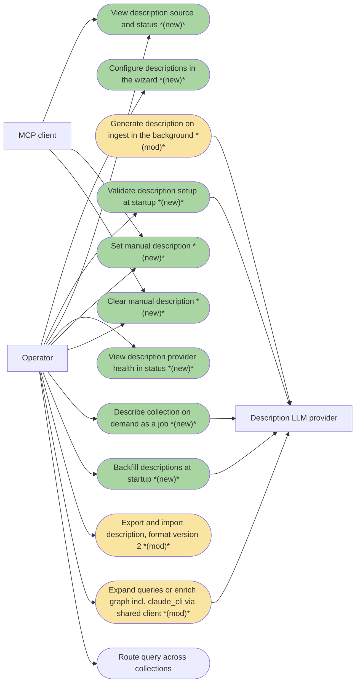
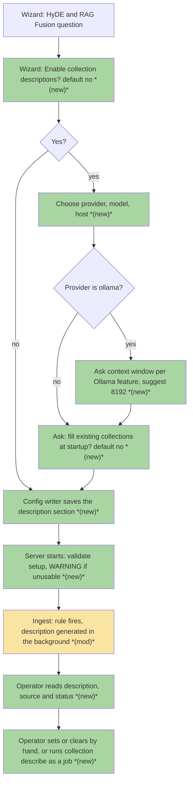
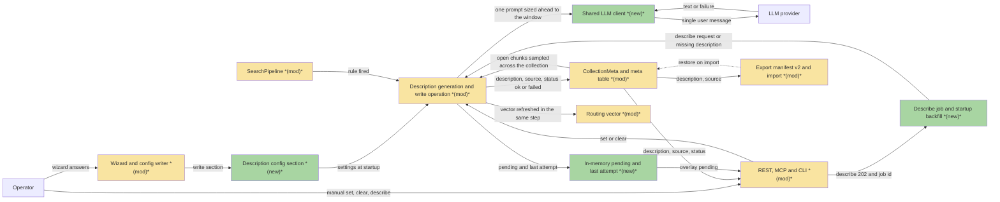
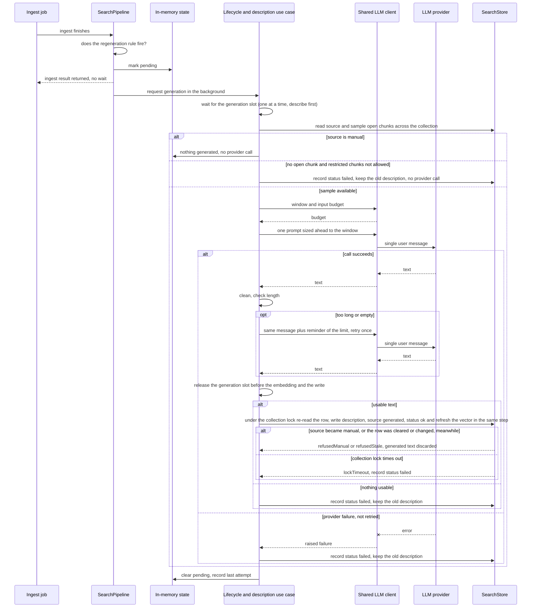
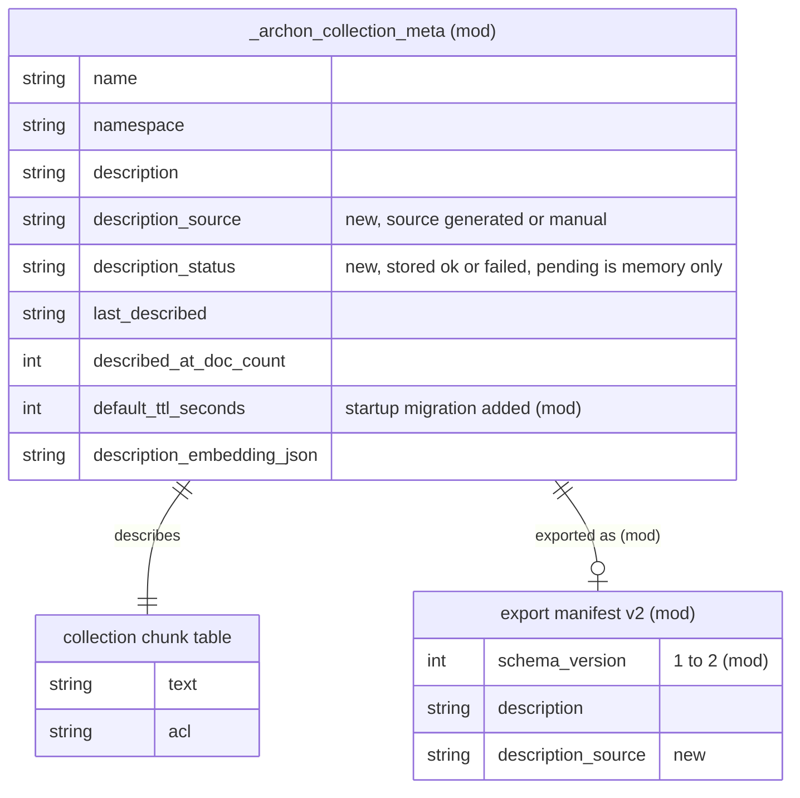

# LCD · Provider-based collection descriptions and a shared LLM client — Team Plan

**How to read this file**
- **Architecture approach:** Clean Architecture — the default; no override skill was requested. **Layers:** Presentation · Use Cases · Interface Adapters · Entities · Frameworks & Drivers. The repository is one flat Python package, not folders named after these layers, so the layer of each component is inferred from its role and from [110_component_catalog_and_layer_breakdown.md](../Architecture/110_component_catalog_and_layer_breakdown.md).
- The **Frontend, Backend, and Tester** sections are the **depth view** — each role's scope, grouped by layer. This is a single-product server with a command-line client: there is no web or mobile UI, so "Frontend" means the operator-facing Presentation layer — the install wizard (with its config writer and extras installer), the `collection` CLI commands and the TOML config templates. Everything else is Backend. The Tester owns end-to-end and manual tests only.
- **Delivery order (agreed in the brief, Q6):** group A — the shared client and the migration of HyDE, RAG Fusion and graph enrichment; the behaviour scenarios S1–S4, S13 and S15 stay true, while every test pinned to the old behaviour or to the old adapter modules is rewritten onto the shared client in the same group (S2–S4 and S13 require one WARNING per process, where today's adapters warn on every failed call, [anthropic_provider.py](../../archon_search/providers/anthropic_provider.py) lines 96-154, so those tests change too; 25 test files import `archon_search.providers` or `archon_search.enrichment` (`grep -rlE --include=*.py 'archon_search\.(providers|enrichment)' tests`), among them [test_anthropic_provider.py](../../tests/test_anthropic_provider.py) and [test_ollama_enrichment_client.py](../../tests/test_ollama_enrichment_client.py)); group B — the description feature on that client, including its stored state (the two status columns and their startup migration); group C — the wizard, the operations (describe job, set and clear, startup validation for descriptions, backfill, `/status`, export version 2) and visibility. Why one plan and this order: group B sits on the client that group A delivers and the existing behaviour tests protect it first (brief, Recommendation). Group B delivers generation and stored state and is testable through a stub client and direct calls; its startup WARNINGs (`think`, restricted chunks) arrive with the startup validator in group C. Role sections list their scope in that order. Task breakdown is a separate downstream step.
- **Contracts** are logical, in **TypeSpec** (version 1.13.0), all in `api-contracts/`: nine internal logical seams as core-construct `.tsp` files checked with `tsp compile <file> --no-emit`, and three HTTP/API seams as TypeSpec HTTP services with an emitted `.openapi.yaml` each (from `api-contracts/`: `tsp compile <name>.tsp --emit @typespec/openapi3 --option "@typespec/openapi3.emitter-output-dir=<dir>"`, then copy `<dir>/openapi.yaml` to `<name>.openapi.yaml`; `@typespec/openapi3` is declared in that folder's `package.json`).
- **Role tags** (`#frontend-role`, `#backend-role`, `#tester-role`) mark each role-owned section — filter a tag (e.g. in Obsidian) to see one role's whole scope.
- IDs (`S#` scenarios, `C#` contracts, `Q#` questions) are the traceability thread; search the file for an ID to find where it is defined.
- **Tasks** are not in this file — task breakdown is a separate downstream step that consumes this plan.
- **Rule:** change a contract only by team agreement.

---

## Background

Collection descriptions are generated by one hard-wired call to the `claude-agent-sdk` package in [description_generator.py](../../archon_search/description_generator.py). It works only when `ANTHROPIC_API_KEY` is set, and the package is a core dependency in [pyproject.toml](../../pyproject.toml), so every installation carries it. Without the key the generator returns nothing; every other failure is logged at DEBUG only; nothing in `/status`, `/ready` or the wizard says the feature is not working; and the operator cannot set a description by hand, because the collection patch route accepts only the embedding model and the default TTL. The four places that call an LLM (HyDE, RAG Fusion, graph enrichment, description) each carry their own provider code with two different failure contracts, and the Ollama enrichment client uses an endpoint where the context window cannot be set per request.

---

## Goal

An operator can turn on collection descriptions in the wizard exactly as they turn on HyDE: choose a provider (`anthropic`, `openai`, `ollama`, `claude_cli`, `llama_cpp`), a model and a host, and get descriptions from a fully local model with no Anthropic key and without `claude-agent-sdk` installed. When the feature is enabled but cannot work, the operator is told at startup, in `/status` and on the affected collection. All four LLM features go through one shared client layer, and each keeps its own provider, model and host. Every prompt is sized to the context window of the model that receives it.

---

## Scope

### In Scope
- A `[description]` config section mirroring `[hyde]` (except `timeout_seconds`, 30 where `[hyde]` has 10 in [config.py](../../archon_search/config.py), and no `max_requests_per_minute`: generations are capped by a process-wide concurrency limit instead, C5): `enabled` (default `false`), `provider`, `model`, `ollama_base_url`, `llama_cpp_base_url`, `ollama_context_tokens`, `backfill_on_startup` (default `false`), `timeout_seconds` (default 30, per attempt), `max_sample_chunks` (default 100), `think` (`default`, `true` or `false`) and `include_restricted_chunks` (default `false`). `ollama_context_tokens` also appears in `[hyde]`, `[rag_fusion]` and `[graph]`.
- A wizard step with its own question and the HyDE-style follow-ups, written by the existing config writer, with the same revert-on-failed-install handling the other provider sections have; the Ollama context question per feature that uses Ollama.
- A shared LLM client layer: one interface, thin wrappers over the existing `anthropic`, `openai` and `ollama` SDKs, `httpx` for `llama_cpp`, and the `claude -p` subprocess for `claude_cli`. Calls are stateless (one user message, no history) and raise on failure; each feature's caller decides its fallback and logs the failure.
- Migration of HyDE, RAG Fusion, graph enrichment and the new description feature onto that layer: clean cutover, no shims, every caller moved, the old adapters, both protocols' old forms, the enrichment factory and the query-expansion builder removed. The modules and callers (from a grep of the repository): the five adapters under [providers/](../../archon_search/providers/), the enrichment clients and [factory.py](../../archon_search/enrichment/factory.py) under [enrichment/](../../archon_search/enrichment/), the old forms in [query_expansion_protocol.py](../../archon_search/query_expansion_protocol.py) and [graph_enrichment_protocol.py](../../archon_search/graph_enrichment_protocol.py), and in [app.py](../../archon_search/server/app.py) `_build_query_expansion_provider` and the `EnrichmentClientFactory` use; the callers to move are [hyde.py](../../archon_search/hyde.py) and [rag_fusion.py](../../archon_search/rag_fusion.py) (each imports the Anthropic provider lazily and `provider_key_available`), [community_builder.py](../../archon_search/community_builder.py), [model_validation.py](../../archon_search/model_validation.py) (the factory use and the startup probe), and the status renderer in [status.py](../../archon_search/cli/status.py) (`_PROVIDER_ENV_VAR` and the key warning, which also learns the description block). The same grep hits [maintenance_loop.py](../../archon_search/jobs/maintenance_loop.py), [routes_graph.py](../../archon_search/server/routes_graph.py) and [wizard.py](../../archon_search/install/wizard.py), which the dev checks. The two `SearchPipeline` constructions in [runner.py](../../archon_search/eval/runner.py) build no LLM client and stay as they are as long as the pipeline's new description-service parameter is optional, `None` meaning no generation.
- Graph enrichment gains `claude_cli` on the shared client (reverses the deferral in the ADR C6), with the prompt on standard input and the graph rate limit applied to it. Every feature on `claude_cli` now sends its prompt on standard input (not in the argument list, which shows in the process list and hits the size limit on a large sample), and the subprocess is locked down (tools disabled, no session saved, `--max-turns 1`, `--safe-mode`, neutral working directory, an allowlisted environment with no `CLAUDECODE`, API key or bearer token, killed on timeout and on cancellation).
- Context-window handling: cloud providers get no setting and no trimming; `llama_cpp` reads its window from `GET /props` and counts exactly with its tokenize call; `ollama` takes `ollama_context_tokens`, sends it as `num_ctx` and estimates with a gpt2-based token counter plus a 20% margin (`ollamaEstimateMargin`, C1). The counter is a new component: the repository has none, gpt2 only appears as the tokenizer name the chunker passes to its chunking library ([chunker.py](../../archon_search/chunker.py) lines 20 and 121). Every prompt is sized ahead of time to the window; there is no truncation detection after the call. A startup WARNING fires when the configured Ollama window exceeds the model's real maximum.
  - Revised after implementation (2026-11-01): HyDE and RAG Fusion are sized to the window by `archon_search/llm_client/fit.py` (`fit_query_to_window`): the template's budget is asked of the client and the query is cut to it, so no fixed 2000-character query cut remains; cloud is unbounded and the query is sent untouched; a request-free `token_ceiling` fast path skips counting when the query already fits, and `TemplateCostCache` keeps the template's cost. The Ollama estimate also counts digits, astral-plane characters (emoji) and special tokens on top of gpt2 tokens, and the `llama_cpp` budget counts the chat framing through `POST /apply-template` and honours `think`.
- Description output rules: one line, at most 600 characters, cleaned, one automatic retry, then trimmed to the last full sentence; nothing usable means status `failed`. A generous answer ceiling and the `think` setting make reasoning models work.
- The description sample is drawn across the whole collection (not the first rows), capped by `max_sample_chunks`, and uses only open chunks (no ACL) unless the operator allows restricted chunks for a local provider; the draw is deterministic: the open chunks ordered by `chunk_id` and picked evenly spaced over all of them (C2).
- Visibility: startup WARNING for a configured but unusable provider, a WARNING when `routing_strategy = "hybrid"` runs without descriptions, warn-once rate limiting, per-collection `description_source` and `description_status`, and the `/status` description block.
- Manual description set and clear through dedicated REST routes, two MCP tools and CLI verbs; `collection describe` as an on-demand job (`--wait`, `--all`) that forces regeneration: the intent of the existing but unreachable `force_regenerate_description` flag, which lives only on `ingest_directory` and cannot be reached from a job, so the force path moves into the lifecycle's entry point (C5) and the unreachable parameter is removed.
- A startup backfill task (off by default) hosted next to the startup sync.
- One shared write-description operation that refreshes the routing vector in the same step.
- The two new metadata columns by startup migration (no schema version bump), plus the missing `default_ttl_seconds` startup migration (a recorded decision that reverses the documented "run `POST /collections/{name}/migrate`" practice for that one migration; see Known limitations).
- Export manifest version 2 carrying `description` and `description_source`; every existing backup becomes a version 1 archive that needs `ignore_schema_version` to restore (see Known limitations).
- Removal of `claude-agent-sdk` from [pyproject.toml](../../pyproject.toml), `_ENV_LOCK`, the `CLAUDECODE` environment mutation, and the SDK assertion in [test_cli_startup_latency.py](../../tests/test_cli_startup_latency.py).
- A new ADR (the next free number, 19 today; the interface-parity service-layer plan also claims it, so whichever lands second takes the next and updates its references; ADRs are append-only, so it supersedes the relevant parts of [C6-local-llm-provider.md](../ADRs/C6-local-llm-provider.md) and [12_local_prose_relations_enrichment_narrowed.md](../ADRs/12_local_prose_relations_enrichment_narrowed.md) instead of editing them), a [BREAKING.md](../../BREAKING.md) entry, and updates to the architecture, security, operator and user docs listed in Documentation update.
  - Revised after implementation (2026-11-01): the ADR landed as number 19, [19_shared_llm_client_and_provider_based_collection_descriptions.md](../ADRs/19_shared_llm_client_and_provider_based_collection_descriptions.md). The `BREAKING.md` entries are indexed as NR-54 to NR-68 in [03_breaking_changes_index.md](../MigrationGuide/03_breaking_changes_index.md).

### Out of Scope
- A no-LLM description built from top terms and file types: dropped by the product owner for now.
- Conversation or session management for LLM calls: every call is already a single stateless message; statelessness becomes a tested contract of the client instead.
- A plain-HTTP rewrite of the Anthropic, OpenAI and Ollama adapters: the `anthropic`, `openai` and `ollama` SDKs stay as the way to reach those providers (the old adapter modules are replaced by the shared client's thin wrappers).
- A default limit on the context window for cloud providers: they have ample room, and the largest known prompt (about 51k tokens) fits.
- Changing the 20% regeneration rule, the routing algorithms or the description prompt wording (only the output rules are added).
- Per-collection provider overrides and multilingual or customised prompts.
- A `think` setting for HyDE, RAG Fusion or graph (a possible later follow-up), an MCP describe tool, and an `--enable-description` install flag.

---

## Acceptance criteria
- With `[description]` enabled and a reachable provider, a first ingest returns without waiting for the model; the description then appears with source `generated` and status `ok`.
- A fully local setup (`ollama` or `llama_cpp`) produces descriptions with no Anthropic key and without `claude-agent-sdk` installed; the package is gone from the dependency list and from lightweight CLI start-up.
- With the feature disabled (the default) nothing is sent to any provider.
- Enabled but unusable (provider unreachable, key missing, context window unknown) logs a WARNING at startup and still boots; with `ANTHROPIC_API_KEY` set and no `[description]` section a notice says descriptions are off and how to turn them on; writing `enabled = false` silences it.
- The operator sees description, source (`generated` or `manual`) and status (`ok`, `failed`, or `pending` while a run is in flight) through the collection metadata calls, and the description provider's health (reachability as of the startup probe), effective context window and last attempt in `/status` (null when the feature is off) — not in `/ready`.
- A manual description can be set and cleared through REST, MCP and CLI by the key whose namespace owns the collection, including meta-only collections; generation never overwrites it; clearing resets the collection and the next trigger regenerates.
- `collection describe <name>` (a job, with `--wait`) and `collection describe --all` run on demand and ignore `backfill_on_startup`; with `backfill_on_startup = true` the server fills collections that have no description, one at a time, in the background, across every namespace, cancellable at shutdown. With descriptions not configured (`[description]` absent or `enabled = false`) `POST /collections/{name}/describe` answers 409 with a setup message and the command prints it and exits 1 — S32.
- A failed save (lock timeout) is a failed description, not a swallowed one; a bad model result is retried once, then trimmed or, with nothing usable, sets status `failed` instead of storing garbage.
- HyDE, RAG Fusion, graph enrichment and description all call the shared client; each keeps its own provider, model, host and context setting; failures keep each caller's fallback (`hyde_applied: false`, `summary_text=None`) and log one WARNING per process.
- `ollama` sends its context size as `num_ctx`; `llama_cpp` reads its window from `GET /props`; every prompt is sized ahead of time to the window minus the output reserve and the prompt template.
- Chunks with any ACL are never sent to a description model unless the operator allows it for a local provider; the sample is drawn from open chunks across the whole collection, ordered by `chunk_id`, and is the same on every run — S10, S55, S56, S57, S82.
- Export writes manifest version 2 with `description` and `description_source`; version 1 archives are refused unless `ignore_schema_version` is set.
- The wizard asks its own "Enable collection descriptions?" question (default no) with a privacy banner, the HyDE-style follow-ups, the Ollama context question (suggests 8192) and the backfill question (default no); a failed install reverts the section.
- Graph enrichment works on `claude_cli` through the shared client: prompt on standard input, tools disabled, the graph rate limit applied — S64, S79.
- A graph provider whose package is missing is a WARNING with the install hint and graph stays off; HyDE and RAG Fusion still refuse to start; a missing description provider package is a WARNING and generation fails visibly — S16, S65, S75.
- The routing vector follows every description change: generate, manual set, clear and import — S43, S69.
- A store whose metadata table lacks `default_ttl_seconds` starts and accepts metadata writes — S73.
- With `routing_strategy = "hybrid"` and collections without descriptions a startup WARNING names the centroid fallback; with `anthropic`, `openai` or `claude_cli`, or `ollama` or `llama_cpp` on a host that is not loopback, a startup INFO says excerpts leave the machine — S37, S38.
- Concurrent description writers never lose a manual description or mix fields, a describe loop is serial and starts at most one generation per collection, and every in-flight generation is cancelled at shutdown — S74, S80, S35, S85.
- Excerpt and description text never reaches logs or telemetry — S76.
- Tag-like or multi-line description text (generated, imported or legacy) cannot break the router's prompt block, import normalises text to one line of at most 600 characters, and an older writer that omits the new keys leaves the stored source and status alone — S77, S78, S83.
- Tests pinned to the old behaviour are rewritten or deleted, not re-pinned (the list is under Tester); the provider registry sync test stays green; all tests pass with zero warnings.

---

## What does NOT change
- The 20% regeneration rule and the description prompt wording (only the output rules are added); the 100-chunk ceiling stays as the default of `max_sample_chunks`.
- Routing algorithms (centroid and hybrid) and the telemetry no-raw-query rule.
- `/ready` semantics: description health never feeds it.
- Boot is never blocked by an optional LLM provider (same rule as the C6 provider work).
- API keys stay in `.secrets.env`; cloud providers get no context-window setting and no trimming.
- The `anthropic`, `openai` and `ollama` SDKs stay as the way to reach those providers; only the adapter modules around them are replaced.
- `PATCH /collections/{name}` and the MCP `update_collection` stay unchanged; only collection creation is admin-only.

---

## Known limitations / accepted trade-offs
- Off by default, with a startup notice and a [BREAKING.md](../../BREAKING.md) entry: an existing Anthropic-key operator stops getting descriptions until they opt in.
- The `pending` state is held in memory and is lost on server restart; the next qualifying ingest or a `collection describe` call picks it up.
- A missing Ollama context value assumes 4096, is not sent as `num_ctx`, and logs a startup WARNING (existing HyDE, RAG Fusion and graph Ollama users see it after upgrade); a failed `llama_cpp` probe assumes 4096 and logs a WARNING.
- No truncation safety net (the brief's product decision): prompts are sized ahead of time. The Ollama estimate (gpt2-based counter plus a 20% margin) was measured by the dev on English, Python code and a small Hungarian sample (real tokens over gpt2 tokens at most 1.02; a measurement of the dev's machine that cannot be reproduced from the repository, so S50 re-measures it); Chinese, Japanese, emoji and digit-heavy text were not tested, and a tokenizer that splits digits or rare scripts into more tokens than gpt2 could exceed the 20% margin. Real truncation never happens in tests today. If it did happen on Ollama, the model would describe a prompt that lost its tail and the result would still be stored as `ok`. Mitigations: the 20% margin, the reserved answer space, an explicit `ollama_context_tokens`, the startup WARNING for an oversized window, and the manual real-text check of S50 on digit-heavy and CJK samples; comparing Ollama's reported prompt token count with the sent estimate is the cheapest later guard (a future iteration, not in scope).
  - Revised after implementation (2026-11-01): the Ollama estimate now adds a surcharge for digits, astral-plane characters (emoji) and special tokens, so digit-heavy and emoji text are no longer a known gap of the gpt2-only count; the manual run of T-2 (2026-11-01, four real Ollama models) also measured Chinese and Japanese text, which cost at most 0.76 of the gpt2 count, so no text class named above is left unmeasured; a tokenizer family that was not measured stays unproven, and nothing is checked after the call.
- Two Ollama features sharing a model with different context values make Ollama reload the model on each switch (load of 9 to 13 s measured by the dev, not reproducible from the repository); the wizard asks per feature and offers the previous value.
- Legacy description text may break the new one-line and 600-character rules; it is replaced at the next qualifying regeneration or `collection describe`, the router renders any description as one line with angle brackets escaped (S77, S83), and import normalises it (C9).
- Cloud providers receive up to `max_sample_chunks` open chunk excerpts, and a retry sends them twice; the operator opts in through the wizard banner and a startup INFO.
- `think` has no verified switch for `anthropic`, `openai` and `claude_cli` and applies to descriptions only; the `llama_cpp` switch is template dependent and untested (verify when building). `think` and `include_restricted_chunks` are accepted for every provider and ignored with a startup WARNING where unsupported, not rejected, so one config file stays valid when the provider changes; the cost is that a mis-set value only warns.
  - Revised after implementation (2026-11-01): the `llama_cpp` switch is `chat_template_kwargs: {"enable_thinking": <bool>}` on the chat call (and on the `/apply-template` call that sizes the prompt), read from the llama.cpp server documentation and its source and exercised against a real llama-server (T-2, T-7); whether it takes effect still depends on the chat template.
- The Ollama output-ratio and the older-server manifest behaviour (unknown keys ignored) are by reading, not tested.
- No description is built when no LLM is configured (a no-LLM description is a future iteration).
- An unset `ollama_context_tokens` is an assumption, not a guarantee: Ollama's own default window depends on the machine's VRAM (4k under 24 GiB, 32k, 256k) and on `OLLAMA_CONTEXT_LENGTH` ([Ollama documentation](https://docs.ollama.com/context-length)). On a server whose real window is below 4096 (a lowered environment value; older versions are not verified here) an unsent `num_ctx` cannot protect the prompt. The brief decides that an unset value is not sent; the startup WARNING tells the operator to set the key.
- `timeout_seconds` defaults to 30 per attempt, which can be too short for a cold local model (a 9 to 13 s load plus prefill of a large sample on a CPU). A timeout is a provider failure: it is not retried, stores `failed`, and the next trigger retries it; operators of slow machines raise the key.
- Reachability in `/status` is the result of the startup probe and is not refreshed while the server runs: a provider that goes down later still reads reachable, and the failure shows only in the last attempt and on the collection (`failed`).
- Backfill skips collections whose stored status is `failed` (the brief's rule), so a collection left `failed` by an outage is never retried automatically; the next qualifying ingest or `collection describe` retries it, and `describe --all` fills a collection that has no description or whose stored status is `failed` (its client-side skip rule, C10).
- Export format version 2 (the brief's decision) turns every existing backup, including those the automatic backup loop wrote, into a version 1 archive: restoring one needs `ignore_schema_version` (the embedding-model check still applies). Only `description_source` is new, because version 1 manifests already carry `description`. [BREAKING.md](../../BREAKING.md), [100_upgrading.md](../OperatorGuide/100_upgrading.md) and [40_backup_restore_disaster_recovery.md](../OperatorGuide/40_backup_restore_disaster_recovery.md) say so.
- The `default_ttl_seconds` startup migration reverses the documented practice that version-1 migrations run only through `POST /collections/{name}/migrate` (the E2a entry in [BREAKING.md](../../BREAKING.md), [100_upgrading.md](../OperatorGuide/100_upgrading.md), the bump policy in [CLAUDE.md](../../CLAUDE.md)): a metadata write on a table without the column fails inside LanceDB, so the brief decides to apply it at startup. It is idempotent, the migrate route stays valid and becomes a no-op for that spec, and the places that say otherwise are updated.
- With `include_restricted_chunks = true` a description may contain text from chunks the ACL hides, and the description is served to every caller who can see the collection (list, detail, router, MCP); the startup WARNING says so. For `ollama` or `llama_cpp` on a host that is not loopback the restricted text also leaves the machine; that case warns and is not blocked (the brief's rule).
- Any key whose namespace owns a collection can run `collection describe` or `describe --all` in a loop and force paid provider calls past the 20% rule. Generations are serial (one at a time in the process) and single-flight per collection, but there is no per-key rate limit.
- Rolling back to the previous server: its writers omit the two new keys. That LanceDB then leaves the stored columns untouched is an assumption, not something the repository proves (lancedb 0.41.0's `_do_merge` passes `allow_subschema=True`, table.py line 7038; the matched-row behaviour is in the Rust core); S78 verifies it, and if it holds the store opens. The jobs file keeps rows with `job_type` `description`: the older loader reads an unknown type as a plain ingest job (jobs/store.py lines 626-627), which works because a description job persists only base job fields (a persisted extra field would raise inside the load and reset the whole jobs file, line 671; S81), and a description job RUNNING at a crash is marked FAILED without arming the crash-loop guard, which keys on the stored `job_type` string (line 642). The older server does not know `manual` and may regenerate over a manual description, and a description it wrote keeps the stored source and status of the text it replaced; clearing the description resets them.
- A generated description is built from untrusted chunk text and is placed in the router's `<search_collections>` prompt block. The router escapes angle brackets and collapses whitespace so the text cannot close the block or forge a `- name:` row (S77, S83), but a semantically misleading description can still bias routing. The same text reaches MCP agents and REST clients verbatim in list and detail results; it is returned only inside a JSON string field and the MCP schema labels it as data derived from document content, but an agent that obeys it can be misled (the threat model records this, see Documentation update).
- (Revised after implementation, 2026-11-01: these are now exercised by `tests/_fake_model_server.py`, the real-subprocess `tests/_fake_claude.py` and the manual runs of T-2, T-4 and T-7.) The `GET /props`, tokenize and `claude -p` standard-input behaviours are not exercised anywhere in the repository today; they are read from the servers' documentation and proven by the live tests (S50, S64) when building.
- The `claude_cli` flags and environment were checked against the local `claude` 2.1.308 on macOS only: `--max-turns` is accepted but not listed by its `--help`, so a later version may drop it (the call then fails visibly with an unknown-option error), and the environment allowlist (`PATH`, `HOME`, `USER`, `LOGNAME`, `LANG`, `LC_*`, `TMPDIR`, `CLAUDE_CONFIG_DIR`) needed `USER`, `LOGNAME` and `TMPDIR` there to find the login; the Windows and proxy entries are inferred ([INFERENCE]) and a login that is not found fails visibly.
- The slot queue holds at most 64 requests (`maxQueuedGenerations`, C4): an ingest-rule or backfill request over the bound is dropped with one WARNING per process and retried by the next qualifying trigger (its baseline stays unset), and a describe over the bound settles `failed`.
- A legacy description that has no stored routing vector gets one from the recompute only when the embedder the caller passes has the collection's model (a single-model installation); otherwise it stays vectorless, and hybrid routing uses the centroid for it, until the description next changes (C11).
- `host.docker.internal`, `0.0.0.0` and every hostname other than `localhost` count as not loopback (no DNS lookup, C5), so an operator whose Ollama runs on the Docker host gets the privacy INFO even though the text stays on the machine.

---

## Approach & architecture

The feature follows **Clean Architecture**: one consumer-owned shared LLM client interface at the Use Cases layer, thin provider wrappers at Interface Adapters, composition and the background tasks in the server startup (Frameworks & Drivers), and the description state added to the `CollectionMeta` entity. The same pattern already holds for the query-expansion and enrichment protocols. The work lands in three delivery groups (A shared client and migration, B description feature with its stored state, C wizard, operations and visibility).

### Architecture

_Scope limited to changed nodes only: the full component set exceeds 15 nodes and the 1-hop neighbourhood does too, so closely related components are grouped into one node each (the provider wrappers sit inside the shared client node). Unchanged neighbours (the multi-collection router, the provider SDKs, llama-server, Ollama, the claude binary) are omitted._

| Component | Change | Why |
|-----------|--------|-----|
| Shared LLM client and wrappers | new | One stateless, raise-on-failure interface for all four features (C1); thin wrappers over the `anthropic`, `openai` and `ollama` SDKs, `httpx` for `llama_cpp`, the `claude -p` subprocess for `claude_cli`, now also for graph with the prompt on stdin and the graph rate limit |
| Prompt sizing to the window | new | Sizes every prompt ahead of time: exact count for `llama_cpp`, gpt2-based estimate (a new counter) plus 20% margin for `ollama`; no truncation detection |
| Startup validator and backfill task | new | Warns at startup without blocking boot; fills collections that have no description in a background task started after the startup sync and the reachability probe, and not at all when the startup sync is suppressed (C5) |
| Description lifecycle service | new | Owns every generation task (ingest rule, describe job, backfill), the in-memory `pending` and last-attempt state, the per-collection single-flight and the process-wide generation slot with its bounded, prioritised queue; serves the `pending` overlay to the read paths (the store does not hold it); refuses requests after shutdown begins and drains every task before the stores disconnect (C5). Built and hosted by the server startup |
| DescriptionConfig and context keys | new | The `[description]` section mirroring `[hyde]`, plus `ollama_context_tokens` in the other three sections (C4) |
| Description generation and write operation | modified | Provider-based, typed outcome, output rules, open-chunk sampling across the collection (C2); one shared write that re-reads under the lock, refuses a generated write over a manual description and refreshes the routing vector (C11); the module is [description_generator.py](../../archon_search/description_generator.py) |
| Job store and describe job kind | modified | A new `DescriptionJob` kind (job type `description`; no `JobKind` member and no persisted field beyond the base ones, so an older server still loads it) that its route creates RUNNING and runs as a tracked background task, like the community rebuild and metadata reindex (the scheduler promotes export, import and migration jobs only); not cancellable and never delete-blocking; the store's load, dump and restart-recovery tables, `_job_type` and the `?kind=` filter map name the kind (C10) |
| SearchPipeline | modified | Generation leaves the ingest path and runs in the background through the lifecycle service; the unreachable `force_regenerate_description` parameter is replaced by the lifecycle's forced entry point |
| HyDE, RAG Fusion and graph enrichment callers | modified | Call the shared client, catch failures, keep their fallbacks, log once per process; prompt templates and variant parsing move here |
| CollectionMeta, store and meta table | modified | Gain description source and status by startup migration; the write reports its outcome (C3) |
| REST routes, MCP tools, status, export and import | modified | Source and status fields; set, clear and describe routes; two MCP tools; `/status` block; export version 2 (C6–C10) |
| CLI collection group, describe, set and clear | modified | `describe` with `--wait` and `--all`, `set-description`, `clear-description`, `info` shows source and status |
| Install wizard, config writer, extras | modified | Own question, follow-ups, `[description]` section, per-feature Ollama context, revert, extras for the graph provider |
| Server startup, lifespan and composition root | modified | Builds the per-feature clients and the lifecycle service, runs the startup tasks, hosts the backfill task and drains it and every other generation task at shutdown |
| Old provider and enrichment adapters | removed | Replaced by the shared client wrappers; the modules and callers are named in Scope (Q22) |
| claude-agent-sdk dependency | removed | Package, `_ENV_LOCK` and the `CLAUDECODE` environment mutation go |

**Layer map (and role mapping)**

| Layer | Role | Components |
|-------|------|-----------|
| Presentation | **Frontend** (CLI and wizard) | CLI `collection` group with `describe`, `set-description` and `clear-description`, CLI status rendering, install wizard, config writer, extras installer, install summary, TOML config template |
| Use Cases | Backend (Python) | [pipeline.py](../../archon_search/pipeline.py), description generation and the shared write operation, [hyde.py](../../archon_search/hyde.py), [rag_fusion.py](../../archon_search/rag_fusion.py), [community_builder.py](../../archon_search/community_builder.py), shared client interface, prompt sizing, startup validator and backfill, the description lifecycle service (generation orchestration, `pending`, slot and queue), the consumer-owned protocols [query_expansion_protocol.py](../../archon_search/query_expansion_protocol.py) and [graph_enrichment_protocol.py](../../archon_search/graph_enrichment_protocol.py) (old forms removed) |
| Interface Adapters | Backend | REST routes and schemas, MCP tools and schemas, the route-run describe job and the job store's kind handling, provider wrappers, the old `providers/` and `enrichment/` adapters (removed) |
| Entities | Backend | [collection_meta.py](../../archon_search/collection_meta.py) `CollectionMeta`, `DescriptionConfig` and the other config dataclasses in [config.py](../../archon_search/config.py) |
| Frameworks & Drivers | Backend | [app.py](../../archon_search/server/app.py) composition root and lifespan (builds the lifecycle service and hosts the startup validator, probe and backfill tasks, whose logic is Use Cases), [store.py](../../archon_search/store.py) (LanceDB, implements the `DescriptionStore` port of C3), provider SDKs, `httpx`, the `claude` subprocess |

**What changes**
- Group A: one shared client replaces the two provider families; HyDE, RAG Fusion and graph enrichment move onto it; graph gains `claude_cli`; the Ollama path moves to the native API so `num_ctx` can be set; `ollama_context_tokens` arrives in the three existing sections (`[hyde]`, `[rag_fusion]`, `[graph]`; the fourth, `[description]`, is built in group B) with the startup WARNINGs for an unset or oversized Ollama window and a failed `llama_cpp` probe; graph enrichment for `openai` and `ollama` now needs the matching package (`anthropic` already does), so a startup guard warns and keeps graph off when it is missing and the wizard installs the extra.
- Group B: description generation runs on the shared client, is sized ahead to the model's window, samples open chunks across the collection, validates and retries its output, and records `ok` or `failed`; the two status columns, their startup migration and the shared write operation, and the lifecycle service with its wiring in the server startup and its shutdown drain, land here; the SDK dependency goes.
- Group C: the wizard question and `[description]` section; source and status exposed everywhere; manual set and clear; the describe job and `collection describe`; startup validation, notices and backfill; the `/status` block; export version 2.

**Key decisions (from the brief and the decision log)**
- Own wizard question, default off: descriptions send document text, not queries.
- Off by default, with a startup notice and a [BREAKING.md](../../BREAKING.md) entry; the notice appears only when `ANTHROPIC_API_KEY` is set and `[description]` is absent.
- The shared client wraps the existing SDKs; one interface and one failure contract, not one provider or model for everything.
- Raise-on-failure contract; callers keep their fallbacks and log a WARNING once per process.
- Size ahead, never detect after: `llama_cpp` exact, `ollama` estimate plus 20% margin, cloud none; a startup WARNING when the Ollama window exceeds the model's maximum.
- Output rules: one line, 600 characters, one retry, then trim; manual text follows the same limits but is rejected, never trimmed. `think` is `default`, `true` or `false`.
- Manual wins. Set records source `manual`, status `ok`; clear only resets and starts nothing. Whoever changes the description refreshes its routing vector in the same step.
- `pending` is memory only, a derived read value overlaid on the stored status; stored status is `ok`, `failed` or empty; legacy descriptions read as `generated` / `ok`.
- Manual set and clear are dedicated REST and MCP operations authorised by "the collection exists in the caller's namespace" (no admin); the describe route is a job.
- Backfill is a startup background task, off by default; one collection at a time, skipping collections being generated and collections whose stored status is `failed`, and not running at all while the startup sync is suppressed.
- ACL: only open chunks are sampled; `include_restricted_chunks` is for local providers only.
- Import restores the description under export version 2; health is reported in `/status` and the startup log only, never in `/ready` or `provider_warnings`.
- The two new columns are added by startup migration with no schema version bump.

### Actors & Use Cases

_Scope limited to the change neighbourhood: the full set exceeds 15 nodes, so the existing Anthropic-key operator and the API key holder (namespace owner) appear as the Operator, and the three features that already use an LLM (HyDE, RAG Fusion, graph enrichment) are one use case. MCP has no describe tool, so the MCP client reaches only view, set and clear._

### Flows

#### User Flow

#### Data Flow

#### Sequence

### Prior decisions

| Decision | Rationale | Constraint |
|----------|-----------|-----------|
| [C6-local-llm-provider.md](../ADRs/C6-local-llm-provider.md): `llama_cpp` is the fifth provider; one provider registry; query-expansion adapters never raise, enrichment clients raise; the dependency guard never covers `llama_cpp` or httpx-only enrichment; `claude_cli` has no enrichment client; `llama_cpp` graph calls are exempt from the rate limit because a local server has no account quota; `llama_cpp_ok` probe notes (partially superseded by ADR 12, relationship labelling only) | Local-model parity without new dependencies; one place to keep in sync; boot never blocked | The new ADR supersedes the never-raise versus raise split, the "graph enrichment needs no extra" rule, the `claude_cli` graph deferral (graph now offers all five providers; the registry sync test changes from four of five to all five) and the `llama_cpp_ok` and probe notes. The exemption stays for `llama_cpp` only; `claude_cli` graph calls get the rate limit. Today only the Anthropic enrichment client throttles (the `openai` and `ollama` enrichment clients have no limiter), so the limiter moves into the shared client layer and applies to `anthropic` and `claude_cli` graph calls (C1). The registry stays the single source and [test_provider_registry_sync.py](../../tests/test_provider_registry_sync.py) stays green |
| [12_local_prose_relations_enrichment_narrowed.md](../ADRs/12_local_prose_relations_enrichment_narrowed.md): the enrichment protocol is narrowed to community summarisation; the client is built once and injected into the community builder; provider warnings are actionable-only and feed `/ready` | The local engine owns relations; protocol carries only what its consumer uses | The shared client's graph surface stays summarisation-only (one message in, text out); the model probe moves onto the shared client; no relationship labelling and no provider-notes channel; description health must not use the provider warnings, because they feed `/ready` |
| [C4-hyde-external-llm-dependency.md](../ADRs/C4-hyde-external-llm-dependency.md): HyDE is opt-in, falls back silently, never logs query text, prints a startup INFO when enabled, `anthropic` is an optional extra | Privacy first; availability over quality | Keep the `hyde_applied: false` fallback and operator opt-in; the move from silent to a rate-limited WARNING must keep the no-raw-query guard green; the startup INFO is the model for the description privacy INFO |
| [C5-rag-fusion-external-llm-dependency.md](../ADRs/C5-rag-fusion-external-llm-dependency.md): RAG Fusion is opt-in, falls back to the single query, wins over HyDE, has its own rate limiter | Recall for vocabulary-mismatch queries with explicit consent | Keep `rag_fusion_applied: false`, the mutual exclusion, per-feature rate limits and the no-raw-query guard; each feature keeps its own provider, model and host |
| [07_description_embedding_hybrid_routing.md](../ADRs/07_description_embedding_hybrid_routing.md): hybrid routing blends the centroid and the description embedding; the embedding is computed in the metadata recompute; the "Prior decisions" row says it is backfilled at startup (no such startup backfill exists in the code); new metadata columns are tolerated when absent | The description is an orthogonal routing signal | A changed description must not leave a stale embedding (one shared write path refreshes the vector); the new columns follow the startup-migration practice with column-absent tolerance; the bulk metadata payload stays lean; the hybrid-without-descriptions WARNING ties to this ADR's fallback to the centroid; the new ADR records the missing backfill |
| [04_multi_collection_router_with_centroid_preranking.md](../ADRs/04_multi_collection_router_with_centroid_preranking.md): centroid pre-ranking with a confidence gate; descriptions judged too short and noisy as the primary signal | Bounded fan-out, cheap local routing | Routing algorithms are unchanged; the router must tolerate the new metadata fields |
| [05_opt_in_local_telemetry_no_raw_query.md](../ADRs/05_opt_in_local_telemetry_no_raw_query.md): telemetry is opt-in and structurally has no raw query | Privacy default for a local tool indexing sensitive content | Description generation adds no excerpt text or description text to telemetry or logs |
| [08_per_collection_embedder_lru_cache.md](../ADRs/08_per_collection_embedder_lru_cache.md) and [11_embedder_cache_bounded_waiter_timeout.md](../ADRs/11_embedder_cache_bounded_waiter_timeout.md): each collection is embedded with its own model through a bounded LRU cache whose waiters have a time bound | Per-collection embedding models are real, and the router accepts a description vector only for a matching model and length | The shared write embeds a description with the collection's own embedder from the cache, not the global embedder the metadata recompute uses today; the wait is bounded on the caller's side (`embedWaitSeconds`), because the cache's own bound covers only a waiter that joins another load, never the caller that is the loader, and a failure keeps the description without a vector (C11) |
| [06_durable_state_writes_via_fsync.md](../ADRs/06_durable_state_writes_via_fsync.md): durable state writes go through the durable-write helper | A plain replace is not durable across power loss | Any new durable state written outside the store and the config writer uses the helper; `pending` and the last attempt are held in memory, so no new durable file is needed |
| [14_wizard_prewarm_loads_models.md](../ADRs/14_wizard_prewarm_loads_models.md): the wizard pre-warm is fatal only for the embedder, with config rollback | Installs that pass must work at runtime | The `[description]` section reverts on a failed install like the other provider sections; no fatal pre-warm for an optional LLM provider |
| [16_wizard_validates_cuda_before_writing.md](../ADRs/16_wizard_validates_cuda_before_writing.md): the wizard re-runs the tool install with the receipt's exclusions when it adds an extra | Config never claims what is unavailable | Removing the SDK and adding graph extras uses the existing extras mechanism, not hand-rolled installs |

Revised after implementation (2026-11-01): the "four of five to all five" change to the registry sync test (decision row for [C6-local-llm-provider.md](../ADRs/C6-local-llm-provider.md) above) is done: `tests/test_provider_registry_sync.py` now guards all five providers for the graph prompt too, and its docstring says so.

### Contradictions

All entries below are resolved in this revision.

**Brief vs reality** (resolved)
- **Graph enrichment extras.** The brief said all three enrichment clients use `httpx` and need no package. The [anthropic.py](../../archon_search/enrichment/anthropic.py) client imports the `anthropic` package lazily, while [openai.py](../../archon_search/enrichment/openai.py) and [ollama.py](../../archon_search/enrichment/ollama.py) use `httpx` only. Resolved (Q16): `anthropic` needs the `anthropic` package (extra `hyde`, already needed), `openai` and `ollama` need their packages after the migration (extras `openai-provider` and `ollama`, already declared in [pyproject.toml](../../pyproject.toml); only graph's use of them is new), `llama_cpp` nothing, `claude_cli` the binary; the brief is corrected.
- **`claude_cli` for graph enrichment.** [factory.py](../../archon_search/enrichment/factory.py) returns no client for `claude_cli` and the ADR C6 defers it. Resolved (Q15): graph gains `claude_cli`; the new ADR supersedes the deferral.
- **Unlocked-deps lane cannot prove an absent package.** The plan assumed the unlocked-dependency lane proves "SDK not installed", but that lane installs every extra. Resolved (Q23): the claim is proven by removing the package from [pyproject.toml](../../pyproject.toml) and the lock file, asserting it is not importable, plus the existing module-masking pattern.
- **"Same authorization as PATCH".** The plan said manual set and clear reuse the authorization of `PATCH /collections/{name}`, which hid that PATCH returns 404 for a collection with no config-path entry, so meta-only collections would fail. Resolved (Q14): dedicated set and clear operations check "the collection exists in the caller's namespace" and the PATCH config-path rule is not used.
- **Group B done-when needed Group C columns.** The group B checklist asked for stored `ok` or `failed` while the status columns and their migration were delivered in group C. Resolved: the columns and the startup migration move into group B; the order stays A, B, C.

**Code vs docs** (resolved)
- **"User-provided" description.** [130_data_architecture_and_persistence.md](../Architecture/130_data_architecture_and_persistence.md) calls the `description` column "auto- or user-provided", but no code path lets a user provide one today. The code is correct for today's behaviour. Owner: doc needs updating (listed in Documentation update).
- **Schema version policy.** The bump policy in [CLAUDE.md](../../CLAUDE.md) and the comment next to the version in [store.py](../../archon_search/store.py) say a metadata schema change bumps `STORE_SCHEMA_VERSION` and adds a `MigrationSpec`, but the two newest metadata columns were added by startup migrations with no bump. Resolved (Q8): the new columns follow the practice; the policy text and the comment are updated. Owner: doc needs updating.
- **`llama_cpp_ok` feeding `/ready`.** The earlier C7 and Q18 text said `llama_cpp_ok` feeds `/ready`. In the code, [routes_ready.py](../../archon_search/server/routes_ready.py) grades only `embedder_ok`, `reranker_ok` and `provider_warnings`; `llama_cpp_ok` is a `/status` field only. Resolved (Q18): description health must not use `provider_warnings`; `llama_cpp_ok` is unchanged. Owner: plan corrected.
- **No cross-namespace listing call.** The earlier Q19 said none was found; `SearchStore.get_all_collections_meta` in [store.py](../../archon_search/store.py) lists every namespace. Resolved (Q19). Owner: plan corrected.
- **`pending` shown as stored.** The earlier Data section and sequence diagram showed `pending` as a stored status. Resolved (Q9): it is memory only; the Data section and the sequence diagram are corrected.
- **ADR 07 claims a startup backfill.** The "Prior decisions" row of [07_description_embedding_hybrid_routing.md](../ADRs/07_description_embedding_hybrid_routing.md) says the description embedding is backfilled at startup; no such backfill exists in the code. Resolved (Q12): the shared write path refreshes the vector, and the new ADR records the correction (ADRs are append-only). Owner: doc needs updating, via the new ADR.
- **"C8 empty text clears".** The earlier C8 said an empty text clears the description, which conflicts with the explicit set and clear tools. Resolved (Q14): `set_collection_description` rejects empty text; `clear_collection_description` clears.
- **Existing `default_ttl_seconds` startup migration gap.** The gap is documented, not an oversight: the column belongs to a version-1 `MigrationSpec` that operators run through `POST /collections/{name}/migrate` ([store.py](../../archon_search/store.py) `_all_migrations`, the E2a entry in [BREAKING.md](../../BREAKING.md), [100_upgrading.md](../OperatorGuide/100_upgrading.md), the bump policy in [CLAUDE.md](../../CLAUDE.md)), and `_run_startup_migrations` does not call `migrate_default_ttl_seconds`. Every metadata writer includes the `default_ttl_seconds` key, and LanceDB's merge raises `Field 'default_ttl_seconds' not found in target schema` for a key the table lacks (the message comes from LanceDB's `_align_field_types`; reproduced here with a merge on an unknown column), so a description write on an un-migrated table fails. Resolved (Q26): the brief decides to add the migration to the startup migrations in this feature; it is idempotent, the migrate route stays valid, and the documents above are updated to say so (see Known limitations). Owner: code is the issue, fixed here; the documents need updating.

---

## Contracts / seams

Boundaries where roles must agree. **Logical, not code.** Changing one requires team agreement. **TypeSpec** (1.13.0) is used: C1–C5, C8, C9, C11 and C12 are internal logical seams in core-construct `.tsp` files, each compiled clean with `tsp compile <file> --no-emit`; C6, C7 and C10 are HTTP/API seams authored as TypeSpec HTTP services in `api-contracts/` and emitted to OpenAPI 3 with `@typespec/openapi3`, all compiled and emitted clean. `GET /openapi.json` stays the authoritative wire contract of the running server; the HTTP contracts model only what this feature changes. No contract is provisional any more.

**C1 — Shared LLM client**  *(Use Cases ↔ Interface Adapters)*
One consumer-owned interface for all four features: one user message in, text out, no history; every failure is raised. The client reports its context window (configured, probed or assumed `assumedContextTokens` = 4096, or unbounded for cloud) and an input budget (callers ask for it with the longest form of their prompt, the template plus the retry reminder, so the retry of a full sample still fits a small window); there is no truncation signal. Sizing is ahead of the call: exact for `llama_cpp`, a new gpt2-based counter plus `ollamaEstimateMargin` = 20% for `ollama`, none for cloud. The window startup WARNINGs (unset or oversized Ollama window, failed `llama_cpp` probe) live in this layer and ship in group A. A thinking setting (`default`, `true`, `false`) rides on the request. `claude_cli` carries the prompt on standard input for every feature and runs locked down: all tools disabled, no session saved, no slash commands or MCP servers, `--max-turns 1`, `--safe-mode` (the operator's own CLAUDE.md, hooks and plugins neither change the output nor see the excerpts), a neutral working directory, an ALLOWLISTED per-call environment (`PATH`, `HOME`, `USER`, `LOGNAME`, `LANG`, `LC_*`, `TMPDIR`, `CLAUDE_CONFIG_DIR`: no `CLAUDECODE`, no API keys, no bearer token, so the call bills the Claude login and never an API key; no global mutation), and the child is killed on timeout and on cancellation. The wrapper's transport retry on a non-zero exit stays for HyDE and RAG Fusion only and is off for graph and description, whose prompts hold excerpts that a retry would send twice. It serves graph too with the graph rate limit, which moves into this layer (today it exists only inside the Anthropic enrichment client) and applies to `anthropic` and `claude_cli`. Each feature builds its own client. — see [2026-10-30-010-llm-collection-descriptions-c1-shared-llm-client.tsp](./api-contracts/2026-10-30-010-llm-collection-descriptions-c1-shared-llm-client.tsp)

Revised after implementation (2026-11-01): a description call that may think (`[description].think` is not `false`) asks for the answer reserve plus `DESCRIPTION_THINKING_HEADROOM_TOKENS` (3072), paid for out of its sample (at most half of a bounded input budget, and none of it when that would leave no room for one excerpt), because a reasoning model's thinking counts against the answer ceiling. HyDE and RAG Fusion size the query with `llm_client/fit.py` instead of a fixed 2000-character cut (cloud untrimmed). A `/search` or `/explain` whose client disconnects, and the MCP search tools, cancel the provider call, so a real `claude` child does not outlive the abort (`CancelOnDisconnectMiddleware`, `CancelMcpToolOnDisconnectMiddleware`).

**C2 — Description generation**  *(Use Cases ↔ Use Cases)*
From a sample of open chunk excerpts to a typed outcome: generated text (possibly trimmed), or a failure with a reason (call failed, unusable output, no unrestricted chunks, sample read failed, save failed). The sample is deterministic: the open chunks sorted by `chunk_id` (never stored row order, which shifts with compaction and re-ingest), then the largest count up to `max_sample_chunks` that fits the budget, found by a stated shrink loop and spaced evenly over all of them, so a small window never reduces it to the head of the collection. The rows come through the store port, and a read error is its own failure (`sampleReadFailed`), never read as "no unrestricted chunks". A manual source or a collection with no open chunk makes no provider call. One line, at most 600 characters (`maxDescriptionChars`, C4), one automatic retry, then trim to the last full sentence. Generation never raises; a failure never replaces an existing description. — see [2026-10-30-010-llm-collection-descriptions-c2-description-generation.tsp](./api-contracts/2026-10-30-010-llm-collection-descriptions-c2-description-generation.tsp)

**C3 — Description state**  *(Use Cases ↔ Entities, through the `DescriptionStore` port that the store implements)*
Every collection carries a source (`generated` or `manual`) and a stored status (`ok` or `failed`); `pending` is an in-memory overlay owned by the lifecycle (C5) and applied at the API edge, never by the store, so the `description_status` that readers see is a derived value. Legacy descriptions read as `generated` / `ok`; an empty description with no failed attempt reads empty, and a failed attempt on a collection with no description stores `failed`. Manual wins, checked inside the collection lock at write time: the store write re-reads the row, applies a guard and changes only the description fields, each stated as keep, set or clear (so "unchanged" is never confused with "empty"); a generated write and a recorded failure carry the state the generation started from and are refused when the row differs (`refusedManual` for a manual set, `refusedStale` for a clear or any other change), so a failure landing after a clear never leaves a `failed` status that backfill would skip for good; and every other whole-row writer carries the description fields and the stored vector as read inside the lock, never from an earlier read. The write takes the collection lock itself and the lock is not reentrant, so the set and clear routes call it without holding the lock (PATCH and DELETE hold it and are not the pattern). Clear resets description, source, status, last-described and the baseline and starts nothing; set records `manual` / `ok` and leaves the baseline. The two columns arrive by startup migration with no version bump. The write reports `written`, `lockTimeout`, `collectionMissing`, `refusedManual` or `refusedStale`. The port carries everything the use cases need, so none of them calls a concrete store: the stored read (no overlay), every collection's state for the backfill, the guarded write, and the chunk ids and excerpts the sample is drawn from; its read calls raise on a store error. — see [2026-10-30-010-llm-collection-descriptions-c3-description-state.tsp](./api-contracts/2026-10-30-010-llm-collection-descriptions-c3-description-state.tsp)

Revised after implementation (2026-11-01): the guard (`ExpectedState`) also compares the stored status, so a row whose status changed since the generation began is refused as stale. A failed generation whose failure the busy store refused is remembered by the lifecycle with the store's `description_version` (`SearchStore.description_version`) and read as `failed` until that version changes. `collectionMissing` is still the store write's outcome; the describe job's word for a deleted collection is `superseded`.

**C4 — `[description]` configuration**  *(Presentation ↔ Entities)*
Keys: `enabled` (false), `provider`, `model`, the two base URLs, `ollama_context_tokens`, `backfill_on_startup` (false), `timeout_seconds` (30), `max_sample_chunks` (100), `think` and `include_restricted_chunks` (false, local providers only). `ollama_context_tokens` also lives in `[hyde]`, `[rag_fusion]` and `[graph]`. Keys stay in the secrets file; providers come from the single registry. Defaults and limits are named once here (`maxDescriptionChars` 600, `defaultTimeoutSeconds` 30, `defaultMaxSampleChunks` 100, `maxConcurrentGenerations` 1, `maxQueuedGenerations` 64) and quoted elsewhere. The description question is asked whenever the wizard is interactive, whatever `--enable-hyde` or `--enable-rag-fusion` says; a non-interactive install leaves the section unwritten. The installer creates `.secrets.env` and prints its key tip for the description and graph providers too, not only for HyDE and RAG Fusion. — see [2026-10-30-010-llm-collection-descriptions-c4-description-config.tsp](./api-contracts/2026-10-30-010-llm-collection-descriptions-c4-description-config.tsp)

**C5 — Description lifecycle**  *(Frameworks & Drivers host the tasks, Use Cases hold the logic: Frameworks & Drivers → Use Cases)*
Startup validation never blocks boot and never raises; its findings are the description-specific ones (provider unreachable or key missing, missing package, `think` ignored, restricted-chunk notices naming provider and host, the privacy INFO, the off-notice and the hybrid warning); the window WARNINGs belong to C1. "Local" means a loopback host, not the provider's name; one function decides it (`urlsplit` and `ipaddress`; a scheme-less `host:port` handled, a trailing dot stripped, an IPv4-mapped IPv6 address unwrapped; `0.0.0.0` and `host.docker.internal` are not loopback) and a table test pins it (S84). Three triggers: the ingest rule and the startup backfill (`requestGeneration`, which never forces) and the describe job (`generateNow`, which forces). The lifecycle service owns every generation task, the `pending` and last-attempt state (and serves the `pending` overlay to the read paths), a per-collection single-flight (a second request settles `alreadyRunning` at once) and a process-wide slot of one generation at a time that covers only the sample read and the model call and is released before the embedding and the guarded write, so a collection stuck on a lock never stalls the others; waiting requests are served describe first, then ingest rule, then backfill, in a queue bounded at `maxQueuedGenerations`. At shutdown it refuses new requests, then cancels and awaits all of its tasks, after the other background tasks are cancelled and before the stores disconnect. Backfill is a background task that waits for the startup sync (in any end state, or none) and for the reachability probe, is skipped altogether when the startup sync is suppressed (the previous run died mid-ingest, and a mass LLM run over a possibly stale corpus would defeat the crash-loop guard), and otherwise works one collection at a time across every namespace, filling only collections with no description whose stored status is not `failed`, skipping collections in progress. Reachability is its own startup task, read once and not refreshed; health never enters `/ready`. — see [2026-10-30-010-llm-collection-descriptions-c5-description-lifecycle.tsp](./api-contracts/2026-10-30-010-llm-collection-descriptions-c5-description-lifecycle.tsp)

Revised after implementation (2026-11-01): the triggers are `GenerationKind.DESCRIBE`, `INGEST` and `BACKFILL` (`request_generation(collection, namespace, kind)`); the contract names `generateNow`, `ingestRule` and `startupBackfill` are not used in code. Every path that changes a collection's documents asks for its description through one routine, `SearchPipeline.finalize_collection_change` (single-file and batch ingest, incremental sync and the watcher, and removals through `finalize_after_removal`: MCP `delete_document`, the maintenance orphan sweep, expired pruning); import and the eval runner do not. The reachability probe runs whenever descriptions are enabled, independent of `backfill_on_startup` and of the sync state; when the sync is suppressed the backfill is skipped without waiting for it. The probe makes no generation call and sends no document text.

**C6 — Collections REST routes (HTTP/API seam)**  *(CLI and MCP clients ↔ REST adapters)*
List and detail gain `description_source` and `description_status` (nullable). `PUT` and `DELETE /collections/{name}/description` set and clear (owner of the namespace, no admin, no config-path rule; 422 for text that is not one line of at most 600 characters). `POST /collections/{name}/describe` answers 202 with the same `JobResponse` the sibling job routes return (it forces a fresh generation of a generated, failed or empty description), 409 for a manual description, and 409 with a setup message when descriptions are not configured (told apart by `detail`; a configured but down provider is not a 409, the job settles `failed`). `PUT` and `DELETE` answer 200 with the updated `CollectionDetail`. The contract's `CollectionDetail` lists the real detail fields (`acl_protected_count`, `acl_open_count`, `default_ttl_seconds`, `schema_version`), not `missing_extensions` and `message`, which belong to the code-parsers status block. `PATCH` is unchanged. Records a [BREAKING.md](../../BREAKING.md) entry. — see [llm-collection-descriptions-c6-collections-api.tsp](./api-contracts/llm-collection-descriptions-c6-collections-api.tsp) and [llm-collection-descriptions-c6-collections-api.openapi.yaml](./api-contracts/llm-collection-descriptions-c6-collections-api.openapi.yaml)

Revised after implementation (2026-11-01): the 422 body of `PUT /collections/{name}/description` is FastAPI's validation list (`detail` is a list of error objects), because the text is checked by a pydantic validator on `SetDescriptionBody`. `description_source` and `description_status` are optional with a null default in the OpenAPI schema, not required-nullable as the `.tsp` shows.

**C7 — `/status` description block (HTTP/API seam)**  *(operator tools ↔ REST adapter)*
A nullable `description` sub-object next to `hyde`, `rag_fusion` and `graph`: provider, key availability, reachability (startup probe, null until probed, not refreshed afterwards), effective context tokens and their source (`effective_context_tokens` and `context_window_source` on the wire; C1 calls the source `source`, C5 `contextWindowSource`), the backfill flag, and the last attempt's result and time (memory only). Null when the feature is off. It never feeds `/ready` or `provider_warnings`; `llama_cpp_ok` is unchanged. — see [llm-collection-descriptions-c7-status-api.tsp](./api-contracts/llm-collection-descriptions-c7-status-api.tsp) and [llm-collection-descriptions-c7-status-api.openapi.yaml](./api-contracts/llm-collection-descriptions-c7-status-api.openapi.yaml)

Revised after implementation (2026-11-01): the block's fields are optional with a null default in OpenAPI, not required-nullable as the `.tsp` shows. Reachability comes from a probe that always runs when descriptions are enabled, whatever `backfill_on_startup` says. `key_available` for `claude_cli` means the client found the `claude` program.

**C8 — MCP collection tools**  *(MCP client ↔ MCP adapter)*
The three collection schemas gain source and status; new tools `set_collection_description` and `clear_collection_description` (tool count 20 to 22 with the four key-management tools, which register only when a key store is passed; 16 to 18 without) with the namespace-owner authorization and the existing error vocabulary (`not_found`, `validation_error`, `conflict`, `store_busy`, `forbidden`, `collection_unavailable`, `internal_error`); `update_collection` unchanged; no describe tool. The description field is labelled in the schemas as text derived from document content, to be treated as data. MCP tools are JSON tool schemas, so no OpenAPI file is emitted. — see [2026-10-30-010-llm-collection-descriptions-c8-mcp-description-tools.tsp](./api-contracts/2026-10-30-010-llm-collection-descriptions-c8-mcp-description-tools.tsp)

Revised after implementation (2026-11-01): the counts are 18 tools without a key store and 22 with one, as planned. MCP sessions are bound to the credential that opened them (`bind_sessions=True` in the API-key middleware). The return annotations of the four list tools (`ingest_directory`, `list_collections`, `get_collections_meta`, `list_documents`) are now unions with the error object, so their `outputSchema` changed (BREAKING.md, NR-65).

**C9 — Export manifest version 2**  *(export job ↔ import job)*
Manifest version 2 carries `description` and `description_source` (only the source is new: version 1 manifests already carry `description`; the bump is the brief's decision). Version 1 archives, which every existing backup is, are refused unless `ignore_schema_version` is set (it skips only the version comparison); REST import and MCP import both compare for strict equality today. A sourceless description in a bypassed v1 archive imports as `generated`; `manual` stays manual; imported status is `ok`; the baseline stays unset. The imported text is untrusted: it is normalised to one line of at most 600 characters before the write (whitespace and control characters collapsed, trimmed to the last full sentence, an empty result imports as no description), and the router collapses and escapes any description when it renders it (S83). — see [2026-10-30-010-llm-collection-descriptions-c9-export-manifest-description.tsp](./api-contracts/2026-10-30-010-llm-collection-descriptions-c9-export-manifest-description.tsp)

**C10 — Describe job (HTTP/API seam)**  *(CLI client ↔ job API)*
The new description job kind (`DescriptionJob`, job type `description`; `kind` stays null because `JobKind` has no description member, and `?kind=description` works through the list filter map) created RUNNING by the describe route (202 `JobResponse`) and run as a tracked background task like the community rebuild and metadata reindex, because the scheduler promotes only export, import and migration jobs; polled with `GET /jobs/{id}` (`--wait`). The status on the wire is the existing UPPERCASE `JobStatus` (`PENDING`, `QUEUED`, `RUNNING`, `DONE`, `FAILED`, `FAILED_EXPIRED`, `CANCELLED`, `CANCELLING`; the CLI's `_poll_job` compares `DONE`), not the lowercase words of an earlier draft. A description job persists only the base job fields, so an older server loads it as a plain ingest job instead of resetting the whole jobs file (S81); `_job_type` (jobs/model.py line 40) and the filter map `_KIND_TYPE_MAP` (routes_jobs.py line 939) name it. It is not cancellable (`DELETE /jobs/{id}` answers 409 like a sync job: the generation is shared and single-flight) and never blocks `DELETE /collections/{name}` (a generation that finds its collection gone settles `collectionMissing` and writes nothing; S87). The job store names the kind in its load and dump branches and in its restart-recovery handling (a describe job left running by a crash loads `FAILED` with `process_restart` but must NOT arm the crash-loop guard of the ingest family), and in `NEVER_BLOCKING_JOB_KINDS` (jobs/store.py line 124) so the delete-blocking classification stays exhaustive; the load branch is what keeps the new server from reading the kind as a plain ingest job. Vocabulary: the job's status is `DONE` whenever the run settled, and the settled outcome is in `result` (`generated`, `failed`, `alreadyRunning`, `refusedManual` or `superseded`) with the `description_status` read at that moment (`ok`, `failed`, `pending` or null, because an `alreadyRunning` or refused run may have nothing stored); the job status is `FAILED` only when the job itself broke (an unexpected error or a restart). A description that settles `failed` is a job `DONE` with outcome `failed`; a server shutdown during the run ends the job `FAILED` ("the server is shutting down"). CLI exit codes: `describe <name>` exits 0 for `generated` and `alreadyRunning`, and 1 for outcome `failed`, `refusedManual` or `superseded`, job `FAILED`, a manual collection (409) or descriptions not configured (409, the server's setup message is printed); `describe --all` exits 0 when every collection ended `generated`, `alreadyRunning` or skipped (manual, or described with a stored status that is not `failed`) and exits 1 when any ended `failed`, `refusedManual` or `superseded` or its job `FAILED`; when descriptions are not configured the first 409 stops the loop with exit 1. `describe <name>` forces regeneration of a generated, failed or empty description; `--all` lists the namespace, skips manual collections and collections whose description is non-empty and whose stored status is not `failed` client-side (listing them; one rule shared by S31, Q28 and the Known limitations: fill when the description is empty OR the stored status is `failed`) and creates one job per collection it fills. `--all` is a CLI loop over the caller's namespace. — see [llm-collection-descriptions-c10-describe-job-api.tsp](./api-contracts/llm-collection-descriptions-c10-describe-job-api.tsp) and [llm-collection-descriptions-c10-describe-job-api.openapi.yaml](./api-contracts/llm-collection-descriptions-c10-describe-job-api.openapi.yaml)

Revised after implementation (2026-11-01): the word for a generation that finds its collection gone (or that a set, clear or other change overtook) is `superseded` (`GenerationResult.SUPERSEDED`), not `collectionMissing`, as the vocabulary sentence above already says for overtaken runs.

**C11 — Shared write-description operation**  *(Use Cases ↔ Entities and the store)*
One operation for generate, manual set, clear and import: it writes the description fields and refreshes (or removes) the routing vector in the same step; if embedding fails the description is kept without a vector and a WARNING is logged. The model call and the embedding run outside the collection lock; the write re-reads the row inside the lock, refuses a generated change over a manual source, or over a row that changed since the generation began (`refusedStale`), and writes once, so a manual set, a clear or a second generation that lands during a slow step is never overwritten; recording a failure is guarded the same way, so a failure that lands after a manual set or a clear is discarded instead of marking the row `failed`. This operation is the only writer of the description vector: it is embedded with the collection's own embedder from the embedder cache (ADR 08), under a caller-side bound (`embedWaitSeconds`, 120 s; the cache's own bound, ADR 11, covers only a waiter that joins another caller's load, never the caller that is the loader), and a timeout counts as an embedding failure. The recompute today embeds with whatever embedder it is passed (the global one from ingest and sync, pipeline.py lines 1053 and 1360 and sync.py line 926; the collection's from import, routes_export.py line 798) and would overwrite this vector with a wrong-model one; it now carries the stored vector as read inside the lock and computes one itself only for a legacy description that has none, and only when the embedder's model is the collection's (S88). — see [2026-10-30-010-llm-collection-descriptions-c11-write-description-operation.tsp](./api-contracts/2026-10-30-010-llm-collection-descriptions-c11-write-description-operation.tsp)

Revised after implementation (2026-11-01): the guard compares the stored status as well (see C3), and a failure the busy store refused is remembered by the lifecycle until the description version changes. `collectionMissing` is the store write's outcome; the job-level word is `superseded`.

**C12 — Provider dependency guard**  *(Frameworks & Drivers ↔ Interface Adapters)*
Per feature and provider: which package or binary is needed. A missing package for HyDE or RAG Fusion refuses to start (as today); for graph it is a WARNING with the install hint, graph enrichment stays off, and the server starts; for description it is also a WARNING and the server starts, but every generation attempt then fails visibly (status `failed`), `/status` shows the provider as not reachable and backfill is skipped (S75). The graph entry ships in group A, the description entry in group C. — see [2026-10-30-010-llm-collection-descriptions-c12-provider-dependency-guard.tsp](./api-contracts/2026-10-30-010-llm-collection-descriptions-c12-provider-dependency-guard.tsp)

---

## Data

The store is LanceDB (embedded, Arrow schemas), not SQL; the schema change is on the collection metadata table, and the export archive manifest changes version.

_Entities: three, below the cap of 15; the per-collection chunk table appears only for its ACL column, which the description sample filters on._

**Migration notes**
- Two nullable text columns are added to the collection metadata table at every server start by the startup migrations: `description_source` (`generated` or `manual`) and `description_status` (`ok` or `failed`). There is no `STORE_SCHEMA_VERSION` bump and no `MigrationSpec`, like the two newest metadata columns; the policy text in [CLAUDE.md](../../CLAUDE.md) and the comment next to the version in [store.py](../../archon_search/store.py) are updated to state the real rule. Rolling back keeps the store openable if an assumption holds: an older server's writers omit the new keys, and LanceDB is assumed to leave omitted columns untouched (not proven in the repository, lancedb 0.41.0 `_do_merge`, table.py line 7038; S78 verifies it), and the stored source and status can then be stale relative to text the older server wrote (see Known limitations). Group B delivers them.
- The same startup migrations gain the missing `default_ttl_seconds` migration (Q26): a metadata write on a table without that column fails today. The version-1 migration spec stays in the catalog and `POST /collections/{name}/migrate` stays valid; for that spec it becomes a no-op. [CLAUDE.md](../../CLAUDE.md) (which says version 1's migrations are not applied at startup), [100_upgrading.md](../OperatorGuide/100_upgrading.md), the comment next to `STORE_SCHEMA_VERSION` and the BREAKING.md entry of this feature are updated to say so.
- Who runs the startup migrations (Q39): the server lifespan ([app.py](../../archon_search/server/app.py) line 614) is not the only opener of the store. The installer's collection bootstrap (`_bootstrap_collections`, [installer.py](../../archon_search/install/installer.py) line 376) and the eval runner ([runner.py](../../archon_search/eval/runner.py) lines 634 and 804) call `connect()` and then write metadata, so on an existing table they would fail exactly like `default_ttl_seconds` does today. Each of those three calls `_run_startup_migrations()` right after `connect()`; `connect()` itself stays free of side effects, because tests and every other caller use it. S73 covers the installer path.
- Existing rows: a collection with a description reads as source `generated`, status `ok`; an empty description with no failed attempt reads as no source and no status (a failed attempt on a collection with no description stores status `failed` and leaves the source empty, so "no status" means no description and no failed attempt). `pending` is memory only, a derived read value overlaid on the stored status; the baseline (`described_at_doc_count`) is saved only on success.
- The export manifest version goes from 1 to 2 and carries `description` and `description_source` (version 1 manifests already carry `description`; only the source is new); version 1 archives, which every existing backup is, need `ignore_schema_version`.
- Order of the change: startup migrations and entity fields, every place that rebuilds the metadata field by field, the description write outcome and the shared write operation, the pipeline writer, then the API, MCP, CLI and export shapes.

**Entity model changes**
- `CollectionMeta` gains source and status. Fifteen `CollectionMeta(` constructor sites copy fields by name (`grep -rn --include=*.py "CollectionMeta(" archon_search` finds exactly these 15 lines: store 10, pipeline 2, routes 2, router 1; in [store.py](../../archon_search/store.py): the row reader (1), `update_description` (1), the centroid-maintenance writers `_do_update_meta_on_add` (5) and `_do_subtract_meta_on_delete` (2), and the claim writer `_do_claim_collection` (1); in [routes_collections.py](../../archon_search/server/routes_collections.py) and [routes_jobs.py](../../archon_search/server/routes_jobs.py) new-collection creation; the two constructors in `recompute_collection_meta` in [pipeline.py](../../archon_search/pipeline.py); the router's routing-field filter in [router.py](../../archon_search/router.py), which deliberately ignores them), and both `merge_insert` writer dictionaries in the store and the metadata table schema must list them. A missed site silently resets the value, so the sites move to copy-with (`dataclasses.replace`) and a test builds a row with every field non-default and fails if any writer drops one (C3). Whole-row writers other than the description write carry the description fields as read inside the lock (C3).
- The per-collection chunk tables and the graph tables are unchanged; the job records gain one kind (`DescriptionJob`, stored in the same jobs file with a new `job_type` and only the base job fields), no new table.

---

## Scenarios #tester-role

What the system must do and what the tester verifies end to end. Behavioural only. S1–S52 keep their ids (some reworded by the decisions); S53 onward are new, S74 to S80 were added by the first review round and S81 to S88 by the second.

| id | Scenario (Given / When / Then) |
|----|--------------------------------|
| **S1** | **Given** HyDE enabled and its provider reachable · **When** a search asks for HyDE · **Then** the hypothetical document is used exactly as before, through the shared client |
| **S2** | **Given** HyDE enabled and its provider failing (unreachable, key missing, timeout) · **When** a search asks for HyDE · **Then** the search still answers, `hyde_applied` is false, one WARNING is logged per process, and no log line contains the query or the hypothesis |
| **S3** | **Given** RAG Fusion enabled and its provider failing · **When** a search runs · **Then** it falls back to the single query, `rag_fusion_applied` is false, and one WARNING is logged per process |
| **S4** | **Given** graph enrichment on and its provider failing · **When** communities are built · **Then** each community keeps no summary text, the build completes, and one WARNING is logged per process |
| **S5** | **Given** HyDE on `ollama`, graph on `llama_cpp` and description on `anthropic` · **When** each feature runs · **Then** each calls its own provider, model and host |
| **S6** | **Given** any provider wrapper · **When** two calls follow each other · **Then** each sends exactly one user message and the second shares no history with the first |
| **S7** | **Given** an Ollama feature with an explicit context value · **When** it calls · **Then** the context is sent as `num_ctx`; **and given** no value · **Then** 4096 is assumed, nothing is sent as `num_ctx`, and startup logs a WARNING |
| **S8** | **Given** a `llama_cpp` feature · **When** the server starts · **Then** the window is read from `GET /props`; **and given** the probe fails · **Then** 4096 is assumed and a WARNING is logged |
| **S9** | **Given** a cloud provider · **When** a prompt of about 51k tokens is sent · **Then** it is sent whole: no setting, no trimming |
| **S10** | **Given** a 4k-token model and a 200k-token model · **When** a description sample is built from the same collection · **Then** the small model's input fits window minus output reserve minus template, the large model's input is larger, and neither exceeds 100 chunks, and the picks are ordered by `chunk_id`, evenly spaced over the whole collection and identical on every run, also after the table was compacted or the collection re-ingested into a different row order |
| **S11** | **Given** a prompt for an `ollama` feature and one for `llama_cpp` · **When** the input is sized · **Then** `llama_cpp` uses its exact token count; `ollama` uses the gpt2 estimate plus a 20% margin on top of the answer reserve and the template; both fit the window, sized for the template including the retry reminder; no check runs after the call |
| **S12** | **Given** `claude_cli` · **When** a call runs · **Then** it goes through the `claude -p` subprocess without the SDK, the child is killed on timeout and on cancellation, and a failure is raised |
| **S13** | **Given** a provider that fails on every call · **When** many calls run in one process · **Then** a single WARNING per process is logged, not one per call |
| **S14** | **Given** the new `[description]` section · **When** the provider registry sync test runs · **Then** it stays green |
| **S15** | **Given** the migrated HyDE and RAG Fusion paths · **When** the no-raw-query guards run · **Then** they stay green |
| **S16** | **Given** a graph provider whose package is missing (`openai` or `ollama` without its package) · **When** the server starts · **Then** a WARNING names the missing package and the install command, graph enrichment stays off, and the server still starts |
| **S17** | **Given** descriptions enabled, a reachable provider and a new collection · **When** the first ingest completes · **Then** the ingest result is returned without waiting for the model, and the description then appears with source `generated`, status `ok` |
| **S18** | **Given** a described collection · **When** the document count moves by 20% or more (grow or shrink) · **Then** the description is regenerated; **and when** it moves by less, or the collection has no chunks · **Then** it is not |
| **S19** | **Given** descriptions disabled (the default) · **When** a collection is ingested · **Then** no provider is called, no excerpt leaves the machine and no description is generated |
| **S20** | **Given** descriptions enabled and the provider unreachable or its key missing at generation time · **When** generation runs · **Then** the status is `failed` and any existing description is kept |
| **S21** | **Given** a reasoning model whose output is still empty or only thinking tags after the retry · **When** generation runs · **Then** nothing is stored, the status is `failed`, an earlier description is kept, and the WARNING says the model may be a reasoning model and points to `think` |
| **S22** | **Given** the collection lock times out while saving · **When** generation finishes · **Then** the description is reported as failed, not swallowed |
| **S23** | **Given** a description pending · **When** the server restarts · **Then** the pending state is gone and the next qualifying ingest or `collection describe` picks it up |
| **S24** | **Given** two ingests of the same collection finish close together · **When** generation is requested twice · **Then** no state is lost or corrupted and one description results |
| **S25** | **Given** a local model that takes tens of seconds · **When** an ingest completes · **Then** ingest latency is unchanged (non-functional) |
| **S26** | **Given** a collection owned by the caller's namespace · **When** the operator sets a description by hand through REST, MCP or CLI · **Then** source is `manual`, status `ok`, and later ingests never overwrite it |
| **S27** | **Given** a key whose namespace does not own the collection (or a collection that does not exist there) · **When** it sets, clears or describes · **Then** the call is refused with not found, exactly like any collection the caller cannot see |
| **S28** | **Given** a manual description · **When** the operator clears it · **Then** description, source and status are empty and the baseline is unset, so the next qualifying trigger regenerates |
| **S29** | **Given** a collection with no description and a configured provider · **When** `collection describe <name>` runs · **Then** a description is generated and shown with source `generated`; **and given** a collection that already has a generated description · **Then** `describe <name>` forces a fresh generation and replaces it |
| **S30** | **Given** a manual description · **When** `collection describe <name>` or an ingest runs · **Then** the manual text is unchanged |
| **S31** | **Given** several collections, some described, and `backfill_on_startup = false` · **When** `collection describe --all` runs · **Then** it fills the collections that have no description or whose stored status is `failed`, and lists, then leaves, the manual ones and the described ones whose status is not `failed` |
| **S32** | **Given** descriptions not configured (`[description]` absent or `enabled = false`) · **When** `collection describe` runs, or `POST /collections/{name}/describe` is called · **Then** REST answers 409 with a setup message in `detail` and creates no job, and the CLI prints that message and exits 1; **and given** a configured provider that is down · **Then** the route answers 202 and the job settles `failed` (S20) |
| **S33** | **Given** `backfill_on_startup = true` and collections in several namespaces, some described, some whose stored status is `failed` · **When** the server starts · **Then** after the startup sync (in any end state, or when there is none) and the reachability probe it fills only collections with no description, one at a time, in the background; it skips collections already being generated and collections whose stored status is `failed` (also after a restart), and never regenerates a described or a manual one |
| **S34** | **Given** backfill on and the provider down · **When** the server starts · **Then** it boots, logs a WARNING, `/status` reports the provider not ok, and backfill, which waits for the probe result, is skipped |
| **S35** | **Given** a generation in flight (ingest-triggered, describe job or backfill) · **When** the server shuts down · **Then** every in-flight generation is cancelled and awaited before the stores disconnect, a running `claude` subprocess is killed, and no description is half written; a request that arrives after the shutdown began is refused (S85) |
| **S36** | **Given** `ANTHROPIC_API_KEY` set and no `[description]` section · **When** the server starts · **Then** a notice says descriptions are off and how to turn them on; **and given** `enabled = false` is written · **Then** the notice is silent |
| **S37** | **Given** `routing_strategy = "hybrid"` and some collections without descriptions · **When** the server starts · **Then** a WARNING says routing falls back to the centroid for them |
| **S38** | **Given** descriptions enabled with `anthropic`, `openai` or `claude_cli`, or with `ollama` or `llama_cpp` on a host that is not loopback · **When** the server starts · **Then** an INFO says excerpts of document text leave the machine (and that a retry sends them again); an `ollama` or `llama_cpp` provider on a loopback host gets no such INFO |
| **S39** | **Given** a description provider that is down · **When** the operator calls `/status` and `/ready` · **Then** `/status` shows the provider not ok (as of the startup probe, which is not refreshed) and its effective context window, and `/ready` is unaffected |
| **S40** | **Given** a collection with a description · **When** the operator reads it through the REST list and detail calls, the MCP metadata tools or `collection info` · **Then** description, source and status are shown |
| **S41** | **Given** a collection with a manual description · **When** it is exported and imported (version 2) · **Then** the description and its source are restored and stay protected; the imported status is `ok` |
| **S42** | **Given** a store written before this feature, with described collections · **When** the new version starts · **Then** the two columns are added at startup, collections read without error as source `generated` and status `ok`, and empty descriptions read empty |
| **S43** | **Given** hybrid routing · **When** a description is generated, set or cleared · **Then** the routing embedding follows the new text, computed with the collection's own embedder (S88) |
| **S44** | **Given** the wizard · **When** it reaches the optional features · **Then** it asks "Enable collection descriptions?" separately from HyDE and RAG Fusion, default no, and the banner says that for `anthropic`, `openai` and `claude_cli` excerpts leave the machine; **and given** `--enable-hyde` or `--enable-rag-fusion` was passed · **Then** the description question is still asked when the wizard is interactive |
| **S45** | **Given** the operator answers yes · **When** the wizard continues · **Then** it asks provider, model and (for `ollama` or `llama_cpp`) host, asks the Ollama context window suggesting 8192, and asks whether to fill existing collections at startup, default no |
| **S46** | **Given** the wizard finishes · **When** the config is written · **Then** a `[description]` section holds the answers, API keys stay in `.secrets.env`, and answering no writes `enabled = false` |
| **S47** | **Given** a failed install · **When** the wizard rolls back · **Then** the `[description]` section is reverted like the other provider sections |
| **S48** | **Given** two Ollama features sharing a model with different context values · **When** the wizard asks · **Then** it warns and offers the previous value as the default |
| **S49** | **Given** an installation without `claude-agent-sdk` · **When** the server and the CLI start · **Then** both work, lightweight CLI start does not import the package, the dependency is no longer declared in the project or the lock file, and the module is not importable |
| **S50** | **Given** real providers (`ollama`, `llama_cpp`, `claude_cli`, `anthropic`, `openai`) and a real reasoning model · **When** descriptions are generated · **Then** they are sensible, the estimate margin holds on real text, a changed Ollama context reloads the model but calls still work, and `think` behaves as documented |
| **S51** | **Given** every configured LLM provider down · **When** the server starts · **Then** it boots normally (non-functional: boot is never blocked) |
| **S52** | **Given** existing `/status` consumers · **When** the description block is added · **Then** the response stays additive and their parsing is unaffected |
| **S53** | **Given** a model whose first answer is over 600 characters or has line breaks · **When** generation runs · **Then** the answer is cleaned (thinking tags removed, one line) and retried once with the same single message plus a reminder of the limit; if still over, it is trimmed to the last full sentence within 600 characters and stored; a provider error is not retried; on a cloud provider the retry sends the excerpts twice; on `claude_cli` the transport's one retry after a non-zero exit applies to HyDE and RAG Fusion only, never to description or graph, so no transport retry sends the excerpts again |
| **S54** | **Given** `think` set to `default`, `true` or `false` · **When** generation runs · **Then** `default` sends no thinking control and the answer ceiling lets a reasoning model finish; `true` or `false` is sent where a verified switch exists; `true` on a model without thinking support gives a clear WARNING; `anthropic`, `openai` and `claude_cli` ignore a non-default value with a startup WARNING |
| **S55** | **Given** a collection with open chunks and chunks that carry an ACL (including deny-all) · **When** a description sample is built · **Then** only open chunks are sampled and sent to the model, chosen across the collection and not from the first rows (ordered by `chunk_id`, the same sample on every run for the same collection), and never more than `max_sample_chunks` |
| **S56** | **Given** `include_restricted_chunks = true` · **When** the server starts and generates · **Then** for `ollama` and `llama_cpp` restricted chunks may be sampled and a startup WARNING names provider and host and says that restricted text may then appear in descriptions every reader of the collection can see (a second WARNING when the host is not loopback); for `anthropic`, `openai` and `claude_cli` the switch is ignored with a startup WARNING and restricted chunks stay out |
| **S57** | **Given** a collection with no open chunk and the switch off · **When** generation runs · **Then** no description is generated, the status is `failed`, a WARNING says "no unrestricted chunks to describe", and the operator can set one by hand (a store error while reading the chunks is not this case: it is `failed` with its own reason, S82) |
| **S58** | **Given** `POST /collections/{name}/describe` or `collection describe <name> --wait` · **When** the request is made · **Then** the route answers 202 with a job id, the job settles as generated, failed or already running, the CLI polls it until done and prints the result, and `describe --all` loops over the caller's own namespace, one job per collection it fills (manual collections and described ones whose status is not `failed` are listed and skipped); the job status (the uppercase `JobStatus` words) is `DONE` with the outcome in its result, and `FAILED` only when the job itself broke |
| **S59** | **Given** a manual description · **When** `collection describe <name>` runs, or `describe --all` meets it · **Then** REST answers 409 and the CLI prints an error that says to clear it first and exits 1; `--all` skips manual collections, lists them, and exits 0, but exits non-zero when a provider fails; a manual set that lands between the 409 check and the run makes the job settle `refusedManual` (exit 1) |
| **S60** | **Given** a meta-only collection (no config-path entry) in the caller's namespace · **When** the operator sets or clears the description through the REST routes, the MCP tools `set_collection_description` and `clear_collection_description`, or the CLI verbs `set-description` and `clear-description` · **Then** it works without admin rights; the PATCH route and `update_collection` are unchanged; the MCP tool count is 22 with the key tools (18 without) |
| **S61** | **Given** manual text that is empty, has a line break or any control character, or is over 600 characters · **When** it is set · **Then** it is rejected (422 on REST, a validation error on MCP and CLI) and never trimmed |
| **S62** | **Given** a manual description is cleared · **When** clearing finishes · **Then** no generation starts, the CLI prints a hint to run `collection describe <name>`, and the next qualifying ingest, an enabled startup backfill or `collection describe` regenerates |
| **S63** | **Given** a version 1 export archive and a version 2 archive · **When** each is imported · **Then** version 1 is refused unless `ignore_schema_version` is set (the embedding-model check is not bypassed); a sourceless description in a bypassed archive imports as `generated`, `manual` stays manual, the imported status is `ok`, the baseline stays unset, and the text is normalised first (S83); for an empty archive the description is written on its own |
| **S64** | **Given** graph enrichment on `claude_cli` · **When** communities are built · **Then** the call goes through the `claude` subprocess with the prompt on standard input (a very large prompt works), `extraction_rate_limit_rpm` throttles it, and HyDE and RAG Fusion on `claude_cli` stay unthrottled |
| **S65** | **Given** HyDE or RAG Fusion on a provider whose package is missing · **When** the server starts · **Then** it refuses to start with the existing error that names the package, unlike graph, which only warns (S16) |
| **S66** | **Given** descriptions enabled · **When** `/status` is read before and after the startup probe and after an attempt · **Then** the `description` block shows provider, key availability, reachability (null until probed), effective context tokens and source (`configured`, `probed` or `assumed`), the backfill flag, and the last attempt result and time; with the feature off the block is null |
| **S67** | **Given** `ollama_context_tokens` unset in `[hyde]`, `[rag_fusion]`, `[graph]` or `[description]` · **When** the server starts · **Then** each Ollama feature without a value gets a startup WARNING and assumes 4096 without sending `num_ctx`; a set value is sent |
| **S68** | **Given** a configured Ollama window larger than the model's real maximum · **When** the server starts · **Then** a startup WARNING says so (the maximum is read from Ollama's model details) and the server still boots; Ollama itself lowers the window silently, which is why the warning exists |
| **S69** | **Given** a description change whose routing embedding fails, or whose embedder load or first embedding runs past `embedWaitSeconds` · **When** the shared write runs · **Then** the description is kept without a vector and a WARNING is logged; when embedding works the vector follows generate, set, clear (removed) and import |
| **S70** | **Given** a generation in flight · **When** the collection metadata calls are read · **Then** status reads `pending`, which is never stored; after the run it reads `ok` or `failed`; a restart in between leaves the stored value unchanged |
| **S71** | **Given** the wizard reaches each feature that uses Ollama · **When** it asks the context window · **Then** it asks per feature, suggests 8192 and offers the previous value as the default; the graph provider prompt offers `claude_cli`; the matching extra is installed for the graph provider and for the description provider (`hyde` for `anthropic`, `openai-provider`, `ollama`) and reverted on failure |
| **S72** | **Given** a scripted install · **When** the operator configures descriptions · **Then** there is no `--enable-description` flag; `config set` works, and the `config` command's default sections include `description` |
| **S73** | **Given** a store whose metadata table lacks the `default_ttl_seconds` column · **When** the new server starts, or the installer's collection bootstrap or the eval runner opens the store, and a metadata write follows · **Then** the migration (`_run_startup_migrations`, run by each opener) adds the column and the write succeeds |
| **S74** | **Given** a description write that has read its row and is now in a slow step (a model call, or the metadata recompute's scan of every vector) · **When** the operator sets a manual description, clears it, or a second generation finishes in between · **Then** a manual set is never overwritten (the generated write is refused inside the lock as `refusedManual` and its text discarded), a clear or any other change is not undone by a stale write (`refusedStale`), a failure recorded after a manual set or a clear is refused too (a manual `ok` never becomes `failed`, and a cleared row never keeps a `failed` that backfill would skip for good), the recompute never writes back a description it read before its scan, and the final row is one of the serial outcomes with no mixed fields |
| **S75** | **Given** descriptions enabled on a provider whose package is missing (`anthropic`, `openai` or `ollama` without it) · **When** the server starts and a generation is requested · **Then** a startup WARNING names the package and the install command, the server boots, the attempt fails visibly (status `failed`, one WARNING per process), `/status` shows the provider not reachable and backfill is skipped |
| **S76** | **Given** description generation in every outcome (success, retry, failure, backfill, describe job) and the shared client in every feature · **When** the logs and the telemetry are inspected · **Then** no excerpt, prompt, description text or query appears, only counts, collection names and reasons; a source-scan guard like the existing no-query-log guards covers the description and shared-client modules |
| **S77** | **Given** a description that contains `</search_collections>` or `<search_selected_collections>` · **When** the router builds its collection block for the decomposer · **Then** the text is escaped so the block stays well formed and the selection parsing is unaffected; line breaks and other whitespace runs in a description (generated, legacy or imported) are collapsed to one space, so it cannot forge a `- name:` row |
| **S78** | **Given** a metadata table that already has the two new columns · **When** a writer in the older form (a row dictionary without the new keys) merges a row · **Then** it succeeds and leaves the stored source and status untouched; **and** a row inserted without them reads with the legacy defaults (a description present reads `generated` / `ok`, an empty one reads empty) |
| **S79** | **Given** `claude_cli` for any feature · **When** a call runs · **Then** the prompt arrives on standard input (a very large prompt works and nothing of it shows in the process list), every tool is disabled, no session is saved, the working directory is neutral, `--max-turns 1` and `--safe-mode` are on the argv, the child's environment holds only the allowlisted variables (no `CLAUDECODE`, no API key, no bearer token), and the child is killed on timeout and on cancellation |
| **S80** | **Given** describe requests for one collection from two callers, or a loop over many collections · **When** they run · **Then** at most one generation per collection runs at a time (the second settles `alreadyRunning`) and at most one generation runs in the process at a time, across ingest, describe and backfill; the slot is held only for the sample read and the model call, so a collection with a slow lock wait or embedding does not delay the others; waiting requests are served describe, then ingest, then backfill; a request over the queue bound is dropped (ingest, backfill) or settles `failed` (describe) |
| **S81** | **Given** a jobs file that holds a finished and a running description job · **When** an older server's loader reads it (its fallback branch builds `IngestJob(**item)`) · **Then** the file loads without an error and without resetting the other jobs, the rows read as plain ingest jobs, and the running one is marked `FAILED` (`process_restart`) without arming the crash-loop guard; **and** a unit test asserts that a persisted description job holds only base `IngestJob` fields |
| **S82** | **Given** a collection whose rows were compacted or re-ingested into a different stored order · **When** the description sample is built twice · **Then** both samples are the same chunk ids (sorted by `chunk_id`); **and given** a store error while listing or reading the chunks · **Then** the generation settles `failed` with the reason `sampleReadFailed` and its own WARNING, never `noUnrestrictedChunks`; **and given** a window too small for even one excerpt · **Then** it settles `failed` with a detail that names the window |
| **S83** | **Given** a version 1 archive or a legacy row whose description holds line breaks, control characters, an embedded `- other: forged row` line or more than 600 characters · **When** it is imported and the router later builds its collection block · **Then** the imported text is one line of at most 600 characters (trimmed to the last full sentence), an empty result imports as no description with a WARNING, and the router prints every description on one line with `<` and `>` escaped, so no forged `- name:` row appears |
| **S84** | **Given** the configured host of an `ollama` or `llama_cpp` description provider · **When** the startup INFO and the restricted-chunk WARNINGs decide whether it is loopback · **Then** `127.0.0.1`, `127.1.2.3`, `[::1]`, `localhost`, `localhost.`, `LOCALHOST`, the scheme-less `localhost:11434` and `::ffff:127.0.0.1` are loopback, and `0.0.0.0`, `192.168.1.5`, `host.docker.internal`, `example.com`, an empty value and `http://` are not |
| **S85** | **Given** the server shutting down · **When** an ingest task that is being cancelled, or a describe request, asks for a generation after the shutdown began · **Then** the request is refused (`closed` for `requestGeneration`, `shuttingDown` and a `FAILED` job for `generateNow`), no task starts, and nothing writes to the closed store; the lifecycle shutdown runs after the other background tasks are cancelled and before the stores disconnect |
| **S86** | **Given** `backfill_on_startup = true` and a startup sync that is `SUPPRESSED` (the previous run died mid-ingest) · **When** the server starts · **Then** the backfill is skipped with one INFO that names the reason and no provider is called; after a clean `POST /sync` the next start backfills as usual |
| **S87** | **Given** a describe job RUNNING for a collection · **When** its owner sends `DELETE /jobs/{id}` for it, and, in another case, `DELETE /collections/{name}` for that collection · **Then** the job delete answers 409 and the generation continues; the collection delete is not refused because of the job (the generation then finds the collection gone, settles `collectionMissing`, writes nothing and recreates nothing) |
| **S88** | **Given** a collection whose embedding model differs from the pipeline's global model, with a description whose vector the shared write wrote · **When** an ingest, a sync or an import runs the metadata recompute · **Then** the stored description vector is carried unchanged, never replaced by one from the wrong model; **and given** a legacy description without a vector in a collection whose model is the passed embedder's model · **Then** the recompute computes it, and for a differing model it leaves it absent |

**Revised after implementation (2026-11-01).** The scenarios above stay as written; where shipped behaviour deliberately differs:
- **S9, S11:** HyDE and RAG Fusion size the query with `archon_search/llm_client/fit.py`; no fixed 2000-character cut remains. Cloud is untrimmed and nothing is counted (S9). Ollama's estimate counts digits and emoji; the `llama_cpp` budget counts the chat framing through `/apply-template` and honours `think`.
- **S17, S19, S25:** every path that changes a collection's documents requests a description through `SearchPipeline.finalize_collection_change` (single-file ingest, batch ingest, sync and the watcher, and removals through `finalize_after_removal`); import and the eval runner do not. The request never waits for the model call. With descriptions off, no lifecycle exists, so nothing is requested.
- **S22, S74:** the stale-write guard also compares the stored status. A failed generation that the busy store refused to record is remembered by the lifecycle and shown as `failed` until the description version changes.
- **S31, S32, S58, S59:** `collection describe --all` first reads `GET /status`; when `description` is null it prints the setup message and exits 1 before listing anything. Any other `/status` answer (error, old server) is "unknown" and the per-collection 409 stays the authority. `describe <name>` relies on the 409.
- **S34, S36, S86:** the reachability probe runs whenever descriptions are enabled, independent of `backfill_on_startup` and of the sync state. "No provider is called" in S86 means no generation call and no document text: the probe sends no prompt. With a suppressed sync the backfill is skipped without waiting for the probe.
- **S44, S45:** the wizard asks the host before the model for `ollama` and `llama_cpp`. "Default no" is not an Enter default: Enter re-asks ("Please answer y or n."), and only a closed stdin answers no. A blank model for `openai`, `ollama` or `llama_cpp` leaves the feature disabled (exit 0, nothing written).
- **S87:** the settlement word for a deleted collection is `superseded`, not `collectionMissing`.
- **S79 (and Q32, Q38, the C1 allowlist):** the child's environment is an allowlist, but it is wider than the list named in C1: besides `PATH`, `HOME`, `USER`, `LOGNAME`, `LANG`, `LC_*`, `TMPDIR` and `CLAUDE_CONFIG_DIR` it carries the Windows variables, the proxy and CA variables, and `CLAUDE_PROXY_URL` and `CLAUDE_PROXY_TOKEN` for the dev-container `claude` wrapper (`child_environment` in `llm_client/claude_cli_client.py`). "No bearer token" means the server's own API key and `ANTHROPIC_API_KEY`, `OPENAI_API_KEY` never reach the child; the dev-container proxy token does.
- **Also:** the answer ceiling of a description call that may think includes `DESCRIPTION_THINKING_HEADROOM_TOKENS`, and an aborted `/search` or `/explain` and the MCP search tools cancel the provider call.

---

## Frontend — Presentation (CLI wizard, CLI commands, TOML templates) #frontend-role

**Scope:** the operator-facing surface only: the install wizard with its config writer, extras installer and summary, the `collection` CLI commands and status rendering, and the TOML config template. It consumes C4, C6, C7 and C10 and never reaches into the server. Delivery order:
- **Group A (shared client and migration):** the wizard graph prompt offers `claude_cli` (all five providers), installs the matching extra for the graph provider (`openai-provider`, `ollama`, `hyde` for `anthropic`) and reverts the graph flag on failure; the Ollama context question is asked per feature that uses Ollama (`[hyde]`, `[rag_fusion]`, `[graph]`), suggests 8192 and offers the previous value; the provider registry sync test changes from four of five to all five providers and stays green.
  - Revised after implementation (2026-11-01): done; the registry sync test guards all five graph providers.
- **Group B (description feature):** no operator-facing change beyond what group C delivers; the surface is built against the contracts so it can follow the server.
- **Group C (wizard, operations, visibility):** the own-question wizard step in [wizard.py](../../archon_search/install/wizard.py) with the privacy banner, provider, model, host, Ollama context and backfill follow-ups, asked whenever the wizard is interactive even when `--enable-hyde` or `--enable-rag-fusion` was passed (the existing HyDE, RAG Fusion and graph provider prompts all sit under one gate that is skipped in that case, wizard.py line 808; the description step has its own gate) (no wizard question for `think` or `include_restricted_chunks`; they are documented in the template); the `[description]` section through [config_writer.py](../../archon_search/install/config_writer.py) with assert-and-revert handling; extras in [extras.py](../../archon_search/install/extras.py) (the description provider's extra is installed like the graph provider's: `hyde` for `anthropic`, `openai-provider`, `ollama`; the section list in `extras.py` today covers only `hyde` and `rag_fusion`) and the shared revert path in [installer.py](../../archon_search/install/installer.py); the `.secrets.env` creation gate and the post-install key tip in [installer.py](../../archon_search/install/installer.py) (lines 1010 and 1119-1129 gate them on `enable_hyde` or `enable_rag_fusion` and the tip names HyDE only: the description and graph providers join the gate and the tip names the feature that needs the key); the install summary in [render.py](../../archon_search/install/render.py); the [archon-search.toml.example](../../archon-search.toml.example) template (new keys incl. `think`, and `ollama_context_tokens` in the other sections; Frontend is its only owner, it is not a close-out task); in [collection.py](../../archon_search/cli/collection.py) the new `describe <name>` with `--wait`, `describe --all`, `set-description`, `clear-description` (with the hint after clear), and `info` showing source and status; `description` added to the `config` command's default sections; the description block in [status.py](../../archon_search/cli/status.py); the setup message the server returns in the 409 body when descriptions are not configured (the CLI prints `detail` and exits 1); and the `describe --all` skip rule, "fill when the description is empty or the stored status is `failed`" (C10).
**Owns layer:** Presentation. Writes unit and integration tests for its code; the dev rewrites the pinned wizard prompt-order tests (marked `integration`) in [test_e2e_wizard_optional_features.py](../../tests/test_e2e_wizard_optional_features.py) in the same change (Q24) and writes the wizard end-to-end cases of S44, S45, S46, S48 and S71 in that same file (one owner for one file; the Tester keeps the manual wizard checklist and verifies the run).

**Done when**
- [ ] The wizard asks its own question, default no, with the privacy banner — S44
- [ ] The yes path asks provider, model, host, Ollama context (suggests 8192) and backfill (default no) — S45
- [ ] The config holds a `[description]` section, keys stay in `.secrets.env` (which the installer creates for a description or graph provider that needs a key), no writes `enabled = false` — S46
- [ ] A failed install reverts the section — S47
- [ ] Sharing an Ollama model with a different context value warns and offers the previous value — S48
- [ ] The Ollama context is asked per feature, the graph prompt offers `claude_cli`, and the extras of the graph and description providers are installed — S71, S16
- [ ] `collection describe <name>` (`--wait`) and `--all` behave as specified, with the no-provider message and the manual-collection rules — S29, S30, S31, S32, S58, S59
- [ ] Set and clear work from the CLI, with the hint after clear — S26, S28, S60, S62
- [ ] No install flag; `config` includes `description` — S72
- [ ] `collection info` and `status` show description, source, status and the provider block — S39, S40, S66
- [ ] The provider registry sync test stays green with all five graph providers — S14

---

## Backend — Entities · Use Cases · Adapters · Frameworks (Python) #backend-role

**Scope:** everything non-UI. Writes both unit and integration tests for its work. Delivery order:
- **Group A (shared client and migration):** the shared client interface (C1) and the five provider wrappers; prompt sizing ahead of the call (exact for `llama_cpp`, a new gpt2-based counter plus 20% for `ollama`); HyDE, RAG Fusion and graph enrichment moved onto it with a clean cutover (the old adapters, both protocols' old forms, the enrichment factory and `_build_query_expansion_provider` removed per Q22, prompt templates and variant parsing moved to the consumers, `provider_key_available` re-homed next to the shared client); `claude_cli` on stdin for every feature and locked down (C1: allowlisted environment, `--max-turns 1`, `--safe-mode`, no transport retry for graph), for graph with the rate limit, which moves into the shared client layer for `anthropic` and `claude_cli`; native Ollama API with `num_ctx`; the `llama_cpp` window from `/props`; `ollama_context_tokens` in `[hyde]`, `[rag_fusion]` and `[graph]` (the fourth section is group B) with the startup WARNING when unset; warn-once rate limiting; the provider dependency guard (C12) in [app.py](../../archon_search/server/app.py) (graph warns and stays off, HyDE and RAG Fusion refuse to start); the startup WARNINGs for an oversized Ollama window and a failed `llama_cpp` probe (group A owns every window WARNING, C1); S1–S4, S13 and S15 hold throughout (the tests pinned to the old per-call warnings are rewritten) and the adapter-pinned tests are rewritten in this group (the Tester section lists them); the suite-wide no-real-call guard, an extension of the existing session guard in [conftest.py](../../tests/conftest.py), lands here because this group adds the wrappers and rewrites the tests that exercise them.
- **Group B (description feature):** the `DescriptionConfig` section and parser in [config.py](../../archon_search/config.py) (C4, incl. `think` and `include_restricted_chunks`); description source and status on [collection_meta.py](../../archon_search/collection_meta.py) and in the store with their startup migration, the missing `default_ttl_seconds` startup migration (run by the server lifespan, the installer's collection bootstrap and the eval runner's two stores, Q39), legacy defaults, the `pending` overlay (served by the lifecycle, not the store) and every metadata rebuild site (C3); the shared write-description operation with the routing-vector refresh (C11); description generation on the shared client with open-chunk sampling across the collection, output rules, one retry, trim and `think` (C2); generation moved off the ingest path in [pipeline.py](../../archon_search/pipeline.py) into the background through the lifecycle service (C5), which owns the tasks, the `pending` state, the single-flight and the process-wide slot with its prioritised, bounded queue, and whose forced entry point replaces the unreachable `force_regenerate_description` parameter (removed); the lifecycle's wiring in [app.py](../../archon_search/server/app.py) (building the service, passing it to the pipeline, the shutdown order and the drain with its closed flag: S35 for ingest-triggered generations, S85) is group B's, because B is the group that moves generation into the background, and the describe job and the backfill join the same service in group C; the atomic read-check-write under the lock with `refusedManual` and `refusedStale`, the keep, set and clear field changes, and the whole-row writers (recompute included) carrying the description fields and the stored vector from the locked row (C3), set and clear calling the write without holding the collection lock; the vector embedded with the collection's own embedder under `embedWaitSeconds`, and the recompute carrying the stored vector (C11, S88); the deterministic open-chunk sample through the port calls `listChunkIds` and `readExcerpts` in [store.py](../../archon_search/store.py), ordered by `chunk_id`, with the stated fit loop and a distinct read-error outcome, replacing `sample_chunk_texts` (C2); the router's escaping and whitespace collapsing of description text in [router.py](../../archon_search/router.py) (S77, S83); the failed-save fix in [store.py](../../archon_search/store.py); removal of `claude-agent-sdk` (project and lock file), `_ENV_LOCK` and the `CLAUDECODE` mutation; the live local-model test and the `claude_cli` fake-binary test.
- **Group C (operations and visibility):** the set, clear and describe routes in [routes_collections.py](../../archon_search/server/routes_collections.py) and [schemas.py](../../archon_search/server/schemas.py) (C6) with the namespace-only check (describe answers the sibling `JobResponse`, 409 for a manual description and for descriptions not configured); the `DescriptionJob` kind (no persisted field beyond the base ones), the route-run task that executes it, the job store's load, dump and restart-recovery entries, `NEVER_BLOCKING_JOB_KINDS`, `_job_type`, `_KIND_TYPE_MAP` and the 409 on `DELETE /jobs/{id}` (C10); the MCP tools and schemas in [mcp.py](../../archon_search/server/mcp.py) and [mcp_schemas.py](../../archon_search/server/mcp_schemas.py) (C8); the `/status` block in [routes_status.py](../../archon_search/server/routes_status.py) (C7); export version 2 and the import rules, text normalisation included, in [routes_export.py](../../archon_search/server/routes_export.py) and [export_archive.py](../../archon_search/jobs/export_archive.py) (C9); startup validation (the description-specific WARNINGs for `think` and restricted chunks, the description package guard of C12, notices, the privacy INFO, the hybrid warning), the shared loopback function with its table test (S84), the reachability probe task and the cancellable backfill task, which is skipped under a suppressed startup sync (C5); the new ADR and the [BREAKING.md](../../BREAKING.md) entry. The other documents in Documentation update belong to the close-out task (Tester).
**Owns layers:** Entities, Use Cases, Interface Adapters, Frameworks & Drivers.

**Done when**
- [ ] One stateless, raise-on-failure client serves all four features; each keeps its own provider, model, host and context — S5 (its description arm is checked in group B, when the section exists), S6
- [ ] HyDE, RAG Fusion and graph enrichment keep their fallbacks and log once per process, with no query text — S1, S2, S3, S4, S13, S15
- [ ] Context windows are resolved per provider and prompts are sized ahead to them; the startup WARNINGs for unset and oversized Ollama windows fire — S7, S8, S9, S10, S11, S67, S68 (S10's description-sample arm and S67's `[description]` arm land in group B; group A covers the three existing sections)
- [ ] `claude_cli` works through the subprocess with no SDK, locked down, on stdin for every feature, and for graph with the rate limit — S12, S64, S79
- [ ] The graph provider's missing package is a WARNING and HyDE and RAG Fusion still refuse to start — S16, S65
- [ ] Generation runs in the background, follows the output rules, retries once, trims, and records `ok` or `failed` in the new stored columns; a lock timeout is a failure — S17, S20, S21, S22, S25, S53, S54 (S54's WARNING for an ignored `think` lands with the validator in group C; the sending rules are here)
- [ ] The sample uses open chunks across the collection, deterministically; the restricted-chunk switch works as specified (its startup WARNINGs land with the validator in group C) — S55, S56, S57, S82
- [ ] The regeneration rule is unchanged; restart, `pending` overlay, concurrent ingests and concurrent writers behave, and a manual description is never lost — S18, S23, S24, S70, S74, S80
- [ ] Disabled means nothing is sent — S19
- [ ] Old stores open: columns added at startup, legacy defaults, the `default_ttl_seconds` migration — S42, S73
- [ ] The routing vector follows every description change and no recompute replaces it with a wrong-model vector — S43, S69, S88
- [ ] The lifecycle service is built and drained by the server: in-flight ingest-triggered generations are cancelled before the stores disconnect and late requests are refused — S35 (the describe job and backfill join in group C), S85
- [ ] `claude-agent-sdk` is removed and nothing imports it — S49
- [ ] Manual set and clear work through REST, MCP and CLI with the namespace check and the limits; manual is never overwritten — S26, S27, S28, S30, S60, S61, S62
- [ ] The describe job and startup backfill work across namespaces, skip as specified and cancel cleanly — S29, S31, S33, S35, S58, S59
- [ ] Startup validation never blocks boot and reports in the log and `/status`, never `/ready`; a missing description provider package fails visibly — S34, S36, S37, S38, S39, S51, S66, S75
- [ ] Source and status appear in every metadata call and survive every metadata rebuild; the older writer form stays harmless — S40, S78
- [ ] No excerpt or description text reaches logs or telemetry, and tag-like or multi-line description text cannot break the router's prompt block — S76, S77, S83
- [ ] The describe job is not cancellable and never delete-blocking, an older loader reads it, and a suppressed sync skips the backfill — S81, S86, S87
- [ ] Export version 2 and the import rules, text normalisation included — S41, S63, S83
- [ ] `/status` stays additive — S52
- [ ] The registry sync test stays green — S14 (with the `[description]` section from group B)

---

## Tester #tester-role

**Scope:** the tester owns **e2e and manual** tests plus the project close-out. **Unit and integration** tests belong to the implementing dev, in each implementation task's `Tests` block; so do the wizard end-to-end cases (S44, S45, S46, S48, S71), which live in the existing wizard test file the dev rewrites anyway (Q24). The close-out has one owner, the Tester: it works through the Documentation update list (except the new ADR and the BREAKING.md entry, which Backend writes with group C, and the TOML template, which Frontend owns) and checks the pinned-test list below.

**Harness (observed in the repository, except where marked new):** pytest with xdist and an 85% coverage gate; the test stubs in [conftest.py](../../tests/conftest.py) replace the model backends and clear `ANTHROPIC_API_KEY`; real-store fixtures in [conftest.py](../../tests/integration/conftest.py); the existing collection-description end-to-end in [test_bug090_collection_description_e2e.py](../../tests/integration/test_bug090_collection_description_e2e.py) (seeds a metadata row with a description, reusable for source and status); the HyDE stub pattern in [_hyde_stubs.py](../../tests/_hyde_stubs.py) to mirror for a stub description client; wizard end-to-end through the command runner in [test_e2e_wizard_optional_features.py](../../tests/test_e2e_wizard_optional_features.py); REST and CLI end-to-end in [test_routes_e2e.py](../../tests/test_routes_e2e.py) and [test_cli_e2e.py](../../tests/integration/test_cli_e2e.py); multi-namespace keys in [test_acl_namespace_integration.py](../../tests/integration/test_acl_namespace_integration.py); real-process lane under [conftest.py](../../tests/smoke/conftest.py) (opt-in); the auto-skipping live convention in [test_llama_cpp_e2e.py](../../tests/integration/test_llama_cpp_e2e.py); and the manual-checklist convention in [test_g10_t2_manual_checklist.md](../../tests/integration/test_g10_t2_manual_checklist.md). The fake-binary harness for `claude_cli` is NEW, not observed: no test in the repository runs a fake `claude` today (the existing `claude_cli` tests mock `asyncio.create_subprocess_exec`, [test_claude_cli_provider_factory.py](../../tests/integration/test_claude_cli_provider_factory.py) lines 146-150 and [test_claude_cli_provider.py](../../tests/test_claude_cli_provider.py) line 48); the dev builds it (a real subprocess with a fake `claude` on PATH that reads stdin and records its argv and environment) at integration level. A server restart is automatable by building a new app on the same store directory; shutdown mid-backfill by cancelling the lifespan; a provider dropping mid-call by a raising stub. Interruptions, route changes and device permissions do not apply (no device layer).

**Existing tests that must be rewritten or updated** (found by searching the repository; the implementing dev changes each in the group that breaks it, and the close-out checks that none was merely re-pinned):

- Group A, adapter-pinned: 25 test files import `archon_search.providers` or `archon_search.enrichment` (`grep -rlE --include=*.py 'archon_search\.(providers|enrichment)' tests`; 26 when the two protocol modules and `_build_query_expansion_provider` join the pattern), among them [test_anthropic_provider.py](../../tests/test_anthropic_provider.py), [test_ollama_enrichment_client.py](../../tests/test_ollama_enrichment_client.py) and [test_openai_enrichment_client.py](../../tests/test_openai_enrichment_client.py).
- Groups A and B, guard tests that read files this change removes or replaces: [test_no_content_log_in_enrichment.py](../../tests/test_no_content_log_in_enrichment.py) (globs the enrichment directory and asserts it is not empty, line 261), [test_no_query_log_in_llama_cpp_provider.py](../../tests/test_no_query_log_in_llama_cpp_provider.py) (reads the llama.cpp provider file, whose path is built at lines 180-185) and [test_anthropic_key_guards.py](../../tests/test_anthropic_key_guards.py) (lists `description_generator.py` and the Anthropic provider as guard files, line 54); each guard is re-expressed for the shared client and the new description module.
- Group B, description: [test_description_generator.py](../../tests/test_description_generator.py) (patches `claude_agent_sdk`), [test_e0c_be1_sample_shuffle.py](../../tests/test_e0c_be1_sample_shuffle.py) (pins the shuffle of the first rows), [test_pipeline_ingest.py](../../tests/pipeline/test_pipeline_ingest.py), [test_pipeline_ingest_fts.py](../../tests/test_pipeline_ingest_fts.py) (patch `pipeline.generate_description` and rely on generation inside the ingest), and [test_routing_integration.py](../../tests/integration/test_routing_integration.py) (a docstring at line 239 says `generate_description` is skipped without the key; reword it, nothing patches it there), and [test_cli_startup_latency.py](../../tests/test_cli_startup_latency.py) (the SDK assertion at line 146 and the docstrings that name `claude_agent_sdk`).
- Group A, suite safety (moved from group B: group A adds the wrappers and rewrites the tests that exercise them): [conftest.py](../../tests/conftest.py) clears `ANTHROPIC_API_KEY` so that description generation short-circuits (the comment around line 180 explains the 30 s wait it avoids). Descriptions are off by default, so nothing calls out, but a test that enables `[description]` could reach a real `claude` subprocess or provider client: extend the existing session-scoped guards in that file (`_block_anthropic_key_at_session` at line 112 and `_block_anthropic_client` at lines 123-146, which already make an instantiated Anthropic client raise) instead of adding a second mechanism: they gain the `openai` and `ollama` clients, `httpx` calls to a model host and `claude` subprocess spawns, keyed on the RESOLVED binary path so the fake `claude` of S79 and the live lanes pass; and rewrite that comment.
- Group C, pinned counts and snapshots: `tests/server/openapi_snapshot.json` and `tests/contract/openapi_snapshot.json` (equality-pinned by [test_be18_provider_notes_removal.py](../../tests/integration/test_be18_provider_notes_removal.py), line 40; regenerated with the `--update-openapi-snapshot` flag, registered in [conftest.py](../../tests/conftest.py) line 64 and read by [test_openapi_snapshot.py](../../tests/server/test_openapi_snapshot.py)); the MCP tool counts in [test_mcp_slice1_be3.py](../../tests/integration/test_mcp_slice1_be3.py) (20 and 16 become 22 and 18), [test_readme_contract.py](../../tests/test_readme_contract.py) (20, 16 and 4), [test_mcp_export.py](../../tests/test_mcp_export.py) and [test_mcp_update_collection.py](../../tests/server/test_mcp_update_collection.py) (16 without a key store becomes 18), and the documents that [test_mcp_tool_count_docs.py](../../tests/test_mcp_tool_count_docs.py) checks.
- Group C, wizard: the prompt order pinned in [test_e2e_wizard_optional_features.py](../../tests/test_e2e_wizard_optional_features.py) (Q24).

**Allocation** — each scenario at the cheapest level that proves it *(unit + integration are dev-written; e2e + manual are the tester's tasks)*

| Scenario | Cheapest level |
|----------|----------------|
| S6, S9, S10, S11, S13, S14, S15, S18, S21, S53, S55, S61 | unit |
| S1, S2, S3, S4, S5, S7, S8, S12, S16, S65, S67 | integration |
| S19, S20, S22, S23, S24, S25, S27, S28, S30, S31, S32, S33 | integration |
| S34, S35, S36, S37, S38, S39, S43, S47, S51, S52, S56, S57, S59 | integration |
| S62, S66, S69, S70, S72, S73 | integration |
| S74, S75, S78, S80, S81, S85, S86, S87, S88 | integration |
| S76, S77, S82, S83, S84 | unit |
| S79 | integration (real subprocess with a fake `claude`), plus manual (real `claude` login) |
| S17, S26, S29, S40, S58, S60, S63 | integration + e2e |
| S41, S42 | integration, plus manual for a real data directory (S42) |
| S44, S45, S46, S48, S71 | e2e (dev-written in the existing wizard test file, Q24) |
| S49 | integration, plus manual clean-environment install |
| S54, S64, S68 | integration with stubs, plus manual (real reasoning model, real `claude` login, real Ollama model details) |
| S10, S11 (real text ratios), S50 | manual (real Ollama, llama-server, `claude` login, cloud keys) |

Notes: nothing truncates in tests because prompts are sized ahead; the estimate margin, the Ollama model reload on a changed context, real `claude_cli`, a real reasoning model (`think`) and real provider quality cannot be proven by stubs and stay manual or experiment (Q1, Q2, Q3, Q25). The local live lane is an auto-skipping test like [test_llama_cpp_e2e.py](../../tests/integration/test_llama_cpp_e2e.py) (Q23); "SDK not installed" is proven by the lock-file change, an import check and module masking, not by the unlocked-dependency lane (S49). The manual checklist follows the existing convention (prerequisites, a replace-whole-config TOML block per scenario, checkbox steps, the bearer token from the local env file). On this machine Ollama is running with `qwen3.6:35b-a3b-128k` and `llama3.1:8b`; `llama-server` and `claude` are installed.

---

## Documentation update

Docs the feature touches — the tasks file's close-out task (owned by the Tester) works through this list, except the new ADR and the [BREAKING.md](../../BREAKING.md) entry, which Backend writes with group C, and the TOML template, which Frontend owns. A new ADR with the next free number (19 today, see Scope) is created in the ADRs folder (it does not exist yet, so it carries no link).

- [ ] [CLAUDE.md](../../CLAUDE.md) — *contradiction with code* — the `STORE_SCHEMA_VERSION` bump-policy text says every metadata schema change bumps the version, but nullable metadata columns are added by startup migration, and says version 1's migrations are not applied at startup (the `default_ttl_seconds` one now is); also update the comment next to the version in [store.py](../../archon_search/store.py)
- [ ] [130_data_architecture_and_persistence.md](../Architecture/130_data_architecture_and_persistence.md) — *contradiction with code* — the "user-provided" description wording; also add source and status columns and the startup migration
- [ ] [BREAKING.md](../../BREAKING.md) — *new feature* — entries: descriptions off by default with a startup notice; `claude-agent-sdk` removed; graph on `openai` or `ollama` needs the package, with a graph WARNING when it is missing; a new Ollama context WARNING for existing HyDE, RAG Fusion and graph users; export format version 2 and version 1 archives, which every existing backup is, need `ignore_schema_version`; the `default_ttl_seconds` migration now runs at startup; MCP tool count 20 to 22 (16 to 18 without the key tools) and the new REST routes
- [ ] [100_system_architecture_overview.md](../Architecture/100_system_architecture_overview.md) — *new feature* — the shared LLM client and the startup background tasks
- [ ] [110_component_catalog_and_layer_breakdown.md](../Architecture/110_component_catalog_and_layer_breakdown.md) — *new feature* — description generator row, provider rows, status route row, shared client
- [ ] [150_security_and_privacy_architecture.md](../Architecture/150_security_and_privacy_architecture.md) — *new feature* — description generation sends open chunk excerpts; the restricted-chunk switch
- [ ] [140_error_handling_strategy.md](../Architecture/140_error_handling_strategy.md) — *new feature* — description failure handling and the raise-plus-fallback contract
- [ ] [210_performance_and_scalability.md](../Architecture/210_performance_and_scalability.md) — *new feature* — the SDK deferred-import text and the start-up latency guard
- [ ] [600_api_reference_or_public_interface.md](../Architecture/600_api_reference_or_public_interface.md) — *new feature* — `/status` description block, new response fields, set, clear and describe routes, MCP tools, export version 2
- [ ] [990_documentation_index_and_contribution_guide.md](../Architecture/990_documentation_index_and_contribution_guide.md) — *new feature* — index row for the new ADR
- [ ] [01_threat_model.md](../SecurityGuide/01_threat_model.md) — *new feature* — description generation and its provider choices; generated description text is untrusted data that reaches the router prompt, REST clients and MCP agents verbatim
- [ ] [03_authorization_and_acl.md](../SecurityGuide/03_authorization_and_acl.md) — *new feature* — descriptions are visible to the owning namespace; restricted chunks are never sampled unless a local provider is allowed, and then their text may appear in descriptions every reader of the collection can see (S56)
- [ ] [10_deployment_topologies.md](../OperatorGuide/10_deployment_topologies.md) — *new feature* — the image-size note that counts the SDK
- [ ] [20_monitoring_and_alerts.md](../OperatorGuide/20_monitoring_and_alerts.md) — *new feature* — description health in `/status`
- [ ] [60_graph_operations.md](../OperatorGuide/60_graph_operations.md) — *contradiction with code* — the rate-limit note exempts only `llama_cpp` and says nothing of `claude_cli`; graph now offers `claude_cli`, applies the rate limit to it, and needs the `openai` and `ollama` packages
- [ ] [20_wizard.md](../UserManual/20_wizard.md) — *new feature* — the description question, the per-feature Ollama context question and the `[description]` section
- [ ] [30_configuration.md](../UserManual/30_configuration.md) — *new feature* — the `[description]` section, `ollama_context_tokens` in the other sections
- [ ] [50_ingestion_and_collections.md](../UserManual/50_ingestion_and_collections.md) — *new feature* — description source and status, set and clear, `collection describe`
- [ ] [90_export_import.md](../UserManual/90_export_import.md) — *new feature* — export format version 2 and the `ignore_schema_version` rule for version 1 archives
- [ ] [archon-search.toml.example](../../archon-search.toml.example) — *new feature* — owned by Frontend, group C (not a close-out task): the `[description]` section incl. `think` and `include_restricted_chunks`, and `ollama_context_tokens` in the other sections
- [ ] [AGENTS.md](../../AGENTS.md) — *contradiction with code* — the MCP tool list says 20 total (with the key tools); it becomes 22 with the two description tools; also the line that names the description generator
- [ ] [README.md](../../README.md) — *new feature* — the MCP tool counts (16 always, 4 key tools, 20 total) become 18, 4 and 22; [test_readme_contract.py](../../tests/test_readme_contract.py) guards them
- [ ] [05_mcp_integration.md](../DeveloperGuide/05_mcp_integration.md) — *new feature* — Principle 2 states the MCP tool counts and names the tools; [test_mcp_tool_count_docs.py](../../tests/test_mcp_tool_count_docs.py) guards it
- [ ] [100_upgrading.md](../OperatorGuide/100_upgrading.md) — *contradiction with code* — says the version-1 migrations, including `migrate_default_ttl_seconds`, are not applied at startup; the new startup migrations and the export format version 2 are worth a line
- [ ] [40_backup_restore_disaster_recovery.md](../OperatorGuide/40_backup_restore_disaster_recovery.md) — *new feature* — restoring a pre-upgrade backup (a version 1 archive) needs `ignore_schema_version`
- [ ] [03_breaking_changes_index.md](../MigrationGuide/03_breaking_changes_index.md) — *new feature* — index entry for the new break, if the index lists them
- [ ] [CHANGELOG.md](../../CHANGELOG.md) — *new feature*
- [ ] [07_description_embedding_hybrid_routing.md](../ADRs/07_description_embedding_hybrid_routing.md) — *contradiction with code* — claims a startup embedding backfill that does not exist; ADRs are append-only, so the new ADR records the correction and the file is not edited
- [ ] [C6-local-llm-provider.md](../ADRs/C6-local-llm-provider.md) and [12_local_prose_relations_enrichment_narrowed.md](../ADRs/12_local_prose_relations_enrichment_narrowed.md) — *no change needed* — append-only; the new ADR supersedes the claude_cli graph deferral, the never-raise versus raise split, the "graph needs no extra" rule, the `llama_cpp_ok` and probe notes, and the narrowed enrichment protocol
- [ ] [C4-hyde-external-llm-dependency.md](../ADRs/C4-hyde-external-llm-dependency.md) and [C5-rag-fusion-external-llm-dependency.md](../ADRs/C5-rag-fusion-external-llm-dependency.md) — *no change needed* — the new ADR states how the failure contract interacts with them

Revised after implementation (2026-11-01): the new ADR is [19_shared_llm_client_and_provider_based_collection_descriptions.md](../ADRs/19_shared_llm_client_and_provider_based_collection_descriptions.md); the breaking-changes index lists the entries (NR-54 to NR-68), so "if the index lists them" is answered yes; the MCP count guards use digits (`22 tools`, `18 always register`).

**Consulted (read-only)**
- [200_testing_strategy.md](../Architecture/200_testing_strategy.md) — API-key fixture and live tests
- [530_technical_debt_refactoring_roadmap.md](../Architecture/530_technical_debt_refactoring_roadmap.md) — provider registry history
- [04_multi_collection_router_with_centroid_preranking.md](../ADRs/04_multi_collection_router_with_centroid_preranking.md), [05_opt_in_local_telemetry_no_raw_query.md](../ADRs/05_opt_in_local_telemetry_no_raw_query.md), [06_durable_state_writes_via_fsync.md](../ADRs/06_durable_state_writes_via_fsync.md), [14_wizard_prewarm_loads_models.md](../ADRs/14_wizard_prewarm_loads_models.md), [16_wizard_validates_cuda_before_writing.md](../ADRs/16_wizard_validates_cuda_before_writing.md) — constraints listed under Prior decisions
- [07_versioning_and_breaking_changes.md](../DeveloperGuide/07_versioning_and_breaking_changes.md) — format of the breaking-change entry
- [2026-10-29-010-replace-fasttext-with-lingua-language-detection-team-plan.md](./2026-10-29-010-replace-fasttext-with-lingua-language-detection-team-plan.md) — format precedent

---

## Open questions

None remain; every question is resolved in this revision. Q25, Q26 and Q27 were raised during the decision round; Q28 to Q34 were raised by the first review round and decided in this plan; Q35 to Q45 were raised by the second review round and decided by the reviewer as implementation details, except Q44, which the product owner confirmed (backfill is skipped while the startup sync is suppressed).

### Resolved in this revision

| id | Question | Decision | Where it landed |
|----|----------|----------|-----------------|
| **Q1** | Which fields report truncation reliably? | Moot: every prompt is sized ahead to the window; no post-call truncation detection and no safety net (llama-server rejects oversized prompts; Ollama protected by margin and a startup WARNING) | Key decisions; C1; S11, S68 |
| **Q2** | How large a safety margin does the token estimate need? | `llama_cpp`: exact count and window from its server; `ollama`: gpt2-based counter (a new component) plus 20% margin on top of answer space and template; cloud: none | C1; S10, S11 |
| **Q3** | Does Ollama honour a changed `num_ctx` without reloading, and should the wizard read the model maximum? | It reloads on a changed value (accepted trade-off, see Known limitations); the model maximum is read from Ollama at startup for a WARNING, not by the wizard | Known limitations; C1; S67, S68, S71 |
| **Q4** | Exact bounds for an accepted description | One line of plain text, at most 600 characters; clean, one retry, trim to the last full sentence; manual text rejected (422), never trimmed | C2; S53, S61 |
| **Q5** | Final config key names and defaults | `[description]` mirrors `[hyde]`: `timeout_seconds` 30, `max_sample_chunks` 100, plus `think` and `include_restricted_chunks` | C4 |
| **Q6** | Delivery order | Groups A, B, C; the status columns and migration move into B | How to read this file; role sections |
| **Q7** | Source and status for legacy descriptions | A description from before the feature reads `generated` / `ok`; an empty description with no failed attempt reads empty | C3; Data; S42 |
| **Q8** | Version bump or startup migration for the two columns? | Startup migration at every start, no bump, no migration spec; update [CLAUDE.md](../../CLAUDE.md) and the store comment | Data; Contradictions; S42, S73 |
| **Q9** | Where is `pending` held; what reads for never attempted or feature off? | Memory only, overlaid on reads; stored values `ok`, `failed` or empty; feature off shown once in `/status` (null) | C3; C7; S66, S70 |
| **Q10** | `describe` on a manual description | REST 409, CLI error with exit 1 saying to clear first; `--all` skips and lists manual collections, exit 0, non-zero on provider failure | C6; S59 |
| **Q11** | Clear semantics and baseline | Clear only resets (incl. baseline), no immediate generation, CLI hint; set records `manual` / `ok`, baseline untouched | C3; S28, S62 |
| **Q12** | Who refreshes the description embedding? | One shared write operation refreshes or removes the vector in the same step; on embedding failure keep the description and log a WARNING | C11; S43, S69 |
| **Q13** | On-demand route and `--all` | `POST /collections/{name}/describe` answers 202 with a job; CLI `--wait` polls; `--all` loops over the caller's namespace; no MCP describe tool | C6; C10; S58 |
| **Q14** | Manual set and clear shape | Dedicated REST routes, MCP tools and CLI verbs; namespace-exists authorization, no admin; PATCH and `update_collection` unchanged | C6; C8; S60, S61 |
| **Q15** | Does graph gain `claude_cli`? | Yes, on the shared client, prompt on stdin, rate limit applied; the new ADR supersedes the deferral | C1; S64 |
| **Q16** | Which graph providers need their package, and does that mean a new extra? | `openai` and `ollama` need their packages (extras already declared; only graph's use is new), `anthropic` already needs its package, `llama_cpp` none, `claude_cli` the binary; missing package is a graph WARNING | C12; Contradictions; S16, S65 |
| **Q17** | Context setting on the other sections? | `ollama_context_tokens` in all four sections; unset assumes 4096 with a startup WARNING; the wizard asks per feature | C4; S67, S71 |
| **Q18** | `/status` block fields and `llama_cpp_ok` | Provider, key, reachability, context tokens and source, backfill flag, last attempt; `llama_cpp_ok` unchanged; never in `/ready` | C7; S66 |
| **Q19** | Backfill hosting and cross-namespace listing | Background task after the startup sync; the store's all-collections call; one at a time; skip in-flight and failed collections | C5; S33 |
| **Q20** | Export manifest version and archive handling | Version 2; v1 refused unless `ignore_schema_version`; sourceless bypassed description imports as `generated`; status `ok`; baseline unset | C9; S41, S63 |
| **Q21** | Install flag for descriptions? | None; own wizard question, `config set` for scripts, `description` joins the `config` command's default sections | Frontend scope; S72 |
| **Q22** | Which old modules are removed? | The old adapters, the protocols' old forms, the enrichment factory and `_build_query_expansion_provider`; the modules and callers are named in Scope | Architecture; Backend scope |
| **Q23** | Live and `claude_cli` tests; proving the SDK is gone | Auto-skipping live test for local models; fake-binary test for `claude_cli`; absence proven by lock-file change, import check and module masking | Tester; S49, S64 |
| **Q24** | Who rewrites the pinned wizard prompt-order tests? | The implementing dev, in the same change | Frontend scope |
| **Q25** | Reasoning-model output (new) | Setting `think` (`default`, `true`, `false`) in `[description]` only, a generous answer ceiling for all models, WARNINGs for unsupported values | C1; C4; S54 |
| **Q26** | `default_ttl_seconds` startup migration defect (new) | Add the missing startup migration in this feature | Data; Contradictions; S73 |
| **Q27** | Graph request cap for `claude_cli` (new) | `extraction_rate_limit_rpm` (default 60) applies to `claude_cli` graph calls; HyDE and RAG Fusion `claude_cli` stay unthrottled | C1; S64 |
| **Q28** | `describe` on a collection that already has a generated description (review) | `describe <name>` forces a fresh generation of a generated, failed or empty description (a manual one is 409); `describe --all` fills collections whose description is empty or whose stored status is `failed` and lists the manual and the other described ones as skipped, client-side | C5; C10; S29, S31, S58 |
| **Q29** | How is the describe job run, and what do its failure words mean (review) | A route-run background task like the community rebuild and metadata reindex (the scheduler promotes only export, import and migration jobs); the job store names the kind in its load, dump, recovery and delete tables; job `DONE` with the outcome in its result, `FAILED` only for a broken job, not cancellable; exit codes in C10 | C10; S58, S59 |
| **Q30** | Who owns in-flight generation tasks, and how is paid usage bounded (review) | The lifecycle service owns every task and cancels them at shutdown; one generation per collection and one in the process at a time (`maxConcurrentGenerations`); no per-key rate limit | C5; C4; S35, S80 |
| **Q31** | How is the description sample drawn (review) | Deterministic: open chunks only, the largest count up to `max_sample_chunks` that fits the budget, spaced evenly over all open chunks | C2; S10, S55 |
| **Q32** | How is `claude -p` fed and isolated (review) | Prompt on standard input for every feature; tools disabled, no session, no slash commands or MCP servers, neutral working directory, per-call environment without `CLAUDECODE`, child killed on timeout and cancellation | C1; S79 |
| **Q33** | Where does the graph rate limiter live (review) | In the shared client layer, one per graph client, for `anthropic` (as today) and `claude_cli` (new); the other graph providers stay unthrottled as today | C1; S64 |
| **Q34** | What does a missing description provider package do (review) | WARNING with the install hint, every attempt fails visibly, `/status` shows not reachable, backfill skipped; HyDE and RAG Fusion keep refuse-to-start and graph stays off | C12; S75 |
| **Q35** | `describe` when descriptions are not configured (review 2) | `POST /collections/{name}/describe` answers 409 with a setup message in `detail` and creates no job; the CLI prints it and exits 1; a configured but down provider is a job that settles `failed`, not a 409. Brief Core Flow step 8 already specifies the 409 | C6; C10; S32 |
| **Q36** | Description job persistence, cancel and delete-blocking (review 2) | Job type `description`, no `JobKind` member and no persisted field beyond the base ones, so an older loader reads it as an ingest job; `?kind=description` through the filter map; `DELETE /jobs/{id}` answers 409; the kind is in `NEVER_BLOCKING_JOB_KINDS`, as for sync jobs. Decided by reviewer | C10; S81, S87 |
| **Q37** | Imported and legacy description text (review 2) | Import normalises to one line of at most 600 characters (an empty result imports as no description); the router collapses whitespace and escapes angle brackets for every description. Decided by reviewer | C9; S77, S83 |
| **Q38** | `claude_cli` flags, environment and retry (review 2) | `--max-turns 1` and `--safe-mode` (checked against the local 2.1.308: `--max-turns` is accepted though unlisted in `--help`), an allowlisted environment instead of a copy minus `CLAUDECODE`, and the transport retry only for HyDE and RAG Fusion. Decided by reviewer | C1; S79, S53 |
| **Q39** | Who runs the startup migrations besides the server (review 2) | The installer's collection bootstrap and the eval runner call `_run_startup_migrations()` after `connect()`; `connect()` stays free of side effects. Decided by reviewer | Data; S73 |
| **Q40** | Generation slot scope, order and queue bound (review 2) | The slot covers the sample read and the model call only; waiting requests are served describe, ingest, backfill; the queue holds 64 requests (`maxQueuedGenerations`). Decided by reviewer | C5; C4; S80 |
| **Q41** | Who writes the description vector (review 2) | Only the shared write operation; the recompute carries the stored vector and computes one only for a legacy description without one when the passed embedder's model is the collection's. Decided by reviewer | C11; S88 |
| **Q42** | How the sample is ordered and fitted (review 2) | Open chunks sorted by `chunk_id`; a stated shrink loop picks N evenly spaced rows; a store read error is `sampleReadFailed`, not "no unrestricted chunks"; a window too small for one excerpt fails with a detail. Decided by reviewer | C2; S10, S55, S82 |
| **Q43** | Stale writes and failure recording (review 2) | Generated writes and recorded failures are guarded by the state the generation started from: `refusedManual` for a manual set, `refusedStale` for a clear or other change; the job outcome `superseded`. Decided by reviewer | C3; C11; S74 |
| **Q44** | Requests after shutdown; backfill under a suppressed sync (review 2) | The lifecycle refuses requests once shutdown begins and shuts down after the other background tasks are cancelled; backfill is skipped for the run when the startup sync is suppressed. Confirmed by product owner (option A: skip); the brief's startup-backfill decision now states it | C5; S85, S86 |
| **Q45** | What counts as a loopback host (review 2) | `urlsplit` and `ipaddress`, a scheme-less `host:port` handled, a trailing dot stripped, IPv4-mapped IPv6 unwrapped; `0.0.0.0` and `host.docker.internal` are not loopback. Decided by reviewer; the cautious rule is a recorded trade-off (plan Known limitations) | C5; S84 |

Revised after implementation (2026-11-01), decisions that changed: Q9 and Q43 stand, with the stored-status guard and the lifecycle's remembered failure added (C3); Q13 and Q29 outcome words are `GenerationResult` words, with `superseded` for a deleted or overtaken collection; Q17 and Q25 gained a thinking headroom (`DESCRIPTION_THINKING_HEADROOM_TOKENS`) and sizing through `llm_client/fit.py`; Q35's 409 is also read by `describe --all` through a `GET /status` preflight; Q44's skip under a suppressed sync does not wait for the probe, which runs independently; the wizard defaults (S44, S45) re-ask on Enter and answer no only on a closed stdin.

---

## References

- **Brief:** [2026-10-30-010-llm-collection-descriptions-brief.md](./2026-10-30-010-llm-collection-descriptions-brief.md)
- **Tasks:** [2026-10-30-010-llm-collection-descriptions-tasks.md](./2026-10-30-010-llm-collection-descriptions-tasks.md)
