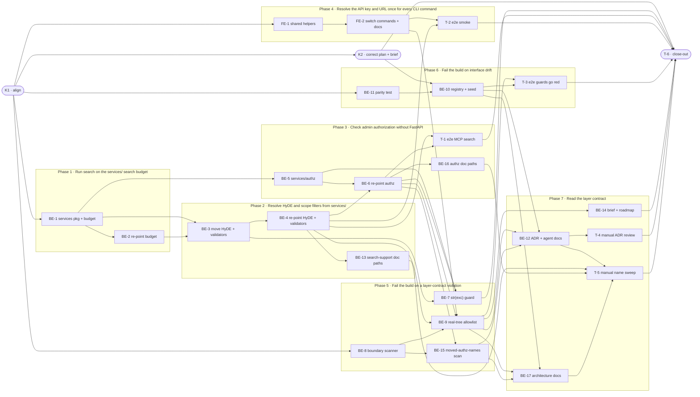

# S0 · Application-service layer foundation — Task Breakdown

**How to read this file**

- This is the **order view** for `00_service_layer_foundation-team-plan.md` — every task is a single-role checkbox in execution order, opening with a dependency graph.
- **Phases are vertical slices**: each delivers one outcome a maintainer, CI or a CLI user can observe, not a horizontal layer. No separate "integrate" phase. Sliced with the `vertical-slicer` skill (behaviour-first order, verticality test and smell check applied).
- Each task carries the **role tag at the end of its title line**, then sub-bullets: **layer · estimate** (decimal hours), **needs · completes**, and a **Tests** block. **needs** = predecessor tasks; **completes** = the scenario `S#` (from the plan) it makes true, or the contract `C#` (from the plan) it realises. Guard-test and documentation tasks own no layer (`—`).
- **Tests** are tagged by level. **Unit and integration tests belong to the implementing dev** (test-first); **e2e and manual tests are the tester's tasks**. The close-out task writes no tests. A task that only re-points imports adds no new test: its `Tests` block lists existing tests that must stay green, by their real names.
- IDs (`BE-#`/`FE-#`/`T-#`/`K#`) are this file's traceability thread; `S#`/`C#` are defined in the plan.
- **Plain terms:** *re-point* = change an import to the new location; *walking skeleton* = the thinnest working path through the whole feature; *allowlist* = the list of known, accepted rule exceptions that may only shrink; *HyDE* = the search step where the language model writes a sample answer to improve matching.
- The **Frontend** role is the CLI (Presentation); there is no browser UI. Test files cited as "moved" keep their assertions; only imports, patch strings, docstrings and logger names change.
- **Atomic moves:** within a slice, a module-move task and its re-pointing task (for example BE-1 and BE-2) land in one commit; between slices the tree stays green because the old modules of the next slice still exist.
- **Ordering:** the boundary test (Phase 5) can only pass on the real tree once the modules have moved and the four CLI modules that import a sibling command module (FE-2) are fixed, so Phase 5 follows Phases 1 to 4. The parity test (Phase 6) needs only K1 and is written against synthetic registries before BE-10 seeds the real one; T-3 needs both guards. Documentation edits ride with the phase that moves the names (BE-13 in Phase 2, BE-16 in Phase 3, FE-2 in Phase 4); the ADR and the architecture docs, which describe the finished layer contract, close the work in Phase 7.
- **Rule:** edit your own tasks freely.

---

## References

- **Plan:** [00_service_layer_foundation-team-plan.md](./00_service_layer_foundation-team-plan.md) — the full team plan (contracts, scenarios, architecture, allocation). **Always read the plan before you start planning the next task** — it holds the context this file only cites (`S#`/`C#`).
- **Brief:** [00_service_layer_foundation_brief.md](./00_service_layer_foundation_brief.md) — the source feature brief behind the plan.

---

## Task Breakdown

Single-role tasks in execution order, grouped into **vertical slices**. Read **Plan corrections** and **Decisions** at the end first.

### Dependency graph

### Phase 0 · Kickoff *(prerequisite; the one cross-cutting step)*
- [x] **K1** — Agree the Contracts and Scenarios with the team #team
    - — · 1.5h
    - completes C1, C2, C3, C4, C5
    - Tests
- [x] **K2** — Correct the plan and the brief where the code disagrees (see Plan corrections): eight allowlist entries instead of nine, the S29 and S30 allocation, the stale line references, and the S33 exemption list (add this tasks file and the interface-parity `.tsp` contracts); record the descriptions decision (see Decisions) in `roadmap.md` as a waiver line and a decisions-log entry #team
    - — · 3.0h
    - needs K1 · completes C1
    - Tests

### Phase 1 · Run search on the services/ search budget *(the walking skeleton: REST, MCP, explain and the shim run their time budget from `services/`)*
- [x] **BE-1** — Create `archon_search/services/` (docstring-only `__init__.py`, no `__all__`, no side effects) and `tests/services/` (with `__init__.py`); move `server/_search_budget.py` to `services/search_budget.py` unchanged (git mv), delete the old module, re-point `server/_hyde.py` to it; move `tests/server/test_search_budget.py` to `tests/services/` and fix its module docstring #backend-role
    - Use Case · 2.0h
    - needs K1 · completes C2
    - Tests
        - #unit_test — `test_search_budget.py` (moved, assertions unchanged) — warm-up result, the budget wrapper and its overrun error behave as before from the new path
- [x] **BE-2** — Re-point `mcp.py`, `routes_search.py`, `routes_explain.py` and `routes_openai_shim.py` to `services.search_budget`; keep the module-level `_SEARCH_TIMEOUT_SECONDS` aliases, `routes_search._EMBEDDER_LOAD_WAIT_TIMEOUT_SECONDS`, and the explicit timeout passed at each budgeted call; re-point the budget import in the 8 other test importers (`test_s391_mcp_search_reranker_score_doc_gap.py`, `test_hyde.py`, `test_search_filtered_benchmark.py`, `eval/test_eval_suite.py`, `server/test_mcp_search.py`, `server/test_routes_openai_shim_be5.py`, `server/test_routes_search.py`, `server/test_request_hyde.py`) and the docstring mentions (`server/_job_warmup.py`, `server/routes_ready.py`, `routes_search.py`, five test docstrings) #backend-role
    - Interface Adapter · 3.5h
    - needs BE-1 · completes S21
    - Tests
        - #integration_test — `test_explain_hyde_is_bounded_by_the_search_budget` — existing test that patches the timeout alias; passes unchanged, so a short patched alias still bounds the explain call (an adapter that stopped passing its alias explicitly would fall back to the 30 s default and fail it)
        - #integration_test — `test_direct_search_timeout_returns_openai_504` — existing shim test (class in `test_routes_openai_shim_be5.py`) with the same alias patch; a short budget still gives the 504
        - #integration_test — `test_s299_prefix_filter_survives_cold_query_embedder` — existing test that patches the embedder-wait alias; a cold embedder still degrades to FTS-only through the moved budget

### Phase 2 · Resolve HyDE and scope filters from services/
- [x] **BE-3** — Move `server/_hyde.py` to `services/request_hyde.py` (renamed: root `hyde.py` exists) and `server/_validators.py` to `services/validators.py`; delete the old modules; move `test_request_hyde.py` and `test_validators.py` to `tests/services/`, re-pointing the string patch of the HyDE resolver, the module docstrings and the logger name passed to the `caplog` scope at `test_request_hyde.py:221` (a stale name still captures through the root logger, so it would stay green silently); no shim or alias left behind #backend-role
    - Use Case · 2.5h
    - needs BE-1, BE-2 · completes C2, S2, S20
    - Tests
        - #unit_test — `test_request_hyde.py` and `test_validators.py` (moved, assertions unchanged) — HyDE outcome, suppression and scope validation unchanged, and the re-pointed patch still takes effect (it raises if the target is wrong)
        - #unit_test — `test_old_server_search_support_modules_do_not_import` — the old `server` budget, HyDE and validators modules raise on import
- [x] **BE-4** — Re-point `mcp.py` (keeping the `_check_scope_filter` alias and `_validate_scope_filter` wrapper), `routes_search.py` and `routes_explain.py` to `services.request_hyde` and `services.validators`; re-point the HyDE imports in `test_hyde.py`, `test_search_filtered_benchmark.py` and `eval/test_eval_suite.py`, and the docstrings in `tests/_hyde_stubs.py` and `test_s582_hyde_outside_search_budget.py` #backend-role
    - Interface Adapter · 3.0h
    - needs BE-3 · completes S27
    - Tests
        - #unit_test — `test_search_request_scope_filter_bare_wildcard_400` — existing REST test; the validator reached through the new path still gives the same 400 (with `test_mcp_search_scope_filter_bare_wildcard_returns_error` for MCP)
        - #integration_test — `test_eval_suite_gated_smoke` — the retrieval regression gate meets its thresholds unchanged (also `test_eval_hyde_regression_scenario` and `test_eval_hyde_false_fast_path_no_overhead`, whose function-local imports are re-pointed here)
        - #integration_test — `test_search_hyde_llama_cpp_unresponsive_server_stays_within_search_budget` — HyDE still runs outside the search budget through the adapters
- [x] **BE-13** — Re-point the path references to the moved search-support modules in the live docs: 120 (`:69`), 140 (`:105`, `:133`, `:135`), 600 (`:176`, `:197`), UserManual 60 (`:10`) and 130 (`:167`), `tests/eval/README.md` (`:365`) and `01_search_brief.md` (`:54`, `:135`); leave the historical records (`BREAKING.md`, `CHANGELOG.md`, `Documentation/Completed/`, doc 530's resolved item, `learnings-archive.md`) alone #backend-role
    - — · 1.5h
    - needs BE-4 · completes S24
    - Tests
        - #integration_test — `test_wire_text_matches_source_and_every_quoting_doc` — docs 120, 140 and 600 still quote the wire text correctly (also `test_api_reference_states_the_total_and_base_counts` for doc 600)

### Phase 3 · Check admin authorization without FastAPI
- [x] **BE-5** — Create `services/authz.py` with the moved policy (`AuthIdentity`, `ForbiddenError`, `FORBIDDEN_CODE`, the three `*_DETAIL` constants, `require_admin`, `authorize_key_create`, `authorize_key_listing_namespace`, `can_manage_key`, `caller_may_revoke`); trim `server/authz.py` to `identity_of`, `require_admin_dependency`, `caller_identity`, `ADMIN_ONLY_RESPONSES` (importing the policy and `ADMIN_REQUIRED_DETAIL`; no `__all__`) #backend-role
    - Use Case · 3.0h
    - needs BE-1 · completes C3
    - Tests
        - #unit_test — `test_require_admin_rejects_non_admin_with_fixed_detail` — fixed wire text and `FORBIDDEN_CODE` unchanged (no authz unit test exists today)
        - #unit_test — `test_authorize_key_create_and_listing_namespace_rules` — admin-key grant and foreign-namespace refusals
        - #unit_test — `test_caller_may_revoke_reads_key_store` — async policy against a core `KeyStore`, and `can_manage_key` with a `KeyRecord`
        - #unit_test — `test_services_authz_loads_without_fastapi` — subprocess `sys.modules` check (pattern of `test_cli_startup_latency.py`) that import pulls in no `fastapi`, `starlette` or `fastmcp`
- [x] **BE-6** — Re-point moved authz names: `mcp.py` (8 names; `identity_of` stays on `server/authz`, so the import splits), `middleware_auth.py` (`AuthIdentity`), `routes_keys.py` (6 names; `ADMIN_ONLY_RESPONSES`, `caller_identity`, `require_admin_dependency` stay), and the tests `integration/test_admin_scope.py`, `server/test_ingest_non_admin_paths.py`, `server/test_mcp_fail_closed.py`; fix the `server.authz` mentions in `key_manager.py`, `routes_keys.py` and `tests/test_no_wire_str_exc.py` (the `middleware_auth.py` stamp comment stays) #backend-role
    - Interface Adapter · 3.0h
    - needs BE-4, BE-5 · completes S1, S3, S4, S22, S23
    - Tests
        - #integration_test — `test_non_admin_key_cannot_mint_a_key_for_another_namespace` — existing REST test; the service-raised refusal still reaches the caller with the same 403 text (also `test_control_endpoints_refuse_a_managed_non_admin_key` for the admin-only routes)
        - #integration_test — `test_key_tools_refuse_a_request_whose_state_has_a_namespace_but_no_admin_flag` — existing MCP test; the same refusal reaches an MCP caller, so REST and MCP share one `ForbiddenError`
        - #integration_test — `test_openapi_spec_matches_snapshot` — the OpenAPI snapshot is unchanged and the 403 `ErrorDetail` is still declared
        - #integration_test — `test_a_real_fastmcp_tool_call_without_an_http_request_is_refused` — existing guard; the `get_http_request` fixtures and `real_mcp_auth_context` opt-out still work (ADR 17)
- [x] **BE-16** — Re-point the authz path references in the live docs: 140 (`:75`), 600 (`:23`), 150, SecurityGuide 01, 02 and 06, DeveloperGuide 02 (`:15`), MigrationGuide 06 (`:150`) and the root `README.md` (`:190`); leave the historical records alone; add no "HOME" mention to the guides #backend-role
    - — · 1.5h
    - needs BE-6 · completes S24
    - Tests
        - #integration_test — `test_security_guide_home_mention_is_not_data_dir_relocation` — the guides that may mention HOME stay exactly as pinned
        - #integration_test — `test_wire_text_matches_source_and_every_quoting_doc` — the quoting docs stay correct (also `test_readme_mcp_tool_count_matches_source` for the root README and `test_api_reference_states_the_total_and_base_counts` for doc 600)
- [x] **T-1** — e2e: a real MCP client connected to `/mcp` of a real server calls `search` and gets results (new smoke test over `smoke_server`) #tester-role
    - — · 3.0h
    - needs BE-4, BE-6 · completes S30
    - Tests
        - #e2e_test — `test_smoke_mcp_search_returns_results` — `fastmcp.Client` with `StreamableHttpTransport` on `/mcp/` and the smoke API key calls `search` on the `smoke` collection and gets non-empty results; client closed cleanly (`ResourceWarning` is an error)

### Phase 4 · Resolve the API key and URL once for every CLI command
- [x] **FE-1** — Add `load_key`, `_DEFAULT_API_URL` and `_resolve_api_key` to `cli/_helpers.py` (body identical to the five copies; `ConfigError` must propagate); drop `_LOCAL_DEFAULT_URL` and update its uses and the stale comment; move the four resolver tests from `tests/test_cli_collection.py` to a `_helpers` test, patching `archon_search.cli._helpers.load_key` #frontend-role
    - Presentation · 1.5h
    - needs K1 · completes C5
    - Tests
        - #unit_test — `test_resolve_api_key_arg_priority` — moved; the option wins over the environment and the key file
        - #unit_test — `test_resolve_api_key_env_fallback` — moved; the environment key is used when no option is given
        - #unit_test — `test_resolve_api_key_file_fallback` — moved; the key file is used when the others are absent
        - #unit_test — `test_resolve_api_key_no_key_no_write` — moved; the fixed stderr text, exit 1, no key file written
- [x] **FE-2** — Delete the local resolver and URL copies in `collection.py`, `backup_cmd.py`, `export_cmd.py`, `key_cmd.py`, `maintenance_cmd.py` (and the URL in `status.py`); drop the unused `load_key` imports in `collection.py`, `key_cmd.py`, `export_cmd.py`; make `sync.py`, `ingest.py`, `jobs_cmd.py`, `graph_cmd.py` import both names from `_helpers`; keep the best-effort lookups (`status.py` x2, `_fetch_server_status` in `backup_cmd.py` and `maintenance_cmd.py`) and the `key_cmd` / `maintenance run` try/except wrappers; fix the stale docstring in `test_cli_260_connection_refused_ux.py`, the `_LOCAL_DEFAULT_URL` mention in `learnings.md` (`:18`) and the helper reference in doc 120 (`:154`) #frontend-role
    - Presentation · 3.5h
    - needs FE-1 · completes C5, S17, S18, S19
    - Tests
        - #unit_test — `test_best_effort_key_lookup_returns_none_without_key` — parametrized over `backup` and `maintenance`: no key means no exit, same as `test_fetch_server_status_returns_none_when_no_key` pins for `status`
        - #integration_test — `test_client_commands_report_weak_key_in_one_line` — the 8 commands still exit 1 with a single `Error` line
        - #integration_test — `test_message_consistent_across_modules` — the connection-refused UX module-identity check stays green (and the existing test in `test_cli_collection.py` that asserts the default URL for `collection` keeps passing)
        - #integration_test — `test_wire_text_matches_source_and_every_quoting_doc` — doc 120 still quotes the wire text correctly
- [x] **T-2** — e2e: after the move, real-server REST search and the CLI commands that use the shared helpers work end to end; add the environment-key path #tester-role
    - — · 3.0h
    - needs FE-2, BE-4 · completes S28
    - Tests
        - #e2e_test — `test_search_returns_results_within_5s` — existing REST search smoke (run `uv run pytest tests/smoke/ --no-cov -k "not test_full_smoke_suite_passes"`)
        - #e2e_test — `test_e2e_collection_add_wait_against_server` — existing CLI smoke; with `test_key_list_no_repr`, `test_e2e_ingest_wait_against_server`, `test_e2e_jobs_status_after_reindex`, `test_e2e_sync_wait_all_result_fields_against_server` and `test_e2e_graph_build_communities_wait_against_server` it covers every helper-using command the local lane reaches (backup and export have no smoke coverage and rest on S17 to S19)
        - #e2e_test — `test_smoke_key_list_resolves_key_from_environment` — new: `key list` against the smoke server with no key option and `ARCHON_SEARCH_API_KEY` set
        - #e2e_test — `test_status_with_server_shows_http_telemetry` — docker module (`-o addopts=`): `status` live against a server (and `test_maintenance_run_exits_0` for `maintenance run`)

### Phase 5 · Fail the build on a layer-contract violation
- [ ] **BE-7** — Add `archon_search/services` to the guarded directories of `tests/test_no_wire_str_exc.py` (now that the directory exists) and add a check that every guarded directory exists and yields Python files, because a missing or misspelled entry otherwise scans nothing and passes #backend-role
    - — · 1.0h
    - needs BE-3, BE-5, BE-6 · completes S10
    - Tests
        - #unit_test — `test_every_guarded_directory_exists_and_holds_python_files` — new positive control for the directory list
        - #integration_test — `test_no_new_str_exc_of_a_caught_exception` — existing guard; now also scans the real files in `services/` and passes
- [ ] **BE-8** — Write the import scanner and rules in `tests/test_layer_import_boundary.py`: stack-based visitor for module-level, function-local and `TYPE_CHECKING`-only scope; import forms (`from pkg import name` resolves to the submodule when it exists; relative imports resolved); rules 1–4 of C1; hard-coded exceptions (`app.py` for any `routes_*` and `server.mcp` in any scope; the single function-local `run_server` import in `cli/serve.py`); keep repo root derived from `__file__` and the scan free of repo-conftest dependencies (T-3 relies on it) #backend-role
    - — · 4.5h
    - needs K1 · completes C1, S6, S8, S9, S32
    - Tests
        - #unit_test — `test_services_importing_fastapi_server_or_cli_is_a_violation` — also `anthropic` at module level fails, function-local passes (ADR-C4)
        - #unit_test — `test_route_importing_route_or_mcp_is_a_violation` — covers the shim and non-route importers such as `_collection_job.py`
        - #unit_test — `test_cli_importing_services_server_or_sibling_command_is_a_violation` — only `_helpers` is allowed; `cli/main.py` exempt
        - #unit_test — `test_function_local_type_checking_relative_and_from_package_imports_are_classified` — each form is an edge; `from pkg import mod` targets the submodule
        - #unit_test — `test_run_server_import_allowed_only_in_cli_serve` — the same import elsewhere fails, and the exception is never stale
- [ ] **BE-9** — Run the scanner on the real tree: seed the allowlist keyed (file, module, scope) with the eight edges that exist (see Plan corrections) and fail on a new or stale entry #backend-role
    - — · 2.5h
    - needs BE-4, BE-6, FE-2, BE-8 · completes C1, S5, S7
    - Tests
        - #unit_test — `test_stale_allowlist_entry_fails` — a fixed violation turns its entry stale, scope included (a function-local import left after the module-level one is fixed keeps its own entry)
        - #integration_test — `test_real_tree_has_no_unlisted_boundary_violation` — passes on the current tree, which needs FE-2 (four sibling CLI imports) and BE-6; the eight seeded edges are `_collection_job` → `routes_jobs`; `mcp` → `routes_explain`, `routes_export` and, function-local, `routes_collections`; `routes_collections`, `routes_graph`, `routes_sync` → `routes_jobs`; `routes_status` → `routes_collections`
- [ ] **BE-15** — Add the S31 scan to the same test file: every import in `archon_search/` and `tests/` of a moved authz name from `archon_search.server.authz`, plus a check that `server/authz.py` defines no `__all__` #backend-role
    - — · 1.5h
    - needs BE-6, BE-8 · completes S31
    - Tests
        - #unit_test — `test_moved_authz_name_imported_from_server_authz_is_flagged` — snippets in plain, aliased and multi-name import forms are flagged; a positive control so a scanner that matches nothing cannot pass
        - #unit_test — `test_names_that_stay_in_server_authz_are_not_flagged` — `identity_of`, `require_admin_dependency`, `caller_identity` and `ADMIN_ONLY_RESPONSES` pass
        - #integration_test — `test_no_code_or_test_imports_moved_authz_name_from_server_authz` — real tree clean and no `__all__` in `server/authz.py`

### Phase 6 · Fail the build on interface drift
- [ ] **BE-11** — Write `tests/parity/test_parity.py` (with `tests/parity/__init__.py`) and its live-surface collectors, tested against synthetic registries: REST from the app built with docs and the OpenAI shim enabled, without running its lifespan (identifier is method plus path, `HEAD` dropped, a `Mount` by path); MCP from the existing `registered_tools` helper in `tests/_mcp_tools.py` with a key-store stand-in and the real FastMCP (never the stub); Click tree walked through `list_commands` and `get_command` (space-joined paths; a group counts only when invokable, as `backup`); `/mcp` claimed with its waiver and exempt from the missing check; the four failure kinds; keep the test free of repo-conftest dependencies (T-3 relies on it) #backend-role
    - — · 6.0h
    - needs K1 · completes C4, S12, S13, S14
    - Tests
        - #unit_test — `test_unclaimed_surface_fails` — a live route, tool or command missing from the registry fails
        - #unit_test — `test_claimed_surface_that_does_not_exist_fails` — except lifespan-only `/mcp`
        - #unit_test — `test_gap_without_waiver_and_pending_waiver_without_slice_fail` — both failure kinds
- [ ] **BE-10** — Create the registry as a plain data module in `tests/parity/` (T-3 mutates a copy): one capability per roadmap slice S1–S32, its service method, and per interface the live surface identifier or a waiver (`permanent`, or `pending` naming a slice); seed by hand about 107 identifiers from the live REST routes, 22 MCP tools and 36 Click surfaces, plus the roadmap waivers and the descriptions row (a permanent waiver for the missing MCP describe tool, citing the descriptions plan C8 and ADR 19; see Decisions) #backend-role
    - — · 5.0h
    - needs K2, BE-11 · completes C4, S11, S15, S16
    - Tests
        - #integration_test — `test_parity_passes_on_live_surfaces` — every live surface is claimed or waived; the lazy `graph` group, nested groups, invokable `backup`, docs routes incl. `/docs/oauth2-redirect`, `/v1` routes and `HEAD` handling raise no false failure (T-6 checks the registry against the roadmap list, S16)
- [ ] **T-3** — e2e: each guard fails in a real pytest process on a real violation #tester-role
    - — · 3.0h
    - needs BE-9, BE-10 · completes S29
    - Tests
        - #e2e_test — `test_smoke_boundary_test_fails_in_a_real_pytest_run_on_an_injected_forbidden_import` — local smoke lane (`tests/smoke/`, not in CI): copy `archon_search/`, the boundary test and the test helper modules it needs to `tmp_path`, add a `fastapi` import to `services/validators.py`, run the copy with the current interpreter (no `uv run`, per `tests/CLAUDE.md`); exit code 1 and the edge named
        - #e2e_test — `test_smoke_parity_test_fails_in_a_real_pytest_run_on_a_deleted_registry_row` — the same lane for the parity test and a registry copy (with `tests/_mcp_tools.py` and the `tests/__init__.py` files it imports); the child gets the data dir and API key through its environment

### Phase 7 · Read the layer contract
- [ ] **BE-12** — Write the new ADR `Documentation/ADRs/20_…` (format of ADR 17/18: Status, Date, Deciders, Supersedes, Context, Decision, Consequences, Cross-References); add its row and one Backlog row for the interface-parity roadmap, briefs, plan and task breakdown to doc 990; update the layer maps in `AGENTS.md` (`:61`, `:77`), `CLAUDE.md` (`:30`, `:50`) and `tests/CLAUDE.md` (suite layout gains `tests/services` and `tests/parity`); keep `git-cliff` in `CLAUDE.md` (pinned by `test_docs.py`) #backend-role
    - — · 3.0h
    - needs BE-9, BE-10, BE-15 · completes S24
    - Tests
        - #integration_test — `test_adr_numbers_are_unique_contiguous_and_every_adr_is_in_the_documentation_index` — numbering stays contiguous and every ADR is in doc 990 (it does not prove ADR 20 exists; T-4 does)
        - #integration_test — `test_claude_md_mentions_git_cliff` — the `CLAUDE.md` edit keeps the pinned mention
- [ ] **BE-17** — Update the architecture docs for the finished layer contract: 100 (principle 1 and the auth-boundary path at `:157`), 110 (layer table, principle 5, the `services/` rows, and every mention of the moved modules at `:56`, `:72`, `:74`, `:130`, `:133`, `:143` to `:146`, `:149`, `:150`, `:154` and `:156`), 520 (the "share internal services" statement), 540 (ARCH-01 status, stale `mcp.py` line ranges, the "no Ruff gate" lines `:371`, `:376`, `:484`), 500 (the ruff merge-gate statement) and 510 (the ruff pin at `:143`) #backend-role
    - — · 4.5h
    - needs BE-9, BE-10, BE-15 · completes S24
    - Tests
        - #integration_test — `test_wire_text_matches_source_and_every_quoting_doc` — docs 110, 120, 140 and 600 stay correct after the edits
- [ ] **BE-14** — Amend the rest of the brief to the plan's Documentation update list (importer lists, test-patch claims; K2 has already fixed the edge counts and exemptions) and tick S0 in `roadmap.md` in the landing commit #backend-role
    - — · 1.0h
    - needs BE-9 · completes S24
    - Tests
- [ ] **T-4** — Manual: review the new ADR for format, accuracy and supersession #tester-role
    - — · 1.0h
    - needs BE-12 · completes S25
    - Tests
        - #manual_test — ADR 20 review — follows the ADR 17/18 format, exists, takes the next free number and is listed in doc 990 (non-automatable: content and format review is judgement; contiguity and the index row are already enforced by the docs test in BE-12)
- [ ] **T-5** — Manual: sweep the repo for the old module names and for `server.authz` mentions that describe a moved name #tester-role
    - — · 2.0h
    - needs BE-12, BE-13, BE-16, BE-17 · completes S33
    - Tests
        - #manual_test — Old-name sweep — search `archon_search/`, `tests/` and the live docs for the old `server` budget, HyDE and validators modules (module and file names) and for `server.authz` mentions; only the exemptions in the plan remain (as K2 extends them) (non-automatable as a permanent test: a permanent name search would have to carry the long list of historical exemptions and adds nothing after the cutover, so the name half is a one-off search run in this task, and the `server.authz` half needs a human to judge whether a mention describes a moved name)

### Phase 8 · Close-out
- [ ] **T-6** — Project close-out & acceptance fact-check #tester-role
    - — · 5.0h
    - needs K2, BE-7, T-1, T-2, T-3, BE-14, T-4, T-5 (and through them every other task) · completes S26 (acceptance gate)
    - Tests
    - Duties
        - Update all documentation per [00_service_layer_foundation-team-plan.md](./00_service_layer_foundation-team-plan.md)'s "Documentation update" section — project docs, user manuals, architecture docs, `CLAUDE.md`, `AGENTS.md`, etc.; work through the checklist and fix whatever BE-12 to BE-17 left; update `learnings.md` as `CLAUDE.md` requires (under 30 lines and under 256 characters per line).
        - Fix all build / compiler warnings, if any.
        - Run the full test suite (`uv run pytest`, the 85% coverage gate), `uvx ruff@0.17.3 check .`, the eval slice, the integration lane, the benchmark lane (HyDE benchmark file), the smoke lane and the docker smoke module; fix every failing test, including any unrelated to this feature.
        - Check the parity registry against the slice list and the waivers in `roadmap.md` (S16), and every `S#` and `C#` of the plan against the task that completes it.
        - Validate every Acceptance criterion one-by-one (from the plan) with a fact check — no assumptions; confirm each is genuinely done.

**Critical path (29.5h):** K1 → BE-1 → BE-2 → BE-3 → BE-4 → BE-6 → BE-9 → BE-17 → T-5 → T-6. The CLI slice (FE-1, FE-2, T-2), the parity slice (BE-11, BE-10) and BE-8 run alongside; BE-9 waits for FE-2 because four CLI modules import a sibling command module today.

---

## Plan corrections

Facts found against the code that the plan and brief still state wrongly. The tasks use the real values; K2 applies these corrections to the plan and brief (line numbers are as of today and shift after edits).

- **The code has eight allowlist entries to seed, not nine.** `routes_explain.py` does not import `routes_search`; it only names it in comments (`routes_explain.py:9` and `:573`). The plan states "nine" at `:45`, `:63`, `:364`, `:396` and `:451` and the brief at `:110`; the plan (`:328`, the principle-5 bullet) and the brief (`:10`) also name the non-existent import as real. The `.tsp` contracts state no count.
- **A real-server test of the MCP interface is possible, so S29 and S30 are not manual only.** The plan's Tester scope and Allocation say no such harness exists; `serve_real_app` in `tests/integration/conftest.py` and `fastmcp.Client` in `test_disconnect_cancels_provider_call_e2e.py` are one. T-1 adds the missing e2e test for S30 and T-3 the e2e tests for S29.
- **Stale references.** The plan seeds only S1 to S32 (`:46`, `:407`); descriptions need a registry row with the permanent waiver (see Decisions). The `app.py` lines the plan cites at `:363` (105 to 121, 768, 818, 937, 1143, 1333, 1367 to 1368) are really 124 to 140, 866, 916, 1037, 1281, 1533 and 1567 to 1568. `tests/test_llama_cpp_provider.py` does not exist (`:449`; the function-local old-path imports are in `tests/test_hyde.py`). A second adapter alias, `routes_search._EMBEDDER_LOAD_WAIT_TIMEOUT_SECONDS`, is patched by five tests. `mcp.py` has 2,674 lines. Doc line numbers differ (`CLAUDE.md:30` and `:50`, `AGENTS.md:77`, `README.md:190`, doc 140 at `:75`, `:105`, `:133`, `:135`). DeveloperGuide 02, doc 600 `:23`, `tests/CLAUDE.md` and more doc 110 rows also need edits. The S33 exemption list (plan `:62`, `:424`) must also exempt this tasks file and the interface-parity `.tsp` contracts.

## Decisions

- **Agents get no tool to rewrite a collection's description (owner decision B).** The web API and the command line can ask the server to rewrite a description, and AI agents (MCP) can only set or clear one by hand. The description feature's own plan chose this (ADR 19 lists an agent tool as out of scope). A rewrite uses the language model, which costs money with a cloud provider and nothing with a local one, and no per-key limit exists (ADR 19). K2 records the exception and the reason in `roadmap.md`; BE-10 registers it as a permanent waiver. The tasks have no open questions.
