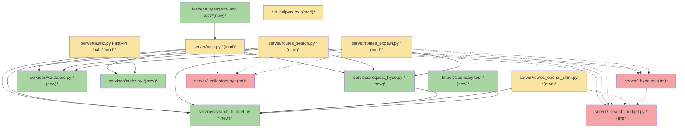
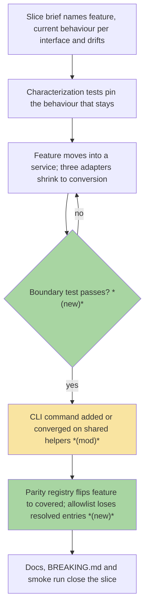
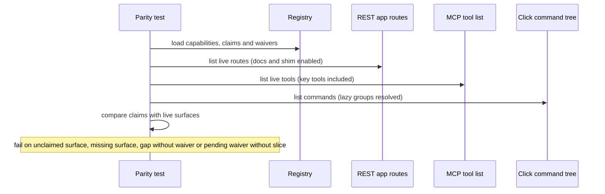

# S0 · Application-service layer foundation — Team Plan

**How to read this file**

- **Architecture approach:** Clean Architecture — the default; no override skill was requested. **Layers:** Presentation · Use Cases · Interface Adapters · Entities · Frameworks & Drivers.
- **Deployment boundary:** client+server. The CLI is an HTTP-only client of the REST server; REST, MCP and the OpenAI shim are server-side adapters in one FastAPI process. There is no browser frontend, so the **Frontend** role is the **CLI** (Presentation); every other layer is **Backend**.
- The **Frontend, Backend, and Tester** sections are the **depth view** — each role's scope, grouped by layer.
- **Contracts** are logical and authored as linked `.tsp` files (TypeSpec, core constructs only). S0 creates and changes no HTTP/API seam, so no `openapi.yaml` is emitted.
- **Role tags** (`#frontend-role`, `#backend-role`, `#tester-role`) mark each role-owned section — filter a tag (e.g. in Obsidian) to see one role's whole scope.
- IDs (`S#` scenarios, `C#` contracts) are the traceability thread; search the file for an ID to find where it's defined. Plan IDs are unrelated to the brief's own rule numbers (its C1–C14) and to roadmap slice numbers (S0–S33): this file says "brief C#" for those rules and "roadmap S#" for every roadmap slice except its own, which it calls "S0" (scenarios start at S1, so a bare "S0" is never ambiguous).
- **Tasks** are not in this file — task breakdown is a separate downstream step that consumes this plan.
- **Rule:** change a contract only by team agreement.

---

## Background

The same feature is implemented once per interface: search exists three times (REST, MCP, OpenAI shim) above a shared core, and [mcp.py](../../../archon_search/server/mcp.py) imports route modules while route modules import each other. Shared application logic ([_search_budget.py](../../../archon_search/server/_search_budget.py), [_hyde.py](../../../archon_search/server/_hyde.py), [_validators.py](../../../archon_search/server/_validators.py) and the policy half of [authz.py](../../../archon_search/server/authz.py)) lives under `server/` only because the first callers were routes. No `archon_search/services/` package, no layer-boundary check and no parity registry exist today (the existing [test_import_boundary.py](../../../tests/test_import_boundary.py) only forbids imports from the `archon.` namespace). [540_code_and_architecture_quality_audit.md](../../Architecture/540_code_and_architecture_quality_audit.md) finding ARCH-01 already prescribes application services; nothing has been built.

---

## Goal

A maintainer adding or changing a feature touches one service and one thin adapter per interface, and the build fails when a layer boundary is crossed or a feature exists on one interface but not another without a written waiver. S0 delivers the rules, the enforcement and the first real structural moves; roadmap S1 (Search) proves the pattern end to end.

---

## Scope

### In Scope

- New `archon_search/services/` package holding the modules shared by search, search-with-context and explain, moved out of `server/` with every caller and test updated: search budget, request HyDE, validators, and the transport-free authorization policy.
- The FastAPI-specific half of authz stays in `server/` and imports the policy from services.
- Boundary test (brief C11) in a new `tests/test_layer_import_boundary.py` (the existing `tests/test_import_boundary.py` checks a different rule and is untouched): AST scan with a ratcheting allowlist keyed by (importing file, imported module, import scope) and seeded with the nine real route-layering edges listed in C1, plus the S31 check in the same file that no code or test takes a moved authz name from `server/authz`; `archon_search/services` added to the guarded directories of [test_no_wire_str_exc.py](../../../tests/test_no_wire_str_exc.py).
- Parity registry and test (brief C12) in a new `tests/parity/` package (with `__init__.py`, as in every other test subdirectory except `eval` and `fixtures`; distinct from the existing `tests/runtime_parity/`), seeded with every roadmap feature and its current REST, MCP and CLI surface, plus the roadmap's waivers; the seed is derived by hand from the live surfaces (see C4).
- CLI helper consolidation: one API key resolver and one default server URL in [_helpers.py](../../../archon_search/cli/_helpers.py), used by every CLI module.
- Docs: a new ADR (application-service layer, one implementation per feature), layer table and principles in doc 110, layering text in doc 100, ARCH-01 status in doc 540, layer map in [AGENTS.md](../../../AGENTS.md) and [CLAUDE.md](../../../CLAUDE.md), and the moved-module and authz path references in every other doc named under Documentation update (including the amended brief and the S1 brief).

### Out of Scope

- `ServiceError`, the services container, `SearchService` and the adapter error-mapping tables (specified in the brief but built in roadmap S1 with their first consumer).
- Moving `warmup.py`, `readiness.py`, `_ingest_admission.py`, `_ingest_lock.py`, `_collection_job.py` and the helpers in `routes_jobs.py` and `routes_collections.py`.
- Any feature move, new route, MCP tool or CLI command; generating adapter schemas from commands; any behaviour change.
- Touching [BREAKING.md](../../../BREAKING.md): S0 changes no wire behaviour.

---

## Acceptance criteria

- `archon_search/services/` exists and holds the four moved modules; the old `server/` modules and the policy half of `server/authz.py` are gone, with no shim, alias or re-export: no code or test imports a moved authz name (`AuthIdentity`, `ForbiddenError`, the `*_DETAIL` constants, `FORBIDDEN_CODE`, the policy functions) from `server/authz.py`, and that module lists none of them in an `__all__`.
- Every importer in code, tests, docstrings and comments uses the new locations; tests that patch or assert the old module path or logger name are re-pointed and still exercise the code; a repo-wide search for the old module names (`_search_budget`, `_hyde` and `_validators` under `server`) and for `server.authz` or `server/authz` references that describe a moved name finds only the sweep exemptions: the historical records (`BREAKING.md`, `CHANGELOG.md`, `Documentation/Completed/`, the resolved item in doc 530, `learnings-archive.md`), the S2 test that asserts the old paths no longer import, the new ADR, and this plan and the brief.
- The boundary test fails on a new violation (including function-local and `TYPE_CHECKING` imports), fails on a stale allowlist entry, and its allowlist equals exactly the nine edges seeded in C1.
- `services/` is guarded by the "never `str(exc)` on the wire" test.
- The parity test fails on an unclaimed REST route, MCP tool or CLI command, on a claimed surface that does not exist, on a gap without a waiver, and on a pending waiver that names no slice.
- `_resolve_api_key` and the default API URL are defined once in [_helpers.py](../../../archon_search/cli/_helpers.py); [test_cli_260_connection_refused_ux.py](../../../tests/test_cli_260_connection_refused_ux.py) stays green.
- OpenAPI snapshots ([contract](../../../tests/contract/openapi_snapshot.json), [server](../../../tests/server/openapi_snapshot.json)) are unchanged; search, explain, shim and admin behaviour is unchanged.
- The ADR, layer docs, layer maps and every doc in the Documentation update list are updated; doc-sync tests pass.
- Default test suite, `uvx ruff@0.17.3 check .` and the 85% coverage gate pass.

---

## What does NOT change

- Wire behaviour of REST, MCP and the OpenAI shim (status codes, bodies, wire text, timeouts, warm-up degrade to FTS-only, HyDE suppression rules).
- `identity_of`, `require_admin_dependency`, `caller_identity` and `ADMIN_ONLY_RESPONSES` keep their behaviour (they stay in [authz.py](../../../archon_search/server/authz.py)); the 403 `ErrorDetail` stays in the OpenAPI schema.
- `get_http_request` stays a module attribute of [mcp.py](../../../archon_search/server/mcp.py), and the autouse fixture `_mcp_default_request_context` with its `real_mcp_auth_context` opt-out in [conftest.py](../../../tests/conftest.py) keeps working (ADR 17 guard).
- The `cli/serve.py` lazy `run_server` import (the one allowed CLI-to-server import, a permanent exception hard-coded in the boundary test, not an allowlist entry) and the HTTP-only CLI model.
- The best-effort key lookups keep their non-exiting `api_key or load_key()` (they return no key instead of exiting): the two in [status.py](../../../archon_search/cli/status.py) and `_fetch_server_status` in [backup_cmd.py](../../../archon_search/cli/backup_cmd.py) and in [maintenance_cmd.py](../../../archon_search/cli/maintenance_cmd.py); the `key_cmd` and `maintenance_cmd` try/except wrappers around key resolution stay as they are.
- `BREAKING.md`, the store schema version and every stored data format.

---

## Known limitations / accepted trade-offs

- Boundary enforcement is an in-repo AST test, not import-linter (no new dependency; same pattern as the existing guards).
- The registry lives in `tests/`, not in the package: nothing in production reads it.
- Authorization-once-in-the-service is a later-slice consequence: S0 only relocates the transport-free policy.
- S0 ships no unused abstraction; `ServiceError` and the container wait for roadmap S1.
- Only direct imports are checked; transitive coupling through core modules is not. The layer-boundary scan covers only `services/`, `server/` and `cli/`, so a core module importing `services/`, `server/` or `cli/` goes unflagged (today only `__main__.py`, outside the scanned trees, imports `cli`); the S31 check is the one scan of `archon_search/` and `tests/`, and it looks only for moved authz names.
- Field-level parity is not checked in S0 (evaluated in roadmap S1).
- The parity check has four failure kinds (brief C12's three plus a pending waiver that names no slice) and no stale-waiver rule: a waiver that outlives its gap is not flagged. The registry seed is hand-derived once, not generated.

---

## Approach & architecture

Clean Architecture, applied to a repo that has no layer folders: `archon_search/services/` becomes the **Use Cases** home for logic shared by adapters, dependencies point inward (adapters → services → core), and the boundary and parity guard tests (with the existing `str(exc)` guard extended to `services/`) make the checked part of that direction checkable instead of conventional: services and the CLI never import outward, and routes, MCP and the shim stay apart, while a core module importing `services/`, `server/` or `cli/` is not checked.

### Architecture

_Scope limited to changed nodes only: the full component set is well above 15 nodes and the 1-hop expansion also exceeds the limit. Changed components not drawn are in the table below; unchanged components (pipeline, router, key manager, filters, store, composition root, the other route modules) are omitted. Dotted edges show the last known connection of a removed module. Edges are illustrative, not exhaustive: the boundary test (BT) scans every guarded file and the parity test (PR) reads the live REST, MCP and CLI surfaces, each drawn with one representative edge; `middleware_auth.py` and `routes_keys.py` also import from the authz policy (AZ), and every CLI command module imports `cli/_helpers.py` (HLP), none of which is drawn._

| Component | Change | Why |
|-----------|--------|-----|
| `services/` package with `search_budget`, `request_hyde`, `validators`, `authz` | new | Use Cases home for logic shared by adapters; moved from `server/` (the HyDE module is renamed because the root `hyde.py` exists) |
| `server/_search_budget`, `server/_hyde`, `server/_validators` | removed | Cut over; no shim or re-export |
| [authz.py](../../../archon_search/server/authz.py) | modified | Keeps only the FastAPI half; imports the policy and `ADMIN_REQUIRED_DETAIL` from services |
| [mcp.py](../../../archon_search/server/mcp.py), [routes_search.py](../../../archon_search/server/routes_search.py), [routes_explain.py](../../../archon_search/server/routes_explain.py), [routes_openai_shim.py](../../../archon_search/server/routes_openai_shim.py) | modified | Import re-pointed (shim imports only the search budget); `mcp.py` also splits its authz import (`identity_of` stays in `server/authz`) |
| [middleware_auth.py](../../../archon_search/server/middleware_auth.py), [routes_keys.py](../../../archon_search/server/routes_keys.py) | modified | Import moved authz names from services; `routes_keys.py` splits its import (`ADMIN_ONLY_RESPONSES`, `caller_identity` and `require_admin_dependency` stay in `server/authz`). `routes_collections.py`, `routes_jobs.py` and the sync, backup, maintenance and telemetry routes import only names that stay, so they are unchanged |
| Import boundary test | new | Brief C11; seeded allowlist; also hosts the S31 moved-authz-names check |
| `tests/parity/` registry and test | new | Brief C12; seeded from the roadmap |
| [test_no_wire_str_exc.py](../../../tests/test_no_wire_str_exc.py) | modified | `archon_search/services` added to the guarded directories |
| [_helpers.py](../../../archon_search/cli/_helpers.py) | modified | Receives the single API key resolver and default URL |
| [collection.py](../../../archon_search/cli/collection.py), [backup_cmd.py](../../../archon_search/cli/backup_cmd.py), [export_cmd.py](../../../archon_search/cli/export_cmd.py), [key_cmd.py](../../../archon_search/cli/key_cmd.py), [maintenance_cmd.py](../../../archon_search/cli/maintenance_cmd.py), [status.py](../../../archon_search/cli/status.py) | modified | Local copies removed; shared helpers used |
| [sync.py](../../../archon_search/cli/sync.py), [ingest.py](../../../archon_search/cli/ingest.py), [jobs_cmd.py](../../../archon_search/cli/jobs_cmd.py), [graph_cmd.py](../../../archon_search/cli/graph_cmd.py) | modified | Stop importing the helpers from the `collection` command module |

**Layer map (and role mapping)**

| Layer | Role | Components |
|-------|------|-----------|
| Presentation | **Frontend** (CLI, Click) | `cli/` command modules and [_helpers.py](../../../archon_search/cli/_helpers.py); the CLI talks to REST over HTTP only |
| Interface Adapters | Backend (Python) | REST route modules, [mcp.py](../../../archon_search/server/mcp.py), [routes_openai_shim.py](../../../archon_search/server/routes_openai_shim.py), [middleware_auth.py](../../../archon_search/server/middleware_auth.py), FastAPI half of [authz.py](../../../archon_search/server/authz.py); wire models in [schemas.py](../../../archon_search/server/schemas.py) and [mcp_schemas.py](../../../archon_search/server/mcp_schemas.py) |
| Use Cases | Backend (Python) | new `services/` modules (search budget, request HyDE, validators, authz policy); core orchestration in [pipeline.py](../../../archon_search/pipeline.py), [router.py](../../../archon_search/router.py), [hyde.py](../../../archon_search/hyde.py), `jobs/` |
| Entities | Backend (Python) | [filters.py](../../../archon_search/filters.py) `SearchFilters`, [key_manager.py](../../../archon_search/key_manager.py) `KeyRecord`, [collection_meta.py](../../../archon_search/collection_meta.py) |
| Frameworks & Drivers | Backend (Python) | [store.py](../../../archon_search/store.py) (LanceDB), FastAPI / FastMCP / Click / httpx, composition root [app.py](../../../archon_search/server/app.py) |

The repo's own docs use a different layer vocabulary ([110_component_catalog_and_layer_breakdown.md](../../Architecture/110_component_catalog_and_layer_breakdown.md) layer summary); the labels above are this plan's Clean Architecture classification.

The guard tests (import boundary, parity registry, `str(exc)` on the wire) are cross-cutting architecture-enforcement tests; they sit outside the layer map and own no layer.

**What changes**

- Shared search-support logic and the transport-free authorization policy move from `server/` to `services/` (Use Cases); `services/` may import core and nothing from `server`, `cli`, `fastapi`, `starlette`, `fastmcp`, `click`, `httpx` or `uvicorn`, and not the optional `anthropic` package at module level.
- Adapters (REST, MCP, shim) re-point their imports; the logger of the HyDE module changes name with the move.
- Two new guard test files appear, holding three checks: an import-boundary scan (ratcheting allowlist; scans `services/`, `server/` and `cli/`), a moved-authz-names check in the same file (S31; scans `archon_search/` and `tests/`) and a parity registry check (drift check with waivers; it does not ratchet); the existing `str(exc)` on the wire guard now also covers `services/`.
- CLI helper duplication collapses into [_helpers.py](../../../archon_search/cli/_helpers.py); four CLI modules stop importing a sibling command module.
- Docs gain the layer contract: ADR, layer tables and principles, ARCH-01 status, layer maps.

**Key decisions (from the brief, fixed for S0)**

- Package `archon_search/services/`, classes named `*Service` (later slices).
- Boundary enforcement is an in-repo AST test with a ratcheting allowlist, not import-linter.
- Authorization is enforced once, in the service (roadmap decision D8, confirmed 2026-10-30).
- The registry lives in `tests/`, not in the package.
- Only the four shared modules move; each later slice moves what it needs.
- Roadmap S1 is a pilot; this contract is reviewed after roadmap S1 and amended before roadmap S2.

### Actors & Use Cases

_Scope limited to change neighbourhood: the full set has 20 nodes (7 actors, 13 use cases). Omitted are the REST API consumer, MCP client and OpenAI-compatible client actors and the unchanged use cases (search, search with context, explain, OpenAI shim chat, key management and admin authorization, the other CLI commands), because S0 changes none of their behaviour._

### Flows

#### User Flow

How a later slice uses the foundation (the brief's core flow); steps S0 introduces or changes are tagged. S0 itself moves no feature, so step C is untagged.

#### Data Flow

_Skipped: no data edge changes — S0 changes no persistence, API call or migration; modules only change location._

#### Sequence

The parity test is the one new multi-component interaction; the boundary test is a single static scan with a compare-and-ratchet step against its allowlist.

### Prior decisions

| Decision | Rationale | Constraint |
|----------|-----------|------------|
| [ADR 01](../../ADRs/01_lancedb_as_local_vector_store.md) — LanceDB as local single-process vector store | Zero-deployment, file-backed, single process; multi-writer is not a target | Underpins brief C1 (CLI over HTTP, never in-process); services reach the store only via the core `SearchStore` |
| [ADR 05](../../ADRs/05_opt_in_local_telemetry_no_raw_query.md) — opt-in local telemetry, no raw query | Privacy is structural, not runtime-checked | Services (later slices) emit telemetry only via the existing `TelemetryEntry` factories and never pass or log query text; S0 moves no telemetry code |
| [ADR 06](../../ADRs/06_durable_state_writes_via_fsync.md) — durable state writes via `_durable_io` | Crash durability | Informational: the in-repo AST guard (`test_no_raw_durable_writes`) is the precedent for the boundary test; new services code must not write state raw |
| [ADR 09](../../ADRs/09_mcp_http_mount_and_namespace_propagation.md) — MCP mounted in the same FastAPI app (partially superseded by ADR 17) | One process and port; namespace resolved per request | The MCP adapter keeps resolving the caller per request; services receive `AuthIdentity` and never resolve it; moving code must not break mount or lifespan |
| [ADR 17](../../ADRs/17_mcp_namespace_via_public_get_http_request.md) — namespace via public `get_http_request` | Public API; request-context faults must not fall back silently | `get_http_request` stays a module attribute of `server/mcp.py`; the conftest autouse fixture and the namespace guard test keep working; services must not import fastmcp |
| [ADR-C4 (HyDE)](../../ADRs/C4-hyde-external-llm-dependency.md) — HyDE is opt-in, external LLM | Privacy-first; availability over quality | The moved HyDE module keeps opt-in and silent fallback and must not import the optional `anthropic` dependency eagerly (C1 denies `anthropic` at module level in `services/`) |
| [ADR-C5 (RAG Fusion)](../../ADRs/C5-rag-fusion-external-llm-dependency.md) — RAG Fusion, mutually exclusive with HyDE | Semantic reformulation needs an LLM; accepted opt-in | HyDE/RAG Fusion suppression and fallback semantics are unchanged by the move |

### Contradictions

**Code vs. docs**

- [110_component_catalog_and_layer_breakdown.md](../../Architecture/110_component_catalog_and_layer_breakdown.md) principle 5 is marked `#Unverified` and lists only some of the real cross-imports: it names `routes_collections` → `routes_jobs` and `routes_status` → `routes_collections` (and notes `mcp.py`'s function-local reuse of `_all_collection_paths`), but omits `routes_explain` → `routes_search`, `routes_graph` and `routes_sync` → `routes_jobs`, the module-level imports of `routes_explain` and `routes_export` by `mcp.py`, and `_collection_job` → `routes_jobs`; the layer table has no application-service row and no `_validators` row. Owner: **doc needs updating** (S0 rewrites these).
- [100_system_architecture_overview.md](../../Architecture/100_system_architecture_overview.md) principle 1 says modules above the pipeline depend only on the pipeline, while shared logic sits between them under `server/`. Owner: **doc needs updating** (S0 rewrites the layering text).
- [AGENTS.md](../../../AGENTS.md) lists a subset of CLI subcommands and route modules that [main.py](../../../archon_search/cli/main.py) and the code register. Owner: **doc needs updating**.
- [500_development_workflows_and_conventions.md](../../Architecture/500_development_workflows_and_conventions.md) says ruff is not a merge gate, while [archon-search-pr.yml](../../../.github/workflows/archon-search-pr.yml) runs `uvx ruff@0.17.3 check .` (and [200_testing_strategy.md](../../Architecture/200_testing_strategy.md) agrees with the workflow). [540_code_and_architecture_quality_audit.md](../../Architecture/540_code_and_architecture_quality_audit.md) lines 371, 376 and 484 likewise say no Ruff gate exists, and [510_release_and_environment_strategy.md](../../Architecture/510_release_and_environment_strategy.md) line 143 pins `ruff@0.17.2` while the workflow uses 0.17.3. Owner: **doc needs updating** (pre-existing; relevant because the brief relies on lint-before-merge).
- Docs that name the moved modules or call `server/authz.py` the single policy home ([600](../../Architecture/600_api_reference_or_public_interface.md), [140](../../Architecture/140_error_handling_strategy.md), [120](../../Architecture/120_services_and_integration_architecture.md), [150](../../Architecture/150_security_and_privacy_architecture.md), [SecurityGuide 01](../../SecurityGuide/01_threat_model.md), [02](../../SecurityGuide/02_authentication_and_keys.md) and [06](../../SecurityGuide/06_hardening_checklist.md), [UserManual 60](../../UserManual/60_searching.md) and [130](../../UserManual/130_ttl_and_scoping.md), [tests/eval/README.md](../../../tests/eval/README.md), [CLAUDE.md](../../../CLAUDE.md)) become stale after the move; the brief's docs list names only part of them. Owner: **doc needs updating** (listed in Documentation update).
- [06_client_migration_examples.md](../../MigrationGuide/06_client_migration_examples.md) (line 150), the root [README.md](../../../README.md) (line 189) and the S1 brief [01_search_brief.md](./01_search_brief.md) (lines 54 and 135) also name `server/authz.py` or the moved `_search_budget`, `_hyde` and `_validators` modules. Owner: **doc needs updating** (listed in Documentation update).
- [540_code_and_architecture_quality_audit.md](../../Architecture/540_code_and_architecture_quality_audit.md) line ranges for `mcp.py` are stale: the 1,905 lines at 540:221 are the `create_app` factory span (`mcp.py:260-2164`), not the file length; the file is 2,601 lines and the factory now spans `mcp.py:468-2517` (about 2,050 lines). Owner: **doc needs updating** while its ARCH-01 status is edited.
- [520_api_design_and_contracts.md](../../Architecture/520_api_design_and_contracts.md) says MCP and REST "share internal services", but no `services/` package exists. Owner: **doc needs updating** (brief names 520).

**Brief vs. reality** (each item resolved as stated)

- Brief In Scope 2 says allowlist entries of [test_no_wire_str_exc.py](../../../tests/test_no_wire_str_exc.py) for moved code are re-keyed. The code has no entry for any of the four moved modules; the only authz entry (`require_admin_dependency`) belongs to the half that stays in `server/`. Resolved: S0 only adds `services/` to the guarded directories; nothing is re-keyed.
- Brief In Scope 4 names five `_resolve_api_key` and six `_DEFAULT_API_URL` copies and `sync.py` as the sole importer from `collection`. Reality: [ingest.py](../../../archon_search/cli/ingest.py), [jobs_cmd.py](../../../archon_search/cli/jobs_cmd.py) and [graph_cmd.py](../../../archon_search/cli/graph_cmd.py) also import both from `collection`, and `_helpers.py` already holds a seventh copy of the URL (`_LOCAL_DEFAULT_URL`) whose comment cites the soon-removed `collection` constant. Resolved: the brief's rule "every module uses them" covers all of these.
- Brief Edge Cases say "many tests" patch `archon_search.server.mcp.*` or `archon_search.server._hyde.*` by string. Reality found one string patch of a moved module ([test_request_hyde.py](../../../tests/server/test_request_hyde.py)) plus one logger-name assertion. Of the 17 test files that mention `archon_search.server.mcp.`, 15 patch it by string (one only inside sample source text); separately, four files call `monkeypatch.setattr` on the module object (`tests/conftest.py`, `tests/test_mcp.py`, `tests/server/test_mcp_search.py` and, in sample source text only, `tests/test_no_leaked_fastmcp_stub.py`). None of the patched names is a moved name except the adapters' `_SEARCH_TIMEOUT_SECONDS` alias, which S0 keeps (see Backend).
- Brief C10 names [sync.py](../../../archon_search/cli/sync.py) as the CLI pattern including `--json`, but `sync.py` has no `--json`; the option exists only in `status`, `backup` and `maintenance`. Resolved: those three commands are the `--json` reference.
- Brief importer lists are incomplete: In Scope 1 lists importers only for the search budget; `_validators` and HyDE each have three importers (`mcp`, `routes_search`, `routes_explain`), and the authz importers that change are [middleware_auth.py](../../../archon_search/server/middleware_auth.py), [routes_keys.py](../../../archon_search/server/routes_keys.py) and `mcp.py` (which also imports `identity_of`, so its import splits); `routes_collections.py`, `routes_jobs.py` and the sync, backup, maintenance and telemetry routes import only names that stay in `server/authz` and are untouched. The OpenAI shim imports only the search budget, not HyDE or validators. Informational; covered by the Backend scope.
- Brief Problem names `schemas` among the route modules `mcp.py` imports and omits its function-local `routes_collections` import. Reality: `mcp.py` imports `routes_explain` and `routes_export` at module level and `routes_collections` function-locally; `schemas` and `mcp_schemas` are wire-model modules, not route modules. Resolved: the brief's Problem bullet is corrected.
- Brief C1 lists the modules `services/` may import and a deny-list without `uvicorn`, and says routes, MCP and the shim "do not import each other", while "only `app.py` imports route modules" enforces only the route and shim side. Resolved: plan C1 reads the core as every other `archon_search` module outside `server/` and `cli/` (a widening of the listed modules; `install`, `platform` and `providers` are not forbidden and none of the moved modules imports them), adds `uvicorn` (imported by `server/app.py`) to the deny-list, and extends rule 2 to `server.mcp` so a route or the shim importing MCP fails; no such import exists today; the brief's C1 is amended to match.
- Roadmap D8 (authorization enforced once, in the service) read "proposed in Brief 00, not yet confirmed", while the brief lists it as a fixed Key Decision. Resolved: confirmed 2026-10-30 and recorded in the roadmap.

---

## Contracts / seams

Boundaries where roles must agree. **Logical, not code.** Changing one requires team agreement. **Tooling used: TypeSpec 1.13.0**, core constructs only, each compiled clean with `tsp compile <file> --no-emit`. S0 creates or changes no HTTP/API seam (no wire change), so **no `openapi.yaml` is emitted** and the two OpenAPI snapshots must stay unchanged.

**C1 — Import boundary rule**  *(cross-cutting guard test ↔ every layer)*
The boundary test (new `tests/test_layer_import_boundary.py`; the existing `tests/test_import_boundary.py` checks a different rule, no `archon.` imports, and is untouched) parses every `.py` file under `archon_search/services/`, `archon_search/server/` and `archon_search/cli/`, derives import edges, and compares them to the rules below and to a ratcheting allowlist. A new violation fails; a stale allowlist entry fails; the list only shrinks. The same test file also hosts the S31 check, a separate scan of every `.py` file under `archon_search/` and `tests/` for a moved authz name imported from `server/authz` (no allowlist, no scope logic). See [00_service_layer_foundation-c1-import-boundary.tsp](./00_service_layer_foundation-c1-import-boundary.tsp).

- **Edge and key:** an edge is (importing file, imported module, scope) with scope `moduleLevel`, `functionLocal` or `typeCheckingOnly` (inside `if TYPE_CHECKING:`); several statements with the same key are one edge. The allowlist is keyed by all three, as brief C11 (amended with this plan) states: without the scope, fixing a module-level import would not turn its entry stale while a function-local import of the same module remained.
- **Import forms:** `import a.b` and `from a.b import x` give an edge to `a.b`; `from pkg import name` gives an edge to `pkg.name` when that submodule exists (so `from archon_search.server import routes_search` is an edge to the route module), otherwise to `pkg`; a relative import is resolved to its absolute module first (only `archon_search/install/` uses them, outside the scanned trees); function-local and `TYPE_CHECKING` imports get the same verdict as module-level ones, because a type-only edge is still layer coupling, except under the `anthropic` clause of rule 1 (module level only). Scope also matters for matching: allowlist entries and the `run_server` exception are pinned to a scope.
- **Rule 1 — services deny-list:** `services/` imports nothing from `archon_search.server` or `archon_search.cli` and nothing from `fastapi`, `starlette`, `fastmcp` (web), `click` (CLI), `httpx` (HTTP client) or `uvicorn` (web server), in any scope, and does not import `anthropic` at module level (ADR-C4; function-local and type-only imports are allowed). Brief C1's "core" is read as every other `archon_search` module outside `server/` and `cli/` (a widening of the brief's listed modules, recorded under Brief vs. reality); `install`, `platform` and `providers` are not forbidden, and none of the moved modules imports them.
- **Rule 2 — server adapters:** no file under `server/` imports a `routes_*` module (the OpenAI shim, `routes_openai_shim`, is one) or `archon_search.server.mcp`; the composition root `app.py` is the permanent exception below, so the rule itself has no importer list. That covers "MCP never imports route modules", "route modules and the shim do not import each other" and "routes and the shim never import MCP", and also catches the non-route importer `_collection_job.py`. `mcp_schemas` and `schemas*` are different modules and are not matched.
- **Rule 3 — CLI to CLI:** a `cli/` file imports no other `cli/` module except `archon_search.cli._helpers`; `cli/main.py`, which registers the commands, is exempt. After S0 no command module imports a sibling command module.
- **Rule 4 — CLI to server:** `cli/` imports nothing from `archon_search.services` or `archon_search.server`.
- **Permanent exceptions** (hard-coded in the test, not allowlist entries, never stale; `app.py` is encoded only here): `app.py` as the composition root importing any `routes_*` module and `server.mcp` in any scope (today module-level at `app.py:105-121`; function-local for `routes_export` at :768 (`_export_task`, `_import_task`), `routes_collections` at :818 (`_migration_task`), `routes_openai_shim` at :1143, :1333 and :1367-1368, and `server.mcp` at :937 (`create_mcp_http_app`)), and the single function-local `from archon_search.server.app import run_server` in `cli/serve.py` (pinned to that file, module and scope).
- **Seeded allowlist** (the nine rule 2 violations that exist today): `_collection_job.py` → `routes_jobs`; `mcp.py` → `routes_explain` and `routes_export` (module-level) and `routes_collections` (function-local); `routes_collections.py`, `routes_graph.py` and `routes_sync.py` → `routes_jobs`; `routes_explain.py` → `routes_search`; `routes_status.py` → `routes_collections`. Every entry except the `mcp.py` → `routes_collections` one is module-level. Each later slice deletes the entries it resolves.

**C2 — Shared search-support modules**  *(Interface Adapters ↔ Use Cases)*
The search budget (time budget and warm-up result), request HyDE (resolution outcome and the shared warning text) and scope-filter validation are offered by `services/` and consumed by the REST, MCP and shim adapters. Adapters keep binding the timeout constant under the same module-level alias name and pass it explicitly, so existing alias patches keep taking effect. The adapters consume `warmup_for_search`, `run_within_budget`, `SearchBudgetExceeded`, `RequestHyDE.for_request`, `validate_scope_filter` and the constants `SEARCH_TIMEOUT_SECONDS` and `EMBEDDER_WARMUP_WAIT_SECONDS`; `hyde_suppressed` and `resolve_hyde_within_budget` keep their names because tests import and patch them. Behaviour, wire text and the HyDE logger semantics are unchanged (the logger name follows the module) — see [00_service_layer_foundation-c2-search-support.tsp](./00_service_layer_foundation-c2-search-support.tsp).

**C3 — Authorization policy split**  *(Interface Adapters ↔ Use Cases)*
`services/authz` owns the transport-free policy, moved as it is from `server/authz`: `AuthIdentity` (`namespace`, `admin`), `ForbiddenError` (an `Exception` whose message is the fixed detail), the constants `FORBIDDEN_CODE`, `ADMIN_REQUIRED_DETAIL`, `ADMIN_KEY_GRANT_DETAIL` and `FOREIGN_NAMESPACE_DETAIL`, and `require_admin`, `authorize_key_create`, `authorize_key_listing_namespace`, `can_manage_key` (takes a `KeyRecord`) and `caller_may_revoke`. `caller_may_revoke` is async and reads a core `KeyStore`, which is why the policy is called transport-free rather than pure; it has no transport coupling and services may import the key manager, so it moves with the policy (as the brief lists it). `server/authz` keeps `identity_of(request)`, `require_admin_dependency`, `caller_identity` and `ADMIN_ONLY_RESPONSES`, importing the policy and `ADMIN_REQUIRED_DETAIL` from services for its own use. There is exactly one `ForbiddenError` class. Moved names are not re-exported: `middleware_auth.py`, `routes_keys.py`, `mcp.py` and the tests take them from `services/authz`, `server/authz` defines no `__all__`, and no code or test imports a moved name from it (S31) — see [00_service_layer_foundation-c3-authz-policy.tsp](./00_service_layer_foundation-c3-authz-policy.tsp).

**C4 — Parity registry**  *(cross-cutting guard test ↔ REST, MCP, CLI surfaces)*
Each capability lists its service method and, per interface, either the live surface identifier or a waiver with a reason (a pending waiver names its slice). The check reads the live REST routes, the real MCP tool list (key-management tools included) and the Click tree including lazily registered groups, and fails on an unclaimed surface, a claimed surface that does not exist, a gap without a waiver, or a pending waiver that names no slice. The registry has no stale-waiver rule. A REST route is identified as `METHOD path` for each of its methods with `HEAD` dropped (Starlette adds `HEAD` to every plain `Route` that serves `GET`, such as `/openapi.json` and the docs routes), and a `Mount`, which has no methods, by its path alone. The test builds the app with docs and the OpenAI shim enabled in its config, so those routes are live and checked like any other; `/mcp` is mounted only inside the lifespan (`app.py`), which the test does not run, so it is the one lifespan-only surface: claimed with its waiver and exempt from the claimed-surface-missing check. The seed is a one-time manual step: list the `create_app` routes (as identified above), the MCP tool names and the Click commands, then assign each identifier by hand to a roadmap capability or waiver; the test's own unclaimed and missing checks keep the seed honest. The Click tree is walked recursively, because `list_commands` returns one level only and `collection`, `config`, `graph`, `jobs`, `key`, `backup` and `maintenance` are nested groups: a command is identified by its space-joined path (`collection list`, `key create`), a group is a surface itself only when it is invokable without a subcommand (`backup`, which also has `backup status`), and the lazy `graph` group is resolved through `get_command`. `backup status` and `maintenance status` have no REST or MCP twin of their own (they render the backup and maintenance sections of `GET /status` plus on-disk state), so the seed claims them under the roadmap S25 Status capability next to `status`, and S25's pending waiver covers the missing MCP side — see [00_service_layer_foundation-c4-parity-registry.tsp](./00_service_layer_foundation-c4-parity-registry.tsp).

**C5 — Shared CLI helpers**  *(Presentation ↔ Presentation)*
One API key resolver (option, then environment, then key file; otherwise a fixed stderr message and exit 1) and one default server URL, both in `cli/_helpers`. Every command module uses them; no command imports another command module for them. The best-effort lookups (the two in `status` and `_fetch_server_status` in `backup_cmd` and `maintenance_cmd`) keep their own non-exiting `api_key or load_key()` — see [00_service_layer_foundation-c5-cli-shared-helpers.tsp](./00_service_layer_foundation-c5-cli-shared-helpers.tsp).

---

## Data

_Skipped: S0 changes no table, field, relationship or migration. The project has no relational schema (persistence is LanceDB plus JSON and JSONL files); the moved modules persist nothing, `STORE_SCHEMA_VERSION` is not bumped and no `MigrationSpec` is added. The registry and allowlist are test-side artefacts, and the OpenAPI snapshots must remain unchanged._

---

## Scenarios #tester-role

What the maintainers' tooling must do and what the tester verifies end to end. Behavioural only — step-level detail is produced by the tasks below.

| id | Scenario (Given / When / Then) |
|----|--------------------------------|
| **S1** | **Given** the four modules moved · **When** search, search with context, explain and the OpenAI shim run · **Then** results, timeouts, warm-up degrade to FTS-only and HyDE suppression behave exactly as before |
| **S2** | **Given** the cutover is complete · **When** the old `server` modules for budget, HyDE or validators are imported · **Then** the import fails (no shim or alias left behind) |
| **S3** | **Given** the transport-free authz policy lives in `services/` · **When** it is imported without FastAPI · **Then** it loads, and `ForbiddenError` is one class shared by services, routes and MCP |
| **S4** | **Given** a non-admin key · **When** it calls an admin-only REST route or MCP tool · **Then** it still gets the same 403 or error with the same fixed wire text |
| **S5** | **Given** the current tree · **When** the boundary test runs · **Then** it passes and its allowlist equals exactly the nine edges seeded in C1 (the real violations of the C1 rules today; `app.py` and the `run_server` import are permanent exceptions, not entries) |
| **S6** | **Given** a new forbidden import (a service importing `fastapi`, `server` or, at module level, `anthropic`; a route importing another route; a route or the shim importing `server.mcp`; the CLI importing `services`) · **When** the boundary test runs · **Then** it fails and names the edge |
| **S7** | **Given** an allowlist entry whose violation was fixed · **When** the boundary test runs · **Then** it fails as stale |
| **S8** | **Given** function-local, `TYPE_CHECKING`-only, relative and `from package import module` imports · **When** the boundary test runs · **Then** each is classified as C1 states: all four count as edges, `from pkg import mod` targets the submodule, a relative import is resolved to its absolute module, and scope changes a verdict only under the `anthropic` clause of rule 1 and where an allowlist entry or exception is pinned to a scope |
| **S9** | **Given** the lazy `run_server` import in `cli/serve.py` · **When** the boundary test runs · **Then** it is the only allowed CLI-to-server import, as a hard-coded exception (not an allowlist entry, never stale); the same import from another file fails |
| **S10** | **Given** a `str(exc)` of a caught exception placed in `services/` · **When** the wire-text guard runs · **Then** it fails |
| **S11** | **Given** the live REST app (built with docs and the OpenAI shim enabled), MCP tool list (key tools included) and Click tree · **When** the parity test runs · **Then** every surface is claimed or waived and it passes |
| **S12** | **Given** a REST route, MCP tool or CLI command missing from the registry · **When** the parity test runs · **Then** it fails as unclaimed |
| **S13** | **Given** a registry claim for a surface that does not exist (other than the lifespan-only `/mcp`) · **When** the parity test runs · **Then** it fails |
| **S14** | **Given** an interface gap with no waiver, or a pending waiver that names no slice · **When** the parity test runs · **Then** it fails |
| **S15** | **Given** the lazily registered `graph` group, the nested command groups, the invokable `backup` group, the conditional `/mcp` mount (mounted only in the lifespan, so exempt from the missing check), the docs routes (including `/docs/oauth2-redirect`) and the conditional `/v1` routes (live in the test app, which enables both), `HEAD` on the Starlette routes, and the roadmap's other waived surfaces · **When** the parity test runs · **Then** each is seen or waived without a false failure |
| **S16** | **Given** the roadmap · **When** the registry is reviewed · **Then** it is seeded with every feature slice roadmap S1–S32 and the agreed waivers |
| **S17** | **Given** a key passed as option, environment variable or key file · **When** any CLI command resolves it · **Then** the same priority applies everywhere; with no key it prints the fixed message and exits 1 |
| **S18** | **Given** no `--api-url` · **When** any CLI command connects · **Then** it uses the one shared default; the best-effort lookups (`status`, and `_fetch_server_status` in `backup_cmd` and `maintenance_cmd`) still return without exiting when no key exists |
| **S19** | **Given** the server is stopped · **When** any command that connects (key, backup, export, maintenance, collection, sync, ingest, jobs, graph) runs · **Then** the same friendly connection-refused message appears: the UX test exercises key, backup and collection, and its module-identity check covers every one of them; it stays green |
| **S20** | **Given** tests that patched the old HyDE module path or asserted its logger name · **When** they run after the move · **Then** they target the new location and still exercise the code (no silent no-op patch) |
| **S21** | **Given** tests that patch the timeout alias on an adapter module · **When** the adapter imports it from services · **Then** the patched value still reaches the budget call |
| **S22** | **Given** no wire change · **When** the OpenAPI snapshots are compared · **Then** both are unchanged and the admin-only 403 `ErrorDetail` is still declared |
| **S23** | **Given** the MCP default request-context fixture and its opt-out · **When** MCP tests run · **Then** both keep working |
| **S24** | **Given** the doc edits · **When** the doc-sync tests run (MCP tool count, sanitized wire text, docs) · **Then** they pass |
| **S25** | **Given** the new ADR · **When** the ADR directory and index are reviewed · **Then** it carries the next free number at merge time, follows the ADR format and is listed in the documentation index |
| **S26** | **Given** the finished slice · **When** the default test suite, ruff and the coverage gate run · **Then** all pass with coverage at or above 85% and no new warnings |
| **S27** | **Given** the retrieval regression gate · **When** it runs after the move · **Then** thresholds are met unchanged (no ranking behaviour drift) |
| **S28** | **Given** a real server process · **When** REST search and the CLI commands that use the shared helpers (collection, key list, sync, ingest, jobs and graph, as the local smoke tests already exercise them) are exercised · **Then** they work end to end after the move; `maintenance run` runs live only in the opt-in docker lane (`tests/smoke/docker/test_docker_cli.py`, which also runs `status`), the local smoke lane runs it only against a closed port, and backup and export have no smoke coverage and rest on the unit-level scenarios S17–S19 |
| **S29** | **Given** a scratch branch · **When** a forbidden import is added, or a registry row is deleted · **Then** the boundary test, respectively the parity test, goes red |
| **S30** | **Given** a real MCP client connected to `/mcp` · **When** it calls `search` · **Then** it returns results as before |
| **S31** | **Given** the moved authz names · **When** every import in `archon_search/` and `tests/` is scanned (an AST check in the boundary test file) · **Then** none takes `AuthIdentity`, `ForbiddenError`, a `*_DETAIL` constant, `FORBIDDEN_CODE` or a policy function from `archon_search.server.authz`, and `server/authz.py` defines no `__all__` |
| **S32** | **Given** a CLI command module importing another command module (for example `collection`) · **When** the boundary test runs · **Then** it fails and names the edge; only `cli/_helpers.py` may be imported, and `cli/main.py` may import the commands it registers |
| **S33** | **Given** the cutover is complete · **When** the repo is searched for the old module names (`server._search_budget`, `server._hyde`, `server._validators` and their file names) and for `server.authz` or `server/authz` mentions in docstrings, comments and docs that describe a moved name · **Then** nothing remains in `archon_search/`, `tests/` or the live docs except the exemptions: historical records (`BREAKING.md`, `CHANGELOG.md`, `Documentation/Completed/`, the resolved item in doc 530, `learnings-archive.md`), the S2 test that names the old modules, the new ADR, and this plan and the brief; authz mentions are re-pointed to `services/authz`, or name both halves, and a mention of the request-state stamps read by `identity_of` stays |

---

## Frontend — Presentation (CLI) #frontend-role

**Scope:** the CLI only — the one client-side surface (no browser frontend). S0's CLI work is the helper consolidation in [_helpers.py](../../../archon_search/cli/_helpers.py): one API key resolver and one default server URL, used by every command module, including the four modules ([sync.py](../../../archon_search/cli/sync.py), [ingest.py](../../../archon_search/cli/ingest.py), [jobs_cmd.py](../../../archon_search/cli/jobs_cmd.py), [graph_cmd.py](../../../archon_search/cli/graph_cmd.py)) that import them from a sibling command module today. The CLI gains no command and no behaviour change, and never imports `services/` or `server/` (apart from the lazy `run_server`) or another command module. Writes both unit and integration tests for its tasks.
**Owns layer:** Presentation.

**Done when**

- [ ] Every command resolves the API key through one shared helper with the same priority and the same missing-key message and exit code — S17
- [ ] Every command shows and uses one shared default server URL — S18
- [ ] The best-effort key lookups (`status`, `_fetch_server_status` in `backup_cmd` and `maintenance_cmd`) keep their non-exiting behaviour — S18
- [ ] Connection-refused messaging is identical across modules and the UX test stays green — S19
- [ ] Tests that patched the key loader on the old command module patch the shared helper and still bind — S17
- [ ] No command module imports another command module (only `cli/_helpers.py`), and the CLI imports neither `services/` nor `server/` (except the lazy `run_server`) — S6, S9, S32
- [ ] The CLI commands that use the shared helpers still work against a real server (the local smoke lane covers collection, key list, sync, ingest, jobs and graph; `maintenance run` and `status` run live only in the opt-in docker lane; backup and export have no smoke coverage) — S28

---

## Backend — Entities · Use Cases · Adapters · Frameworks #backend-role

**Scope:** everything non-CLI — creating `services/` with the four moved modules, splitting authz, re-pointing every importer, and the boundary and parity guard tests. Writes both unit and integration tests for its tasks.

- **Module moves:** the search budget, HyDE (renamed because the root `hyde.py` exists), validators and the transport-free authz policy; update every importer in code, tests, docstrings and comments: the adapters, `middleware_auth.py`, `routes_keys.py` and `mcp.py` for authz (`routes_collections.py`, `routes_jobs.py` and the other routes import only names that stay), and tests such as the request-HyDE, search-budget, validators, MCP search, shim and admin-scope tests (authz name imports in `tests/integration/test_admin_scope.py`, `tests/server/test_ingest_non_admin_paths.py` and `tests/server/test_mcp_fail_closed.py`), the function-local imports in `tests/eval/test_eval_suite.py`, `tests/test_search_filtered_benchmark.py` and `tests/test_llama_cpp_provider.py`, and path mentions in docstrings and comments (for example `server/_job_warmup.py`, `server/routes_ready.py` and test docstrings), including the `server.authz` mentions that describe the moved policy in `routes_keys.py`, `key_manager.py` and `tests/test_no_wire_str_exc.py` (the one in `middleware_auth.py` describes the request-state stamps read by `identity_of` and stays). Ruff does not catch a stale function-local import, so the close-out runs the S33 sweep.
- **Silent-break hazards:** the HyDE logger name and its `caplog` assertion; the string patch of the HyDE resolver; the adapter-module `_SEARCH_TIMEOUT_SECONDS` alias, which tests patch with `monkeypatch.setattr(module, "_SEARCH_TIMEOUT_SECONDS", ...)` (for example in `test_mcp.py`): dropping an alias fails loudly with `AttributeError`, so S0 keeps it, and the silent trap is `run_within_budget`'s `timeout` default, bound to `SEARCH_TIMEOUT_SECONDS` when the function is defined, so an adapter that stops passing its alias explicitly would silently ignore a test's short budget; `get_http_request` staying in `mcp.py`; no circular import (`services/authz` must not import `server.schemas`; keep `services/__init__.py` free of side effects); `services/` must not import the optional `anthropic` dependency eagerly (rule 1 of C1).
- **Guards:** the boundary test in `tests/test_layer_import_boundary.py` (the C1 import-form rules, module-level, function-local and `TYPE_CHECKING` imports, the hard-coded exceptions, the nine-edge seeded allowlist, the scanned trees `services/`, `server/` and `cli/`, and the S31 moved-authz-names check in the same file, which scans `archon_search/` and `tests/`) and the parity registry and its test in `tests/parity/` (live REST routes from an app built with docs and the shim enabled, real MCP tool list built with a key store, Click tree walked recursively through `list_commands` and `get_command`, hand-derived seed from the roadmap and its waivers); `archon_search/services` added to the `str(exc)` guard.
- **Docs and ADR (Backend-owned):** the new ADR, layer docs and maps listed in Documentation update.

**Owns layers:** Entities, Use Cases, Interface Adapters, Frameworks & Drivers.

**Done when**

- [ ] The four modules live in `services/` and the old paths no longer import — S1, S2, S3
- [ ] Behaviour of search, search with context, explain, shim and admin checks is unchanged, including 403 wire text — S1, S4, S22, S27
- [ ] Adapters keep the module-level timeout alias and tests that patch it still take effect — S21
- [ ] Old-path string patches and logger assertions are re-pointed — S20
- [ ] The boundary test passes on the real tree, fails on new and stale entries, and handles every import form per the import-form rules of C1 — S5, S6, S7, S8, S9
- [ ] No code or test imports a moved authz name from `server/authz`, and the old module names appear only in historical records — S31, S33
- [ ] `services/` is covered by the `str(exc)` guard — S10
- [ ] The parity registry covers every live surface and roadmap feature with waivers, and fails on its four failure kinds (unclaimed surface, claimed surface missing, gap without waiver, pending waiver naming no slice) — S11, S12, S13, S14, S15, S16
- [ ] MCP request-context fixture and namespace guard keep working — S23
- [ ] Doc-sync tests, ADR and docs are done — S24, S25
- [ ] Suite, ruff and coverage gates pass — S26

---

## Tester #tester-role

**Scope:** the tester owns **e2e and manual** tests plus the project close-out. **Unit and integration** tests belong to the implementing dev, in each implementation task's `Tests` block. Harness facts: smoke tests ([tests/smoke/](../../../tests/smoke/conftest.py)) spawn a real server and are local-only (not in any CI workflow, needs a model cache); there is no MCP or shim smoke coverage and no real-transport MCP e2e harness; no browser UI e2e applies; device-only behaviours (interruption, route change, permissions) and data migration do not apply to this server-side refactor.

**Allocation** — each scenario at the cheapest level that proves it *(unit + integration are dev-written; e2e + manual are the tester's tasks)*

| Scenario | Cheapest level |
|----------|----------------|
| S2, S3, S5, S6, S7, S8, S9, S10, S31, S32 | unit |
| S17, S18, S20, S21, S23 | unit |
| S1, S4, S19, S22 | integration |
| S11, S12, S13, S14, S15, S16 | integration |
| S24, S26 | integration (automated gates) |
| S27 | integration (retrieval regression gate) |
| S28 | e2e (local smoke lane; docker lane for `maintenance run` and `status`) |
| S25, S29, S30, S33 | manual |

**Done when**

- [ ] A forbidden import added on a scratch branch turns the boundary test red, and a deleted registry row turns the parity test red — S29
- [ ] A real MCP client connected to `/mcp` gets search results as before — S30

---

## Documentation update

Docs the feature touches — the tasks file's close-out task works through this list. List only real files. Each file carries a reason: *new feature* / *contradiction with code* / *no change needed*.

- [ ] [00_service_layer_foundation_brief.md](./00_service_layer_foundation_brief.md) — *contradiction with code* — allowlist re-keying, importer lists, the C10 reference and test-patch claims diverge from the code (see Contradictions); amend the brief to match. The C1 rules (including the rule 2 `server.mcp` and `uvicorn` additions and the ADR-C4 wording), C11, C12 (a pending waiver must name a slice), the Problem bullet on `mcp.py`'s imports (`schemas` is not a route module; `routes_collections` is a function-local import), the transport-free wording, the In Scope 2 seed and the "no boundary check exists" line were already amended together with this plan
- [ ] [roadmap.md](./roadmap.md) — *new feature* — tick S0 in the landing commit (D8 is already recorded as confirmed; the S25 line already names the CLI `backup status` and `maintenance status` claims)
- [ ] [110_component_catalog_and_layer_breakdown.md](../../Architecture/110_component_catalog_and_layer_breakdown.md) — *contradiction with code* — layer table and principles, `services/` rows, moved-module rows, principle 5
- [ ] [100_system_architecture_overview.md](../../Architecture/100_system_architecture_overview.md) — *contradiction with code* — principle 1 and the auth-boundary path reference
- [ ] [AGENTS.md](../../../AGENTS.md) — *new feature* — layer map (the layered-pipeline description, line 61) and the authz description (line 76); the stale CLI and route lists are a pre-existing *contradiction with code* fixed in the same edit
- [ ] [CLAUDE.md](../../../CLAUDE.md) — *new feature* — layer map (the layered-pipeline description, line 37) and authz location in the hard invariants (line 80)
- [ ] [540_code_and_architecture_quality_audit.md](../../Architecture/540_code_and_architecture_quality_audit.md) — *new feature* — ARCH-01 status; stale line ranges; the "no Ruff gate" statements (lines 371, 376, 484)
- [ ] [120_services_and_integration_architecture.md](../../Architecture/120_services_and_integration_architecture.md) — *new feature* — search-budget parity path reference
- [ ] [140_error_handling_strategy.md](../../Architecture/140_error_handling_strategy.md) — *new feature* — authz, search-budget and HyDE path references (140:130 and 140:132 name `server/_search_budget.py` and `server/_hyde.RequestHyDE.resolve`)
- [ ] [520_api_design_and_contracts.md](../../Architecture/520_api_design_and_contracts.md) — *contradiction with code* — "share internal services" now becomes true; update the layering statement
- [ ] [600_api_reference_or_public_interface.md](../../Architecture/600_api_reference_or_public_interface.md) — *new feature* — admin-scope and warm-up path references
- [ ] [150_security_and_privacy_architecture.md](../../Architecture/150_security_and_privacy_architecture.md) — *new feature* — authz path reference
- [ ] [500_development_workflows_and_conventions.md](../../Architecture/500_development_workflows_and_conventions.md) — *contradiction with code* — ruff merge-gate statement
- [ ] [990_documentation_index_and_contribution_guide.md](../../Architecture/990_documentation_index_and_contribution_guide.md) — *new feature* — ADR index row for the new ADR
- [ ] [01_threat_model.md](../../SecurityGuide/01_threat_model.md), [02_authentication_and_keys.md](../../SecurityGuide/02_authentication_and_keys.md), [06_hardening_checklist.md](../../SecurityGuide/06_hardening_checklist.md) — *new feature* — authz path references
- [ ] [60_searching.md](../../UserManual/60_searching.md), [130_ttl_and_scoping.md](../../UserManual/130_ttl_and_scoping.md) — *new feature* — moved-module path references
- [ ] [tests/eval/README.md](../../../tests/eval/README.md) — *new feature* — HyDE module path reference
- [ ] [06_client_migration_examples.md](../../MigrationGuide/06_client_migration_examples.md) — *new feature* — authz code path reference (line 150)
- [ ] [README.md](../../../README.md) (repository root) — *new feature* — authz path reference (line 189)
- [ ] [01_search_brief.md](./01_search_brief.md) — *new feature* — moved-module paths (lines 54 and 135)
- [ ] [510_release_and_environment_strategy.md](../../Architecture/510_release_and_environment_strategy.md) — *contradiction with code* — ruff pin 0.17.2 against the workflow's 0.17.3 (line 143)
- [ ] [530_technical_debt_refactoring_roadmap.md](../../Architecture/530_technical_debt_refactoring_roadmap.md) — *no change needed* — the old validator path appears only in a struck-through, resolved item (historical)
- [ ] [CHANGELOG.md](../../../CHANGELOG.md) and [BREAKING.md](../../../BREAKING.md) — *no change needed* — S0 changes no wire behaviour; old paths there are history; `release.sh` generates the changelog from commit messages

The new ADR is a planned file and is not linked here. Its number is assigned at merge time: ADR 19 is now taken by the LLM collection descriptions feature ([19_shared_llm_client_and_provider_based_collection_descriptions.md](../../ADRs/19_shared_llm_client_and_provider_based_collection_descriptions.md), the [LLM collection descriptions plan](../2026-10-30-010-llm-collection-descriptions-team-plan.md) landed first), so this ADR takes 20 (or the next free number at merge time).

**Consulted (read-only)**

- [03_breaking_changes_index.md](../../MigrationGuide/03_breaking_changes_index.md) — confirms no row is needed
- [05_mcp_integration.md](../../DeveloperGuide/05_mcp_integration.md) — pins the MCP tool count the doc-sync test checks
- [010_engineering_principles_and_constraints.md](../../Architecture/010_engineering_principles_and_constraints.md) — shared auth layer
- [200_testing_strategy.md](../../Architecture/200_testing_strategy.md) — lint step and coverage gate
- [18_pytorch_runtime_replaces_fastembed.md](../../ADRs/18_pytorch_runtime_replaces_fastembed.md) — ADR format (the highest current number is 19)

---

## Open questions

No open questions block S0.

*Resolved in this revision:*

- *The brief's open questions on the `ServiceError` shape, the telemetry writer, field-level parity and the `warmup.py`/`readiness.py` placement: the brief assigns them to later slices (roadmap S1, S1, S1 and S25); they do not affect S0.*
- *The new ADR number is the next free one at merge time: 20 today (the last numbered ADR is 19; the lettered C4–C6 files are a separate series); see the collision note under Documentation update.*
- *D8 confirmed by the product owner (service enforces authorization once).*
- *The changelog is generated by `release.sh` from commit messages.*
- *Brief-versus-reality questions (re-keying, importer lists, the C10 reference, test patches): answered by the brief's own rules (see Contradictions).*
- *No behaviour change in S0, and a smoke run closes every slice: both answered by the brief.*
- *Test-design details: the implementer settles them from brief C1, C11 and C12, the roadmap slice list and this plan's C1 and C4.*
- *The brief's "32 feature slices" matches the roadmap (roadmap S1–S32 are features, roadmap S33 is close-out); no authz wire constant appears in the sanitized-wire-text doc test cases, so moving them carries no doc-sync risk beyond path references.*

---

## References

- **Brief:** [00_service_layer_foundation_brief.md](./00_service_layer_foundation_brief.md)
