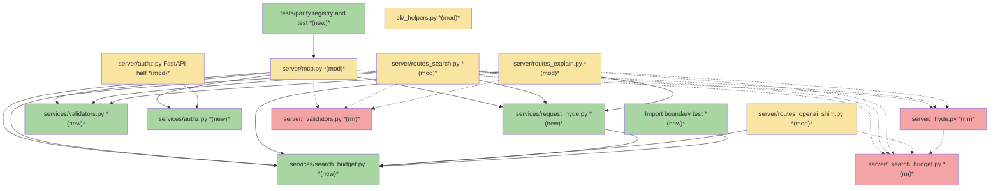
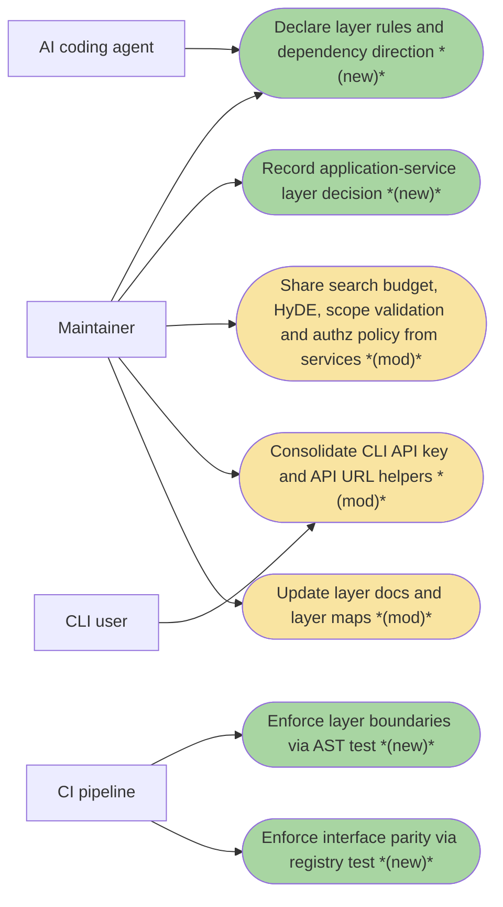
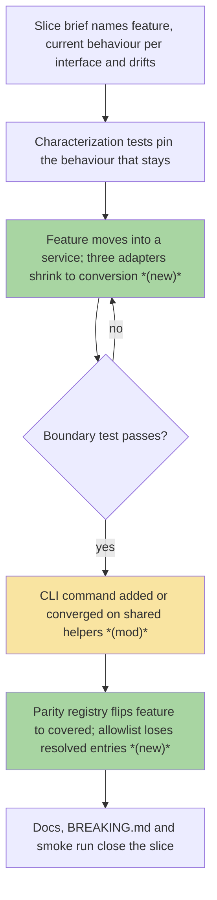
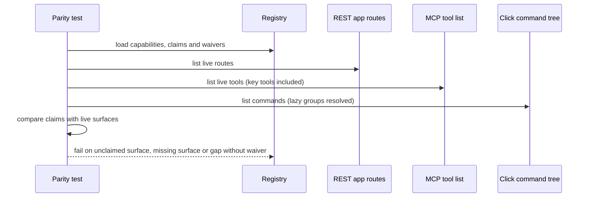

# S0 · Application-service layer foundation — Team Plan

**How to read this file**
- **Architecture approach:** Clean Architecture — the default; no override skill was requested. **Layers:** Presentation · Use Cases · Interface Adapters · Entities · Frameworks & Drivers.
- **Deployment boundary:** client+server. The CLI is an HTTP-only client of the REST server; REST, MCP and the OpenAI shim are server-side adapters in one FastAPI process. There is no browser frontend, so the **Frontend** role is the **CLI** (Presentation); every other layer is **Backend**.
- The **Frontend, Backend, and Tester** sections are the **depth view** — each role's scope, grouped by layer.
- **Contracts** are logical and authored as linked `.tsp` files (TypeSpec, core constructs only). S0 creates and changes no HTTP/API seam, so no `openapi.yaml` is emitted.
- **Role tags** (`#frontend-role`, `#backend-role`, `#tester-role`) mark each role-owned section — filter a tag (e.g. in Obsidian) to see one role's whole scope.
- IDs (`S#` scenarios, `C#` contracts, `Q#` questions) are the traceability thread; search the file for an ID to find where it's defined. Plan IDs are unrelated to the brief's own rule numbers (its C1–C14) and to roadmap slice numbers (S0–S33); this file always says "brief C#" or "roadmap S#" for those.
- **Tasks** are not in this file — task breakdown is a separate downstream step that consumes this plan.
- **Rule:** change a contract only by team agreement.

---

## Background

The same feature is implemented once per interface: search exists three times (REST, MCP, OpenAI shim) above a shared core, and [mcp.py](../../../archon_search/server/mcp.py) imports route modules while route modules import each other. Shared application logic ([_search_budget.py](../../../archon_search/server/_search_budget.py), [_hyde.py](../../../archon_search/server/_hyde.py), [_validators.py](../../../archon_search/server/_validators.py) and the policy half of [authz.py](../../../archon_search/server/authz.py)) lives under `server/` only because the first callers were routes. No `archon_search/services/` package, no import-boundary check and no parity registry exist today. [540_code_and_architecture_quality_audit.md](../../Architecture/540_code_and_architecture_quality_audit.md) finding ARCH-01 already prescribes application services; nothing has been built.

---

## Goal

A maintainer adding or changing a feature touches one service and one thin adapter per interface, and the build fails when a layer boundary is crossed or a feature exists on one interface but not another without a written waiver. S0 delivers the rules, the enforcement and the first real structural moves; slice S1 (Search) proves the pattern end to end.

---

## Scope

### In Scope
- New `archon_search/services/` package holding the modules shared by search, search-with-context and explain, moved out of `server/` with every caller and test updated: search budget, request HyDE, validators, and the pure authorization policy.
- The FastAPI-specific half of authz stays in `server/` and imports the policy from services.
- Boundary test (brief C11): AST scan with a ratcheting allowlist seeded from today's violations; `archon_search/services` added to the guarded directories of [test_no_wire_str_exc.py](../../../tests/test_no_wire_str_exc.py).
- Parity registry and test (brief C12) under `tests/parity/`, seeded with every roadmap feature and its current REST, MCP and CLI surface, plus the roadmap's waivers.
- CLI helper consolidation: one API key resolver and one default server URL in [_helpers.py](../../../archon_search/cli/_helpers.py), used by every CLI module.
- Docs: a new ADR (application-service layer, one implementation per feature), layer table and principles in doc 110, layering text in doc 100, ARCH-01 status in doc 540, layer map in [AGENTS.md](../../../AGENTS.md) and [CLAUDE.md](../../../CLAUDE.md).

### Out of Scope
- `ServiceError`, the services container, `SearchService` and the adapter error-mapping tables (specified in the brief but built in S1 with their first consumer).
- Moving `warmup.py`, `readiness.py`, `_ingest_admission.py`, `_ingest_lock.py`, `_collection_job.py` and the helpers in `routes_jobs.py` and `routes_collections.py`.
- Any feature move, new route, MCP tool or CLI command; generating adapter schemas from commands; any behaviour change.
- Touching [BREAKING.md](../../../BREAKING.md): S0 changes no wire behaviour.

---

## Acceptance criteria
- `archon_search/services/` exists and holds the four moved modules; the old `server/` modules and the pure half of `server/authz.py` are gone, with no shim, alias or re-export.
- Every importer in code, tests, docstrings and comments uses the new locations; tests that patch or assert the old module path or logger name are re-pointed and still exercise the code.
- The boundary test fails on a new violation (including function-local imports), fails on a stale allowlist entry, and its allowlist matches today's real violations.
- `services/` is guarded by the "never `str(exc)` on the wire" test.
- The parity test fails on an unclaimed REST route, MCP tool or CLI command, on a claimed surface that does not exist, and on a gap without a waiver; every pending slice carries a waiver that names it.
- `_resolve_api_key` and the default API URL are defined once in [_helpers.py](../../../archon_search/cli/_helpers.py); [test_cli_260_connection_refused_ux.py](../../../tests/test_cli_260_connection_refused_ux.py) stays green.
- OpenAPI snapshots ([contract](../../../tests/contract/openapi_snapshot.json), [server](../../../tests/server/openapi_snapshot.json)) are unchanged; search, explain, shim and admin behaviour is unchanged.
- The ADR, layer docs and layer maps are updated; doc-sync tests pass.
- Default test suite, `uvx ruff@0.17.3 check .` and the 85% coverage gate pass.

---

## What does NOT change
- Wire behaviour of REST, MCP and the OpenAI shim (status codes, bodies, wire text, timeouts, warm-up degrade to FTS-only, HyDE suppression rules).
- `identity_of`, `require_admin_dependency`, `caller_identity` and `ADMIN_ONLY_RESPONSES` keep their behaviour (they stay in [authz.py](../../../archon_search/server/authz.py)); the 403 `ErrorDetail` stays in the OpenAPI schema.
- `get_http_request` stays a module attribute of [mcp.py](../../../archon_search/server/mcp.py), and the autouse fixture `_mcp_default_request_context` with its `real_mcp_auth_context` opt-out in [conftest.py](../../../tests/conftest.py) keeps working (ADR 17 guard).
- The `cli/serve.py` lazy `run_server` import (the one allowed CLI-to-server import) and the HTTP-only CLI model.
- `status` keeps its non-exiting key lookup; the `key_cmd` and `maintenance_cmd` try/except wrappers around key resolution stay as they are.
- `BREAKING.md`, the store schema version and every stored data format.

---

## Known limitations / accepted trade-offs
- Boundary enforcement is an in-repo AST test, not import-linter (no new dependency; same pattern as the existing guards).
- The registry lives in `tests/`, not in the package: nothing in production reads it.
- Authorization-once-in-the-service is a later-slice consequence: S0 only relocates the pure policy.
- S0 ships no unused abstraction; `ServiceError` and the container wait for S1.
- Only direct imports are checked; transitive coupling through core modules is not.
- Field-level parity is not checked in S0 (evaluated in S1).

---

## Approach & architecture

Clean Architecture, applied to a repo that has no layer folders: `archon_search/services/` becomes the **Use Cases** home for logic shared by adapters, dependencies point inward (adapters → services → core), and the two guard tests make that direction checkable instead of conventional.

### Architecture

_Scope limited to changed nodes only: the full component set is well above 15 nodes and the 1-hop expansion also exceeds the limit. Changed components not drawn are in the table below; unchanged components (pipeline, router, key manager, filters, store, composition root, the other route modules) are omitted. Dotted edges show the last known connection of a removed module._

| Component | Change | Why |
|-----------|--------|-----|
| `services/` package with `search_budget`, `request_hyde`, `validators`, `authz` | new | Use Cases home for logic shared by adapters; moved from `server/` (the HyDE module is renamed because the root `hyde.py` exists) |
| `server/_search_budget`, `server/_hyde`, `server/_validators` | removed | Cut over; no shim or re-export |
| [authz.py](../../../archon_search/server/authz.py) | modified | Keeps only the FastAPI half; imports the policy and `ADMIN_REQUIRED_DETAIL` from services |
| [mcp.py](../../../archon_search/server/mcp.py), [routes_search.py](../../../archon_search/server/routes_search.py), [routes_explain.py](../../../archon_search/server/routes_explain.py), [routes_openai_shim.py](../../../archon_search/server/routes_openai_shim.py) | modified | Import re-pointed (shim imports only the search budget) |
| [middleware_auth.py](../../../archon_search/server/middleware_auth.py), [routes_keys.py](../../../archon_search/server/routes_keys.py), [routes_collections.py](../../../archon_search/server/routes_collections.py), [routes_jobs.py](../../../archon_search/server/routes_jobs.py) | modified | Import moved authz names from services (and split imports where both halves are used) |
| Import boundary test | new | Brief C11; seeded allowlist |
| `tests/parity/` registry and test | new | Brief C12; seeded from the roadmap |
| [test_no_wire_str_exc.py](../../../tests/test_no_wire_str_exc.py) | modified | `archon_search/services` added to the guarded directories |
| [_helpers.py](../../../archon_search/cli/_helpers.py) | modified | Receives the single API key resolver and default URL |
| [collection.py](../../../archon_search/cli/collection.py), [backup_cmd.py](../../../archon_search/cli/backup_cmd.py), [export_cmd.py](../../../archon_search/cli/export_cmd.py), [key_cmd.py](../../../archon_search/cli/key_cmd.py), [maintenance_cmd.py](../../../archon_search/cli/maintenance_cmd.py), [status.py](../../../archon_search/cli/status.py) | modified | Local copies removed; shared helpers used |
| [sync.py](../../../archon_search/cli/sync.py), [ingest.py](../../../archon_search/cli/ingest.py), [jobs_cmd.py](../../../archon_search/cli/jobs_cmd.py), [graph_cmd.py](../../../archon_search/cli/graph_cmd.py) | modified | Stop importing the helpers from the `collection` command module |

**Layer map (and role mapping)**

| Layer | Role | Components |
|-------|------|-----------|
| Presentation | **Frontend** (CLI, Click) | `cli/` command modules and [_helpers.py](../../../archon_search/cli/_helpers.py); the CLI talks to REST over HTTP only |
| Interface Adapters | Backend (Python) | REST route modules, [mcp.py](../../../archon_search/server/mcp.py), [routes_openai_shim.py](../../../archon_search/server/routes_openai_shim.py), [middleware_auth.py](../../../archon_search/server/middleware_auth.py), FastAPI half of [authz.py](../../../archon_search/server/authz.py); wire models in [schemas.py](../../../archon_search/server/schemas.py) and [mcp_schemas.py](../../../archon_search/server/mcp_schemas.py) |
| Use Cases | Backend (Python) | new `services/` modules (search budget, request HyDE, validators, authz policy); core orchestration in [pipeline.py](../../../archon_search/pipeline.py), [router.py](../../../archon_search/router.py), [hyde.py](../../../archon_search/hyde.py), `jobs/` |
| Entities | Backend (Python) | [filters.py](../../../archon_search/filters.py) `SearchFilters`, [key_manager.py](../../../archon_search/key_manager.py) `KeyRecord`, [collection_meta.py](../../../archon_search/collection_meta.py) |
| Frameworks & Drivers | Backend (Python) | [store.py](../../../archon_search/store.py) (LanceDB), FastAPI / FastMCP / Click / httpx, composition root [app.py](../../../archon_search/server/app.py), and the guard tests |

The repo's own docs use a different layer vocabulary ([110_component_catalog_and_layer_breakdown.md](../../Architecture/110_component_catalog_and_layer_breakdown.md) layer summary); the labels above are this plan's Clean Architecture classification.

**What changes**
- Shared search-support logic and the pure authorization policy move from `server/` to `services/` (Use Cases); `services/` may import core and nothing from `server`, `cli`, `fastapi`, `starlette`, `fastmcp`, `click` or `httpx`.
- Adapters (REST, MCP, shim) re-point their imports; the logger of the HyDE module changes name with the move.
- Two ratcheting tests appear: an import-boundary scan and a parity registry check; a third guard (`str(exc)` on the wire) now also covers `services/`.
- CLI helper duplication collapses into [_helpers.py](../../../archon_search/cli/_helpers.py); four CLI modules stop importing a sibling command module.
- Docs gain the layer contract: ADR, layer tables and principles, ARCH-01 status, layer maps.

**Key decisions (from the brief, fixed for S0)**
- Package `archon_search/services/`, classes named `*Service` (later slices).
- Boundary enforcement is an in-repo AST test with a ratcheting allowlist, not import-linter.
- Authorization is enforced once, in the service (roadmap decision D8, confirmed 2026-10-30).
- The registry lives in `tests/`, not in the package.
- Only the four shared modules move; each later slice moves what it needs.
- S1 is a pilot; this contract is reviewed after S1 and amended before S2.

### Actors & Use Cases

_Scope limited to change neighbourhood: the full set has 20 nodes (7 actors, 13 use cases). Omitted are the REST API consumer, MCP client and OpenAI-compatible client actors and the unchanged use cases (search, search with context, explain, OpenAI shim chat, key management and admin authorization, the other CLI commands), because S0 changes none of their behaviour._

### Flows

#### User Flow

How a later slice uses the foundation (the brief's core flow); steps S0 introduces or changes are tagged.

#### Data Flow

_Skipped: no data edge changes — S0 changes no persistence, API call or migration; modules only change location._

#### Sequence

The parity test is the one new multi-component interaction; the boundary test is a single static scan with the same compare-and-ratchet logic.

### Prior decisions

| Decision | Rationale | Constraint |
|----------|-----------|------------|
| [ADR 01](../../ADRs/01_lancedb_as_local_vector_store.md) — LanceDB as local single-process vector store | Zero-deployment, file-backed, single process; multi-writer is not a target | Underpins brief C1 (CLI over HTTP, never in-process); services reach the store only via the core `SearchStore` |
| [ADR 05](../../ADRs/05_opt_in_local_telemetry_no_raw_query.md) — opt-in local telemetry, no raw query | Privacy is structural, not runtime-checked | Services (later slices) emit telemetry only via the existing `TelemetryEntry` factories and never pass or log query text; S0 moves no telemetry code |
| [ADR 06](../../ADRs/06_durable_state_writes_via_fsync.md) — durable state writes via `_durable_io` | Crash durability | Informational: the in-repo AST guard (`test_no_raw_durable_writes`) is the precedent for the boundary test; new services code must not write state raw |
| [ADR 09](../../ADRs/09_mcp_http_mount_and_namespace_propagation.md) — MCP mounted in the same FastAPI app (partially superseded by ADR 17) | One process and port; namespace resolved per request | The MCP adapter keeps resolving the caller per request; services receive `AuthIdentity` and never resolve it; moving code must not break mount or lifespan |
| [ADR 17](../../ADRs/17_mcp_namespace_via_public_get_http_request.md) — namespace via public `get_http_request` | Public API; request-context faults must not fall back silently | `get_http_request` stays a module attribute of `server/mcp.py`; the conftest autouse fixture and the namespace guard test keep working; services must not import fastmcp |
| [ADR C4](../../ADRs/C4-hyde-external-llm-dependency.md) — HyDE is opt-in, external LLM | Privacy-first; availability over quality | The moved HyDE module keeps opt-in and silent fallback and must not import the optional `anthropic` dependency eagerly |
| [ADR C5](../../ADRs/C5-rag-fusion-external-llm-dependency.md) — RAG Fusion, mutually exclusive with HyDE | Semantic reformulation needs an LLM; accepted opt-in | HyDE/RAG Fusion suppression and fallback semantics are unchanged by the move |

### Contradictions

**Code vs. docs**
- [110_component_catalog_and_layer_breakdown.md](../../Architecture/110_component_catalog_and_layer_breakdown.md) principle 5 is marked `#Unverified` and lists only some of the real cross-imports (it omits `routes_explain` → `routes_search`, the MCP → route imports and `_collection_job` → `routes_jobs`); the layer table has no application-service row and no `_validators` row. Owner: **doc needs updating** (S0 rewrites these).
- [100_system_architecture_overview.md](../../Architecture/100_system_architecture_overview.md) principle 1 says modules above the pipeline depend only on the pipeline, while shared logic sits between them under `server/`. Owner: **doc needs updating** (S0 rewrites the layering text).
- [AGENTS.md](../../../AGENTS.md) lists a subset of CLI subcommands and route modules that [main.py](../../../archon_search/cli/main.py) and the code register. Owner: **doc needs updating**.
- [500_development_workflows_and_conventions.md](../../Architecture/500_development_workflows_and_conventions.md) says ruff is not a merge gate, while [archon-search-pr.yml](../../../.github/workflows/archon-search-pr.yml) runs `uvx ruff@0.17.3 check .` (and [200_testing_strategy.md](../../Architecture/200_testing_strategy.md) agrees with the workflow). Owner: **doc needs updating** (pre-existing; relevant because the brief relies on lint-before-merge).
- Docs that name the moved modules or call `server/authz.py` the single policy home ([600](../../Architecture/600_api_reference_or_public_interface.md), [140](../../Architecture/140_error_handling_strategy.md), [120](../../Architecture/120_services_and_integration_architecture.md), [150](../../Architecture/150_security_and_privacy_architecture.md), [SecurityGuide 01](../../SecurityGuide/01_threat_model.md), [02](../../SecurityGuide/02_authentication_and_keys.md) and [06](../../SecurityGuide/06_hardening_checklist.md), [UserManual 60](../../UserManual/60_searching.md) and [130](../../UserManual/130_ttl_and_scoping.md), [tests/eval/README.md](../../../tests/eval/README.md), [CLAUDE.md](../../../CLAUDE.md)) become stale after the move; the brief's docs list names only part of them. Owner: **doc needs updating** (listed in Documentation update).
- [540_code_and_architecture_quality_audit.md](../../Architecture/540_code_and_architecture_quality_audit.md) line ranges for `mcp.py` (1,905 lines) no longer match the code (2,601 lines). Owner: **doc needs updating** while its ARCH-01 status is edited.
- [520_api_design_and_contracts.md](../../Architecture/520_api_design_and_contracts.md) says MCP and REST "share internal services", but no `services/` package exists. Owner: **doc needs updating** (brief names 520).

**Brief vs. reality** (each item resolved as stated)
- Brief In Scope 2 says allowlist entries of [test_no_wire_str_exc.py](../../../tests/test_no_wire_str_exc.py) for moved code are re-keyed. The code has no entry for any of the four moved modules; the only authz entry (`require_admin_dependency`) belongs to the half that stays in `server/`. Resolved: S0 only adds `services/` to the guarded directories; nothing is re-keyed.
- Brief In Scope 4 names five `_resolve_api_key` and six `_DEFAULT_API_URL` copies and `sync.py` as the sole importer from `collection`. Reality: [ingest.py](../../../archon_search/cli/ingest.py), [jobs_cmd.py](../../../archon_search/cli/jobs_cmd.py) and [graph_cmd.py](../../../archon_search/cli/graph_cmd.py) also import both from `collection`, and `_helpers.py` already holds a seventh copy of the URL (`_LOCAL_DEFAULT_URL`) whose comment cites the soon-removed `collection` constant. Resolved: the brief's rule "every module uses them" covers all of these.
- Brief Edge Cases say "many tests" patch `archon_search.server.mcp.*` or `archon_search.server._hyde.*` by string. Reality found one string patch of a moved module ([test_request_hyde.py](../../../tests/server/test_request_hyde.py)) plus one logger-name assertion; the 17 files patching `server.mcp.*` target names that S0 does not move. The adapter-level alias patches of `_SEARCH_TIMEOUT_SECONDS` are the real silent-break risk (see Backend).
- Brief C10 names [sync.py](../../../archon_search/cli/sync.py) as the CLI pattern including `--json`, but `sync.py` has no `--json`; the option exists only in `status`, `backup` and `maintenance`. Resolved: those three commands are the `--json` reference.
- Brief importer list for the moved modules is incomplete: `_validators` has three importers (`mcp`, `routes_search`, `routes_explain`) the brief does not list, and the authz importers are broader than the brief states ([middleware_auth.py](../../../archon_search/server/middleware_auth.py), [routes_keys.py](../../../archon_search/server/routes_keys.py), [routes_collections.py](../../../archon_search/server/routes_collections.py), [routes_jobs.py](../../../archon_search/server/routes_jobs.py)). The OpenAI shim imports only the search budget, not HyDE or validators. Informational; covered by the Backend scope.
- Brief seeds the allowlist with "MCP importing route modules, route modules importing each other". Reality adds non-route edges: [_collection_job.py](../../../archon_search/server/_collection_job.py) → `routes_jobs`, [routes_status.py](../../../archon_search/server/routes_status.py) → `routes_collections`, [routes_sync.py](../../../archon_search/server/routes_sync.py) and [routes_graph.py](../../../archon_search/server/routes_graph.py) → `routes_jobs`, and function-local imports in `mcp.py` and [app.py](../../../archon_search/server/app.py). Resolved: the allowlist is seeded from every real edge, as the brief's "today's violations" requires.
- Roadmap D8 (authorization enforced once, in the service) read "proposed in Brief 00, not yet confirmed", while the brief lists it as a fixed Key Decision. Resolved: confirmed 2026-10-30 and recorded in the roadmap.

---

## Contracts / seams

Boundaries where roles must agree. **Logical, not code.** Changing one requires team agreement. **Tooling used: TypeSpec 1.13.0**, core constructs only, each compiled clean with `tsp compile <file> --no-emit`. S0 creates or changes no HTTP/API seam (no wire change), so **no `openapi.yaml` is emitted** and the two OpenAPI snapshots must stay unchanged.

**C1 — Import boundary rule**  *(Frameworks & Drivers test ↔ every layer)*
The boundary test scans guarded source for imports and compares each edge, keyed by (importing file, imported module), to a ratcheting allowlist. A new violation fails; a stale allowlist entry fails; the list only shrinks. `services/` has a deny-list of `archon_search.server`, `archon_search.cli` and the web, CLI and HTTP client packages; the CLI may import none of `services/` or `server/` except the one lazy `run_server` import. See [00_service_layer_foundation-c1-import-boundary.tsp](./00_service_layer_foundation-c1-import-boundary.tsp).

**C2 — Shared search-support modules**  *(Interface Adapters ↔ Use Cases)*
The search budget (time budget and warm-up result), request HyDE (resolution outcome and the shared warning text) and scope-filter validation are offered by `services/` and consumed by the REST, MCP and shim adapters. Adapters keep binding the timeout constant under the same module-level alias name and pass it explicitly, so existing alias patches keep taking effect. Behaviour, wire text and the HyDE logger semantics are unchanged (the logger name follows the module) — see [00_service_layer_foundation-c2-search-support.tsp](./00_service_layer_foundation-c2-search-support.tsp).

**C3 — Authorization policy split**  *(Interface Adapters ↔ Use Cases)*
`services/authz` owns the transport-free policy: the caller identity (`namespace`, `admin`), the forbidden error with its fixed code and sanitized detail text, and the admin and key-management checks. `server/authz` keeps only the request-derived identity resolution and the REST dependency and response declarations, importing from services. There is exactly one `ForbiddenError` class; moved names are not re-exported from `server/authz` — see [00_service_layer_foundation-c3-authz-policy.tsp](./00_service_layer_foundation-c3-authz-policy.tsp).

**C4 — Parity registry**  *(Frameworks & Drivers test ↔ REST, MCP, CLI surfaces)*
Each capability lists its service method and, per interface, either the live surface identifier or a waiver with a reason (pending work names its slice). The check reads the live REST routes, the real MCP tool list (key-management tools included) and the Click tree including lazily registered groups, and fails on an unclaimed surface, a claimed surface that does not exist, or a gap without a waiver — see [00_service_layer_foundation-c4-parity-registry.tsp](./00_service_layer_foundation-c4-parity-registry.tsp).

**C5 — Shared CLI helpers**  *(Presentation ↔ Presentation)*
One API key resolver (option, then environment, then key file; otherwise a fixed stderr message and exit 1) and one default server URL, both in `cli/_helpers`. Every command module uses them; no command imports another command module for them. `status` keeps its separate non-exiting key lookup — see [00_service_layer_foundation-c5-cli-shared-helpers.tsp](./00_service_layer_foundation-c5-cli-shared-helpers.tsp).

---

## Data

_Skipped: S0 changes no table, field, relationship or migration. The project has no relational schema (persistence is LanceDB plus JSON and JSONL files); the moved modules persist nothing, `STORE_SCHEMA_VERSION` is not bumped and no `MigrationSpec` is added. The registry and allowlist are test-side artefacts, and the OpenAPI snapshots must remain unchanged._

---

## Scenarios #tester-role

What the maintainers' tooling must do and what the tester verifies end to end. Behavioural only — step-level detail is produced by the tasks below.

| id | Scenario (Given / When / Then) |
|----|--------------------------------|
| **S1** | **Given** the four modules moved · **When** search, search with context, explain and the OpenAI shim run · **Then** results, timeouts, warm-up degrade to FTS-only and HyDE suppression behave exactly as before |
| **S2** | **Given** the cutover is complete · **When** the old `server` modules for budget, HyDE or validators are imported · **Then** the import fails (no shim or alias left behind) |
| **S3** | **Given** the pure authz policy lives in `services/` · **When** it is imported without FastAPI · **Then** it loads, and `ForbiddenError` is one class shared by services, routes and MCP |
| **S4** | **Given** a non-admin key · **When** it calls an admin-only REST route or MCP tool · **Then** it still gets the same 403 or error with the same fixed wire text |
| **S5** | **Given** the current tree · **When** the boundary test runs · **Then** it passes and its allowlist equals today's real violations |
| **S6** | **Given** a new forbidden import (a service importing `fastapi` or `server`, a route importing another route, the CLI importing `services`) · **When** the boundary test runs · **Then** it fails and names the edge |
| **S7** | **Given** an allowlist entry whose violation was fixed · **When** the boundary test runs · **Then** it fails as stale |
| **S8** | **Given** function-local, `TYPE_CHECKING`-only and `from package import module` imports · **When** the boundary test runs · **Then** each is classified consistently with the documented rule |
| **S9** | **Given** the lazy `run_server` import in `cli/serve.py` · **When** the boundary test runs · **Then** it is the only allowed CLI-to-server import |
| **S10** | **Given** a `str(exc)` of a caught exception placed in `services/` · **When** the wire-text guard runs · **Then** it fails |
| **S11** | **Given** the live REST app, MCP tool list (key tools included) and Click tree · **When** the parity test runs · **Then** every surface is claimed or waived and it passes |
| **S12** | **Given** a REST route, MCP tool or CLI command missing from the registry · **When** the parity test runs · **Then** it fails as unclaimed |
| **S13** | **Given** a registry claim for a surface that does not exist · **When** the parity test runs · **Then** it fails |
| **S14** | **Given** an interface gap with no waiver · **When** the parity test runs · **Then** it fails; **and** every pending slice carries a waiver that names it |
| **S15** | **Given** the lazily registered `graph` group, conditional `/mcp` mount, docs routes and the roadmap's waived surfaces · **When** the parity test runs · **Then** each is seen or waived without a false failure |
| **S16** | **Given** the roadmap · **When** the registry is reviewed · **Then** it is seeded with every feature slice S1–S32 and the agreed waivers |
| **S17** | **Given** a key passed as option, environment variable or key file · **When** any CLI command resolves it · **Then** the same priority applies everywhere; with no key it prints the fixed message and exits 1 |
| **S18** | **Given** no `--api-url` · **When** any CLI command connects · **Then** it uses the one shared default; `status` still returns without exiting when no key exists |
| **S19** | **Given** the server is stopped · **When** any key, backup, export, maintenance, collection or sync command runs · **Then** the same friendly connection-refused message appears and the connection-refused UX test stays green |
| **S20** | **Given** tests that patched the old HyDE module path or asserted its logger name · **When** they run after the move · **Then** they target the new location and still exercise the code (no silent no-op patch) |
| **S21** | **Given** tests that patch the timeout alias on an adapter module · **When** the adapter imports it from services · **Then** the patched value still reaches the budget call |
| **S22** | **Given** no wire change · **When** the OpenAPI snapshots are compared · **Then** both are unchanged and the admin-only 403 `ErrorDetail` is still declared |
| **S23** | **Given** the MCP default request-context fixture and its opt-out · **When** MCP tests run · **Then** both keep working |
| **S24** | **Given** the doc edits · **When** the doc-sync tests run (MCP tool count, sanitized wire text, docs) · **Then** they pass |
| **S25** | **Given** the new ADR · **When** the ADR directory and index are reviewed · **Then** it carries the next free number at merge time, follows the ADR format and is listed in the documentation index |
| **S26** | **Given** the finished slice · **When** the default test suite, ruff and the coverage gate run · **Then** all pass with coverage at or above 85% and no new warnings |
| **S27** | **Given** the retrieval regression gate · **When** it runs after the move · **Then** thresholds are met unchanged (no ranking behaviour drift) |
| **S28** | **Given** a real server process · **When** REST search and the CLI collection, key and sync commands are exercised · **Then** they work end to end after the move |
| **S29** | **Given** a scratch branch · **When** a forbidden import is added, or a registry row is deleted · **Then** the boundary test, respectively the parity test, goes red |
| **S30** | **Given** a real MCP client connected to `/mcp` · **When** it calls `search` · **Then** it returns results as before |

---

## Frontend — Presentation (CLI) #frontend-role

**Scope:** the CLI only — the one client-side surface (no browser frontend). S0's CLI work is the helper consolidation in [_helpers.py](../../../archon_search/cli/_helpers.py): one API key resolver and one default server URL, used by every command module, including the four modules ([sync.py](../../../archon_search/cli/sync.py), [ingest.py](../../../archon_search/cli/ingest.py), [jobs_cmd.py](../../../archon_search/cli/jobs_cmd.py), [graph_cmd.py](../../../archon_search/cli/graph_cmd.py)) that import them from a sibling command module today. The CLI gains no command and no behaviour change, and never imports `services/` or `server/`. Writes both unit and integration tests for its tasks.
**Owns layer:** Presentation.

**Done when**
- [ ] Every command resolves the API key through one shared helper with the same priority and the same missing-key message and exit code — S17
- [ ] Every command shows and uses one shared default server URL — S18
- [ ] `status` keeps its non-exiting key lookup — S18
- [ ] Connection-refused messaging is identical across modules and the UX test stays green — S19
- [ ] Tests that patched the key loader on the old command module patch the shared helper and still bind — S17
- [ ] No command module imports another command module for these helpers, and the CLI imports neither `services/` nor `server/` (except the lazy `run_server`) — S6, S9
- [ ] The CLI still works against a real server — S28

---

## Backend — Entities · Use Cases · Adapters · Frameworks #backend-role

**Scope:** everything non-CLI — creating `services/` with the four moved modules, splitting authz, re-pointing every importer, and the two guard tests. Writes both unit and integration tests for its tasks.
- **Module moves:** the search budget, HyDE (renamed because the root `hyde.py` exists), validators and the pure authz policy; update every importer in code, tests, docstrings and comments (adapters, middleware, key routes, collections and jobs routes, tests such as the request-HyDE, search-budget, validators, MCP search, shim and admin-scope tests, and path mentions in test docstrings).
- **Silent-break hazards:** the HyDE logger name and its `caplog` assertion; the string patch of the HyDE resolver; the adapter-module timeout alias patches; `get_http_request` staying in `mcp.py`; no circular import (`services/authz` must not import `server.schemas`; keep `services/__init__.py` free of side effects); `services/` must not import the optional `anthropic` dependency eagerly.
- **Guards:** the boundary test (module-level and function-local imports, the seeded allowlist including the non-route edges, the guarded-tree definition) and the parity registry and its test (live REST routes, real MCP tool list built with a key store, Click tree via `list_commands`, seeded from the roadmap and its waivers); `archon_search/services` added to the `str(exc)` guard.
- **Docs and ADR (Backend-owned):** the new ADR, layer docs and maps listed in Documentation update.

**Owns layers:** Entities, Use Cases, Interface Adapters, Frameworks & Drivers.

**Done when**
- [ ] The four modules live in `services/` and the old paths no longer import — S1, S2, S3
- [ ] Behaviour of search, search with context, explain, shim and admin checks is unchanged, including 403 wire text — S1, S4, S22, S27
- [ ] Adapters keep the module-level timeout alias and tests that patch it still take effect — S21
- [ ] Old-path string patches and logger assertions are re-pointed — S20
- [ ] The boundary test passes on the real tree, fails on new and stale entries, and handles every import form per the documented rule — S5, S6, S7, S8, S9
- [ ] `services/` is covered by the `str(exc)` guard — S10
- [ ] The parity registry covers every live surface and roadmap feature with waivers, and fails on the three drift cases — S11, S12, S13, S14, S15, S16
- [ ] MCP request-context fixture and namespace guard keep working — S23
- [ ] Doc-sync tests, ADR and docs are done — S24, S25
- [ ] Suite, ruff and coverage gates pass — S26

---

## Tester #tester-role

**Scope:** the tester owns **e2e and manual** tests plus the project close-out. **Unit and integration** tests belong to the implementing dev, in each implementation task's `Tests` block. Harness facts: smoke tests ([tests/smoke/](../../../tests/smoke/conftest.py)) spawn a real server and are local-only (not in any CI workflow, needs a model cache); there is no MCP or shim smoke coverage and no real-transport MCP e2e harness; no browser UI e2e applies; device-only behaviours (interruption, route change, permissions) and data migration do not apply to this server-side refactor.

**Allocation** — each scenario at the cheapest level that proves it *(unit + integration are dev-written; e2e + manual are the tester's tasks)*

| Scenario | Cheapest level |
|----------|----------------|
| S2, S3, S5, S6, S7, S8, S9, S10 | unit |
| S17, S18, S20, S21, S23 | unit |
| S1, S4, S19, S22 | integration |
| S11, S12, S13, S14, S15, S16 | integration |
| S24, S26 | integration (automated gates) |
| S27 | integration (retrieval regression gate) |
| S28 | e2e (local smoke lane) |
| S25, S29, S30 | manual |

---

## Documentation update

Docs the feature touches — the tasks file's close-out task works through this list. List only real files. Each file carries a reason: *new feature* / *contradiction with code* / *no change needed*.

- [ ] [00_service_layer_foundation_brief.md](./00_service_layer_foundation_brief.md) — *contradiction with code* — allowlist re-keying, importer lists, the C10 reference and test-patch claims diverge from the code (see Contradictions); amend the brief to match
- [ ] [00_service_layer_foundation-team-plan.md](./00_service_layer_foundation-team-plan.md) — *new feature* (this file)
- [ ] [roadmap.md](./roadmap.md) — *new feature* — tick S0 in the landing commit (D8 is already recorded as confirmed)
- [ ] [110_component_catalog_and_layer_breakdown.md](../../Architecture/110_component_catalog_and_layer_breakdown.md) — *contradiction with code* — layer table and principles, `services/` rows, moved-module rows, principle 5
- [ ] [100_system_architecture_overview.md](../../Architecture/100_system_architecture_overview.md) — *contradiction with code* — principle 1 and the auth-boundary path reference
- [ ] [AGENTS.md](../../../AGENTS.md) — *contradiction with code* — layer map; stale CLI and route lists
- [ ] [CLAUDE.md](../../../CLAUDE.md) — *new feature* — layer map; authz location in the hard invariants
- [ ] [540_code_and_architecture_quality_audit.md](../../Architecture/540_code_and_architecture_quality_audit.md) — *new feature* — ARCH-01 status; stale line ranges
- [ ] [120_services_and_integration_architecture.md](../../Architecture/120_services_and_integration_architecture.md) — *new feature* — search-budget parity path reference
- [ ] [140_error_handling_strategy.md](../../Architecture/140_error_handling_strategy.md) — *new feature* — authz and search-budget path references
- [ ] [520_api_design_and_contracts.md](../../Architecture/520_api_design_and_contracts.md) — *contradiction with code* — "share internal services" now becomes true; update the layering statement
- [ ] [600_api_reference_or_public_interface.md](../../Architecture/600_api_reference_or_public_interface.md) — *new feature* — admin-scope and warm-up path references
- [ ] [150_security_and_privacy_architecture.md](../../Architecture/150_security_and_privacy_architecture.md) — *new feature* — authz path reference
- [ ] [500_development_workflows_and_conventions.md](../../Architecture/500_development_workflows_and_conventions.md) — *contradiction with code* — ruff merge-gate statement
- [ ] [990_documentation_index_and_contribution_guide.md](../../Architecture/990_documentation_index_and_contribution_guide.md) — *new feature* — ADR index row for the new ADR
- [ ] [01_threat_model.md](../../SecurityGuide/01_threat_model.md), [02_authentication_and_keys.md](../../SecurityGuide/02_authentication_and_keys.md), [06_hardening_checklist.md](../../SecurityGuide/06_hardening_checklist.md) — *new feature* — authz path references
- [ ] [60_searching.md](../../UserManual/60_searching.md), [130_ttl_and_scoping.md](../../UserManual/130_ttl_and_scoping.md) — *new feature* — moved-module path references
- [ ] [README.md](../../../tests/eval/README.md) (under `tests/eval`) — *new feature* — HyDE module path reference
- [ ] [530_technical_debt_refactoring_roadmap.md](../../Architecture/530_technical_debt_refactoring_roadmap.md) — *no change needed* — the old validator path appears only in a struck-through, resolved item (historical)
- [ ] [CHANGELOG.md](../../../CHANGELOG.md) and [BREAKING.md](../../../BREAKING.md) — *no change needed* — S0 changes no wire behaviour; old paths there are history; `release.sh` generates the changelog from commit messages

The new ADR (next free number, 19 at the time of writing) is a planned file and is not linked here.

**Consulted (read-only)**
- [01_search_brief.md](./01_search_brief.md) — first consumer of this foundation
- [03_breaking_changes_index.md](../../MigrationGuide/03_breaking_changes_index.md) — confirms no row is needed
- [05_mcp_integration.md](../../DeveloperGuide/05_mcp_integration.md) — pins the MCP tool count the doc-sync test checks
- [010_engineering_principles_and_constraints.md](../../Architecture/010_engineering_principles_and_constraints.md) — shared auth layer
- [200_testing_strategy.md](../../Architecture/200_testing_strategy.md) — lint step and coverage gate
- [18_pytorch_runtime_replaces_fastembed.md](../../ADRs/18_pytorch_runtime_replaces_fastembed.md) — ADR format and highest current number

---

## Open questions

No open questions block S0.

*Resolved in this revision:*
- *Q1, Q2, Q3, Q5 (from the brief): the brief assigns them to later slices (S1, S1, S1, S25); they do not affect S0.*
- *Q4, Q19: the new ADR is number 19 (the last numbered ADR is 18; the lettered C4–C6 files are a separate series).*
- *Q16: D8 confirmed by the product owner (service enforces authorization once).*
- *Q18: the changelog is generated by `release.sh` from commit messages.*
- *Q11, Q12, Q13, Q15: answered by the brief's own rules (see Contradictions).*
- *Q14, Q17: answered by the brief (no behaviour change in S0; a smoke run closes every slice).*
- *Q6–Q10: test-design details the implementer settles from brief C1, C11 and C12 and the roadmap slice list.*
- *The brief's "32 feature slices" matches the roadmap (S1–S32 are features, S33 is close-out); no authz wire constant appears in the sanitized-wire-text doc test cases, so moving them carries no doc-sync risk beyond path references.*

---

## References

- **Brief:** [00_service_layer_foundation_brief.md](./00_service_layer_foundation_brief.md)
