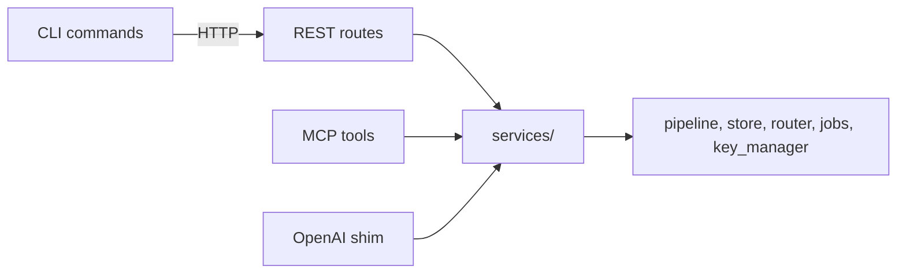

# Feature Brief: Application-service layer foundation (the contract for interface parity)

Slice S0 of the [interface parity roadmap](./roadmap.md). Every later slice brief refers to the numbered rules in the **Contract** section below (C1, C2, ...) instead of restating them.

## Problem

The same feature is implemented once per interface. The core is shared (`SearchPipeline.search` and `search_many` are called by REST, MCP and the OpenAI shim), but everything above it is duplicated: validation, HyDE and RAG Fusion resolution, warm-up, the search budget, filter building, error mapping, telemetry and response shaping. Evidence, as of 2026-10-30:

- Search exists three times: `server/routes_search.py:301-695`, `server/mcp.py:520-865` and `server/routes_openai_shim.py` (~250-345). A step-by-step comparison found 20 behavioral differences and a dozen duplicated literals (see [Brief 01](./01_search_brief.md)).
- `mcp.py` is 2601 lines of tool implementations. It imports from route modules (`routes_explain`, `routes_export`, `schemas`), and route modules import each other (`routes_explain` imports `dependency_error_response` from `routes_search`; `routes_collections` imports from `routes_jobs`). `Documentation/Architecture/110_component_catalog_and_layer_breakdown.md` principle 5 already admits this.
- Shared application logic lives under `server/`: `_search_budget.py`, `_hyde.py`, `_validators.py` and the policy half of `authz.py`. None of the first three imports FastAPI; they sit in `server/` only because the first callers were routes.
- The CLI has no search, explain, route, document, expiring-chunk or telemetry command, MCP has no job tools, and REST lacks `search_with_context` and document deletion.
- `Documentation/Architecture/540_code_and_architecture_quality_audit.md` finding ARCH-01 already names this problem and prescribes application services with typed commands, results and domain errors. Nothing has been built.
- No import-boundary check exists. The repo has no import-linter, tach or pytest-archon configuration, and the pinned ruff rule set deliberately excludes the `TID` rules (`pyproject.toml:127-129`).

## Goal

A maintainer adding or changing a feature touches one service and one thin adapter per interface, and the build fails when a layer boundary is crossed or a feature exists on one interface but not another without a written waiver. S0 delivers the rules, the enforcement and the first real structural moves. Slice S1 (Search) proves the pattern end to end.

## Users & Context

- Maintainers of archon-search who implement the following 32 feature slices, usually one at a time and often through agents that have no memory of this discussion. The contract must therefore be explicit and checkable by tests, not by convention.
- API consumers (REST, MCP clients, CLI users) benefit indirectly: identical behavior and feature coverage on every interface.

## Core Flow

How a later slice uses this foundation:

1. The slice brief names the feature, its current behavior per interface and the drifts to resolve.
2. Characterization tests pin the behavior that stays.
3. The feature moves into a service following the Contract; the three adapters shrink to conversion.
4. The CLI command is added or converged on the shared CLI helpers.
5. The parity registry flips the feature to covered; the boundary allowlist loses the entries the slice resolved.
6. Docs, `BREAKING.md` and a smoke run through the real server close the slice.

## Contract

**C1 — Layers and dependency direction.**
- `archon_search/services/` is the application layer. It may import the core (pipeline, store, router, jobs, key manager, config, constants, filters) and nothing from `archon_search.server`, `archon_search.cli`, `fastapi`, `starlette`, `fastmcp`, `click` or `httpx`.
- REST routes, MCP tools and the OpenAI shim import services. They do not import each other. No route module imports another route module.
- The CLI never imports services or `server/` (the existing lazy `run_server` import in `cli/serve.py:43` is the one allowed exception). It talks to the running server over HTTP, because LanceDB is single-writer and an in-process CLI would conflict with a running server.

**C2 — Service shape.**
- One service class per feature group (for example `SearchService`). Constructor-injected dependencies, no module-level globals, built once at startup and reachable from `app.state` for REST and passed to the MCP factory.
- Each method is async and takes a command plus the caller, and returns a result: `await service.search(command, caller) -> SearchResult`.
- A service never receives a request object, an `HTTPException`, a FastMCP `Context` or a Click context.

**C3 — Commands, results and names.**
- Commands and results are frozen dataclasses defined next to the service. Existing transport-free models such as `SearchFilters` (`filters.py`) are reused inside them.
- A concept has one name on every interface: command field names are the canonical names. REST and MCP use them as-is (snake_case); the CLI uses the kebab-case form (`source_path_prefix` becomes `--source-path-prefix`). A different name needs a recorded waiver in the registry (C12).
- Derived response fields are computed once, in the service (for example `expansion_used` and `expansion_warning`, which REST and MCP compute separately today).

**C4 — Caller and authorization.**
- The caller is `AuthIdentity(namespace, admin)`. Adapters resolve it from their transport (REST middleware state, MCP request context) and pass it in.
- Authorization is enforced once, inside the service: admin checks, namespace scoping and key-management rules. REST keeps only the OpenAPI declaration of the 403 response; it does not run a second check.

**C5 — Errors.**
- Services raise `ServiceError` subclasses. Each carries a stable `code`, a fixed sanitized `detail` constant (never `str(exc)`, per `140_error_handling_strategy.md` principle 6 and `tests/test_no_wire_str_exc.py`) and the telemetry `ErrorKind` it maps to.
- Services translate core exceptions (`CollectionNotFoundError`, `MetadataLookupError`, `FanoutTimeoutError`, `EmbedderNotReadyError`, `GraphCommunitiesNotBuiltError`, ...) once. Adapters never catch core exceptions.
- Each adapter has exactly one mapping table: REST (error kind to HTTP status, including the existing coded and plain body shapes), MCP (`{"error", "code"}` dict), CLI (HTTP status to message and exit code). A slice that changes a wire shape records it in `BREAKING.md`.

**C6 — What belongs in the service.** Input validation and bounds, defaults and limits, collection and namespace resolution, embedder selection and warm-up, HyDE and RAG Fusion resolution, the budget and timeout, calls into the core, derived fields, telemetry for every outcome (including timeouts and internal errors, which MCP skips today), and logging.

**C7 — What belongs in an adapter.** Parsing the transport shape into a command (REST Pydantic models, MCP function signatures, Click options), calling the service, rendering the result (REST JSON, MCP dict, CLI text or `--json`, OpenAI text and SSE) and mapping errors through its table. An adapter contains no business branching and does not recompute anything the service derives.

**C8 — Constants and wire text.** A default, limit, valid-value set or message exists once: limits come from `SearchConfig` or `constants.py`; a wire text constant lives next to the error that uses it and is imported by every adapter. Duplicate literals found in a slice are removed in that slice.

**C9 — Long-running work.** A feature that can run long exposes its core once. Whether an interface runs it inline or as a job is decided per feature in its brief (D1 for ingest) and implemented as two thin entry points over that one core, not as two implementations.

**C10 — CLI.** A command follows the `cli/sync.py` pattern: `--api-url`, `--api-key`, `_server_connect_fail_msg` on connect failure, `--json` for machine output (`json.dumps(payload, indent=2, sort_keys=True)`), exit 1 on errors, exit 2 for an unsuccessful job where the command already uses it. Shared pieces live in `cli/_helpers.py`.

**C11 — Boundary enforcement.** An AST test asserts C1. Current violations sit in an explicit allowlist keyed by (importing file, imported module); the test fails on a new violation and on a stale allowlist entry. Each slice deletes the entries it resolves, so the list only shrinks.

**C12 — Parity registry.** A registry in `tests/parity/` lists every capability: its service method, its REST route, its MCP tool, its CLI command, and a waiver (with reason) for each interface that lacks it. A test introspects the live REST app routes, the real FastMCP tool list and the Click command tree, and fails when an interface exposes something the registry does not claim, when a capability claims a surface that does not exist, or when a gap has no waiver. Pending slices carry a waiver that names the slice. Field-level parity (every command field exposed on every interface) is evaluated in S1.

**C13 — Tests.**
- Characterization tests first (the repo's TDD rule); service logic is tested directly with fakes, without an HTTP or MCP stack; adapter tests check mapping only.
- Tests pinned to behavior a slice intentionally changes are rewritten or deleted, never re-pinned.
- OpenAPI snapshots (`tests/contract/openapi_snapshot.json`, `tests/server/openapi_snapshot.json`) and contract tests are updated in the slice that changes them.
- Tests that patch `archon_search.server.mcp.*` or `archon_search.server._hyde.*` by string are re-pointed when the code moves.
- Coverage stays at or above 85%; `--cov=archon_search` already covers a new `services/` package.

**C14 — Cutover and docs.** When a slice lands, every caller uses the service and the old code is deleted: no shims, re-exports or aliases. Each slice updates the docs it affects (`100`, `110`, `120`, `140`, `520`, `600` under `Documentation/Architecture/`, the user manual, `AGENTS.md` and `CLAUDE.md` where they describe layering), adds a `BREAKING.md` entry with its row in `MigrationGuide/03_breaking_changes_index.md`, and respects the doc-sync tests (`test_mcp_tool_count_docs.py`, `test_sanitized_wire_text_docs.py`).

## In Scope

S0 ships only what has a real consumer on day one:

1. **`archon_search/services/` package** with the modules that search, search-with-context and explain all share, moved out of `server/` with every caller and test updated:
   - `server/_search_budget.py` → `services/search_budget.py` (importers: `mcp.py`, `routes_search.py`, `routes_explain.py`, `routes_openai_shim.py`, `_hyde.py`).
   - `server/_hyde.py` → `services/request_hyde.py` (the root `archon_search/hyde.py` already exists, hence the name).
   - `server/_validators.py` → `services/validators.py`.
   - The pure policy half of `server/authz.py` (`AuthIdentity`, `ForbiddenError`, `require_admin`, `authorize_key_create`, `authorize_key_listing_namespace`, `can_manage_key`, `caller_may_revoke`, the `*_DETAIL` constants and `FORBIDDEN_CODE`) → `services/authz.py`. The FastAPI-specific half (`identity_of(request)`, `require_admin_dependency`, `caller_identity`, `ADMIN_ONLY_RESPONSES`) stays in `server/authz.py` and imports from services.
2. **Boundary test** implementing C11, with the allowlist seeded from today's violations (MCP importing route modules, route modules importing each other), and `archon_search/services` added to `_GUARDED_DIRS` in `tests/test_no_wire_str_exc.py` (its allowlist entries for moved code are re-keyed; `test_every_allowlist_entry_still_matches` fails on stale ones).
3. **Parity registry and test** implementing C12, seeded with every feature in the roadmap and its current REST, MCP and CLI surface, and the waivers from the roadmap.
4. **CLI helper consolidation.** `_resolve_api_key` is copied in `collection.py`, `backup_cmd.py`, `export_cmd.py`, `key_cmd.py` and `maintenance_cmd.py` (`sync.py` imports it from `collection`), and `_DEFAULT_API_URL` is copied in `collection`, `status`, `backup_cmd`, `export_cmd`, `key_cmd` and `maintenance_cmd`. Both move to `cli/_helpers.py` and every module uses them. `tests/test_cli_260_connection_refused_ux.py` must stay green.
5. **Docs:** a new ADR for the application-service layer and one-implementation-per-feature rule (ADRs are append-only; take the next number), the layer table and principles in `110` and the layering text in `100`, the status of ARCH-01 in `540`, and the layer map in `AGENTS.md` and `CLAUDE.md`. `BREAKING.md` is not touched: S0 changes no wire behavior.

## Out of Scope

- `ServiceError`, the services container, `SearchService` and the adapter error-mapping tables. They are specified above (C2, C5) but implemented in S1 with their first consumer, so S0 ships no unused abstraction.
- Moving `warmup.py`, `readiness.py`, `_ingest_admission.py`, `_ingest_lock.py`, `_collection_job.py` and the helpers in `routes_jobs.py` and `routes_collections.py`. Several import `server.schemas` or return `JSONResponse`, and each moves in the slice that needs it.
- Any feature move, new route, MCP tool or CLI command.
- Generating adapter schemas from commands.
- Any behavior change.

## Key Decisions

- **Package named `archon_search/services/`, classes named `*Service`.** ARCH-01 suggests `*ApplicationService`; the shorter name keeps call sites readable and carries the same meaning.
- **Boundary enforcement is an in-repo AST test with a ratcheting allowlist, not import-linter.** The repo has no import tooling, and its existing guards (`test_no_wire_str_exc`, `test_no_raw_durable_writes`, `test_no_fstring_sql`) follow exactly this pattern with no new dependency. Alternative: adopt import-linter if the layer set grows.
- **Authorization is enforced once, in the service.** A second route-level check would be a second place to drift. The cost: admin-only routes lose their `Depends(require_admin_dependency)` when their slice lands, so each such slice needs a test that a non-admin key gets 403 on every interface.
- **The registry lives in `tests/`, not in the package.** Nothing in production reads it, and a production-side registry would be unused code.
- **S0 moves only the four shared modules.** Moving more would be speculative; each later slice moves what it needs.
- **S1 is a pilot.** The pattern is reviewed after S1 and this brief is amended before S2 starts.

## Edge Cases & Constraints

- **String patch targets.** Many tests patch `archon_search.server.mcp.*` and `archon_search.server._hyde.resolve_hyde_within_budget` by name (`tests/server/test_request_hyde.py:105` and others). Moving a module breaks them silently if the patch target is not updated.
- **`conftest.py` autouse fixture.** `_mcp_default_request_context` patches `archon_search.server.mcp.get_http_request` for every test; opt-out is `real_mcp_auth_context`. Slices must keep both working.
- **`authz.py` is mixed.** Its pure policy functions have no transport coupling; `identity_of`, `require_admin_dependency` and `caller_identity` need FastAPI. Only the pure half moves.
- **Wire-text constants.** `tests/test_sanitized_wire_text_docs.py` requires wire literals to appear in docs `600`, `110`, `120`, `140` and `BREAKING.md`. Moving a constant must not break that link.
- **Unguarded new package.** `tests/test_no_wire_str_exc.py` guards only the directories it lists; without the `_GUARDED_DIRS` change, `services/` would escape the "never `str(exc)` on the wire" rule.
- **CI.** Ruff runs only in the PR workflow (`archon-search-pr.yml`); the release workflow has no ruff step, so lint must be clean before merge.
- **Line numbers in this brief** were read on 2026-10-30 and may drift; the module and symbol names are the stable reference.

## Open Questions

- Is `ServiceError` one class with a `kind` enum or a small hierarchy? Decided in S1 with the first real errors.
- Where does the injected telemetry writer come from, and does the services container live on `app.state`, in a factory in `services/`, or both? Decided in S1.
- Is field-level parity (every command field exposed on every interface) checkable without per-feature alias tables, given MCP and CLI flatten REST's nested `filters`? Evaluated in S1.
- Which ADR number applies (the next free one at merge time).
- Whether `warmup.py` and `readiness.py` belong to services or stay server-side; decided in the Status slice (S25).

## Future Iterations

- Derive REST request schemas and MCP signatures from command dataclasses, if drift reappears despite the parity test.
- Adopt import-linter if more layers are added.
- A telemetry `origin` dimension (REST, MCP, CLI), if operators want per-interface usage.

## Recommendation

Build S0 as specified, small and with only real consumers: it is the cheapest slice and it makes every later slice checkable by tests instead of by memory. The hardest part is the module moves, because many tests patch the old paths by string; budget time for that and fix every caller in the same commit. Do not compromise on three things: the boundary test must fail on a new violation, the registry must fail on an unclaimed route, tool or command, and no abstraction ships without a consumer.

---

## References

- **Team plan:** [00_service_layer_foundation-team-plan.md](./00_service_layer_foundation-team-plan.md)
- `Documentation/Architecture/540_code_and_architecture_quality_audit.md` finding ARCH-01
- `Documentation/Architecture/110_component_catalog_and_layer_breakdown.md` (layer principles and server table)
- `Documentation/Architecture/140_error_handling_strategy.md`, `520_api_design_and_contracts.md`, `600_api_reference_or_public_interface.md`
- `archon_search/server/_search_budget.py`, `_hyde.py`, `_validators.py`, `authz.py`
- `archon_search/cli/_helpers.py`, `cli/sync.py`
- `tests/test_no_wire_str_exc.py`, `tests/test_cli_260_connection_refused_ux.py`, `tests/conftest.py`
- Roadmap: [roadmap.md](./roadmap.md); first consumer: [01_search_brief.md](./01_search_brief.md)
