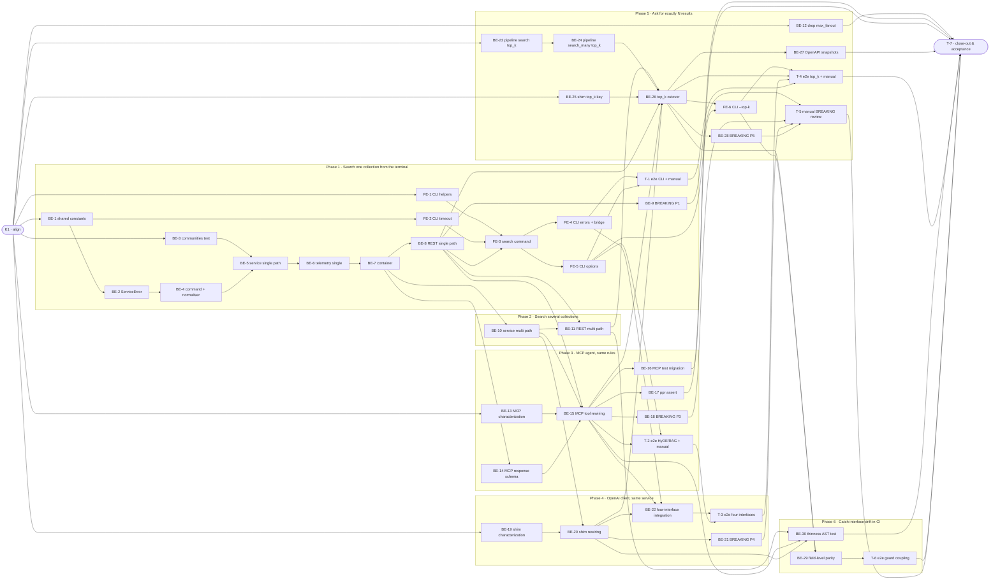

# 01-SEARCH · Search on one implementation across REST, MCP, OpenAI shim and CLI — Task Breakdown

**How to read this file**

- This is the **order view** for `01_search-team-plan.md` — every task is a single-role checkbox in execution order, opening with a dependency graph.
- **Phases are vertical slices where the code allows it**: Phases 1–4 each deliver one outcome that a CLI user, an API client, an MCP agent or an OpenAI-compatible client can observe, not a horizontal layer. Phase 5 builds its internals (BE-23, BE-24, BE-25) with no visible effect until the one observable step, the cutover BE-26, which lands in one commit with the snapshot regeneration BE-27 (ordering rule 3 admits that half-state); BE-12 is dead-code cleanup that sits in this phase only because it touches the `SearchPipeline` constructor next to BE-23. Phase 6 holds guards only, whose effect is a red CI on drift. No separate "integrate" phase. Sliced with the `vertical-slicer` skill (behaviour-first order, verticality test and smell check applied).
- Each task carries the **role tag at the end of its title line**, then sub-bullets: **layer · estimate** (decimal hours), **needs · completes**, and a **Tests** block. **needs** = predecessor tasks; **completes** = the scenario `S#` or contract `C#` (from the plan) it makes true or realises. A scenario that spans slices is listed by every task that makes part of it true.
- **Tests** are tagged by level. **Unit and integration tests belong to the implementing dev** (test-first); **e2e and manual tests are the tester's tasks**. Kickoff and close-out write no tests. A task that only re-points existing code lists the existing tests that must stay green, marked `(existing)`.
- IDs (`BE-#`/`FE-#`/`T-#`/`K#`/`TQ#`) are this file's traceability thread; `S#`/`C#` are defined in the plan, which has no open question; `TQ1` is the one question this file raised and it is decided (under **Open questions**).
- The **Frontend** role is the CLI (Presentation); there is no browser UI. Every server-side layer is **Backend**. The plan's layer map lists `pipeline.py` under Use Cases; tasks that edit only `pipeline.py` carry the layer *Frameworks & Drivers* because they change core retrieval code, not the new `services/` code.
- **Plain terms:** *service* = the new `SearchService`; *single path* = `collection="x"`; *multi path* = `collections=[…]`; *re-point* = change an import or a patch string to the new location; *characterization test* = a test that records today's behaviour before it is changed; *cutover* = the one task that turns a new behaviour on everywhere.
- **Ordering rules from the code (not the plan's prose):** (1) the service never changes an adapter before it is complete for the path that adapter uses, so REST moves in two steps (single path in Phase 1, multi path in Phase 2); (2) the `ppr`-with-`collections` pipeline guard (BE-17) lands only after MCP stops forwarding that combination (BE-15), otherwise MCP would answer an `AssertionError` as `internal_error`; (3) `top_k` reaches the service and the adapters only in the cutover (BE-26), after both pipeline entry points accept it and after REST (BE-8, BE-11), MCP (BE-15) and the shim (BE-20) run on the service, so there is never a client-visible half state; (4) characterization tests (BE-13, BE-19) sit in the slice that rewrites their subject and must land before that slice's rewiring task; they do not depend on Phase 1 because Phase 1 touches `mcp.py` and the shim only to re-point constants and never changes their behaviour; the ones that pin the old behaviour are rewritten or deleted in the commit that turns them red (BE-16 for MCP, BE-20 for the shim), and each of those tasks names the test that replaces each of them; (5) `BREAKING.md` entries and their migration-index rows are written in the slice that changes the behaviour (the index-parity test needs both in one commit); the remaining documentation edits belong to the close-out task; (6) a moved name has one owner task: the task that moves it re-points every importer, source and test, in the same commit, with no re-export or alias (BE-1 for the shared sets and the timeout constant, BE-2 for the wire text and codes); the adapter task that later deletes old logic deletes only what is still there.
- **Atomic groups (one commit each):** BE-14 + BE-15 + BE-16 (the MCP response schema, the tool rewiring and the migration of the tests that pin real tool output: `McpSearchResponse` is `extra="forbid"` and `model_dump` emits every field, so adding fields changes every real key-set pin at once); BE-26 + BE-27 (the OpenAPI snapshot test fails after BE-26 until the snapshots are regenerated); and every task that moves a name or deletes a parameter lands with all its importers in its own commit (rule 6: BE-1, BE-2, FE-1, BE-12). Edit-collision note (merge-conflict risk only; there is no functional dependency, so no `needs` edge): BE-1, BE-3, BE-12, BE-17, BE-23 and BE-24 edit `pipeline.py`; BE-2 and BE-12 edit `app.py`.
- **Rule:** edit your own tasks freely.

---

## References

- **Plan:** [01_search-team-plan.md](./01_search-team-plan.md) — the full team plan (contracts, scenarios, architecture, allocation). **Always read the plan before you start planning the next task** — it holds the context this file only cites (`S#`/`C#`).
- **Brief:** [01_search_brief.md](./01_search_brief.md) — the source feature brief behind the plan.

---

## Task Breakdown

Single-role tasks in execution order, grouped into **vertical slices**. Read **Open questions** and **Plan corrections** at the end first.

### Dependency graph

### Phase 0 · Kickoff *(prerequisite; the one cross-cutting step)*

- [x] **K1** — Agree the Contracts C1–C9 and the scenario split with the team; TQ1 is already decided (Option D, see **Open questions**) and its plan corrections go to the plan owner #team
    - — · 1.5h
    - completes C1, C2, C3, C4, C5, C6, C7, C8, C9
    - Tests

### Phase 1 · Search one collection from the terminal *(the walking skeleton: CLI → REST → `SearchService` → pipeline; carries the service foundation)*

An operator runs `archon-search search "q" --collection docs` and reads ranked results; REST single-collection search now runs on the service, with every refinement REST offers today (filters, HyDE, RAG Fusion, graph mode, scope filter, ACL context).

- [x] **BE-1** — Move the shared sets and limits into `constants.py`: the `GraphMode` alias and valid set (replacing `mcp.py`'s `_VALID_GRAPH_MODES`, the `Literal`s of REST search and of `routes_explain.py` at its request and its two response annotations, the tuple in `eval/fixtures.py` and the pipeline's three four-value annotations at ≈194, 2265 and 2830; the two-value `Literal["local", "global"]` at ≈2889 stays), `VALID_ACL_SOURCES` (replacing the two `_VALID_ACL_SOURCES` copies) and `SEARCH_TIMEOUT_SECONDS` (from `search_budget.py`, which then imports it). Re-point every importer in the same commit, with no re-export: `routes_search.py`, `routes_explain.py`, `mcp.py`, the shim, `eval/fixtures.py`, `pipeline.py`, `search_budget.py` (the adapters' `SEARCH_TIMEOUT_SECONDS as _SEARCH_TIMEOUT_SECONDS` import keeps its alias name so existing patches stay live until each adapter is rewired) and the tests that import the old names: `tests/server/test_be2_ppr_schemas.py` (≈103), `tests/services/test_search_budget.py` (≈17), `tests/services/test_request_hyde.py` (≈20), `tests/eval/test_eval_suite.py` (≈626, 794), `tests/test_hyde.py` (≈317, 348) and `tests/test_search_filtered_benchmark.py` (≈289) #backend-role
    - Entities · 3.5h
    - needs K1 · completes S13, S58, S61
    - Tests
        - #unit_test — `test_every_shared_graph_mode_is_accepted_by_search_and_explain_requests` — one valid set drives the REST search request, the REST explain request and the MCP check
        - #unit_test — `test_unknown_acl_source_is_sanitised_with_the_shared_valid_set` — search and explain sanitise an unknown ACL source the same way
        - #unit_test — `test_search_budget_default_timeout_is_the_constants_value` — `run_within_budget` binds its `timeout` default at definition time, so the test asserts `inspect.signature(run_within_budget).parameters["timeout"].default is constants.SEARCH_TIMEOUT_SECONDS` and `search_budget.SEARCH_TIMEOUT_SECONDS is constants.SEARCH_TIMEOUT_SECONDS` (a copy is a second `30.0` object, so identity fails on it)
        - #integration_test — `test_rest_openapi_graph_mode_enum_stays_naive_local_global_ppr` — the OpenAPI enum is unchanged after the `Literal` moves to the alias
        - #integration_test — (existing, file-level) `tests/services/test_search_budget.py`, `tests/services/test_request_hyde.py`, `tests/eval/test_eval_suite.py`, `tests/test_hyde.py` and `tests/test_search_filtered_benchmark.py` — stay green with the re-pointed imports
- [x] **BE-2** — Add `ServiceError` with its closed set of kinds, fixed sanitized details, telemetry mapping and the single `Retry-After` constant under `services/`, and give the wire text one home. This task owns these moves and re-points every importer, source and test, with no re-export: `INVALID_SCOPE_FILTER_CODE` and `GRAPH_COMMUNITIES_NOT_BUILT_CODE` out of `server/schemas.py` (importers: `schemas.py` itself ≈644, `routes_search.py`, `routes_explain.py`, `mcp.py` and `tests/server/test_search_explain_error_contract.py` ≈37-38); REST's `SEARCH_FAILED_DETAIL` and MCP's `_SEARCH_FAILED_DETAIL` and `_SEARCH_FAILED_CODE` (`"search failed"`, `"internal_error"`; importers: `mcp.py` `search` and `search_with_context` ≈1037, `tests/server/test_no_internal_error_leak_rest.py` ≈55, 130, 332 and `tests/server/test_no_internal_error_leak_mcp.py` ≈62, 191-194, 478-479), with `mcp.py`'s `_EXPLAIN_FAILED_CODE` and `_ERR_INTERNAL` replaced by the same constants, so `mcp.py` keeps no copy; the `"collection not found"` literal and the fan-out and `top_k` messages of `mcp.py`, `routes_search.py` and `routes_explain.py`; and the `Retry-After` literals in `app.py` (≈1535, 1540) and `routes_search.py` (≈640). The adapter tasks later delete only the old logic that is still there #backend-role
    - Use Cases · 4.5h
    - needs BE-1 · completes C2, S58, S61
    - Tests
        - #unit_test — `test_service_error_kinds_carry_fixed_sanitized_details` — each kind has a stable code and a detail that never contains an exception's text
        - #unit_test — `test_service_error_telemetry_mapping_matches_the_plan_table` — timeout maps to `timeout`; internal, HyDE, embedder-not-ready and metadata-store map to `internal_error`/`other`; validation-class kinds and not-found map to nothing
        - #integration_test — `test_embedder_not_ready_503_carries_retry_after_from_the_single_constant` — the app-level handler and the REST route emit the same header value
        - #integration_test — `test_coded_error_bodies_carry_their_code` — (existing, `tests/server/test_search_explain_error_contract.py`, re-pointed imports) the wire codes are unchanged
        - #integration_test — (existing, file-level) `tests/server/test_no_internal_error_leak_rest.py` and `tests/server/test_no_internal_error_leak_mcp.py` — stay green with the re-pointed imports of the moved `"search failed"` constants
- [x] **BE-3** — Expose the `GraphCommunitiesNotBuiltError` message as a class-constant template built from the typed `exc.collection`, wire text byte-identical #backend-role
    - Frameworks & Drivers · 1.5h
    - needs K1 · completes S76
    - Tests
        - #unit_test — `test_graph_communities_not_built_text_is_byte_identical` — the rendered text equals today's `No community representatives found for collection '<name>'. Run community detection first.`
- [ ] **BE-4** — Add `SearchCommand` and the one normaliser under `services/`: REST's actual check order, REST's exact 422 strings, stripped query and collection names, the two include-metadata flags ORed once, no-filter means no filter, fan-out (after de-duplication), `top_k` bounds, scope-filter and `graph_mode` rules, `ppr` with any `collections` #backend-role
    - Use Cases · 5.0h
    - needs BE-2 · completes C1, S5, S6, S8, S9, S10, S13, S14, S15, S20
    - Tests
        - #unit_test — `test_validation_order_matches_the_rest_handler` — a command breaking several rules fails on fan-out, then `top_k`, scope-filter syntax, scope filter with `graph_mode`, `ppr` with collections, graph enabled
        - #unit_test — `test_ppr_with_collections_is_rejected_even_for_one_name` — the combination is a validation error with REST's text
        - #unit_test — `test_include_metadata_flags_are_ored_once` — top-level and `filters.include_metadata` combine by OR
        - #unit_test — `test_empty_or_padded_query_and_collection_are_validated_and_stripped` — empty is rejected, padding is stripped
        - #unit_test — `test_invalid_filter_value_is_a_validation_error_with_a_fixed_detail` — a bad date, glob, file type or language never leaks a Pydantic text beyond REST's strings
- [ ] **BE-5** — Add `SearchService.search` for the single path and `SearchOutcome`: the collection-name check with `is_valid_collection_name` before any store call (an invalid name is `not_found`; the middleware already validated the namespace, `middleware_auth.py` ≈128), then the namespace-scoped metadata lookup (`get_collection_meta(..., namespace=)`; a collection of another namespace is `not_found`, S18), per-collection embedder through the cache with the bounded 0.5 s wait and the abandoned-load callback (moved intact from `routes_search.py`; the service module gets its own `_EMBEDDER_LOAD_WAIT_TIMEOUT_SECONDS`, REST's copy goes in BE-8), warm-up, HyDE and RAG Fusion resolution with today's suppression rules, the 30 s budget and HyDE called with an explicit `timeout=` read at call time from the service module's `_SEARCH_TIMEOUT_SECONDS` (an import alias of the constant), because `run_within_budget` binds its default at definition time and a patch would silently do nothing; one `AclGate` value per hit built once with the four fields REST's `AclGateSchema` renders today (`allowed_principals`, `source` sanitised against `VALID_ACL_SOURCES`, `sidecar_path`, `warnings`; `schemas.py` ≈975-978); derived fields once, including the ORed include-metadata flag: `SearchOutcome` exposes it, so the adapters blank `metadata` from it and REST's `SearchRequest.wants_metadata` (≈165-168) stops being a second OR (S14); cancellation never swallowed. The absent-cache fallback stays by plan decision (C1): `create_app` builds the embedder cache locally (`app.py` ≈1375) but only the lifespan publishes it as `app.state.embedder_cache` (≈725), so a `TestClient` built without the lifespan has none (`tests/server/test_routes_search_telemetry.py` never sets one, `tests/server/test_routes_search.py` sets one in two tests ≈1283, 1307); the service therefore accepts no cache and then uses the global embedder and `config.embedding_model`, as `routes_search.py` ≈538-541 does today (production always runs the lifespan, so the branch is reachable only without it) #backend-role
    - Use Cases · 6.5h
    - needs BE-3, BE-4 · completes C1, S2, S11, S12, S14, S16, S18, S24, S27, S31, S36, S37, S57
    - Tests
        - #unit_test — `test_single_path_uses_the_collection_embedder_and_reports_its_model` — `embedding_model` is the collection's active model
        - #unit_test — `test_absent_embedder_cache_falls_back_to_the_global_embedder_and_model` — no cache: the global embedder and `config.embedding_model`, one warning
        - #unit_test — `test_cold_embedder_degrades_to_fts_only_after_the_bounded_wait` — a never-finishing handoff ends at the bound and the load keeps running
        - #unit_test — `test_abandoned_load_failure_is_retrieved_and_registration_untouched` — a later failure leaves no "never retrieved" warning (ADR 11)
        - #unit_test — `test_invalid_collection_name_is_not_found_without_a_store_call` — fixed text, no metadata-store error
        - #unit_test — `test_cancellation_is_not_swallowed_and_namespace_is_passed_by_keyword` — a cancelled search propagates; the pipeline gets `namespace=`
        - #unit_test — `test_rag_fusion_wins_over_hyde_and_graph_mode_suppresses_hyde` — S12: with both requested only RAG Fusion runs; a `graph_mode` request never resolves HyDE
        - #unit_test — `test_cold_embedder_or_missing_generator_falls_back_to_the_plain_query_with_the_warning` — S12: `hyde_applied` is false and `expansion_warning` is the standard HyDE warning, no error
        - #unit_test — `test_fts_only_is_passed_to_the_pipeline_unchanged_and_never_re_derived` — S16: the service forwards the warm-up's `fts_only` and `rerank` as they are
        - #unit_test — `test_outcome_exposes_the_ored_include_metadata_flag` — S14: the top-level flag, the nested `filters.include_metadata` flag, both and neither give the one ORed value the adapters read
        - #integration_test — `test_single_path_derived_fields_and_acl_gate_against_a_real_pipeline` — `acl_gate` is populated only when requested; `applied_filters` is `null` with no filter
        - #integration_test — (existing, S57) `tests/test_layer_import_boundary.py` (file-level) and `tests/test_no_wire_str_exc.py::test_no_new_str_exc_of_a_caught_exception` — stay green for the new `services/` module
- [ ] **BE-6** — Record the single-path outcome in the service through the existing `TelemetryEntry` factories (success `search`, timeout and internal as errors labelled `search`, embedder-not-ready, metadata-store and HyDE failures as `internal_error`/`other`, validation-class kinds and not-found nothing), the same doc-id hasher on every interface, and the stage timings on every branch REST records today; and log the failure events REST logs today, because a `ServiceError` carries no exception: the service logs each failure where the exception is in hand (with its traceback, never the query) and the adapters log nothing for these kinds. ERROR `search_pipeline_failure` with `exc_info` for internal and HyDE failures, ERROR `search_timeout` with the `collection` (or `collections`) in `extra`, the exception with its traceback for a metadata-store failure and a warning for embedder-not-ready; MCP and the shim log the same events today, so no interface loses one #backend-role
    - Use Cases · 4.0h
    - needs BE-5 · completes C4, S33, S34, S35
    - Tests
        - #unit_test — `test_success_records_a_search_entry_with_hashed_doc_ids_and_filter_flags` — the single-path entry carries ids when hashing is on and `include_metadata` is counted
        - #unit_test — `test_recorded_error_kinds_map_to_timeout_or_internal_error_other` — one entry per recorded kind, labelled `search`
        - #unit_test — `test_validation_class_kinds_and_not_found_record_nothing` — no entry for validation, graph, scope-filter, communities-not-built and not-found
        - #unit_test — `test_stage_timings_are_logged_on_success_and_on_error_branches` — with the flag on, the log record carries the timings
        - #unit_test — `test_internal_and_hyde_failures_log_search_pipeline_failure_with_the_exception_and_no_query` — one ERROR record with `event_type == "search_pipeline_failure"`, `exc_info` set and no query text (the contract of `tests/server/test_routes_search_telemetry.py` ≈177)
        - #unit_test — `test_timeout_logs_search_timeout_with_the_collection_name_and_a_metadata_failure_logs_its_traceback` — ERROR `search_timeout` with `collection` in `extra` (≈422 of that file); the metadata-store failure is logged with its traceback (`assert_logged_with_traceback` in the two leak tests)
        - #unit_test — `test_a_failing_telemetry_enqueue_is_logged_as_telemetry_enqueue_failed_with_the_exception_type_and_never_breaks_the_request` — the warning text `telemetry enqueue failed: RuntimeError` that REST's `_enqueue_error` logs today and `test_search_hyde_runtime_error_with_failing_telemetry_still_answers_json_500` pins (BE-8 keeps it green)
        - #integration_test — `test_telemetry_jsonl_never_contains_the_query` — a real writer's JSONL has no query text (ADR 05)
- [ ] **BE-7** — Add the services container: one factory that builds `SearchService` from the pipeline, configuration, embedder cache, HyDE and RAG Fusion generators, telemetry writer and doc-id hasher; REST builds it per request from `request.app.state`. The MCP factory (lazy build on its first `search` call) and the shim call the same factory in BE-15 and BE-20, because the MCP `search` tool and the shim keep their old code until then #backend-role
    - Use Cases · 2.0h
    - needs BE-6 · completes C1
    - Tests
        - #unit_test — `test_container_builds_the_same_service_class_whatever_the_callers_arguments` — one class and one code path (the MCP and shim call sites arrive with BE-15 and BE-20)
        - #unit_test — `test_container_reads_app_state_per_call_so_swapped_objects_are_seen` — a pipeline swapped after app creation is used (the pattern in `tests/server/test_routes_search.py`)
- [ ] **BE-8** — Rewire the REST single-collection branch of `routes_search.py` to the service: resolve the caller with `caller_identity(request)` instead of reading `request.state.namespace` (a missing identity is the 401 `authentication required` before the service, S17); one error table rendering each `ServiceError` kind to today's body shape (plain 500, JSON `search failed`, coded 400 and 422, 404, 503 with and without `Retry-After`, 504), the Pydantic request model kept as transport parsing with its validators calling the normaliser, `acl_gate`, every derived field and the `metadata` blanking (from the outcome's ORed flag, S14) rendered from the service result; delete the single-path-only helpers (`_discard_abandoned_load`, REST's `_EMBEDDER_LOAD_WAIT_TIMEOUT_SECONDS`); the multi branch keeps `routes_search._SEARCH_TIMEOUT_SECONDS` and `SearchRequest.wants_metadata` until BE-11, and the tests need no cache migration because the service keeps the absent-cache fallback (BE-5). Re-point the patches that reach single-path searches to the service module's alias: `_SEARCH_TIMEOUT_SECONDS` in `test_s184_no_match_returns_200.py`, `test_s582_hyde_outside_search_budget.py`, `test_routes_search_telemetry.py`, `test_stage_timings_handlers.py` (these are the only tests that patch the REST alias besides the disconnect loop, and all of them post a single collection); `_EMBEDDER_LOAD_WAIT_TIMEOUT_SECONDS` in the s299/s300/s302/s303 tests and `tests/server/test_routes_search.py`; add the service alias to the module loop in `test_disconnect_cancels_provider_call_e2e.py` (its REST entry stays for the multi branch until BE-11, its MCP entry stays for HyDE in the other tools); rewrite `test_search_store_exception_returns_503` for the recorded metadata-store entry; the two REST leak tests that run a single-path HyDE failure break here, not in BE-11, and must stay green with the service keeping the log text `telemetry enqueue failed: RuntimeError`; the log events `search_pipeline_failure` (`exc_info`) and `search_timeout` pinned in `tests/server/test_routes_search_telemetry.py` (≈177, ≈422) stay green because the service logs them (BE-6); remove the `routes_search.py` / `search` / `GraphCommunitiesNotBuiltError` entry with ordinal 2 (the single-path handler, ≈642; the multi handler ≈390 is ordinal 1 and goes in BE-11) from the `str(exc)` allowlist in `tests/test_no_wire_str_exc.py`, or `test_every_allowlist_entry_still_matches` fails #backend-role
    - Interface Adapters · 7.0h
    - needs BE-7 · completes C2, S11, S14, S17, S24, S28, S29, S30, S31, S32, S36, S37, S61
    - Tests
        - #unit_test — `test_rest_error_table_renders_each_service_error_kind_to_todays_body` — body shape and status per kind
        - #integration_test — `test_search_without_an_identity_is_401_authentication_required_before_the_service` — S17: the route mounted without the API-key middleware answers 401 and never calls the service
        - #integration_test — `test_search_blanks_metadata_from_the_outcome_flag_for_top_level_and_nested_include_metadata` — S14 on REST's single path: `metadata` is `{}` unless either flag is set
        - #integration_test — `test_search_unknown_and_invalid_collection_name_is_404_against_the_real_store` — `bad name!` is a 404, not a 503, and records nothing (S11)
        - #integration_test — `test_search_metadata_failure_is_one_recorded_internal_error_entry` — a store failure is a 503 `metadata_store_error` plus an `internal_error`/`other` entry
        - #integration_test — (existing, file-level) `tests/integration/test_s299_prefix_filter_cold_embedder.py`, `test_s300_zero_match_prefix.py`, `test_s302_zero_match_glob.py`, `test_s303_language_filter.py`, `test_e0c_be3_validation.py`, `test_e2h_t1_ppr_guard_paths_e2e.py` — stay green after the patch strings are re-pointed
        - #integration_test — `test_search_hyde_runtime_error_answers_json_500_with_telemetry` and `test_search_hyde_runtime_error_with_failing_telemetry_still_answers_json_500` — (existing, `tests/server/test_no_internal_error_leak_rest.py`) the JSON `search failed` body, the one error entry and the preserved log text
        - #integration_test — (existing, file-level) `tests/integration/test_disconnect_cancels_provider_call_e2e.py`, re-pointed — client abort still cancels the search and its provider call
- [ ] **FE-1** — Move `_json_body`, `_server_message`, `_send_or_exit` and `_PYDANTIC_VALUE_ERROR_PREFIX` (the one constant only they use) from `cli/collection.py` into `cli/_helpers.py`; `_server_message` gains the coded `{code, message}` detail shape and takes the text for an empty detail as an argument, so `_EMPTY_SERVER_MESSAGE` ("the server refused the description", pinned by `tests/test_cli_collection_description.py` ≈209) stays in `collection.py` and the description commands pass it (`_description_error` ≈302 and the call at ≈465); update the `_clean` docstring (stderr is now cleaned for `search`) #frontend-role
    - Presentation · 3.0h
    - needs K1 · completes C8, S51, S74
    - Tests
        - #unit_test — `test_server_message_renders_the_message_of_a_coded_detail` — `{code, message}` shows the message
        - #unit_test — `test_server_message_joins_a_validation_list_and_drops_the_value_error_prefix` — the 422 list shape reads cleanly
        - #unit_test — `test_server_message_cleans_terminal_controls` — no raw escape character in the result
        - #unit_test — `test_server_message_returns_the_callers_empty_text_for_an_empty_detail_and_body` — a bare 401 (no body, `middleware_auth.py` ≈152) shows the text the caller passed, never the description text
        - #unit_test — `test_send_or_exit_connect_failure_prints_the_shared_message_and_exits_1` — the shared connection-refused text
        - #integration_test — (existing, file-level) `tests/test_cli_collection_description.py` and `tests/test_cli_collection_describe.py` — stay green after the helper move (the description text is still printed for an empty description error)
- [ ] **FE-2** — Add the CLI request-timeout constant to `constants.py` as `2 * SEARCH_TIMEOUT_SECONDS` plus a named margin constant (the 0.5 s warm-up bounds live in `services/search_budget.py`, which `constants.py` and the CLI cannot import) #frontend-role
    - Presentation · 1.0h
    - needs BE-1 · completes S52
    - Tests
        - #unit_test — `test_cli_search_request_timeout_exceeds_hyde_plus_budget_and_the_real_warmup_bounds` — the test may import `services/`: the constant is larger than `2 * SEARCH_TIMEOUT_SECONDS + EMBEDDER_WARMUP_WAIT_SECONDS + RERANKER_WARMUP_WAIT_SECONDS`, the worst-case server path
- [ ] **FE-3** — Add `cli/search.py` and register it in `cli/main.py`: positional query, required repeatable `--collection` (one sends `collection`, several send `collections`, a repeated identical name is sent as given because REST's request model de-duplicates, `routes_search.py` ≈203-207), `--json`, `--api-url`, `--api-key`; the request is sent with the FE-2 timeout; one human line per result (1-based rank, score, collection, source path, excerpt cut at a CLI-local named constant, whitespace collapsed, every server string cleaned); an empty result prints `No results found.` (after `No collections found.` in `collection list`) and exits 0; a 200 with a body that is not JSON is handled like `collection list` (`Error: server returned unexpected response: …`, exit 1); after the results, notes on stderr (TQ1, Option D): one cleaned note with the server's `expansion_warning` when it is present, and one cleaned note per entry of `excluded_collections` (collection name and reason), none when neither is present, so standard output stays exactly one line per result; `--json` prints `json.dumps(payload, indent=2, sort_keys=True)`; flip the registry's Search row (CLI claim `search`, pending waiver dropped, `service_method` set) in `tests/parity/registry.py` #frontend-role
    - Presentation · 5.0h
    - needs FE-1, FE-2, BE-8 · completes C8, S42, S47, S48, S49, S52, S53
    - Tests
        - #unit_test — `test_search_prints_one_line_per_result_in_response_order` — 1-based rank, score, collection, path and excerpt
        - #unit_test — `test_search_collapses_whitespace_and_cuts_the_excerpt_at_the_constant` — long text is shortened
        - #unit_test — `test_search_one_collection_sends_collection_and_several_send_collections` — body shape per count; a repeated identical name is sent as given
        - #unit_test — `test_search_json_reserialises_the_response_with_sorted_keys_and_full_text` — same values as the REST body
        - #unit_test — `test_search_empty_result_prints_a_message_and_exits_0` and `test_search_without_collection_is_a_usage_error_exit_2` — the two edge exits
        - #unit_test — `test_search_200_with_a_non_json_body_exits_1_like_collection_list` — the unexpected-body case
        - #unit_test — `test_search_prints_notes_after_the_results_on_stderr_only` — (TQ1, Option D) a response with `expansion_warning` and `excluded_collections` prints one cleaned note for the warning and one per skipped collection (name and reason) on stderr after the result lines; standard output holds only the result lines; an all-skipped response prints `No results found.` on standard output and the reasons on stderr; a response with neither field prints no note
        - #unit_test — `test_search_sends_the_request_with_the_cli_timeout_constant` — patch `cli.search.httpx.post` and assert its `timeout=` kwarg is the FE-2 constant (the `cli_against_app` bridge drops `timeout`, `tests/_cli_testclient_bridge.py` ≈62, so only a patched call can prove it)
        - #integration_test — `test_parity_passes_on_live_surfaces` — (existing, `tests/parity/test_parity.py`) Search is claimed on REST, MCP and the CLI with the identifier `search`
- [ ] **FE-4** — Render every REST error shape and clean every server string in `cli/search.py`: 400 coded, 404 string, 422 string, list and coded, 503 with `Retry-After` shown in seconds, 504, plain-text 500, a bare 401 (empty body; `search` passes its own fixed empty-detail text to the shared `_server_message`), connection refused, missing key; prove the text and `--json` output against the real app through `cli_against_app`, including repeated `--collection` (the multi path); keep the CLI import-rule and startup-latency guards green #frontend-role
    - Presentation · 4.5h
    - needs FE-3 · completes S4, S51, S54, S55, S74
    - Tests
        - #unit_test — `test_search_renders_every_rest_error_shape_on_stderr_and_exits_1` — parametrized over 400 coded, 404 string, 422 string, 422 list, 422 coded, 504, a plain-text 500 and a bare 401 with an empty body (the search-specific text, never the description text)
        - #unit_test — `test_search_503_shows_the_retry_after_in_seconds` — the header value appears
        - #unit_test — `test_search_connection_refused_and_missing_key_print_the_shared_messages_and_exit_1` — the shared connection-refused text and the fixed missing-key text
        - #unit_test — `test_search_strips_terminal_controls_from_stdout_and_stderr` — excerpt, collection, path and `detail`
        - #integration_test — `test_cli_search_text_and_json_come_from_the_real_adapter_and_service` — `make_real_app` plus `cli_against_app`
        - #integration_test — `test_cli_search_unknown_collection_and_fanout_exceeded_print_the_server_text` — 404 and 422 string through the real app
        - #integration_test — `test_cli_two_collections_use_the_multi_path_through_the_real_app` — repeated `--collection` over `cli_against_app` reaches the multi path (REST's multi path already exists, so this does not wait for BE-11; it must stay green through BE-11's rewiring)
        - #integration_test — `test_cli_search_prints_the_not_run_step_and_skipped_collection_notes_on_stderr` — (TQ1, Option D) through the real app: with `--hyde` and no usable generator the server's `expansion_warning` is printed as one note on stderr; a model-mismatched collection among `--collection a --collection b` prints one note per skipped collection with its reason; standard output keeps exactly one line per result; `--json` output is unchanged
        - #integration_test — (existing, file-level) `tests/test_cli_startup_latency.py` and `tests/test_layer_import_boundary.py` — stay green with the new module
- [ ] **FE-5** — Add the filter and feature options to `cli/search.py`: `--file-type`, `--source-path-prefix`, `--source-path-glob`, `--indexed-after`, `--indexed-before`, `--language`, `--include-metadata`, `--hyde`, `--rag-fusion`, `--graph-mode` (a free string sent as given, the server validates and its 422 text is shown), `--scope-filter`, `--acl-context`; flat filters nest under `filters`; `--include-metadata` fills the top-level flag only; a flag that is not given is omitted from the body (never sent as `false`) #frontend-role
    - Presentation · 2.0h
    - needs FE-3 · completes S50
    - Tests
        - #unit_test — `test_search_nests_flat_filter_options_under_filters` — body shape
        - #unit_test — `test_search_omits_filters_when_no_filter_option_is_given` — no empty `filters` object
        - #unit_test — `test_search_include_metadata_sets_the_top_level_flag_only` — the one CLI waiver of the field check
        - #unit_test — `test_search_omits_unset_flags_and_sends_graph_mode_as_given` — no `hyde: false`, no client-side `graph_mode` list
        - #integration_test — `test_cli_search_filters_and_feature_flags_reach_the_service` — a real app returns `applied_filters` and, with `--acl-context`, `acl_gate`
- [ ] **BE-9** — Write the Phase 1 `BREAKING.md` entries and their migration-index rows: REST invalid collection name now 404 (it was a 503; REST only here, the shim's entry is written by BE-21 with the shim change), the metadata-store failure now recorded in telemetry (REST single path only in this phase; BE-11 extends the entry to the multi path), REST timeout and internal errors as today (no entry); keep the heading-to-index parity and the sanitized-wire-text guards green #backend-role
    - Use Cases · 1.5h
    - needs BE-8 · completes S62, S63
    - Tests
        - #integration_test — `test_breaking_md_headings_have_index_rows` — (existing, `tests/test_removed_engine_repo_guard.py`) every new heading has its `NR-n` row
        - #integration_test — `test_wire_text_matches_source_and_every_quoting_doc` — (existing, `tests/test_sanitized_wire_text_docs.py`) `BREAKING.md` quotes no metadata-store literal
- [ ] **T-1** — e2e: the CLI against a real server, human and `--json`; manual: terminal readability #tester-role
    - — · 2.5h
    - needs FE-4, FE-5 · completes S67, S69
    - Tests
        - #e2e_test — `test_cli_search_human_and_json_against_a_real_server` — a subprocess prints one line per result and exits 0; `--json` parses, stderr is empty, no raw escape sequence
        - #e2e_test — `test_cli_search_missing_collection_stopped_server_and_missing_key` — exit 2 for a missing `--collection`; exit 1 with `archon-search serve is not running.`; exit 1 with the fixed missing-key text (no `search` case is added to `tests/smoke/docker/test_docker_cli.py`: S67 names the real-server subprocess run only)
        - #manual_test — Terminal readability — a person reads the human list and pipes `--json` into `jq` (non-automatable: layout readability is a human judgement; validity, exit codes and escape-free output are automated above)

### Phase 2 · Search several collections *(the multi path joins the service)*

An API client or operator searches `collections=[a, b]` (or repeats `--collection`) and gets the same rules, errors and telemetry as the single path.

- [ ] **BE-10** — Add `SearchService.search` for the multi path: global embedder, `excluded_collections` with reasons (all excluded is an empty result, no error), `collection not found`, `MetadataLookupError`, fan-out timeout and the budget mapped to `ServiceError`, HyDE and RAG Fusion suppression, `search_multi` telemetry on success and `search` on every error entry (the multi-path factory is unchanged: no doc ids, no filter flags) #backend-role
    - Use Cases · 5.5h
    - needs BE-7 · completes S3, S4, S10, S12, S16, S29, S30, S31, S33, S34
    - Tests
        - #unit_test — `test_multi_path_uses_the_global_embedder_and_reports_excluded_collections` — a model-mismatched collection is excluded with its reason
        - #unit_test — `test_all_collections_excluded_returns_an_empty_result_without_error` — empty, no error kind
        - #unit_test — `test_multi_metadata_failure_maps_to_metadata_store_error` — one kind, recorded as `internal_error`/`other`
        - #unit_test — `test_multi_success_records_search_multi_without_doc_ids_or_filter_flags` — the label and the unchanged factory
        - #unit_test — `test_multi_rag_fusion_wins_over_hyde_and_graph_mode_suppresses_hyde` — S12 on the multi path: the same suppression rules and the silent fallback with the warning
        - #unit_test — `test_multi_fts_only_is_passed_to_search_many_unchanged` — S16: the service never re-derives `fts_only`
        - #unit_test — `test_multi_timeout_maps_to_timeout_and_records_a_timeout_entry` — S30/S34: a fan-out timeout and a budget overrun both map to the `timeout` kind, one `timeout` entry labelled `search`, and the ERROR `search_timeout` log with `collections` in `extra` (REST ≈402-414, MCP ≈674-679, shim ≈252-260 log it today)
        - #unit_test — `test_multi_unexpected_failure_maps_to_internal_and_records_internal_error_other` — S31/S34: the entry REST records today (`routes_search.py` ≈415-419), the `search_pipeline_failure` log with `exc_info`, no exception text in the kind
        - #unit_test — `test_multi_hyde_failure_maps_to_hyde_failed_and_records_internal_error_other` — S31/S34: the HyDE failure of the multi path keeps its distinct kind and its entry (the case of `tests/server/test_routes_search.py` ≈1380-1400)
        - #integration_test — `test_same_collection_single_and_multi_path_may_differ_when_its_model_differs` — the kept core behaviour (S4), real pipeline
- [ ] **BE-11** — Rewire the REST multi-collection branch of `routes_search.py` to the service and delete what is left of the old logic: `_enqueue_error`, `_report_pipeline_failure`, `_hyde_failure_response`, `SearchRequest.wants_metadata` (the `metadata` blanking now reads the outcome's ORed flag, S14) and `routes_search._SEARCH_TIMEOUT_SECONDS`. `routes_search.py` holds no `config is None` fallback (they are in `mcp.py` and go in BE-15), so none is deleted here. The only test that patches the REST alias for this branch is the module loop of `tests/integration/test_disconnect_cancels_provider_call_e2e.py` (≈91-92): remove the `archon_search.server.routes_search` entry from that loop (BE-8 added the service alias), or every test in the file fails with an `AttributeError`; the other REST-alias patches were all single-path and moved in BE-8. Remove the last `routes_search.py` / `search` / `GraphCommunitiesNotBuiltError` entry (ordinal 1, the multi handler; BE-8 removed ordinal 2) from the `str(exc)` allowlist in `tests/test_no_wire_str_exc.py`; extend the Phase 1 metadata-store `BREAKING.md` entry with the multi path (same heading, so its index row stays); the multi-path case of `test_no_internal_error_leak_rest.py` (`test_multi_collection_metadata_lookup_error_answers_503_and_logs_traceback`, the `search_many` parametrization) and the fan-out HyDE log test in `tests/server/test_routes_search.py` (≈1380-1400, event `search_pipeline_failure`) stay green because the service logs them (BE-10) #backend-role
    - Interface Adapters · 5.0h
    - needs BE-8, BE-10 · completes S3, S4, S10, S11, S14, S29, S30, S58, S61, S76
    - Tests
        - #integration_test — `test_rest_multi_not_found_metadata_error_timeout_bodies_are_unchanged` — 404, 503 coded, 504 as today
        - #integration_test — `test_rest_fanout_above_max_is_the_same_422_text_on_both_paths` — one message
        - #integration_test — `test_every_allowlist_entry_still_matches` — (existing `tests/test_no_wire_str_exc.py`) stays green after the last `routes_search.py` entry is removed (the `str(exc)` allowlist then holds no search entry for REST)

### Phase 3 · An MCP agent searches with the same rules, fields and errors *(MCP joins the service)*

An MCP agent now gets REST's validation, REST's response fields, `acl_context`, bounded embedder wait and the unified error codes.

- [ ] **BE-13** — Write the MCP characterization tests first, recording today's behaviour: check order (graph disabled before scope rules, MCP texts), `ppr` with `collections` reaching `search_many`, a timeout with no telemetry, the unbounded single-path embedder wait, the default collection #backend-role
    - Interface Adapters · 3.5h
    - needs K1 · completes S60
    - Tests
        - #integration_test — `test_mcp_search_old_check_order_graph_before_scope_rules` — characterization (new file `tests/server/test_mcp_search_characterization.py`)
        - #integration_test — `test_mcp_search_ppr_with_collections_reaches_search_many` — characterization
        - #integration_test — `test_mcp_search_timeout_records_no_telemetry` — characterization
        - #integration_test — `test_mcp_search_single_path_embedder_wait_is_unbounded` — a never-finishing cache hangs until `asyncio.wait_for` fires
        - #integration_test — `test_mcp_search_without_collection_falls_back_to_the_default_collection` — characterization of the default collection that BE-15 removes
- [ ] **BE-14** — Unify the MCP response schema in `mcp_schemas.py`: add `embedding_model`, `rag_fusion_applied`, `rag_fusion_queries_used`, `rag_fusion_attempted`, `applied_filters` to `McpSearchResponse` (with defaults, so `test_mcp_search_response_hyde_applied_defaults_false` in `tests/test_mcp_schemas.py` still constructs it) and a search-only result schema carrying per-result `acl_gate` as a subclass of `McpSearchResultSchema` with a new classmethod that calls the base `from_result` (the subclass does not override `from_result`, so the `McpSearchResultSchema.from_result` patches that reach `search`, `tests/test_mcp.py` ≈1225 and `tests/server/test_no_internal_error_leak_mcp.py` ≈381-383, keep working). `McpSearchResponse.results` is retyped from `list[McpSearchResultSchema]` to `list[<the subclass>]`: Pydantic v2 dumps only the fields of the annotated type (checked: a `list[Base]` field drops a subclass's extra field on `model_dump`), so without the retyping `acl_gate` would silently vanish from the wire. `McpSearchResultSchema` itself stays untouched, so `search_with_context` (its item schema keeps the base) does not change. Lands in one commit with BE-15 and BE-16: `model_dump` emits every field, so adding fields changes the real tool output that the key-set pins in `tests/test_mcp.py` (≈1143, 1184) and `tests/integration/test_mcp_schema_contract.py` (≈376-390) read, and BE-15 is the task that fills the new fields #backend-role
    - Interface Adapters · 3.0h
    - needs BE-7 · completes C6, S38
    - Tests
        - #unit_test — `test_mcp_search_response_fields_equal_rests` — `tests/test_mcp_schemas.py::test_mcp_search_response_fields` rewritten to the new key set
        - #unit_test — `test_search_result_schema_adds_acl_gate_only_for_search` — `McpSearchResultSchema` keeps its 14 keys and the `search_with_context` response its 4 (`results`, `hyde_applied`, `expansion_used`, `expansion_warning`; `tests/test_mcp.py` ≈1006, `tests/test_mcp_schemas.py` ≈269)
        - #integration_test — `test_mcp_schema_contract_pins_the_new_response_and_per_result_keys` — `tests/integration/test_mcp_schema_contract.py` rewritten: `_SEARCH_RESULT_PUBLIC_FIELDS` splits into the 14-key set that stays for `McpSearchResultSchema.from_result` (≈166) and a 15-key set with `acl_gate` for the real tool item (≈387); the response set (≈47-75, 376-390) gains the five top-level fields
        - #unit_test — `test_mcp_search_response_dumps_the_per_result_acl_gate` — a response holding a search-only result dumps `acl_gate` per item (the `list[Base]` pitfall), while a `search_with_context` item built from the base schema still dumps 14 keys
        - #integration_test — `test_mcp_search_tool_returns_exactly_the_rest_response_fields` — the two key-set pins in `tests/test_mcp.py` (≈1143, 1184) rewritten to the new response key set
- [ ] **BE-15** — Rewire the MCP `search` tool to the service: resolve the caller with `_get_request_identity` and refuse a missing identity with the fixed `ToolError` before the service and before any validation (a call with no `collection` and no identity still gets that `ToolError`, as `tests/server/test_mcp_fail_closed.py` pins); build the service lazily on the first `search` call from the factory's existing arguments (with no config: the fixed internal error and a distinct error log event, the other tools unaffected); `collection`/`collections` required (no default, no literal `"default"`); add `acl_context`; REST's check order and three texts, the fan-out message included (the `search` tool's own fan-out check ≈611-616 goes); one MCP error table (`not_found` fixed text on both paths, `metadata_store_error` now on the single path, `embedder_not_ready` now on the multi path, `timeout`, `internal_error`); the tool description lists `ppr`; fill the new response fields and blank `metadata` from the service result (the outcome's ORed include-metadata flag, S14). Delete what remains of the old `search` body: the `run_within_budget`, `warmup_for_search` and `SearchBudgetExceeded` imports (`_SEARCH_FAILED_*` and `_VALID_GRAPH_MODES` already moved in BE-2 and BE-1; `_SEARCH_TIMEOUT_SECONDS` stays for HyDE in the other tools), the `search` tool's own `config is None` fallbacks (≈556, 572, 606; the other tools' stay, S56), its own log calls (the service logs `search_timeout`, `search_pipeline_failure` and the exceptions since BE-6 and BE-10) and the two `mcp.py` / `search` / `GraphCommunitiesNotBuiltError` entries (ordinals 1 and 2) of the `str(exc)` allowlist in `tests/test_no_wire_str_exc.py`; the other tools' helpers and `default_collection` stay. Needs BE-8 because BE-16 relies on the disconnect-loop alias that BE-8 adds. Lands in one commit with BE-14 and BE-16 #backend-role
    - Interface Adapters · 7.0h
    - needs BE-8, BE-10, BE-13, BE-14 · completes C6, S5, S6, S9, S10, S11, S14, S17, S18, S25, S28, S29, S30, S31, S32, S34, S35, S36, S37, S40, S59, S76
    - Tests
        - #unit_test — `test_mcp_search_requires_exactly_one_of_collection_and_collections` — no default, no `"default"`
        - #unit_test — `test_mcp_search_rejects_empty_query_and_ppr_with_collections_with_rests_text` — validation parity
        - #unit_test — `test_mcp_search_without_config_answers_the_fixed_internal_error_and_logs` — S59: a factory built without a config still serves the other tools while `search` answers `search failed` / `internal_error` and logs a distinct error event
        - #unit_test — `test_mcp_search_tool_input_schema_has_acl_context` — S40: `test_mcp_search_tool_input_schema_is_superset_of_search_filters` (`tests/server/test_mcp_search.py` ≈262, which loops `search` and `search_with_context`) is extended so `search` also publishes `acl_context` (`top_k` joins in BE-26)
        - #integration_test — `test_mcp_search_cold_embedder_degrades_to_fts_only` — the bound applies to the MCP single path
        - #integration_test — `test_mcp_search_timeout_and_internal_error_are_recorded` — telemetry entries on both recorded kinds, labelled `search`
        - #integration_test — `test_mcp_search_missing_identity_is_refused_before_the_service` — fixed `ToolError`; the test must request the `real_mcp_auth_context` fixture, because the autouse `_mcp_default_request_context` in `tests/conftest.py` (≈336-362) injects a default admin identity into every directly called tool; `tests/server/test_mcp_fail_closed.py` (existing, it requests that fixture and calls `search` with `{"query": "x"}` and no collection) stays green
        - #integration_test — `test_mcp_search_over_max_fanout_text_equals_rests` — S10: more collections than `max_fanout` (after de-duplication) answers `validation_error` with the same text as REST's 422 (`collections length exceeds maximum of N`)
        - #integration_test — `test_mcp_search_strips_a_padded_query_and_collection_and_rejects_a_whitespace_only_collection` — the service receives the stripped values (BE-18 announces "padded query stripped"); a whitespace-only collection name is a validation error with REST's wording
        - #integration_test — `test_mcp_search_multi_path_embedder_not_ready_is_embedder_not_ready` — S28: an injected `EmbedderNotReadyError` on the multi path (it was `internal_error`)
        - #integration_test — `test_mcp_search_single_path_metadata_failure_is_metadata_store_error` — S29 on the single path (the existing `test_mcp_search_meta_lookup_failure_returns_metadata_store_error` covers the multi path)
        - #integration_test — `test_mcp_search_not_found_has_the_fixed_text_on_both_paths_and_for_an_invalid_name` — S11: `bad name!` against the real store, no collection name in the text, no telemetry entry
        - #integration_test — `test_mcp_search_response_carries_rests_fields_and_per_result_acl_gate` — S36, S37: `embedding_model`, the three `rag_fusion_*` fields and `applied_filters` (null without a filter) equal REST's for one query; `acl_gate` is populated only with `acl_context=true`
- [ ] **BE-16** — Migrate the existing tests that pin drifted MCP behaviour, in the same commit as BE-14 and BE-15: (a) every `search` call gets a collection and a real config, in every access form (plan S61's 69 lookups in 14 files, counted by `tools["search"]` and `get_tool("search")`: `tests/contract/test_mcp_search_response_shape.py`, `tests/integration/test_mcp_error_paths.py`, `tests/integration/test_mcp_schema_contract.py`, `tests/server/test_e1a_fe3_mcp_search_graph_mode.py`, `tests/server/test_mcp_embedder_dispatch.py`, `tests/server/test_mcp_error_responses.py`, `tests/server/test_mcp_namespace_propagation_be5.py`, `tests/server/test_mcp_search.py`, `tests/server/test_mcp_search_be4_multi_collection_filters.py`, `tests/server/test_mcp_search_stage_timings.py`, `tests/server/test_mcp_telemetry.py`, `tests/server/test_telemetry_e2e.py` (these three call `search(collection=None)` on a factory without a config), `tests/test_e2a_be12_mcp_scope_filter.py`, `tests/test_fastmcp_stub.py` ≈140; plus the other forms: `_get_tool_fn("search", …)` in `tests/test_e1b_be9_mcp_search_graph_mode.py` (10 sites), `stub_mcp_tool("search", …)`, `_get_hyde_tool_fn("search", …)` and `_get_rag_fusion_tool_fn("search", …)` in `tests/test_mcp.py` (≈267, 353-384, 627-662, 938, 954, 1131, 1179) and the multi-line `stub_mcp_tool(\n"search", …)` in `tests/test_integration_rag_fusion.py` (2 sites); the HTTP callers that already pass a collection need only their assertions checked: `tests/integration/test_mcp_slice2_be7.py`, `tests/integration/test_hyde_per_collection_embedder.py`, `tests/integration/test_disconnect_cancels_provider_call_e2e.py`); the docstrings that say the MCP response has no `rag_fusion_*` fields (`tests/test_integration_rag_fusion.py` ≈461-465, 499-500; `tests/eval/live/test_live_rag_fusion.py` ≈471-474) are reworded; (b) `tests/server/test_mcp_search.py` ≈523 sits inside `test_mcp_search_bounds_hyde_by_the_search_budget` and asserts `expansion_warning == "HyDE expansion failed"`, not a timeout: it is only re-pointed to the service module's `_SEARCH_TIMEOUT_SECONDS`, and a separate new test asserts a real timeout; the MCP entry of the module loop in `test_disconnect_cancels_provider_call_e2e.py` (≈91-92) stays for HyDE in the other tools (BE-8 added the service alias to that loop, so the MCP `search` disconnect case reaches the service); (c) `_get_request_namespace` patches (`test_mcp_namespace_propagation_be5.py` ≈83-97, 878-895) patch `_get_request_identity`; (d) the `ppr` skip and its false comment (`tests/test_mcp.py` ≈614-624); (e) the stale docstring in `tests/integration/test_mcp_error_paths.py` (≈98-107); (f) `tests/server/test_no_internal_error_leak_mcp.py`: its imports moved in BE-2, and the `_patch_from_result(McpSearchResultSchema)` cases for `search` (≈381-383) must still answer the schema-validation code because BE-14's subclass builds through the base `from_result`; its `assert_logged_with_traceback` cases stay green because the service logs the exceptions (BE-6, BE-10); (g) `test_s391_mcp_search_reranker_score_doc_gap.py`: only the `warmup_for_search` source assertion (≈163, on `tools["search"]`) stops being true and is deleted; the doc-sentence test (≈139-153) compares `McpSearchResultSchema` with REST's `SearchResultSchema`, both untouched by BE-14, and stays true while T-7 keeps that sentence in `05_mcp_integration.md` (or re-words doc and test together); (h) `tests/test_mcp.py` (≈959-962, 1134, 1159); (i) the BE-13 characterization tests are deleted or rewritten, each replaced as follows: `test_mcp_search_old_check_order_graph_before_scope_rules` by `test_mcp_search_check_order_matches_rests`, `test_mcp_search_ppr_with_collections_reaches_search_many` by `test_mcp_search_ppr_with_collections_is_rejected_before_hyde`, `test_mcp_search_timeout_records_no_telemetry` by BE-15's `test_mcp_search_timeout_and_internal_error_are_recorded`, `test_mcp_search_single_path_embedder_wait_is_unbounded` by BE-15's `test_mcp_search_cold_embedder_degrades_to_fts_only`, `test_mcp_search_without_collection_falls_back_to_the_default_collection` by BE-15's `test_mcp_search_requires_exactly_one_of_collection_and_collections` #backend-role
    - Interface Adapters · 6.0h
    - needs BE-15 · completes S38, S61
    - Tests
        - #integration_test — `test_mcp_search_check_order_matches_rests` — scope-filter rules before graph-enabled, REST's three texts (replaces the BE-13 order test)
        - #integration_test — `test_mcp_search_ppr_with_collections_is_rejected_before_hyde` — replaces the skipped branch with the real assertion
        - #integration_test — `test_mcp_search_pipeline_overrun_answers_the_timeout_code_through_the_service_alias` — scope distinct from BE-15's telemetry test: it proves a patched budget in the existing test files reaches the service (never a silent no-op) and that the answer is the `timeout` code
        - #integration_test — `test_mcp_namespace_isolation_through_the_identity_helper` — a collection of another namespace is `not_found`
- [ ] **BE-17** — Add the `ppr`-with-any-`collections` assert in `SearchPipeline.search_many`, like the existing `scope_filter` asserts #backend-role
    - Frameworks & Drivers · 1.0h
    - needs BE-15 · completes S75
    - Tests
        - #unit_test — `test_search_many_ppr_with_collections_asserts` — the guard fires instead of returning `ppr_entities_matched=0`
- [ ] **BE-18** — Write the Phase 3 `BREAKING.md` entries and migration-index rows: MCP default collection removed, `ppr` with collections rejected, empty query rejected, padded query stripped, three MCP texts and the check order now REST's, bounded embedder wait and full-text-only results on the MCP single path, six new response fields, `acl_context`, unified not-found and metadata-error codes, `embedder_not_ready` on the multi path, timeout and error telemetry. Reconcile with the existing rows of `Documentation/MigrationGuide/03_breaking_changes_index.md` (they must not contradict each other): NR-3 (cold cross-encoder degrade), NR-4 (cold embedder on REST, MCP and the shim answers from the FTS leg alone) and NR-6 (REST-only: the embedder-cache handoff bound of 0.5 s). A new `BREAKING.md` sentence that puts `/search`, "reranker", a warm-up word and `503` together trips the doc-gap scans #backend-role
    - Use Cases · 2.0h
    - needs BE-15 · completes S62, S63
    - Tests
        - #integration_test — `test_breaking_md_headings_have_index_rows` — (existing, `tests/test_removed_engine_repo_guard.py`) heading-to-index parity
        - #integration_test — (existing, file-level) `tests/test_s343_reranker_503_doc_gap.py`, `tests/test_s344_reranker_504_doc_gap.py`, `tests/test_s444_reranker_warmup_503_doc_gap.py` and `tests/test_s27_ready_warmup_doc_gap.py` — scan `BREAKING.md` and stay green
        - #integration_test — (existing, file-level) `tests/test_mcp_tool_count_docs.py` stays green; `tests/test_s391_mcp_search_reranker_score_doc_gap.py` does not stay as it is: BE-16 rewrites it (the source assertion at ≈163)
- [ ] **T-2** — e2e: HyDE and RAG Fusion fields through the CLI and MCP against a real server with a fake LLM; manual: a live provider #tester-role
    - — · 3.5h
    - needs BE-15, FE-5 · completes S70
    - Tests
        - #e2e_test — `test_hyde_and_rag_fusion_fields_via_cli_and_mcp_with_a_fake_llm` — `hyde_applied`, `rag_fusion_applied`, `rag_fusion_queries_used`, `rag_fusion_attempted`, `expansion_warning` populated as documented. Harness change owned by this task: `smoke_server` writes no TOML today (`_subprocess_env` in `tests/smoke/conftest.py` ≈98-109 only points `ARCHON_SEARCH_CONFIG` at a non-existent `{data_dir}/archon-search.toml`; only `smoke_server_graph_enabled` writes one, `_write_graph_enabled_config` ≈430-443). Add a sibling writer that `smoke_server` calls before `_start_server` and that writes `[hyde]` and `[rag_fusion]` pointing at a session-scoped `FakeModelServer` (`tests/_fake_model_server.py`); the fixture therefore depends on a new session fixture that starts the fake server first, and the child environment gets `NO_PROXY=127.0.0.1`. No third server (plan old Q25); leaving S70 manual-only is not taken because the wiring is automatable
        - #manual_test — Live provider HyDE and RAG Fusion — run both through MCP and the CLI against a real provider (non-automatable: real model quality and latency; the wiring is automated above); checklist follows `tests/integration/test_g10_t2_manual_checklist.md`

### Phase 4 · An OpenAI-compatible client searches on the same service *(the shim joins the service)*

A chat client keeps its envelope, streaming and model-name routing, and gains defined failure behaviour, stripped names and telemetry.

- [ ] **BE-19** — Write the shim characterization tests first: the all-collections list lookup failure (plain 500), embedder-not-ready (503 with `Retry-After: 30` from the app handler), the unbounded single-path embedder wait, the empty collection name against a real store #backend-role
    - Interface Adapters · 2.5h
    - needs K1 · completes S60
    - Tests
        - #integration_test — `test_shim_collection_list_failure_is_a_plain_500` — characterization (`raise_server_exceptions=False`)
        - #integration_test — `test_shim_embedder_not_ready_is_503_with_retry_after` — characterization
        - #integration_test — `test_shim_single_path_embedder_wait_is_unbounded` — characterization
        - #integration_test — `test_shim_empty_collection_name_against_a_real_store_is_a_503` — characterization with `make_real_app` (the real store raises `ValueError` for the name, so the shim answers 503; the mocked `test_trailing_slash_model_returns_404` in `test_routes_openai_shim_be5.py` hides it, S78)
- [ ] **BE-20** — Rewire `chat_completions` in `routes_openai_shim.py` to the service: resolve the caller with `identity_of` and answer a missing identity with the shim's OpenAI 401 envelope before the service (S17; the existing `OpenAI401Middleware` already rewrites the API-key middleware's bodyless 401); strip the collection name from the model name and the user message; 404 for an empty, whitespace-only or invalid name; the all-collections list lookup failure and any unexpected failure on either branch answer the 503 envelope; embedder-not-ready, timeout and not-found keep their envelopes (504 "Request timeout.", 503 with `Retry-After`, the two 404 texts); a request `top_k` stays accepted and ignored (the pipeline is called with no `top_k` argument); routing, truncation at `config.max_fanout` with its warning, rendering, streaming and "No collections available." unchanged; shim traffic recorded in telemetry; the shim's own `search_timeout` and metadata-lookup log calls go (the service logs them, BE-6 and BE-10); build the service through the BE-7 container; re-point the shim alias patches (`test_routes_openai_shim_be5.py` ≈475, `_be7.py` ≈345) to the service module's alias and delete the shim's `_SEARCH_TIMEOUT_SECONDS` alias. The BE-19 characterization tests are deleted or rewritten in this commit, each replaced as follows: `test_shim_collection_list_failure_is_a_plain_500` by `test_shim_collection_list_failure_and_fanout_failure_are_the_503_envelope`, `test_shim_embedder_not_ready_is_503_with_retry_after` by `test_shim_embedder_not_ready_has_retry_after_through_the_service`, `test_shim_single_path_embedder_wait_is_unbounded` by `test_shim_cold_embedder_degrades_to_fts_only`, `test_shim_empty_collection_name_against_a_real_store_is_a_503` by `test_shim_empty_whitespace_and_invalid_collection_name_return_404_against_the_real_store` #backend-role
    - Interface Adapters · 7.0h
    - needs BE-10, BE-19 · completes C7, S7, S10, S11, S17, S26, S28, S29, S30, S34, S43, S44, S45, S46, S61, S78
    - Tests
        - #integration_test — `test_shim_empty_whitespace_and_invalid_collection_name_return_404_against_the_real_store` — S78, not a mock
        - #integration_test — `test_shim_collection_list_failure_and_fanout_failure_are_the_503_envelope` — S29, S45
        - #integration_test — `test_shim_embedder_not_ready_has_retry_after_through_the_service` — S28, S44
        - #integration_test — `test_shim_cold_embedder_degrades_to_fts_only` — S26: `archon-search/<collection>` with a never-finishing embedder handoff answers full-text-only results after the 0.5 s bound; the all-collections model is unchanged
        - #integration_test — `test_shim_search_timeout_answers_the_504_envelope_and_records_a_timeout_entry` — S30 on both branches: 504 "Request timeout." and one `timeout` entry labelled `search` (the existing `test_direct_search_timeout_returns_openai_504` and `test_fanout_timeout_returns_openai_504` stay green)
        - #integration_test — `test_shim_search_is_recorded_in_telemetry_with_the_same_labels` — S34
        - #integration_test — `test_shim_padded_name_and_query_reach_the_service_stripped` — S7, S78
        - #integration_test — `test_shim_without_an_identity_answers_the_openai_401_envelope_before_the_service` — S17: a request with no identity (API-key middleware bypassed) never reaches the service
        - #integration_test — `test_max_fanout_is_read_from_config_by_the_service_and_the_shim` — the one source is `config.max_fanout`: with `[search] max_fanout = 3` REST rejects four collections with the 422 text and the shim truncates to three with its warning (moved here from BE-12, which cannot prove the service or shim wiring before they exist)
        - #integration_test — `test_shim_accepts_a_request_top_k_of_zero_above_the_maximum_or_null_with_no_4xx_and_ignores_it` — S46 against `make_real_app`: `top_k` 0, a value above `top_k_max` and `null` each answer 200, the pipeline is called with no `top_k` argument and the number of `[Source:` blocks is unchanged (the existing `TestTopKRequestFieldIgnored` covers only one in-range value on a mock)
        - #integration_test — (existing, file-level) `tests/server/test_routes_openai_shim_be5.py`, `_be6.py`, `_be7.py` and `tests/integration/test_openai_shim_e2e.py` — stay green after the re-point of their `_SEARCH_TIMEOUT_SECONDS` patches (`_be5` ≈475, `_be7` ≈345); no other edit, `TestTopKRequestFieldIgnored` (`_be5` ≈653-672) included
- [ ] **BE-21** — Write the Phase 4 `BREAKING.md` entries and migration-index rows: shim searches now recorded in telemetry stats, the 503 for the fan-out failure and the list lookup, stripped names and queries, a real 404 for an empty, whitespace-only or invalid name (was 503), bounded embedder wait on the shim single path #backend-role
    - Use Cases · 1.5h
    - needs BE-20 · completes S62, S63
    - Tests
        - #integration_test — `test_breaking_md_headings_have_index_rows` — (existing) heading-to-index parity
        - #integration_test — `test_wire_text_matches_source_and_every_quoting_doc` — (existing) no back-quoted metadata-store literal in `BREAKING.md`
- [ ] **BE-22** — Prove the four interfaces agree in the default lane: one `make_real_app` with MCP and the shim enabled, the same query and collection through REST, MCP, the CLI `--json` (bridge) and the shim #backend-role
    - Interface Adapters · 4.0h
    - needs BE-15, BE-20, FE-4 · completes S1
    - Tests
        - #integration_test — `test_rest_mcp_and_cli_return_the_same_ordered_results_and_derived_fields` — results, `embedding_model`, `rag_fusion_*`, `applied_filters`, per-result `acl_gate`
        - #integration_test — `test_error_codes_agree_across_rest_mcp_cli_and_shim_for_not_found_and_validation` — same kind, each adapter's wire form
        - #integration_test — `test_shim_returns_the_same_ordered_sources_in_its_chat_text` — source order matches REST
- [ ] **T-3** — e2e: the same query through REST, MCP, the shim and the CLI `--json` against a real server #tester-role
    - — · 3.5h
    - needs BE-22, T-2 · completes S66
    - Tests
        - #e2e_test — `test_rest_mcp_and_cli_return_the_same_ordered_results_and_derived_fields_on_a_real_server` — same sources, approximately equal scores, equal derived fields (one warm-up REST search first, so no cold-embedder degrade skews the ranking)
        - #e2e_test — `test_shim_returns_the_same_ordered_sources_on_a_real_server` — `[Source: <path>]` order equals REST's `source_path` order (this task adds `[openai_shim] enabled = true` to the TOML writer that T-2 added for `smoke_server`; no third server)

### Phase 5 · A caller asks for exactly N results *(per-request `top_k` becomes real)*

REST, MCP and the CLI honour `top_k`; the shim ignores the request value and takes its count from `[openai_shim].top_k` or `top_k_return`. BE-23, BE-24 and BE-25 prepare the change and have no client-visible effect until the cutover BE-26, which lands in one commit with the snapshot regeneration BE-27; BE-12 is independent cleanup.

- [ ] **BE-12** — Delete the dead `max_fanout` parameter of `SearchPipeline` (constructor, stored attribute, `create_pipeline`, the `app.py` pass-through) and its assertions and arguments: `tests/pipeline/test_pipeline_ingest.py` (≈967, 971, 993, 1021), `tests/server/test_app.py` (the test `test_create_app_wires_fanout_config_into_pipeline`: docstring ≈300-315, assertion and message ≈339-341; `tests/test_app.py` also exists and holds no `max_fanout`), `tests/integration/test_multi_collection_search.py` (≈68); the default `8` then lives once in `config.py` #backend-role
    - Frameworks & Drivers · 2.0h
    - needs K1 · completes S58, S61
    - Tests
        - #unit_test — `test_pipeline_constructor_has_no_max_fanout_parameter` — the parameter is gone
        - #integration_test — `test_create_app_builds_the_pipeline_without_a_max_fanout_argument` — the rewritten `test_create_app_wires_fanout_config_into_pipeline`: `fanout_timeout_seconds` and `fanout_leg_trim` from the TOML still reach the pipeline, `max_fanout` is no argument of it (the service and shim wiring of `config.max_fanout` is proved in BE-20, where both exist)
- [ ] **BE-23** — Add an optional `top_k` to `SearchPipeline.search` and its helpers: the pool is raised to at least `top_k` at the four `search` pool sites, every cutoff and the shortfall warning use the effective count, default behaviour byte-identical #backend-role
    - Frameworks & Drivers · 5.5h
    - needs K1 · completes C3, S21, S22, S72, S73
    - Tests
        - #unit_test — `test_search_pool_is_raised_to_top_k_and_unchanged_without_it` — small `top_k` keeps today's pool
        - #unit_test — `test_search_shortfall_warning_uses_the_effective_top_k` — the warning compares against the effective count
        - #integration_test — `test_search_exact_n_when_enough_chunks_pass_the_post_filters` — real pipeline, stubbed ranking
        - #integration_test — `test_search_top_k_above_the_corpus_returns_all_available_and_above_the_pool_returns_exactly_top_k` — S21 on the single path: fewer chunks than `top_k` return all of them; more than the default pool of 45 return exactly `top_k`
        - #integration_test — `test_search_returns_exactly_a_large_top_k_within_the_budget` — S72 on the single path: `top_k` near `top_k_max` on a corpus larger than the pool, stubbed backends, inside the 30 s budget
        - #integration_test — `test_search_prefix_stable_while_n_and_m_fit_the_pool_of_45` — `results(N)[:M] == results(M)`; above 45 the test asserts only the count
- [ ] **BE-24** — Add an optional `top_k` to `SearchPipeline.search_many` and `_fanout_merge_acl`: pool at least `top_k` at its four pool sites, the four leg trims become `max(trim, top_k)` (three in `search_many`, ≈3273, 3388, 3516, and the fourth in `_fanout_merge_acl`, ≈3776, which takes an optional `top_k` that only `search_many` passes), every cutoff uses the effective count; `explain` never passes it (its five pool sites and its call of the helper at ≈2359 stay) #backend-role
    - Frameworks & Drivers · 5.5h
    - needs BE-23 · completes C3, S21, S23, S72, S73
    - Tests
        - #unit_test — `test_multi_leg_trim_is_max_of_trim_and_top_k` — 40 by default, `top_k` above it, at all four trim sites
        - #integration_test — `test_search_many_without_top_k_is_byte_identical_in_results_and_pool_sites` — without `top_k` the results, the four pool values and the four trims equal today's (the default-path proof; the eval runner never passes `top_k`, so the eval gate cannot be the proof)
        - #integration_test — `test_explain_pool_sites_and_trim_stay_unchanged_whatever_top_k_search_receives` — the S23 gate
        - #integration_test — `test_multi_top_k_above_the_corpus_returns_all_and_above_the_leg_trim_returns_exactly_top_k` — S21 and S72 on the multi path: all available when fewer exist, exactly `top_k` when more than the leg trim of 40 exist, stubbed backends, inside the budget
        - #integration_test — `test_multi_exact_n_and_prefix_stable_within_the_leg_trim_of_40` — above 40 only the count is asserted
        - #integration_test — `test_eval_suite_gated_smoke` — (existing, `tests/eval/test_eval_suite.py`, still green) the eval runner builds pipelines with a fixed return count and never passes `top_k`, so this only shows the default path is unchanged
- [ ] **BE-25** — Make `[openai_shim].top_k` an optional integer, unset by default (the result count when set, `top_k_return` otherwise), a value above `top_k_max` is a `ConfigError` at `load_config` (the key is parsed at `config.py` ≈1489 but nothing reads it yet; the shim honours it from BE-26); delete the then-dead `_OPENAI_SHIM_TOP_K_DEFAULT = 5` (`config.py` ≈312, used only by the field default at ≈327); update `schemas_openai.py`'s comment, `archon-search.toml.example`, `tests/test_openai_shim_config.py` (default pinned at ≈24, 63, 144; ≈53 asserts an explicit `top_k = 10` and stays) and `tests/test_config_defaults.py` (≈276-279) #backend-role
    - Frameworks & Drivers · 2.0h
    - needs K1 · completes S61 (the config half of S79 is here; S79 itself completes in BE-26, when the shim honours the key)
    - Tests
        - #unit_test — `test_shim_top_k_is_unset_by_default` — the default is no value
        - #unit_test — `test_shim_top_k_above_top_k_max_raises_config_error` — the cross-check runs after both sections are loaded
        - #unit_test — `test_openai_shim_top_k_must_be_positive_int`, `test_openai_shim_top_k_bool_rejected` and `test_openai_shim_top_k_float_rejected` — (existing, `tests/test_openai_shim_config.py` ≈91-118) stay valid
- [ ] **BE-26** — Cut `top_k` over on every interface in one change: the service forwards `top_k` to the pipeline only when present (never `top_k=None`); REST `SearchRequest.top_k` becomes `int | None` with minimum 1 and the schema default `5` goes; MCP gains `top_k`; the shim gives the service its count only when `[openai_shim].top_k` is set and keeps ignoring the request field; rewrite `tests/integration/test_s313_top_k_does_not_set_result_count.py` and `tests/server/test_routes_search.py::test_search_top_k_accepted_but_ignored_by_pipeline`. Lands in one commit with BE-27: the OpenAPI snapshot test fails after this task until the snapshots are regenerated #backend-role
    - Interface Adapters · 5.0h
    - needs BE-8, BE-11, BE-15, BE-20, BE-24, BE-25 · completes C3, C5, C6, C7, S19, S20, S22, S40, S46, S58, S61, S72, S79
    - Tests
        - #unit_test — `test_top_k_is_forwarded_only_when_present` — the pipeline call has no `top_k` key when omitted
        - #unit_test — `test_mcp_search_tool_input_schema_has_top_k` — S40: the superset guard of BE-15 also requires `top_k` on `search`
        - #integration_test — `test_top_k_exact_n_on_rest_and_mcp_single_and_multi_path` — S19 on both paths
        - #integration_test — `test_top_k_below_one_or_above_the_maximum_is_rejected_on_rest_and_mcp` — the shim answers no 4xx for it (S20, S46)
        - #integration_test — `test_top_k_null_is_valid_on_rest_and_means_the_configured_count` — S22
        - #integration_test — `test_large_top_k_times_out_with_the_timeout_error_on_every_interface` — S72 with a patched budget
        - #integration_test — `test_shim_count_follows_the_config_key_then_top_k_return` — S79: `toml_content` in `make_real_app`; the key is honoured when set
- [ ] **BE-27** — Regenerate both OpenAPI snapshots together (`uv run pytest tests/server/test_openapi_snapshot.py --update-openapi-snapshot --no-cov -n0`; the flag writes both files in one run, and `pyproject.toml`'s `addopts` would otherwise add `--cov-fail-under=85 -n 8` to a single-file run) and check that they differ only in `SearchRequest.top_k` (an `anyOf` of integer minimum 1 and null, no default) and changed descriptions. Lands in one commit with BE-26 #backend-role
    - Frameworks & Drivers · 1.0h
    - needs BE-26 · completes C5, S39
    - Tests
        - #integration_test — `test_openapi_spec_matches_snapshot` — (existing, `tests/server/test_openapi_snapshot.py`) the live schema equals the server snapshot; it is the test that fails after BE-26 until the regeneration
        - #integration_test — `test_openapi_snapshots_regenerated_match` — (existing, `tests/server/test_openapi_snapshot.py`) both pinned files equal the live schema
        - #integration_test — `test_both_openapi_snapshots_match` — (existing, `tests/integration/test_be18_provider_notes_removal.py`) the two copies are identical
        - #integration_test — `test_openapi_search_request_top_k_is_an_integer_minimum_1_or_null_without_a_default` — S39, C5: the new assertion on the regenerated schema
- [ ] **FE-6** — Add `--top-k` to `cli/search.py`: a plain integer option, sent in the body only when given; below 1 and above the maximum come back as the server's 422 text; no CLI-private limit #frontend-role
    - Presentation · 1.5h
    - needs BE-26, FE-5 · completes S19, S20, S50
    - Tests
        - #unit_test — `test_search_top_k_is_sent_in_the_body_only_when_given` — omitted means no key
        - #unit_test — `test_search_top_k_above_the_maximum_prints_the_422_string_and_exits_1` — the server's text, exit 1
        - #unit_test — `test_search_top_k_zero_prints_the_servers_422_text_and_exits_1` — `--top-k 0` is sent as given and the framework's 422 list for a value below 1 is shown through the shared `_server_message`
        - #integration_test — `test_cli_search_top_k_returns_exactly_n_results` — through `cli_against_app`
- [ ] **BE-28** — Write the Phase 5 `BREAKING.md` entries and migration-index rows: `top_k` real on REST, MCP and the CLI (`top_k: null` valid, the OpenAPI type changes), `top_k` on MCP (`acl_context` on MCP is BE-18's entry), the `[openai_shim].top_k` key honoured and a value above `top_k_max` failing config load; rewrite or remove the old `[next release]` entry "REST `/search` per-request `top_k` no longer honored" (`BREAKING.md` ≈2132) with its NR-2 index row and detail section (the heading and the index link text must change together), and the places that quote the old heading: `Documentation/MigrationGuide/06_client_migration_examples.md` (≈86 and ≈88) and `Documentation/Architecture/530_technical_debt_refactoring_roadmap.md` (API-2, ≈27) #backend-role
    - Use Cases · 2.0h
    - needs BE-26 · completes S62, S63
    - Tests
        - #integration_test — `test_breaking_md_headings_have_index_rows` — (existing, `tests/test_removed_engine_repo_guard.py`) the renamed heading and the NR-2 row stay in step
        - #integration_test — `test_s52_allowlist_is_pinned_and_self_tightening` — (existing, `tests/test_removed_engine_repo_guard.py`) the 65-heading allowlist is untouched
- [ ] **T-4** — e2e: `top_k` on a real server and through a real OpenAI client and MCP client; manual: real products #tester-role
    - — · 4.0h
    - needs BE-26, FE-6, T-3, T-1 · completes S68, S71
    - Tests
        - #e2e_test — `test_top_k_returns_exactly_n_on_rest_and_the_cli` — a dedicated seeded collection (`smoke_topk`, at least 12 single-chunk documents; the shared `smoke` collection's chunk count varies with test order); `len(results) == N` with N within the pool of 45
        - #e2e_test — `test_top_k_results_are_the_first_n_of_the_default_query` — same `chunk_id` order
        - #e2e_test — `test_openai_client_search_ignores_request_top_k` — `openai` SDK built with an injected `http_client` (the provider guard refuses a bare client; an `httpx` client is accepted although the installed `openai` 3.41.0 imports `httpx2`, `openai/_base_client.py` ≈1037, and `tests/integration/test_openai_shim_e2e.py` ≈102 already injects one), `extra_body={"top_k": 1}`, the number of `[Source:` blocks is the default count
        - #e2e_test — `test_mcp_call_uses_top_k_and_acl_context_on_a_real_server` — a real `fastmcp` client
        - #e2e_test — `test_full_smoke_suite_passes` — (existing, `tests/smoke/test_rest.py` ≈352) T-4 owns the final count: the new smoke tests of T-1 to T-4 (all its predecessors) enlarge the child run, so raise `_EXPECTED_MIN_PASSED` (25) and re-measure `_CHILD_SUITE_TIMEOUT_S` (480 s) together, once, here
        - #manual_test — Real OpenAI-compatible client and real MCP agent — a product such as Open WebUI and an LLM-driven agent choosing the tool (non-automatable: needs external products and an LLM; the protocol behaviour is automated above)
- [ ] **T-5** — Manual: review `BREAKING.md` and the migration rows against the S62 list #tester-role
    - — · 1.5h
    - needs BE-9, BE-18, BE-21, BE-28 · completes S62
    - Tests
        - #manual_test — BREAKING completeness — every changed behaviour in S62 has an entry and an `NR-n` row, none quotes the metadata-store literal back-quoted (non-automatable: completeness against a prose list is a human judgement; the heading-to-index parity and sanitized-wire-text guards already run in the default suite)

### Phase 6 · A maintainer catches interface drift in CI *(the guards that keep the four interfaces together)*

A field removed from one surface, or a forbidden import in an adapter, turns CI red.

- [ ] **BE-29** — Add the field-level parity check (C9) beside `tests/parity/test_parity.py`: an explicit mapping of every command field to its REST property (nested versus flat filters), MCP parameter and CLI option, and of every result field to REST's and MCP's response fields; waivers with `waived_surfaces` and a reason; the two include-metadata flags mapped as C9 says; `--json`, `--api-url`, `--api-key` exempt #backend-role
    - Use Cases · 4.5h
    - needs BE-26, FE-6 · completes C9, S41
    - Tests
        - #unit_test — `test_field_parity_passes_on_the_real_tree` — every command field is mapped or waived
        - #unit_test — `test_field_parity_fails_on_a_field_missing_from_a_surface` — a fake surface without `top_k`
        - #unit_test — `test_field_parity_fails_on_a_surface_field_that_maps_to_nothing` — except the exempt transport options
        - #unit_test — `test_field_parity_fails_on_an_invalid_waiver` — no `waived_surfaces` or no reason
- [ ] **BE-30** — Add the adapter-thinness AST test: whole-module scan for `routes_search.py` and the shim's search path, the `search` tool body only for `mcp.py`; forbidden: `archon_search.services.validators`, `.request_hyde`, `.search_budget`, `archon_search.telemetry.entry`; the boundary allowlist (eight edges) is unchanged #backend-role
    - Use Cases · 3.0h
    - needs BE-11, BE-15, BE-20 · completes S56, S57, S77
    - Tests
        - #unit_test — `test_adapters_import_no_forbidden_module_in_scope` — the real tree passes
        - #unit_test — `test_thinness_scan_fails_on_a_forbidden_import_in_a_scoped_body` — a fake `search` tool body that uses `RequestHyDE`
        - #unit_test — `test_thinness_scan_ignores_imports_used_by_other_mcp_tools` — `search_with_context` and `explain` keep theirs
- [ ] **T-6** — e2e: keep the real-pytest guard-failure test in step with the new parity files #tester-role
    - — · 1.0h
    - needs BE-29 · completes S41, S42
    - Tests
        - #e2e_test — `test_smoke_parity_test_fails_in_a_real_pytest_run_on_a_deleted_registry_row` — (existing, `tests/smoke/test_t3_guards_fail_in_real_pytest_run.py`, with its sibling `test_smoke_boundary_test_fails_in_a_real_pytest_run_on_an_injected_forbidden_import`) update `_PARITY_FILES` for any new helper under `tests/parity/`; the row name `S1 Search (pilot)` (`_DELETED_ROW`) and the node `test_parity_passes_on_live_surfaces` (`_PARITY_NODE`) still match, and deleting the Search row still turns it red

### Phase 7 · Close-out

- [ ] **T-7** — Project close-out & acceptance fact-check #tester-role
    - — · 19.0h
    - needs all prior tasks · completes (acceptance gate; S62, S63, S64, S65)
    - Tests
    - Duties
        - Update all documentation per [01_search-team-plan.md](./01_search-team-plan.md)'s "Documentation update" section — project docs, user manuals, architecture docs, `CLAUDE.md`, `AGENTS.md`, etc. The estimate counts the work: the plan's list has 35 entries; the brief (already done), the plan itself, `00_index.md` (no change) and `BREAKING.md` (written by BE-9, BE-18, BE-21, BE-28) leave 31 files, `03_breaking_changes_index.md` among them (its new rows are the BE tasks' work, so T-7 only checks it); plus 3 items the plan omits and 6 more files that say `top_k` is ignored or inert = 40 edits at about 0.4 h = 16 h, plus about 3 h for the full-suite run and the fact-check of every statement. The plan omits: `Documentation/Architecture/200_testing_strategy.md` (the smoke section ≈145-156 lists three files and one MCP call), the smoke paragraph of `tests/CLAUDE.md` (≈21-22, 38; the file is also in the plan's list for `tests/services`), the stale comment in `tests/smoke/test_cli.py` (≈838-841: the smoke server's config is no longer an empty file once T-2 and T-3 add `[hyde]`, `[rag_fusion]` and `[openai_shim]`) and the counts in `tests/smoke/test_rest.py` (≈320-344). More docs that say `top_k` is ignored, none in the plan's list: `Documentation/DeveloperGuide/03_rest_client_python.md` (≈183), `04_rest_client_typescript.md` (≈300), `07_versioning_and_breaking_changes.md` (≈43), `Documentation/Architecture/990_documentation_index_and_contribution_guide.md` (≈77, the NR-2 "`top_k` ignored" description), `Documentation/quick_start.md` (≈128) and `Documentation/OperatorGuide/100_upgrading.md` (≈190). Keep `05_mcp_integration.md`'s sentence that REST's `SearchResultSchema` has the same fields plus `acl_gate` true for `McpSearchResultSchema`, or re-word that sentence and `test_dev_guide_rest_parity_claim_matches_the_schemas` together; `140_error_handling_strategy.md` (≈120) and the runbook keep naming the log events `search_pipeline_failure` and `search_timeout`, which the service now emits for every interface. Verify each statement about `top_k`, the MCP default collection, the MCP response, the cold-embedder wait, the shim and the CLI against the finished behaviour (S64).
        - Fix all build / compiler warnings, if any.
        - Run the full test suite (`uv run pytest`, `uvx ruff@0.17.3 check .`, the 85% coverage gate; one pytest at a time, `-n 8`) and the smoke lane once (`uv run pytest tests/smoke/ --no-cov`, local and pre-release only, it needs the model cache); fix every failing test, including any unrelated to this feature.
        - Validate every Acceptance criterion one-by-one (from the plan) with a fact check — no assumptions; confirm each is genuinely done.

**Critical path** (the longest chain by the hour estimates, computed from the `needs` lines; total 74.0 h): K1 (1.5) → BE-1 (3.5) → BE-2 (4.5) → BE-4 (5.0) → BE-5 (6.5) → BE-6 (4.0) → BE-7 (2.0) → BE-8 (7.0) → FE-3 (5.0) → FE-4 (4.5) → BE-22 (4.0) → T-3 (3.5) → T-4 (4.0) → T-7 (19.0). The path is computed per task; an atomic group (BE-14 + BE-15 + BE-16, BE-26 + BE-27) lands as one commit, so a successor of any member also waits for the whole group. The CLI, the shim, the BREAKING tasks and the tester's e2e/manual tasks run alongside their backend dependencies.

---

## Open questions

No question is open. The plan has none, and the one question this file raised (TQ1, what the terminal output of `archon-search search` shows when a search quietly did less than asked) is decided.

- **TQ1 — decided: Option D.** The readable output stays one line per result on standard output. After the results, the command writes notes to the error output (stderr, where errors print), so a script that counts or parses result lines is unaffected: one line when an extra search step the person asked for (`--hyde`, `--rag-fusion`) did not run, taking the server's warning (`expansion_warning`), and one line per collection that was left out with its reason (`excluded_collections`); when every collection was left out, "No results found." still prints on standard output and the notes give the reasons. A search answered from keywords only because the models were still loading stays invisible (no response field reports it, by an earlier decision). `--json` prints everything, as before. The owner of the change is FE-3 (output) and FE-4 (its test through the real app); the plan text that says "one line per result" and "no extra indication" is corrected under **Plan corrections**.

## Plan corrections found while grounding

These corrections are applied to the plan, the brief and the `.tsp` contract files (nothing here is waiting for the plan owner); they stay as the record of what was found while grounding and why.

- C8 says "no cold-embedder indication is shown because no response field carries it" and decides that the human output is exactly one line per result; the plan repeats the premise in the resolved old Q20 answer (plan ≈790). The premise is not fully true: `expansion_warning` carries a HyDE that did not run (a cold embedder with `--hyde` at `archon_search/services/request_hyde.py` ≈84-94 and 170-171, and HyDE with no usable generator at ≈170), and also the RAG Fusion failures "RAG Fusion timed out" and "RAG Fusion expansion failed" (`pipeline.py` ≈1595, 1608, 3223, 3230; `routes_search.py` ≈441, 609); a collection skipped on the multi path is listed in `excluded_collections`. The product owner decided (Option D, see **Open questions**) that the human output adds notes on the error output; the plan must change to match: the Key decision brief Q4 at ≈226, C8 at ≈509 (and `01_search-c8-cli-search.tsp`), S47 at ≈574, the acceptance line at ≈635 and the old Q20 answer at ≈790 (the brief's Q4 at `01_search_brief.md` ≈114 too). A keyword-only answer stays invisible: no response field reports it.
- Ambiguous file names: only `test_app.py` is ambiguous (`tests/test_app.py` and `tests/server/test_app.py` both exist; the `max_fanout` assertions are in `tests/server/test_app.py` ≈339); `test_pipeline_ingest.py` is `tests/pipeline/test_pipeline_ingest.py` and `test_multi_collection_search.py` is `tests/integration/test_multi_collection_search.py`, each the only file of that name.
- `tests/test_openai_shim_config.py` lines 91-118 only check `top_k` validation (zero, bool, float) and stay valid; the lines that pin the default are ≈24, 63 and 144 (line ≈53 asserts an explicit `top_k = 10` and stays), plus `tests/test_config_defaults.py` ≈276-279.
- The plan's count of 69 `search` tool lookups in 14 files is right for its counting rule (`tools["search"]` and `get_tool("search")`; the 14 files are listed in BE-16) but the rule misses other forms: `_get_tool_fn("search", …)` (`tests/test_e1b_be9_mcp_search_graph_mode.py`, 10 sites), `stub_mcp_tool("search", …)` (`tests/test_mcp.py` ≈267, 1131, 1179, `tests/test_fastmcp_stub.py` ≈140 and the multi-line calls in `tests/test_integration_rag_fusion.py`), `_get_hyde_tool_fn("search", …)` and `_get_rag_fusion_tool_fn("search", …)` (`tests/test_mcp.py` ≈938, 954).
- Tests that break and are not listed in S61 (all covered by BE-1, BE-2, BE-8, BE-11, BE-15, BE-16 or BE-26): the moved timeout constant is imported by `tests/eval/test_eval_suite.py` (≈626, 794), `tests/services/test_search_budget.py` (≈17), `tests/services/test_request_hyde.py` (≈20), `tests/test_hyde.py` (≈317, 348) and `tests/test_search_filtered_benchmark.py` (≈289) (BE-1); `test_no_internal_error_leak_mcp.py` and `_rest.py` import the moved `"search failed"` constants (BE-2) and the REST single-path HyDE cases keep their log text (BE-8); `tests/integration/test_disconnect_cancels_provider_call_e2e.py` patches `routes_search._SEARCH_TIMEOUT_SECONDS` in an autouse loop (BE-8, BE-11); `tests/server/test_routes_search.py` ≈434 (BE-8) and ≈331 (BE-26); `test_s391_mcp_search_reranker_score_doc_gap.py` (≈163) and `tests/test_mcp.py` (≈959-962, 1134, 1159) (BE-16).
- The plan assigns no owner to the ERROR log events `search_pipeline_failure` (with `exc_info`) and `search_timeout`, which REST, MCP and the shim log today and which tests pin (`tests/server/test_routes_search_telemetry.py` ≈177, 422; `tests/server/test_routes_search.py` ≈1397) and `140_error_handling_strategy.md` ≈120 documents; a `ServiceError` carries no exception, so C2 and C4 should say that the service logs them where the exception is in hand (BE-6, BE-10).
- The plan's Documentation update list omits `Documentation/Architecture/200_testing_strategy.md` (the smoke section lists three files and one MCP call), the smoke paragraph of `tests/CLAUDE.md`, the stale comment in `tests/smoke/test_cli.py` (≈838-841), the counts in `tests/smoke/test_rest.py` (≈320-344) and six docs that say `top_k` is ignored (`DeveloperGuide/03_rest_client_python.md`, `04_rest_client_typescript.md`, `07_versioning_and_breaking_changes.md`, `Architecture/990_documentation_index_and_contribution_guide.md`, `quick_start.md`, `OperatorGuide/100_upgrading.md`); T-7 covers them.
- The plan's smoke statements ("enabled through the smoke server's TOML config like `_write_graph_enabled_config`") read as if `smoke_server` already had a TOML; it writes none (only `smoke_server_graph_enabled` does), so T-2 adds the writer and a session `FakeModelServer` fixture.
- S17 (and C2's last paragraph) reads as if a missing identity reaches the adapter; in production `APIKeyMiddleware` answers the bodyless 401 first (`middleware_auth.py` ≈152), and the shim's `OpenAI401Middleware` rewrites it, so the adapter-level `caller_identity` 401 and the shim's envelope are reachable only without the middleware; BE-8 and BE-20 add and test them as that second line.
