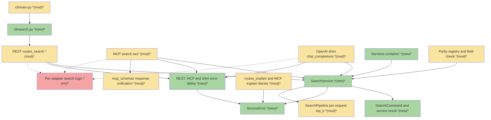
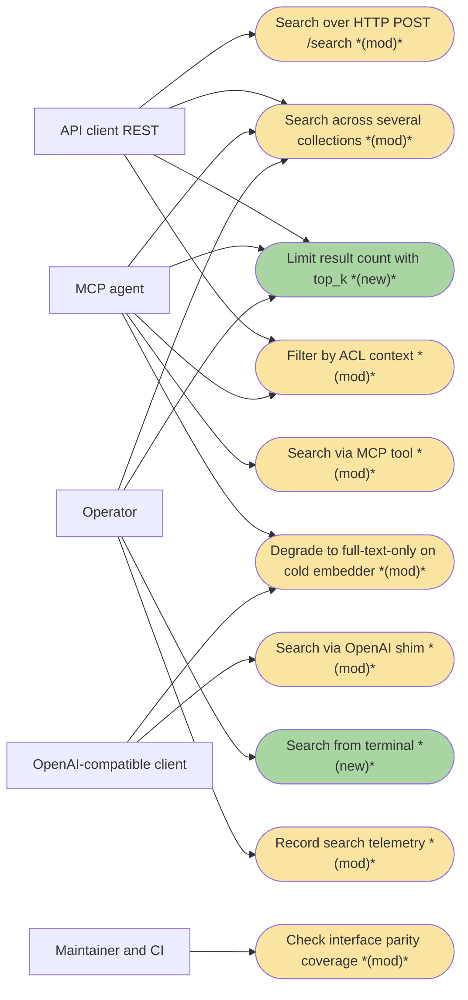
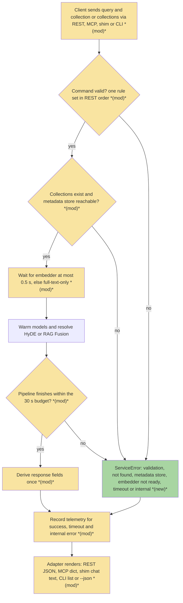
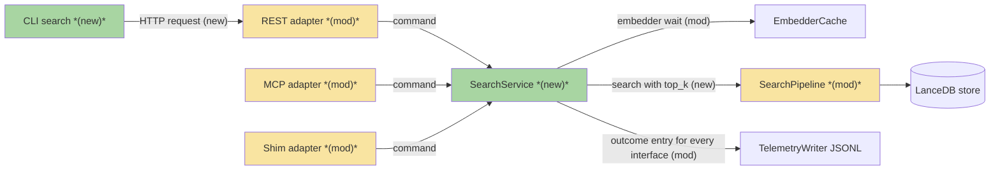
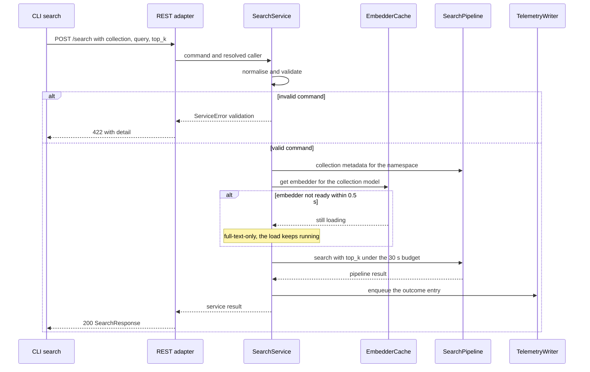

# 01-SEARCH · Search on one implementation across REST, MCP, OpenAI shim and CLI — Team Plan

**How to read this file**

- **Architecture approach:** Clean Architecture — the default; no override skill was requested. **Layers:** Presentation · Use Cases · Interface Adapters · Entities · Frameworks & Drivers.
- **Deployment boundary:** client+server. The CLI is an HTTP-only client of the REST server (ADR 20 rule 4: it imports nothing from `services/` or `server/`); REST, MCP and the OpenAI shim are server-side adapters in one FastAPI process. There is no browser frontend, so the **Frontend** role is the **CLI** (Presentation); every other layer, the three server adapters included, is **Backend**.
- The **Frontend, Backend, and Tester** sections are the **depth view** — each role's scope, grouped by layer.
- **Contracts** are logical and authored as linked `.tsp` files (TypeSpec 1.17.0). Internal seams and the MCP tool seam are core-construct `.tsp` files beside this plan, each compiled with `--no-emit`; the two HTTP seams (REST `POST /search`, the OpenAI shim) are TypeSpec HTTP services in the `api-contracts/` folder with an emitted `.openapi.yaml` each.
- **Role tags** (`#frontend-role`, `#backend-role`, `#tester-role`) mark each role-owned section — filter a tag (e.g. in Obsidian) to see one role's whole scope.
- IDs (`S#` scenarios, `C#` contracts, `Q#` questions) are the traceability thread. Vocabulary kept apart on purpose: the brief's decisions are written "brief Q1–Q4" (all resolved), Brief 00's rules "brief C1–C14", the other slices "roadmap S#" (this slice is "roadmap S1"), the roadmap's decisions "roadmap D#"; "row N" is a row of the brief's drift table (rows 1–20) and "D21–D27" are the extra drifts this plan found, continuing that numbering. Plan IDs `S#`, `C#`, `Q#` are never the brief's.
- **Tasks** are not in this file — task breakdown is a separate downstream step that consumes this plan.
- **Rule:** change a contract only by team agreement.

---

## Background

Search is implemented three times: REST ([routes_search.py](../../../archon_search/server/routes_search.py), handler at lines 292-658), the MCP `search` tool ([mcp.py](../../../archon_search/server/mcp.py), lines 513-854) and the OpenAI shim ([routes_openai_shim.py](../../../archon_search/server/routes_openai_shim.py), `chat_completions` at lines 152-354). Each calls `SearchPipeline.search` or `search_many` and re-implements validation, collection lookup, embedder selection, HyDE, the time budget, telemetry and response fields around it; the brief counts 20 behavioural differences, several user-visible (an MCP search can wait up to 120 seconds on a cold embedder where REST degrades to full-text-only after 0.5 seconds; a `ppr` search over several collections is a 422 on REST and runs silently on MCP; MCP records no telemetry when a search times out). The CLI has no search command. `top_k` is validated on REST and then dropped because the pipeline takes no `top_k`; the shim accepts it and ignores it; MCP has none.

The S0 foundation has landed: the application-service package `archon_search/services/` (search budget, request HyDE, validators, authz policy), the layer boundary test ([test_layer_import_boundary.py](../../../tests/test_layer_import_boundary.py)) and the parity registry ([registry.py](../../../tests/parity/registry.py), already holding a Search row whose CLI claim is a pending waiver for S1). `SearchService`, `ServiceError`, the services container and the adapter error tables do not exist yet; this slice builds them with their first consumer.

---

## Goal

The same query returns the same ordered results, the same derived fields and the same errors on REST, MCP and the CLI; the OpenAI shim runs on the same service and keeps its protocol-specific rendering. One `SearchService` owns validation, collection resolution, embedder selection, warm-up, HyDE and RAG Fusion, the budget, telemetry and derived fields. Operators can run `archon-search search` from a terminal. The parity registry reports Search as covered on every interface, and a first field-level parity check proves the interfaces carry the same fields.

---

## Scope

### In Scope

- `SearchService` (single and multi collection), `SearchCommand`, the service result type, the first `ServiceError` types and the services container, following brief C2–C6.
- Rewiring of REST `POST /search`, the MCP `search` tool and the shim's search path to the service; deletion of the duplicated code in those three files: the telemetry-enqueue wrappers, the dependency-error mapping (see Contradictions: only the surviving catch-alls exist) and the `config is None` fallbacks that exist only for the test harness.
- Resolution of every drift row of the brief (each resolved as written, or explicitly kept with a reason), plus the extra drifts D21–D27 listed under Contradictions.
- Removal of the duplicated literals: `"search failed"`, `"internal_error"`, the valid-`graph_mode` definitions, the fan-out and `top_k` messages (also repeated in [routes_explain.py](../../../archon_search/server/routes_explain.py) and the MCP explain tool, which roadmap S3 will then reuse), `"collection not found"`, `"Retry-After": "30"`, and the `5`, `100` and `8` limits.
- Per-request `top_k` (brief Q1): an optional `top_k` on `pipeline.search` and `search_many`, forwarded by REST and the shim, new on MCP and the CLI (`--top-k`), passing the eval gate; a separate task at the end of the slice.
- New CLI command `search` in a new `cli/search.py`, registered in [main.py](../../../archon_search/cli/main.py), using the shared CLI helpers; one `--collection` selects the single path, several select the multi path; `--json` prints the REST response body (brief Q4).
- MCP `search` gains `acl_context` and `top_k`; its response gains `embedding_model`, `rag_fusion_applied`, `rag_fusion_queries_used`, `rag_fusion_attempted`, `applied_filters` and `acl_gate`, so REST and MCP return the same fields.
- The first field-level parity check (brief Q3), the parity registry flip (CLI claim, service method), `BREAKING.md` entries with the migration-guide rows, and the docs listed under Documentation update.

### Out of Scope

- `search_with_context` (roadmap S2), `explain` (roadmap S3) and `route` (roadmap S4); they reuse the pieces this slice extracts.
- Changes to retrieval algorithms, reranking, fusion or the graph expansion; the only core change is per-request `top_k`.
- The shim's streaming format and OpenAI envelope (adapter rendering).
- Making `SEARCH_TIMEOUT_SECONDS` configurable (existing `TODO` in [search_budget.py](../../../archon_search/services/search_budget.py)).
- `MultiCollectionRouter`: no search surface uses it (only `route` and `explain`); automatic collection choice is a future iteration.

---

## Acceptance criteria

- The same query returns the same ordered results and the same derived fields through REST, MCP and `archon-search search --json` against a running server (proved by the cross-interface smoke run, S66, which also sends it through the shim).
- Each drift row is resolved as written or explicitly kept, and every changed behaviour has a [BREAKING.md](../../../BREAKING.md) entry.
- [routes_search.py](../../../archon_search/server/routes_search.py), the MCP `search` tool and the shim's search path import no HyDE, budget, validator or telemetry-building code. No existing test enforces this and the brief's second clause (the boundary test's allowlist losing the entries this slice resolved) is vacuous, because none of its eight edges is a search edge — see Contradictions and Q23.
- The shim's existing contract tests ([test_routes_openai_shim_be5.py](../../../tests/server/test_routes_openai_shim_be5.py), [_be6](../../../tests/server/test_routes_openai_shim_be6.py), [_be7](../../../tests/server/test_routes_openai_shim_be7.py), [test_openai_shim_e2e.py](../../../tests/integration/test_openai_shim_e2e.py)) pass, plus new shim tests for the metadata-lookup failure and for embedder-not-ready.
- The parity registry marks Search as covered on REST, MCP and the CLI; the new field-level parity check passes; the exact-string REST validation tests ([test_e0c_be3_validation.py](../../../tests/integration/test_e0c_be3_validation.py), [test_e2h_t1_ppr_guard_paths_e2e.py](../../../tests/integration/test_e2h_t1_ppr_guard_paths_e2e.py)) still pass; the default suite, `uvx ruff@0.17.3 check .` and the 85% coverage gate pass.
- Both OpenAPI snapshots ([contract](../../../tests/contract/openapi_snapshot.json), [server](../../../tests/server/openapi_snapshot.json)) are regenerated together and differ only where the contracts C5 and C7 say.

---

## What does NOT change

- `search_with_context`, `explain` and `route` behaviour; `pipeline.search_with_context` keeps calling the pipeline without `top_k`; retrieval, reranking, fusion and graph algorithms; the eval harness still builds its pipelines and calls the pipeline without a per-request `top_k`.
- The single-versus-multi visibility: `collection="x"` runs `pipeline.search` with the per-collection embedder, `collections=["x"]` runs `search_many` with the global embedder and excludes model-mismatched collections. The multi-path `embedding_model` stays the global configured model.
- The shim's streaming format, OpenAI envelope, model-name routing (`archon-search` means all collections, `archon-search/<collection>` one), `max_fanout` truncation with its warning, and its non-exposure of HyDE, RAG Fusion, graph mode, filters and ACL.
- Existing REST body shapes (plain `ErrorDetail`, coded `{"detail":{"code","message"}}`, the framework validation list); the wire text of every row that is not a drift row.
- MCP filter parameters stay flat and REST's `filters` stays nested; both build the same `SearchFilters`. The superset guard [test_mcp_search.py](../../../tests/server/test_mcp_search.py) keeps protecting this.
- `get_http_request` stays a module attribute of [mcp.py](../../../archon_search/server/mcp.py) and the caller is resolved by the adapter per request (ADR 09, ADR 17); `default_collection` stays in the MCP factory for the six other tools that use it until their slices.
- Telemetry labels (single success `search`, multi success `search_multi`, errors `search`) and the privacy rule (no query text); `SEARCH_TIMEOUT_SECONDS` (30 s) and the 0.5 s warm-up bounds; the `fts_only` rules inside the pipeline; the HyDE and RAG Fusion suppression rules.
- Persisted data: no table, field, migration or store schema version changes. The eight boundary-test allowlist edges (none concerns search).

---

## Known limitations / accepted trade-offs

- **Single and multi path can differ for the same collection** when its embedding model differs from the global one; the CLI exposes this as one versus several `--collection`.
- **Cold-embedder results on MCP and the shim:** after this slice those clients can receive full-text-only results where they used to wait; a breaking-change entry says so.
- **MCP `search` differs from six other MCP tools** (`ingest_file`, `ingest_directory`, `list_documents`, `delete_document`, `search_with_context`, `explain`) until their slices remove their `default_collection` fallback (brief Q2).
- **The eval gate does not exercise per-request `top_k`** (it only proves the default behaviour is byte-identical); new integration tests carry the `top_k` proof (S19–S23, Q18).
- The CLI cannot import the server's budget or limits, so it carries its own named constants for request timeout, excerpt length and the `graph_mode` choices; the server enforces every limit (`top_k_max`, `max_fanout`) and the CLI shows the server's message.
- **The smoke lane is local and pre-release only** (not in PR CI, needs the model cache); the cross-interface comparison with real ranking runs there, and the default suite proves shape, derived fields and errors with stubbed backends (zero-vector ranking).
- No telemetry `origin` dimension: shim, MCP, REST and CLI traffic share the same endpoint labels (brief Future Iterations).
- Field-level parity covers Search only; later slices extend it.
- The pilot's contract (ADR 20) is reviewed after this slice and amended before roadmap S2.

---

## Approach & architecture

Clean Architecture, applied to a repo with no layer folders: `archon_search/services/` is the **Use Cases** home. `SearchService` takes a resolved caller and a command, runs the brief's canonical flow once, and raises `ServiceError` for every failure; REST, MCP and the shim shrink to converting transport input into a command and a result or error into their wire form, each with one error table. The CLI stays outside the process boundary and calls REST. The boundary test (rules 1–4) and the parity registry keep the direction checkable; the slice adds a field-level parity check and an adapter-thinness check.

### Architecture

_Scope limited to changed nodes only: the full component set (about 45 components) is far above 15 nodes and the 1-hop expansion also exceeds the limit. Changed components that share a file or role are drawn as one node and listed separately in the table below; unchanged components (the budget, HyDE and validator modules, embedder cache, telemetry writer, store, filters, configuration, the other adapters) are omitted. The dotted edges show the last known connection of the removed logic. Edges are illustrative: the three server adapters also use the unchanged `services/` modules through the service, and the edge from the explain literals to the service error stands for the shared constants whose home is Q8._

| Component | Change | Why |
|-----------|--------|-----|
| `SearchService` (new module under `archon_search/services/`) | new | One implementation of the brief's canonical flow for REST, MCP and the shim |
| `SearchCommand` and the service result (name: Q3) | new | Transport-free input and output of the service; derived fields computed once |
| `ServiceError` with its kinds and fixed wire constants | new | One translation of every failure; replaces the per-handler `except` ladders |
| REST, MCP and shim error tables | new | One table per adapter rendering a `ServiceError` to its wire form |
| Services container | new | Gives the three adapters the same `SearchService` (placement: Q7) |
| `cli/search.py` | new | The `archon-search search` command, an HTTP client of REST |
| [main.py](../../../archon_search/cli/main.py) | modified | Registers the new command |
| [routes_search.py](../../../archon_search/server/routes_search.py) | modified | Shrinks to request conversion, caller resolution and rendering; the telemetry, HyDE-failure and embedder-wait helpers are removed |
| [mcp.py](../../../archon_search/server/mcp.py) | modified | `search` shrinks the same way; gains `top_k` and `acl_context`; loses its default collection and the `config is None` fallbacks. Helpers shared with other tools (the failure constants, `_resolve_embedder`, `default_collection`) stay until their slices |
| [routes_openai_shim.py](../../../archon_search/server/routes_openai_shim.py) | modified | Calls the service; keeps model-name routing, truncation, rendering and streaming |
| [pipeline.py](../../../archon_search/pipeline.py) | modified | Optional `top_k` on `search` and `search_many` (the one core change) |
| [mcp_schemas.py](../../../archon_search/server/mcp_schemas.py), [schemas_openai.py](../../../archon_search/server/schemas_openai.py), [schemas.py](../../../archon_search/server/schemas.py) | modified | MCP response gains six fields; the shim's `top_k` comment stops being true; the two wire-code constants that `services/` cannot import from `server/` move (Q8) |
| [routes_explain.py](../../../archon_search/server/routes_explain.py) and the MCP explain tool | modified | Re-point the duplicated fan-out, `top_k` and `graph_mode` literals to the shared definitions; no behaviour change |
| [registry.py](../../../tests/parity/registry.py) and the parity test | modified | CLI claim `search`, service method set, waiver dropped; first field-level check added |
| Per-adapter search logic | removed | Telemetry-enqueue wrappers, dependency-error mapping, harness fallbacks, MCP default collection, adapter timeout aliases |

**Layer map (and role mapping)**

| Layer | Role | Components |
|-------|------|-----------|
| Presentation | **Frontend** (CLI, Click) | `cli/search.py` (new), [main.py](../../../archon_search/cli/main.py) registration, [_helpers.py](../../../archon_search/cli/_helpers.py); talks to REST over HTTP only |
| Interface Adapters | Backend (Python) | [routes_search.py](../../../archon_search/server/routes_search.py) with `SearchRequest`, `SearchResponse`, `SearchResultSchema`; the MCP `search` tool in [mcp.py](../../../archon_search/server/mcp.py) with [mcp_schemas.py](../../../archon_search/server/mcp_schemas.py); [routes_openai_shim.py](../../../archon_search/server/routes_openai_shim.py) with [schemas_openai.py](../../../archon_search/server/schemas_openai.py); the three error tables; caller resolution in [authz.py](../../../archon_search/server/authz.py) and the MCP identity helper; [embedder_cache.py](../../../archon_search/embedder_cache.py), the telemetry writer |
| Use Cases | Backend (Python) | new `SearchService`, `SearchCommand`, service result, `ServiceError`, services container under `archon_search/services/`; existing [search_budget.py](../../../archon_search/services/search_budget.py), [request_hyde.py](../../../archon_search/services/request_hyde.py), [validators.py](../../../archon_search/services/validators.py), [authz.py](../../../archon_search/services/authz.py); core orchestration in [pipeline.py](../../../archon_search/pipeline.py) |
| Entities | Backend (Python) | [filters.py](../../../archon_search/filters.py) `SearchFilters`, [_types.py](../../../archon_search/_types.py) `SearchResult` (the per-chunk hit), `ExcludedCollection`, [entry.py](../../../archon_search/telemetry/entry.py) `TelemetryEntry` and its enums |
| Frameworks & Drivers | Backend (Python) | [store.py](../../../archon_search/store.py) (LanceDB), [config.py](../../../archon_search/config.py), FastAPI / FastMCP / Click / httpx, the composition root [app.py](../../../archon_search/server/app.py) |

The repo's own docs use a different layer vocabulary ([110_component_catalog_and_layer_breakdown.md](../../Architecture/110_component_catalog_and_layer_breakdown.md)); the labels above are this plan's Clean Architecture classification. The guard tests (boundary, parity, `str(exc)` on the wire, adapter thinness) are cross-cutting and own no layer.

**What changes**

- `services/` gains the search service, its command and result types, `ServiceError` and a container; it may import core modules and nothing from `server`, `cli`, `fastapi`, `starlette`, `fastmcp`, `click`, `httpx` or `uvicorn`, and no module-level `anthropic` (ADR 20 rule 1). Consequence: the REST, MCP and shim wire schemas and the two wire-code constants now in [schemas.py](../../../archon_search/server/schemas.py) cannot be returned or imported by the service; the service returns raw core types and adapters build their schemas.
- Each adapter resolves the caller, builds a command, calls the service, and renders the result or error through its own table; the CLI renders REST's statuses and bodies.
- The pipeline gains an optional `top_k` on both entry points; callers that do not pass it behave byte-identically.
- The MCP response, input schema and tool description change (six response fields, `top_k`, `acl_context`, no default collection, `ppr` accepted in the description).
- The telemetry decision moves into the service: every outcome in scope is recorded once, for every interface.
- Tests that string-patch adapter aliases (`_SEARCH_TIMEOUT_SECONDS` on REST, MCP and shim; `_EMBEDDER_LOAD_WAIT_TIMEOUT_SECONDS` on REST) re-point to the service; the 143 MCP factory call sites and the REST tests that swap `app.state` objects after app creation keep working (Q7).

**Key decisions (from the brief)**

- Brief Q1: `top_k` is real, a separate task at the end; it passes the eval gate; the s313 test is rewritten, not re-pinned.
- Brief Q2: a collection is required everywhere; MCP loses its default. The shim's model-name mapping is adapter policy.
- Brief Q3: the first field-level parity check compares command fields against the REST request schema, the MCP input schema and the CLI options, with an explicit mapping for nested versus flat filters.
- Brief Q4: the CLI prints one line per result (rank, score, collection, source path, excerpt at a named constant of about 200 characters with whitespace collapsed); no excerpt flag; `--json` prints the REST body with the full text.
- REST is canonical where it is the more complete and better-tested surface (roadmap D5); validation order is REST's; the shim keeps its truncation and model mapping as adapter policy.
- Existing tests that pin drifted behaviour are rewritten, not re-pinned (brief C13); characterization tests for the six uncovered behaviours are written first.

### Actors & Use Cases

_Scope limited to change neighbourhood: the full set has 20 nodes (7 actors, 13 use cases). Omitted are the system actors (embedder cache and warm-up, telemetry writer, metadata store) and the unchanged use cases (search with context, explain, route), because this slice changes none of their behaviour; the 15 nodes shown are the 10 changed use cases and their 5 actors._

### Flows

#### User Flow

The brief's canonical order, as a client experiences it. Steps whose behaviour changes are tagged; the validation rules, the bounded embedder wait on every interface and the error kinds are the visible changes.

#### Data Flow

#### Sequence

The primary user-facing flow: the new CLI against the single-collection path, including the cold-embedder degrade. MCP and the shim follow the same service steps from their own adapters.

### Prior decisions

| Decision | Rationale | Constraint |
|----------|-----------|------------|
| [ADR 20](../../ADRs/20_application_service_layer_with_enforced_boundaries_and_interface_parity.md) — application-service layer with test-enforced boundaries and interface parity | Features drifted across interfaces with no check | The service and its errors live in `services/` and import no web, CLI or HTTP-client package; `cli/search.py` is HTTP-only and imports only `cli/_helpers`; `services/` is guarded against `str(exc)` on the wire; the Search registry row must claim REST, MCP and the CLI; ADR 20 prescribes a dated Amendment after this pilot (it has no Amendments section yet); its text that adapters keep the timeout aliases ceases to hold here |
| [ADR 11](../../ADRs/11_embedder_cache_bounded_waiter_timeout.md) — embedder cache bounded waiter timeout | A wedged load must not hang every search | `EmbedderNotReadyError` becomes a 503-class `ServiceError`; its 120 s cache bound is the source of MCP's "unbounded" wait; the service's 0.5 s wait is a separate layer and must never cancel the loader or touch its registration |
| [ADR 08](../../ADRs/08_per_collection_embedder_lru_cache.md) — per-collection embedder LRU cache | Per-collection models need bounded memory | The single path selects the collection's embedder only through the cache; the multi path uses the global embedder; the service never builds embedders |
| [ADR C4](../../ADRs/C4-hyde-external-llm-dependency.md) — HyDE (partly superseded by ADR 19) | Opt-in, availability over quality | Silent fallback only; never log or record the query or hypothesis; no module-level `anthropic`; do not reintroduce a 422 for a missing package |
| [ADR C5](../../ADRs/C5-rag-fusion-external-llm-dependency.md) — RAG Fusion, exclusive with HyDE (partly superseded by ADR 19) | Reformulation needs an LLM; cost control | The service, not the pipeline, owns HyDE and RAG Fusion resolution and the "RAG Fusion wins" suppression; the MCP response gains the RAG Fusion fields |
| [ADR 19](../../ADRs/19_shared_llm_client_and_provider_based_collection_descriptions.md) — one shared LLM client | Duplicated provider stacks failed silently | The dependency-error classes and their 422 are gone and must not return; client-abort cancellation of the search and its provider call must keep working through the service (it must not swallow `CancelledError`) |
| [ADR 05](../../ADRs/05_opt_in_local_telemetry_no_raw_query.md) — opt-in local telemetry, no raw query | Privacy is structural | The service builds entries only through the existing factories, with no query text, using the same doc-id hasher on every interface; the container carries the writer and hasher |
| [ADR 09](../../ADRs/09_mcp_http_mount_and_namespace_propagation.md) — MCP mounted in the same app (partly superseded by ADR 17) | One process; namespace per request | The MCP adapter keeps resolving the caller per request and refuses a missing identity before the service is called; MCP response changes do not touch the OpenAPI snapshots |
| [ADR 17](../../ADRs/17_mcp_namespace_via_public_get_http_request.md) — public `get_http_request` | Public API, no private context | `get_http_request` stays a module attribute of `mcp.py`; resolution stays in the adapter. Its fallback text contradicts the code (see Contradictions) |
| [ADR 04](../../ADRs/04_multi_collection_router_with_centroid_preranking.md) — multi-collection router | Bound query cost as collections grow | `max_fanout` is the single source of the fan-out limit (service validation, shim truncation, replacing the literal `5`); the router is not wired into the service |
| [ADR 03](../../ADRs/03_cross_encoder_reranker_second_stage.md) — cross-encoder reranker | Precision at the top of the list | Per-request `top_k` touches the retrieve/return relationship: the pipeline must retrieve at least `top_k` candidates and pass the eval gate; reranking itself is unchanged |

### Contradictions

**Code vs. docs**

- [120_services_and_integration_architecture.md](../../Architecture/120_services_and_integration_architecture.md) line 57 gives the multi-collection metadata failure as `{"detail": "service unavailable"}`; the code constants ([pipeline.py](../../../archon_search/pipeline.py) `METADATA_STORE_UNAVAILABLE_DETAIL` and `_CODE`) answer `"service unavailable: metadata store could not be reached"` with code `metadata_store_error`, which [140_error_handling_strategy.md](../../Architecture/140_error_handling_strategy.md) line 83 and [600_api_reference_or_public_interface.md](../../Architecture/600_api_reference_or_public_interface.md) lines 213 and 471 already state. Owner: **doc needs updating** (the sanitized-wire-text doc test requires the literal in 120).
- [600](../../Architecture/600_api_reference_or_public_interface.md) line 197 and [120](../../Architecture/120_services_and_integration_architecture.md) line 69 say the MCP tool and the shim bound the embedder wait at 0.5 s like REST; in the code only the later model warm-up is bounded on MCP and the shim, while the single-path embedder load waits up to the cache's 120 s bound (`mcp.py` `_resolve_embedder`, the shim's own `_resolve_embedder`); [140](../../Architecture/140_error_handling_strategy.md) line 84 states the real behaviour. The brief decides the parity the docs describe (row 8). Owner: **code is the issue**, fixed by this slice; 600 and 120 are listed under Documentation update.
- The MCP `search` tool description in [mcp.py](../../../archon_search/server/mcp.py) (and the `_VALID_GRAPH_MODES` comment) lists `naive`, `local` and `global` only, while the code accepts `ppr` and [65_graph_search.md](../../UserManual/65_graph_search.md) documents it. Owner: **doc needs updating** (the tool description reaches clients; edit it with the new parameters).
- [test_mcp.py](../../../tests/test_mcp.py) lines 614-624 skip `ppr` with `collections` with a comment that MCP rejects it before HyDE; MCP does not (the pipeline's multi path returns `ppr_entities_matched=0`). The docstring of the missing-collection test in [test_mcp_error_paths.py](../../../tests/integration/test_mcp_error_paths.py) (about lines 98-107) says the single path falls through to `internal_error`; the code answers `not_found`. Owner: **doc needs updating** (test comment and docstring; rewritten per brief C13).
- [ADR 17](../../ADRs/17_mcp_namespace_via_public_get_http_request.md) says a missing request or a request without a namespace resolves to the default namespace; the code (`_get_request_identity` in [mcp.py](../../../archon_search/server/mcp.py)) fails closed with a fixed `ToolError`, matching the brief's row 19 (see also [test_mcp_fail_closed.py](../../../tests/server/test_mcp_fail_closed.py)). Owner: **doc needs updating** (a dated Amendment, the ADR pattern).
- Docs that describe `top_k` as validated but ignored, MCP as defaulting its collection, and the MCP response as a deliberately narrower envelope ([600](../../Architecture/600_api_reference_or_public_interface.md) lines 193, 533, 558-566; [60_searching.md](../../UserManual/60_searching.md) lines 12 and 119; [05_mcp_integration.md](../../DeveloperGuide/05_mcp_integration.md) lines 25, 43, 112; [85_openai_compatible_api.md](../../UserManual/85_openai_compatible_api.md) lines 22 and 27; [03_breaking_changes_index.md](../../MigrationGuide/03_breaking_changes_index.md) NR-2; [06_client_migration_examples.md](../../MigrationGuide/06_client_migration_examples.md) lines 15 and 146; [530](../../Architecture/530_technical_debt_refactoring_roadmap.md) API-2; [openapi-openai-shim.yaml](../../../tsp_contract/openapi-openai-shim.yaml) line 99; the `top_k` comment in [schemas_openai.py](../../../archon_search/server/schemas_openai.py)) describe today's code correctly and become stale when this slice lands. Owner: **doc needs updating** (listed under Documentation update).
- [520_api_design_and_contracts.md](../../Architecture/520_api_design_and_contracts.md) says MCP and REST "share internal services" (line 14) and advises documenting an asymmetry rather than forcing parity (line 98). The first becomes true here; the second is reversed by this slice. Owner: **doc needs updating**.

**Brief vs. reality** (owner: open question; items with a Q# stay open, the others are answered by the evidence given; the answered items and the pointers to the open Q# were applied to the brief in a later amendment)

- **S0 deliverables already exist.** `archon_search/services/` (four modules), the boundary test and the parity registry landed; the registry's Search row has `service_method` unset and a pending CLI waiver for slice S1 ([registry.py](../../../tests/parity/registry.py)); the shim is already claimed with a waiver. Answered: this slice edits them. Missing are `SearchService`, `SearchCommand`, `ServiceError`, the container and the adapter tables.
- **Stale line references.** REST handler lines 292-658 (brief: 301-695); MCP tool 513-854 (brief: 520-865); shim `chat_completions` 152-354 (brief: ~250-345); the pipeline `scope_filter`/`graph_mode` asserts in `search_many` sit near lines 3367, 3453 and 3498 of [pipeline.py](../../../archon_search/pipeline.py) (brief: ~3319-3455); the `ppr` skip is in [test_mcp.py](../../../tests/test_mcp.py) lines 614-624 (brief: 646-670). Answered; no behaviour impact.
- **The service result name collides.** [_types.py](../../../archon_search/_types.py) already defines the per-chunk `SearchResult`, imported by 29 files; the brief's service-level `SearchResult` needs another name (Q3).
- **The HyDE and RAG Fusion dependency errors no longer exist.** The brief lists them among the `except` clauses to move; ADR 19 removed `HyDEDependencyError` and `RAGFusionDependencyError`, and a search of `archon_search/` finds no such class (only unrelated community and graph-ML dependency errors). A HyDE generator failure reaches the generic failure path. Answered: the service has no dependency-error kind and none may be reintroduced (D24 covers the surviving shapes).
- **Validation order and the REST validation seam.** The brief calls its step-1 order "REST's order today", but REST validates the query, the collection selection and the `graph_mode` value in the Pydantic request model first (framework-shaped 422), and its handler then checks fan-out, `top_k` above the maximum, `scope_filter` syntax, `scope_filter` with `graph_mode`, `ppr` with collections and graph-enabled, in that order (graph-enabled last). One service cannot produce the framework-shaped list body without a shape decision (Q1, Q2).
- **The acceptance line on the boundary allowlist is vacuous and the import clause has no test.** None of the eight allowlist edges concerns search (`mcp.py` → `routes_explain` belongs to roadmap S3), and rule 2 forbids only `routes_*` and `server.mcp` imports, so nothing asserts that the three adapters import no HyDE, budget, validator or telemetry-building code (Q23).
- **The shim's embedder-not-ready is already a 503.** The brief says neither failure is wrapped; the app-level handler in [app.py](../../../archon_search/server/app.py) (line 1507) already answers `/v1/*` with an OpenAI 503 and `Retry-After: 30`. Only the collection-list lookup failure on the all-collections model is truly unwrapped (a plain 500, D22). Answered: the shim gains defined behaviour for the lookup failure; for embedder-not-ready the behaviour is kept and moves into the service, with the new test the brief asks for.
- **The shim records no telemetry at all** (success included), not only on timeout; row 10's canonical "recorded for every outcome" would therefore start recording shim traffic (Q10). MCP records only the generic internal failure.
- **Row 8 is narrower than written.** Only the single path's embedder-cache load is unbounded on MCP and the shim; their multi paths already use the bounded warm-up. Row 9 is single-path only on MCP (its multi path already returns `metadata_store_error`). Row 20: only MCP's single path passes the namespace positionally. Answered.
- **Telemetry labels are verified** (the brief marks them unverified): REST and MCP agree; single success `search`, multi success `search_multi`, every error entry `search` even on the multi path (D27). Answered: keep today's labels.
- **The eval gate never passes a per-request `top_k`**: the eval runner builds pipelines with a fixed return count and calls the pipeline without it, so the brief's "must pass the eval gate" proves only that the default is unchanged (Q18). REST's `top_k` schema default is 5, which would override an operator's configured `top_k_return` once `top_k` is real (Q16).
- **The CLI has no shared request or error-render helper.** The brief says the command uses "the shared CLI helpers from S0"; [_helpers.py](../../../archon_search/cli/_helpers.py) holds the key resolver, default URL, connection-failure message and the text cleaner, but the request-sending and error-rendering helpers are private to [collection.py](../../../archon_search/cli/collection.py), and a command may import no other command module (Q19). The brief also leaves implicit that the CLI calls REST over HTTP; ADR 20 rule 4 and the roadmap require it.
- **`acl_gate` and the shared MCP result schema.** The brief says the MCP response "gains `acl_gate`" without saying per result (REST) or top level, and `McpSearchResultSchema` is shared with `search_with_context`, so a per-result field would change roadmap S2's response (Q4).
- **The valid-`graph_mode` set is defined in more places than three**: REST search and REST explain (`Literal`), MCP's tuple, and the eval fixtures; the REST OpenAPI enum must stay `naive|local|global|ppr` (Q8).
- **Deletion in `mcp.py` is partial.** The failure constants, `_enqueue_internal_error`, the scope-filter helper and `_resolve_embedder` are also used by `search_with_context`, `explain` and the ingest tools; they stay until those slices, and the other tools' `config is None` fallbacks stay. Answered.
- **Extra drifts the brief's table omits** (all covered by scenarios): D21 MCP's single-path not-found text names the collection while the multi path and REST use the fixed text; D22 the shim's collection-list lookup failure on the all-collections model is a plain 500; D23 shim internal failures are 503 while REST is 500 and MCP is `internal_error` (Q12); D24 a REST HyDE failure is a JSON 500 `search failed` while any other pipeline failure is a plain-text 500 (Q15); D25 embedder-not-ready has two REST mappings (a local single-path handler that records telemetry and stage timings, an app-level handler for the multi path and the shim), MCP maps it only on the single path (the multi path falls to `internal_error`), and the shim relies on the app handler; D26 the `graph_mode` set exists in several places and REST rejects a bad value in the framework, MCP in the handler; D27 telemetry endpoint labels differ between multi success and multi failure. Also observed: REST ORs the top-level `include_metadata` into its telemetry flags while MCP builds them from the built filters, and the REST single path records stage timings on its error branches while MCP records them only on success (Q9).
- **Docs outside the brief's list quote changed behaviour**: [85_openai_compatible_api.md](../../UserManual/85_openai_compatible_api.md), [30_configuration.md](../../UserManual/30_configuration.md), [06_error_handling.md](../../DeveloperGuide/06_error_handling.md), [06_client_migration_examples.md](../../MigrationGuide/06_client_migration_examples.md), [530](../../Architecture/530_technical_debt_refactoring_roadmap.md), ADR 20 and ADR 17. Answered: all are in Documentation update; the migration-guide row the brief names is [03_breaking_changes_index.md](../../MigrationGuide/03_breaking_changes_index.md).
- **Where the new CLI doc lives is unspecified** — no per-command CLI doc exists (Q22).

---

## Contracts / seams

Boundaries where roles must agree. **Logical, not code.** Changing one requires team agreement. **Tooling used: TypeSpec 1.17.0.** The internal seams (C1–C4), the MCP tool seam (C6: JSON-RPC tool calls, not REST routes, so no OpenAPI, matching the repo's earlier MCP contracts), the CLI command (C8) and the parity check (C9) are core-construct `.tsp` files beside this plan, each compiled clean with `tsp compile <file> --no-emit`. The HTTP/API seams C5 (REST) and C7 (OpenAI shim) are TypeSpec HTTP services in [api-contracts](./api-contracts/package.json) (`npm install` done, `@typespec/openapi3` emitter) with an emitted `.openapi.yaml` each. The two REST OpenAPI snapshots are the runtime copies of C5 and must be regenerated together; the shim is absent from them (disabled by default) and its standing contract is [openapi-openai-shim.yaml](../../../tsp_contract/openapi-openai-shim.yaml).

**C1 — Search command, result and service**  *(Interface Adapters ↔ Use Cases)*
One operation: the service takes a command and a resolved caller (the existing `AuthIdentity`) and returns a result. The command carries the canonical field names of REST's request: the query, exactly one of `collection` or `collections`, an optional `top_k`, the filters, the include-metadata flag already resolved by REST's OR rule, `hyde`, `rag_fusion`, `graph_mode`, `scope_filter` and `acl_context`. The result carries the raw per-chunk hits (adapters build their own wire schemas; `acl_gate` is built from the raw ACL fields only when requested), `acl_filtered`, the excluded collections, the effective embedding model (collection model on the single path, global model on the multi path), the HyDE, RAG Fusion and graph flags, `expansion_used`, `expansion_warning`, `applied_filters` and `ppr_entities_matched`, each derived once. The canonical order is the brief's Core Flow; nothing transport-specific is accepted or raised. The container gives every adapter the same service and carries what the service needs (pipeline, configuration, embedder cache, HyDE and RAG Fusion generators, telemetry writer, doc-id hasher); its placement and lifetime are Q7, and the result type's name is Q3. See [01_search-c1-search-service.tsp](./01_search-c1-search-service.tsp).

**C2 — ServiceError and the adapter error tables**  *(Use Cases ↔ Interface Adapters)*
One closed set of kinds, each with a stable wire code, a fixed sanitized detail (never an exception's text) and, for embedder-not-ready, one `Retry-After` constant (30 s) replacing the literals in REST and the app handler. Each adapter owns one table; existing REST body shapes are preserved unless a drift row changes them. Brief decisions in the table are the MCP and shim cells marked changed.

| Kind | REST (unchanged unless marked) | MCP code | Shim (OpenAI envelope) |
|------|-------------------------------|----------|------------------------|
| validation (query, selection, fan-out, `top_k` bounds, `ppr` with collections, filter values) | 422: framework list for Pydantic-detected input (Q1); plain `{"detail": text}` for fan-out, `top_k` above the maximum, `ppr` with collections | `validation_error` (now also `top_k`, `ppr` with collections, empty query) | not exposed, except `top_k` (Q11); its own 400 and 422 for "no user message" stay |
| invalid_graph_mode | framework 422 (`Literal`) | `invalid_graph_mode` | n/a |
| graph_disabled, scope_filter_graph_mode_incompatible | 422 plain | same-named codes | n/a |
| invalid_scope_filter | 400 coded | `invalid_scope_filter` | n/a |
| graph_communities_not_built | 422 coded (message text: Q6) | `graph_communities_not_built` | n/a |
| not_found | 404 `{"detail":"collection not found"}` | `not_found` with the fixed text on both paths (single path no longer names the collection) | 404; both existing texts kept |
| metadata_store_error | 503 `{"detail","code"}`, no `Retry-After` | `metadata_store_error` (now also the single path) | 503 "Service temporarily unavailable." (now also the all-collections list lookup) |
| embedder_not_ready | 503 `{"detail","code"}` with `Retry-After` | `embedder_not_ready` (now also the multi path) | 503 with `Retry-After` |
| timeout | 504 "Search timed out" | `timeout` "search timed out" | 504 "Request timeout." |
| internal (pipeline or HyDE failure) | 500: plain text, or JSON `search failed` for a HyDE failure (Q15) | `internal_error` "search failed" | 503 as today (Q12) |

The CLI has no service table; it renders REST's statuses and the three REST `detail` shapes (string, list, coded). See [01_search-c2-service-error.tsp](./01_search-c2-service-error.tsp).

**C3 — Per-request top_k on the pipeline**  *(Use Cases ↔ core pipeline)*
Both pipeline entry points gain an optional `top_k`; absent means today's behaviour exactly (the result count is the configured `top_k_return`). When present it is the number of results on every cutoff of the single path (standard, RAG Fusion, graph local and global, PPR) and of the multi path (standard, graph, local, hybrid fallback); the candidate depth is at least what `top_k` needs (the exact rule above the default depth is Q16); the reranker already takes a count; the upper bound `top_k_max` is enforced by the service, never the pipeline. `search_with_context` and the eval harness pass nothing. See [01_search-c3-pipeline-top-k.tsp](./01_search-c3-pipeline-top-k.tsp).

**C4 — Search telemetry recorded by the service**  *(Use Cases ↔ telemetry writer)*
The service records the outcome of every search once for every interface. The brief names the outcomes success, timeout and internal error; which further outcomes count and how they map to the entry's status and error kind is Q9, and whether shim traffic is recorded is Q10. Labels stay as today (single success `search`, multi success `search_multi`, every error `search`); internal failures keep today's status and error-kind pair; the entry never carries the query (ADR 05); the same doc-id hasher applies everywhere; the filter flags come from the resolved command so `include_metadata` counts the same on every interface. See [01_search-c4-search-telemetry.tsp](./01_search-c4-search-telemetry.tsp).

**C5 — REST `POST /search`**  *(CLI and API clients ↔ REST adapter; HTTP/API seam)*
Request and response are REST's existing shapes. Delta: `top_k` is real (at least 1 in the schema, at most the operator's `top_k_max` in the service, forwarded to the pipeline; its default when omitted is Q16), and the error responses (400 coded, 404, 422 in three body shapes, 500, 503 with an optional `Retry-After`, 504) are produced from the one service translation with their bodies preserved. No new response field: REST already carries every field the other interfaces gain. The CLI is a client of this seam. See [01_search-c5-rest-search.tsp](./api-contracts/01_search-c5-rest-search.tsp) and the emitted [01_search-c5-rest-search.openapi.yaml](./api-contracts/01_search-c5-rest-search.openapi.yaml).

**C6 — MCP `search` tool**  *(MCP agents ↔ MCP adapter; client-server seam, core-construct contract)*
Input gains `top_k` and `acl_context`; `collection` and `collections` are required (exactly one, no default, no literal `"default"`); filter parameters stay flat; `graph_mode` stays a string validated by the service. The response schema (strict today) gains `embedding_model`, `rag_fusion_applied`, `rag_fusion_queries_used`, `rag_fusion_attempted`, `applied_filters` and `acl_gate` (per result, like REST; placement and the effect on `search_with_context` are Q4) so its field set equals REST's. Errors are `{error, code}` dicts using the codes of C2; a call with no identity is refused with a fixed `ToolError` before the service is called. See [01_search-c6-mcp-search-tool.tsp](./01_search-c6-mcp-search-tool.tsp).

**C7 — OpenAI shim `POST /v1/chat/completions` (search path)**  *(OpenAI-compatible clients ↔ shim adapter; HTTP/API seam)*
Wire unchanged except: `top_k` is forwarded (bounds: Q11), embedder-not-ready and a failed collection-list lookup answer the 503 envelope (the latter was a plain 500), timeouts and not-found keep their envelopes, the unexposed fields stay unexposed. The model-name routing, truncation with its warning, rendering and streaming remain adapter policy. See [01_search-c7-openai-shim-search.tsp](./api-contracts/01_search-c7-openai-shim-search.tsp) and the emitted [01_search-c7-openai-shim-search.openapi.yaml](./api-contracts/01_search-c7-openai-shim-search.openapi.yaml).

**C8 — `archon-search search` command**  *(Presentation ↔ REST over HTTP)*
The command takes the query and a required, repeatable `--collection` (one value selects REST's `collection`, several select `collections`), `--top-k`, the flat filter options, `--include-metadata`, `--hyde`, `--rag-fusion`, `--graph-mode`, `--scope-filter`, `--acl-context`, `--json`, `--api-url` and `--api-key` (the exact set and names: Q20). Human output is one line per result in response order (rank, score, collection, source path, excerpt cut at one named constant of about 200 characters, whitespace collapsed and control characters cleaned); `--json` prints the REST body with the full text (format: Q21). Errors go to stderr with exit code 1, connection failures use the shared connection-refused message, and the request timeout is one named constant above the server's 30 s budget (Q19). The CLI imports nothing from `services/` or `server/`. See [01_search-c8-cli-search.tsp](./01_search-c8-cli-search.tsp).

**C9 — Field-level parity check**  *(test-side guard ↔ command, REST, MCP, CLI)*
Extends [tests/parity](../../../tests/parity/test_parity.py): an explicit mapping of every command field to its REST property (nested `filters.<name>` versus flat), MCP parameter and CLI option, and of every result field to REST's response field and MCP's response field (the CLI `--json` is the REST body), with a waiver and reason where a surface intentionally lacks one (the shim is waived wholesale as adapter policy). It fails on a field missing from a surface without a waiver, on a surface field that maps to nothing, and on an invalid waiver. This shapes brief C12 for the remaining slices. See [01_search-c9-field-parity.tsp](./01_search-c9-field-parity.tsp).

---

## Data

_Skipped: this slice changes no table, field, relationship or migration. The project has no relational schema (persistence is LanceDB plus JSON and JSONL files); `top_k` is a request argument and is never stored, the store schema version is not bumped and no migration spec is added. The telemetry entry shape is unchanged (any new status or error-kind value needed by Q9 is an additive change to the entry model, its documented-fields set and the telemetry docs); only which outcomes are written changes, and the large-`top_k` case is already handled because the writer truncates `result_doc_ids` to fit its per-entry size cap._

---

## Scenarios #tester-role

Behavioural only — step-level detail is produced by the tasks below. Covers happy, unhappy, edge and non-functional paths for every drift row, the extra drifts and the CLI, shim and release behaviours.

| id | Scenario (Given / When / Then) |
|----|--------------------------------|
| **S1** | **Given** one running app with one pipeline · **When** the same query and collection go through REST, MCP and the CLI's `--json` (in-process) · **Then** the ordered results, the derived fields and the error codes agree, because one `SearchService` produced them |
| **S2** | **Given** `collection="x"` (single path) · **When** the search runs · **Then** the collection's own embedder is used and `embedding_model` is that collection's active model |
| **S3** | **Given** `collections=[a, b]` where b's model differs from the global one · **When** the search runs · **Then** the global embedder is used, b is listed in `excluded_collections` with its reason, `embedding_model` is the global model, and if every collection is excluded the result is empty with no error |
| **S4** | **Given** the same collection searched as `collection="x"` and as `collections=["x"]` · **When** its model differs from the global one · **Then** the two paths may differ (core behaviour, kept), and the CLI maps one `--collection` to the first and several to the second |
| **S5** | **Given** a request with no collection, an empty or whitespace collection, or a padded name · **When** it reaches the service from REST, MCP or the CLI · **Then** a missing collection is a validation error (MCP no longer falls back to a default or the literal `"default"`), an empty one is a validation error, a padded one is stripped; and the shim's model `archon-search` still means all collections (row 2, row 3) |
| **S6** | **Given** an empty or whitespace query · **When** it is sent on REST, MCP or the CLI · **Then** every interface rejects it with a validation error and MCP no longer searches it unvalidated (row 4) |
| **S7** | **Given** a shim request with no user message, a blank last user message, or padded text · **When** it is sent · **Then** the shim keeps its own 422 and 400 `no_user_message` envelopes and its non-user-message errors, and the text searched is the normalised one (Q13) (row 4) |
| **S8** | **Given** a command that breaks several rules at once · **When** it is validated on any interface · **Then** the first failing rule in REST's actual order wins (fan-out, `top_k` bound, scope-filter syntax, scope filter with `graph_mode`, `ppr` with collections, graph enabled) and REST's exact 422 strings still pass the e0c and e2h tests (row 5, Q2) |
| **S9** | **Given** `graph_mode="ppr"` with `collections` · **When** it is sent through MCP or the CLI (REST already rejects it) · **Then** it is rejected with REST's message, never reaches the pipeline's silent fall-through, and no interface returns `ppr_entities_matched=0` for it (row 6) |
| **S10** | **Given** more collections than `max_fanout` (counted after de-duplication) · **When** sent on REST, MCP or the CLI · **Then** the service rejects it with the same message; **and Given** the shim's `archon-search` model with more namespace collections than the limit · **Then** it truncates to the same `max_fanout` value and logs a warning naming the omitted ones (row 7) |
| **S11** | **Given** an unknown collection on the single or multi path, or one in another namespace · **When** searched · **Then** one `not_found` kind is raised and rendered: REST 404 with the fixed text, MCP `not_found` with the same fixed text on both paths (the single path no longer names the collection), the shim's two existing 404 texts (row 18, D21) |
| **S12** | **Given** HyDE, RAG Fusion, `graph_mode` and `scope_filter` · **When** requested on REST, MCP or the CLI · **Then** the service resolves them with today's suppression rules (RAG Fusion wins over HyDE, `graph_mode` suppresses HyDE, a cold embedder or missing generator falls back silently with `hyde_applied` false and the warning) and the shim does not expose them (rows 16-17) |
| **S13** | **Given** an invalid `graph_mode`, graph disabled, `scope_filter` with `graph_mode`, a graph whose communities are not built, or an invalid `scope_filter` · **When** searched · **Then** each is one error kind: MCP keeps its codes, REST keeps its 422 and 400 bodies, the valid-`graph_mode` set is defined once and REST's OpenAPI enum stays `naive|local|global|ppr` (rows 16-17, D26, Q6, Q8) |
| **S14** | **Given** `include_metadata` at the top level or inside `filters` · **When** searched · **Then** the service applies REST's OR rule once, `metadata` is blanked unless wanted, and MCP and the CLI behave the same (row 14) |
| **S15** | **Given** filters passed nested (REST) or flat (MCP, CLI), with and without any filter, on the single and multi paths · **When** searched · **Then** one construction builds the same `SearchFilters`, no filter means no filter on every path, MCP's multi path now honours `include_metadata`, and an invalid date, glob, file type or language is a validation error everywhere (row 15) |
| **S16** | **Given** `fts_only` and a pipeline that cancels or extends it · **When** the service calls the pipeline · **Then** it passes `fts_only` unchanged and never re-derives it, and the pipeline's `scope_filter`/`graph_mode` assertions stay unreachable because the service validates first |
| **S17** | **Given** a request with no authenticated identity · **When** it reaches MCP, REST or the shim · **Then** the adapter refuses it in its own wire form before the service is called (MCP: the fixed `ToolError` before any validation) (row 19, Q14) |
| **S18** | **Given** any search on either path · **When** the service calls the pipeline · **Then** the namespace is always passed by keyword, and a collection owned by another namespace is `not_found` (row 20) |
| **S19** | **Given** a corpus with more chunks than `top_k` · **When** `top_k=N` is sent on REST, MCP, the CLI (`--top-k`) or the shim · **Then** exactly N results return on the single and multi path (row 1) |
| **S20** | **Given** `top_k` below 1 or above `top_k_max` · **When** sent on REST, MCP or the CLI · **Then** it is rejected on every interface (REST keeps its framework 422 for below 1 and its plain 422 above the maximum) and the shim's out-of-range behaviour is the one decided in Q11 |
| **S21** | **Given** `top_k` larger than the corpus, or larger than the default candidate depth · **When** searched · **Then** all available results return when fewer exist, and `top_k` results return when more exist (the pipeline retrieves at least `top_k` candidates; Q16) |
| **S22** | **Given** a request without `top_k` · **When** searched · **Then** the count is the configured `top_k_return` and retrieval is unchanged, and the eval gate stays green (the rewritten s313 test no longer pins "ignored"; Q16, Q18) |
| **S23** | **Given** `search_with_context` and the eval harness · **When** they call the pipeline without `top_k` · **Then** their results are byte-identical to before |
| **S24** | **Given** the collection's embedder is still loading and REST search · **When** it runs · **Then** the 0.5 s wait ends, full-text-only results return, the load keeps running, and the existing cold-embedder tests stay green (row 8) |
| **S25** | **Given** the same cold embedder on the MCP single path · **When** `search` runs · **Then** it degrades to full-text-only like REST instead of waiting up to 120 s; the MCP multi path is unchanged (already bounded) (row 8) |
| **S26** | **Given** the same cold embedder on the shim with `archon-search/<collection>` · **When** the request runs · **Then** it degrades like REST; the all-collections model is unchanged (row 8) |
| **S27** | **Given** a degraded search whose abandoned embedder load later fails · **When** the load ends · **Then** its failure is retrieved (no "never retrieved" warning), the loader's registration is untouched (ADR 11) and a cancelled search still propagates cancellation |
| **S28** | **Given** the embedder cache gives up after its 120 s wait · **When** a search needs it · **Then** REST answers 503 `embedder_not_ready` with `Retry-After` from the single constant, MCP answers `embedder_not_ready` on both paths (the multi path was `internal_error`), and the shim answers its 503 envelope with `Retry-After`, now through the service (D25) |
| **S29** | **Given** the metadata store failing on the single path, the multi path, or the shim's all-collections list lookup · **When** searched · **Then** every interface answers the metadata-store error (REST 503 `metadata_store_error`, MCP `metadata_store_error` on the single path too, the shim's 503 envelope including for the list lookup that was a plain 500) (row 9, D22) |
| **S30** | **Given** a pipeline call exceeding the budget (a short patched budget) · **When** searched on REST, MCP or the shim · **Then** REST 504, MCP `timeout`, shim 504 envelope, and a timeout telemetry entry is recorded on every interface (row 10) |
| **S31** | **Given** an unexpected pipeline failure, or a HyDE generator failure · **When** searched · **Then** no exception text reaches the wire; REST keeps its plain-text 500 for the pipeline failure and its JSON `search failed` for HyDE (Q15), MCP answers `internal_error`, and an internal-error telemetry entry is recorded on every interface (D24) |
| **S32** | **Given** a client that disconnects mid-search on REST or MCP · **When** the request is aborted · **Then** the search and its provider call are cancelled through the service, which never swallows the cancellation |
| **S33** | **Given** telemetry enabled · **When** a single-path and a multi-path search succeed on any interface · **Then** entries carry `search` and `search_multi`, no query text, hashed doc ids when hashing is on, and the same filter flags (including `include_metadata`); every error entry is labelled `search` (D27) |
| **S34** | **Given** the shim or MCP times out or fails internally, or the shim succeeds · **When** the search ends · **Then** an entry is recorded as the brief's row 10 says; whether shim traffic is recorded at all and under which label is Q10; outcomes beyond success, timeout and internal error follow Q9 |
| **S35** | **Given** the stage-timings flag on · **When** a single-path search runs on REST or MCP · **Then** the service records the stage timings (the shim and both multi paths record none), and error-path behaviour follows Q9 (row 11) |
| **S36** | **Given** `acl_context=true` or false · **When** searched on REST, MCP or the CLI `--json` · **Then** every result carries `acl_gate` (populated when requested, null otherwise) on all three, ACL-filtered chunks never appear, and the shim does not expose it (row 12) |
| **S37** | **Given** one query · **When** answered on REST, MCP and the CLI `--json` · **Then** `embedding_model`, the three `rag_fusion_*` fields and `applied_filters` carry equal values (row 13, Q5) |
| **S38** | **Given** the contract tests · **When** they run · **Then** the MCP response field set equals REST's, the new MCP fields are pinned, the pinned key-set assertions in `test_mcp.py` are updated, and `search_with_context`'s response is not silently changed (Q4) |
| **S39** | **Given** the two OpenAPI snapshots · **When** they are regenerated · **Then** they remain identical copies and differ from today only in the `top_k` description or default and in changed response descriptions (C5, Q16) |
| **S40** | **Given** the MCP tool's input schema · **When** the superset guard runs · **Then** every `SearchFilters` field is still a flat parameter, and `top_k` and `acl_context` are present |
| **S41** | **Given** the field-level parity check · **When** it runs on the real tree and on fakes with a field missing from a surface, a surface field mapped to nothing, or an invalid waiver · **Then** it passes on the tree and fails on each fake, with the nested-versus-flat filter mapping explicit (brief Q3, C9) |
| **S42** | **Given** the parity registry · **When** the parity test runs after the slice · **Then** Search is claimed on REST, MCP and the CLI with the live identifier `search`, the pending waiver is gone and the service method is set; removing the command turns the test red |
| **S43** | **Given** the shim · **When** it serves `archon-search`, `archon-search/<collection>`, an unknown model, no collections, streaming and citations · **Then** its model-name routing, truncation, "No collections available." 404, materialise-then-stream behaviour and rendering are unchanged |
| **S44** | **Given** the shim through the service · **When** the failures of S11, S28, S29 and S30 occur · **Then** it answers its existing envelopes and texts (404, 504 "Request timeout.", 503 "Service temporarily unavailable." with `Retry-After` for embedder-not-ready), with the two new shim tests the brief requires for the metadata failure and for embedder-not-ready |
| **S45** | **Given** an unexpected failure on the shim · **When** the search ends · **Then** the status follows the decision in Q12 (503 today, REST 500) and no exception text reaches the wire (D23) |
| **S46** | **Given** a shim request with `top_k` · **When** it is sent · **Then** it is forwarded and honoured, and its comment and docs stop saying "no effect" (row 1, Q11) |
| **S47** | **Given** a running server and results · **When** `archon-search search "q" --collection docs` runs · **Then** it prints one line per result in response order with rank, score, collection, source path and an excerpt (whitespace collapsed, control characters cleaned, cut at the named constant), and exits 0 |
| **S48** | **Given** one versus several `--collection` · **When** the command builds its request · **Then** one sends `collection` (single path) and several send `collections` (multi path) |
| **S49** | **Given** `--json` · **When** the command runs · **Then** it prints the REST response body with the full text, not the excerpt, in the format decided in Q21 |
| **S50** | **Given** the filter, `--top-k`, `--hyde`, `--rag-fusion`, `--graph-mode`, `--scope-filter`, `--acl-context` and `--include-metadata` options · **When** the command runs · **Then** it builds REST's body with the flat filters nested under `filters` and nothing else dropped (Q20) |
| **S51** | **Given** the server stopped, no API key, or an error response in any of REST's shapes (400 coded, 404 string, 422 string, list or coded, 503 with `Retry-After`, 504, plain-text 500) · **When** the command runs · **Then** it prints the shared connection-refused message, the fixed missing-key message, or the server's detail to stderr and exits 1 (Q19) |
| **S52** | **Given** a search that takes longer than five seconds · **When** the command waits · **Then** its own request timeout is a named constant above the server's 30 s budget, so the user sees the server's 504 rather than a client timeout |
| **S53** | **Given** no results, or no `--collection` · **When** the command runs · **Then** the no-result message and exit code, and the usage error, are the ones decided in Q20 |
| **S54** | **Given** the new command module and a fresh interpreter · **When** the boundary and startup-latency tests run · **Then** the module imports nothing from `services/` or `server/` or another command module, and loading the CLI still loads no heavy model library |
| **S55** | **Given** the command bridged to a real in-process app (`make_real_app`) · **When** it searches · **Then** the text and `--json` outputs come from the real adapter and service end to end |
| **S56** | **Given** the three adapters after the slice · **When** the thinness check scans them · **Then** none imports HyDE, budget, validator or telemetry-building code, the telemetry wrappers, dependency-error mapping and `config is None` fallbacks are gone, MCP's search tests build a real configuration, and the other tools' fallbacks remain (Q23) |
| **S57** | **Given** the new service and its errors · **When** the boundary and wire-text guards run · **Then** `services/` has no forbidden import (rules 1-4), no `str(exc)` reaches the wire, and the eight allowlist edges are unchanged (Q23) |
| **S58** | **Given** the duplicated literals (`"search failed"`, `"internal_error"`, the `graph_mode` set, the fan-out and `top_k` messages in REST, MCP and the explain routes, `"collection not found"`, `Retry-After: 30`, the `5`, `100` and `8` limits) · **When** the repo is searched · **Then** each is defined once, wire text is unchanged unless a drift row changes it, and the sanitized-wire-text doc test stays green (D26, Q8) |
| **S59** | **Given** the container · **When** REST, MCP and the shim handle a search · **Then** all use the same `SearchService`, tests that swap `app.state` objects after app creation and the 143 MCP factory call sites still work, and the factory keeps `default_collection` for the other tools (Q7) |
| **S60** | **Given** the six behaviours no test pins (MCP versus REST validation order, MCP `ppr` with collections, MCP timeout without telemetry, the unbounded embedder wait on MCP and the shim, the shim's collection-list failure, the shim's embedder-not-ready) · **When** the slice starts · **Then** characterization tests record the old result first and are then deliberately rewritten |
| **S61** | **Given** the tests that pin drifted behaviour (the s313 `top_k` test, the MCP `ppr` skip and its false comment, the stale docstring, the MCP default-collection and unbounded-wait tests) and the tests that patch adapter aliases · **When** the slice lands · **Then** they are rewritten, not re-pinned, the exact-string REST tests stay green, and every alias patch targets an attribute that exists (no silent no-op; the service passes its timeout explicitly) |
| **S62** | **Given** every changed behaviour (MCP default collection removed, MCP `ppr` with collections rejected, bounded embedder wait and full-text-only results on MCP and the shim, `top_k` real everywhere, six new MCP response fields, `acl_context` and `top_k` on MCP, the unified not-found and metadata-error codes, timeout telemetry, the shim's new 503 and any shim telemetry) · **When** the release notes are reviewed · **Then** each has a `BREAKING.md` entry and a migration-guide row |
| **S63** | **Given** the doc edits · **When** the doc-sync tests run (MCP tool count, sanitized wire text, docs) · **Then** they pass |
| **S64** | **Given** the documentation update list · **When** a reviewer reads each doc against the finished behaviour · **Then** every statement about `top_k`, the MCP default collection, the MCP response, the cold-embedder wait, the shim and the CLI is accurate |
| **S65** | **Given** the finished slice · **When** the default suite, `uvx ruff@0.17.3 check .` and the coverage gate run · **Then** all pass with coverage at or above 85% and no new warnings |
| **S66** | **Given** a real server (with the shim enabled) and the same query and collection · **When** REST, MCP, the shim and the CLI `--json` each run it · **Then** REST, MCP and CLI return the same ordered results (same sources, approximately equal scores) and derived fields, and the shim returns the same ordered sources in its chat text |
| **S67** | **Given** a real server · **When** `archon-search search` runs as a subprocess in human and `--json` modes · **Then** the output is well formed, exit codes are right, and a missing collection and a stopped server print the expected messages |
| **S68** | **Given** a real server with real models · **When** `top_k=N` is sent on REST and the CLI · **Then** exactly N results return and the order matches the default query's first N |
| **S69** | **Given** a terminal and the human list · **When** a person reads it and pipes `--json` to a JSON tool · **Then** the layout is readable and the JSON is valid |
| **S70** | **Given** a live LLM provider · **When** `hyde` or `rag_fusion` is requested through MCP and the CLI · **Then** the expansion fields and warning are populated as documented |
| **S71** | **Given** a real OpenAI-compatible client and a real MCP agent · **When** they search · **Then** the shim answers with `top_k` honoured and the MCP agent can use `top_k` and `acl_context` |

**Drift coverage** — every drift row and extra drift has at least one scenario.

| Row | Scenarios | Row | Scenarios |
|-----|-----------|-----|-----------|
| 1 | S19, S20, S21, S22, S46 | 14 | S14 |
| 2, 3 | S5 | 15 | S15 |
| 4 | S6, S7 | 16-17 | S12, S13 |
| 5 | S8 | 18 | S11 |
| 6 | S9 | 19 | S17 |
| 7 | S10 | 20 | S18 |
| 8 | S24, S25, S26, S27 | D21 | S11 |
| 9 | S29 | D22 | S29 |
| 10 | S30, S34 | D23 | S45 |
| 11 | S35 | D24 | S31 |
| 12 | S36 | D25 | S28 |
| 13 | S37 | D26 | S13, S58 |
| | | D27 | S33 |

---

## Frontend — Presentation (CLI) #frontend-role

**Scope:** the CLI only — the one client-side surface (no browser frontend). It adds one command, `search`, in a new `cli/search.py` registered in [main.py](../../../archon_search/cli/main.py). The command is an HTTP client of REST `POST /search` (C5, C8): it builds REST's body from flat options, sends it with `--api-url` and `--api-key` through the shared [_helpers.py](../../../archon_search/cli/_helpers.py) resolver and default URL, and renders the response or the error. It imports nothing from `services/` or `server/` and no other command module (so it carries its own request-timeout, excerpt-length and `graph_mode` choice constants, and renders the error shapes itself unless Q19 adds a shared helper), and it must call `httpx.post` at module level on a module that imports `httpx`, so the in-process test bridge can route it ([_cli_testclient_bridge.py](../../../tests/_cli_testclient_bridge.py)). Importing it must not load heavy model libraries ([test_cli_startup_latency.py](../../../tests/test_cli_startup_latency.py)). Writes both unit and integration tests for its tasks.
**Owns layer:** Presentation.

**Done when**

- [ ] `archon-search search "<query>" --collection <name>` prints one line per result in response order (rank, score, collection, source path, excerpt of about 200 characters, whitespace collapsed, control characters cleaned) and exits 0 — S47
- [ ] One `--collection` sends `collection`, several send `collections`; `--top-k`, the flat filter options and the feature flags build REST's body with filters nested — S48, S50
- [ ] `--json` prints the REST response body with the full text — S49
- [ ] Connection failure, missing key and every REST error shape print a clear message to stderr and exit 1; the request timeout is a named constant above the server's 30 s budget — S51, S52
- [ ] No-result output, exit code and the usage error for a missing `--collection` follow the decisions in Q20 — S53
- [ ] The module respects the CLI import rules and the startup-latency test, and works against a real in-process app — S54, S55
- [ ] The parity registry claims the command as `search` and the field-level check maps every command field to a CLI option or a recorded waiver — S41, S42
- [ ] The command shows the same fields as REST's `--json` body for the response parity check — S1, S36, S37

---

## Backend — Entities · Use Cases · Adapters · Frameworks #backend-role

**Scope:** everything non-CLI. Writes both unit and integration tests for its tasks.

- **Service and container:** the search service, command, result type (name: Q3), `ServiceError` and the services container under `archon_search/services/`, following the brief's canonical flow and brief C2-C6; the single-path embedder block (bounded wait, abandoned-load callback, global-embedder placeholder) moves into the service intact; the two wire-code constants that `services/` cannot import from [schemas.py](../../../archon_search/server/schemas.py) move to a location both the service and the adapters may import (Q8); `services/` stays free of `str(exc)` on the wire; the service never swallows cancellation.
- **Adapters:** REST, MCP and the shim each resolve the caller (a missing identity is refused before the service), build a command, call the service and render through one error table; REST keeps its existing body shapes and Pydantic request validators subject to Q1; MCP gains `top_k` and `acl_context`, loses its default collection, unifies its response with REST's (field set and the shared-schema question: Q4) and corrects its tool description; the shim keeps its model-name routing, truncation, rendering and streaming and gains the new 503 behaviour and forwarded `top_k` (Q11, Q12, Q13). Delete the telemetry-enqueue wrappers, the HyDE-failure and embedder-wait helpers in REST, the `config is None` fallbacks and the adapter timeout aliases; leave in `mcp.py` what other tools still use.
- **Pipeline:** an optional `top_k` on `search` and `search_many` through every internal cutoff and candidate-depth site, default behaviour byte-identical (C3, Q16); the explain pipeline path and `search_with_context` untouched; passes the eval gate (Q18).
- **Telemetry:** the service records the in-scope outcomes through the existing factories on every interface, keeping labels (C4, Q9, Q10); stage timings on the single path when the flag is on.
- **Composition:** the container is reachable by the adapters in the app and in the MCP factory without breaking the 143 MCP factory call sites or the REST tests that swap `app.state` objects (Q7).
- **Guards:** the field-level parity check (C9), the registry flip (CLI claim `search`, service method set, waiver dropped), the adapter-thinness check (Q23), and `services/` kept under the boundary and wire-text guards.
- **Tests and docs:** characterization tests first (S60), rewritten drift-pinning tests (S61), re-pointed alias patches, new shim tests, regenerated OpenAPI snapshots, MCP tests building a real configuration; docs, `BREAKING.md` and migration rows per Documentation update.

**Owns layers:** Entities, Use Cases, Interface Adapters, Frameworks & Drivers.

**Done when**

- [ ] One service owns the canonical flow; REST, MCP and the shim call it and render through one table each; the old per-adapter logic is deleted — S1, S56, S59
- [ ] Every validation rule runs once in REST's order, with REST's exact 422 strings preserved — S5, S6, S8, S9, S10, S12, S13, S14, S15, S16
- [ ] Not-found, metadata-store, embedder-not-ready, timeout and internal errors are one kind each, rendered per adapter with today's bodies except where a drift row changes them — S11, S28, S29, S30, S31, S44, S45
- [ ] The bounded embedder wait applies on MCP and the shim, and the abandoned load is handled — S24, S25, S26, S27
- [ ] `top_k` is real on every interface, bounded, default-preserving and eval-safe — S19, S20, S21, S22, S23, S46
- [ ] Telemetry is recorded once per outcome for every interface with today's labels and no query text — S30, S31, S33, S34, S35
- [ ] REST, MCP and the CLI return the same response fields and values, including `acl_gate`; the OpenAPI snapshots and contract tests are updated together — S1, S36, S37, S38, S39, S40
- [ ] The caller is resolved by the adapter and namespaces are isolated — S17, S18, S32
- [ ] The shim keeps its adapter policies and passes its existing and new tests — S7, S43, S44
- [ ] The field-level parity check and the registry flip pass; the boundary and wire-text guards pass — S41, S42, S57, S58
- [ ] Characterization tests exist first and drift-pinning tests are rewritten, not re-pinned — S60, S61
- [ ] Docs, `BREAKING.md`, the migration-guide rows and the doc-sync tests are done — S62, S63
- [ ] Default suite, ruff and the coverage gate pass — S65

---

## Tester #tester-role

**Scope:** the tester owns **e2e and manual** tests plus the project close-out. **Unit and integration** tests belong to the implementing dev, in each implementation task's `Tests` block. Harness facts: the smoke lane ([tests/smoke](../../../tests/smoke/conftest.py)) spawns a real `archon-search serve` subprocess with real models and is local and pre-release only (not in any PR workflow, needs the model cache); the existing smoke tests already run REST search and a real `fastmcp` client search against the `smoke` collection with an explicit collection ([test_rest.py](../../../tests/smoke/test_rest.py)) and run CLI subprocesses ([test_cli.py](../../../tests/smoke/test_cli.py)); no smoke fixture enables the OpenAI shim, so S66 needs a shim-enabled server (Q25); the smoke `top_k` call in `test_rest.py` targets `POST /explain`, not search, so it does not drift. Cross-interface checks in the default lane use `make_real_app` ([conftest.py](../../../tests/integration/conftest.py)), which already accepts the shim, `top_k_max`, `max_fanout`, HyDE and graph options, and run with stubbed backends (zero-vector ranking), so only the smoke lane proves real ranking parity. Device-only behaviours do not apply (no UI); no data migration exists. Manual checks follow the checklist convention of [test_g10_t2_manual_checklist.md](../../../tests/integration/test_g10_t2_manual_checklist.md).

**Allocation** — each scenario at the cheapest level that proves it *(unit + integration are dev-written; e2e + manual are the tester's tasks)*

| Scenario | Cheapest level |
|----------|----------------|
| S2, S3, S5, S6, S8, S9, S10, S12, S13, S14, S15, S16, S20, S27 | unit |
| S40, S47, S48, S49, S50, S51, S52, S53, S54, S56, S57, S58 | unit |
| S1, S4, S7, S11, S17, S18, S19, S21, S23, S24, S25, S26, S28, S29, S30, S31, S32 | integration |
| S33, S34, S35, S36, S37, S38, S39, S41, S42, S43, S44, S45, S46, S55, S59, S60, S61 | integration |
| S22 | integration (eval gate unchanged-green plus the rewritten s313 test) |
| S63, S65 | integration (automated gates) |
| S66, S67, S68 | e2e (local smoke lane; S66 needs the shim-enabled server) |
| S62, S64, S69, S70, S71 | manual |

**Done when**

- [ ] The cross-interface smoke run sends the same query through REST, MCP, the shim and the CLI `--json` against a real server and the results and derived fields agree (the shim by ordered sources) — S66
- [ ] The CLI runs as a subprocess against a real server in human and `--json` modes with correct output and exit codes — S67
- [ ] `top_k=N` returns exactly N results on a real server through REST and the CLI — S68
- [ ] Manual checks pass: `BREAKING.md` and migration rows complete (S62), docs accurate (S64), terminal readability and JSON piping (S69), live HyDE or RAG Fusion (S70), a real OpenAI-compatible client and a real MCP agent (S71)

---

## Documentation update

Docs the feature touches — the tasks file's close-out task works through this list. List only real files. Each file carries a reason: *new feature* / *contradiction with code* / *no change needed*.

- [x] [01_search_brief.md](./01_search_brief.md) — *contradiction with code* — amended: S0 already landed, the stale line references, the removed dependency-error `except` clauses, the shim embedder-not-ready and metadata-failure behaviour, rows 8, 10 and 20, the vacuous allowlist clause, the verified telemetry labels, the `_types.SearchResult` name collision and the CLI-over-REST rule; each decision still open points to its plan Q#. Remaining for the close-out: record the answers to Q1-Q25 in the brief once resolved
- [ ] [01_search-team-plan.md](./01_search-team-plan.md) — *new feature* (this file)
- [ ] [roadmap.md](./roadmap.md) — *new feature* — tick roadmap S1 in the landing commit
- [ ] [00_service_layer_foundation_brief.md](./00_service_layer_foundation_brief.md) — *new feature* — Brief 00 is reviewed after this pilot and amended before roadmap S2 (the C12 field-level shape from brief Q3, the C5 error shape)
- [ ] [600_api_reference_or_public_interface.md](../../Architecture/600_api_reference_or_public_interface.md) — *contradiction with code* — `top_k` rows (193, 560), the embedder-bound statement (197), the shim row (516), the MCP `search` row and its response and default-collection text (533, 558-566), the multi-collection 503 text, and a new `search` row in the CLI commands table (570+)
- [ ] [110_component_catalog_and_layer_breakdown.md](../../Architecture/110_component_catalog_and_layer_breakdown.md) — *new feature* — services table (new modules, container, error type), the `routes_search`, MCP and shim rows, the new `cli/search.py`
- [ ] [120_services_and_integration_architecture.md](../../Architecture/120_services_and_integration_architecture.md) — *contradiction with code* — the multi-collection 503 text (line 57), the warm-up parity statement (line 69), the search route and fan-out telemetry text
- [ ] [140_error_handling_strategy.md](../../Architecture/140_error_handling_strategy.md) — *new feature* — not-found (74), metadata-store (83), embedder-not-ready (84) and `/search` 500 and 504 (90-91) rows; the MCP tools no longer wait the full 120 s on search
- [ ] [520_api_design_and_contracts.md](../../Architecture/520_api_design_and_contracts.md) — *contradiction with code* — the "share internal services" line and the asymmetry guidance (14, 98), filter parity (56), the CLI `search` and the parity checks
- [ ] [530_technical_debt_refactoring_roadmap.md](../../Architecture/530_technical_debt_refactoring_roadmap.md) — *new feature* — API-2 (REST `top_k` ignored) is resolved; API-1 wording
- [ ] [60_searching.md](../../UserManual/60_searching.md) — *contradiction with code* — principle 3 and the `top_k` row (lines 12, 36), the MCP tool table and the default-collection and `applied_filters` text (105, 119), and the CLI section if Q22 chooses it
- [ ] [65_graph_search.md](../../UserManual/65_graph_search.md) — *new feature* — `ppr` with `collections` is now rejected on MCP and the CLI too (lines 77, 90)
- [ ] [85_openai_compatible_api.md](../../UserManual/85_openai_compatible_api.md) — *contradiction with code* — `top_k` no longer inert (22, 27); new 503 behaviour; truncation text (69)
- [ ] [30_configuration.md](../../UserManual/30_configuration.md) — *new feature* — `top_k_max` and `max_fanout` now bound MCP, the CLI and the shim (85, 88)
- [ ] [05_mcp_integration.md](../../DeveloperGuide/05_mcp_integration.md) — *contradiction with code* — `search` inputs (25), the envelope no longer a subset of REST's (43), the default-collection note for `search` (112), telemetry side effects (113)
- [ ] [06_error_handling.md](../../DeveloperGuide/06_error_handling.md) — *new feature* — the MCP `search` metadata-store and embedder-not-ready rows (103, 123, 124) and the single-path embedder text (38)
- [ ] [03_breaking_changes_index.md](../../MigrationGuide/03_breaking_changes_index.md) — *new feature* — new `NR-n` rows for every changed behaviour (S62); NR-2 and the `top_k` detail sections (105, 121-127) are superseded
- [ ] [06_client_migration_examples.md](../../MigrationGuide/06_client_migration_examples.md) — *contradiction with code* — the NR-2 section and lines 15 and 146 (MCP has no `top_k`)
- [ ] [BREAKING.md](../../../BREAKING.md) — *new feature* — newest-first `[next release]` entries (Surface, What changed, Migration, Announced in) for each item of S62; the sanitized-wire-text doc test requires the literals
- [ ] [openapi-openai-shim.yaml](../../../tsp_contract/openapi-openai-shim.yaml) — *contradiction with code* — the `top_k` description (line 99) and the new 503
- [ ] [20_application_service_layer_with_enforced_boundaries_and_interface_parity.md](../../ADRs/20_application_service_layer_with_enforced_boundaries_and_interface_parity.md) — *new feature* — a dated Amendment after the pilot review (ServiceError, container, adapter tables, field-level parity; the timeout-alias sentence); where the new decisions are recorded is Q24
- [ ] [17_mcp_namespace_via_public_get_http_request.md](../../ADRs/17_mcp_namespace_via_public_get_http_request.md) — *contradiction with code* — a dated Amendment: a missing identity fails closed (see Contradictions)
- [ ] [AGENTS.md](../../../AGENTS.md) — *new feature* — the `services/` module list (line 65) and the CLI command list
- [ ] [tests/CLAUDE.md](../../../tests/CLAUDE.md) — *new feature* — `tests/services` gains the search service tests (line 67); parity description (68)
- [ ] [00_index.md](../../UserManual/00_index.md) — *new feature* — only if Q22 adds a new CLI page
- [ ] [90_incident_runbook.md](../../OperatorGuide/90_incident_runbook.md) — *no change needed* — lines 92-95 describe REST-only symptoms (JSON `search failed`, 503 `metadata_store_error`) that stay as they are; revisit only if Q15 merges the two 500 shapes
- [ ] [100_system_architecture_overview.md](../../Architecture/100_system_architecture_overview.md) — *no change needed* — principle 1 already describes the shared `services/` layer and cites ADR 20

**Consulted (read-only)**

- [00_service_layer_foundation-team-plan.md](./00_service_layer_foundation-team-plan.md) — roles, status and link conventions; the C1–C5 contracts of S0
- [200_testing_strategy.md](../../Architecture/200_testing_strategy.md) — smoke lane, markers, coverage gate
- [CLAUDE.md](../../../CLAUDE.md) — layer map and authorization location (S1 adds no layer)
- [990_documentation_index_and_contribution_guide.md](../../Architecture/990_documentation_index_and_contribution_guide.md) — ADR index rows (relevant only if Q24 chooses a new ADR)

---

## Open questions

Resolve before committing (status moves `draft → planned`). The brief's own questions, brief Q1–Q4, are resolved in the brief (see below); every question here is new, from the investigation or from planning. Each names a default only where the brief or the code already supplies one.

| id | Area | Question |
|----|------|----------|
| **Q1** | architecture | REST validation seam: REST's request model validates the query, collection selection, de-duplication and the `graph_mode` value and produces framework-shaped 422 lists, while the service must own the same rules for MCP and the CLI. Does REST keep its request-model validators (duplicating rules, against "one implementation per behaviour") or does the service own all validation and REST re-render, accepting a changed 422 body shape for those rules? The exact-string tests e0c and e2h pin REST's current strings |
| **Q2** | architecture | Is REST's actual handler order (fan-out, `top_k` bound, `scope_filter` syntax, `scope_filter` with `graph_mode`, `ppr` with collections, graph enabled last) the canonical order, rather than the brief's step-1 text that lists the graph checks earlier? The brief says "REST's order today" and the pinned tests keep REST green only with the actual order |
| **Q3** | contracts | What is the service result type called, given that `SearchResult` is the per-chunk entity used by 29 files, and does it flatten the pipeline result's fields or hold the pipeline result? |
| **Q4** | contracts | Where does MCP's `acl_gate` live: per result like REST (assumed in C6), or top level? `McpSearchResultSchema` is shared with `search_with_context`: split the schema so roadmap S2's response is untouched, or accept that S2 inherits the field? |
| **Q5** | contracts | What is `applied_filters` for MCP and CLI calls: null when no filter was given (REST's behaviour) or an all-null filter object; and does it echo `include_metadata`? (REST echoes the nested request `filters` as sent, without the top-level flag) |
| **Q6** | security | `GraphCommunitiesNotBuiltError`'s text embeds the collection name and goes on the wire as the exception text on REST and MCP; `services/` is under the "never `str(exc)` on the wire" guard. Fixed detail (a wire-text change needing a `BREAKING.md` entry) or an explicit exemption? |
| **Q7** | architecture | Where does the services container live and when is it built? The embedder cache, telemetry writer and doc-id hasher exist only inside the app lifespan, 27 test files swap `app.state.pipeline` after app creation, and MCP's factory (143 call sites, positional `default_collection`) must keep its signature for the other tools. Lifespan-built container on `app.state` and passed to the MCP factory, lazy reads, or both? Is the REST fallback to the global embedder when no embedder cache exists kept? |
| **Q8** | architecture | Where do the shared constants live so both `services/` and the adapters (and, for the CLI, no `services/` or `server/` import) can use them: the two wire codes now in `server/schemas.py`, the single valid-`graph_mode` set (REST's OpenAPI enum must stay `naive|local|global|ppr`), the fan-out and `top_k` message texts also used by the explain routes, and the CLI's own constants? |
| **Q9** | telemetry | Which outcomes beyond success, timeout and internal error does the service record (embedder-not-ready, metadata-store failure, not-found, validation, client cancellation), with which status and error kind (the error-entry factory accepts only internal-error and timeout today), and are stage timings recorded on error paths (REST does on its single path, MCP does not)? |
| **Q10** | telemetry | The shim records no telemetry today; row 10 says "recorded for every outcome" while the brief keeps the shim minimal elsewhere. Does shim traffic start being recorded, and under which endpoint label (there is no origin dimension in this slice)? |
| **Q11** | shim | Is the shim's `top_k` bounded by `top_k_max`, and what status and envelope does an out-of-range value get (the brief is silent on shim validation errors; the shim has no bound check today)? |
| **Q12** | shim | Should the shim's catch-all failure stay 503 "Service temporarily unavailable." (REST answers 500, MCP `internal_error`), or follow the service's internal kind? |
| **Q13** | shim | The shim searches the unstripped query and does not strip the collection taken from the model name (`archon-search/ docs ` or `archon-search/`). After the service strips, does the shim pass normalised values (a small behaviour change) or keep its own handling? |
| **Q14** | architecture | When no identity is present, REST and the shim read the stamped namespace directly (an unhandled error that the middleware makes unreachable); the brief says adapters refuse a missing identity before the service. Which status and body do REST and the shim use (REST has a shared caller helper that answers 401)? |
| **Q15** | architecture | REST has two 500 shapes today (a HyDE failure answers JSON `search failed`, any other pipeline failure a plain-text 500). The brief preserves existing REST shapes, so the service must keep the two distinguishable: confirm they stay distinct, or merge them (a wire change) |
| **Q16** | core | When `top_k` is omitted, is the result count the configured `top_k_return`? REST's schema default of 5 would override an operator's configured value once `top_k` is real, so the schema default likely becomes absent (changing the OpenAPI snapshots and the CLI's default); and what is the candidate-depth rule above the default depth of 45 candidates (the brief says "at least `top_k`"), and does `top_k` interact with the fan-out per-leg trim? |
| **Q17** | architecture | Sequencing: may the slice land an intermediate state where MCP and the CLI accept `top_k` before the core change, or are `top_k` on MCP and the CLI exposed only with the core change (the clean-cutover rule suggests the latter)? |
| **Q18** | tests | What does the brief's "must pass the eval gate" prove for per-request `top_k`? The gate (the dedicated `-m eval` CI step and the default suite) never passes it and only guards that the default is unchanged. Is "existing gate green plus new integration tests" intended, or must the eval runner gain a `top_k` case? |
| **Q19** | CLI | Transport and error rendering: the request-timeout constant's value and home (the CLI cannot import the server's budget), whether the three REST `detail` shapes are rendered by a new shared helper in `_helpers.py` (a command may not import `collection.py`'s private helpers) or locally, and how a 503 with `Retry-After` is shown |
| **Q20** | CLI | The exact option set and names (all command fields, or which are waived in the field-level check), query as a positional argument versus stdin and leading-dash queries, a missing `--collection` as a local usage error (exit 2) versus the server's 422 (exit 1), the empty-result text and exit code, and how `excluded_collections`, `expansion_warning`, `embedding_model` and a cold-embedder degrade are shown in the human list |
| **Q21** | CLI | `--json`: print the response body verbatim, or re-serialise with the repo's existing `--json` format (indent 2, sorted keys)? |
| **Q22** | docs | Which document hosts the new CLI command's documentation (no per-command CLI doc exists; candidates are a section in `60_searching.md`, a new page indexed in `00_index.md`, plus the CLI row in 600)? |
| **Q23** | tests | The adapter-thinness acceptance has no test, and the allowlist clause is vacuous (none of the eight edges concerns search; `mcp.py` → `routes_explain` is roadmap S3). Confirm the allowlist is intentionally unchanged, and decide where the thinness check lives (a new rule in the boundary test or a separate test) |
| **Q24** | ADR | Where are the ServiceError, container and adapter-table decisions recorded: an ADR 20 Amendment (the ADR prescribes a dated one after this pilot) or a new ADR (number assigned at merge time, with an index row in doc 990)? Is the ADR 17 Amendment for the fail-closed identity in this slice? |
| **Q25** | tests | The smoke fixtures do not enable the shim and the shim needs its own server (each smoke server is memory-heavy and the lane caps at two). A third server, a combined fixture, or is the shim compared only by ordered sources in a separate lighter run? Who runs the smoke lane (it is not in PR CI) and when? |

*Resolved in this revision:*

- *Brief Q1 (`top_k` real, a separate final task, eval gate, s313 rewritten), brief Q2 (collection required everywhere, MCP loses its default), brief Q3 (first field-level parity check) and brief Q4 (CLI output) are decided in the brief and applied here; the open details they leave are Q16-Q18 and Q20-Q21.*
- *The brief's unverified telemetry-label question is answered by the code: REST and MCP use the same labels; keep them (see Contradictions).*
- *The CLI calls REST over HTTP, never the service: ADR 20 rule 4 and the roadmap; the field-level check therefore treats the CLI's `--json` as the REST body.*
- *The HyDE and RAG Fusion dependency errors are gone (ADR 19): the service has no such kind.*
- *`eval`-marked tests run in the default suite (the default marker expression does not exclude them) and in a dedicated CI step; Q18 asks only what they prove for `top_k`.*
- *Whether `make_real_app` can host a four-interface in-process parity test: it accepts the shim, `top_k_max`, `max_fanout`, HyDE and graph options.*
- *Whether the large-`top_k` case overflows a telemetry entry: the writer truncates `result_doc_ids` to fit its size cap.*
- *The multi-path `embedding_model` is the global configured model even when collections were excluded (kept core behaviour).*

---

## References

- **Brief:** [01_search_brief.md](./01_search_brief.md)
