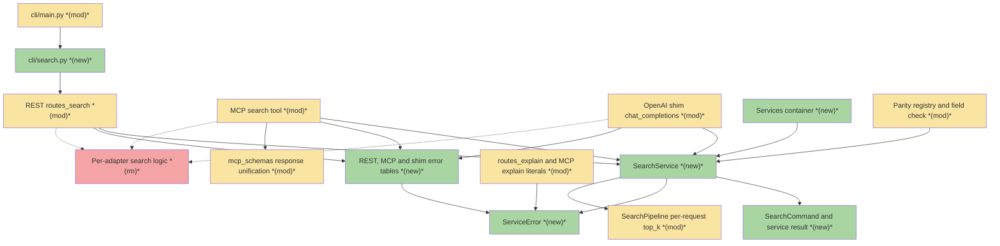
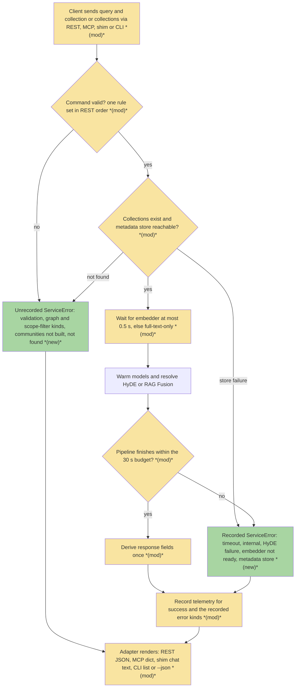
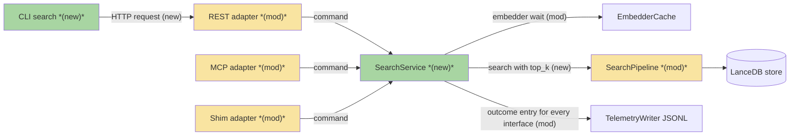
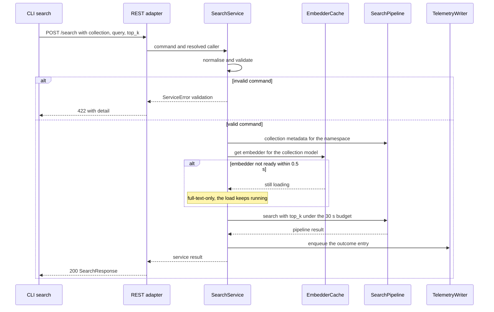

# 01-SEARCH · Search on one implementation across REST, MCP, OpenAI shim and CLI — Team Plan

**How to read this file**

- **Architecture approach:** Clean Architecture — the default; no override skill was requested. **Layers:** Presentation · Use Cases · Interface Adapters · Entities · Frameworks & Drivers.
- **Deployment boundary:** client+server. The CLI is an HTTP-only client of the REST server (ADR 20 rule 4: it imports nothing from `services/` or `server/`); REST, MCP and the OpenAI shim are server-side adapters in one FastAPI process. There is no browser frontend, so the **Frontend** role is the **CLI** (Presentation); every other layer, the three server adapters included, is **Backend**.
- The **Frontend, Backend, and Tester** sections are the **depth view** — each role's scope, grouped by layer.
- **Contracts** are logical and authored as linked `.tsp` files (TypeSpec 1.17.0). Internal seams and the MCP tool seam are core-construct `.tsp` files beside this plan, each compiled with `--no-emit`; the two HTTP seams (REST `POST /search`, the OpenAI shim) are TypeSpec HTTP services in the `api-contracts/` folder with an emitted `.openapi.yaml` each. The root [CLAUDE.md](../../../CLAUDE.md) rule (the `tsp_contract/` paragraph) keeps `.tsp` contract files in `tsp_contract/` with the compiled output beside them; the files here are drafts for review and move there at implementation (the Documentation update list names the move).
- **Role tags** (`#frontend-role`, `#backend-role`, `#tester-role`) mark each role-owned section — filter a tag (e.g. in Obsidian) to see one role's whole scope.
- IDs (`S#` scenarios, `C#` contracts, `Q#` questions) are the traceability thread. Vocabulary kept apart on purpose: the brief's decisions are written "brief Q1–Q4" (all resolved), Brief 00's rules "brief C1–C14", the other slices "roadmap S#" (this slice is "roadmap S1"), the roadmap's decisions "roadmap D#"; "row N" is a row of the brief's drift table (rows 1–20) and "D21–D27" are the extra drifts this plan found, continuing that numbering. Plan IDs `S#`, `C#`, `Q#` are never the brief's. No plan question is open: the 25 questions of the first draft, the former Q1 (the shim's `[openai_shim].top_k` key), the two questions that were open afterwards (Q1, how the shim treats a request `top_k`; Q2, a keyword-only signal) and TQ1 (what the CLI's human output shows when a search quietly did less than asked, raised while the task breakdown was grounded and decided as option D) are resolved and kept under Open questions, "Resolved in this revision", as `old Q# → answer → evidence`; the key decision renumbered the other two (former Q2 became Q1, former Q3 became Q2).
- **Tasks** are not in this file — task breakdown is a separate downstream step that consumes this plan.
- **Rule:** change a contract only by team agreement.

---

## Background

Search is implemented three times: REST ([routes_search.py](../../../archon_search/server/routes_search.py), handler at lines 292-658), the MCP `search` tool ([mcp.py](../../../archon_search/server/mcp.py), lines 513-854) and the OpenAI shim ([routes_openai_shim.py](../../../archon_search/server/routes_openai_shim.py), `chat_completions` at lines 152-354). Each calls `SearchPipeline.search` or `search_many` and re-implements validation, collection lookup, embedder selection, HyDE, the time budget, telemetry and response fields around it; the brief counts 20 behavioural differences, several user-visible (an MCP or shim single-collection search hands the embedder cache an unbounded wait where REST gives up after 0.5 seconds and degrades to full-text-only; a `ppr` search over several collections is a 422 on REST and runs silently on MCP; MCP records no telemetry when a search times out). The CLI has no search command. `top_k` is validated on REST and then dropped because the pipeline takes no `top_k`; the shim accepts it and ignores it; MCP has none.

The S0 foundation has landed: the application-service package `archon_search/services/` (search budget, request HyDE, validators, authz policy), the layer boundary test ([test_layer_import_boundary.py](../../../tests/test_layer_import_boundary.py)) and the parity registry ([registry.py](../../../tests/parity/registry.py), already holding a Search row whose CLI claim is a pending waiver for S1). `SearchService`, `ServiceError`, the services container and the adapter error tables do not exist yet; this slice builds them with their first consumer.

---

## Goal

The same query returns the same ordered results, the same derived fields and the same errors on REST, MCP and the CLI; the OpenAI shim runs on the same service and keeps its protocol-specific rendering. One `SearchService` owns validation, collection resolution, embedder selection, warm-up, HyDE and RAG Fusion, the budget, telemetry and derived fields. Operators can run `archon-search search` from a terminal. The parity registry reports Search as covered on REST, MCP and the CLI (the shim is a waived registry row, [registry.py](../../../tests/parity/registry.py) line 1142), and a first field-level parity check proves the interfaces carry the same fields.

---

## Scope

### In Scope

- `SearchService` (single and multi collection), `SearchCommand`, the service result type (`SearchOutcome`), the first `ServiceError` types and the services container, following brief C2–C6.
- Rewiring of REST `POST /search`, the MCP `search` tool and the shim's search path to the service; deletion of the duplicated code in those three files: the telemetry-enqueue wrappers, the dependency-error mapping (see Contradictions: only the surviving catch-alls exist) and the `config is None` fallbacks that exist only for the test harness.
- Resolution of every drift row of the brief (each resolved as written, or explicitly kept with a reason), plus the extra drifts D21–D27 listed under Contradictions.
- Removal of the duplicated literals: `"search failed"`, `"internal_error"`, the six definitions of the valid `graph_mode` set (the `mcp.py` tuple at line 244, the `Literal` in REST search at line 159, the three `Literal` uses in [routes_explain.py](../../../archon_search/server/routes_explain.py) at lines 296, 363 and 383, and `eval/fixtures.py` line 14), the fan-out and `top_k` messages (also repeated in [routes_explain.py](../../../archon_search/server/routes_explain.py) and the MCP explain tool, which roadmap S3 will then reuse), `"collection not found"`, `"Retry-After": "30"`, the REST `top_k` default `5` (`routes_search.py` line 155), the two `_VALID_ACL_SOURCES` copies (`routes_search.py` and `routes_explain.py`, line 84 each; one definition in `constants.py`, because the service builds `acl_gate` once), and the dead `max_fanout` parameter of `SearchPipeline` (stored at `pipeline.py` line 535 and never read): the parameter is deleted with its pass-throughs (`pipeline.py` line 4197, `app.py` line 1434) and its wiring assertions and arguments in `tests/pipeline/test_pipeline_ingest.py`, `tests/server/test_app.py` and `tests/integration/test_multi_collection_search.py`, instead of keeping a duplicate default `8`, which then lives once in `config.py` line 358; `top_k_max=100` exists once (`config.py` line 362) and the adapters already read `config.max_fanout`.
- Clean-up and re-pointing in `mcp.py` and its tests: `_SEARCH_FAILED_DETAIL` and `_SEARCH_FAILED_CODE` (`mcp.py` lines 232-233) do not stay: `search_with_context` imports the one definition of `"search failed"` and `"internal_error"` from `services/`, as do `_EXPLAIN_FAILED_CODE` (line 241) and `_ERR_INTERNAL` (line 277), so `mcp.py` keeps no copy and the literals are defined once (S58); `run_within_budget`, `warmup_for_search` and `SearchBudgetExceeded` are used only by the `search` tool (lines 645-842) and their imports (lines 148-150) are removed (unused, ruff F401); `_SEARCH_TIMEOUT_SECONDS` (line 145) stays because HyDE in `search_with_context` and `explain` uses it (lines 949 and 1122), so the service passes its timeout explicitly and the tests that patch `mcp._SEARCH_TIMEOUT_SECONDS` for `search` are re-pointed (S61); `_VALID_GRAPH_MODES` (line 244) is also used by `explain` (line 1086) and imported by `tests/server/test_be2_ppr_schemas.py` (line 103), so `mcp.py`, that test and the explain check move to the shared valid set in `constants.py` (S61).
- Moved wire codes and the budget constant: `INVALID_SCOPE_FILTER_CODE` and `GRAPH_COMMUNITIES_NOT_BUILT_CODE` leave [schemas.py](../../../archon_search/server/schemas.py) (lines 625-626) for `services/`; `routes_explain.py` (lines 38-39), `mcp.py` (lines 129-132) and `tests/server/test_search_explain_error_contract.py` (lines 37-38) import them today and are re-pointed, with no re-export. `SEARCH_TIMEOUT_SECONDS` ([search_budget.py](../../../archon_search/services/search_budget.py) line 21) moves to `constants.py` so the CLI request timeout can be derived from it without importing `services/` (C8); `search_budget.py`, the adapters and the CLI read it there.
- Stale text after the `max_fanout` removal: besides the assertion at `tests/server/test_app.py` line 339 (`tests/test_app.py` also exists and holds no `max_fanout`), the docstring note at lines 312-315 and the assertion message at lines 340-341 of the same test describe the deleted parameter and are updated.
- Per-request `top_k` (brief Q1): an optional `top_k` on `pipeline.search` and `search_many`, forwarded by REST (whose request field becomes nullable, because omitted means configured), new on MCP and the CLI (`--top-k`); the shim keeps ignoring a request `top_k` by decision (its result count is the `[openai_shim].top_k` key when set and `top_k_return` otherwise, decided below); a candidate pool of at least `top_k` at the 8 pool sites of `search` and `search_many` (the 5 `explain` sites stay unchanged) and a multi-path leg trim of `max(trim, top_k)`; the existing eval gate stays green and new default-lane integration tests prove exact-N (under the preconditions in C3) and prefix stability for N and M that both fit the same pool (45 on the single path, 40 on the multi path; the eval runner is not changed); one separate task at the end of the slice exposes `top_k` on REST, MCP and the CLI at once.
- New CLI command `search` in a new `cli/search.py`, registered in [main.py](../../../archon_search/cli/main.py), using the shared CLI helpers (the request-sending and error-rendering helpers move from `cli/collection.py` into `cli/_helpers.py`); one `--collection` selects the single path, several select the multi path; `--json` prints the response re-serialised in the repo's `--json` format (brief Q4).
- MCP `search` gains `acl_context` and `top_k`; its response gains `embedding_model`, `rag_fusion_applied`, `rag_fusion_queries_used`, `rag_fusion_attempted`, `applied_filters` and `acl_gate` (per result, like REST, through a search-only result schema), so REST and MCP return the same fields.
- The first field-level parity check (brief Q3), the parity registry flip (CLI claim, service method), `BREAKING.md` entries with the migration-guide rows, and the docs listed under Documentation update.
- A pipeline-level assert for `graph_mode="ppr"` combined with any `collections` in `search_many` (REST rejects even one name), like the existing `scope_filter` asserts, so a later caller cannot regress row 6 (C3).
- `str(exc)` guard maintenance: the `GraphCommunitiesNotBuiltError` text is built from the typed `exc.collection` and a message template that the exception exposes as a class constant, so the service does not retype it (wire text unchanged), and the four stale search entries of [test_no_wire_str_exc.py](../../../tests/test_no_wire_str_exc.py) are deleted.
- The adapter-thinness AST test: for `mcp.py` it scans the names used inside the `search` tool body (module-level imports there are legitimate for the other tools); for `routes_search.py` and the shim's search path it scans the whole-module imports.

### Out of Scope

- `search_with_context` (roadmap S2), `explain` (roadmap S3) and `route` (roadmap S4); they reuse the pieces this slice extracts.
- Changes to retrieval algorithms, reranking, fusion or the graph expansion; the only retrieval-behaviour change is per-request `top_k` (the slice also edits `pipeline.py` for the `ppr` guard, the exception message constant and the deleted `max_fanout` parameter, none of which changes retrieval).
- The shim's streaming format and OpenAI envelope (adapter rendering).
- Making `SEARCH_TIMEOUT_SECONDS` configurable (existing `TODO` in [search_budget.py](../../../archon_search/services/search_budget.py)).
- `MultiCollectionRouter`: no search surface uses it (only `route` and `explain`); automatic collection choice is a future iteration.

---

## Acceptance criteria

- The same query returns the same ordered results and the same derived fields through REST, MCP and `archon-search search --json` against a running server (proved by the cross-interface smoke run, S66, which also sends it through the shim).
- Each drift row is resolved as written or explicitly kept, and every changed behaviour has a [BREAKING.md](../../../BREAKING.md) entry.
- [routes_search.py](../../../archon_search/server/routes_search.py), the MCP `search` tool and the shim's search path import none of `archon_search.services.validators`, `archon_search.services.request_hyde`, `archon_search.services.search_budget` or `archon_search.telemetry.entry` (the telemetry entry factories); the REST request-model validators call the service normaliser, which is allowed. No existing test enforces this; the boundary test's allowlist (eight edges, none a search edge) stays unchanged, and a new AST test enforces it: whole-module for `routes_search.py` and the shim's search path, the `search` tool body only for `mcp.py` (S77).
- The shim's existing contract tests ([test_routes_openai_shim_be5.py](../../../tests/server/test_routes_openai_shim_be5.py), [_be6](../../../tests/server/test_routes_openai_shim_be6.py), [_be7](../../../tests/server/test_routes_openai_shim_be7.py), [test_openai_shim_e2e.py](../../../tests/integration/test_openai_shim_e2e.py)) pass unchanged, `TestTopKRequestFieldIgnored` in `_be5` (lines 653-672) included: it keeps asserting that `top_k` is not forwarded, because the shim ignores a request `top_k` by decision (S46); new shim tests cover the metadata-lookup failure and embedder-not-ready.
- The parity registry marks Search as covered on REST, MCP and the CLI; the new field-level parity check passes; the exact-string REST validation tests ([test_e0c_be3_validation.py](../../../tests/integration/test_e0c_be3_validation.py), [test_e2h_t1_ppr_guard_paths_e2e.py](../../../tests/integration/test_e2h_t1_ppr_guard_paths_e2e.py)) still pass; the default suite, `uvx ruff@0.17.3 check .` and the 85% coverage gate pass.
- Both OpenAPI snapshots ([contract](../../../tests/contract/openapi_snapshot.json), [server](../../../tests/server/openapi_snapshot.json)) are regenerated together and differ only where contract C5 says: `SearchRequest.top_k` changes from an integer with default 5 (server snapshot lines 3545-3550) to an `anyOf` of an integer with minimum 1 and null, with no `default` key, plus changed descriptions; the shim is absent from both (neither has a `/v1` path), so C7 does not change them.

---

## What does NOT change

- `search_with_context`, `explain` and `route` behaviour; `pipeline.search_with_context` keeps calling the pipeline without `top_k`; retrieval, reranking, fusion and graph algorithms; the eval harness still builds its pipelines and calls the pipeline without a per-request `top_k`.
- The single-versus-multi visibility: `collection="x"` runs `pipeline.search` with the per-collection embedder, `collections=["x"]` runs `search_many` with the global embedder and excludes model-mismatched collections. The multi-path `embedding_model` stays the global configured model.
- The shim's streaming format, OpenAI envelope, model-name routing (`archon-search` means all collections, `archon-search/<collection>` one; an empty or whitespace-only collection name answers a 404, which is a 503 against a real store today, see S78), `max_fanout` truncation with its warning, and its non-exposure of HyDE, RAG Fusion, graph mode, filters and ACL.
- Existing REST body shapes (plain `ErrorDetail`, coded `{"detail":{"code","message"}}`, the framework validation list); the wire text of every row that is not a drift row.
- MCP filter parameters stay flat and REST's `filters` stays nested; both build the same `SearchFilters`. The superset guard [test_mcp_search.py](../../../tests/server/test_mcp_search.py) keeps protecting this.
- `get_http_request` stays a module attribute of [mcp.py](../../../archon_search/server/mcp.py) and the caller is resolved by the adapter per request (ADR 09, ADR 17); `default_collection` stays in the MCP factory for the six other tools that use it until their slices.
- Telemetry labels (single success `search`, multi success `search_multi`, errors `search`) and the privacy rule (no query text); `SEARCH_TIMEOUT_SECONDS` (30 s) and the 0.5 s warm-up bounds; the `fts_only` rules inside the pipeline; the HyDE and RAG Fusion suppression rules.
- Persisted data: no table, field, migration or store schema version changes. The eight boundary-test allowlist edges (none concerns search).

---

## Known limitations / accepted trade-offs

- **Single and multi path can differ for the same collection** when its embedding model differs from the global one; the CLI exposes this as one versus several `--collection`.
- **Cold-embedder results on MCP `search` and the shim:** after this slice those clients can receive full-text-only results where they used to wait on the embedder cache handoff (REST's 0.5 s bound now applies to their single path); a breaking-change entry says so. `search_with_context` ([mcp.py](../../../archon_search/server/mcp.py) line 934) and `explain` (line 1273) keep the unbounded handoff until their slices. The degrade is already silent on every interface (MCP and the shim through `warmup_for_search`, REST through `warmup.fts_only` or `embedder_cold`) and stays silent (no response field reports a keyword-only answer) by decision (Q2, resolved below): a caller cannot distinguish a keyword-only answer, and a RAG Fusion or graph request dropped under `fts_only` looks like "not requested"; a later slice revisits it (brief Future Iterations). What the server already reports is not hidden: the CLI prints the response's `expansion_warning` (a HyDE or RAG Fusion step that did not run) and `excluded_collections` as notes on stderr (TQ1, decided D), but never a keyword-only note.
- **MCP `search` differs from six other MCP tools** (`ingest_file`, `ingest_directory`, `list_documents`, `delete_document`, `search_with_context`, `explain`) until their slices remove their `default_collection` fallback (brief Q2).
- **The eval gate does not exercise per-request `top_k`** (it only proves the default behaviour is byte-identical: the eval runner builds pipelines with `top_k_return=10` and never passes `top_k`); new default-lane integration tests carry the `top_k` proof (S19–S23, S72, S73).
- The CLI imports the shared `archon_search/constants.py`, as `cli/_helpers.py` already does, for the request timeout and the limits it needs; there is no CLI-private copy of a server limit, the server enforces every limit (`top_k_max`, `max_fanout`) and validates `graph_mode`, and the CLI shows the server's message. Only the excerpt length is a CLI-local constant.
- **The smoke lane is local and pre-release only** (not in PR CI, needs the model cache); the cross-interface comparison with real ranking runs there, and the default suite proves shape, derived fields and errors with stubbed backends (zero-vector ranking).
- No telemetry `origin` dimension: shim, MCP, REST and CLI traffic share the same endpoint labels (brief Future Iterations).
- Field-level parity covers Search only; later slices extend it.
- The pilot's contract (ADR 20) is reviewed after this slice and amended before roadmap S2.
- **A large `top_k` costs latency.** The reranker scores every candidate (`predict` over all pairs, [reranker.py](../../../archon_search/reranker.py) lines 196-229) and the search budget stays a fixed 30 s, so a `top_k` near `top_k_max` can time out on a slow reranker (S72). MCP allows up to `top_k_max` chunks per call, which can fill an agent's context; there is no separate MCP cap.
- **`acl_gate` adds `sidecar_path`, `source` and `warnings` to the MCP `search` response** ([schemas.py](../../../archon_search/server/schemas.py) lines 959-978; MCP feeds LLM agents). This is parity with MCP `explain` and REST, not a new exposure: MCP `explain` already returns the same `acl_gate` on every candidate, not opt-in ([routes_explain.py](../../../archon_search/server/routes_explain.py) lines 192 and 215-220; [mcp.py](../../../archon_search/server/mcp.py) lines 1200 and 1316 build `ExplainResponse`), the allowed principals already ship per result as `acl` on REST and on MCP ([mcp_schemas.py](../../../archon_search/server/mcp_schemas.py) line 65), and REST returns all of it to the same authenticated callers. On `search` it is opt-in (`acl_context`) under the same authorization; `sidecar_path` is relative to the collection root, or the bare file name when the sidecar lies outside it ([pipeline.py](../../../archon_search/pipeline.py) lines 850-858). No redaction in this slice.
- **The shim's truncation beyond `max_fanout` drops collections in store order** and only logs a warning ([routes_openai_shim.py](../../../archon_search/server/routes_openai_shim.py) lines 223-229); a chat client cannot tell which collections were left out.

---

## Approach & architecture

Clean Architecture, applied to a repo with no layer folders: `archon_search/services/` is the **Use Cases** home. `SearchService` takes a resolved caller and a command, runs the brief's canonical flow once, and raises `ServiceError` for every failure; REST, MCP and the shim shrink to converting transport input into a command and a result or error into their wire form, each with one error table. The CLI stays outside the process boundary and calls REST. The boundary test (rules 1–4) and the parity registry keep the direction checkable; the slice adds a field-level parity check and an adapter-thinness check. Implementation order, the input of the task breakdown: characterization tests first, then the service extraction with no behaviour change, then the row flips one at a time, and per-request `top_k` last.

### Architecture

_Scope limited to changed nodes only: the full component set (about 45 components) is far above 15 nodes and the 1-hop expansion also exceeds the limit. Changed components that share a file or role are drawn as one node and listed separately in the table below; unchanged components (the budget, HyDE and validator modules, embedder cache, telemetry writer, store, filters, configuration, the other adapters) are omitted. The dotted edges show the last known connection of the removed logic. Edges are illustrative: the three server adapters also use the unchanged `services/` modules through the service, and the edge from the explain literals to the service error stands for the shared constants (wire text beside the error in `services/`; limits and valid sets in `constants.py`)._

| Component | Change | Why |
|-----------|--------|-----|
| `SearchService` (new module under `archon_search/services/`) | new | One implementation of the brief's canonical flow for REST, MCP and the shim |
| `SearchCommand` and the service result `SearchOutcome` | new | Transport-free input and output of the service; derived fields computed once |
| `ServiceError` with its kinds and fixed wire constants | new | One translation of every failure; replaces the per-handler `except` ladders |
| REST, MCP and shim error tables | new | One table per adapter rendering a `ServiceError` to its wire form |
| Services container | new | One `SearchService` class and code path for the three adapters; each adapter builds its own instance (REST and the shim per request from `request.app.state`, there is no lifespan instance; the MCP factory lazily from its existing arguments) |
| `cli/search.py` | new | The `archon-search search` command, an HTTP client of REST |
| [main.py](../../../archon_search/cli/main.py) | modified | Registers the new command |
| [routes_search.py](../../../archon_search/server/routes_search.py) | modified | Shrinks to request conversion (the Pydantic request model stays as transport parsing and its validators call the service normaliser; `top_k` becomes nullable), caller resolution and rendering; the telemetry, HyDE-failure and embedder-wait helpers and the `_VALID_ACL_SOURCES` copy are removed |
| [mcp.py](../../../archon_search/server/mcp.py) | modified | `search` shrinks the same way; gains `top_k` and `acl_context`; loses its default collection and the `config is None` fallbacks; resolves the caller with `_get_request_identity` (the service needs the `AuthIdentity`); builds the service lazily on its first call (with no config it answers the fixed internal error and logs a distinct error event, C1). Helpers that other tools use stay until their slices: `_enqueue_internal_error` and `_validate_scope_filter` (`search_with_context`, `explain`), `_resolve_embedder` (`search_with_context`, ingest tools), `_resolve_embedder_by_model` (`explain`), `_SEARCH_TIMEOUT_SECONDS` (HyDE in `search_with_context` and `explain`), `default_collection`. Removed from the module: `_SEARCH_FAILED_DETAIL` and `_SEARCH_FAILED_CODE` (the other tools import the services constants), the `run_within_budget`, `warmup_for_search` and `SearchBudgetExceeded` imports (only `search` used them) and `_VALID_GRAPH_MODES` (moves to `constants.py`; `explain` and `test_be2_ppr_schemas.py` re-point) |
| [routes_openai_shim.py](../../../archon_search/server/routes_openai_shim.py) | modified | Calls the service; keeps model-name routing, truncation, rendering and streaming; strips the collection name and answers 404 for an empty, whitespace-only or invalid name |
| [pipeline.py](../../../archon_search/pipeline.py) | modified | Optional `top_k` on `search` and `search_many` (the only retrieval-behaviour change: the 8 pool sites, the cutoffs, the three `search_many` trim sites and the shortfall warning of `search`; the 5 `explain` pool sites and the `explain` use of the shared trim helper stay unchanged); the `ppr` guard in `search_many`; the message of `GraphCommunitiesNotBuiltError` exposed as a class constant; the dead `max_fanout` constructor parameter deleted |
| [mcp_schemas.py](../../../archon_search/server/mcp_schemas.py), [schemas_openai.py](../../../archon_search/server/schemas_openai.py), [schemas.py](../../../archon_search/server/schemas.py) | modified | MCP response gains six fields (`acl_gate` through a search-only result schema); the shim's `top_k` comment is reworded (the field stays accepted and ignored; the count is the `[openai_shim].top_k` key or `top_k_return`); the two wire-code constants that `services/` cannot import from `server/` move beside the error type in `services/` (`routes_explain.py`, `mcp.py` and `test_search_explain_error_contract.py` import them today and are re-pointed, with no re-export) |
| [routes_explain.py](../../../archon_search/server/routes_explain.py) and the MCP explain tool | modified | Re-point the duplicated fan-out and `top_k` messages, the three `graph_mode` `Literal` uses (lines 296, 363, 383), the explain check of `_VALID_GRAPH_MODES` (`mcp.py` line 1086), the moved wire codes (`routes_explain.py` lines 38-39) and the `_VALID_ACL_SOURCES` copy to the shared definitions; no behaviour change |
| [registry.py](../../../tests/parity/registry.py) and the parity test | modified | CLI claim `search`, service method set, waiver dropped; first field-level check added |
| [app.py](../../../archon_search/server/app.py) | modified | Composition root: `create_app` builds the embedder cache (line 1375) and the lifespan publishes it; the `Retry-After` literals (lines 1535, 1540) use the shared constant; the `max_fanout` pass-through to `SearchPipeline` (line 1434) goes; the MCP factory call is unchanged (it already passes the embedder cache, writer, config and doc-id hasher, lines 1044-1050) |
| [constants.py](../../../archon_search/constants.py) | modified | Home of the shared limits, the `GraphMode` `Literal` alias with the valid set, the valid ACL sources, `SEARCH_TIMEOUT_SECONDS` (moved from `search_budget.py`, which reads it there) and the CLI request timeout derived from it |
| [_helpers.py](../../../archon_search/cli/_helpers.py) and [collection.py](../../../archon_search/cli/collection.py) | modified | The request-sending and error-rendering helpers (`_json_body`, `_server_message`, `_send_or_exit`) move from `collection.py` into `_helpers.py` and gain the coded error shape |
| [test_no_wire_str_exc.py](../../../tests/test_no_wire_str_exc.py) | modified | The four search entries become stale when the handlers move and are deleted |
| Per-adapter search logic | removed | Telemetry-enqueue wrappers, dependency-error mapping, harness fallbacks, MCP default collection, adapter timeout aliases |

**Layer map (and role mapping)**

| Layer | Role | Components |
|-------|------|-----------|
| Presentation | **Frontend** (CLI, Click) | `cli/search.py` (new), [main.py](../../../archon_search/cli/main.py) registration, [_helpers.py](../../../archon_search/cli/_helpers.py); talks to REST over HTTP only |
| Interface Adapters | Backend (Python) | [routes_search.py](../../../archon_search/server/routes_search.py) with `SearchRequest`, `SearchResponse`, `SearchResultSchema`; the MCP `search` tool in [mcp.py](../../../archon_search/server/mcp.py) with [mcp_schemas.py](../../../archon_search/server/mcp_schemas.py); [routes_openai_shim.py](../../../archon_search/server/routes_openai_shim.py) with [schemas_openai.py](../../../archon_search/server/schemas_openai.py); the three error tables; caller resolution in [authz.py](../../../archon_search/server/authz.py) and the MCP identity helper; [embedder_cache.py](../../../archon_search/embedder_cache.py), the telemetry writer |
| Use Cases | Backend (Python) | new `SearchService`, `SearchCommand`, service result, `ServiceError`, services container under `archon_search/services/`; existing [search_budget.py](../../../archon_search/services/search_budget.py), [request_hyde.py](../../../archon_search/services/request_hyde.py), [validators.py](../../../archon_search/services/validators.py), [authz.py](../../../archon_search/services/authz.py); core orchestration in [pipeline.py](../../../archon_search/pipeline.py) |
| Entities | Backend (Python) | [filters.py](../../../archon_search/filters.py) `SearchFilters`, [_types.py](../../../archon_search/_types.py) `SearchResult` (the per-chunk hit), `ExcludedCollection`, [entry.py](../../../archon_search/telemetry/entry.py) `TelemetryEntry` and its enums |
| Frameworks & Drivers | Backend (Python) | [store.py](../../../archon_search/store.py) (LanceDB), [config.py](../../../archon_search/config.py), FastAPI / FastMCP / Click / httpx, the composition root [app.py](../../../archon_search/server/app.py) |

The repo's own docs use a different layer vocabulary ([110_component_catalog_and_layer_breakdown.md](../../Architecture/110_component_catalog_and_layer_breakdown.md)); the labels above are this plan's Clean Architecture classification. The guard tests (boundary, parity, `str(exc)` on the wire, adapter thinness) are cross-cutting and own no layer.

**What changes**

- `services/` gains the search service, its command and result types, `ServiceError` and a container; it may import core modules and nothing from `server`, `cli`, `fastapi`, `starlette`, `fastmcp`, `click`, `httpx` or `uvicorn`, and no module-level `anthropic` (ADR 20 rule 1). Consequence: the REST, MCP and shim wire schemas and the two wire-code constants now in [schemas.py](../../../archon_search/server/schemas.py) cannot be returned or imported by the service; the service returns raw core types and adapters build their schemas.
- Each adapter resolves the caller, builds a command, calls the service, and renders the result or error through its own table; the CLI renders REST's statuses and bodies.
- The pipeline gains an optional `top_k` on both entry points; callers that do not pass it behave byte-identically.
- The MCP response, input schema and tool description change (six response fields, `top_k`, `acl_context`, no default collection, `ppr` accepted in the description).
- The telemetry decision moves into the service: every outcome in scope is recorded once, for every interface.
- Tests that string-patch adapter aliases (`_SEARCH_TIMEOUT_SECONDS` on REST, the shim and MCP `search`; `_EMBEDDER_LOAD_WAIT_TIMEOUT_SECONDS` on REST) re-point to the service (the MCP module alias stays for HyDE in the other tools, so a stale patch would silently do nothing, S61); the MCP factory keeps its signature and builds the service lazily on the first `search` call from its existing arguments (`mcp.py` lines 457-473), and REST and the shim keep reading `request.app.state` per request, so the tests that call the factory without a config (for the other tools) and the ones that swap `app.state` objects after app creation keep working; tests that call `search` need a collection and a real config (S61).

**Key decisions (from the brief)**

- Brief Q1: `top_k` is real, a separate task at the end; the existing eval gate stays green and new integration tests prove exact-N (under its preconditions) and prefix stability within the default pool; the s313 test is rewritten, not re-pinned.
- Brief Q2: a collection is required everywhere; MCP loses its default. The shim's model-name mapping is adapter policy.
- Brief Q3: the first field-level parity check compares command fields against the REST request schema, the MCP input schema and the CLI options, with an explicit mapping for nested versus flat filters.
- Brief Q4: the CLI prints one line per result on stdout (rank, score, collection, source path, excerpt at a named constant of about 200 characters with whitespace collapsed); no excerpt flag; after the results it writes notes to stderr (TQ1, decided D): one cleaned note with the server's `expansion_warning` when it is present (a requested HyDE or RAG Fusion step did not run) and one cleaned note per entry of `excluded_collections` (name and reason), so a script that counts result lines is unaffected; an all-skipped response still prints `No results found.` on stdout with the reasons on stderr; a keyword-only answer stays invisible (no response field reports it, Q2); `--json` prints the response re-serialised in the repo's format with the same values as the REST body and is unchanged.
- Shim decisions (resolved below): the shim ignores a request `top_k` (accepted for protocol compatibility, never a 4xx) and takes its count from the `[openai_shim].top_k` key or `top_k_return`; no keyword-only signal is added in this slice (an accepted limitation).
- Where defaults or limits conflict between interfaces the REST bounded values win (roadmap D5); validation order and the 422 texts are REST's because clients and tests pin its exact strings (e0c, e2h, `tests/server/test_search_explain_error_contract.py`); the shim keeps its truncation and model mapping as adapter policy.
- Existing tests that pin drifted behaviour are rewritten, not re-pinned (brief C13); characterization tests for the six uncovered behaviours are written first.

### Actors & Use Cases

_Scope limited to change neighbourhood: the full set has 21 nodes (8 actors, 13 use cases). Omitted are the three system actors (embedder cache and warm-up, telemetry writer, metadata store) and the three unchanged use cases (search with context, explain, route), because this slice changes none of their behaviour; the 15 nodes shown are the 10 changed use cases and their 5 actors._

### Flows

#### User Flow

The brief's canonical order, as a client experiences it. Steps whose behaviour changes are tagged; the validation rules, the bounded embedder wait on every interface and the error kinds are the visible changes.

#### Data Flow

#### Sequence

The primary user-facing flow: the new CLI against the single-collection path, including the cold-embedder degrade. MCP and the shim follow the same service steps from their own adapters.

### Prior decisions

| Decision | Rationale | Constraint |
|----------|-----------|------------|
| [ADR 20](../../ADRs/20_application_service_layer_with_enforced_boundaries_and_interface_parity.md) — application-service layer with test-enforced boundaries and interface parity | Features drifted across interfaces with no check | The service and its errors live in `services/` and import no web, CLI or HTTP-client package; `cli/search.py` is HTTP-only and imports only `cli/_helpers`; `services/` is guarded against `str(exc)` on the wire; the Search registry row must claim REST, MCP and the CLI; ADR 20 prescribes a dated Amendment after this pilot (it has no Amendments section yet); its text that adapters keep the timeout aliases ceases to hold here |
| [ADR 11](../../ADRs/11_embedder_cache_bounded_waiter_timeout.md) — embedder cache bounded waiter timeout | A wedged load must not hang every search | `EmbedderNotReadyError` becomes a 503-class `ServiceError`; today the cache's 120 s bound covers only a waiter behind another caller's in-flight load of the same model (the caller that runs the load, queued in the thread pool, is unbounded), and that is the only limit on the MCP and shim single-path handoff; after S1 those single paths wait 0.5 s like REST; the service's 0.5 s wait is a separate layer and must never cancel the loader or touch its registration |
| [ADR 08](../../ADRs/08_per_collection_embedder_lru_cache.md) — per-collection embedder LRU cache | Per-collection models need bounded memory | The single path selects the collection's embedder only through the cache; the multi path uses the global embedder; the service never builds embedders |
| [ADR C4](../../ADRs/C4-hyde-external-llm-dependency.md) — HyDE (partly superseded by ADR 19) | Opt-in, availability over quality | Silent fallback only; never log or record the query or hypothesis; no module-level `anthropic`; do not reintroduce a 422 for a missing package |
| [ADR C5](../../ADRs/C5-rag-fusion-external-llm-dependency.md) — RAG Fusion, exclusive with HyDE (partly superseded by ADR 19) | Reformulation needs an LLM; cost control | The service, not the pipeline, owns HyDE and RAG Fusion resolution and the "RAG Fusion wins" suppression; the MCP response gains the RAG Fusion fields |
| [ADR 19](../../ADRs/19_shared_llm_client_and_provider_based_collection_descriptions.md) — one shared LLM client | Duplicated provider stacks failed silently | The dependency-error classes and their 422 are gone and must not return; client-abort cancellation of the search and its provider call must keep working through the service (it must not swallow `CancelledError`) |
| [ADR 05](../../ADRs/05_opt_in_local_telemetry_no_raw_query.md) — opt-in local telemetry, no raw query | Privacy is structural | The service builds entries only through the existing factories, with no query text, using the same doc-id hasher on every interface that records document ids (the single path; the multi-path factory has no such parameter and stays unchanged); the container carries the writer and hasher |
| [ADR 09](../../ADRs/09_mcp_http_mount_and_namespace_propagation.md) — MCP mounted in the same app (partly superseded by ADR 17) | One process; namespace per request | The MCP adapter keeps resolving the caller per request and refuses a missing identity before the service is called; MCP response changes do not touch the OpenAPI snapshots |
| [ADR 17](../../ADRs/17_mcp_namespace_via_public_get_http_request.md) — public `get_http_request` | Public API, no private context | `get_http_request` stays a module attribute of `mcp.py`; resolution stays in the adapter. Its fallback text contradicts the code (see Contradictions) |
| [ADR 04](../../ADRs/04_multi_collection_router_with_centroid_preranking.md) — multi-collection router | Bound query cost as collections grow | `max_fanout` is the single source of the fan-out limit (service validation and shim truncation; the adapters already read `config.max_fanout`); the router is not wired into the service |
| [ADR 03](../../ADRs/03_cross_encoder_reranker_second_stage.md) — cross-encoder reranker | Precision at the top of the list | Per-request `top_k` touches the retrieve/return relationship: the pool is raised to at least `top_k`, the existing eval gate stays green and new integration tests prove exact-N (with its preconditions) and prefix stability while N and M fit the same pool (45 on the single path, 40 on the multi path); reranking itself is unchanged (it scores every candidate, so a large `top_k` costs latency and, beyond that pool, can change the ranking) |

### Contradictions

**Code vs. docs**

- [120_services_and_integration_architecture.md](../../Architecture/120_services_and_integration_architecture.md) line 57 gives the multi-collection metadata failure as `{"detail": "service unavailable"}`; the code constants ([pipeline.py](../../../archon_search/pipeline.py) `METADATA_STORE_UNAVAILABLE_DETAIL` and `_CODE`) answer `"service unavailable: metadata store could not be reached"` with code `metadata_store_error`, which [140_error_handling_strategy.md](../../Architecture/140_error_handling_strategy.md) line 83 and [600_api_reference_or_public_interface.md](../../Architecture/600_api_reference_or_public_interface.md) lines 213 and 471 already state. Owner: **doc needs updating** (the sanitized-wire-text doc test does not cover 120: `tests/test_sanitized_wire_text_docs.py` requires the literal in 600, 140, `160_troubleshooting`, the incident runbook and `06_error_handling`).
- [600](../../Architecture/600_api_reference_or_public_interface.md) line 197 documents REST's `POST /search` bounds (S290) and [120](../../Architecture/120_services_and_integration_architecture.md) line 69 documents the `warmup_for_search` stage that MCP and the shim also call (`mcp.py` lines 645 and 760; the shim's two calls); both are accurate for what they describe. The real difference is one stage earlier: REST wraps the embedder cache handoff in its own 0.5 s bound ([routes_search.py](../../../archon_search/server/routes_search.py) lines 59-77), while MCP's `_resolve_embedder` and the shim's own `_resolve_embedder` wait on the cache unbounded. `make_embedder` is lazy (no weights load, [embedder.py](../../../archon_search/embedder.py) line 244); the weights build in the bounded warm-up. The cache's own 120 s bound (`embedder_cache.py` lines 94-127, the constant at line 23) covers only a caller that waits behind another caller's in-flight load of the same model; the caller that runs the load itself, queued through `asyncio.to_thread` (line 145), has no bound. [140](../../Architecture/140_error_handling_strategy.md) line 84 states the cache bound and [03_breaking_changes_index.md](../../MigrationGuide/03_breaking_changes_index.md) NR-4 already describes the warm-up behaviour. The brief decides the parity of the handoff (row 8). Owner: **code is the issue**, fixed by this slice; 600 and 120 each get a sentence on the handoff (Documentation update).
- The MCP `search` tool description in [mcp.py](../../../archon_search/server/mcp.py) (lines 531-535) lists `naive`, `local` and `global` only, and so do the inline comments at lines 552 and 1085, while `_VALID_GRAPH_MODES` (line 244) already lists `ppr`, the code accepts it and [65_graph_search.md](../../UserManual/65_graph_search.md) documents it. Owner: **doc needs updating** (the tool description reaches clients; edit it with the new parameters).
- [test_mcp.py](../../../tests/test_mcp.py) lines 614-624 skip `ppr` with `collections` with a comment that MCP rejects it before HyDE; MCP does not (the pipeline's multi path returns `ppr_entities_matched=0`). The docstring of the missing-collection test in [test_mcp_error_paths.py](../../../tests/integration/test_mcp_error_paths.py) (about lines 98-107) says the single path falls through to `internal_error`; the code answers `not_found`. Owner: **doc needs updating** (test comment and docstring; rewritten per brief C13).
- [ADR 17](../../ADRs/17_mcp_namespace_via_public_get_http_request.md) says a missing request or a request without a namespace resolves to the default namespace; the code (`_get_request_identity` in [mcp.py](../../../archon_search/server/mcp.py)) fails closed with a fixed `ToolError`, matching the brief's row 19 (see also [test_mcp_fail_closed.py](../../../tests/server/test_mcp_fail_closed.py)). Owner: **doc needs updating** (a dated Amendment, the ADR pattern).
- Docs that describe `top_k` as validated but ignored, MCP as defaulting its collection, and the MCP response as a deliberately narrower envelope ([600](../../Architecture/600_api_reference_or_public_interface.md) lines 193, 533, 558-566; [60_searching.md](../../UserManual/60_searching.md) lines 12 and 119; [05_mcp_integration.md](../../DeveloperGuide/05_mcp_integration.md) lines 21, 25, 39, 43, 112; [85_openai_compatible_api.md](../../UserManual/85_openai_compatible_api.md) lines 22 and 27; [03_breaking_changes_index.md](../../MigrationGuide/03_breaking_changes_index.md) NR-2; [06_client_migration_examples.md](../../MigrationGuide/06_client_migration_examples.md) lines 15 and 146; [530](../../Architecture/530_technical_debt_refactoring_roadmap.md) API-2; [openapi-openai-shim.yaml](../../../tsp_contract/openapi-openai-shim.yaml) line 99; the `top_k` comment in [schemas_openai.py](../../../archon_search/server/schemas_openai.py)) describe today's code correctly and become stale when this slice lands. Owner: **doc needs updating** (listed under Documentation update).
- [520_api_design_and_contracts.md](../../Architecture/520_api_design_and_contracts.md) says MCP and REST "share internal services" (line 14) and advises documenting an asymmetry rather than forcing parity (line 98). The first becomes true here; the second is reversed by this slice. Owner: **doc needs updating**.
- More statements that change with this slice: [90_incident_runbook.md](../../OperatorGuide/90_incident_runbook.md) line 95 (a metadata-store 503 emits no telemetry entry; the telemetry decision now records it as `internal_error`/`other`) and line 94 (the S299 sentence bounds the per-collection embedder handoff for `POST /search` only and ends with the cache's own 120 s wedge sentence; after S1 the MCP and shim single paths share that bound, and the 120 s sentence must read as the limit for a waiter behind another caller's load); [120_telemetry.md](../../UserManual/120_telemetry.md) line 35 (says the REST `/search` route is not instrumented, which the code already contradicts: `routes_search.py` builds entries at lines 117, 428 and 594); [60_searching.md](../../UserManual/60_searching.md) line 186 (`applied_filters` is REST only) and line 348 (`acl_context` and `acl_gate` are REST only); [85_openai_compatible_api.md](../../UserManual/85_openai_compatible_api.md) line 123 (says config-enabled HyDE and RAG Fusion apply to the shim, but `routes_openai_shim.py` never uses a HyDE or RAG Fusion generator; its calls to `search` and `search_many` pass neither); [30_configuration.md](../../UserManual/30_configuration.md) line 299 (the `[openai_shim].top_k` key documented as inert); the root [CLAUDE.md](../../../CLAUDE.md) line 30 (enumerates the `services/` modules like AGENTS.md line 65). Owner: **doc needs updating** (listed under Documentation update).

**Brief vs. reality** (owner: the evidence given; every item below is answered, and no question is open: the last two were decided and are recorded in the Open questions section; the answers were applied to the brief)

- **S0 deliverables already exist.** `archon_search/services/` (four modules), the boundary test and the parity registry landed; the registry's Search row has `service_method` unset and a pending CLI waiver for slice S1 ([registry.py](../../../tests/parity/registry.py)); the shim is already claimed with a waiver. Answered: this slice edits them. Missing are `SearchService`, `SearchCommand`, `ServiceError`, the container and the adapter tables.
- **Stale line references.** REST handler lines 292-658 (first-draft brief: 301-695); MCP tool 513-854 (first-draft brief: 520-865); shim `chat_completions` 152-354 (first-draft brief: ~250-345); the pipeline `scope_filter`/`graph_mode` asserts in `search_many` sit near lines 3367, 3453 and 3498 of [pipeline.py](../../../archon_search/pipeline.py) (first-draft brief: ~3319-3455); the `ppr` skip is in [test_mcp.py](../../../tests/test_mcp.py) lines 614-624 (first-draft brief: 646-670). Answered; no behaviour impact, and the brief now carries the corrected values.
- **The service result name collides.** [_types.py](../../../archon_search/_types.py) already defines the per-chunk `SearchResult`, imported by 32 files, 4 of them in the package (counted with `grep -rlP "^\s*from archon_search\._types import .*\bSearchResult\b|^\s+SearchResult,?\s*$" archon_search tests`, which also catches the multi-line import form); the brief's service-level `SearchResult` needs another name. Answered: `SearchOutcome`, holding the raw pipeline hits plus the derived fields.
- **The HyDE and RAG Fusion dependency errors no longer exist.** The brief lists them among the `except` clauses to move; ADR 19 removed `HyDEDependencyError` and `RAGFusionDependencyError`, and a search of `archon_search/` finds no such class (only unrelated community and graph-ML dependency errors). A HyDE generator failure reaches the generic failure path. Answered: the service has no dependency-error kind and none may be reintroduced (D24 covers the surviving shapes).
- **Validation order and the REST validation seam.** The brief calls its step-1 order "REST's order today", but REST validates the query, the collection selection and the `graph_mode` value in the Pydantic request model first (framework-shaped 422), and its handler then checks fan-out, `top_k` above the maximum, `scope_filter` syntax, `scope_filter` with `graph_mode`, `ppr` with collections and graph-enabled, in that order (graph-enabled last; `routes_search.py` lines 301-338). Answered: the canonical order is the actual handler order (now written in the brief's Core Flow step 1 and row 5), and REST keeps its request model as transport parsing while the rules live once in the service, so the framework 422 list and every exact string stay.
- **The acceptance line on the boundary allowlist is vacuous and the import clause has no test.** None of the eight allowlist edges concerns search (`mcp.py` → `routes_explain` belongs to roadmap S3), and rule 2 forbids only `routes_*` and `server.mcp` imports, so nothing asserts that the three adapters import no HyDE, budget, validator or telemetry-building code. Answered: a separate AST test, scoped as in S77, because `mcp.py` keeps `RequestHyDE`, budget and `TelemetryEntry` imports for `search_with_context` and `explain` (lines 143-160) and a whole-module check would be unsatisfiable.
- **The shim's embedder-not-ready is already a 503.** The brief says neither failure is wrapped; the app-level handler in [app.py](../../../archon_search/server/app.py) (line 1507) already answers `/v1/*` with an OpenAI 503 and `Retry-After: 30`. Only the collection-list lookup failure on the all-collections model is truly unwrapped (a plain 500, D22). Answered: the shim gains defined behaviour for the lookup failure; for embedder-not-ready the behaviour is kept and moves into the service, with the new test the brief asks for.
- **The shim records no telemetry at all** (success included), not only on timeout; row 10's canonical "recorded for every outcome" therefore starts recording shim traffic. Answered: shim traffic is recorded with the same labels, with a BREAKING note ("operators with telemetry on now see shim searches in their stats"). MCP records only the generic internal failure today.
- **Row 8 is narrower than written.** Only the single path's embedder-cache handoff is unbounded on MCP and the shim (the weights build later in the bounded warm-up, which both already call); their multi paths are already bounded. Row 9 is single-path only on MCP (its multi path already returns `metadata_store_error`). Row 20: only MCP's single path passes the namespace positionally. Answered.
- **Telemetry labels are verified** (the brief marks them unverified): REST and MCP agree; single success `search`, multi success `search_multi`, every error entry `search` even on the multi path (D27). Answered: keep today's labels.
- **The eval gate never passes a per-request `top_k`**: the eval runner builds pipelines with a fixed return count (`top_k_return=10`, [runner.py](../../../archon_search/eval/runner.py) lines 701-702 and 842-843) and calls the pipeline without it, so the brief's "must pass the eval gate" proves only that the default is unchanged. REST's `top_k` schema default is 5, which would override an operator's configured `top_k_return` once `top_k` is real. Answered: the existing gate stays green plus new integration tests (prefix stability, exact-N); omitted `top_k` means `top_k_return` and the schema default goes away.
- **The CLI has no shared request or error-render helper.** The brief says the command uses "the shared CLI helpers from S0"; [_helpers.py](../../../archon_search/cli/_helpers.py) holds the key resolver, default URL, connection-failure message and the text cleaner, but the request-sending and error-rendering helpers are private to [collection.py](../../../archon_search/cli/collection.py), and a command may import no other command module. The brief also leaves implicit that the CLI calls REST over HTTP; ADR 20 rule 4 and the roadmap require it. Answered: the helpers move into `_helpers.py`, as S0 did for the key resolver.
- **`acl_gate` and the shared MCP result schema.** The brief says the MCP response "gains `acl_gate`" without saying per result (REST) or top level, and `McpSearchResultSchema` is shared with `search_with_context`, so a per-result field would change roadmap S2's response. Answered: per result like REST, through a search-only schema or subclass, so `search_with_context` is unchanged.
- **The valid-`graph_mode` set is defined in more places than three**: six definitions (the `mcp.py` tuple at line 244, the `Literal` in REST search at line 159, REST explain's request at line 296 and its two response `graph_mode_applied` annotations at lines 363 and 383, and `eval/fixtures.py` line 14), plus the pipeline's type annotations; the REST OpenAPI enum must stay `naive`, `local`, `global` and `ppr`. The `mcp.py` tuple is also used by `explain` (line 1086) and imported by `tests/server/test_be2_ppr_schemas.py` (line 103). Answered: one `GraphMode` alias and valid set in `constants.py`; the explain check and that test re-point.
- **Deletion in `mcp.py` is partial.** `_SEARCH_FAILED_DETAIL` and `_SEARCH_FAILED_CODE` are also used by `search_with_context` (line 1037) and do not stay in `mcp.py`: it imports the services constants (as do `_EXPLAIN_FAILED_CODE` and `_ERR_INTERNAL`), so each literal is defined once; `_enqueue_internal_error` and `_validate_scope_filter` are used by `search_with_context` and `explain`; `_resolve_embedder` by `search_with_context` and the ingest tools; `_resolve_embedder_by_model` by `explain`; `_SEARCH_TIMEOUT_SECONDS` by HyDE in `search_with_context` and `explain` (lines 949 and 1122). The ingest tools use only `_internal_error` and `_resolve_embedder`. Those helpers stay until their slices, and the other tools' `config is None` fallbacks stay. The imports `run_within_budget`, `warmup_for_search` and `SearchBudgetExceeded` serve only `search` (lines 645-842) and are removed. Answered.
- **`SearchPipeline(max_fanout=...)` is dead.** The constructor stores it (`pipeline.py` line 535) and nothing reads `_max_fanout`; `tests/server/test_app.py` line 312 calls it write-only and asserts it only "for wiring parity" (`tests/test_app.py` also exists and holds no `max_fanout`). The brief's literal-removal item would otherwise have to keep a second default `8` in sync with `config.py` line 358. Answered: the parameter is deleted (constructor, store, `pipeline.py` line 4197, `app.py` line 1434) with the assertions in `tests/pipeline/test_pipeline_ingest.py` (lines 971, 993, 1021), `tests/server/test_app.py` (line 339, with the stale docstring at lines 312-315 and message at lines 340-341) and the arguments in `tests/integration/test_multi_collection_search.py` (line 68) and `tests/pipeline/test_pipeline_ingest.py` (line 967).
- **Extra drifts the brief's table omits** (all covered by scenarios): D21 MCP's single-path not-found text names the collection while the multi path and REST use the fixed text; D22 the shim's collection-list lookup failure on the all-collections model is a plain 500; D23 shim internal failures are 503 on the single-collection branch while REST is 500 and MCP is `internal_error`, and the fan-out branch has no catch-all, so an unexpected error there is an unhandled 500 ([routes_openai_shim.py](../../../archon_search/server/routes_openai_shim.py) lines 236-267; answered: both branches answer the 503 envelope, the single-collection one is pinned by `test_routes_openai_shim_be5.py` lines 630-649 and `_be7.py` lines 371-390); D24 a REST HyDE failure is a JSON 500 `search failed` while any other pipeline failure is a plain-text 500 (answered: the two stay distinct); D25 embedder-not-ready has two REST mappings (a local single-path handler that records telemetry and stage timings, an app-level handler for the multi path and the shim), MCP maps it only on the single path (the multi path falls to `internal_error`), and the shim relies on the app handler; D26 the `graph_mode` set exists in several places and REST rejects a bad value in the framework, MCP in the handler; D27 telemetry endpoint labels differ between multi success and multi failure. Also observed: REST ORs the top-level `include_metadata` into its telemetry flags while MCP builds them from the built filters (answered: the service ORs it once), and the REST single path records stage timings on its error branches while MCP records them only on success (answered: follow REST).
- **Docs outside the brief's list quote changed behaviour**: [85_openai_compatible_api.md](../../UserManual/85_openai_compatible_api.md), [30_configuration.md](../../UserManual/30_configuration.md), [06_error_handling.md](../../DeveloperGuide/06_error_handling.md), [06_client_migration_examples.md](../../MigrationGuide/06_client_migration_examples.md), [530](../../Architecture/530_technical_debt_refactoring_roadmap.md), ADR 20 and ADR 17. Answered: all are in Documentation update; the migration-guide row the brief names is [03_breaking_changes_index.md](../../MigrationGuide/03_breaking_changes_index.md).
- **The shim's 404 for `archon-search/` holds only with a mock.** `test_routes_openai_shim_be5.py` line 679 stubs `get_collection_meta` to return `None`; the real store raises `ValueError` for an empty or invalid collection name (`store.py` lines 790 and 1153), the shim's catch-all answers a 503 (`routes_openai_shim.py` lines 284-285) and REST answers a 503 `metadata_store_error` (`routes_search.py` lines 461-467), which the service must not confuse with a metadata-store outage. Answered: the service checks `is_valid_collection_name` first and answers `not_found`; the shim answers 404 for an empty, whitespace-only or invalid name; a `BREAKING.md` entry; S11, S29 and S78 test it against the real app.
- **Where the new CLI doc lives is unspecified** — no per-command CLI doc exists. Answered: a CLI section in `UserManual/60_searching.md` plus the CLI row in 600, no new page.

---

## Contracts / seams

Boundaries where roles must agree. **Logical, not code.** Changing one requires team agreement. **Tooling used: TypeSpec 1.17.0.** The internal seams (C1–C4), the MCP tool seam (C6: JSON-RPC tool calls, not REST routes, so no OpenAPI, matching the repo's earlier MCP contracts), the CLI command (C8) and the parity check (C9) are core-construct `.tsp` files beside this plan, each compiled clean with `tsp compile <file> --no-emit`. The HTTP/API seams C5 (REST) and C7 (OpenAI shim) are TypeSpec HTTP services in [api-contracts](./api-contracts/package.json) (`npm install` done, `@typespec/openapi3` emitter) with an emitted `.openapi.yaml` each. The two REST OpenAPI snapshots are the runtime copies of C5 and must be regenerated together; the shim is absent from them (disabled by default) and its standing contract is [openapi-openai-shim.yaml](../../../tsp_contract/openapi-openai-shim.yaml).

**C1 — Search command, result and service**  *(Interface Adapters ↔ Use Cases)*
One operation: the service takes a command and a resolved caller (the existing `AuthIdentity`) and returns a result. The command carries the canonical field names of REST's request: the query, exactly one of `collection` or `collections`, an optional `top_k`, the filters, both raw include-metadata flags (the top-level flag and `filters.include_metadata`, as the caller sent them; the service ORs them once, REST's rule), `hyde`, `rag_fusion`, `graph_mode`, `scope_filter` and `acl_context`. The rules live once, in the service normaliser: REST's `SearchRequest` field and model validators (`routes_search.py` lines 170-208) call it (not `services/validators.py`, which holds only the scope-filter syntax check), so the framework 422 list and its exact strings stay. Before any store call the service checks each collection name with `is_valid_collection_name` (`store.py` line 174): the real store raises `ValueError` for an invalid name (`store.py` lines 790 and 1153), which REST answers today as a 503 `metadata_store_error`, so an invalid name is `not_found` and is neither a metadata-store failure nor recorded as one (C2, C4). The result, `SearchOutcome`, holds the raw pipeline hits plus the derived fields: `acl_filtered`, the excluded collections, the effective embedding model (collection model on the single path, global model on the multi path), the HyDE, RAG Fusion and graph flags, `expansion_used`, `expansion_warning`, `applied_filters` and `ppr_entities_matched`, each derived once. `acl_gate` is built once, in the service result: one `AclGate` value per hit (its source sanitised against the valid set, which replaces the two `_VALID_ACL_SOURCES` copies in `routes_search.py` and `routes_explain.py`), only when `acl_context` was requested; adapters only render it. `applied_filters` is `None` in the result (`null` on the wire: the field is present with a null value, `routes_search.py` line 269) when no filter was given, else the filters as parsed: the `SearchFilters` after validation (`file_type` lower-cased and stripped of leading dots, dates coerced; `filters.py` lines 43-53 and 86-88), a nested `filters.include_metadata` included (REST echoes the parsed `body.filters`, `routes_search.py` line 625, and its output does not change); the top-level `include_metadata` flag is not part of it (MCP today builds a filter object even when empty, `mcp.py` lines 733-744). The canonical order is the brief's Core Flow; nothing transport-specific is accepted or raised. The service carries what it needs (pipeline, configuration, embedder cache, HyDE and RAG Fusion generators, telemetry writer, doc-id hasher). It is one class and one code path, not one object: REST builds the service per request from `request.app.state` (there is no lifespan instance, and tests build a `TestClient` without the lifespan and swap `app.state.pipeline` after creation, `tests/server/test_routes_search.py` lines 32-48), the shim does the same (`routes_openai_shim.py` lines 170-171), and the MCP factory keeps its signature and builds the service lazily on the first `search` call from its existing arguments, because 135 test files reference the factory and several call it without a config (for example `tests/server/test_mcp_ingest_503.py` line 19, which uses only ingest tools), which an eager build would break. With no config `search` answers the fixed internal error (`search failed`, code `internal_error`), logs a distinct error event and leaves the other tools unaffected; only tests reach that branch, because `app.py` always passes the config (line 1044), and `tests/contract/test_mcp_search_response_shape.py` line 46 (`search(collection=None)` on a factory without a config) fails both new rules and is rewritten (S61). The absent-cache fallback to the global embedder stays (`routes_search.py` lines 538-541). The embedder cache is built in `create_app` (`app.py` line 1375) and published in the lifespan (line 725); the telemetry writer and the doc-id hasher are lifespan-built (lines 997 and 1017). Brief 00 C2 ("built once at startup") needs an amendment note. See [01_search-c1-search-service.tsp](./01_search-c1-search-service.tsp).

**C2 — ServiceError and the adapter error tables**  *(Use Cases ↔ Interface Adapters)*
One closed set of kinds, each with a stable wire code, a fixed sanitized detail (never an exception's text), a telemetry mapping (Brief 00 C5; the table below the error table) and, for embedder-not-ready, one `Retry-After` constant (30 s) replacing the literals in REST (`routes_search.py` line 640) and the app handler (`app.py` lines 1535 and 1540). The wire constants (the two codes now in `server/schemas.py`, `search failed`, `internal_error`, `collection not found`) sit beside the error type in `services/` (Brief 00 C8); limits and valid sets live in `constants.py`. The graph-communities-not-built detail is built from the exception's typed `collection` and a message template that `GraphCommunitiesNotBuiltError` exposes as a class constant (`pipeline.py` lines 218-226), not retyped in the service. Each adapter owns one table; existing REST body shapes are preserved unless a drift row changes them. Brief decisions in the table are the MCP and shim cells marked changed. One detail per kind means MCP's texts change where they differ from REST's: `graph_disabled` (`mcp.py` line 558 lacks "in server config"), the scope-plus-graph text (line 567) and the whitespace-name text (line 602) become the shared ones, and MCP's check order (graph enabled before the `scope_filter` rules, lines 553-570) becomes REST's; this is a `BREAKING.md` entry (S62). A name that is not a valid collection name is `not_found` (checked first in the service, C1); today REST and the shim answer a 503 for it and MCP's single path does not handle it specifically.

| Kind | REST (unchanged unless marked) | MCP code | Shim (OpenAI envelope) |
|------|-------------------------------|----------|------------------------|
| validation (query, selection, fan-out, `top_k` bounds, `ppr` with collections, filter values) | 422: framework list for Pydantic-detected input (REST keeps its request model as transport parsing and its validators call the service normaliser); plain `{"detail": text}` for fan-out, `top_k` above the maximum, `ppr` with collections | `validation_error` (now also `top_k`, `ppr` with collections, empty query) | not exposed; a request `top_k` is accepted and ignored, so there is no out-of-range `top_k` 400 (decided); its own 400 and 422 for "no user message" stay |
| invalid_graph_mode | framework 422 (`Literal`) | `invalid_graph_mode` | n/a |
| graph_disabled, scope_filter_graph_mode_incompatible | 422 plain | same-named codes | n/a |
| invalid_scope_filter | 400 coded | `invalid_scope_filter` | n/a |
| graph_communities_not_built | 422 coded (text built from the typed `exc.collection` and the exception's class-constant template; wire text unchanged) | `graph_communities_not_built` | n/a |
| not_found (a name that is not a valid collection name included) | 404 `{"detail":"collection not found"}` (an invalid name was a 503 `metadata_store_error`) | `not_found` with the fixed text on both paths (single path no longer names the collection) | 404; both existing texts kept (an empty, whitespace-only or invalid name was a 503 against a real store) |
| metadata_store_error | 503 `{"detail","code"}`, no `Retry-After` | `metadata_store_error` (now also the single path) | 503 "Service temporarily unavailable." (now also the all-collections list lookup) |
| embedder_not_ready | 503 `{"detail","code"}` with `Retry-After` | `embedder_not_ready` (now also the multi path) | 503 with `Retry-After` |
| timeout | 504 "Search timed out" | `timeout` "search timed out" | 504 "Request timeout." |
| internal, hyde_failed | 500: plain text for `internal`, JSON `search failed` for `hyde_failed` (the two shapes stay distinct) | `internal_error` "search failed" | 503 envelope on both branches (the fan-out branch had no catch-all) |

Telemetry per kind (C4): the service records a kind through the existing `TelemetryEntry.from_error`; validation-class kinds are not recorded.

| Kind | Recorded | Entry status / error kind |
|------|----------|---------------------------|
| timeout | yes | `timeout` / `timeout` |
| internal, hyde_failed, embedder_not_ready, metadata_store_error | yes | `internal_error` / `other` |
| validation, invalid_graph_mode, graph_disabled, scope_filter_graph_mode_incompatible, invalid_scope_filter, graph_communities_not_built, not_found (an invalid collection name included) | no | none (REST records nothing for them today; for communities not built see `routes_search.py` lines 642-646) |

The CLI has no service table; it renders REST's statuses and the three REST `detail` shapes (string, list, coded) through the helpers moved into `cli/_helpers.py`, and shows a 503 `Retry-After` in seconds. A missing identity is answered first, in production, by `APIKeyMiddleware` with a bodyless 401 (`middleware_auth.py` line 152, `_unauthorized`), which the shim's `OpenAI401Middleware` rewrites into the OpenAI envelope for `/v1`; the adapter-level refusals are a second line reachable only where the middleware is absent (a route mounted without it, as the tests do): REST's `caller_identity` 401 `authentication required` ([authz.py](../../../archon_search/server/authz.py) lines 40-45), the shim's OpenAI 401 envelope and MCP's fixed `ToolError`, each before the service is called (S17); the CLI therefore sees a bare 401 with an empty body and prints its own fixed text. Because a `ServiceError` carries no exception, the service (not the adapters) logs the failure events where the exception is in hand, for every interface and both paths: ERROR `search_pipeline_failure` with `exc_info` for `internal` and `hyde_failed`, ERROR `search_timeout` with `collection` (or `collections`) in `extra`, the exception with its traceback for `metadata_store_error` and a warning for `embedder_not_ready`; the query text is never logged. The adapters log nothing for these kinds, so no interface loses an event that REST, MCP and the shim log today (pinned by `tests/server/test_routes_search_telemetry.py`, `tests/server/test_routes_search.py` and `tests/server/test_no_internal_error_leak_*.py`, documented in [140_error_handling_strategy.md](../../Architecture/140_error_handling_strategy.md)). See [01_search-c2-service-error.tsp](./01_search-c2-service-error.tsp).

**C3 — Per-request top_k on the pipeline**  *(Use Cases ↔ core pipeline)*
Both pipeline entry points gain an optional `top_k`; absent means today's behaviour exactly (the result count is the configured `top_k_return`, the candidate pool is `max(top_k_retrieve * 3, 20)`, 45 at the default). When present it is the number of results on every site that uses the configured return count (a `grep -n "_top_k_return"` finds them: lines 1691 to 3722, all in `search`, `search_many` and their helpers, none in `explain`): on the single path the standard, RAG Fusion, graph local and global, PPR and hybrid-fallback cutoffs and the shortfall warning in the standard path (`pipeline.py` lines 2224 and 2235 compare the candidate count against `_top_k_return` and use the effective `top_k`); on the multi path the standard, hybrid-fallback and graph cutoffs, the RAG Fusion cutoffs (lines 3256 and 3339) and the global graph cutoff (line 3484); the task lists every cutoff, pool and trim site. The candidate pool `max(self._top_k_retrieve * 3, 20)` appears at 13 sites (`pipeline.py` lines 1635, 1919, 2145, 2212, 2358, 2478, 2734, 2844, 3092, 3210, 3385, 3503 and 3707) and splits in two: the 8 sites of `search` and `search_many` (lines 1635, 1919, 2145, 2212, 3210, 3385, 3503 and 3707; the glob over-fetch multiplies it at lines 3210, 3385, 3503 and 3707) are raised to at least `top_k` (small `top_k` keeps today's pool), while the 5 sites that are `explain` code (lines 2358, 2478, 2734, 2844 and 3092) must stay unchanged, gated by a test (S23). The multi-path per-leg trim `max(self._fanout_leg_trim, 1)` (default 40) sits at four sites: lines 3273, 3388 and 3516 in `search_many` become `max(trim, top_k)`, and line 3776 is in the shared helper `_fanout_merge_acl`, which `explain` also calls (line 2359), so the helper takes the effective `top_k` as an optional parameter that `search_many` passes and `explain` never does. One rule for the pool: it is raised to at least `top_k`, so up to N results return, and exactly N when enough chunks survive the ACL, source-path glob and wildcard-scope post-filters (which run after the pool is fetched, `pipeline.py` lines 1922 and 2215-2222; [130_data_architecture_and_persistence.md](../../Architecture/130_data_architecture_and_persistence.md) line 259 already states the shortfall) and no `fts_only` degrade limits the search. The pool depth feeds each leg's limit (`store.py` lines 3832 and 3848) and the reranker's candidate set, so the ranking may change when `top_k` exceeds the pool; the prefix guarantee (`results(N)[:M] == results(M)`) therefore holds only while N and M fit the same pool, and the pool depends on the path: the single path's default pool is 45, the multi path's per-leg trim is 40 (it becomes `max(40, N)`, so the multi-path bound is 40) (S73). The reranker already takes a count but scores every candidate ([reranker.py](../../../archon_search/reranker.py) lines 196-229) under the fixed 30 s budget, so latency grows with `top_k` (S72). The upper bound `top_k_max` is enforced by the service, never the pipeline. `search_many` also gains a guard for `graph_mode="ppr"` combined with any `collections` (REST rejects even one name, `routes_search.py` line 328), written as an `assert` like the `scope_filter` asserts (lines 3367, 3453 and 3498): today it returns `ppr_entities_matched=0` for that case (line 3734) without one (S75). `search_with_context` and the eval harness pass nothing. See [01_search-c3-pipeline-top-k.tsp](./01_search-c3-pipeline-top-k.tsp).

**C4 — Search telemetry recorded by the service**  *(Use Cases ↔ telemetry writer)*
The service records the outcome of every search once for every interface: success, timeout and internal error on every interface, shim included; an embedder-not-ready, a metadata-store failure and a HyDE failure are recorded as `internal_error`/`other`, as REST's `_enqueue_error` already records the first and the last (`routes_search.py` lines 105, 135 and 635; REST records no entry for a metadata-store failure today, which the incident runbook line 95 says, so that one is new behaviour). Validation-class errors are not recorded: validation, the graph and scope-filter kinds, graph communities not built (a 422 that REST records nothing for today, `routes_search.py` lines 642-646) and not-found (a name that is not a valid collection name is not-found, never a metadata-store failure); the kind-to-entry table is in C2. Stage timings follow REST (single path, flag on, also on its error branches). The service also owns the ERROR log events of the failure paths, on the single and the multi path, because only it holds the exception (C2): `search_pipeline_failure` with `exc_info` for internal and HyDE failures, `search_timeout` with the collection name or names in `extra`, and the traceback of a metadata-store failure; and a telemetry enqueue that itself fails is logged as the warning `telemetry enqueue failed: <ExceptionType>` and never breaks the request (the text REST's `_enqueue_error` logs today and `test_search_hyde_runtime_error_with_failing_telemetry_still_answers_json_500` pins). `TelemetryEntry.from_error` already accepts every non-`ok` status and error kind ([entry.py](../../../archon_search/telemetry/entry.py) lines 71-86 and 246-256; `routes_route.py` records `validation_error`), so the entry model does not change; only REST's `_enqueue_error` narrows the types, and it is deleted. Labels stay as today (single success `search`, multi success `search_multi`, every error `search`); the entry never carries the query (ADR 05). Filter flags and hashed document ids exist on the single path only: `from_search_multi_result` (`entry.py` lines 192-203) has no `filter_flags`, `result_doc_ids` or hasher parameter and stays unchanged, so the multi-path entry carries neither before and after this slice (the existing factories are not extended). On the single path the same doc-id hasher applies on every interface and the filter flags come from the resolved command, so `include_metadata` counts the same everywhere. There is no origin dimension in this slice, so shim searches appear in the operator's stats with the same labels (BREAKING note). See [01_search-c4-search-telemetry.tsp](./01_search-c4-search-telemetry.tsp).

**C5 — REST `POST /search`**  *(CLI and API clients ↔ REST adapter; HTTP/API seam)*
Request and response are REST's existing shapes. Delta: `top_k` is real (at least 1 in the schema, at most the operator's `top_k_max` in the service, forwarded to the pipeline). Because omitted means the configured `top_k_return`, the request field becomes nullable (`int | None`, minimum 1) and the schema default `5` at `routes_search.py` line 155 goes away: both OpenAPI snapshots change `SearchRequest.top_k` from an integer with default 5 to an `anyOf` of an integer with minimum 1 and null with no `default` key (server snapshot lines 3545-3550; C5 yaml `top_k` at line 182), so `top_k: null` also becomes valid. The error responses (400 coded, 404, 422 in three body shapes, 500, 503 with an optional `Retry-After`, 504) are produced from the one service translation with their bodies preserved, except that a name that is not a valid collection name answers 404 `collection not found` where it answered the 503 `metadata_store_error`. No new response field: REST already carries every field the other interfaces gain, and `applied_filters` keeps echoing the request's `filters` as parsed (the `SearchFilters` after validation, `null` when none). The CLI is a client of this seam. See [01_search-c5-rest-search.tsp](./api-contracts/01_search-c5-rest-search.tsp) and the emitted [01_search-c5-rest-search.openapi.yaml](./api-contracts/01_search-c5-rest-search.openapi.yaml).

**C6 — MCP `search` tool**  *(MCP agents ↔ MCP adapter; client-server seam, core-construct contract)*
Input gains `top_k` and `acl_context`; `collection` and `collections` are required (exactly one, no default, no literal `"default"`); filter parameters stay flat; `graph_mode` stays a string validated by the service, and the tool description lists `ppr`. The response schema (strict today) gains `embedding_model`, `rag_fusion_applied`, `rag_fusion_queries_used`, `rag_fusion_attempted`, `applied_filters` (the same echo as REST's: the filters as parsed, a nested `include_metadata` included) and `acl_gate` (per result, like REST, rendered from the value the service built once, through a search-only schema or subclass so `search_with_context` is unchanged) so its field set equals REST's. The tool builds or fetches the service lazily from the factory arguments; with no config it answers `{error: "search failed", code: "internal_error"}` and the other tools are unaffected. Errors are `{error, code}` dicts using the codes of C2, with one detail per kind: three MCP texts (graph disabled, scope filter with graph mode, whitespace collection name) take REST's wording and the graph check moves after the `scope_filter` rules (C2, S62). The adapter resolves the caller with `_get_request_identity` and passes the `AuthIdentity` (the service needs more than the namespace); `search` therefore stops calling `_get_request_namespace`, and the tests that patch that helper for `search` are rewritten (S61); a call with no identity is refused with a fixed `ToolError` before the service is called. See [01_search-c6-mcp-search-tool.tsp](./01_search-c6-mcp-search-tool.tsp).

**C7 — OpenAI shim `POST /v1/chat/completions` (search path)**  *(OpenAI-compatible clients ↔ shim adapter; HTTP/API seam)*
Wire unchanged except: a request `top_k` stays accepted and ignored (decided: the shim ignores it, as today; no value, in or out of range, gets a 4xx, so there is no out-of-range `top_k` 400; REST, MCP and the CLI honour `top_k`, the shim ignores the request field by decision); the result count is the `[openai_shim].top_k` key when set and `[database].top_k_return` otherwise (decided: the key becomes `int | None`, unset by default, and a set value above `top_k_max` is a config-load error; see Open questions, Resolved in this revision); the shim gives the service a `top_k` only when the key is set, so an unset key reaches the pipeline with no `top_k` argument; embedder-not-ready and a failed collection-list lookup answer the 503 envelope (the latter was a plain 500), an unexpected failure on the fan-out branch answers the same 503 envelope (it was unhandled), timeouts and not-found keep their envelopes, the shim strips the collection name taken from the model name and answers 404 for an empty, whitespace-only or invalid name (a 503 against a real store today), padded queries reach the service stripped, the unexposed fields stay unexposed. The model-name routing, truncation with its warning, rendering and streaming remain adapter policy. See [01_search-c7-openai-shim-search.tsp](./api-contracts/01_search-c7-openai-shim-search.tsp) and the emitted [01_search-c7-openai-shim-search.openapi.yaml](./api-contracts/01_search-c7-openai-shim-search.openapi.yaml).

**C8 — `archon-search search` command**  *(Presentation ↔ REST over HTTP)*
The command takes the query (positional) and a required, repeatable `--collection` (Click usage error, exit 2, when missing; one value selects REST's `collection`, several select `collections`), `--top-k`, the flat filter options, `--include-metadata`, `--hyde`, `--rag-fusion`, `--graph-mode`, `--scope-filter`, `--acl-context`, `--json`, `--api-url` and `--api-key`: every command field has an option named in kebab-case, except `filters.include_metadata`: the command carries two include-metadata flags (C1), and the single `--include-metadata` option fills the top-level one, which the service ORs with the other (C9 records the waiver). `--json`, `--api-url` and `--api-key` are transport options: they map to no command field (C9 exempts them). Human output on stdout is one line per result in response order (rank, score, collection, source path, excerpt cut at one named constant of about 200 characters, whitespace collapsed); every server-supplied string printed (excerpt, collection name, source path, the server's `detail` and the notes below on stderr) goes through the shared `_helpers` text cleaner, so no control or escape character reaches the terminal. An empty result prints `No results found.` and exits 0. After the results the command writes notes to stderr (TQ1, decided D), so a script that counts or parses the result lines is unaffected: one cleaned note with the server's `expansion_warning` when it is present (a requested HyDE or RAG Fusion step did not run: a cold embedder or no usable generator with `--hyde`, a RAG Fusion timeout or failure) and one cleaned note per entry of `excluded_collections` (collection name and reason; the multi path skips a collection whose model differs from the global one); when every collection was skipped, `No results found.` still prints on stdout and the reasons go to stderr; no note is printed when neither field is present. A keyword-only answer (cold embedder) stays invisible, because no response field reports it (Q2, an accepted limitation). `--json` re-serialises the response with `json.dumps(payload, indent=2, sort_keys=True)` (Brief 00 C10; same values as the REST body, full text) and is unchanged. Errors go to stderr with exit code 1, connection failures use the shared connection-refused message, and the request timeout is one named constant in `constants.py` above the sum of the HyDE bound and the search budget, both of which are `SEARCH_TIMEOUT_SECONDS` (`services/search_budget.py` line 21): the CLI cannot import `services/`, so that constant moves to `constants.py` and the budget module and the CLI both read it there (the same way `cli/_helpers.py` already imports `constants.py`). `--hyde` runs HyDE before and outside the 30 s budget with its own bound of the same 30 s (`routes_search.py` lines 342-373), so the worst case is about 60 s plus the 0.5 s warm-up bounds. The CLI imports nothing from `services/` or `server/`. See [01_search-c8-cli-search.tsp](./01_search-c8-cli-search.tsp).

**C9 — Field-level parity check**  *(test-side guard ↔ command, REST, MCP, CLI)*
Extends [tests/parity](../../../tests/parity/test_parity.py): an explicit mapping of every command field to its REST property (nested `filters.<name>` versus flat), MCP parameter and CLI option, and of every result field to REST's response field and MCP's response field (the CLI `--json` is the REST body), comparing values as well as names where that is cheap, with a waiver and reason where a surface intentionally lacks one (the shim is waived wholesale as adapter policy, which covers its ignored request `top_k`: the shim has no `top_k` mapping to check). The command carries two include-metadata flags: the top-level `include_metadata` maps to REST `include_metadata`, the MCP parameter `include_metadata` and the CLI option `--include-metadata`; `filters.include_metadata` maps to REST only and is waived on MCP and the CLI with the reason that each carries one flag, which fills the top-level one. The CLI options `--json`, `--api-url` and `--api-key` map to no command field and are transport options: an explicit exemption set lists them, so the check "a surface field that maps to nothing" does not fire for them. A waiver names the surfaces it covers (`waived_surfaces`) and carries a reason; it is invalid without a non-empty surface list or without a reason. It fails on a field missing from a surface without a waiver, on a surface field that maps to nothing and is not exempt, and on an invalid waiver. This shapes brief C12 for the remaining slices. See [01_search-c9-field-parity.tsp](./01_search-c9-field-parity.tsp).

---

## Data

_Skipped: this slice changes no table, field, relationship or migration. The project has no relational schema (persistence is LanceDB plus JSON and JSONL files); `top_k` is a request argument and is never stored, the store schema version is not bumped and no migration spec is added. The telemetry entry shape is unchanged: `TelemetryEntry.from_error` already accepts every non-`ok` status and error kind (`validation_error` and `other` exist), so no new status or error-kind value, no change to the entry model, its documented-fields set or the telemetry docs; only which outcomes are written changes, and the large-`top_k` case is already handled because the writer truncates `result_doc_ids` to fit its per-entry size cap._

---

## Scenarios #tester-role

Behavioural only — step-level detail is produced by the tasks below. Covers happy, unhappy, edge and non-functional paths for every drift row, the extra drifts and the CLI, shim and release behaviours.

| id | Scenario (Given / When / Then) |
|----|--------------------------------|
| **S1** | **Given** one running app with one pipeline · **When** the same query and collection go through REST, MCP and the CLI's `--json` (in-process) · **Then** the ordered results, the derived fields and the error codes agree, because one `SearchService` produced them |
| **S2** | **Given** `collection="x"` (single path) · **When** the search runs · **Then** the collection's own embedder is used and `embedding_model` is that collection's active model |
| **S3** | **Given** `collections=[a, b]` where b's model differs from the global one · **When** the search runs · **Then** the global embedder is used, b is listed in `excluded_collections` with its reason, `embedding_model` is the global model, and if every collection is excluded the result is empty with no error |
| **S4** | **Given** the same collection searched as `collection="x"` and as `collections=["x"]` · **When** its model differs from the global one · **Then** the two paths may differ (core behaviour, kept), and the CLI maps one `--collection` to the first and several to the second |
| **S5** | **Given** a request with no collection, an empty or whitespace collection, or a padded name · **When** it reaches the service from REST, MCP or the CLI · **Then** a missing collection is a validation error (MCP no longer falls back to a default or the literal `"default"`), an empty one is a validation error, a padded one is stripped; and the shim's model `archon-search` still means all collections (row 2, row 3) |
| **S6** | **Given** an empty or whitespace query · **When** it is sent on REST, MCP or the CLI · **Then** every interface rejects it with a validation error and MCP no longer searches it unvalidated (row 4) |
| **S7** | **Given** a shim request with no user message, a blank last user message, or padded text · **When** it is sent · **Then** the shim keeps its own 422 and 400 `no_user_message` envelopes and its non-user-message errors, and the text searched is the stripped one (S78) (row 4) |
| **S8** | **Given** a command that breaks several rules at once · **When** it is validated on any interface · **Then** the first failing rule in REST's actual order wins (fan-out, `top_k` bound, scope-filter syntax, scope filter with `graph_mode`, `ppr` with collections, graph enabled) and REST's exact 422 strings still pass the e0c and e2h tests (row 5) |
| **S9** | **Given** `graph_mode="ppr"` with `collections` · **When** it is sent through MCP or the CLI (REST already rejects it) · **Then** it is rejected with REST's message, never reaches the pipeline's silent fall-through, and no interface returns `ppr_entities_matched=0` for it (row 6) |
| **S10** | **Given** more collections than `max_fanout` (counted after de-duplication) · **When** sent on REST, MCP or the CLI · **Then** the service rejects it with the same message; **and Given** the shim's `archon-search` model with more namespace collections than the limit · **Then** it truncates to the same `max_fanout` value and logs a warning naming the omitted ones (row 7) |
| **S11** | **Given** an unknown collection on the single or multi path, or one in another namespace · **When** searched · **Then** one `not_found` kind is raised and rendered: REST 404 with the fixed text, MCP `not_found` with the same fixed text on both paths (the single path no longer names the collection), the shim's two existing 404 texts (row 18, D21); **and Given** a name that is not a valid collection name (for example `bad name!`) **Then** the service answers the same `not_found` before any store call, tested against the real store and not a mock, never a metadata-store error: REST 404 (it was a 503), MCP `not_found`, the shim 404 (it was a 503), and no telemetry entry is recorded |
| **S12** | **Given** HyDE, RAG Fusion, `graph_mode` and `scope_filter` · **When** requested on REST, MCP or the CLI · **Then** the service resolves them with today's suppression rules (RAG Fusion wins over HyDE, `graph_mode` suppresses HyDE, a cold embedder or missing generator falls back silently with `hyde_applied` false and the warning) and the shim does not expose them (rows 16-17) |
| **S13** | **Given** an invalid `graph_mode`, graph disabled, `scope_filter` with `graph_mode`, a graph whose communities are not built, or an invalid `scope_filter` · **When** searched · **Then** each is one error kind: MCP keeps its codes, REST keeps its 422 and 400 bodies, the valid-`graph_mode` set is defined once and REST's OpenAPI enum stays naive, local, global and ppr; the communities-not-built text is unchanged on the wire (S76) (rows 16-17, D26) |
| **S14** | **Given** `include_metadata` at the top level or inside `filters` · **When** searched · **Then** the service applies REST's OR rule once and `SearchOutcome` exposes the ORed flag, so each adapter blanks `metadata` from it unless wanted (REST's `SearchRequest.wants_metadata` stops being a second OR and is deleted), and MCP and the CLI behave the same (row 14) |
| **S15** | **Given** filters passed nested (REST) or flat (MCP, CLI), with and without any filter, on the single and multi paths · **When** searched · **Then** one construction builds the same `SearchFilters`, no filter means no filter on every path, the `include_metadata` telemetry flag counts the same on every interface's single path (the multi-path entry carries no filter flags and its factory is unchanged, C4), and an invalid date, glob, file type or language is a validation error everywhere (row 15) |
| **S16** | **Given** `fts_only` and a pipeline that cancels or extends it · **When** the service calls the pipeline · **Then** it passes `fts_only` unchanged and never re-derives it, and the pipeline's `scope_filter`/`graph_mode` assertions stay unreachable because the service validates first |
| **S17** | **Given** a request with no authenticated identity · **When** it reaches the server · **Then** in production `APIKeyMiddleware` answers it first with a bodyless 401 (`middleware_auth.py` line 152) and the shim's `OpenAI401Middleware` rewrites that into the OpenAI envelope, so the adapters never see it; each adapter also refuses a missing identity in its own wire form before the service is called, as a second line reachable only without the middleware (MCP: the fixed `ToolError` before any validation; REST: `caller_identity` 401 `authentication required`; the shim: its OpenAI 401 envelope), and the tests for that line mount the route without the middleware (row 19) |
| **S18** | **Given** any search on either path · **When** the service calls the pipeline · **Then** the namespace is always passed by keyword, and a collection owned by another namespace is `not_found` (row 20) |
| **S19** | **Given** a corpus with more chunks than `top_k`, whose chunks pass the ACL, glob and wildcard-scope post-filters, and a search that an `fts_only` degrade does not limit · **When** `top_k=N` is sent on REST, MCP or the CLI (`--top-k`) · **Then** exactly N results return on the single and multi path; otherwise up to N results return, all from the ranked pool; REST, MCP and the CLI honour `top_k`, and the shim ignores the request field by decision (S46) (row 1) |
| **S20** | **Given** `top_k` below 1 or above `top_k_max` · **When** sent on REST, MCP or the CLI · **Then** it is rejected on each of them (REST keeps its framework 422 for below 1 and its plain 422 above the maximum); the shim has no such rejection: it ignores a request `top_k` of any value, in or out of range, and answers no 4xx for it (S46) |
| **S21** | **Given** `top_k` larger than the corpus, larger than the default candidate pool of 45, or larger than the multi-path leg trim of 40 · **When** searched · **Then** all available results return when fewer exist, and exactly `top_k` results return when more exist and they pass the ACL, glob and wildcard-scope post-filters (which run after the pool is fetched) and no `fts_only` degrade limits the search (the pool is raised to at least `top_k` and the leg trim becomes `max(trim, top_k)`) |
| **S22** | **Given** a request without `top_k` on any interface · **When** searched · **Then** the count is the configured `top_k_return` (the REST schema default `5` is gone) and retrieval is unchanged, and the eval gate stays green (the rewritten s313 test no longer pins "ignored") |
| **S23** | **Given** `search_with_context`, `explain` and the eval harness · **When** they call the pipeline without a per-request `top_k` (`explain` keeps its own `top_k=5` argument) · **Then** their results are byte-identical to before, and a test gates the 5 `explain` pool sites (`pipeline.py` lines 2358, 2478, 2734, 2844 and 3092) and `explain`'s call of the shared trim helper (line 2359, the helper at line 3776): they stay `max(top_k_retrieve * 3, 20)` and `max(trim, 1)` whatever `top_k` the search path receives |
| **S24** | **Given** the collection's embedder is still loading and REST search · **When** it runs · **Then** the 0.5 s wait ends, full-text-only results return, the load keeps running, and the existing cold-embedder tests stay green (row 8; the response does not say so: no keyword-only signal is added, an accepted limitation) |
| **S25** | **Given** the same cold embedder on the MCP single path · **When** `search` runs · **Then** it degrades to full-text-only like REST instead of waiting on the cache handoff (today the cache bounds only a waiter behind another caller's in-flight load, at 120 s, and the caller that runs the load has no bound); the MCP multi path is unchanged (already bounded), and `search_with_context` and `explain` keep the unbounded handoff (row 8) |
| **S26** | **Given** the same cold embedder on the shim with `archon-search/<collection>` · **When** the request runs · **Then** it degrades like REST; the all-collections model is unchanged (row 8) |
| **S27** | **Given** a degraded search whose abandoned embedder load later fails · **When** the load ends · **Then** its failure is retrieved (no "never retrieved" warning), the loader's registration is untouched (ADR 11) and a cancelled search still propagates cancellation |
| **S28** | **Given** the embedder cache gives up after its 120 s wait (the default lane needs a stub or an injected `EmbedderNotReadyError`: the real cache raises it only from the 120 s waiter timeout, which the service never reaches on the single path because it stops waiting at 0.5 s, and the multi path has no per-collection cache) · **When** a search needs it · **Then** REST answers 503 `embedder_not_ready` with `Retry-After` from the single constant, MCP answers `embedder_not_ready` on both paths (the multi path was `internal_error`), and the shim answers its 503 envelope with `Retry-After`, now through the service (D25) |
| **S29** | **Given** the metadata store failing on the single path, the multi path, or the shim's all-collections list lookup · **When** searched · **Then** every interface answers the metadata-store error (REST 503 `metadata_store_error`, MCP `metadata_store_error` on the single path too, the shim's 503 envelope including for the list lookup that was a plain 500) (row 9, D22); a name that is not a valid collection name is not this error but `not_found` (S11) |
| **S30** | **Given** a pipeline call exceeding the budget (a short patched budget) · **When** searched on REST, MCP or the shim · **Then** REST 504, MCP `timeout`, shim 504 envelope, and a timeout telemetry entry is recorded on every interface (row 10) |
| **S31** | **Given** an unexpected pipeline failure, or a HyDE generator failure · **When** searched · **Then** no exception text reaches the wire; REST keeps its plain-text 500 for the pipeline failure and its JSON `search failed` for HyDE (the two shapes stay distinct), MCP answers `internal_error`, and an internal-error telemetry entry is recorded on every interface (D24) |
| **S32** | **Given** a client that disconnects mid-search on REST or MCP · **When** the request is aborted · **Then** the search and its provider call are cancelled through the service, which never swallows the cancellation |
| **S33** | **Given** telemetry enabled · **When** a single-path and a multi-path search succeed on any interface · **Then** entries carry `search` and `search_multi` and no query text; the single-path entry carries hashed doc ids when hashing is on and the same filter flags (including `include_metadata`), the multi-path entry carries neither because `from_search_multi_result` has no such parameters and stays unchanged; every error entry is labelled `search` (D27) |
| **S34** | **Given** MCP or the shim times out or fails internally, the shim succeeds, or an embedder-not-ready, metadata-store or HyDE failure occurs · **When** the search ends · **Then** success, timeout and internal error entries are recorded on every interface (shim traffic included, same labels); embedder-not-ready, metadata-store and HyDE failures are recorded as `internal_error`/`other` (the metadata-store one is new behaviour, flagged in `BREAKING.md`); validation-class errors (including graph communities not built, a 422 that REST records nothing for today) and not-found errors are recorded nowhere; and the service, not the adapters, logs the failure events for every interface on the single and the multi path (ERROR `search_pipeline_failure` with `exc_info` for internal and HyDE failures, ERROR `search_timeout` with the collection name or names in `extra`, the traceback of a metadata-store failure, a warning for embedder-not-ready, never the query), and logs a failing telemetry enqueue as `telemetry enqueue failed: <ExceptionType>` without breaking the request |
| **S35** | **Given** the stage-timings flag on · **When** a single-path search runs on REST or MCP · **Then** the service records the stage timings, also on the error branches as REST does today (the shim and both multi paths record none) (row 11) |
| **S36** | **Given** `acl_context=true` or false · **When** searched on REST, MCP or the CLI `--json` · **Then** every result carries `acl_gate` (populated when requested, null otherwise) on all three, built once in the service result with adapters only rendering it, ACL-filtered chunks never appear, and the shim does not expose it (row 12) |
| **S37** | **Given** one query · **When** answered on REST, MCP and the CLI `--json` · **Then** `embedding_model`, the three `rag_fusion_*` fields and `applied_filters` carry equal values; `applied_filters` is `null` when no filter was given and otherwise echoes the filters as parsed (the `SearchFilters` after validation: `file_type` lower-cased and stripped of leading dots, dates coerced), a nested `filters.include_metadata` included, while the top-level `include_metadata` flag is not part of it (row 13) |
| **S38** | **Given** the contract tests · **When** they run · **Then** the MCP response field set equals REST's, the new MCP fields are pinned (`acl_gate` per result through the search-only schema), the pinned key-set assertions are updated (`test_mcp.py`, `tests/test_mcp_schemas.py::test_mcp_search_response_fields` with its 8 response keys, and `tests/integration/test_mcp_schema_contract.py` with its 8 response keys and 14 per-result keys), and `search_with_context`'s response is not silently changed |
| **S39** | **Given** the two OpenAPI snapshots · **When** they are regenerated · **Then** they remain identical copies and differ from today in `SearchRequest.top_k` (an `anyOf` of an integer with minimum 1 and null with no default, instead of an integer with default 5) and in changed descriptions (C5); neither contains the shim |
| **S40** | **Given** the MCP tool's input schema · **When** the superset guard runs · **Then** every `SearchFilters` field is still a flat parameter, and `top_k` and `acl_context` are present |
| **S41** | **Given** the field-level parity check · **When** it runs on the real tree and on fakes with a field missing from a surface, a surface field mapped to nothing, or an invalid waiver (no `waived_surfaces` or no reason) · **Then** it passes on the tree and fails on each fake, with the nested-versus-flat filter mapping explicit, the two include-metadata flags mapped as C9 says (the top-level flag to REST, MCP and the CLI; `filters.include_metadata` to REST only, waived on MCP and the CLI) and the CLI transport options `--json`, `--api-url` and `--api-key` exempt from "maps to nothing" (brief Q3, C9) |
| **S42** | **Given** the parity registry · **When** the parity test runs after the slice · **Then** Search is claimed on REST, MCP and the CLI with the live identifier `search`, the pending waiver is gone and the service method is set; removing the command turns the test red |
| **S43** | **Given** the shim · **When** it serves `archon-search`, `archon-search/<collection>`, an unknown model, no collections, streaming and citations · **Then** its model-name routing, truncation, "No collections available." 404, materialise-then-stream behaviour and rendering are unchanged |
| **S44** | **Given** the shim through the service · **When** the failures of S11, S28, S29 and S30 occur · **Then** it answers its existing envelopes and texts (404, 504 "Request timeout.", 503 "Service temporarily unavailable." with `Retry-After` for embedder-not-ready), with the two new shim tests the brief requires for the metadata failure and for embedder-not-ready |
| **S45** | **Given** an unexpected failure on the shim's single-collection or fan-out branch · **When** the search ends · **Then** both answer the 503 `Service temporarily unavailable.` envelope (the fan-out branch was an unhandled 500) and no exception text reaches the wire (D23) |
| **S46** | **Given** a shim request with `top_k` (any integer, in or out of range, or null) · **When** it is sent · **Then** the request is accepted with no 4xx and the request value does not change the count: the count is the `[openai_shim].top_k` key when set (S79) and `[database].top_k_return` otherwise; with the key unset the pipeline is called without a `top_k` argument, so `TestTopKRequestFieldIgnored` (`test_routes_openai_shim_be5.py` lines 653-672) stays valid and is not rewritten; REST, MCP and the CLI honour `top_k` and the shim ignores the request field by decision, and the comment in `schemas_openai.py` and the docs keep saying the field is accepted and ignored and name the key as the way to control the count (row 1) |
| **S47** | **Given** a running server and results · **When** `archon-search search "q" --collection docs` runs · **Then** stdout holds one line per result in response order with rank, score, collection, source path and an excerpt (whitespace collapsed, control characters cleaned, cut at the named constant), and the command exits 0; after the results it writes notes to stderr (TQ1): one cleaned note with the response's `expansion_warning` when present (a requested HyDE or RAG Fusion step did not run) and one cleaned note per entry of `excluded_collections` (name and reason), none when neither is present, so stdout stays exactly one line per result; a keyword-only answer prints no note (no response field reports it) and `--json` is unchanged |
| **S48** | **Given** one versus several `--collection` · **When** the command builds its request · **Then** one sends `collection` (single path) and several send `collections` (multi path) |
| **S49** | **Given** `--json` · **When** the command runs · **Then** it prints the response with the full text, not the excerpt, re-serialised with `json.dumps(payload, indent=2, sort_keys=True)`, with the same values as the REST body |
| **S50** | **Given** the filter, `--top-k`, `--hyde`, `--rag-fusion`, `--graph-mode`, `--scope-filter`, `--acl-context` and `--include-metadata` options · **When** the command runs · **Then** it builds REST's body with the flat filters nested under `filters`; every command field has an option except `filters.include_metadata`, which the single `--include-metadata` option covers through the top-level flag, so the field-level check records exactly that one CLI waiver; `--json`, `--api-url` and `--api-key` map to no command field and are exempt transport options (C8, C9) |
| **S51** | **Given** the server stopped, no API key, or an error response in any of REST's shapes (400 coded, 404 string, 422 string, list or coded, 503 with `Retry-After`, 504, plain-text 500, a bare 401 with an empty body) · **When** the command runs · **Then** it prints the shared connection-refused message, the fixed missing-key message, the command's own fixed text for a bare 401, or the server's detail (cleaned of control characters; a `Retry-After` shown in seconds) to stderr and exits 1 |
| **S52** | **Given** a search with `--hyde`, which runs HyDE before and outside the 30 s search budget with its own 30 s bound (about 60 s in the worst case, plus the 0.5 s warm-up bounds) · **When** the command waits · **Then** its request timeout, one named constant in `constants.py` above that sum, lets the user see the server's 504 rather than a client timeout |
| **S53** | **Given** no results, or no `--collection` · **When** the command runs · **Then** an empty result prints `No results found.` on stdout and exits 0 (when every collection was skipped the message still prints on stdout and the reasons go to stderr, S47), and a missing `--collection` is a Click usage error with exit 2 |
| **S54** | **Given** the new command module and a fresh interpreter · **When** the boundary and startup-latency tests run · **Then** the module imports nothing from `services/` or `server/` or another command module, and loading the CLI still loads no heavy model library |
| **S55** | **Given** the command bridged to a real in-process app (`make_real_app`) · **When** it searches · **Then** the text and `--json` outputs come from the real adapter and service end to end |
| **S56** | **Given** the three adapters after the slice · **When** the thinness check scans them · **Then** none imports a forbidden module in its scope (S77: `services.validators`, `services.request_hyde`, `services.search_budget` or `telemetry.entry`), the telemetry wrappers, dependency-error mapping and `config is None` fallbacks are gone, MCP's search tests build a real configuration, and the other tools' fallbacks remain |
| **S57** | **Given** the new service and its errors · **When** the boundary and wire-text guards run · **Then** `services/` has no forbidden import (rules 1-4), no `str(exc)` reaches the wire, and the eight allowlist edges are unchanged (the `str(exc)` allowlist is S76) |
| **S58** | **Given** the duplicated literals (`"search failed"`, `"internal_error"`, the six definitions of the `graph_mode` set, the fan-out and `top_k` messages in REST, MCP and the explain routes, `"collection not found"`, `Retry-After: 30`, the two `_VALID_ACL_SOURCES` copies and the dead `SearchPipeline(max_fanout=...)` parameter, which is deleted so the default `8` lives once, in `config.py`) and the CLI request timeout and any CLI graph-mode list · **When** the repo is searched · **Then** each is defined once (wire text beside the error in `services/`, limits and valid sets in `constants.py`, no CLI-private copy), the REST search `top_k` default `5` no longer exists, wire text is unchanged unless a drift row changes it, and the sanitized-wire-text doc test stays green (D26); `mcp.py` keeps no copy of `"search failed"` or `"internal_error"` (`_SEARCH_FAILED_DETAIL`, `_SEARCH_FAILED_CODE`, `_EXPLAIN_FAILED_CODE` and `_ERR_INTERNAL` are gone: `search_with_context` and `explain` import the services constants), and `explain` and `tests/server/test_be2_ppr_schemas.py` use the shared `graph_mode` set instead of `mcp._VALID_GRAPH_MODES`; the explain request keeps `Field(default=5)` (`routes_explain.py` line 292) and `explain(top_k=5)` (`pipeline.py` line 2257) until roadmap S3, so the search and explain defaults differ until then |
| **S59** | **Given** the services wiring · **When** REST, MCP and the shim handle a search · **Then** all run the same `SearchService` class and code path (REST and the shim build their instance per request from `request.app.state`, the MCP factory builds it lazily from its arguments; no object is shared), tests that swap `app.state` objects after app creation and the MCP factory's existing call sites and signature still work, the factory keeps `default_collection` for the other tools, and a factory built without a config still serves the other tools while `search` answers the fixed internal error (`search failed`, code `internal_error`) and logs a distinct error event, because the service is built lazily on the first `search` call |
| **S60** | **Given** the six behaviours no test pins (MCP versus REST validation order, MCP `ppr` with collections, MCP timeout without telemetry, the unbounded embedder wait on MCP and the shim, the shim's collection-list failure, the shim's embedder-not-ready) · **When** the slice starts · **Then** characterization tests record the old result first and are then deliberately rewritten |
| **S61** | **Given** the tests that pin drifted behaviour (the s313 `top_k` test, the MCP `ppr` skip and its false comment, the stale docstring, the MCP default-collection and unbounded-wait tests, and the shim config tests that pin the default `top_k`: `tests/test_openai_shim_config.py` lines 24, 63 and 144 and `tests/test_config_defaults.py` lines 276-279; lines 91-118 of the first file only check `top_k` validation (zero, bool, float) and stay valid, and line 53 asserts an explicit `top_k = 10` and stays; the shim's `TestTopKRequestFieldIgnored` stays valid and is not in this list), the tests that patch or import names that move or stop reaching `search` (the search-timeout patches `mcp._SEARCH_TIMEOUT_SECONDS` at `tests/server/test_mcp_search.py` line 523 and in the loop of `tests/integration/test_disconnect_cancels_provider_call_e2e.py` line 92, which keep an existing attribute because HyDE in the other MCP tools still uses it and would silently stop reaching `search`; the REST and shim aliases; the `_VALID_GRAPH_MODES` import at `tests/server/test_be2_ppr_schemas.py` line 103; the wire-code imports at `tests/server/test_search_explain_error_contract.py` lines 37-38; the moved timeout constant imported by `tests/eval/test_eval_suite.py` (lines 626, 794), `tests/services/test_search_budget.py` (line 17), `tests/services/test_request_hyde.py` (line 20), `tests/test_hyde.py` (lines 317, 348) and `tests/test_search_filtered_benchmark.py` (line 289); the moved `"search failed"` constants imported by `tests/server/test_no_internal_error_leak_mcp.py` and `_rest.py` (the REST single-path HyDE cases keep their log text); the autouse loop of `tests/integration/test_disconnect_cancels_provider_call_e2e.py` that patches `routes_search._SEARCH_TIMEOUT_SECONDS`; `tests/server/test_routes_search.py` (lines 434 and 331); `tests/test_s391_mcp_search_reranker_score_doc_gap.py` (line 163) and `tests/test_mcp.py` (lines 959-962, 1134 and 1159); the `_get_request_namespace` patches for `search` in `tests/server/test_mcp_namespace_propagation_be5.py`, about lines 83-97 and 878-895, which stop working when `search` resolves the caller with `_get_request_identity` and are rewritten to patch that helper), the MCP tests that call `search` without a collection or a config (`tests/contract/test_mcp_search_response_shape.py` line 46, and 69 `search` tool lookups in 14 test files, counting `tools["search"]` and `get_tool("search")` under `tests/`, plus the other access forms that rule does not match: `_get_tool_fn("search", …)` (`tests/test_e1b_be9_mcp_search_graph_mode.py`, 10 sites), `stub_mcp_tool("search", …)` (`tests/test_mcp.py` lines 267, 1131 and 1179, `tests/test_fastmcp_stub.py` line 140 and the multi-line calls in `tests/test_integration_rag_fusion.py`), `_get_hyde_tool_fn("search", …)` and `_get_rag_fusion_tool_fn("search", …)` (`tests/test_mcp.py` lines 938 and 954); each gets a collection and a real config), the pinned MCP shape tests (`tests/test_mcp_schemas.py::test_mcp_search_response_fields`, `tests/integration/test_mcp_schema_contract.py` lines 47-75, 166 and 376-390) and the stale `max_fanout` text in `tests/server/test_app.py` (docstring lines 312-315, assertion message lines 340-341) · **When** the slice lands · **Then** they are rewritten, not re-pinned, the exact-string REST tests stay green, and every alias patch targets an attribute that exists and still reaches the code it names (no silent no-op: the service passes its timeout explicitly and each timeout test asserts the timeout outcome) |
| **S62** | **Given** every changed behaviour (MCP default collection removed, MCP `ppr` with collections rejected, MCP empty query now rejected and padded query now stripped, MCP's check order and three error texts (graph disabled, scope filter with graph mode, whitespace collection name) now REST's, bounded embedder handoff and full-text-only results on MCP `search` and the shim single path (`search_with_context` and `explain` stay unbounded), `top_k` real on REST, MCP and the CLI with a nullable request field (`top_k: null` valid, the OpenAPI type changes), six new MCP response fields, `acl_context` and `top_k` on MCP, the unified not-found and metadata-error codes, a name that is not a valid collection name now `not_found` (REST 404 and the shim 404 where both answered 503; MCP `not_found`), the shim's empty and whitespace-only collection name now a real 404 against a real store (it was a 503), the embedder-not-ready code now also on the MCP multi path, timeout telemetry and the new error telemetry rows (embedder-not-ready, metadata-store, HyDE failure), shim searches now recorded in telemetry stats, the shim's 503 for the fan-out failure and the list lookup, the shim's stripped names and queries, and the `[openai_shim].top_k` key (resolved: now an optional integer, unset by default, a value an operator set is now honoured, and a value above `top_k_max` is a config-load error); the shim's request `top_k` stays accepted and ignored, so it has no entry and there is no out-of-range 400) · **When** the release notes are reviewed · **Then** each has a `BREAKING.md` entry and a migration-guide row, the old `[next release]` entry "REST `/search` per-request `top_k` no longer honored" is rewritten or removed, and `BREAKING.md` does not quote the metadata-store literal back-quoted (the sanitized-wire-text test) |
| **S63** | **Given** the doc edits · **When** the doc-sync tests run (MCP tool count, sanitized wire text, docs) · **Then** they pass |
| **S64** | **Given** the documentation update list · **When** a reviewer reads each doc against the finished behaviour · **Then** every statement about `top_k`, the MCP default collection, the MCP response, the cold-embedder wait, the shim and the CLI is accurate |
| **S65** | **Given** the finished slice · **When** the default suite, `uvx ruff@0.17.3 check .` and the coverage gate run · **Then** all pass with coverage at or above 85% and no new warnings |
| **S66** | **Given** a real server (with the shim enabled) and the same query and collection · **When** REST, MCP, the shim and the CLI `--json` each run it · **Then** REST, MCP and CLI return the same ordered results (same sources, approximately equal scores) and derived fields, and the shim returns the same ordered sources in its chat text |
| **S67** | **Given** a real server · **When** `archon-search search` runs as a subprocess in human and `--json` modes · **Then** the output is well formed, exit codes are right, and a missing collection and a stopped server print the expected messages |
| **S68** | **Given** a real server with real models · **When** `top_k=N` is sent on REST and the CLI, on the single path with N within the default candidate pool of 45 and a corpus larger than N whose chunks pass the post-filters · **Then** exactly N results return and the order matches the default query's first N |
| **S69** | **Given** a terminal and the human list · **When** a person reads it and pipes `--json` to a JSON tool · **Then** the layout is readable and the JSON is valid |
| **S70** | **Given** a live LLM provider · **When** `hyde` or `rag_fusion` is requested through MCP and the CLI · **Then** the expansion fields and warning are populated as documented |
| **S71** | **Given** a real OpenAI-compatible client and a real MCP agent · **When** they search · **Then** the shim answers and ignores a request `top_k` (its count is the `[openai_shim].top_k` key or `top_k_return`) and the MCP agent can use `top_k` and `acl_context` |
| **S72** | **Given** a large `top_k` (up to `top_k_max`) on the single and multi path with a corpus larger than the candidate pool, whose chunks pass the ACL, glob and wildcard-scope post-filters, and a search that no `fts_only` degrade limits · **When** searched · **Then** the pool is raised to at least `top_k` (on the multi path the leg trim becomes `max(40, top_k)`), exactly `top_k` results return within the 30 s budget with stubbed backends, and a pipeline that exceeds the budget on a large `top_k` answers the timeout error of S30 on every interface (the reranker scores every candidate, so latency grows with `top_k`) |
| **S73** | **Given** one query on one corpus whose matching chunks pass the post-filters · **When** `top_k=N` and `top_k=M` with M < N are searched, both within the same pool (the single path's default pool of 45; on the multi path the leg trim of 40) · **Then** `len(results(N)) == N` and `results(N)[:M] == results(M)` (prefix stability); **and Given** N above that pool (45 on the single path, 40 on the multi path) · **Then** the test asserts only the count (up to N results, all from the ranked pool), because the pool depth feeds the per-leg limits and the reranker's candidate set, so the ranking may change |
| **S74** | **Given** server-supplied strings (collection name, source path, excerpt, the server's `detail`, the `expansion_warning` and the reasons of `excluded_collections` printed as notes) that contain control or escape characters · **When** the CLI prints them to stdout or stderr · **Then** each goes through the shared `_helpers` cleaner and no raw escape sequence reaches the terminal |
| **S75** | **Given** `graph_mode="ppr"` with any `collections` (REST rejects even one name) reaching `search_many` directly (a caller that skipped the service) · **When** it runs · **Then** the pipeline's own assert-style guard fires, like the `scope_filter` asserts, instead of returning `ppr_entities_matched=0`, and the service validation keeps it unreachable from every interface |
| **S76** | **Given** the `str(exc)` guard `tests/test_no_wire_str_exc.py` after the handlers moved into the service · **When** it runs · **Then** the four stale search allowlist entries are gone, the staleness test passes, and the `GraphCommunitiesNotBuiltError` text on REST and MCP is byte-identical to today's, built from the typed `exc.collection` and the message template the exception exposes as a class constant |
| **S77** | **Given** the adapter-thinness AST test · **When** it runs on the real tree and on fakes · **Then** for `mcp.py` it scans the names used inside the `search` tool body (the module keeps `RequestHyDE`, budget and `TelemetryEntry` imports for `search_with_context` and `explain`, which are legitimate), for `routes_search.py` and the shim's search path it scans the whole-module imports, it passes on the tree and fails on a fake that uses one of the forbidden modules in a scoped body, and the boundary allowlist is unchanged; the forbidden modules are named explicitly: `archon_search.services.validators`, `archon_search.services.request_hyde`, `archon_search.services.search_budget` and `archon_search.telemetry.entry` (the entry factories); "validator" means `services.validators`, not the service normaliser, which the REST request-model validators legitimately call |
| **S78** | **Given** a shim request for `archon-search/` (empty collection name), one for `archon-search/` followed only by spaces, one for a name that is not a valid collection name, and requests with padded names or queries (a collection name with leading and trailing spaces after `archon-search/`, a padded user message) · **When** they are sent against the real app (the 404 for `archon-search/` holds today only with a mocked pipeline, `test_routes_openai_shim_be5.py` lines 675-687; the real store raises `ValueError` for these names, `store.py` lines 790 and 1153, and the shim answers a 503, `routes_openai_shim.py` lines 284-285, because it looks the name up unstripped, lines 198 and 282-292) · **Then** the empty, the whitespace-only and the invalid name all answer the shim's 404 not-found envelope (a behaviour change against a real store, BREAKING note) and padded values reach the service stripped (BREAKING note) |
| **S79** | **Given** the `[openai_shim].top_k` config key · **When** the shim searches (a request `top_k` plays no part, S46) · **Then** (decided, see Open questions, Resolved in this revision) the key is an optional integer, unset by default; when unset the shim uses `[database].top_k_return` like every other interface; when set it is the shim's result count; a set value above `top_k_max` makes `load_config` raise a `ConfigError`; the then-dead `_OPENAI_SHIM_TOP_K_DEFAULT = 5` (`config.py` line 312, used only by the field default at line 327) is deleted; the config tests that pin the default (`tests/test_openai_shim_config.py` lines 24, 63 and 144, `tests/test_config_defaults.py` lines 276-279) are rewritten while lines 91-118 (validation) and line 53 (an explicit `top_k = 10`) stay, and docs 85, 30 and `archon-search.toml.example` agree |

**Drift coverage** — every drift row and extra drift has at least one scenario.

| Row | Scenarios | Row | Scenarios |
|-----|-----------|-----|-----------|
| 1 | S19, S20, S21, S22, S46, S72, S73 | 14 | S14 |
| 2, 3 | S5, S78 | 15 | S15 |
| 4 | S6, S7, S78 | 16-17 | S12, S13 |
| 5 | S8 | 18 | S11 |
| 6 | S9, S75 | 19 | S17 |
| 7 | S10 | 20 | S18 |
| 8 | S24, S25, S26, S27 | D21 | S11 |
| 9 | S29 | D22 | S29 |
| 10 | S30, S34 | D23 | S45 |
| 11 | S35 | D24 | S31 |
| 12 | S36 | D25 | S28 |
| 13 | S37 | D26 | S13, S58 |
| | | D27 | S33 |

---

## Frontend — Presentation (CLI) #frontend-role

**Scope:** the CLI only — the one client-side surface (no browser frontend). It adds one command, `search`, in a new `cli/search.py` registered in [main.py](../../../archon_search/cli/main.py). The command is an HTTP client of REST `POST /search` (C5, C8): it builds REST's body from flat options, sends it with `--api-url` and `--api-key` through the shared [_helpers.py](../../../archon_search/cli/_helpers.py) resolver and default URL, and renders the response or the error. It imports nothing from `services/` or `server/` and no other command module (it imports the shared `archon_search/constants.py` for the request timeout, as `_helpers.py` already does, and uses the request-sending and error-rendering helpers moved from `collection.py` into `_helpers.py`), and it must call `httpx.post` at module level on a module that imports `httpx`, so the in-process test bridge can route it ([_cli_testclient_bridge.py](../../../tests/_cli_testclient_bridge.py)). Importing it must not load heavy model libraries ([test_cli_startup_latency.py](../../../tests/test_cli_startup_latency.py)). Writes both unit and integration tests for its tasks.
**Owns layer:** Presentation.

**Done when**

- [ ] `archon-search search "<query>" --collection <name>` prints one line per result on stdout in response order (rank, score, collection, source path, excerpt of about 200 characters, whitespace collapsed, control characters cleaned) and exits 0; after the results it writes cleaned notes to stderr for the server's `expansion_warning` and for each entry of `excluded_collections` (name and reason), and an all-skipped response still prints `No results found.` on stdout with the reasons on stderr — S47
- [ ] One `--collection` sends `collection`, several send `collections`; `--top-k`, the flat filter options and the feature flags build REST's body with filters nested — S48, S50
- [ ] `--json` prints the response with the full text, re-serialised in the repo's format — S49
- [ ] Connection failure, missing key and every REST error shape print a clear message to stderr (every server-supplied string cleaned of control characters) and exit 1; the request timeout is a named constant in `constants.py` above the HyDE bound plus the search budget — S51, S52, S74
- [ ] No-result output (a message, exit 0) and the usage error for a missing `--collection` (exit 2) — S53
- [ ] The module respects the CLI import rules and the startup-latency test, and works against a real in-process app — S54, S55
- [ ] The parity registry claims the command as `search` and the field-level check maps every command field to a CLI option or a recorded waiver — S41, S42
- [ ] The command shows the same fields as REST's `--json` body for the response parity check — S1, S36, S37

---

## Backend — Entities · Use Cases · Adapters · Frameworks #backend-role

**Scope:** everything non-CLI. Writes both unit and integration tests for its tasks.

- **Service and container:** the search service, command, result type `SearchOutcome`, `ServiceError` and the service wiring under `archon_search/services/`, following the brief's canonical flow and brief C2-C6; the single-path embedder block (bounded wait, abandoned-load callback, global-embedder placeholder) moves into the service intact; the two wire-code constants that `services/` cannot import from [schemas.py](../../../archon_search/server/schemas.py) move beside the error type in `services/`, limits and valid sets to `constants.py`; `services/` stays free of `str(exc)` on the wire (the `GraphCommunitiesNotBuiltError` text comes from the typed `exc.collection` and the exception's class-constant template); the service never swallows cancellation.
- **Adapters:** REST, MCP and the shim each resolve the caller (a missing identity is refused before the service; MCP resolves the full `AuthIdentity` with `_get_request_identity`), build a command, call the service and render through one error table; REST keeps its existing body shapes and its Pydantic request model as transport parsing, whose validators call the service normaliser; MCP gains `top_k` and `acl_context`, loses its default collection, builds the service lazily (no config: the fixed internal error for `search` only, with a distinct error log event), unifies its response with REST's (per-result `acl_gate`, rendered from the value the service built once, through a search-only schema), takes REST's check order and texts, and corrects its tool description; the shim keeps its model-name routing, truncation, rendering and streaming and gains the 503 behaviour on both branches, a request `top_k` that stays accepted and ignored (no 4xx, no count change), a result count from the `[openai_shim].top_k` key or `top_k_return`, stripped names and queries, and the 404 for an empty, whitespace-only or invalid collection name. Delete the telemetry-enqueue wrappers, the HyDE-failure and embedder-wait helpers in REST, the `config is None` fallbacks and the adapter timeout aliases; leave in `mcp.py` what other tools still use and remove what only `search` used (the budget and warm-up imports, the failure constants, `_VALID_GRAPH_MODES`).
- **Pipeline:** an optional `top_k` on `search` and `search_many` through every internal cutoff, the shortfall warning, the 8 pool sites of `search` and `search_many` and the three `search_many` trim sites (pool at least `top_k`, multi-path leg trim `max(trim, top_k)`), the shared trim helper taking an optional `top_k` that `explain` never passes, default behaviour byte-identical (C3); a `ppr`-with-any-`collections` assert in `search_many`; the dead `max_fanout` constructor parameter deleted; the explain pipeline path (its 5 pool sites and its helper call) and `search_with_context` untouched, gated by a test (S23); the existing eval gate stays green and new integration tests prove exact-N (under its preconditions) and prefix stability within the same pool (45 on the single path, 40 on the multi path).
- **Telemetry:** the service records the in-scope outcomes through the existing factories on every interface, shim included, keeping labels (C4); stage timings on the single path when the flag is on; the service also emits the failure log events (`search_pipeline_failure` with the exception, `search_timeout`, the metadata-store traceback, the embedder-not-ready warning, `telemetry enqueue failed: <ExceptionType>`) for every interface and both paths, so the adapters log nothing for these kinds (C2, C4).
- **Composition:** one class and one code path, not one object: REST and the shim build the service per request from `request.app.state` (no lifespan instance), and the MCP factory keeps its signature and builds the service lazily on the first `search` call from its existing arguments, so the tests that call the factory without a config (for the other tools) or swap `app.state` objects keep working; tests that call `search` need a collection and a real config (S61).
- **Guards:** the field-level parity check (C9), the registry flip (CLI claim `search`, service method set, waiver dropped), the adapter-thinness AST test (S77), the `str(exc)` allowlist cleanup (S76), and `services/` kept under the boundary and wire-text guards.
- **Tests and docs:** characterization tests first (S60), rewritten drift-pinning tests (S61), re-pointed alias patches, new shim tests, regenerated OpenAPI snapshots, MCP tests building a real configuration; docs, `BREAKING.md` and migration rows per Documentation update.

**Owns layers:** Entities, Use Cases, Interface Adapters, Frameworks & Drivers.

**Done when**

- [ ] One service owns the canonical flow; REST, MCP and the shim call it and render through one table each; the old per-adapter logic is deleted; the single path uses the collection's embedder and the multi path the global one — S1, S2, S3, S4, S56, S59
- [ ] Every validation rule runs once in REST's order, with REST's exact 422 strings preserved, and the pipeline guards the `ppr`-with-collections case — S5, S6, S8, S9, S10, S12, S13, S14, S15, S16, S75
- [ ] Not-found, metadata-store, embedder-not-ready, timeout and internal errors are one kind each, rendered per adapter with today's bodies except where a drift row changes them — S11, S28, S29, S30, S31, S44, S45
- [ ] The bounded embedder wait applies on MCP and the shim, and the abandoned load is handled — S24, S25, S26, S27
- [ ] `top_k` is real on REST, MCP and the CLI (the shim ignores the request field by decision), bounded, default-preserving and eval-safe, with exact-N (under its preconditions), prefix stability within the same pool (45 on the single path, 40 on the multi path), the 5 `explain` pool sites untouched and large-`top_k` latency covered — S19, S20, S21, S22, S23, S46, S72, S73
- [ ] Telemetry is recorded once per outcome for every interface with today's labels and no query text — S30, S31, S33, S34, S35
- [ ] REST, MCP and the CLI return the same response fields and values, including `acl_gate`; the OpenAPI snapshots and contract tests are updated together — S1, S36, S37, S38, S39, S40
- [ ] The caller is resolved by the adapter and namespaces are isolated — S17, S18, S32
- [ ] The shim keeps its adapter policies (stripped names and queries, 404 for an empty, whitespace-only or invalid collection name) and passes its existing and new tests; it keeps ignoring a request `top_k` (decided, S46) and its `top_k` config key is decided (unset by default, S79) — S7, S43, S44, S46, S78, S79
- [ ] The field-level parity check and the registry flip pass; the boundary, wire-text and thinness guards pass — S41, S42, S57, S58, S76, S77
- [ ] Characterization tests exist first and drift-pinning tests are rewritten, not re-pinned — S60, S61
- [ ] Docs, `BREAKING.md`, the migration-guide rows and the doc-sync tests are done — S62, S63
- [ ] Default suite, ruff and the coverage gate pass — S65

---

## Tester #tester-role

**Scope:** the tester owns **e2e and manual** tests plus the project close-out. **Unit and integration** tests belong to the implementing dev, in each implementation task's `Tests` block. Harness facts: the smoke lane ([tests/smoke](../../../tests/smoke/conftest.py)) spawns a real `archon-search serve` subprocess with real models and is local and pre-release only (not in any PR workflow, needs the model cache); the existing smoke tests already run REST search and a real `fastmcp` client search against the `smoke` collection with an explicit collection ([test_rest.py](../../../tests/smoke/test_rest.py)) and run CLI subprocesses ([test_cli.py](../../../tests/smoke/test_cli.py)); no smoke fixture enables the OpenAI shim, HyDE or RAG Fusion, and `smoke_server` writes no TOML (`_subprocess_env` points `ARCHON_SEARCH_CONFIG` at a file that does not exist, so defaults apply; only `smoke_server_graph_enabled` writes one, `_write_graph_enabled_config`, `tests/smoke/conftest.py` line 430), so the e2e task for the HyDE and RAG Fusion fields (T-2) adds a config writer for `smoke_server` and a session `FakeModelServer` fixture, and S66 needs the shim enabled through that same writer, with no third server; the smoke `top_k` call in `test_rest.py` targets `POST /explain`, not search, so it does not drift. Cross-interface checks in the default lane use `make_real_app` ([conftest.py](../../../tests/integration/conftest.py)), which already accepts the shim, `top_k_max`, `max_fanout`, HyDE and graph options, and run with stubbed backends (zero-vector ranking), so only the smoke lane proves real ranking parity. Device-only behaviours do not apply (no UI); no data migration exists. Manual checks follow the checklist convention of [test_g10_t2_manual_checklist.md](../../../tests/integration/test_g10_t2_manual_checklist.md).

**Allocation** — each scenario at the cheapest level that proves it *(unit + integration are dev-written; e2e + manual are the tester's tasks)*

| Scenario | Cheapest level |
|----------|----------------|
| S2, S3, S5, S6, S8, S9, S10, S12, S13, S14, S15, S16, S20, S27, S75 | unit |
| S40, S47, S48, S49, S50, S51, S52, S53, S54, S56, S57, S58, S74, S76, S77, S79 | unit |
| S1, S4, S7, S11, S17, S18, S19, S21, S23, S24, S25, S26, S28, S29, S30, S31, S32 | integration |
| S33, S34, S35, S36, S37, S38, S39, S41, S42, S43, S44, S45, S46, S55, S59, S60, S61, S72, S73, S78 | integration |
| S22 | integration (eval gate unchanged-green plus the rewritten s313 test) |
| S63, S65 | integration (automated gates) |
| S66, S67, S68 | e2e (local smoke lane; S66 needs the shim-enabled server) |
| S62, S64, S69, S70, S71 | manual |

**Done when**

- [ ] The cross-interface smoke run sends the same query through REST, MCP, the shim and the CLI `--json` against a real server and the results and derived fields agree (the shim by ordered sources) — S66
- [ ] The CLI runs as a subprocess against a real server in human and `--json` modes with correct output and exit codes — S67
- [ ] `top_k=N` returns exactly N results on a real server through REST and the CLI — S68
- [ ] Manual checks pass: `BREAKING.md` and migration rows complete (S62), docs accurate (S64), terminal readability and JSON piping (S69), live HyDE or RAG Fusion (S70), a real OpenAI-compatible client and a real MCP agent (S71)

---

## Documentation update

Docs the feature touches — the tasks file's close-out task works through this list. List only real files. Each file carries a reason: *new feature* / *contradiction with code* / *no change needed*.

- [x] [01_search_brief.md](./01_search_brief.md) — *contradiction with code* — amended: S0 already landed, the stale line references, the removed dependency-error `except` clauses, the shim embedder-not-ready and metadata-failure behaviour, rows 1, 5, 8, 10, 11 and 20, the vacuous allowlist clause, the verified telemetry labels, the `_types.SearchResult` name collision and the CLI-over-REST rule; the answers to the 25 resolved plan questions are recorded in it, the former Q1 (the shim's key) and the two last questions (the shim's request `top_k`, decided C; the keyword-only signal, decided A) are recorded as resolved, its Open Questions section says none is open, its Q4 records the stderr notes of TQ1 (decided D), its identity bullet the middleware-first 401 and its composition bullet the other `search` lookup forms
- [ ] [01_search-team-plan.md](./01_search-team-plan.md) — *new feature* (this file)
- [ ] [roadmap.md](./roadmap.md) — *new feature* — tick roadmap S1 in the landing commit
- [ ] [00_service_layer_foundation_brief.md](./00_service_layer_foundation_brief.md) — *new feature* — Brief 00 is reviewed after this pilot and amended before roadmap S2 (the C12 field-level shape from brief Q3, the C5 error shape, a note on C2 "built once at startup": REST and the shim build the service per request from `app.state` and the MCP factory builds it lazily from its arguments; and the service return type in C2 (line 57), written `SearchResult`, is renamed `SearchOutcome` because `archon_search/_types.py` already defines the per-chunk `SearchResult`)
- [ ] [600_api_reference_or_public_interface.md](../../Architecture/600_api_reference_or_public_interface.md) — *contradiction with code* — `top_k` rows (193, 560), a sentence on line 197 that MCP and the shim now bound the embedder cache handoff like REST (the line documents REST's bound and is accurate), the shim row (516), the MCP `search` row and its response and default-collection text (533, 558-566), the MCP single-path `metadata_store_error` row (the multi-collection 503 text at lines 213 and 471 is already correct), and a new `search` row in the CLI commands table (570+)
- [ ] [110_component_catalog_and_layer_breakdown.md](../../Architecture/110_component_catalog_and_layer_breakdown.md) — *new feature* — services table (new modules, container, error type), the `routes_search`, MCP and shim rows, the new `cli/search.py`
- [ ] [120_services_and_integration_architecture.md](../../Architecture/120_services_and_integration_architecture.md) — *contradiction with code* — the multi-collection 503 text (line 57), the warm-up statement (line 69, accurate for the `warmup_for_search` stage; add that the cache handoff is now bounded on MCP and the shim too), the depth and trim statements (lines 47-48: the leg depth and the `fanout_leg_trim` ceiling now depend on a given `top_k`), the search route and fan-out telemetry text
- [ ] [140_error_handling_strategy.md](../../Architecture/140_error_handling_strategy.md) — *new feature* — not-found (74), metadata-store (83), embedder-not-ready (84) and `/search` 500 and 504 (90-91) rows; the timeout row (105), whose telemetry column says "none on MCP or `/v1`"; the MCP `search` tool and the shim single path no longer wait unbounded on the embedder cache handoff (`search_with_context` and `explain` still do); the HyDE-failure row (120) keeps naming the log events `search_pipeline_failure` and `search_timeout`, whose emitter is now the service for every interface (its "`routes_search.py` `search` — `_hyde_failure_response`" source column is re-pointed)
- [ ] [520_api_design_and_contracts.md](../../Architecture/520_api_design_and_contracts.md) — *contradiction with code* — the "share internal services" line and the asymmetry guidance (14, 98), filter parity (56), the CLI `search` and the parity checks
- [ ] [530_technical_debt_refactoring_roadmap.md](../../Architecture/530_technical_debt_refactoring_roadmap.md) — *new feature* — API-2 (REST `top_k` ignored) is resolved; API-1 wording
- [ ] [60_searching.md](../../UserManual/60_searching.md) — *contradiction with code* — principle 3 and the `top_k` row (lines 12, 36), the MCP tool table and the default-collection and `applied_filters` text (105, 119), the "REST only" notes for `applied_filters` (186) and for `acl_context` and `acl_gate` (348), and the new CLI command section (no new page)
- [ ] [65_graph_search.md](../../UserManual/65_graph_search.md) — *new feature* — `ppr` with `collections` is now rejected on MCP and the CLI too (lines 77, 90)
- [ ] [85_openai_compatible_api.md](../../UserManual/85_openai_compatible_api.md) — *contradiction with code* — the `top_k` key no longer inert (22, 27; the key is an optional integer, unset by default, decided); the request `top_k` stays documented as accepted and ignored, with the key as the way to control the count; line 123 says config-enabled HyDE and RAG Fusion apply to the shim, which the shim never does; new 503 behaviour; truncation text (69)
- [ ] [30_configuration.md](../../UserManual/30_configuration.md) — *new feature* — `top_k_max` and `max_fanout` now bound MCP, the CLI and the shim (85, 88); the `fanout_leg_trim` row (86: the trim becomes `max(trim, top_k)` when `top_k` is given); the `[openai_shim].top_k` key documented as inert (299) is rewritten for the decided behaviour (unset by default, the shim's result count when set, a value above `top_k_max` fails config load)
- [ ] [archon-search.toml.example](../../../archon-search.toml.example) — *contradiction with code* — the `[openai_shim].top_k` comment (lines 793-797) says the key is accepted but not forwarded and shows `top_k = 5`; it becomes the shim's result count, unset by default
- [ ] [05_mcp_integration.md](../../DeveloperGuide/05_mcp_integration.md) — *contradiction with code* — the default collection for `search` (21, 112), `search` inputs (25), the result fields without `acl_gate` and the six new response fields (39), the envelope no longer a subset of REST's (43), telemetry side effects (113)
- [ ] [06_error_handling.md](../../DeveloperGuide/06_error_handling.md) — *new feature* — the MCP `search` metadata-store and embedder-not-ready rows (103, 123, 124) and the single-path embedder text (38)
- [ ] [03_breaking_changes_index.md](../../MigrationGuide/03_breaking_changes_index.md) — *new feature* — new `NR-n` rows for every changed behaviour (S62); NR-2 and the `top_k` detail sections (105, 121-127) are superseded
- [ ] [06_client_migration_examples.md](../../MigrationGuide/06_client_migration_examples.md) — *contradiction with code* — the NR-2 section and lines 15 and 146 (MCP has no `top_k`)
- [ ] [BREAKING.md](../../../BREAKING.md) — *new feature* — newest-first `[next release]` entries (Surface, What changed, Migration, Announced in) for each item of S62; the old `[next release]` entry "REST `/search` per-request `top_k` no longer honored" (line 2132) says the opposite of this slice and is rewritten or removed; the sanitized-wire-text doc test asserts that `BREAKING.md` does not quote the metadata-store literal back-quoted (`in_breaking=False`, `tests/test_sanitized_wire_text_docs.py` line 184), so the metadata-store entry describes the change without it (the docs `600`, `140`, `160_troubleshooting`, the runbook and `06_error_handling` do carry the literal)
- [ ] [openapi-openai-shim.yaml](../../../tsp_contract/openapi-openai-shim.yaml) — *contradiction with code* — the `top_k` description (line 99) and the new 503
- [ ] [20_application_service_layer_with_enforced_boundaries_and_interface_parity.md](../../ADRs/20_application_service_layer_with_enforced_boundaries_and_interface_parity.md) — *new feature* — a dated Amendment after the pilot review (ServiceError, container, adapter tables, field-level parity; the timeout-alias sentence), as ADR 20 itself prescribes and ADR 19's Amendments section shows
- [ ] [17_mcp_namespace_via_public_get_http_request.md](../../ADRs/17_mcp_namespace_via_public_get_http_request.md) — *contradiction with code* — a dated Amendment: a missing identity fails closed (see Contradictions)
- [ ] [AGENTS.md](../../../AGENTS.md) — *new feature* — the `services/` module list (line 65) and the CLI command list
- [ ] [CLAUDE.md](../../../CLAUDE.md) — *new feature* — line 30 enumerates the `services/` modules like AGENTS.md line 65; Brief 00 C14 requires both to be updated
- [ ] [tsp_contract/](../../../tsp_contract) — *new feature* — the draft `.tsp` contract files of this slice (this folder and `api-contracts/`) move to `tsp_contract/` with their compiled output beside them, as the root CLAUDE.md prescribes
- [ ] [200_testing_strategy.md](../../Architecture/200_testing_strategy.md) — *contradiction with code* — the smoke section (lines 145-156) lists three smoke files and one MCP call: it gains the new smoke tests (the cross-interface comparison, the CLI search run, the HyDE and RAG Fusion fields) and the config writer and `FakeModelServer` fixture that T-2 adds for `smoke_server`
- [ ] [tests/smoke/test_cli.py](../../../tests/smoke/test_cli.py) — *contradiction with code* — the comment at lines 838-841 says the smoke server's config is a non-existent file with empty collection lists; after T-2 and T-3 add `[hyde]`, `[rag_fusion]` and `[openai_shim]` to it, the comment is reworded (the `POST /sync` expectation it explains stays true)
- [ ] [tests/smoke/test_rest.py](../../../tests/smoke/test_rest.py) — *contradiction with code* — the test counts in the comment at lines 320-344 (32 collected, 18 + 4 + 10, the `_EXPECTED_MIN_PASSED` floor and the child budget) change with the new smoke tests
- [ ] [03_rest_client_python.md](../../DeveloperGuide/03_rest_client_python.md) — *contradiction with code* — line 183 says `top_k` is accepted but ignored; it is honoured, bounded by `[search].top_k_max`, and omitted or null means `[database].top_k_return`
- [ ] [04_rest_client_typescript.md](../../DeveloperGuide/04_rest_client_typescript.md) — *contradiction with code* — line 300 says `top_k` is accepted but ignored
- [ ] [07_versioning_and_breaking_changes.md](../../DeveloperGuide/07_versioning_and_breaking_changes.md) — *contradiction with code* — line 43, the "REST `/search` `top_k` ignored" bullet
- [ ] [990_documentation_index_and_contribution_guide.md](../../Architecture/990_documentation_index_and_contribution_guide.md) — *contradiction with code* — line 77, the description of `06_client_migration_examples.md` names NR-2 as "`top_k` ignored"
- [ ] [quick_start.md](../../quick_start.md) — *contradiction with code* — line 128 says the `top_k` field on `SearchRequest` is ignored at the route level
- [ ] [100_upgrading.md](../../OperatorGuide/100_upgrading.md) — *contradiction with code* — line 190 tells operators that a release ignores the per-request `top_k` and to set `[database].top_k_return`
- [ ] [tests/CLAUDE.md](../../../tests/CLAUDE.md) — *new feature* — `tests/services` gains the search service tests (line 67); parity description (68); the smoke paragraph (lines 21-22 and 38) lists the smoke files and the server config as an empty file, which changes with the new smoke tests and the config writer T-2 adds
- [ ] [00_index.md](../../UserManual/00_index.md) — *no change needed* — the CLI documentation is a section of `60_searching.md`, no new page
- [ ] [90_incident_runbook.md](../../OperatorGuide/90_incident_runbook.md) — *contradiction with code* — line 95 (a metadata-store 503 emits no telemetry entry) changes with the telemetry decision; line 94: the S299 sentence says the per-collection embedder bound applies to `POST /search` only and ends with the cache's own 120 s wedge sentence, so both change (the MCP and shim single paths share the bound; the 120 s reads as the limit for a waiter behind another caller's load), while its warm-up-leg statement stays accurate; lines 91-92 (the two REST 500 shapes) stay
- [ ] [100_system_architecture_overview.md](../../Architecture/100_system_architecture_overview.md) — *contradiction with code* — line 127 (each leg asks for `max(top_k_retrieve * 3, 20)` and the reranker narrows to `top_k_return`: the pool is raised to at least `top_k` and the count follows `top_k` when given); principle 1 already describes the shared `services/` layer and cites ADR 20
- [ ] [120_telemetry.md](../../UserManual/120_telemetry.md) — *contradiction with code* — line 35 says only the MCP wrappers are instrumented and the REST `/search` route is not, which the code already contradicts; after S1 the service records search on every interface, the shim included
- [ ] [20_monitoring_and_alerts.md](../../OperatorGuide/20_monitoring_and_alerts.md) — *contradiction with code* — line 134 (the 503 meta-lookup path emits no telemetry entry and returns `{"detail": "service unavailable"}`): the failure is now recorded as `internal_error`/`other` and its body is the metadata-store text the code already returns
- [ ] [160_troubleshooting.md](../../UserManual/160_troubleshooting.md) — *contradiction with code* — the 503-from-`/search` section (line 72): the metadata-store literal stays (the wire-text test requires it) and the section gains that the MCP single path and the shim's all-collections lookup answer the same error class
- [ ] [130_data_architecture_and_persistence.md](../../Architecture/130_data_architecture_and_persistence.md) — *new feature* — the candidate-depth bullets (lines 256-257) and the E2a known limitation (line 259): the depth is raised to at least `top_k` and the "fewer than `top_k` results" shortfall now names the post-filters that run after the pool is fetched
- [ ] [210_performance_and_scalability.md](../../Architecture/210_performance_and_scalability.md) — *new feature* — lines 151-152 (the `fanout_leg_trim` recall ceiling and the per-leg retrieval cost): both depend on `top_k` when it is given, and a large `top_k` costs reranker latency

**Consulted (read-only)**

- [00_service_layer_foundation-team-plan.md](./00_service_layer_foundation-team-plan.md) — roles, status and link conventions; the C1–C5 contracts of S0
- [200_testing_strategy.md](../../Architecture/200_testing_strategy.md) — smoke lane, markers, coverage gate
- [CLAUDE.md](../../../CLAUDE.md) — layer map and authorization location (S1 adds no layer); its `services/` module list is updated, see Documentation update
- [990_documentation_index_and_contribution_guide.md](../../Architecture/990_documentation_index_and_contribution_guide.md) — ADR index rows (not needed: the decision is an ADR 20 Amendment)

---

## Open questions

No question is open. The status moved `draft → planned` when the product owner decided the last two questions (Q1 and Q2, recorded below); TQ1, raised later while the task breakdown was grounded, is decided too (option D, recorded below). The brief's own questions, brief Q1–Q4, are resolved in the brief (Q4 as amended by TQ1); the 25 questions of the first draft and the former Q1 about the shim's key are resolved too (see below); the brief's Open Questions section says the same.

*Resolved in this revision:*

- *Brief Q1 (`top_k` real, a separate final task, eval gate, s313 rewritten), brief Q2 (collection required everywhere, MCP loses its default), brief Q3 (first field-level parity check) and brief Q4 (CLI output, amended by TQ1 below: stderr notes after the result lines) are decided in the brief and applied here.*
- *Former Q1 (the shim's `[openai_shim].top_k` key; the open questions were renumbered, former Q2 is now Q1 and former Q3 is now Q2) → decided option A: the key's type becomes an optional integer and it is unset by default (it defaults to 5 today); when unset the shim uses `[database].top_k_return` like every other interface, when set it is the shim's result count (the shim never takes a count from the request), and a set value above `top_k_max` is a config-load error (`top_k_max` is parsed at `config.py` lines 893-897 and the shim section at lines 1480-1490, so the cross-check runs once both are loaded). Why: the key is documented as the shim's result count, reserved for a runtime `top_k` that this slice adds (`config.py` lines 321-322, `85_openai_compatible_api.md` line 27, `30_configuration.md` line 299); brief row 1 says the count defaults to `top_k_return` on every interface, which rules out a default of 5; the clean-cutover rule (roadmap principle 4, which speaks of callers and old code, not of settings) rules out keeping the key inert. Breaking because the key is inert today: a value an operator set is now honoured and the default 5 becomes unset. Tests rewritten: the ones that pin the default, `tests/test_openai_shim_config.py` lines 24 and 63 (default 5) and 144 (the snapshot's `top_k: 5`) and `tests/test_config_defaults.py` lines 276-279; lines 91-118 (validation) and line 53 (an explicit `top_k = 10`) stay valid (S61, S79). Docs: `archon-search.toml.example` lines 793-797, 85, 30 line 299.*
- *Q1 (how the shim treats a request `top_k`; it was former Q2 before the key question was decided) → decided option C: the shim ignores a request `top_k`, as today. [schemas_openai.py](../../../archon_search/server/schemas_openai.py) keeps accepting the field (`int` or `None`) for protocol compatibility and no value, in or out of range, gets a 4xx, so the shim has no out-of-range `top_k` 400. REST, MCP and the CLI honour `top_k`; the shim ignores the request field by decision. The shim's count comes from the optional `[openai_shim].top_k` key (unset by default, falling back to `[database].top_k_return`), which stays a real change: inert today, honoured after S1, a `BREAKING.md` entry. This reverses the earlier statement in brief Q1 that the shim forwards a request `top_k` (brief row 1, C7, S19, S20, S46, S62 and S71 are updated). Consequences: `TestTopKRequestFieldIgnored` stays valid and is not rewritten (it is out of S46 and S61); the field stays documented as accepted and ignored, with the key as the way to control the count. Why: the shim returns the full text of every hit to a chat model; that chat clients forward a sampling-style `top_k` (an Ollama-style default of 40, or 0 or -1 for "disabled") is an [INFERENCE], none of the named clients was verified to send it, and ignoring the field is today's behaviour, so no client changes → `routes_openai_shim.py` lines 181-183 (the 400 pattern the field does not use), `schemas_openai.py` lines 77-79, `test_routes_openai_shim_be5.py` lines 653-672, [85_openai_compatible_api.md](../../UserManual/85_openai_compatible_api.md) line 1 (the named clients).*
- *Q2 (a keyword-only signal in the search response; it was former Q3 before the key question was decided) → decided option A: no new signal in this slice. It is an accepted limitation (Known limitations and the brief's edge cases): a caller cannot distinguish a keyword-only answer, and a RAG Fusion or graph request dropped under `fts_only` looks like "not requested"; a later slice revisits it (brief Future Iterations). Why: it is the smallest change; the alternative would change both OpenAPI snapshots, the MCP schema, the parity check and the CLI output → `warmup_for_search` degrades silently on MCP and the shim ([mcp.py](../../../archon_search/server/mcp.py) lines 666 and 776, [routes_openai_shim.py](../../../archon_search/server/routes_openai_shim.py) lines 245 and 311), REST through `routes_search.py` line 549, and `request_hyde.py` lines 84-94 and 147-151 already warns for HyDE only.*
- *TQ1 (what the human output of `archon-search search` shows when a search quietly did less than asked; raised while the task breakdown was grounded, it reopens the first draft's old Q20 answer, which said no indication is shown because no response field carries one) → decided option D: stdout stays one line per result; after the results the command writes notes to stderr, so a script that counts or parses result lines is unaffected: one cleaned note with the server's `expansion_warning` when it is present (a requested HyDE or RAG Fusion step did not run) and one cleaned note per entry of `excluded_collections` (name and reason); when every collection was skipped, `No results found.` still prints on stdout and the notes give the reasons; a keyword-only answer stays invisible (no response field reports it, Q2 above); `--json` is unchanged. Why: the premise of the old answer was only partly true: `expansion_warning` already carries a HyDE that did not run (a cold embedder with `--hyde`, or no usable generator) and the RAG Fusion failures "RAG Fusion timed out" and "RAG Fusion expansion failed", and the multi path lists every skipped collection in `excluded_collections`; the CLI can show all of it with no contract change, and it must not pollute the result lines → `request_hyde.py` lines 84-94 and 170-171, `pipeline.py` lines 1595, 1608, 3223 and 3230, `routes_search.py` lines 441, 456, 609 and 624 (`expansion_warning`) and 445-447, 613-615 (`excluded_collections`). Applied in brief Q4, C8, S47, S53, S74 and the CLI's Done-when; tested by the CLI tasks through the real app.*
- *The brief's unverified telemetry-label question is answered by the code: REST and MCP use the same labels; keep them (see Contradictions).*
- *The CLI calls REST over HTTP, never the service: ADR 20 rule 4 and the roadmap; the field-level check therefore treats the CLI's `--json` as the REST body.*
- *The HyDE and RAG Fusion dependency errors are gone (ADR 19): the service has no such kind.*
- *`eval`-marked tests run in the default suite (the default marker expression does not exclude them) and in a dedicated CI step.*
- *Whether `make_real_app` can host a four-interface in-process parity test: it accepts the shim, `top_k_max`, `max_fanout`, HyDE and graph options.*
- *Whether the large-`top_k` case overflows a telemetry entry: the writer truncates `result_doc_ids` to fit its size cap.*
- *The multi-path `embedding_model` is the global configured model even when collections were excluded (kept core behaviour).*
- *Mapping of the first draft's questions, `old Q# → answer → evidence` (old numbers; the resolved Q1–Q2 above are the renumbered ones, not the first draft's):*
- *old Q1 (REST validation seam) → REST keeps its Pydantic request model as transport parsing, and its field and model validators call the one normaliser in the service (not `services/validators.py`), so each rule exists once; the framework 422 list and every exact string stay → `tests/integration/test_e0c_be3_validation.py`, `test_e2h_t1_ppr_guard_paths_e2e.py`, `tests/server/test_search_explain_error_contract.py` line 124 (the `request-validation` case), `routes_search.py` lines 170-208.*
- *old Q2 (canonical order) → REST's actual handler order, written into the brief's Core Flow step 1 and row 5 → `routes_search.py` lines 301-338.*
- *old Q3 (result type name) → `SearchOutcome`, holding the raw pipeline hits plus the derived fields → the `_types.SearchResult` collision (Contradictions).*
- *old Q4 (`acl_gate` placement) → per result like REST, built once in the service result (one `AclGate` value; adapters only render it), through a search-only schema or subclass, so `search_with_context` is unchanged; C9 compares values as well as names where cheap → MCP cannot import REST's `SearchResultSchema` (`routes_*` rule 2) and `McpSearchResultSchema` is shared (`mcp_schemas.py` line 49).*
- *old Q5 (`applied_filters`) → null when no filter was given, else the filters as parsed (the `SearchFilters` after validation: `file_type` lower-cased and stripped of leading dots, dates coerced), a nested `filters.include_metadata` included (REST echoes the parsed `body.filters` today and its output does not change); the top-level `include_metadata` flag is not part of it; the service builds null where MCP built an empty filter object → `routes_search.py` line 625, `filters.py` lines 43-53 and 86-88, `mcp.py` lines 733-744.*
- *old Q6 (communities-not-built text) → no wire change: the text is built from the typed `exc.collection` and the message template that the exception exposes as a class constant, not retyped in the service; the four stale allowlist entries are deleted, no BREAKING entry → `tests/test_no_wire_str_exc.py` lines 190-197 and `test_every_allowlist_entry_still_matches`; `GraphCommunitiesNotBuiltError` (`pipeline.py` lines 218-226) has a typed `collection`.*
- *old Q7 (container placement) → REST keeps reading `request.app.state` per request, the MCP factory keeps its signature and builds the service lazily on the first `search` call from its existing arguments (with no config `search` answers the fixed internal error and the other tools are unaffected), the absent-cache fallback to the global embedder stays; Brief 00 C2 gets an amendment note → `tests/server/test_routes_search.py` lines 32-48, `mcp.py` lines 457-473, `tests/contract/test_mcp_search_response_shape.py` line 46 (a factory call without a config), `routes_search.py` lines 538-541, `app.py` lines 725, 997, 1017 and 1375.*
- *old Q8 (shared constants) → wire text beside the error in `services/`; limits, valid sets (a `GraphMode` `Literal` alias; REST's OpenAPI enum stays naive, local, global, ppr) and the CLI request timeout in `constants.py` → Brief 00 C8; `cli/_helpers.py` line 14 already imports `constants.py`, whose `DESCRIBE_NOT_CONFIGURED_DETAIL` comment says "Shared by the route and the CLI".*
- *old Q9 (telemetry outcomes) → success, timeout and internal error on every interface; embedder-not-ready, metadata-store and HyDE failures as `internal_error`/`other`; validation-class kinds (validation, the graph and scope-filter kinds, graph communities not built) and not-found not recorded; stage timings as REST; no entry-model change → `telemetry/entry.py` lines 71-86 and 246-256, `routes_search.py` lines 105, 135, 635 and 642-646, `routes_route.py` line 187; REST records no entry for a metadata-store failure today (runbook line 95).*
- *old Q10 (shim telemetry) → shim traffic is recorded with the same labels, BREAKING note → Brief 00 C6 ("telemetry for every outcome").*
- *old Q11 (shim `top_k` bound) → no bound: the shim ignores a request `top_k` (Q1 above, option C), so S20 and S46 say the shim has no out-of-range 400; what the config key does is decided (former Q1, above) → `routes_openai_shim.py` lines 181-183 (the 400 pattern, not used for `top_k`), `schemas_openai.py` lines 77-79 (any integer is accepted and ignored).*
- *old Q12 (shim catch-all) → 503 `Service temporarily unavailable.` stays on the single-collection branch and the fan-out branch gets the same envelope, BREAKING note → `test_routes_openai_shim_be5.py` lines 630-649, `_be7.py` lines 371-390, `routes_openai_shim.py` lines 236-267 (no catch-all).*
- *old Q13 (shim normalisation) → an empty or whitespace-only collection name from the model name answers a 404 (adapter policy; the shim looks it up unstripped today, `routes_openai_shim.py` lines 198 and 282-292; the 404 holds today only with a mocked pipeline and the real store gives a 503, so a name that is not a valid collection name joins them, see the Brief vs. reality bullet on the mock), padded names and queries reach the service stripped, BREAKING note → `test_routes_openai_shim_be5.py` lines 675-687 (the empty case).*
- *old Q14 (missing identity) → REST `caller_identity` 401 `authentication required`; the shim answers its OpenAI 401 envelope → `server/authz.py` lines 40-45.*
- *old Q15 (two REST 500 shapes) → stay distinct, so the service has separate kinds for a HyDE failure and an internal failure → `routes_search.py` lines 284-287, the incident runbook lines 91-92.*
- *old Q16 (`top_k` default and depth) → omitted means `top_k_return`; the request field becomes nullable and the schema default goes away on REST, MCP and the CLI; with `top_k` the pool is at least `top_k` and the multi-path leg trim is `max(trim, top_k)` → `routes_search.py` line 155, `pipeline.py` lines 1635 and 3273, `config.py` lines 353 and 359, both snapshots (`"default": 5`, to become an `anyOf` of integer and null).*
- *old Q17 (sequencing) → no intermediate state: `top_k` on MCP, the CLI and the shim ships in the same final task as the core change (clean cutover).*
- *old Q18 (eval gate) → the existing gate stays green and new default-lane integration tests prove prefix stability and exact-N; the eval runner is not changed → `eval/runner.py` lines 701-702 and 842-843.*
- *old Q19 (CLI transport and rendering) → `_json_body`, `_server_message` and `_send_or_exit` move from `cli/collection.py` into `cli/_helpers.py` and gain the coded shape; the request timeout lives in `constants.py` above the HyDE bound plus the search budget; `Retry-After` is shown in seconds → `collection.py` lines 277-337, `routes_search.py` lines 342-373 and 350, `services/search_budget.py` lines 21 and 40, runbook line 93 (about 60 s).*
- *old Q20 (CLI options) → options are the command fields in kebab-case, the query is positional, `--collection` is required through Click (usage error, exit 2), an empty result prints `No results found.` and exits 0, stdout stays one line per result, and the notes on stderr for the server's `expansion_warning` and `excluded_collections` that TQ1 (above) added replace the first draft's "no indication because no response field carries it", which was only true of a keyword-only answer (Q2 adds no signal for that) → Brief 00 C10, `routes_search.py` lines 494-549.*
- *old Q21 (`--json` format) → re-serialised with `json.dumps(payload, indent=2, sort_keys=True)`, same values as the REST body → Brief 00 C10 (`status`, `backup status` and `maintenance status` do the same).*
- *old Q22 (CLI doc home) → a CLI section in `UserManual/60_searching.md` plus the CLI row in 600, no new page → no per-command CLI doc exists today.*
- *old Q23 (thinness check) → a separate AST test, whole-module for `routes_search.py` and the shim's search path and scoped to the `search` tool body for `mcp.py`; the boundary allowlist stays unchanged → `mcp.py` lines 143-160, 940 and 1114 (HyDE, budget and telemetry use by `search_with_context` and `explain`).*
- *old Q24 (ADR home) → a dated Amendment to ADR 20, and the ADR 17 Amendment (fail-closed identity) is in this slice → ADR 20 line 65, ADR 19's Amendments section (line 87).*
- *old Q25 (shim in the smoke lane) → no third server: the shim is enabled through a TOML config writer for the smoke server, which T-2 adds (`smoke_server` writes no TOML today; only `smoke_server_graph_enabled` does, through `_write_graph_enabled_config`) → `tests/smoke/conftest.py` lines 109 and 430.*

---

## References

- **Brief:** [01_search_brief.md](./01_search_brief.md)
- **Tasks:** [01_search-tasks.md](./01_search-tasks.md)
