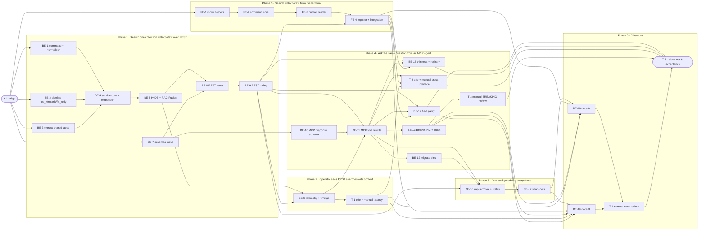

# 02-SWC · Search with context on one shared service across REST, MCP and CLI — Task Breakdown

**Story Points:** 20 — estimated 2026-11-07 with /estimate

**How to read this file**

- This is the **order view** for `02_search_with_context-team-plan.md` — every task is a single-role checkbox in execution order, opening with a dependency graph.
- **Phases are vertical slices**, one per outcome: Phase 1 REST (the walking skeleton; it carries the shared service because the plan fixes that the steps shared with `search` are extracted, not copied; there is no data or migration foundation, plan *Data* is skipped), Phase 2 operator telemetry for REST, Phase 3 the CLI, Phase 4 the MCP cutover with its guards, Phase 5 the configured cap. Phase 6 is the Close-out phase: close-out duty 1 (all documentation) is split into three tasks so each can be reviewed (create-tasks rule 7 allows only Kickoff and Close-out as non-slice phases). No separate "integrate" phase. Sliced with the `vertical-slicer` skill (behaviour-first order, verticality test and smell check applied). Honest limits: Phase 1 is thick (the service must be complete enough for REST to be correct, and the pipeline needs an embedder), Phase 2 is small but operator-visible, and Phase 5's observable outcome is only S7; the rest of it is the deletion the plan mandates, which cannot precede the MCP cutover because the old tool still reads the pipeline's cap.
- Each task carries the **role tag at the end of its title line**, then sub-bullets: **layer · estimate** (decimal hours), **needs · completes**, and a **Tests** block. **needs** = predecessor tasks; **completes** = the scenario `S#` or contract `C#` (from the plan) it makes true or realises. A scenario that spans slices is listed by every task that makes part of it true. IDs are stable: this file was reordered, so `BE-6` and `T-1` sit in Phase 2.
- **Tests** are tagged by level. **Unit and integration tests belong to the implementing dev** (test-first); **e2e and manual tests are the tester's tasks**. Kickoff and close-out write no tests. A task that only re-points existing code lists the existing tests that must stay green, marked `(existing)`; `(existing, rewritten)` marks a test whose assertion changes with the task.
- IDs (`BE-#`/`FE-#`/`T-#`/`K#`) are this file's traceability thread; `S#`/`C#`/`Q#` are defined in the plan, whose questions Q1–Q18 are all answered. Reviewing this file raised no open question; the answers to its first-draft questions are under **Decisions taken**. "roadmap S2" means this slice in the roadmap; "S#" alone is a plan scenario.
- The **Frontend** role is the CLI (Presentation); there is no browser UI. Every server-side layer is **Backend**. Tasks that edit only `pipeline.py` carry the layer *Frameworks & Drivers*.
- **Plain terms:** *service* = `SearchService`; *swc* = search with context; *shared steps* = the private steps `SearchService.search` and `search_with_context` both run (collection lookup, embedder selection, warm-up, HyDE resolution, budget, error translation, telemetry, stage timings); *pin* = an existing test that asserts today's behaviour; *cutover* = the change that turns the new behaviour on and deletes the old.
- **Test-run rule (root `CLAUDE.md`/`tests/CLAUDE.md`):** before any pytest run, check that no pytest worker is alive with `ps -Ao args= | grep -E '[/]bin/pytest|[u]v run pytest'`; one pytest run at a time; the FE and BE tracks may run in parallel as work, not as concurrent test runs.
- **Ordering rules from the code (not the plan's prose):** (1) the MCP cutover (BE-10 to BE-12) precedes the cap removal (BE-16), because the old tool reads `pipeline.context_window_max`; (2) the new CLI command registers only together with its registry claim (FE-4), because `tests/parity/test_parity.py::test_parity_passes_on_live_surfaces` fails on a live command no row claims, and a claimed identifier must be live, so the REST claim flips in BE-9 and the `service_method` in BE-4 (nothing reads `service_method`; MCP's claim has had no waiver since S1); (3) every task that moves a name or deletes a parameter lands with all its importers (no re-export); (4) the doc-wording assertions of `tests/test_s391_mcp_search_reranker_score_doc_gap.py` change in the same task as the docs they read (BE-18), not with the tool; (5) `SearchPipeline.search_with_context` takes a required `embedder`, so the service's embedder selection and warm-up come with the service core (BE-4), and only HyDE and RAG Fusion resolution follow (BE-5).
- **Atomic groups (land together):** BE-7 with every importer of the moved schemas; BE-9 (route wiring with its app-level tests and the snapshot regeneration: adding the route breaks the snapshot test); BE-10 + BE-11 + BE-12 (the swc response model in `mcp_schemas.py` is `extra="forbid"`, so the response, the tool and every pin of the old tool change together; about 19.5 h; work test-first inside the group: write BE-11's new tests and the rewritten pins red, then change the tool; develop as several local commits, merge as one change); BE-16 + BE-17. Edit-collision note (merge-conflict risk only, no `needs` edge): `services/search_service.py` (BE-3, BE-4, BE-5, BE-6); `pipeline.py` (BE-2, BE-16); `app.py` (BE-9, BE-16); `mcp_schemas.py` (BE-7, BE-10); `tests/parity/registry.py` (BE-4, BE-9, FE-4); `tests/CLAUDE.md` (BE-15, BE-19); `tests/server/test_app.py` (BE-12, BE-16); `tests/test_s391_mcp_search_reranker_score_doc_gap.py` (BE-7, BE-12, BE-18).
- **Rule:** edit your own tasks freely.

---

## References

- **Plan:** [02_search_with_context-team-plan.md](./02_search_with_context-team-plan.md) — the full team plan (contracts, scenarios, architecture, allocation). **Always read the plan before you start planning the next task** — it holds the context this file only cites (`S#`/`C#`/`Q#`).
- **Brief:** [02_search_with_context-brief.md](./02_search_with_context-brief.md) — the source feature brief behind the plan.
- **Precedent:** [01_search-tasks.md](./01_search-tasks.md) — the S1 task breakdown whose decomposition and ordering this file reuses.

---

## Task Breakdown

Single-role tasks in execution order, grouped into **vertical slices**. Read **Plan corrections** at the end first.

### Dependency graph

### Phase 0 · Kickoff *(prerequisite; the one cross-cutting step)*

- [ ] **K1** — Agree Contracts C1–C10 and the scenario split with the team and read `learnings.md` in full (root `CLAUDE.md`, "Memory and learning") #team
    - — · 1.5h
    - completes C1, C2, C3, C4, C5, C6, C7, C8, C9, C10
    - Tests

### Phase 1 · Search one collection with context over REST *(the walking skeleton: an API client posts a query and gets hits with their neighbouring chunks from the one shared service)*

- [ ] **BE-1** — Add `SearchWithContextCommand` and its normaliser in `services/search_command.py`: `context_window` optional on the command (C1) and defaulted by the normaliser to `DEFAULT_CONTEXT_WINDOW`; collection required (missing or blank is `collection must not be empty`), query, `top_k` bounds, `context_window` in `[0, [search].context_window_max]` with the pipeline's text built by a new `context_window_exceeded_detail` beside `top_k_exceeded_detail` in `services/service_error.py`, then the `scope_filter` syntax; the two include-metadata flags ORed once #backend-role
    - Use Cases · 3.0h
    - needs K1 · completes C1, C2, S4, S6, S13, S14, S15
    - Tests
        - #unit_test — `test_swc_normaliser_defaults_the_window_to_one` — an omitted window becomes `DEFAULT_CONTEXT_WINDOW` (S4)
        - #unit_test — `test_swc_normaliser_accepts_window_zero_and_the_maximum` — 0 and the configured cap are valid; a cap of 1 with the default window passes
        - #unit_test — `test_swc_normaliser_rejects_window_above_the_cap_or_below_zero_with_the_decided_text` — `context_window must be in [0, {max}]; got {n}` as a `VALIDATION` `ServiceError` (S6)
        - #unit_test — `test_swc_normaliser_rejects_missing_or_blank_collection_and_blank_query` — plain texts, no default collection (S14)
        - #unit_test — `test_swc_normaliser_validation_order_is_collection_query_top_k_window_scope` — first failing rule wins, `top_k` above the maximum before the window (S13, S15)
- [ ] **BE-2** — `SearchPipeline.search_with_context` in `pipeline.py` gains `top_k`, `rerank` and `fts_only` and passes them to `search`; the neighbour loop and the `context` stage timing stay; the cap check and the method's docstring stay until BE-16 #backend-role
    - Frameworks & Drivers · 3.5h
    - needs K1 · completes C3, S8, S9
    - Tests
        - #unit_test — `test_search_with_context_returns_at_most_top_k_hits_each_with_its_neighbours` — a store with more candidates than `top_k`
        - #unit_test — `test_search_with_context_fts_only_does_not_embed_the_query_and_still_returns_neighbours`
        - #unit_test — `test_search_with_context_rerank_false_skips_the_cross_encoder`
        - #unit_test — `test_pipeline_search_with_context_malformed_chunk_id` — extend the existing test (it already pins empty context for `bad-chunk-id`): assert one warning is logged and add a second well-formed hit that keeps its neighbours (S9)
        - #integration_test — (existing, `tests/test_store.py`, `tests/test_store_acl.py`) — `fetch_adjacent_chunks` clamping at 0, window 0 empty (`test_store_fetch_adjacent_chunks_window_zero_returns_empty`) and a missing table give empty context (S8)
        - #integration_test — `test_fetch_adjacent_chunks_for_the_last_chunk_returns_only_the_existing_neighbours` — new case in `tests/test_store.py`: the centre is the last chunk of its document and the window is 2 (S8)
        - #integration_test — (existing, `tests/pipeline/test_pipeline_search.py`) — the exception-propagates test and the cap tests stay green until BE-16
- [ ] **BE-3** — Extract the shared steps out of `SearchService.search` in `services/search_service.py` into private steps that take the endpoint label (today the hard-coded `_ENDPOINT`, used for telemetry, failure reports and stage timings) and explicit arguments instead of a `SearchCommand` (`_resolve_hyde` and `_build_outcome` read `graph_mode`, `acl_context`, `filters` and `wants_metadata` from it; swc passes `graph_mode=None`); `search` behaviour is unchanged; the module attributes `_SEARCH_TIMEOUT_SECONDS` and `_EMBEDDER_LOAD_WAIT_TIMEOUT_SECONDS` stay read at call time (they are the pinned patch seam). A pure extraction: no new test, the existing tests are the guard #backend-role
    - Use Cases · 5.0h
    - needs K1 · completes C4
    - Tests
        - #unit_test — (existing, `tests/services/test_search_service_telemetry.py` ≈104, 185, 327, 468) — `search` still records the endpoint `search` after the label becomes a parameter
        - #integration_test — (existing, file-level) `tests/services/test_search_service.py`, `tests/server/test_mcp_search_service.py`, `tests/integration/test_disconnect_cancels_provider_call_e2e.py` and the stage-timing handler tests — stay green with no edit
- [ ] **BE-4** — Add `SearchWithContextOutcome`, its hit type (`result`, `acl_gate`, `context_before`, `context_after`) and `SearchService.search_with_context`: normalise, namespace-scoped collection lookup, per-collection embedder selection through the cache with the 0.5 s bound and warm-up of the embedder and cross-encoder (the pipeline method needs a required `embedder`; `fts_only` and `rerank` are passed on), ONE `run_within_budget` around the single `pipeline.search_with_context` call (search and neighbour fetch together), `acl_gate` on hits only through the existing gate builder, `ServiceError` for every failure and the failure events `search` logs (the log half of `_report_failure`: `search_pipeline_failure`, `search_timeout`, the metadata and embedder warnings; the `ServiceError` carries no exception, so the step that maps it must log first); set `service_method` of the roadmap-S2 row in `tests/parity/registry.py` to `SearchService.search_with_context` #backend-role
    - Use Cases · 9.5h
    - needs BE-1, BE-2, BE-3 · completes C1, C3, S3, S5, S10, S11, S16, S17, S18, S19, S23, S25, S28, S29, S30, S46
    - Tests
        - #unit_test — `test_swc_window_zero_returns_hits_with_empty_context_lists` (S5)
        - #unit_test — `test_swc_acl_gate_is_on_hits_only_and_null_without_acl_context` — neighbours carry their `acl` list, no gate (S11)
        - #unit_test — `test_swc_applied_filters_is_null_without_filters_and_the_parsed_filters_otherwise` — flat and nested filters (S30)
        - #unit_test — `test_swc_invalid_flat_or_nested_filter_is_the_same_validation_error_as_search` — a bad date in either form (S30)
        - #unit_test — `test_swc_unexpected_exception_and_a_store_value_error_are_internal_error_with_nothing_partial` — fixed text `search failed` (S28, S46)
        - #unit_test — `test_swc_failure_branches_log_the_same_events_as_search` — pipeline failure, timeout, metadata and embedder warnings (S28)
        - #integration_test — `test_swc_neighbours_are_same_document_ordered_and_exclude_the_hit` — `make_real_app` plus a multi-chunk document ingested with `ingest_file_via_path` (S3)
        - #integration_test — `test_swc_neighbour_the_caller_may_not_read_is_dropped_silently` — hit stays, `acl_filtered` unchanged, nothing reports the drop (S10)
        - #integration_test — `test_swc_scope_filter_narrows_hits_but_not_neighbours` — neighbours stay ACL-filtered only (S29)
        - #integration_test — `test_swc_unknown_invalid_or_foreign_namespace_collection_is_not_found` — an invalid name never reaches the store (S16)
        - #integration_test — `test_swc_meta_lookup_failure_is_metadata_store_error` (S17)
        - #integration_test — `test_swc_cold_embedder_answers_keyword_only_and_still_returns_neighbours` — the loader is not cancelled (S18)
        - #integration_test — `test_swc_cold_cross_encoder_answers_unreranked_within_the_bound` (S19)
        - #integration_test — `test_swc_stub_cache_raising_embedder_not_ready_answers_that_kind` — the real cache's 120 s wait is pre-empted by the 0.5 s bound, so a stub cache is the only way (S25)
        - #integration_test — `test_swc_search_plus_neighbour_fetch_beyond_the_budget_is_timeout_with_nothing_partial` — patched `_SEARCH_TIMEOUT_SECONDS`, one budget cancels both (S23)
- [ ] **BE-5** — Wire HyDE and RAG Fusion into `search_with_context`: resolution outside the budget (the pipeline method takes `rag_fusion`, its generator and config, and a precomputed `query_vector`), HyDE skipped on a cold embedder, RAG Fusion winning over HyDE, `hyde_failed` for an unexpected failure #backend-role
    - Use Cases · 3.5h
    - needs BE-4 · completes S20, S21, S22
    - Tests
        - #unit_test — `test_swc_hyde_failure_falls_back_with_a_warning_and_an_unexpected_failure_is_hyde_failed` — `hyde_applied` false, `expansion_warning` set (S21)
        - #unit_test — `test_swc_rag_fusion_wins_over_hyde_and_reports_its_three_fields` — the exclusion survives the extraction (S22)
        - #integration_test — `test_swc_hyde_is_skipped_on_a_cold_embedder` — `hyde_applied` false (S20)
- [ ] **BE-7** — Move `SearchResultSchema` (with `from_result` and `from_hit`) out of `server/routes_search.py` and `ContextChunkSchema` out of `server/mcp_schemas.py` into `server/schemas.py` after `AclGateSchema` (no re-export), re-point every importer (source: `routes_search.py`, `mcp.py`, `mcp_schemas.py`; tests: `tests/test_search_acl_gate.py`, `tests/server/test_search_result_schema.py`, `tests/server/test_search_wire_helpers.py`, `tests/server/test_routes_search_telemetry.py` ≈268 and ≈288, `tests/test_s391_mcp_search_reranker_score_doc_gap.py` ≈48 (import only), `tests/test_mcp_schemas.py` ≈278-340, `tests/integration/test_mcp_schema_contract.py` ≈256) and reword the `fetch_adjacent_chunks` docstring in `store.py` ≈3387 #backend-role
    - Interface Adapters · 3.0h
    - needs K1 · completes C5 (the schema half; the route completes it in BE-8)
    - Tests
        - #unit_test — `test_neighbour_schema_exposes_the_acl_list_and_no_vector_scopes_or_offsets` — the promoted schema keeps MCP's field set; the `acl` list is present, which anchors the absences
        - #integration_test — (existing, file-level) the importer tests listed above and `tests/server/test_routes_search.py` ≈1153 — stay green with the re-pointed imports; `POST /search`'s OpenAPI component name is unchanged
- [ ] **BE-8** — Add `server/routes_search_with_context.py`: request model with `extra="forbid"`, required `collection` and `query` with the request-model validators, `context_window` defaulting to `DEFAULT_CONTEXT_WINDOW` with no schema bounds, `top_k` minimum 1, nested `filters`, `hyde`, `rag_fusion`, `scope_filter`, `acl_context`, `include_metadata`; response `{results: [{result, context_before, context_after}], …}` plus the derived fields of C5 (`acl_filtered`, `embedding_model`, `hyde_applied`, `rag_fusion_applied`, `rag_fusion_queries_used`, `rag_fusion_attempted`, `expansion_used`, `expansion_warning`, `applied_filters`); handler resolves the caller with `caller_identity`, builds the service per request from `request.app.state`, blanks `metadata` on hits AND neighbours with `blank_unrequested_metadata`; its own `_call_normaliser`, 504 text, plain-500 body and error table written out (boundary rule 2: no import of `routes_search` or `server.mcp`); the request, response and item classes take the component names of the drafted `api-contracts` yaml (`SearchWithContextRequest`, `SearchWithContextResponse`, `SearchWithContextItem`), the hit and neighbour keep the moved schemas' own names #backend-role
    - Interface Adapters · 6.0h
    - needs BE-5, BE-7 · completes C5, S6, S12, S13, S14, S29, S31
    - Tests
        - #unit_test — `test_swc_request_model_rejects_unknown_keys_including_graph_mode_collections_and_a_nested_filters_key` — status 422 with an `extra_forbidden` error located at the stray key, while a request without it is accepted (S31)
        - #unit_test — `test_swc_blank_or_missing_collection_and_blank_query_give_the_framework_422_list` (S14)
        - #unit_test — `test_swc_window_out_of_range_even_negative_is_422_with_the_detail_text` — the schema has no minimum so the service owns the range (S6)
        - #unit_test — `test_swc_top_k_below_one_is_the_framework_list_and_above_the_maximum_is_the_service_text` (S13)
        - #unit_test — `test_swc_each_service_error_kind_renders_its_status_and_body` — coded 400 for a bad scope filter, 404, 422, plain 500, 503 with and without `Retry-After`, 504 (S29)
        - #unit_test — `test_swc_include_metadata_blanks_metadata_on_hits_and_on_neighbours` — flag and `filters.include_metadata` ORed once (S12)
- [ ] **BE-9** — Wire the route in `server/app.py`: import (beside ≈137) and `include_router` (beside ≈1544), `/search-with-context` added to the `CancelOnDisconnectMiddleware` path tuple (≈1307, exact match), the pipeline constructor call stays as is until BE-16; fix `tests/test_app.py` ≈1085-1120 (it derives provider routes from OpenAPI and asserts `{"/search","/explain"}`); extend the REST disconnect parameters of `tests/integration/test_disconnect_cancels_provider_call_e2e.py` (≈139) and `tests/server/test_search_explain_error_contract.py` (a swc case table beside `_CASES`, `_ROUTES`, `_PIPELINE_METHODS`); set the REST claim of the roadmap-S2 row in `tests/parity/registry.py` to `POST /search-with-context`; regenerate both OpenAPI snapshots (the snapshot test fails once the route exists); reword the `EmbedderNotReadyError` handler docstring in `app.py` ≈1510-1514, the `disconnect.py` docstring ≈13-14, the `mcp_disconnect.py` docstring ≈19-20 and the `route_422_response` docstring in `schemas.py` ≈630 #backend-role
    - Interface Adapters · 5.5h
    - needs BE-8 · completes S1, S2, S4, S11, S24, S25, S28, S30, S32, S34, S46, S53
    - Tests
        - #integration_test — `test_swc_rest_returns_the_same_hits_as_search_and_neighbours_for_the_same_query` — `make_real_app` and a multi-chunk fixture (S1, S2)
        - #integration_test — `test_swc_rest_default_window_is_one_and_acl_gate_appears_only_with_acl_context` (S4, S11)
        - #integration_test — `test_swc_rest_callers_in_two_namespaces_see_only_their_own_hits_and_neighbours` (S32)
        - #integration_test — `test_swc_rest_missing_or_invalid_key_is_the_generic_401_and_a_malformed_body_is_the_422_list` (S34)
        - #integration_test — `test_swc_rest_error_bodies_match_the_openapi_contract` — metadata store failure, stub-cache `embedder_not_ready` with `Retry-After` 30, plain 500 `search failed`, per-hit store `ValueError` (S25, S28, S46; a new swc case table in `test_search_explain_error_contract.py`: its existing cases send `collections` and `graph_mode`, which the swc route refuses, and the swc 422 union follows C5)
        - #integration_test — `test_swc_rest_invalid_filters_are_a_422_and_applied_filters_echo_the_parsed_filters` — a bad flat or nested date; `applied_filters` is null without filters (S30)
        - #integration_test — `test_disconnect_cancels_search_with_context_and_its_provider_call` — the new parameter of the existing e2e (S24)
        - #unit_test — (existing, rewritten) the provider-route assertion in `tests/test_app.py` ≈1085-1120 — the route derived from OpenAPI is covered by the disconnect middleware (S24)
        - #unit_test — `test_boundary_scan_sees_the_route_module_and_it_imports_no_routes_module_or_server_mcp` — positive control beside the real-tree test in `tests/test_layer_import_boundary.py` (S53)

### Phase 2 · Operator sees REST searches with context *(with telemetry on, a REST swc search shows up under its own label with timings, and never with the query; MCP joins at its cutover)*

- [ ] **BE-6** — Record telemetry and stage timings for `search_with_context` in the service: one entry labelled `search_with_context` for success, timeout and internal error, `embedder_not_ready`, `metadata_store_error` and `hyde_failed` recorded as `internal_error`, nothing for validation-class kinds and `not_found`; the entry carries what the old MCP entry carried (hit doc ids only, hashed with the same hasher, no neighbour ids; filter flags; `rag_fusion_applied` and `rag_fusion_queries_used`; the correlation id); stage timings are logged under the label on success and on every error branch `search` logs, and the `context` stage is present whenever the neighbour loop started (`record_stage` records in a `finally`, so a timeout or a store error inside the loop still shows it) and absent when the search itself fails first #backend-role
    - Use Cases · 4.5h
    - needs BE-5, BE-9 · completes C4, S26, S27
    - Tests
        - #unit_test — `test_swc_success_records_one_entry_labelled_search_with_context_with_hit_doc_ids_only` — hashed when `hash_doc_ids` is on, never neighbour ids (S26)
        - #unit_test — `test_swc_entry_carries_filter_flags_rag_fusion_fields_and_the_correlation_id` (S26)
        - #unit_test — `test_swc_error_kinds_record_internal_error_or_error_and_validation_and_not_found_record_nothing` (S26)
        - #unit_test — `test_swc_stage_timings_are_logged_under_the_swc_label_and_the_context_stage_appears_only_when_the_neighbour_loop_ran` — a failed lookup logs none, as `tests/services/test_search_service_telemetry.py` ≈339 pins for `search` (S27)
        - #integration_test — `test_swc_rest_search_is_recorded_in_the_telemetry_entries_with_the_swc_label` — a real writer; the test polls `GET /telemetry/entries` (the writer drains its queue on a background task) or reads the JSONL after the app lifespan ends (S26)
        - #integration_test — `test_swc_telemetry_jsonl_never_contains_the_query` — a real writer's file has the swc entry (the presence anchor) and no query text (S26, ADR 05)
- [ ] **T-1** — e2e + manual: swc over REST at `top_k_max` against a real server on the shared smoke fixture; record the latency and the `context` stage #tester-role
    - — · 3.0h
    - needs BE-6 · completes S47
    - Tests
        - #e2e_test — `test_e2e_swc_rest_at_top_k_max_and_context_window_max_returns_a_well_formed_answer` — new `tests/smoke/test_search_with_context.py` (with the `smoke_e2e` xdist_group mark) and its module fixture `swc_collection`, about 120 chunks (several paragraphs of about 300 gpt2 tokens per document, `chunk_count > doc_count`) seeded through `_seed_corpus`, shared with T-2 (if the ingest passes the 60 s `_JOB_POLL_TIMEOUT_S`, raise that module constant in `tests/smoke/conftest.py`); the test asserts shape (200 with at most `top_k_max` hits, each with its neighbour lists, or the documented 504 body) and prints the elapsed time, because S47 says an over-budget run is a measurement, not a failure
        - #manual_test — Latency at `top_k_max` — measure `POST /search` and `POST /search-with-context` at the same `top_k` on that collection, take the delta as the neighbour cost and read the logged `context` stage; write both numbers and the real chunk count in the **Close-out note** at the end of this file; a result over the 30 s budget is input for the brief's Future Iterations, not a failure

### Phase 3 · Search with context from the terminal *(an operator runs `archon-search search-with-context` and reads each hit with its neighbours)*

- [ ] **FE-1** — Move the request and render helpers private to `cli/search.py` into `cli/_helpers.py` (`_EXCERPT_MAX_CHARS`, `_BARE_401_MESSAGE`, `_UNEXPLAINED_ERROR_MESSAGE`, `_retry_after_note`, `_error_message`, `_is_list_of_objects`, `_is_printable_score`, `_excerpt`, `_result_line`, `_echo_notes`, `_given`; `_shape_problem` and the `httpx.post` call stay in `search.py`); in `tests/cli/test_search_fe3.py` replace the module import at ≈15 with an import of `_helpers` and re-point the read at ≈78 to `_helpers._EXCERPT_MAX_CHARS`; fix the comments in `tests/smoke/test_cli_search.py` ≈26 and ≈30 and the `_clean` docstring #frontend-role
    - Presentation · 3.0h
    - needs K1 · completes C8, S40
    - Tests
        - #unit_test — (existing, rewritten) `tests/cli/test_search_fe3.py` — reads `_EXCERPT_MAX_CHARS` from `_helpers`, which proves the moved names are importable there (S40)
        - #integration_test — (existing, file-level) `tests/cli/test_search_fe3.py` to `test_search_fe6.py`, `tests/test_cli_helpers.py`, `tests/integration/test_cli_search_fe4_real_app.py` to `_fe6_real_app.py`, `tests/integration/test_be22_four_interface_parity.py`, `tests/test_layer_import_boundary.py`, `tests/test_cli_startup_latency.py` — stay green; their `archon_search.cli.search.httpx.post` patch targets remain valid
- [ ] **FE-2** — Add `cli/search_with_context.py` core: positional query, required single `--collection`, `--context-window`, `--top-k`, the six filter options, `--include-metadata`, `--hyde`, `--rag-fusion`, `--scope-filter`, `--acl-context`, `--json`, `--api-url`, `--api-key` (C7 lists both and `TRANSPORT_EXEMPTIONS` exempts them), no `--graph-mode`; body built with `_given` (a window of 0 is sent, `context_window` is omitted when not given, never `collections` or `graph_mode`, no CLI-side range); `import httpx` at module level and the `httpx.post(…/search-with-context, timeout=CLI_SEARCH_REQUEST_TIMEOUT_SECONDS)` call in this module; every REST error shape, connect failure and missing key exit 1 with the shared messages; `--json` prints the body (indent 2, sorted keys) before any shape check and prints no note; imports only `cli/_helpers` and `constants` #frontend-role
    - Presentation · 4.0h
    - needs FE-1 · completes C7, S35, S37, S38
    - Tests
        - #unit_test — `test_swc_body_carries_collection_query_and_only_the_options_given` — window omitted when not set, `--context-window 0` and `-1` sent as given, filters nested only when given (S35)
        - #unit_test — `test_swc_request_goes_to_search_with_context_with_the_bearer_header_and_the_search_timeout_constant` — the timeout exceeds the 30 s budget (S35)
        - #unit_test — `test_swc_json_prints_the_rest_body_sorted_with_indent_2_and_nothing_on_stderr_even_with_an_expansion_warning` — a wrongly typed body is printed unchanged (S37)
        - #unit_test — `test_swc_every_rest_error_shape_connect_failure_and_missing_key_exits_1_with_a_message` — parametrised like `tests/cli/test_search_fe4.py`: coded 400, 404, 422 string and list, 503 with `Retry-After`, 504, plain 500, bare 401, a 200 body that is not JSON and one that is not an object (S38)
        - #unit_test — `test_swc_missing_collection_is_a_usage_error_exit_2` (S38)
- [ ] **FE-3** — Render the nested REST body in human mode: `_result_line` for each hit, then its before lines and then its after lines as indented excerpt lines marked before or after (excerpt through `_excerpt`, no chunk id; indent and marker wording are the developer's choice, pinned by the test), control characters cleaned; its own nested shape check (`results` is a list of objects, each with an object `result` that has a printable score, and `context_before` and `context_after` are lists of objects); `No results found.` for an empty list; `expansion_warning` as `Note: <text>` on stderr after the results via `_echo_notes` #frontend-role
    - Presentation · 3.0h
    - needs FE-2 · completes S36, S38, S39
    - Tests
        - #unit_test — `test_swc_human_mode_prints_each_hit_then_indented_before_and_after_lines_in_order` — exit 0 (S36)
        - #unit_test — `test_swc_expansion_warning_prints_as_a_note_on_stderr_after_the_results_and_never_on_stdout` (S36)
        - #unit_test — `test_swc_control_characters_are_cleaned_and_excerpts_are_collapsed_and_cut_at_the_constant` — hits and neighbours (S39)
        - #unit_test — `test_swc_ill_shaped_item_or_neighbour_list_exits_1_and_an_empty_result_prints_no_results_found_with_exit_0` (S38)
- [ ] **FE-4** — Register the command in `cli/main.py` (`@click.command("search-with-context")`, import and `main.add_command`) and, in the same task, set the CLI claim of the roadmap-S2 row in `tests/parity/registry.py` to `search-with-context` (without it the registration fails the live-surface parity test); prove the flat-option-to-REST mapping through `cli_against_app` against a real app with a multi-chunk collection #frontend-role
    - Presentation · 4.0h
    - needs FE-3, BE-9 · completes S1, S6, S13, S16, S34, S40
    - Tests
        - #unit_test — `test_swc_command_help_runs_and_lists_the_documented_options` — `main` invoked with `search-with-context --help` exits 0 (S40)
        - #integration_test — `test_cli_swc_json_equals_the_rest_body_for_the_same_query_window_and_top_k` — `make_real_app` plus `cli_against_app` (S1)
        - #integration_test — `test_cli_swc_top_k_returns_exactly_n_hits_with_neighbours` (S13)
        - #integration_test — `test_cli_swc_window_above_the_cap_prints_the_422_text_and_exits_1` (S6)
        - #integration_test — `test_cli_swc_unknown_collection_prints_the_404_text_and_exits_1` (S16)
        - #integration_test — `test_cli_swc_wrong_key_prints_the_401_text_and_exits_1` (S34)
        - #integration_test — (existing) `test_parity_passes_on_live_surfaces`, `tests/test_layer_import_boundary.py` and `tests/test_cli_startup_latency.py` — the new module imports only `cli/_helpers` and `constants` (S40)

### Phase 4 · Ask the same question from an MCP agent *(the MCP tool answers from the one service; the three interfaces are proved equal)*

- [ ] **BE-10** — Rewrite the swc response types in `server/mcp_schemas.py` (≈169-184) and rename them so that no two classes in the code base share a name with the REST ones of BE-8, as `McpSearchResponse` does for `search`: `McpSearchWithContextItem` and `McpSearchWithContextResponse` (re-point every importer: `mcp.py` and the tests that import them); hits are the search-tool result schema (per-hit `acl_gate`), `context_before` and `context_after` are `list[ContextChunkSchema]` imported from `schemas.py`, the item stays nested (`result`, `context_before`, `context_after`), the response carries `search`'s derived fields without `excluded_collections`, `graph_expansion_applied` and `ppr_entities_matched`, `extra="forbid"` stays; reword the comments at ≈52 and ≈94. Lands together with BE-11 and BE-12 #backend-role
    - Interface Adapters · 3.0h
    - needs BE-7 · completes C6
    - Tests
        - #unit_test — (existing, rewritten) `tests/test_mcp_schemas.py` (the imports at ≈188 and ≈224 and the cases at ≈194-199, 243-246 and 349-400) — the swc item and response models under their new names and fields (C6)
- [ ] **BE-11** — Rewrite the MCP `search_with_context` tool in `server/mcp.py` (≈639-819) as an adapter over the service, sharing the lazily built service with `search` (factor one builder closure): resolve the caller with `_get_request_identity()` and refuse before building the service; `collection` required by rule but optional in the signature, `top_k` and `acl_context` added, no `graph_mode`; filters built with `build_search_filters`; one `ServiceError` table (`McpErrorResponse(error, code)`), with no config the fixed `search failed` / `internal_error` and an error log; the docstring FastMCP publishes says `collection` is required and points agents to `search` for graph retrieval; delete the tool's own embedder, HyDE, budget, telemetry and validation code (`_validate_context_window`, the `context_window_error` import ≈104, the `SearchFilters`, `FilterFlags` and `INVALID_SEARCH_FILTERS_DETAIL` uses that only this tool had) and its use of the `_SEARCH_TIMEOUT_SECONDS` alias (≈731), then the imports that become unused (`McpSearchResultSchema` ≈120 and the rest ruff reports); keep the alias definition, `_enqueue_internal_error`, `_validate_scope_filter` and `_resolve_embedder` (they serve `explain` and ingest); reword the comment at ≈217-218 #backend-role
    - Interface Adapters · 7.5h
    - needs BE-6, BE-9, BE-10 · completes C6, S1, S4, S11, S12, S13, S14, S16, S17, S23, S25, S26, S28, S29, S30, S31, S32, S33, S54
    - Tests
        - #unit_test — `test_swc_tool_without_collection_is_validation_error_with_the_plain_text_and_no_default_collection_fallback` (S14)
        - #unit_test — `test_swc_tool_without_a_resolvable_identity_is_refused_before_the_service_is_built` — fail-closed case for this tool (S32)
        - #unit_test — `test_swc_tool_without_config_answers_search_failed_internal_error_and_makes_no_pipeline_call` (S33)
        - #integration_test — `test_published_description_says_collection_is_required_and_points_to_search_for_graph_retrieval` — read from the published tool listing as `tests/server/test_mcp_search.py` ≈318 reads `search`'s (S54)
        - #integration_test — `test_published_schema_has_no_graph_mode_and_no_collections` — while `collection`, `top_k` and `acl_context` are published (the presence anchor) (S31)
        - #integration_test — `test_swc_mcp_service_error_kinds_map_through_one_table` — `not_found`, `metadata_store_error`, `timeout`, `embedder_not_ready` (stub cache), `invalid_scope_filter`, `internal_error` (S16, S17, S23, S25, S28, S29)
        - #integration_test — `test_swc_mcp_invalid_filters_give_the_same_validation_error_as_rest` — a bad flat and a bad nested date (S30)
        - #integration_test — `test_swc_mcp_top_k_bounds_acl_context_include_metadata_and_default_window` — N hits, above-maximum and below-1 texts, `acl_gate` only on hits, metadata blank on hits and neighbours, window 1 by default (S4, S11, S12, S13)
        - #integration_test — `test_swc_mcp_returns_the_same_hits_and_neighbours_as_rest_for_the_same_query` — the MCP leg of S1
        - #integration_test — `test_swc_mcp_callers_in_two_namespaces_see_only_their_own_data` (S32)
        - #integration_test — (existing) `tests/integration/test_d8_be4_wire_hasher.py` and `tests/integration/test_d8_t1_e2e_core_hashing.py` — the lazily built service still receives the doc-id hasher on MCP (S26)
- [ ] **BE-12** — Rewrite every pin of the old MCP behaviour together with BE-10 and BE-11 (plan S45, with the grounded additions). Sweep rule: grep `tests/` for every call of the swc tool without a collection or with `config=None` and for every reference to the removed names, then rewrite each hit. Files: `tests/test_s391_mcp_search_reranker_score_doc_gap.py` (the import ≈46 and the item-schema assertion ≈160-161; its doc-wording assertions flip in BE-18); `tests/test_mcp.py` (every swc-tool test, several run with `config=None`, which now answers `search failed`: ≈399, 423, 440, 555-587, 590 (the `search_with_context` parameter only; `explain` stays), 812, 989-1009 (the exact key set), ≈1012-1030 and ≈1053-1070 (the `explain` rag-fusion test ≈1031-1052 between them stays), 1255-1431, and the `search` test at ≈1243 that patches `archon_search.server.mcp.McpSearchResultSchema.from_result`, retargeted to `archon_search.server.mcp_schemas`); `tests/server/test_mcp_search_with_context.py` (the scope-filter-before-window test ≈433 is inverted: window, then scope syntax; the `graph_mode` twin ≈423 goes; the cap tests ≈363-407 assert the cap through `pipeline.context_window_max` and now set `[search] context_window_max` through the tool's config); the `graph_mode_not_supported` assertions in `tests/test_e1b_be9_mcp_search_graph_mode.py`, `tests/test_e2a_be12_mcp_scope_filter.py` ≈575-593 (comments ≈469-470 and ≈570-575 reworded), `tests/server/test_e1a_fe3_mcp_search_graph_mode.py` ≈239-268, the `graph_mode=None` call ≈365 and its assertion ≈367, the signature pin ≈105-115, the module docstring ≈9 and the comments ≈234 and ≈335, `tests/integration/test_e1a_t3_graph_error_paths_e2e.py` ≈309-353 and `tests/integration/test_e2h_t3_e2e.py` ≈160-187; delete the source-text assertion of `tests/server/test_be2_ppr_schemas.py` ≈107-115 and reword its comment ≈9 (a pin of source wording, not behaviour); `tests/server/test_telemetry_e2e.py` ≈172, 174, 326 and 414 (swc calls with `collection=None`, whose telemetry checks would go vacuous) and `tests/test_integration_rag_fusion.py` ≈536-558 (the old tool's entry fields and a `collection=None` call; comments ≈539-542); `tests/server/test_app.py` ≈360-415 (the two MCP tests that call the tool with no collection and assert the configured cap through the MCP tool: pass a collection, assert the same text); `tests/test_mcp_schemas.py`; `tests/server/test_mcp_telemetry.py`; `tests/server/test_mcp_search_stage_timings.py`; `tests/server/test_mcp_embedder_dispatch.py`; `tests/server/test_mcp_error_responses.py`; `tests/server/test_mcp_namespace_propagation_be5.py`; `tests/server/test_no_internal_error_leak_mcp.py` ≈389 (its `_tools()` helper at ≈126-128 injects a config only for `search`: add `search_with_context`, which affects the cases at ≈198, 389 and 443; the base `McpSearchResultSchema.from_result` must stay on the build path); the swc cases of `tests/server/test_mcp_search.py` (≈161-192, 212-234, 311-318). `tests/integration/test_mcp_smoke_t1.py` ≈218 stays valid (the window is checked before the lookup) #backend-role
    - Interface Adapters · 9.0h
    - needs BE-11 · completes S31, S45
    - Tests
        - #integration_test — `test_real_fastmcp_refuses_a_stale_graph_mode_and_does_not_serve_the_call` — a value and `null` both raise a tool error that names `graph_mode`; no search runs (S31; the argument error is FastMCP's own, so the test does not pin its wording)
        - #integration_test — `test_swc_mcp_response_key_set_equals_the_rest_fields` — the rewritten key-set pin in `tests/test_mcp.py` (S45)
        - #unit_test — (existing, rewritten) `tests/server/test_mcp_search_with_context.py` ≈433 — the inverted order pin: window, then scope filter syntax (S15, S45)
        - #integration_test — (existing, file-level) the rewritten files above, no pin re-pinned (S45)
- [ ] **BE-13** — Write the MCP-cutover `BREAKING.md` entries, the migration-index rows and the root `CLAUDE.md` invariant line (newest first, `[next release]`): `collection` required (no default), padded query and collection stripped, bounded embedder wait, bounded cross-encoder, 30 s budget and `timeout`, HyDE skipped on a cold embedder, `graph_mode` removed with FastMCP's argument error for a stale client, `metadata_store_error`, `collection not found`, blank query or collection as `validation_error`, validation order, telemetry for `timeout`, `metadata_store_error`, `embedder_not_ready` and `hyde_failed`, stage timings on error branches, new response fields and arguments; supersede or annotate `BREAKING.md` lines 55, 161, 212, 222, 227, 228, 242, 1118-1120, 1185-1189, 1495, 1872, 2148 and 2391 and the migration rows NR-19, NR-24, NR-71, NR-74, NR-75, NR-76 and NR-84; change root `CLAUDE.md` line 48 ("`search_with_context` rejects any non-null `graph_mode`") to "has no `graph_mode` argument (a stale client gets FastMCP's own argument error); use `search`" and add the swc types to line 30 (both stop being true at the cutover); bump `Last reviewed` and `Next review` in the edited index `03_breaking_changes_index.md`; keep the heading-to-index parity and the wire-text guards green #backend-role
    - Use Cases · 3.5h
    - needs BE-11 · completes S49
    - Tests
        - #integration_test — (existing, `tests/test_removed_engine_repo_guard.py`) — every new level-3 heading of `BREAKING.md` has an index row and the 65-heading pre-existing allowlist is untouched
        - #integration_test — (existing) `tests/test_sanitized_wire_text_docs.py`, `tests/test_s343_reranker_503_doc_gap.py`, `tests/test_s344_reranker_504_doc_gap.py` and `tests/test_s444_reranker_warmup_503_doc_gap.py` — they scan `BREAKING.md` and the shipped docs, and stay green after the entries
- [ ] **BE-14** — Add the field-level parity check for swc (C10): generalise `tests/parity/field_parity.py` over its surface set (the command type, REST request and response models, MCP tool name and response model, CLI command, today hard-wired to `search` at ≈48-56 and ≈257-293), add a second mapping table to `tests/parity/field_registry.py` with nested neighbour paths, no `graph_mode` or `collections` row, `acl_gate` leaves mapped to `results[].result.acl_gate.*` on the wire, the service-only neighbour fields (vector, scopes, expiry, offsets, custom score, ACL provenance) waived on REST and MCP with a reason, `--json`, `--api-url`, `--api-key` exempt; update the `search`-only assertions in `tests/parity/test_field_parity.py` ≈344-401 #backend-role
    - Use Cases · 4.5h
    - needs BE-9, BE-11, FE-4 · completes C10, S43
    - Tests
        - #unit_test — `test_swc_every_command_field_maps_to_rest_mcp_and_cli_or_a_recorded_waiver` — and the mapping holds no waiver for `graph_mode` or `collections` (S31, S43)
        - #unit_test — `test_swc_response_paths_including_nested_neighbour_paths_map_across_rest_and_mcp` (S43)
        - #unit_test — `test_swc_service_only_neighbour_fields_carry_waivers_with_a_reason` (S43)
        - #unit_test — `test_field_parity_fails_on_an_unmapped_swc_field` — the negative control (S43)
- [ ] **BE-15** — Extend the adapter-thinness scan to swc and pin the registry row: `tests/test_adapter_thinness.py` adds the route module to its whole-module list and to `_make_tree`, scans a second MCP tool body (`_MCP_SEARCH_TOOL` is one name today), and its "other tools may use forbidden modules" fixture and test are re-pointed from `search_with_context` to `explain`; update the thinness note in `tests/CLAUDE.md` ≈70 #backend-role
    - Use Cases · 3.0h
    - needs BE-9, BE-11, FE-4 · completes S42, S44
    - Tests
        - #unit_test — `test_thinness_scan_flags_a_forbidden_import_in_the_swc_route_and_the_swc_tool_body` — neither uses `services.validators`, `services.request_hyde`, `services.search_budget` or `telemetry.entry` (S44)
        - #unit_test — `test_thinness_scan_ignores_imports_used_by_other_mcp_tools` — re-pointed to `explain` (S44)
        - #unit_test — `test_registry_s2_row_names_the_service_method_and_three_live_identifiers_with_no_pending_waiver` — `test_parity_passes_on_live_surfaces` passes with a pending waiver, so the row gets its own check (S42)
        - #unit_test — (existing) `test_adapters_import_no_forbidden_module_in_scope` in `tests/test_adapter_thinness.py` — the real route and tool bodies pass the grown scan list (S44)
        - #integration_test — (existing) `test_parity_passes_on_live_surfaces` — all three interfaces live and claimed (S42)
- [ ] **T-2** — e2e + manual: the same query through REST, `fastmcp.Client` and the CLI `--json` against a real server on the shared `swc_collection`, the CLI once in human mode; terminal and agent checks; keep the smoke-suite guard in step #tester-role
    - — · 5.0h
    - needs BE-11, FE-4, T-1 · completes S1, S48, S51
    - Tests
        - #e2e_test — `test_e2e_swc_same_hits_neighbours_and_derived_fields_on_rest_mcp_and_cli_json` — in `tests/smoke/test_search_with_context.py` on the T-1 fixture; nested equivalents of `_without_scores` and `_assert_same_answer` (scores under `item["result"]`, tolerance 1e-3, neighbours compared exactly), a warm-up call first, default window 1; the MCP `result.structured_content` has no `code` key and carries hits with neighbour lists, the presence anchor (S48, S1, S51 automated half)
        - #e2e_test — `test_e2e_swc_top_k_n_returns_n_hits_with_neighbours_on_rest_and_cli` — N above the default of 5 (S48)
        - #e2e_test — `test_e2e_swc_cli_human_mode_shows_neighbour_lines_with_exit_0_and_json_stdout_parses_with_empty_stderr_and_no_escape_codes` — hit lines match the `_RESULT_LINE` pattern, the neighbour marker format is read from FE-3, not hard-coded (S48, S51 automated half)
        - #manual_test — Terminal readability and `--json | jq` — read the neighbour lines in a real terminal and pipe `--json` through `jq`; note the result in the **Close-out note** (non-automatable: readability is a human judgement; the parse, empty-stderr and no-escape checks are automated above)
        - #manual_test — Real MCP agent — an LLM-driven agent calls `search_with_context` and uses the new response; note the result in the **Close-out note** (non-automatable: needs an LLM; S54 pins the published description at integration level)
        - #e2e_test — `test_full_smoke_suite_passes` — (existing, `tests/smoke/test_rest.py`, updated) re-measure once with `uv run pytest tests/smoke/ --no-cov` and update ≈320-345 in one edit: `_EXPECTED_MIN_PASSED` (keep the margin below the measured count), its "Measured…" comment, the "~70 tests" and "~102 s" text and `_CHILD_SUITE_TIMEOUT_S` if the measured time needs it; add a positive control for the new module name
- [ ] **T-3** — Manual: review `BREAKING.md` and the migration rows against the S49 list #tester-role
    - — · 1.5h
    - needs BE-13 · completes S49
    - Tests
        - #manual_test — S49 review — every changed MCP behaviour in the plan's S49 row has an entry and an index row, NR-24 and NR-74 included, and the old entries that call `search_with_context` unchanged are superseded; note the result in the **Close-out note** (non-automatable: completeness against a prose list is a judgement; the heading-to-index and wire-text guards run in the default lane)

### Phase 5 · One configured cap everywhere *(the operator's `context_window_max` is the only cap; the pipeline holds none)*

- [ ] **BE-16** — Remove the context-window cap from the pipeline and read it from config: delete `context_window_error` (`pipeline.py` ≈379-383), the `context_window_max` constructor argument (≈539), `_context_window_max` (≈579), the property (≈615), the cap check in `search_with_context` (≈3916-3918) and the `pipeline.py` ≈4264 and `app.py` ≈1442 callsites, the then-unused `DEFAULT_CONTEXT_WINDOW_MAX` import (≈55, ruff F401), the `make_pipeline(context_window_max=)` fixture argument (`tests/pipeline/conftest.py` ≈39-46); delete the cap tests (in `tests/pipeline/test_pipeline_search.py`: `test_pipeline_search_with_context_rejects_out_of_range_window` ≈236, `..._rejects_window_outside_configured_max` ≈281, `..._accepts_window_up_to_raised_max` ≈293, `..._default_window_passes_floor_max` ≈313 and the two `test_pipeline_context_window_max_*` property tests ≈331-338; keep `..._accepts_boundary_window` ≈255 without its cap-dependent `max` case; `test_create_pipeline_passes_context_window_max` in `tests/pipeline/test_pipeline_ingest.py` ≈1035; `test_create_app_wires_context_window_max_into_pipeline` in `tests/server/test_app.py` ≈344); delete every dead `pipeline.context_window_max = …` MagicMock assignment (re-run the grep `context_window_max *=` over `tests/` to catch all; known: `tests/_internal_error_leak.py` ≈76, `tests/test_mcp.py` ≈309, 879 and 1315, `tests/test_e2a_be12_mcp_scope_filter.py` ≈74, `tests/server/test_telemetry_e2e.py` ≈98 and ≈113, `tests/server/test_mcp_namespace_propagation_be5.py` ≈125, `tests/server/test_e1a_fe3_mcp_search_graph_mode.py` ≈31, `tests/server/test_mcp_embedder_dispatch.py` ≈123 and ≈141, `tests/server/test_mcp_error_responses.py` ≈49, `tests/server/test_mcp_search.py` ≈168 and ≈218, `tests/server/test_mcp_search_stage_timings.py` ≈48, `tests/server/test_mcp_search_with_context.py` ≈62 and ≈286, `tests/server/test_mcp_telemetry.py` ≈183); `routes_status.py` ≈194-196 and ≈247-258 reads `context_window_max` from the `[search]` config it already receives; reword the `SearchStatusDetail` docstring sentence (`schemas.py` ≈310-311), the `search_with_context` docstring and Raises (`pipeline.py` ≈3905-3915), and the comments in `config.py` ≈361, `constants.py` ≈230-238, `routes_status.py` ≈252, `tests/integration/test_e0c_be4_search_status.py` ≈4-5, `tests/test_config_defaults.py` ≈121 and `tests/test_config_search.py` that name the pipeline as the cap's holder or call the ceiling MCP-only. Lands together with BE-17 #backend-role
    - Frameworks & Drivers · 6.0h
    - needs BE-9, BE-11, BE-12 · completes C3, C9, S7
    - Tests
        - #integration_test — `test_status_reports_the_configured_context_window_max_from_config` — the rewritten `tests/integration/test_e0c_be4_search_status.py` ≈92-102 monkeypatches config, not `_context_window_max`; wire shape unchanged (C9)
        - #integration_test — `test_lowering_the_cap_rejects_the_old_window_on_rest_and_mcp_and_status_reports_the_new_value` — `make_real_app` with `toml_content` (S7)
        - #integration_test — (existing, file-level) the edited files above stay green after the cap leaves the pipeline
- [ ] **BE-17** — Regenerate both OpenAPI snapshots together (`uv run pytest tests/server/test_openapi_snapshot.py --update-openapi-snapshot --no-cov`; the flag writes both files in one run) for the reworded `SearchStatusDetail` description, and check that the whole slice's diff against the snapshots from before the slice (BE-9 regenerated them once for the route) is only the `/search-with-context` path with its schemas and that description. Lands together with BE-16 #backend-role
    - Frameworks & Drivers · 1.5h
    - needs BE-16 · completes S41
    - Tests
        - #integration_test — (existing, `tests/server/test_openapi_snapshot.py`) — the snapshot matches the app
        - #integration_test — (existing, `tests/integration/test_be18_provider_notes_removal.py` ≈40) — the two snapshot files are equal

### Phase 6 · Close-out (documentation, review, acceptance)

- [ ] **BE-18** — Write the user-facing and operator docs on the plan's Documentation update list: `Documentation/UserManual/60_searching.md` (lines 13, 107, 115-116, 120, 124-125, 132-158, 195, 293, 386 and a new REST and CLI section, no new page), `65_graph_search.md` ≈77, `30_configuration.md` ≈89, `120_telemetry.md` ≈36, 57 and 155, `40_running_the_server.md` ≈68, `160_troubleshooting.md` ≈225, `55_chunk_metadata_and_enrichment.md` ≈12; `Documentation/OperatorGuide/80_capacity_and_performance.md` ≈55 and ≈175, `90_incident_runbook.md` ≈94 and ≈111; `archon-search.toml.example` ≈184-187; bump `Last reviewed` and `Next review` in every edited doc that carries them; in the same task rewrite the doc-wording assertions of `tests/test_s391_mcp_search_reranker_score_doc_gap.py` that the new text makes false (the "waits for a cold cross-encoder" sentence check ≈178-194) and delete its source-text pin ≈163, and keep `tests/test_s343_reranker_503_doc_gap.py`, `tests/test_s344_reranker_504_doc_gap.py` and `tests/test_s444_reranker_warmup_503_doc_gap.py` in step with the edited docs #backend-role
    - Interface Adapters · 5.5h
    - needs BE-17, FE-4, BE-13, T-1 · completes S50
    - Tests
        - #integration_test — (existing) `tests/test_sanitized_wire_text_docs.py`, `tests/test_mcp_tool_count_docs.py`, `tests/test_s343_reranker_503_doc_gap.py`, `tests/test_s344_reranker_504_doc_gap.py`, `tests/test_s444_reranker_warmup_503_doc_gap.py` and the rewritten `tests/test_s391_mcp_search_reranker_score_doc_gap.py` — stay green after the edits
- [ ] **BE-19** — Write the developer, architecture and migration docs on the list: `Documentation/DeveloperGuide/` `01_overview.md` ≈30, `03_rest_client_python.md` ≈189, `05_mcp_integration.md` (≈21, 26, 39, 43, 45, 112-113), `06_error_handling.md` (≈29, 35, 38, 39, 47, 77, 78, 80 and the MCP table ≈104-126, the `timeout` row at ≈126 gains swc); `Documentation/Architecture/` `110_component_catalog_and_layer_breakdown.md` (73, 132, 133, 136, 137, 148, 149, 153, 160, 162, 178, 186, 193, 201, 264, plus a row for each new module `cli/search_with_context.py` and `server/routes_search_with_context.py`), `120_services_and_integration_architecture.md` (69, 78), `140_error_handling_strategy.md` (83, 84, 90, 91, 105, 120-123, 135), `150_security_and_privacy_architecture.md` ≈130, `160_operational_readiness_monitoring_and_reliability.md` ≈111, `200_testing_strategy.md` (smoke section ≈155), `210_performance_and_scalability.md` ≈130, `520_api_design_and_contracts.md` (14, 44, 46, 64), `600_api_reference_or_public_interface.md` (≈119, ≈195, 534-566, new REST route and CLI row), and the index `990_documentation_index_and_contribution_guide.md` (the interface-parity row ≈166 gains the S2 brief, team plan, task breakdown and `.tsp` contracts, as it has for S0 and S1); bump `Last reviewed` and `Next review` in every edited doc that carries them (Architecture, DeveloperGuide, MigrationGuide; 990 line 205); `Documentation/MigrationGuide/05_data_migration.md` ≈129 and `06_client_migration_examples.md` (≈145 and the migration note for the removed `graph_mode` and the required `collection`; the index rows are BE-13); `tests/CLAUDE.md` ≈38 (smoke file list, the new smoke file exists after T-1) and ≈68 (the field-level parity check covers both commands) #backend-role
    - Interface Adapters · 7.0h
    - needs BE-14, BE-17, FE-4, BE-13, T-1 · completes S50
    - Tests
        - #integration_test — (existing) `tests/test_sanitized_wire_text_docs.py`, `tests/test_mcp_tool_count_docs.py`, `tests/test_s343_reranker_503_doc_gap.py`, `tests/test_s344_reranker_504_doc_gap.py`, `tests/test_s444_reranker_warmup_503_doc_gap.py`, `tests/test_s391_mcp_search_reranker_score_doc_gap.py` (they read the edited `05_mcp_integration.md` and `600_api_reference_or_public_interface.md`) and the other default-lane doc guards (grep `tests/` for each edited doc name, e.g. the ready-warmup and runbook guards) — stay green after the edits
- [ ] **T-4** — Manual: review the docs against the new behaviour #tester-role
    - — · 2.0h
    - needs BE-18, BE-19 · completes S50
    - Tests
        - #manual_test — S50 review — none of the listed docs still says `search_with_context` is MCP-only, has no `top_k`, keeps a default collection or rejects `graph_mode`; run the stale-claim greps first (`graph_mode_not_supported`, "no REST", "takes no `top_k`", "MCP-only") over `Documentation/`, `README.md` and `archon-search.toml.example`, excluding append-only history and archives (`BREAKING.md`, ADRs, `Documentation/Backlog/`, `Documentation/Completed/`); note the result in the **Close-out note** (non-automatable: prose accuracy is a review; no permanent guard is in scope)
- [ ] **T-5** — Project close-out & acceptance fact-check #tester-role
    - — · 6.5h
    - needs all prior tasks · completes (acceptance gate; S52)
    - Tests
    - Duties
        - Update all documentation per [02_search_with_context-team-plan.md](./02_search_with_context-team-plan.md)'s "Documentation update" section: the entries BE-13, BE-18 and BE-19 did not cover — the brief's three amended statements, the roadmap tick for S2, `AGENTS.md` (lines 65, 80 and 86), a new dated S2 amendment appended to ADR 20 that supersedes the alias sentence at line 97, and moving this slice's `.tsp` drafts to `tsp_contract/` with their compiled output (compile each draft where its TypeSpec packages are installed, the HTTP draft needs the packages of `api-contracts/package.json`, which `tsp_contract/` does not have; move sources and compiled output together; rename the hit and neighbour components of the REST yaml to the real schema names; and repoint the draft links in the plan and in this file) — and update `learnings.md` as the root `CLAUDE.md` "Memory and learning" section requires: bump `(×N)` and the date of each entry acted on, add new entries only if something new arose, stay under 30 lines and 256 characters per line (it has 29 lines now, so compact before adding).
        - Check that the **Close-out note** at the end of this file holds the S47 numbers and the pass notes of T-2, T-3 and T-4.
        - Review `git diff` of the two OpenAPI snapshot files against the commit before this slice: only the `/search-with-context` path with its schemas and the reworded `SearchStatusDetail` description may differ (S41; regenerating the snapshots proves nothing by itself).
        - Fix all build / compiler / lint warnings, if any.
        - Run the full test suite (`uv run pytest`, `uvx ruff@0.17.3 check .`, the 85% coverage gate, one pytest run at a time after the live-worker check) and the smoke lane once (`uv run pytest tests/smoke/ --no-cov`); fix every failing test, including any unrelated to this feature (S52); report the wall-clock duration of the full run in the Close-out note, as `tests/CLAUDE.md` requires.
        - Validate every Acceptance criterion of the plan one-by-one with a fact check — no assumptions; confirm each is genuinely done.

**Critical path:** K1 → BE-3 → BE-4 → BE-5 → BE-8 → BE-9 → BE-6 → BE-11 → BE-12 → BE-16 → BE-17 → BE-19 → T-4 → T-5. The CLI slice (FE-1 to FE-4) and the MCP schema (BE-7 → BE-10) run alongside the service work; T-1 waits for BE-6 and feeds BE-18, BE-19 and T-2; FE-4 waits for BE-9.

---

## Decisions taken

No open question remains. The first draft of this file asked eight (Q19–Q26); each one is answered by the code, the plan or the brief, so none goes to the owner:

- **Q19, the type of the window on the command:** optional on the command, defaulted by the normaliser (C1 and C2 `.tsp` drafts: "omitted = `DEFAULT_CONTEXT_WINDOW`"). BE-1.
- **Q20, `--api-url` and `--api-key` on the new command:** both included. The C7 `.tsp` draft lists them and `TRANSPORT_EXEMPTIONS` in `tests/parity/field_registry.py` exempts them. FE-2.
- **Q21, who flips the registry row:** each claim flips in the task that makes its surface live: `service_method` in BE-4, REST in BE-9, CLI in FE-4. MCP's claim has had no waiver since S1. The plan lists the registry flip under Backend scope; the live-surface check forces the CLI claim into FE-4, a frontend-role task.
- **Q22, where manual results go:** the **Close-out note** below, filled by the tester tasks; T-5 checks it.
- **Q23, the `.tsp` move:** the plan's Documentation update list and root `CLAUDE.md` say move, and the plan states that S1's drafts also still sit beside their plan. T-5 moves this slice's drafts.
- **Q24, NR-24:** BE-13 and T-3 carry NR-24, NR-74 and the `BREAKING.md` lines 1118-1120 and 2148. Only a plan gap, listed under **Plan corrections**.
- **Q25, corpus size against the smoke ingest budget:** one shared fixture of about 120 chunks (T-1, reused by T-2); if the ingest passes the 60 s poll, the developer raises the module constant. A coding detail.
- **Q26, REST class names:** the drafted `api-contracts` yaml fixes `SearchWithContextRequest`, `SearchWithContextResponse` and `SearchWithContextItem` for REST; BE-10 renames the MCP classes (`McpSearchWithContext…`) so that no two classes share a name.

## Plan corrections

Found by the review; none changes a contract. Applied to the plan on 2026-11-08 (scenarios S24 and S27, the S45 row, the Backend scope and Done-when lines and the Documentation update list now carry them); kept here as the reason these tasks cite files the first plan did not name.

- The disconnect test `tests/test_app.py` ≈1085-1120 derives the provider routes from OpenAPI and asserts `{"/search","/explain"}`; it fails when the route exists, so it changes with the route and the middleware path (BE-9). S24 does not name it. The `mcp_disconnect.py` docstring ≈19-20 also becomes false.
- `tests/test_adapter_thinness.py` has two whole-module adapters (`routes_search.py`, `routes_openai_shim.py`) and one MCP tool name (`_MCP_SEARCH_TOOL`), and its fixture uses `search_with_context` as the "other tool that may use forbidden modules" (BE-15).
- `tests/server/test_search_explain_error_contract.py` (`_ROUTES`, `_PIPELINE_METHODS`) is the cheapest REST proof for S17, S25, S28, S29, S34 and S46, but its `_CASES` send `collections` and `graph_mode`, which the swc route refuses, so swc needs its own case table there (BE-9).
- The old MCP test ≈433 of `tests/server/test_mcp_search_with_context.py` pins scope-filter-before-window; C2 and S15 order the window first, so it is inverted, not re-pinned (BE-12).
- S45 under-counts the places that set `pipeline.context_window_max`: twelve test files assign it on a MagicMock (listed in BE-16), the real `make_pipeline` argument sits in `tests/pipeline/conftest.py`, and the plan does not name `tests/server/test_app.py` ≈343-415, `tests/server/test_telemetry_e2e.py`, `tests/test_integration_rag_fusion.py`, the `_tools()` helper of `tests/server/test_no_internal_error_leak_mcp.py` or the `graph_mode` signature pin of `tests/server/test_e1a_fe3_mcp_search_graph_mode.py` (BE-12, BE-16).
- `tests/test_s391_mcp_search_reranker_score_doc_gap.py` and the guards `tests/test_s343_*`, `test_s344_*` and `test_s444_*` read the shipped docs, `BREAKING.md` and the TOML example; the doc edits and the s391 assertions change together (BE-13, BE-18).
- The stale-comment list omits `app.py` ≈1510-1514, `schemas.py` ≈630, `mcp_disconnect.py` ≈19-20 and the `search_with_context` docstring in `pipeline.py` ≈3905-3915 (BE-9, BE-16).
- S27 says the `context` stage is present on success only. `record_stage` records in a `finally`, so a timeout or a store error inside the neighbour loop also logs it; the stage is absent only when the search fails before the loop (BE-6).
- Each new level-3 heading in `BREAKING.md` needs an index row in the same change (`tests/test_removed_engine_repo_guard.py`), which BE-13 owns.
- The plan's `BREAKING.md` and migration lists omit `BREAKING.md` lines 1118, 2148 and 2391 ("There is no `/search/context` REST endpoint") and the index row NR-74 ("`search_with_context` and `explain` keep their texts"), which become false; its `06_error_handling.md` range stops before the MCP `timeout` row (BE-13, BE-19).
- The plan's Documentation update list omits the index `Documentation/Architecture/990_documentation_index_and_contribution_guide.md` (every doc is listed there and carries a review date) (BE-19).
- The drafted `api-contracts` yaml names the hit and neighbour components `SearchResultItem` and `ContextChunk`; the real components are `SearchResultSchema` and `ContextChunkSchema`. Update the draft when it moves to `tsp_contract/` (T-5).

## Close-out note

Filled during the work, checked by T-5.

- S47 latency (T-1): `POST /search` at `top_k_max` = TBD s; `POST /search-with-context` at `top_k_max` and `context_window_max` = TBD s; chunk count = TBD; `context` stage = TBD ms.
- S51 terminal readability and `--json | jq` (T-2): TBD
- S51 real MCP agent (T-2): TBD
- S49 `BREAKING.md` and index rows review (T-3): TBD
- S50 docs review (T-4): TBD
- Full-suite wall-clock (T-5): TBD
