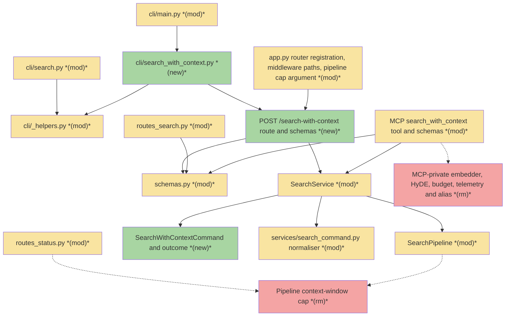
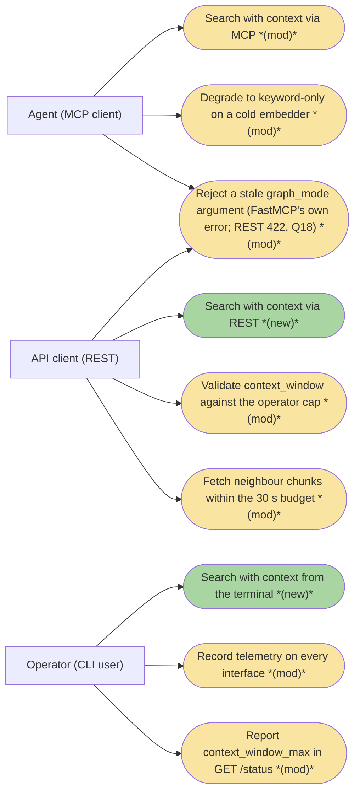
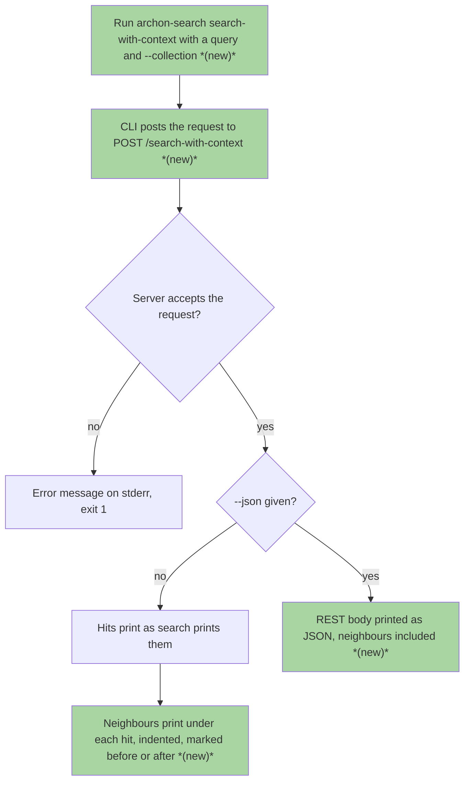
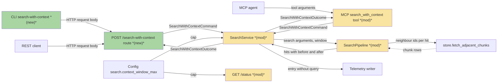
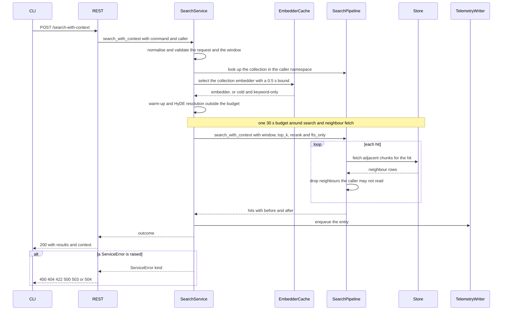

# 02-SWC · Search with context on one shared service across REST, MCP and CLI — Team Plan

**Story Points:** 8 — estimated 2026-11-06 with /estimate

**How to read this file**

- **Architecture approach:** Clean Architecture — the default; no override skill was requested. **Layers:** Presentation · Use Cases · Interface Adapters · Entities · Frameworks & Drivers.
- **Deployment boundary:** client+server. The CLI is an HTTP-only client of the REST server (ADR 20 rule 4: it imports nothing from `services/` or `server/`); REST and MCP are server-side adapters in one FastAPI process. There is no browser frontend, so the **Frontend** role is the **CLI** (Presentation); every other layer, the two server adapters included, is **Backend**. Same mapping as [01_search-team-plan.md](./01_search-team-plan.md).
- The **Frontend, Backend, and Tester** sections are the **depth view** — each role's scope, grouped by layer.
- **Contracts** are logical and authored as linked `.tsp` files (TypeSpec 1.17.0). Internal seams, the MCP tool seam, the CLI seams and the parity check are core-construct `.tsp` files beside this plan, each compiled with `--no-emit`; the one HTTP seam that changes (REST `POST /search-with-context`) is a TypeSpec HTTP service in the `api-contracts/` folder with an emitted `.openapi.yaml`. The root [CLAUDE.md](../../../CLAUDE.md) rule (the `tsp_contract/` paragraph) keeps `.tsp` contract files in `tsp_contract/` with the compiled output beside them. This plan follows the S1 precedent ([01_search-team-plan.md](./01_search-team-plan.md) line 19, whose drafts also still sit beside its plan): the files here are review drafts that move there with their compiled output in the close-out task (the Documentation update list names the move), so the folder never holds two diverging copies.
- **Role tags** (`#frontend-role`, `#backend-role`, `#tester-role`) mark each role-owned section — filter a tag (e.g. in Obsidian) to see one role's whole scope.
- IDs (`S#` scenarios, `C#` contracts, `Q#` questions) are the traceability thread. Vocabulary kept apart on purpose: "roadmap S2" is this slice in the [roadmap](./roadmap.md), "roadmap D#" its decisions, "brief C1–C14" the rules of [Brief 00](./00_service_layer_foundation_brief.md); plan IDs `S#`, `C#`, `Q#` are never those; where this file says "slice S1" or "the S1 plan" it means roadmap S1 ([01_search-team-plan.md](./01_search-team-plan.md)), never plan scenario S1. The brief's seven Open Questions were plan Q1–Q7 ("brief Open Question n" and "plan Qn" are the same item) and Q8–Q18 were unknowns the investigation found; the IDs stay stable; Q1–Q17 are answered from the code, the docs and the brief (the answers are in the *Resolved in this revision* block under Open questions and in the section each one changed), and Q18 was decided by the owner (option A: refuse the stale key with a 422); no question is open, so the status is `planned`.
- **Tasks** are not in this file — task breakdown is a separate downstream step that consumes this plan.
- **Rule:** change a contract only by team agreement.

---

## Background

A search hit alone is often a cut-off fragment, and `search_with_context` (a hit plus the neighbouring chunks of the same document) exists only as an MCP tool with its own implementation in [mcp.py](../../../archon_search/server/mcp.py) (the tool body, about lines 639-819): the collection is optional and falls back to a configured default, the wait for the embedder cache is unbounded, the pipeline call has no overall time budget, HyDE runs on a cold embedder, and `graph_mode` is accepted only to be rejected (`graph_mode_not_supported`). It validates the context window itself against a cap held by the pipeline ([pipeline.py](../../../archon_search/pipeline.py) `context_window_error`, `SearchPipeline.search_with_context`), records telemetry for success and the generic internal error only, and returns four summary fields. REST clients and terminal users cannot get context at all (roadmap D2 gave it a REST route and a CLI command).

Slice S1 has landed: [search_service.py](../../../archon_search/services/search_service.py) holds `SearchService.search` with every shared step as a private method (collection lookup, embedder selection with a 0.5 s bound, warm-up, HyDE resolution, the 30 s budget, `ServiceError` translation, telemetry, stage timings), [service_error.py](../../../archon_search/services/service_error.py) the closed error set, [container.py](../../../archon_search/services/container.py) the per-request and lazy builders, [search_command.py](../../../archon_search/services/search_command.py) the one normaliser, and [registry.py](../../../tests/parity/registry.py) already holds a row "S2 Search with context" whose REST and CLI claims are `pending S2` waivers. This slice adds the second service method on that pattern.

---

## Goal

The same query returns the same hits, the same neighbours, the same derived fields and the same errors on REST, MCP and the CLI, from one `SearchService.search_with_context` code path that shares its steps with `search`. The parity registry reports Search with context as covered on all three interfaces, and a field-level parity check proves the interfaces carry the same fields.

---

## Scope

### In Scope

- `SearchService.search_with_context` with its own command (`SearchWithContextCommand`) and outcome types; the steps it shares with `search` (normalisation, collection lookup, embedder selection, warm-up, HyDE resolution, budget, error translation, stage timings) are factored out of `SearchService.search`, not copied. The telemetry label stays `search_with_context`, so the hard-coded `_ENDPOINT` becomes a parameter.
- New REST `POST /search-with-context` with request and response schemas and the same error mapping table as `POST /search` (400, 404, 422, 500, 503 with `Retry-After`, 504); the route is added to the client-disconnect cancel middleware (ADR 19).
- New CLI command `search-with-context` in its own module, an HTTP client of the new route; the shared request and render helpers move to [_helpers.py](../../../archon_search/cli/_helpers.py) instead of being imported from [search.py](../../../archon_search/cli/search.py).
- MCP `search_with_context` rewritten as an adapter: `collection` required, `top_k` and `acl_context` added, `graph_mode` removed, response fields as `search`.
- Deleting what the cutover makes obsolete: the MCP tool's own embedder, HyDE, budget and telemetry logic, the tool's use of the `_SEARCH_TIMEOUT_SECONDS` alias in [mcp.py](../../../archon_search/server/mcp.py) (the alias definition itself stays until roadmap S3, because `explain` still imports it: [ADR 20](../../ADRs/20_application_service_layer_with_enforced_boundaries_and_interface_parity.md) line 97), and the context-window cap in the pipeline (the `context_window_max` constructor argument, its property and `context_window_error`), with `GET /status.search.context_window_max` reading the configured value instead.
- Parity registry rows (service method set, REST and CLI waivers removed), field-level parity for the new command, the adapter-thinness test extended, regenerated OpenAPI snapshots, docs, `BREAKING.md`, and a smoke run through the real server on all three interfaces.

### Out of Scope

- `collections` (multi-collection search with context): the neighbour fetch is per collection and no caller needs it yet.
- `graph_mode` on this command: `search` covers graph retrieval; the argument is removed, not kept as a rejected field.
- A cap on hits times neighbours, parallel neighbour fetching, a configurable budget: no evidence they are needed yet.
- Reporting neighbours dropped by ACL (unchanged behaviour, documented) and `acl_gate` on neighbours (they already carry their `acl` list).
- Retrieval, reranking and fusion algorithms.

---

## Acceptance criteria

- The same query returns the same hits, neighbours and derived fields through REST, MCP and `archon-search search-with-context --json` against a running server (S1, S48).
- `archon-search search-with-context` text output shows each hit with indented before and after neighbour lines (S36).
- MCP `search_with_context` without `collection` answers a validation error; a request that exceeds 30 s answers `timeout` (S14, S23).
- Every changed MCP behaviour has a [BREAKING.md](../../../BREAKING.md) entry (S49); the parity registry marks Search with context as covered on all three interfaces (S42); the default suite, `uvx ruff@0.17.3 check .` and the 85% coverage gate pass (S52).
- The OpenAPI snapshots differ only by the new path and its schemas and by the reworded `description` of `SearchStatusDetail` (S41).

---

## What does NOT change

- Retrieval, reranking and fusion algorithms; neighbour selection (same document, chunk index within the window of the hit, the hit excluded, ACL-filtered silently).
- `POST /search` and its response shape; the `search` service method's behaviour (its private steps are extracted, not altered).
- The 30 s budget (`SEARCH_TIMEOUT_SECONDS`) and the 0.5 s warm-up bounds; the structural no-raw-query telemetry invariant (ADR 05); the `embedder_not_ready` error kind and its 503 with `Retry-After` 30 (on this path the 0.5 s bound pre-empts the cache's 120 s wait, see *What changes*).
- `GET /status` wire shape: `SearchStatusDetail` keeps `max_fanout`, `top_k_max` and `context_window_max`; only the value's source changes (and one sentence of the model's docstring, which both OpenAPI snapshots publish as its `description`, C9).
- `get_http_request` stays a module attribute of [mcp.py](../../../archon_search/server/mcp.py) and the caller is resolved by the adapter per request (ADR 09, ADR 17); [mcp_disconnect.py](../../../archon_search/server/mcp_disconnect.py) already covers the tool.
- Persisted data: no table, field, migration or store schema version change.
- The `explain` tool and route (roadmap S3), including their use of the `_SEARCH_TIMEOUT_SECONDS` alias, which stays until S3.

---

## Known limitations / accepted trade-offs

- **Keyword-only answers are silent.** A cold embedder or cold cross-encoder degrades to keyword-only or un-reranked results with no response field saying so (accepted in S1; a signal is a Future Iteration shared with S1).
- **One store call per hit.** The neighbour fetch is sequential and costs up to `top_k_max` calls per request (each fetching at most `2 × window` ids); the 30 s budget is the backstop and nothing partial is returned on timeout. Batching or parallel fetch is out of scope (brief Out of Scope) and held in the brief's Future Iterations; S47 only measures the latency at `top_k_max`.
- **`top_k_max` and `context_window_max` are independent**, with no product cap on hits times neighbours; operators can lower either.
- **Neighbours dropped by ACL are not reported**; `acl_filtered` describes the hits only ([03_authorization_and_acl.md](../../SecurityGuide/03_authorization_and_acl.md) line 67 already says so).
- **HyDE is skipped on a cold embedder**, as in `search`: a behaviour change for MCP agents that used to run it (a `BREAKING.md` entry).
- **The CLI needs a running server.** It is an HTTP client; there is no in-process mode.
- **`scope_filter` filters hits only.** Neighbours are ACL-filtered, not scope-filtered: they are chunks of the hit's own document and every chunk of a document gets the same scope tags at ingest ([pipeline.py](../../../archon_search/pipeline.py) lines 1000-1003), so a scope filter on them would change nothing; [60_searching.md](../../UserManual/60_searching.md) line 157 already says so.
- **A stale `graph_mode` is rejected on MCP; on REST it is rejected too (Q18, decided by the owner: option A).** FastMCP validates tool arguments against the tool signature, which has no `**kwargs`, so an MCP client that still sends `graph_mode` (with a value or `null`) gets FastMCP's own argument error (`Unexpected keyword argument`, checked against the installed fastmcp) and the call is not served. The repo has two conventions for unknown REST keys: the request model of `POST /search` ([routes_search.py](../../../archon_search/server/routes_search.py) line 58) and the models of [schemas.py](../../../archon_search/server/schemas.py) set no `extra` option, so a stray top-level key is silently ignored there; the `/explain` models ([routes_explain.py](../../../archon_search/server/routes_explain.py) lines 6-8, which calls that an intentional divergence for a debug endpoint), `ExportRequest` ([routes_export.py](../../../archon_search/server/routes_export.py) line 979) and the nested `SearchFilters` ([filters.py](../../../archon_search/filters.py) line 19) set `extra="forbid"`, so a stray key INSIDE `filters` is already a 422 on `POST /search` today. Neither the brief nor an ADR decides the new route, and the brief's goal is "the same errors on every interface". **Decided (owner, Q18, option A):** the new request model sets `extra="forbid"`, so a stray `graph_mode` or `collections` (and any other unknown top-level key, a misspelt option included) answers the framework 422 list (`Extra inputs are not permitted`) and nothing is searched.

---

## Approach & architecture

Clean Architecture, applied to a repo with no layer folders: `archon_search/services/` is the **Use Cases** home. `SearchService` gains a second method that runs the brief's flow once and raises `ServiceError` for every failure; REST and MCP shrink to converting transport input into a command and the outcome into a response, and the CLI renders what REST returns. Everything the method shares with `search` is extracted into shared private steps so there is one implementation per behaviour.

### Architecture

_Scope limited to changed nodes: the full component set (about 30 components) exceeds 15 nodes, and its 1-hop neighbourhood does too; unchanged components (the store, config, telemetry, embedder cache, reranker, `services/container.py`) appear in the Layer map or the table. Dotted edges are last known connections of removed code._

| Component | Change | Why |
|-----------|--------|-----|
| `cli/search_with_context.py` | new | The `search-with-context` command: an HTTP client of the new route, in its own module (boundary rule 3) |
| `POST /search-with-context` route and schemas | new | REST route in a new module, `archon_search/server/routes_search_with_context.py`, with request and response schemas; error table as `POST /search`; no import of `routes_search` (boundary rule 2), so the hit schema (moved from `routes_search.py`) and the neighbour schema (promoted from `mcp_schemas.py`) live in [schemas.py](../../../archon_search/server/schemas.py) beside `AclGateSchema` and `ErrorDetail`; their importers are re-pointed, with no re-export. The module also holds its own three small transport helpers, written out again and not imported: the normaliser wrapper that turns a `ServiceError` into the framework's 422 (`_call_normaliser`, four lines, [routes_search.py](../../../archon_search/server/routes_search.py) lines 50-56), the 504 text `Search timed out` and the plain 500 body `Internal Server Error` (lines 44-45 there). Rule 2 bars importing them and the repo keeps one table per route module: [routes_openai_shim.py](../../../archon_search/server/routes_openai_shim.py) line 98 has its own `_error_response` and [routes_explain.py](../../../archon_search/server/routes_explain.py) line 596 holds its own `Search timed out` literal; no existing shared non-route home for them exists, and a new one for four lines is not worth a boundary entry |
| [routes_search.py](../../../archon_search/server/routes_search.py) | modified | `SearchResultSchema` moves to `schemas.py` and the file imports it from there, with no re-export; `POST /search` behaviour is unchanged |
| [schemas.py](../../../archon_search/server/schemas.py) | modified | Receives the hit schema and the promoted neighbour schema; one docstring sentence of `SearchStatusDetail` is reworded (C9) |
| `SearchWithContextCommand` and outcome | new | Own command (no `collections`, no `graph_mode`, plus `context_window`) and outcome (hits each with before and after neighbours) |
| [search_service.py](../../../archon_search/services/search_service.py) `SearchService` | modified | New `search_with_context`; shared steps extracted; `_ENDPOINT` parameterised; one 30 s budget around search and neighbour fetch |
| [search_command.py](../../../archon_search/services/search_command.py) normaliser | modified | Single-collection-required normalisation and the context-window rule, beside the `top_k` maximum rule |
| MCP tool and [mcp_schemas.py](../../../archon_search/server/mcp_schemas.py) | modified | Thin adapter: `collection` required, `top_k`, `acl_context`, no `graph_mode`, `acl_gate` per hit, the `search` response fields |
| [pipeline.py](../../../archon_search/pipeline.py) | modified | `SearchPipeline.search_with_context` gains `top_k`, `rerank` and `fts_only` (forwarded to `search`) and keeps the neighbour loop and its `context` stage timing; the context-window cap, `context_window_error` and the `context_window_max` constructor argument leave it, and so do the cap's other callsites: [app.py](../../../archon_search/server/app.py) line 1442, [pipeline.py](../../../archon_search/pipeline.py) line 4264, [mcp.py](../../../archon_search/server/mcp.py) lines 104 and 685 |
| [routes_status.py](../../../archon_search/server/routes_status.py) | modified | Reads `context_window_max` from config, not the pipeline; shape unchanged |
| [app.py](../../../archon_search/server/app.py) | modified | The new router is imported (beside line 137) and registered (beside line 1544); the `CancelOnDisconnectMiddleware` path tuple at line 1307 gains `/search-with-context` (exact match); the pipeline constructor call at line 1442 stops passing `context_window_max`; [disconnect.py](../../../archon_search/server/disconnect.py) itself is unchanged |
| [_helpers.py](../../../archon_search/cli/_helpers.py), [main.py](../../../archon_search/cli/main.py), [search.py](../../../archon_search/cli/search.py) | modified | Shared request and render helpers move to `_helpers.py`; `main.py` registers the command; `search.py` imports the helpers from there |
| MCP-private embedder, HyDE, budget, telemetry and alias | removed | Replaced by the service; only this tool's use of the timeout alias goes: the alias definition stays until roadmap S3 because `explain` still uses it ([ADR 20](../../ADRs/20_application_service_layer_with_enforced_boundaries_and_interface_parity.md) line 97) |
| Pipeline context-window cap | removed | Validation is the service's; the status source is config |

**Layer map (and role mapping)**

| Layer | Role | Components |
|-------|------|-----------|
| Presentation | **Frontend** (CLI, Click) | `cli/search_with_context.py` (new), [main.py](../../../archon_search/cli/main.py) registration, [_helpers.py](../../../archon_search/cli/_helpers.py); talks to REST over HTTP only |
| Interface Adapters | Backend (Python) | The new REST route and schemas; the MCP tool in [mcp.py](../../../archon_search/server/mcp.py) with [mcp_schemas.py](../../../archon_search/server/mcp_schemas.py); [routes_status.py](../../../archon_search/server/routes_status.py); [routes_search.py](../../../archon_search/server/routes_search.py) (the hit schema moves out); [schemas.py](../../../archon_search/server/schemas.py) (`SearchStatusDetail` and the shared hit and neighbour schemas) |
| Use Cases | Backend (Python) | `SearchService.search_with_context`, `SearchWithContextCommand`, its outcome and `AclGate` (the service types live under [services/](../../../archon_search/services/)), the normaliser in [search_command.py](../../../archon_search/services/search_command.py), `ServiceError` in [service_error.py](../../../archon_search/services/service_error.py), [container.py](../../../archon_search/services/container.py) (unchanged), [search_budget.py](../../../archon_search/services/search_budget.py), [request_hyde.py](../../../archon_search/services/request_hyde.py) |
| Entities | Backend (Python) | [_types.py](../../../archon_search/_types.py) `ChunkRecord` and `SearchResult`, [filters.py](../../../archon_search/filters.py) `SearchFilters`, [acl.py](../../../archon_search/acl.py), [entry.py](../../../archon_search/telemetry/entry.py) `TelemetryEntry` and its enums |
| Frameworks & Drivers | Backend (Python) | [pipeline.py](../../../archon_search/pipeline.py), [store.py](../../../archon_search/store.py) (LanceDB, `fetch_adjacent_chunks`), [config.py](../../../archon_search/config.py), FastAPI / FastMCP / Click / httpx, the composition root [app.py](../../../archon_search/server/app.py) |

The repo's own docs use a different layer vocabulary ([110_component_catalog_and_layer_breakdown.md](../../Architecture/110_component_catalog_and_layer_breakdown.md)); the labels above are this plan's Clean Architecture classification, as in the S1 plan.

**What changes**

- `services/` gains `search_with_context` beside `search`, sharing every non-specific step; it may import core modules and nothing from `server`, `cli`, `fastapi`, `starlette`, `fastmcp`, `click`, `httpx` or `uvicorn` (ADR 20 rule 1).
- Search and neighbour fetch run inside ONE `run_within_budget`; today `search_with_context` has no budget and `SearchService` wraps only `pipeline.search`.
- The context-window rule and its cap move out of the pipeline into the service; `GET /status` reads the same configured value (C9).
- REST and MCP resolve the caller, build a command, call the service and render through one error table each; MCP answers `timeout` and `metadata_store_error`, which it never produced for this tool.
- Telemetry moves into the service for every interface with the label `search_with_context` (C4): success, timeout and internal error, plus `embedder_not_ready`, `metadata_store_error` and `hyde_failed` recorded as `internal_error`; MCP recorded only success and the generic internal error before.
- On this tool the 0.5 s embedder bound always pre-empts the cache's own 120 s wait ([BREAKING.md](../../../BREAKING.md) line 227, `_select_embedder` in [search_service.py](../../../archon_search/services/search_service.py)), so MCP `search_with_context` practically stops answering `embedder_not_ready`; the kind stays in the table and answers only if a cache raises at once (S25).
- The CLI renders REST's body: hits as `search` prints them, then indented neighbour lines.

**Key decisions (from the brief)**

- HyDE on a cold embedder is skipped, as in `search` (one rule on every surface; cost: a `BREAKING.md` entry for MCP agents).
- `graph_mode` is removed everywhere (the owner's decision in the brief's Key Decisions, which replaces the rejected-field wording of the root CLAUDE.md invariant; CLAUDE.md is updated at close-out), so the field set stays identical across surfaces and no permanent parity waiver is needed; the MCP tool description points agents to `search` for graph retrieval and says `collection` is required (S54).
- Inputs and response equal `search`'s plus `acl_context` and `top_k` (the response carries the derived fields the brief lists; `excluded_collections`, `graph_expansion_applied` and `ppr_entities_matched` are absent because one collection and no `graph_mode` make them constant, and `expansion_used` is `hyde_applied` or `rag_fusion_applied`); `top_k` matters more here because each hit multiplies the payload.
- `acl_gate` on hits only, one gate rule.
- `top_k_max` and `context_window_max` stay independent; the 30 s budget is the backstop.
- Separate route and command, not a flag on `search`.
- The CLI shows neighbours in text output, not only in `--json`.
- Where limits or defaults conflict between interfaces, REST's bounded values win (roadmap D5).

### Actors & Use Cases

### Flows

#### User Flow

#### Data Flow

_Scope: the neighbour step stays a step of `SearchPipeline.search_with_context` (extended with `top_k`, `rerank` and `fts_only`); the service wraps that one call in its single budget._

#### Sequence

### Prior decisions

| Decision | Rationale | Constraint |
|----------|-----------|------------|
| [ADR 20](../../ADRs/20_application_service_layer_with_enforced_boundaries_and_interface_parity.md) — application-service layer with test-enforced boundaries and interface parity | Features drifted across interfaces with no check | S2 logic goes in `SearchService.search_with_context`; REST and MCP are thin adapters; `cli/search_with_context.py` imports only `cli/_helpers` and `constants` (rules 3-4), which is why the helpers move; `services/` imports no web, CLI or HTTP-client package; no services-side `str(exc)` on the wire; the registry row needs the service method and all three live identifiers with the waivers removed; field-level parity covers the new command; none of the eight ratchet-allowlist edges ([test_layer_import_boundary.py](../../../tests/test_layer_import_boundary.py) lines 341-349) concerns `search_with_context`, so the slice deletes no edge |
| [ADR 20](../../ADRs/20_application_service_layer_with_enforced_boundaries_and_interface_parity.md) Amendment 2026-11-03 — S1 pilot precedent | Records the pattern S2 reuses | Own command and outcome types; one `ServiceErrorKind` table per adapter (REST `_error_response` equivalent, MCP `McpErrorResponse(error, code)` without per-kind branching); the service built per request on REST and lazily once on MCP (ADR 20 line 94, [mcp.py](../../../archon_search/server/mcp.py) lines 539-597); telemetry recorded once in the service; the label `_ENDPOINT` is parameterised; line 97's alias sentence already says the alias stays in `mcp.py` for `search_with_context` and `explain` until their slices, so a new dated S2 amendment supersedes it (only `explain` still uses the alias until S3) and line 97 stays as written, because accepted ADRs are append-only |
| [ADR 05](../../ADRs/05_opt_in_local_telemetry_no_raw_query.md) — opt-in telemetry, no raw query | Privacy is structural | Entries come only from the existing factories, with no query parameter; with `hash_doc_ids` on, hit doc ids are hashed the same way on REST, MCP and CLI-via-REST, so the hasher must reach the new service and route |
| [ADR C4](../../ADRs/C4-hyde-external-llm-dependency.md) — HyDE (partly superseded by ADR 19) | Opt-in, availability over quality | `hyde` resolves through the shared service step; failure falls back with `hyde_applied` false; no query text in logs; "skipped on a cold embedder" is an extra rule applied identically to `search` and needs a `BREAKING.md` entry |
| [ADR C5](../../ADRs/C5-rag-fusion-external-llm-dependency.md) — RAG Fusion, exclusive with HyDE (partly superseded by ADR 19) | Cost control | RAG Fusion wins over HyDE; the exclusion must survive the extraction; its text calls the fallback "silent" and "422", which later amendments superseded, so do not re-pin it |
| [ADR 19](../../ADRs/19_shared_llm_client_and_provider_based_collection_descriptions.md) — shared LLM client; client-abort cancellation | An abandoned search left a child process alive | The new REST route must be covered by `CancelOnDisconnectMiddleware` (path-keyed, exact match); one budget around search and fetch must not defeat cancellation; [test_disconnect_cancels_provider_call_e2e.py](../../../tests/integration/test_disconnect_cancels_provider_call_e2e.py) (fixture at lines 91-96 patches the alias on `mcp`, which `explain` still reads, on `routes_explain` and on `search_service`) stays valid and gains the new route in its REST disconnect parameters (line 139) |
| [ADR 11](../../ADRs/11_embedder_cache_bounded_waiter_timeout.md) — bounded waiter timeout | A wedged load must not hang every search | The 0.5 s bound is an outer bound over the cache call and must not delete or alter the cache's loading entry; reuse the S1 step; the 120 s `EmbedderNotReadyError` path (503) still applies elsewhere |
| [ADR 08](../../ADRs/08_per_collection_embedder_lru_cache.md) — per-collection embedder LRU cache | Bounded memory | Embedder selected per collection through the cache; an evicted model is cold again, so keyword-only degradation can recur |
| [ADR 03](../../ADRs/03_cross_encoder_reranker_second_stage.md) — cross-encoder second stage | Precision at small `top_k_return` | The cold cross-encoder bound reuses the pipeline's behaviour; the algorithm is unchanged |
| [ADR 17](../../ADRs/17_mcp_namespace_via_public_get_http_request.md) — public `get_http_request` (and its 2026-11-03 Amendment) | Public API, no private context | The rewritten tool resolves identity through `_get_request_identity()` and refuses before building the service; `get_http_request` stays a module attribute; the fail-closed tests stay green and gain a case for this tool |
| [ADR 09](../../ADRs/09_mcp_http_mount_and_namespace_propagation.md) — MCP mount and namespace propagation (partly superseded by ADR 17) | One process, one auth | The caller's namespace is threaded into the service `caller` per call, never cached at tool-build time |

### Contradictions

**Code vs. docs**

- [20_application_service_layer_with_enforced_boundaries_and_interface_parity.md](../../ADRs/20_application_service_layer_with_enforced_boundaries_and_interface_parity.md) line 97 says the `_SEARCH_TIMEOUT_SECONDS` alias stays in [mcp.py](../../../archon_search/server/mcp.py) for `search_with_context` and `explain` until those slices move them, so it is no contradiction with this slice: the alias is imported at line 45 and used at line 731 (this tool's HyDE call) and line 904 (`explain`). Decided: S2 removes the use at line 731 and a new dated S2 amendment supersedes the sentence (ADRs are append-only, so line 97 stays as written); the definition stays until S3 for `explain` ([test_mcp_search_service.py](../../../tests/server/test_mcp_search_service.py) line 329 patches `mcp_module._SEARCH_TIMEOUT_SECONDS` and keeps working). Owner: **decided, no open question**; the brief's "delete the alias" is amended (Documentation update).
- [CLAUDE.md](../../../CLAUDE.md) line 48 calls the `graph_mode` rejection on `search_with_context` a "permanent design decision" and says the tool rejects any non-null value; the code agrees today. The brief's Key Decisions (the owner's decision) keep the decision (no graph retrieval here) but remove the argument instead of rejecting it, so the wording becomes false after S2. Owner: **doc needs updating** (maps to Documentation update, *new feature*); no sign-off is needed beyond the brief.
- ADR C5's "silent" and "422" wording is stale against its own 2026-11-04 amendment and ADR 19; the constraint column says not to re-pin it. Owner: **doc needs updating** only if the ADR is revisited; no action in this slice.
- Statements that are accurate today and become false or incomplete at cutover (each is on the Documentation update list): [60_searching.md](../../UserManual/60_searching.md) lines 13, 107, 115-116, 120, 124-125, 132-158, 195, 293 and 386 (no `top_k`, no `acl_context`, no warm-up bound, no `acl_gate`, `graph_mode` rejected, the one-implementation list, the HyDE cap), [65_graph_search.md](../../UserManual/65_graph_search.md) line 77 (the tool "rejects any non-null `graph_mode`"), [01_overview.md](../../DeveloperGuide/01_overview.md) line 30 ("`search_with_context` takes none"), [03_rest_client_python.md](../../DeveloperGuide/03_rest_client_python.md) line 189 ("There is no REST `/search/with_context` endpoint"), [05_mcp_integration.md](../../DeveloperGuide/05_mcp_integration.md) lines 21, 26, 45 and 112-113 (default collection, "exists only on MCP"), [150_security_and_privacy_architecture.md](../../Architecture/150_security_and_privacy_architecture.md) line 130 ("neither MCP tool has an `acl_context` input or an `acl_gate` result field"), [520_api_design_and_contracts.md](../../Architecture/520_api_design_and_contracts.md) lines 14, 43 and 46, [30_configuration.md](../../UserManual/30_configuration.md) line 89, [archon-search.toml.example](../../../archon-search.toml.example) lines 184-187 (`context_window_max` as an MCP-only ceiling), [90_incident_runbook.md](../../OperatorGuide/90_incident_runbook.md) lines 94 and 111 (the unbounded 120 s cache wait and "no search budget" for the tool; the disconnect log lines) and [160_operational_readiness_monitoring_and_reliability.md](../../Architecture/160_operational_readiness_monitoring_and_reliability.md) line 111 (the unbounded cache wait and HyDE on a cold embedder, for `search_with_context`), [110_component_catalog_and_layer_breakdown.md](../../Architecture/110_component_catalog_and_layer_breakdown.md) lines 148 and 153, [06_client_migration_examples.md](../../MigrationGuide/06_client_migration_examples.md) line 145 ("`search_with_context` takes no `top_k`") and the `BREAKING.md` entries at lines 55, 161, 212, 222, 227, 228, 242, 1120, 1185-1189, 1495 and 1872. [README.md](../../../README.md) line 199 stays true: it never says the ceiling is MCP-only. The disconnect log lines (the runbook, [160_troubleshooting.md](../../UserManual/160_troubleshooting.md) line 225 and [600_api_reference_or_public_interface.md](../../Architecture/600_api_reference_or_public_interface.md) line 195 name only the old paths), the services lists ([110_component_catalog_and_layer_breakdown.md](../../Architecture/110_component_catalog_and_layer_breakdown.md) lines 132, 136 and 137, [AGENTS.md](../../../AGENTS.md) line 65, [CLAUDE.md](../../../CLAUDE.md) line 30) and the names of the moved schemas ([520_api_design_and_contracts.md](../../Architecture/520_api_design_and_contracts.md) line 64, [110_component_catalog_and_layer_breakdown.md](../../Architecture/110_component_catalog_and_layer_breakdown.md) line 162, [05_mcp_integration.md](../../DeveloperGuide/05_mcp_integration.md) lines 39 and 43, [55_chunk_metadata_and_enrichment.md](../../UserManual/55_chunk_metadata_and_enrichment.md) line 12) are on the list too.

**Brief vs. reality**

- **The alias deletion is partial.** `explain` still needs the alias definition, and ADR 20 line 97 says it stays until S3. Decided: only this tool's use goes; the brief's line "the `_SEARCH_TIMEOUT_SECONDS` alias in `mcp.py`" is amended (Documentation update). `SEARCH_TIMEOUT_SECONDS` already lives in [constants.py](../../../archon_search/constants.py), line 20, for the S3 slice to import.
- **"MCP records only success today" is slightly too narrow.** The tool also enqueues an `internal_error` entry through `_enqueue_internal_error` on the generic exception path (line 817); it records nothing for a timeout (none exists), embedder-not-ready or a metadata-store failure. Answered: C4 records success, timeout and internal error on every interface, and the service also records `embedder_not_ready`, `metadata_store_error` and `hyde_failed` as `internal_error` (new for MCP); no open question.
- **The pipeline's `search_with_context` cannot be reused as is.** It calls `search` without `top_k`, `rerank` or `fts_only`, so it can neither honour `top_k` nor the keyword-only degrade, and it validates the window against the pipeline-held cap. Answered: the method is extended with `top_k`, `rerank` and `fts_only` and loses the cap check (about twenty pipeline tests call it, so it stays one step the service calls inside its budget); no open question (C3).
- **The new REST route is not covered by the disconnect middleware.** [app.py](../../../archon_search/server/app.py) line 1307 lists the paths `/search` and `/explain` exactly, and the brief is silent. Answered by ADR 19's constraint: the path is added (a Backend done-when item, S24); no open question.
- **The CLI request timeout.** The investigation could not tell whether `CLI_SEARCH_REQUEST_TIMEOUT_SECONDS` exceeds the 30 s budget. Verified: it is twice `SEARCH_TIMEOUT_SECONDS` plus a margin ([constants.py](../../../archon_search/constants.py) lines 28-30, 65 s), so the new command reuses it. Answered; no open question.
- **`include_metadata` on neighbours.** The investigation could not tell whether the flag also blanks neighbour metadata. Verified in the tool body ([mcp.py](../../../archon_search/server/mcp.py) lines 779-790): it blanks both hits and neighbours. Answered; the behaviour is kept on every surface (S12).
- **Telemetry doc ids.** No ADR says whether neighbour doc ids enter telemetry. Verified: the tool records the hits' ids only (`result_doc_ids` from `r["result"]`). Answered: hits only, kept (C4, S26).
- **`acl_filtered` and neighbours.** Answered by the brief's Out of Scope and [03_authorization_and_acl.md](../../SecurityGuide/03_authorization_and_acl.md) line 67: neighbours dropped by ACL do not flip it.
- **The response field set is under-specified.** The brief lists seven derived fields; `search`'s outcome also has `excluded_collections`, `graph_expansion_applied` and `ppr_entities_matched`. Answered: absent, because `excluded_collections` is set only by the multi-collection paths ([pipeline.py](../../../archon_search/pipeline.py) line 3265) and graph expansion runs only for a given `graph_mode` (lines 1583-1611), which this command never passes; `expansion_used` is `hyde_applied` or `rag_fusion_applied` (C1, C5, C6).
- **"Each result carries `context_before` and `context_after`" versus today's nested item.** Today the MCP item is `{result, context_before, context_after}`. Answered: nested stays on every surface; the brief lists no reshape among the MCP changes, [60_searching.md](../../UserManual/60_searching.md) line 107 documents the nested item, and a flat item would be an extra MCP break the brief does not ask for.
- **Where the shared REST schemas go** is not decided in the brief or the code. Answered: in [schemas.py](../../../archon_search/server/schemas.py), which `routes_search.py` and `mcp_schemas.py` already import from; each route keeps its own error table ([routes_openai_shim.py](../../../archon_search/server/routes_openai_shim.py) line 98 is the precedent); neighbours expose their `acl` list only, as MCP does ([mcp_schemas.py](../../../archon_search/server/mcp_schemas.py) lines 131-150).

---

## Contracts / seams

Boundaries where roles must agree. **Logical, not code.** Changing one requires team agreement. **Tooling used: TypeSpec 1.17.0.** The internal seams (C1-C4), the MCP tool seam (C6: JSON-RPC tool calls, not REST routes, so no OpenAPI, as in [01_search-c6-mcp-search-tool.tsp](./01_search-c6-mcp-search-tool.tsp)), the CLI seams (C7, C8), the status-value source (C9) and the parity check (C10) are core-construct `.tsp` files beside this plan, each compiled clean with `tsp compile <file> --no-emit`. The one HTTP seam that changes, REST `POST /search-with-context` (C5), is a TypeSpec HTTP service in `api-contracts/` with an emitted `.openapi.yaml`. C9 changes only the source of an existing HTTP field, so no OpenAPI artefact is emitted for it.

**C1 — Search-with-context command, outcome and service**  *(Interface Adapters ↔ Use Cases)* — [02_search_with_context-c1-search-with-context-service.tsp](./02_search_with_context-c1-search-with-context-service.tsp)
One operation: the service takes a command and a resolved caller and returns an outcome. The command carries REST's field names minus `collections` and `graph_mode`, plus `context_window`; `collection` is required by the rule (optional in the type, so a missing MCP argument reaches the normaliser's validation error). The outcome holds ranked hits, each with its `acl_gate` (hits only) and its ordered `context_before` and `context_after` (neighbours carried as the core `ChunkRecord`), plus the derived fields the brief lists. The flow and its order are the brief's Core Flow; the steps shared with `search` are extracted, not copied. Failures are `ServiceError` only.

**C2 — Normalisation and the context-window rule**  *(Use Cases, internal)* — [02_search_with_context-c2-context-window-validation.tsp](./02_search_with_context-c2-context-window-validation.tsp)
Validation order follows `search` and adds the window: collection (missing or blank: `collection must not be empty`), query, `top_k` below 1, `top_k` above the maximum, `context_window` outside `[0, [search].context_window_max]`, then the `scope_filter` syntax. A window of 0 is valid; the rule lives in the normaliser ([search_command.py](../../../archon_search/services/search_command.py)) beside the `top_k` maximum rule, takes the cap from config, and keeps the pipeline's text `context_window must be in [0, {max}]; got {n}`. REST answers `422 {"detail": text}` for any out-of-range value, a negative one included, because the REST schema has no minimum (a schema minimum would give the framework's list and skip the service); MCP answers `validation_error`. A blank `query` or `collection` is caught earlier on REST by the request model's two field validators, which run the same normaliser rules and answer the framework's list (`Value error, query must not be empty`, as `POST /search` does, pinned in [test_routes_search_service_adapter.py](../../../tests/server/test_routes_search_service_adapter.py) lines 293-294); only the `top_k` maximum and the window answer the plain `{"detail": text}`.

**C3 — Search plus neighbour fetch under one budget**  *(Use Cases ↔ Frameworks & Drivers, internal)* — [02_search_with_context-c3-pipeline-neighbour-fetch.tsp](./02_search_with_context-c3-pipeline-neighbour-fetch.tsp)
Search and the whole neighbour loop run in one 30 s budget with nothing partial on timeout; neighbours are same-document, clamped at 0, ACL-filtered silently (not scope-filtered), one store call per hit; a hit id without a numeric suffix gives empty context and a warning; a per-hit store `ValueError` is practically unreachable and ends as `internal_error`; the pipeline no longer holds the cap. The step stays `SearchPipeline.search_with_context`, extended with `top_k`, `rerank` and `fts_only`.

**C4 — Telemetry label plumbing**  *(Use Cases ↔ telemetry writer, internal)* — [02_search_with_context-c4-telemetry-endpoint-label.tsp](./02_search_with_context-c4-telemetry-endpoint-label.tsp)
The service passes the endpoint label into the shared steps; `search_with_context` is already a valid label. Success, timeout and internal error are recorded on every interface, and `embedder_not_ready`, `metadata_store_error` and `hyde_failed` are recorded as `internal_error` as for `search`; hit doc ids only; no query text. Resolves brief Open Question 6.

**C5 — REST `POST /search-with-context`**  *(client ↔ server; the seam the CLI uses)* — [02_search_with_context-c5-rest-search-with-context.tsp](./api-contracts/02_search_with_context-c5-rest-search-with-context.tsp), [02_search_with_context-c5-rest-search-with-context.openapi.yaml](./api-contracts/02_search_with_context-c5-rest-search-with-context.openapi.yaml)
Request: `query`, required `collection`, optional `context_window` (default 1, no schema minimum or maximum: the service owns the range), `top_k` (minimum 1), nested `filters`, `hyde`, `rag_fusion`, `scope_filter`, `acl_context`, `include_metadata`. Response: `results` (each item holds the hit as `result` plus `context_before` and `context_after`) and the seven derived fields of the brief. Errors: the table of `POST /search` (400, 404, 422, 500, 503 with `Retry-After`, 504). Unknown top-level keys: the owner decided (Q18, option A) that the request model sets `extra="forbid"` (emitted as `additionalProperties: false`), so a stray `graph_mode` or `collections` key, like any unknown key, answers the framework 422 list (`Extra inputs are not permitted`) and nothing is searched, as MCP refuses a stale `graph_mode`; the rejected alternative was no `extra` option, as `SearchRequest` of `POST /search`, which ignores the key. The repo has both conventions: `POST /search` and [schemas.py](../../../archon_search/server/schemas.py) models ignore, the `/explain` models, `ExportRequest` and the nested `SearchFilters` forbid, so a stray key inside `filters` is already a 422. Adds a path to both OpenAPI snapshots; the hit and neighbour schemas live in `server/schemas.py`.

**C6 — MCP `search_with_context` tool**  *(client ↔ server over MCP)* — [02_search_with_context-c6-mcp-search-with-context-tool.tsp](./02_search_with_context-c6-mcp-search-with-context-tool.tsp)
Input gains `top_k` and `acl_context`, `collection` is required by rule (optional in the signature, as in `search`, so a missing one answers the in-band `validation_error` and not FastMCP's argument error), `graph_mode` is removed (a stale one gets FastMCP's own argument error) and the tool description, which FastMCP takes from the tool's docstring, says that `collection` is required and points agents to `search` for graph retrieval (the brief's Key Decision, pinned by S54); the response gains the `search` derived fields and `acl_gate` per hit, the item stays nested; errors go through one table and the tool answers `timeout` and `metadata_store_error`. Without a configuration the tool answers the fixed `search failed` / `internal_error`, as `search` does.

**C7 — CLI `search-with-context`**  *(Presentation ↔ REST over HTTP)* — [02_search_with_context-c7-cli-search-with-context.tsp](./02_search_with_context-c7-cli-search-with-context.tsp)
Positional query, required single `--collection`, optional `--context-window` and `--top-k`, the filter options, `--include-metadata`, `--hyde`, `--rag-fusion`, `--scope-filter`, `--acl-context`, `--json`. Human output: hits as `search` prints them, then indented neighbour lines marked before or after (before lines first, ascending chunk order, no chunk id; indent and marker wording are the developer's choice, pinned by S36); `--json` is the REST body in the repo's format; a response `expansion_warning` prints as `Note: <text>` on stderr after the results and `--json` prints no note, as `search` does; errors and exit codes as `search`; a nested shape check of its own for a 200 body.

**C8 — Shared CLI helpers**  *(Presentation, internal)* — [02_search_with_context-c8-cli-shared-helpers.tsp](./02_search_with_context-c8-cli-shared-helpers.tsp)
The request and render helpers private to `search.py` move to `_helpers.py` (all but the flat `_shape_problem`, which stays; the new module checks the nested item itself); the `httpx.post` call stays in each command module, so the four `tests/cli/test_search_fe3.py`-`fe6.py` patch targets stay valid; one test reads a name that moves, [test_search_fe3.py](../../../tests/cli/test_search_fe3.py) (line 15 imports the module, line 78 reads `search_mod._EXCERPT_MAX_CHARS`), and is re-pointed to `_helpers`.

**C9 — Source of `GET /status.search.context_window_max`**  *(Interface Adapters ↔ config, internal)* — [02_search_with_context-c9-status-context-window-source.tsp](./02_search_with_context-c9-status-context-window-source.tsp)
The value is read from the `[search]` config the status builder already receives; the wire shape and every path are unchanged; the one `SearchStatusDetail` docstring sentence is reworded and both snapshots publish it as the model's `description`. Resolves brief Open Question 2.

**C10 — Field-level parity for search with context**  *(test-side)* — [02_search_with_context-c10-field-parity.tsp](./02_search_with_context-c10-field-parity.tsp)
Command and response fields map across the service, REST, MCP and CLI with nested neighbour paths; no `graph_mode` or `collections` waiver; the service-only neighbour fields (vector, scopes, expiry, offsets, custom score, ACL provenance) carry waivers on REST and MCP. The existing check is generalised over its surface set and a second mapping table is added to `field_registry.py`.

---

## Data

_Skipped: this slice changes no table, field, relationship or migration. Persistence is LanceDB (an embedded vector store, not a relational schema): the feature only reads existing chunk rows through [store.py](../../../archon_search/store.py) `fetch_adjacent_chunks`, which derives neighbours from the chunk id convention `{doc_id}-{index:06d}` by index arithmetic with no join. `STORE_SCHEMA_VERSION` is not bumped and no migration spec is added; the only state change is the source of the `context_window_max` value, which is configuration, not stored data._

---

## Scenarios #tester-role

Behavioural only — step-level detail is produced by the tasks below. Covers happy, unhappy, edge and non-functional paths for the service, REST, MCP, CLI and the release.

| id | Scenario (Given / When / Then) |
|----|--------------------------------|
| **S1** | **Given** one running app and a multi-chunk collection · **When** the same query with the same `top_k` and `context_window` goes through REST, MCP and the CLI `--json` · **Then** hits, neighbours, derived fields and error codes agree, because one `SearchService.search_with_context` produced them |
| **S2** | **Given** a query and `top_k` · **When** `search` and `search_with_context` run on the same single collection · **Then** the hits (order, ids, derived fields) are equal and only the neighbours differ, proving the steps are shared and not copied |
| **S3** | **Given** a hit in the middle of a document and `context_window` 1 · **When** the search runs · **Then** `context_before` holds the one earlier chunk and `context_after` the one later chunk of the same document, in index order, and never the hit itself |
| **S4** | **Given** `context_window` omitted · **When** the search runs · **Then** the window is 1 on REST, MCP and the CLI |
| **S5** | **Given** `context_window` 0 · **When** the search runs · **Then** the hits come back with empty `context_before` and `context_after` |
| **S6** | **Given** `context_window` above `[search].context_window_max`, or below 0 · **When** it is sent · **Then** every interface rejects it with the validation text `context_window must be in [0, {max}]; got {n}` (REST `422 {"detail": text}`, because the schema has no minimum; MCP `validation_error`; CLI `Error:` and exit 1) and nothing reaches the pipeline |
| **S7** | **Given** an operator who lowers `[search].context_window_max` · **When** a request uses the old larger window and `GET /status` is read · **Then** the request is rejected against the new bound and `search.context_window_max` reports the same configured value, read from config (the pipeline no longer holds the cap) |
| **S8** | **Given** a hit at the start of its document, one near the end, and a collection table that is missing · **When** the neighbours are fetched · **Then** the lower bound is clamped at 0, ids past the end are simply absent, and a missing table gives empty context |
| **S9** | **Given** a hit whose `chunk_id` has no numeric suffix · **When** the search runs · **Then** that hit has empty context and the server logs one warning, and the other hits are unaffected |
| **S10** | **Given** a neighbour the caller may not read · **When** the search runs · **Then** it is dropped silently, the hit stays, `acl_filtered` does not change for it and nothing reports the drop |
| **S11** | **Given** `acl_context=true` · **When** the search runs · **Then** each hit carries `acl_gate` and no neighbour does (neighbours carry their `acl` list); **and Given** `acl_context` absent · **Then** `acl_gate` is null on every hit |
| **S12** | **Given** `include_metadata` false, then true · **When** the search runs · **Then** `metadata` is blank on hits AND neighbours in the first case and present on both in the second, with the top-level flag and `filters.include_metadata` ORed once |
| **S13** | **Given** `top_k` N · **When** the search runs on REST, MCP and the CLI · **Then** at most N hits come back, each with its neighbours; a value above `top_k_max` answers `top_k <n> exceeds operator-configured maximum of <max>` on every interface (REST 422, MCP `validation_error`), and a value below 1 is rejected as in `search` (REST by the schema with the framework's 422 list, MCP and the service with `top_k must be at least 1`) |
| **S14** | **Given** a blank query or blank collection, or an MCP call without `collection` · **When** it is sent · **Then** REST answers 422 with the framework's list (`Value error, collection must not be empty` or `Value error, query must not be empty` for a blank value, from the request model's validators as in `POST /search`; `Field required` for a missing `collection`), MCP answers the in-band `validation_error` with the plain texts `collection must not be empty` and `query must not be empty` (a missing `collection` included, so FastMCP's own argument error never answers first, as in `search`), and the CLI prints the text and exits 1 (a missing `--collection` is a usage error, S38); MCP no longer falls back to a configured default collection |
| **S15** | **Given** a request that breaks several rules at once · **When** it is validated · **Then** the first failing rule wins in the order collection, query, `top_k` below 1, `top_k` above the maximum, `context_window` outside its range, then the `scope_filter` syntax |
| **S16** | **Given** an unknown collection, an invalid collection name, or one in another namespace · **When** searched · **Then** one `not_found` kind answers with the text `collection not found` (REST 404, MCP `not_found`), an invalid name never reaches the store, and MCP no longer echoes the name |
| **S17** | **Given** the collection metadata lookup fails · **When** searched · **Then** REST answers 503 `metadata_store_error` without `Retry-After` and MCP answers `metadata_store_error` (today `internal_error`) |
| **S18** | **Given** the collection's embedder is still loading after the 0.5 s bound · **When** searched on any interface · **Then** the answer is keyword-only and silent, the cache's loader is not cancelled, and the neighbours are still returned |
| **S19** | **Given** a cold cross-encoder · **When** searched · **Then** the answer is un-reranked, bounded like `search` (MCP no longer waits for it unbounded) |
| **S20** | **Given** `hyde=true` and a cold embedder · **When** searched · **Then** HyDE is skipped (`hyde_applied` false) on every interface; MCP no longer runs it on a cold embedder |
| **S21** | **Given** `hyde=true` and a HyDE generator failure · **When** searched · **Then** the search falls back with `hyde_applied` false and `expansion_warning` set, and an unexpected failure while resolving HyDE is the `hyde_failed` kind exactly as in `search` |
| **S22** | **Given** `rag_fusion=true` with or without `hyde=true` · **When** searched · **Then** RAG Fusion wins (HyDE skipped), `rag_fusion_applied`, `rag_fusion_queries_used` and `rag_fusion_attempted` are reported, and the exclusion survives the extraction (ADR C5) |
| **S23** | **Given** a search plus neighbour fetch that exceeds 30 s · **When** it runs · **Then** both are cancelled inside ONE budget and the answer is `timeout` (REST 504, MCP `timeout`, CLI `Error:`) with nothing partial |
| **S24** | **Given** a client that aborts `POST /search-with-context` mid-request · **When** the server notices · **Then** the search and its HyDE or RAG Fusion provider call are cancelled, as for `POST /search`; the MCP tool is already covered by its own middleware; the existing middleware test in [test_app.py](../../../tests/test_app.py) (lines 1085-1120) derives the provider routes from OpenAPI and asserts exactly `/search` and `/explain`, so it changes with the route, and the docstring of [mcp_disconnect.py](../../../archon_search/server/mcp_disconnect.py) (lines 19-20) names only those two REST routes |
| **S25** | **Given** a stub embedder cache that raises `EmbedderNotReadyError` at once (the real cache's 120 s wait is always pre-empted by the 0.5 s bound) · **When** searched · **Then** REST answers 503 with `Retry-After` 30 and MCP answers `embedder_not_ready` |
| **S26** | **Given** telemetry on · **When** a search with context succeeds, times out or fails internally on any interface, or ends as `metadata_store_error`, `embedder_not_ready` or `hyde_failed` (each recorded as `internal_error`) · **Then** one entry with the label `search_with_context` is recorded, carries no query text, records hit doc ids only (hashed when `hash_doc_ids` is on) and never neighbour ids; validation-class errors and `not_found` record nothing |
| **S27** | **Given** `[observability].stage_timings_enabled` on · **When** a search with context runs · **Then** the stage timings are logged under the label `search_with_context` on success and on every error branch the service logs for `search`, and the `context` stage is present whenever the neighbour loop started (the loop records it after the search, [pipeline.py](../../../archon_search/pipeline.py) line 3928, inside `record_stage`, which records in a `finally`, so a timeout or a store error inside the loop still shows it) and absent when the search fails before the loop |
| **S28** | **Given** an unexpected exception inside the search · **When** it surfaces · **Then** REST answers the plain 500 and MCP `internal_error` with the fixed text `search failed`, and no exception text reaches the wire |
| **S29** | **Given** an invalid `scope_filter` · **When** sent · **Then** REST answers 400 with the coded body and MCP `invalid_scope_filter`; **and Given** a valid one **Then** it filters the hits and is not applied to neighbours (they stay ACL-filtered only) |
| **S30** | **Given** invalid flat or nested filters (a bad date) · **When** sent · **Then** every interface answers the same validation error and `applied_filters` echoes the parsed filters, null when none were given |
| **S31** | **Given** the MCP tool schema · **When** it is listed · **Then** it has no `graph_mode` and no `collections`, the REST schema has neither, and the field-parity mapping holds no waiver for either name; **and Given** an MCP client that still sends `graph_mode` (with a value or `null`) **Then** FastMCP's own argument error answers (`Unexpected keyword argument`) and the call is not served; **and Given** a REST body that still carries `graph_mode` or `collections` (or any other unknown top-level key) **Then**, as the owner decided in Q18 (option A), the framework 422 list answers (`Extra inputs are not permitted`, the request model sets `extra="forbid"`) and nothing is searched, so a stale client is told as loudly as on MCP; **and Given** an unknown key INSIDE `filters` **Then** it is a 422 on `POST /search` and on the new route alike (nested `SearchFilters` forbids). The tool description is pinned by S54 |
| **S32** | **Given** a caller in namespace A and another in B · **When** each searches · **Then** neighbours and hits come only from the caller's namespace on every interface; **and Given** an MCP request with no resolvable identity **Then** it is refused before the service is built, with a fail-closed case for this tool |
| **S33** | **Given** an MCP factory built without `config` · **When** `search_with_context` is called with a resolvable identity · **Then** it answers `{"error": "search failed", "code": "internal_error"}` and logs the error, exactly as `search` does, and no pipeline call is made |
| **S34** | **Given** a missing or invalid API key, or a malformed body · **When** `POST /search-with-context` is called · **Then** the generic 401 and the framework 422 list answer as on the other routes |
| **S35** | **Given** a stubbed REST server · **When** `archon-search search-with-context "q" --collection docs` runs · **Then** the body carries `collection`, `query` and only the options that were given (`context_window` omitted when not set, never a CLI-side range) and the request timeout is `CLI_SEARCH_REQUEST_TIMEOUT_SECONDS`, above the 30 s budget |
| **S36** | **Given** a stubbed REST server (CliRunner, patched `httpx.post`) answering a body whose hits carry neighbours · **When** the command runs in human mode · **Then** each hit prints as `search` prints it, followed by its before lines and then its after lines as indented excerpt lines marked before or after, each side in ascending chunk order and without the chunk id, exit 0; a response `expansion_warning` prints as `Note: <text>` (control characters cleaned) on stderr after the results and never on stdout |
| **S37** | **Given** a stubbed REST server · **When** the command runs with `--json` · **Then** stdout is the REST body re-serialised in the repo's format (indent 2, sorted keys), neighbours included, and nothing is printed on stderr even when the body carries an `expansion_warning` |
| **S38** | **Given** a stopped server, a missing key, a REST error, a 200 body that is not JSON, not an object or carries an ill-shaped item or neighbour list, or a missing `--collection` · **When** the command runs · **Then** it prints a clear stderr message and exits 1 (usage error: exit 2); an empty result prints `No results found.` and exits 0 |
| **S39** | **Given** a neighbour or hit text with control characters · **When** the command prints it · **Then** they are cleaned (non-printable characters replaced by spaces), and the excerpt is whitespace-collapsed and cut at the named constant |
| **S40** | **Given** the layer boundary test (rules 3-4) and the CLI startup-latency test · **When** the new CLI module is added · **Then** it imports only `cli/_helpers` and `constants`, the moved helpers are importable from `_helpers`, and the existing `search` command tests still pass with their `httpx.post` patch targets |
| **S41** | **Given** the regenerated OpenAPI snapshots · **When** compared with today's · **Then** they differ only by the new `/search-with-context` path with its schemas and the reworded `description` of `SearchStatusDetail`; no field, type or other path changes |
| **S42** | **Given** the parity registry · **When** the S2 row is read · **Then** it names the service method, `POST /search-with-context`, `search_with_context` and `search-with-context`, no `pending S2` waiver remains, and the registry check passes |
| **S43** | **Given** the field-level parity check for search with context · **When** it runs · **Then** every command field maps to a REST field, an MCP parameter and a CLI option or a recorded waiver, the response paths (including nested neighbour paths) map across REST and MCP, the service-only neighbour fields (vector, scopes, expiry, offsets, custom score, ACL provenance) carry waivers, and nothing is left unmapped |
| **S44** | **Given** the adapter-thinness test · **When** it scans the REST route and the MCP `search_with_context` tool body · **Then** neither uses `services.validators`, `services.request_hyde`, `services.search_budget` or `telemetry.entry` |
| **S45** | **Given** the characterization tests written first (a dev checklist, not a test: see the Tester allocation, gate rows) · **When** the cutover lands · **Then** every test that pinned the old MCP behaviour is rewritten for the new one, not re-pinned: [test_s391_mcp_search_reranker_score_doc_gap.py](../../../tests/test_s391_mcp_search_reranker_score_doc_gap.py), [test_mcp.py](../../../tests/test_mcp.py) lines 555-587 and 590 (the `search_with_context` parameter of the HyDE-budget and cold-embedder tests; the `explain` parameter stays) and lines 989-1009 (the exact response key set), [test_mcp_search_with_context.py](../../../tests/server/test_mcp_search_with_context.py), the tests in six files that assert `graph_mode_not_supported` (`tests/test_e1b_be9_mcp_search_graph_mode.py`, `tests/test_e2a_be12_mcp_scope_filter.py`, `tests/server/test_e1a_fe3_mcp_search_graph_mode.py`, `tests/server/test_mcp_search_with_context.py`, `tests/integration/test_e1a_t3_graph_error_paths_e2e.py`, `tests/integration/test_e2h_t3_e2e.py`), [test_mcp_search.py](../../../tests/server/test_mcp_search.py) lines 162-235 and 255-280 (the `search_with_context` tests call the tool with `collection=None` and build it over a mock pipeline) and lines 311-318 (asserts `search_with_context` has no `acl_context`), [test_be2_ppr_schemas.py](../../../tests/server/test_be2_ppr_schemas.py) lines 107-115 (asserts the `graph_mode` rejection text in the source of `mcp.py`), [test_mcp_search_stage_timings.py](../../../tests/server/test_mcp_search_stage_timings.py) lines 131-190, [test_mcp_telemetry.py](../../../tests/server/test_mcp_telemetry.py) lines 197-275 and 345-360, [test_mcp_embedder_dispatch.py](../../../tests/server/test_mcp_embedder_dispatch.py) lines 118-153 and [test_mcp_error_responses.py](../../../tests/server/test_mcp_error_responses.py) lines 46-53 (each calls the tool with `collection=None` or builds it over a mock pipeline that carries `context_window_max`), and, as the rule for any file this list misses, every test found by `grep -rln "search_with_context" tests/` that calls the tool without a `collection`, passes `graph_mode` or sets `pipeline.context_window_max`; the tests that pin the cap's old source: [test_e0c_be4_search_status.py](../../../tests/integration/test_e0c_be4_search_status.py) lines 92-102 (`GET /status` reports the pipeline's bound; it reads config now, S7), [test_app.py](../../../tests/server/test_app.py) lines 343-415 (the configured cap is wired into the pipeline and bounds the MCP tool), [test_pipeline_ingest.py](../../../tests/pipeline/test_pipeline_ingest.py) lines 1034-1056 (`create_pipeline` passes the cap), [test_pipeline_search.py](../../../tests/pipeline/test_pipeline_search.py) lines 234-338 (the window-bound tests that pass the `context_window_max` constructor argument or read its property) and the pipeline fixtures; and the MCP tests of the old response and wiring: [test_mcp_schemas.py](../../../tests/test_mcp_schemas.py) lines 194-199 and 383-392 (the four-field `SearchWithContextResponse` key set) and [test_mcp.py](../../../tests/test_mcp.py) lines 423-450, 1012-1070 and 1255-1431 (`_get_swc_tool_fn` builds the tool with `config=None`, which now answers `search failed`, S33), and the disconnect e2e fixture, which stays valid because the alias stays for `explain` ([test_mcp_search_service.py](../../../tests/server/test_mcp_search_service.py) line 329 likewise); the grep rule also finds [test_app.py](../../../tests/server/test_app.py) lines 343-415 (two MCP tests that assert the cap through the tool), [test_telemetry_e2e.py](../../../tests/server/test_telemetry_e2e.py) and [test_integration_rag_fusion.py](../../../tests/test_integration_rag_fusion.py) (calls with `collection=None`), the `graph_mode` signature pin at [test_e1a_fe3_mcp_search_graph_mode.py](../../../tests/server/test_e1a_fe3_mcp_search_graph_mode.py) lines 105-115, the `_tools()` helper of [test_no_internal_error_leak_mcp.py](../../../tests/server/test_no_internal_error_leak_mcp.py) (it injects a config only for `search`) and the `search` test at test_mcp.py ≈1243 that patches `mcp.McpSearchResultSchema`; the doc-wording assertions of the doc guards `test_s391_mcp_search_reranker_score_doc_gap.py`, `test_s343_reranker_503_doc_gap.py`, `test_s344_reranker_504_doc_gap.py` and `test_s444_reranker_warmup_503_doc_gap.py` read the docs this slice edits and change with them |
| **S46** | **Given** a store that raises `ValueError` for one hit's neighbours (a corrupt row) · **When** the neighbours are fetched · **Then** the whole request ends as `internal_error` with the fixed text `search failed` (REST plain 500, MCP `internal_error`), nothing partial is returned and no new error kind exists; an invalid collection name never gets that far (it is `not_found`, S16) |
| **S47** | **Given** `top_k` at `top_k_max` and a large window · **When** run against a real corpus · **Then** the latency under the 30 s budget is measured and recorded in the close-out note (one store call per hit); a measurement over the budget is reported as input for the brief's Future Iterations, not as a failure of this slice |
| **S48** | **Given** a real `archon-search serve` and a new multi-chunk corpus · **When** one query goes through REST, `fastmcp.Client` and the CLI `--json`, and the CLI runs once in human mode as a subprocess · **Then** hits, neighbours and derived fields agree within the score tolerance, `top_k` N returns N hits with neighbours on REST and the CLI, and the human output shows the neighbour lines with exit 0 |
| **S49** | **Given** the list of changed MCP behaviours in the brief · **When** `BREAKING.md` and the migration rows are reviewed · **Then** every behaviour has an entry (collection required, bounded embedder wait, bounded cross-encoder, 30 s budget and `timeout`, HyDE skipped on cold, `graph_mode` removed with FastMCP's argument error for a stale client, `metadata_store_error`, `collection not found`, blank query or collection as `validation_error`, validation order, telemetry now recorded for `timeout`, `metadata_store_error`, `embedder_not_ready` and `hyde_failed`, stage timings on error branches, new response fields and arguments) and the old entries that call `search_with_context` unchanged are superseded |
| **S50** | **Given** the Documentation update list · **When** the docs are reviewed against the new behaviour · **Then** none still says `search_with_context` is MCP-only, has no `top_k`, keeps a default collection or rejects `graph_mode` |
| **S51** | **Given** a real terminal · **When** the human output and `--json \| jq` are read · **Then** the neighbour lines are readable and the JSON pipes cleanly; **and** a real MCP agent calls the tool and gets the new response |
| **S52** | **Given** the finished slice (a gate, not a test: see the Tester allocation, gate rows) · **When** the default suite, `uvx ruff@0.17.3 check .` and the coverage gate run · **Then** all pass with the 85% floor |
| **S53** | **Given** the layer import-boundary test · **When** the new REST route module is added · **Then** it imports no other `routes_*` module and no `server.mcp` (rule 2), and `services/` still imports no web, CLI or HTTP-client package (rule 1) |
| **S54** | **Given** the MCP tool listing as FastMCP publishes it (the tool's docstring is its description) · **When** the description of `search_with_context` is read · **Then** it states that `collection` is required and points agents to the `search` tool for graph retrieval (the brief's Key Decision: `graph_mode` is removed and the description says where to go instead) |

---

## Frontend — Presentation (CLI) #frontend-role

**Scope:** the CLI only — the one client-side surface (no browser frontend). It adds one command, `search-with-context`, in a new `cli/search_with_context.py` registered in [main.py](../../../archon_search/cli/main.py), and moves the shared request and render helpers from [search.py](../../../archon_search/cli/search.py) into [_helpers.py](../../../archon_search/cli/_helpers.py). The command is an HTTP client of REST `POST /search-with-context` (C5, C7, C8); it builds REST's body from flat options and renders what REST returns. It never imports `services/` or `server/`. The developer writes the unit and integration tests for these items (CliRunner tests with `httpx.post` patched at the module level of each command module, as the `search` tests do, and the `cli_against_app` bridge for the real-app cases); `httpx.post` stays a module-level call in `cli/search_with_context.py` so the patch target exists, and the CLI startup-latency test is run.
**Owns layer:** Presentation.

**Done when**

- [ ] `archon-search search-with-context "<query>" --collection <name>` prints each hit as `search` does, followed by its neighbours as indented excerpt lines marked before or after, cleaned of control characters, and exits 0 — S36, S39
- [ ] `--context-window` and `--top-k` are sent only when given and the CLI hard-codes no range; the request timeout reuses `CLI_SEARCH_REQUEST_TIMEOUT_SECONDS` — S35
- [ ] `--json` prints the REST body with neighbours in the repo's format — S37
- [ ] Connection failure, missing key and every REST error shape print a clear stderr message and exit 1; no result prints `No results found.`; a missing `--collection` is a usage error (exit 2) — S38
- [ ] The new module imports only `cli/_helpers` and `constants`; the moved helpers are importable from `_helpers` and the existing `search` command tests pass — S40
- [ ] Every request field of the command has a CLI option or a recorded waiver (the registry row and the field-level check that read the options are Backend's) — S35

---

## Backend — Entities · Use Cases · Adapters · Frameworks #backend-role

**Scope:** everything non-CLI. Writes both unit and integration tests for its tasks.

- **Service:** `SearchService.search_with_context`, `SearchWithContextCommand` and outcome, with the shared steps extracted from `SearchService.search` (collection lookup, embedder selection, warm-up, HyDE resolution, budget, error translation, telemetry, stage timings; the failure-mapping helper generalised over both outcome types); one 30 s budget around the one pipeline call that does search and neighbour fetch; the endpoint label parameterised; the context-window rule in the normaliser beside the `top_k` maximum (C1-C4).
- **REST:** the new route in `archon_search/server/routes_search_with_context.py` with its own `_call_normaliser`, 504 text and plain-500 body (written out, not imported: boundary rule 2 and the one-table-per-route-module convention, see the architecture table), and its schemas without importing `routes_search` (boundary rule 2), so the hit schema and the neighbour schema move to [schemas.py](../../../archon_search/server/schemas.py) and their importers are re-pointed; the route's own error table; in [app.py](../../../archon_search/server/app.py) the router import and registration and the path added to the disconnect middleware; the request model sets `extra="forbid"`, as the owner decided in Q18 (C5).
- **MCP:** the tool rewritten as an adapter over the service, sharing the lazily built service with `search`; `collection` required by rule (optional in the signature), `top_k`, `acl_context`, no `graph_mode`; the tool docstring (FastMCP publishes it as the tool description) says `collection` is required and points agents to `search` for graph retrieval, instead of the old "`graph_mode` is rejected unconditionally" note; the tool's own embedder, HyDE, budget, telemetry and validation code deleted, and its use of the `_SEARCH_TIMEOUT_SECONDS` alias (the alias stays for `explain`) (C6).
- **Pipeline and status:** `SearchPipeline.search_with_context` gains `top_k`, `rerank` and `fts_only`; the cap, `context_window_error` and the `context_window_max` constructor argument leave `SearchPipeline` with their other callsites ([app.py](../../../archon_search/server/app.py) line 1442, [pipeline.py](../../../archon_search/pipeline.py) line 4264, [mcp.py](../../../archon_search/server/mcp.py) lines 104 and 685); fixtures that pass it are updated; `routes_status.py` reads the configured value and the `SearchStatusDetail` docstring sentence is reworded (C3, C9).
- **Stale comments:** the comments that name the pipeline as the cap's holder or call the ceiling MCP-only are reworded: [config.py](../../../archon_search/config.py) line 361, [constants.py](../../../archon_search/constants.py) lines 230-238 ("pipeline and MCP tool"; "the SearchPipeline constructor default ... needs it"), [disconnect.py](../../../archon_search/server/disconnect.py) lines 13-14 (names only `POST /search` and `POST /explain`), [store.py](../../../archon_search/store.py) lines 3387-3388 (the `fetch_adjacent_chunks` docstring cites `ContextChunkSchema` in `server/mcp_schemas.py`, which moves to `schemas.py`), [routes_status.py](../../../archon_search/server/routes_status.py) line 252 (`context_window_max` "as the bound the served `SearchPipeline` enforces"), [mcp_schemas.py](../../../archon_search/server/mcp_schemas.py) line 52 (the base result item "returned by the `search` and `search_with_context` tools") and line 94 (`search_with_context` "keeps `McpSearchResultSchema`, so its response is unchanged") and [mcp.py](../../../archon_search/server/mcp.py) lines 217-218 (the context-window parameter comment cites the deleted `_validate_context_window`).
- **Guards and docs:** registry flip, field-level parity (C10), adapter-thinness test extended to the REST route and the MCP tool body (the test holds two whole-module adapters and one MCP tool name, and uses `search_with_context` as its "other tool" fixture, which moves to `explain`), the boundary test over the new route module, an own case table for the new route in `tests/server/test_search_explain_error_contract.py` (its cases send `collections` and `graph_mode`, which the route refuses), regenerated OpenAPI snapshots, characterization tests first, rewritten pinning tests, `BREAKING.md`, and the docs on the Documentation update list.

**Owns layers:** Entities, Use Cases, Interface Adapters, Frameworks & Drivers.

**Done when**

- [ ] One service method owns the flow and shares its steps with `search`; REST and MCP render through one table each; the old MCP logic is deleted — S1, S2
- [ ] Neighbours are same-document, ordered, clamped, ACL-filtered silently, and empty for window 0 or for a hit whose id has no numeric suffix; a per-hit store failure ends as `internal_error`; the window is validated against the configured cap with the decided text — S3, S4, S5, S6, S7, S8, S9, S10, S46
- [ ] `acl_gate` is on hits only; `metadata` blanking and the ORed flag cover hits and neighbours; `top_k` is honoured — S11, S12, S13
- [ ] Validation, not-found, metadata-store, embedder-not-ready, timeout and internal errors are one kind each with today's REST bodies — S14, S15, S16, S17, S25, S23, S28, S29, S30
- [ ] Cold embedder and cold cross-encoder degrade silently and boundedly; HyDE is skipped on a cold embedder; RAG Fusion still wins over HyDE — S18, S19, S20, S21, S22
- [ ] The disconnect path is covered; telemetry and stage timings are recorded once per outcome with the right label and no query text — S24, S26, S27
- [ ] The caller is resolved by the adapter and namespaces are isolated; MCP has no `graph_mode`; without a config the tool answers the fixed `search failed`; a stale REST `graph_mode` or `collections` key is refused with a 422 (owner decision Q18) — S32, S31, S33, S34
- [ ] The MCP tool description (the docstring FastMCP publishes) says `collection` is required and points agents to `search` for graph retrieval, and a test reads it from the published tool listing as [test_mcp_search.py](../../../tests/server/test_mcp_search.py) line 318 reads `search`'s — S54
- [ ] `GET /status` reports the configured cap and the OpenAPI snapshots change only by the new path, its schemas and the reworded `SearchStatusDetail` description — S7, S41
- [ ] Registry, field-level parity, thinness and boundary guards pass; pinning tests are rewritten (gate) — S42, S43, S44, S53, S45
- [ ] The pipeline holds no context-window cap (no constructor argument, property or `context_window_error`, and none of their callsites), its `search_with_context` forwards `top_k`, `rerank` and `fts_only`, and the MCP tool no longer uses the `_SEARCH_TIMEOUT_SECONDS` alias while `explain` keeps it; the comments in `config.py` line 361, `constants.py` lines 230-238, `disconnect.py` lines 13-14, `mcp_disconnect.py` lines 19-20, `app.py` lines 1510-1514 and `schemas.py` line 630 (they name only `POST /search` and `POST /explain`), `pipeline.py` lines 3905-3915 (the method's docstring and its `Raises`), `store.py` lines 3387-3388, `routes_status.py` line 252, `mcp_schemas.py` lines 52 and 94 and `mcp.py` lines 217-218 no longer name the pipeline as the cap's holder, call the ceiling MCP-only or describe the old schema and validator — S7, S13, S18, S19, S45
- [ ] Docs on the Documentation update list, `BREAKING.md` and the migration rows are written (their review is a Tester manual check); the default suite, ruff and the coverage gate pass (gate) — S52

---

## Tester #tester-role

**Scope:** the tester owns **e2e and manual** tests plus the project close-out. **Unit and integration** tests belong to the implementing dev, in each implementation task's `Tests` block. Harness facts: the smoke lane ([tests/smoke](../../../tests/smoke/conftest.py)) spawns a real `archon-search serve` subprocess with real models and is local and pre-release only (not in PR CI, needs the model cache, one suite at a time); [test_four_interface_parity.py](../../../tests/smoke/test_four_interface_parity.py) is the template for REST, `fastmcp.Client` and CLI `--json` calls and the score tolerance, [test_cli_search.py](../../../tests/smoke/test_cli_search.py) for human and `--json` output and exit codes, [test_top_k.py](../../../tests/smoke/test_top_k.py) for the `top_k` fixture; `smoke_fake_llm` makes HyDE and RAG Fusion e2e-automatable. The existing smoke corpora hold one-chunk documents, so every hit would have empty neighbours: a new multi-chunk fixture is needed. It seeds its own collection as `test_top_k.py` does, writes documents longer than the configured `[database] chunk_size` tokens ([config.py](../../../archon_search/config.py) line 347, default 512; the chunker counts gpt2 tokens, [chunker.py](../../../archon_search/chunker.py) line 20, not characters) and asserts that the collection's `chunk_count` exceeds its `doc_count`, with the default `[search].context_window_max`; the ACL-dropped neighbour and the over-cap window are integration cases (S10, S6, S7), not smoke cases. Device-only behaviours do not exist (server and CLI feature); the 0.5 s cold-model bound and the 30 s timeout are not reliably automatable against real models, so they are proved at unit and integration level; there is no data migration (the "migration" is the `BREAKING.md` note, a manual review).

**Allocation** — each scenario at the cheapest level that proves it *(unit + integration are dev-written; e2e + manual are the tester's tasks; the CLI scenarios S35-S39 are unit tests because `tests/cli` already proves human output, `--json` and exit codes with CliRunner and a patched `httpx.post`, as `test_search_fe3.py` and `test_search_fe4.py` do)*

| Scenario | Cheapest level |
|----------|----------------|
| S3, S4, S5, S6, S8, S9, S11, S12, S14, S15, S21, S22, S27, S28, S30 | unit |
| S33, S35, S36, S37, S38, S39, S40, S41, S42, S43, S44, S46, S53 | unit |
| S1, S2, S7, S10, S13, S16, S17, S18, S19, S20, S23, S24, S25, S26, S29 | integration |
| S31, S32, S34, S54 | integration |
| S48 | e2e (local smoke lane; needs the new multi-chunk fixture) |
| S47, S49, S50, S51 | manual |
| S45, S52 | gate, not a test: S45 is the developer's checklist of rewritten pinning tests, S52 the automated gates (default suite, ruff, coverage) |

**Done when**

- [ ] The cross-interface smoke run sends one query through REST, MCP and the CLI `--json` against a real server on a multi-chunk corpus, runs the CLI once in human mode as a subprocess, and hits, neighbours and derived fields agree; `top_k` N returns N hits with neighbours; the neighbour lines show with exit 0 — S48
- [ ] Manual checks pass: `BREAKING.md` and migration rows complete (S49), docs accurate (S50), terminal readability, JSON piping and a real MCP agent (S51), the latency measurement recorded in the close-out note (S47)
- [ ] Close-out: [learnings.md](../../../learnings.md) is updated as [CLAUDE.md](../../../CLAUDE.md) (Memory and learning) requires, within its caps of under 30 lines and 256 characters per line — no scenario (close-out)

---

## Documentation update

Docs the feature touches — the tasks file's close-out task works through this list. List only real files. Each file carries a reason: *new feature* / *contradiction with code* / *no change needed*. One rule for every entry: *contradiction with code* = the doc conflicts with the code today; *new feature* = the doc is accurate today and must be created or changed for this feature, which includes a statement that becomes false at cutover; precedence contradiction > new feature > no change needed.

- [ ] [02_search_with_context-brief.md](./02_search_with_context-brief.md) — *contradiction with code* — amend three statements: the `_SEARCH_TIMEOUT_SECONDS` alias deletion becomes this tool's use of it (`explain` still uses the definition until S3), "MCP records only success today" (it also records the generic internal error, [mcp.py](../../../archon_search/server/mcp.py) line 817), and the Open Questions section, whose seven questions are answered in this plan's *Resolved in this revision* block (the Team plan back-link already exists in its References)
- [ ] [02_search_with_context-team-plan.md](./02_search_with_context-team-plan.md) — *new feature* (this file)
- [ ] [roadmap.md](./roadmap.md) — *new feature* — tick roadmap S2 (line 54) in the landing commit
- [ ] [CLAUDE.md](../../../CLAUDE.md) — *new feature* — line 48 ("`search_with_context` rejects any non-null `graph_mode`") becomes "has no `graph_mode` argument (a stale client gets FastMCP's own argument error); use `search`"; line 30 (the `services/` list names the search command and outcome types only) gains the search-with-context ones
- [ ] [AGENTS.md](../../../AGENTS.md) — *new feature* — line 80 (the route-module list gains the new route module; the disconnect paths gain `POST /search-with-context`) and line 86 (the CLI command list gains `search-with-context`); line 82 (the 22-tool list) is unchanged because no tool is added; line 65 (the `services/` list names `SearchService.search` only) gains `SearchService.search_with_context`
- [ ] [20_application_service_layer_with_enforced_boundaries_and_interface_parity.md](../../ADRs/20_application_service_layer_with_enforced_boundaries_and_interface_parity.md) — *new feature* — a new dated Amendment for S2 appended to its Amendments section, as ADR 20 itself prescribes (service method, route, CLI and MCP rows; no allowlist edge is removed); it supersedes the alias sentence of the 2026-11-03 amendment (line 97: only `explain` still uses the alias until S3) and leaves line 97 as written, because accepted ADRs are append-only
- [ ] [110_component_catalog_and_layer_breakdown.md](../../Architecture/110_component_catalog_and_layer_breakdown.md) — *new feature* — lines 73, 132, 133, 136, 137, 148, 149, 153, 160, 162, 178, 264 (pipeline method, `request_hyde.py` consumers, the budget, command and service rows that name `search` only (132, 136, 137), the `mcp.py` and `mcp_schemas.py` rows, the disconnect paths, status source, `SearchStatusDetail` and the promoted schemas, the `SearchResultSchema` that leaves the `routes_search.py` row (162), the cap's home) 186 (the `cli/main.py` subcommand list gains `search-with-context`), 193 (the `cli/search.py` row names `_EXCERPT_MAX_CHARS` and the request and render helpers that move) and 201 (the `_helpers.py` row gains the moved helpers), plus a row for the new `cli/search_with_context.py` and one for the new `server/routes_search_with_context.py`
- [ ] [990_documentation_index_and_contribution_guide.md](../../Architecture/990_documentation_index_and_contribution_guide.md) — *new feature* — the interface-parity row (line 166) lists the S0 and S1 briefs, plans, task breakdowns and `.tsp` contracts; S2's gain the same entries, and the `Last reviewed` and `Next review` dates of every doc this slice edits are bumped (the file's own rule, line 205)
- [ ] [120_services_and_integration_architecture.md](../../Architecture/120_services_and_integration_architecture.md) — *new feature* — line 78 (`search_with_context` → pipeline) and line 69 (budget and warm-up parity now covers `search_with_context`)
- [ ] [140_error_handling_strategy.md](../../Architecture/140_error_handling_strategy.md) — *new feature* — lines 83, 84, 90, 91 and 105 (rows that name `/search` or the MCP `search` tool only: meta-lookup failure, pipeline 500, pipeline timeout, timeout telemetry), 120 and 121-123 (MCP `search_with_context` error texts) and line 135 (warm-up outside the budget) for the new error mapping and `timeout`
- [ ] [210_performance_and_scalability.md](../../Architecture/210_performance_and_scalability.md) — *new feature* — line 130 (the tool wraps `bind_stage_recorder()` itself; the service does now)
- [ ] [520_api_design_and_contracts.md](../../Architecture/520_api_design_and_contracts.md) — *new feature* — line 14 (MCP and REST do not mirror each other), line 46 (it lists `search_with_context` as MCP-only), line 44 (the REST route list gains `POST /search-with-context`; line 43, the 22-tool list, stays true) and line 64 ("inline in `routes_search.py`": `SearchResultSchema` moves to `schemas.py`)
- [ ] [600_api_reference_or_public_interface.md](../../Architecture/600_api_reference_or_public_interface.md) — *new feature* — line 119 (cap source), line 195 (the disconnect paths), lines 534-566 (MCP tool table, return shape, embedder-not-ready), a new REST route and a new CLI row
- [ ] [150_security_and_privacy_architecture.md](../../Architecture/150_security_and_privacy_architecture.md) — *contradiction with code* — line 130 says neither MCP tool has an `acl_context` input or an `acl_gate` result field; `search` already has both and `search_with_context` gets them
- [ ] [160_operational_readiness_monitoring_and_reliability.md](../../Architecture/160_operational_readiness_monitoring_and_reliability.md) — *new feature* — line 111 says HyDE on `search_with_context` and `explain` embeds first on a cold embedder, which stops being true for `search_with_context` (HyDE is skipped on a cold embedder, S20); the "no search budget" statement is in the incident runbook, not here
- [ ] [60_searching.md](../../UserManual/60_searching.md) — *new feature* — lines 13, 107, 115-116, 120, 124-125, 132-158 (window validation), 195 (`acl_gate`), 293 (the HyDE cap), 386 (`acl_context`) and a new REST and CLI section (no new page)
- [ ] [65_graph_search.md](../../UserManual/65_graph_search.md) — *new feature* — line 77 says the MCP `search_with_context` tool rejects any non-null `graph_mode`
- [ ] [30_configuration.md](../../UserManual/30_configuration.md) — *new feature* — line 89: `context_window_max` bounds REST and the CLI too
- [ ] [120_telemetry.md](../../UserManual/120_telemetry.md) — *new feature* — line 36 (instrumented in the MCP wrapper; now in the service) and the `endpoint` literal lines (57, 155)
- [ ] [README.md](../../../README.md) — *no change needed* — lines 199 and 217 stay true: the `[search]` line never says the ceiling is MCP-only and line 217 describes the MCP tool
- [ ] [archon-search.toml.example](../../../archon-search.toml.example) — *new feature* — lines 184-187: the comment says MCP only
- [ ] [80_capacity_and_performance.md](../../OperatorGuide/80_capacity_and_performance.md) — *new feature* — line 55 (HyDE ~30 s cap on the tool) and line 175 (`context_window_max` MCP-only, "no upper limit" on hits times neighbours)
- [ ] [40_running_the_server.md](../../UserManual/40_running_the_server.md) — *new feature* — line 68 (the "Search / route / explain" route table row gains `POST /search-with-context`)
- [ ] [03_rest_client_python.md](../../DeveloperGuide/03_rest_client_python.md) — *new feature* — line 189 says there is no REST endpoint
- [ ] [01_overview.md](../../DeveloperGuide/01_overview.md) — *new feature* — line 30 says `search_with_context` takes no `top_k`
- [ ] [05_mcp_integration.md](../../DeveloperGuide/05_mcp_integration.md) — *new feature* — lines 21, 26 and 45 (inputs, default collection, "only on MCP"), 112-113 (default collection, telemetry), and lines 39 and 43 (they name `ContextChunkSchema` in `mcp_schemas.py` and `SearchResultSchema` in `routes_search.py`, which both move to `schemas.py`)
- [ ] [06_error_handling.md](../../DeveloperGuide/06_error_handling.md) — *new feature* — lines 29, 35, 38, 39, 47, 77, 78 and 80 (the REST rows and notes that name `POST /search` or `POST /explain` only gain the new route, with its own 422 and plain-500 behaviour) and lines 104-126 (the MCP table): the `graph_mode_not_supported` row (111) goes, the `timeout` row (126) and the `metadata_store_error` row gain this tool, the `embedder_not_ready` row (125)
- [ ] [BREAKING.md](../../../BREAKING.md) — *new feature* — newest-first `[next release]` entries for every changed MCP behaviour (the list in the brief's Edge Cases, plus the telemetry and stage-timing changes of S49), superseding or annotating lines 55, 161, 212, 222, 227, 228, 242, 1120, 1185-1189 (the `context_window` entry: "the tool itself has no REST counterpart"), 1495, 1872, 2148 (the `rag_fusion_*` entry for `search` and `search_with_context`, with its 2026-11-03 correction) and 2391 ("There is no `/search/context` REST endpoint"), and annotating 1118 together with 1120
- [ ] [03_breaking_changes_index.md](../../MigrationGuide/03_breaking_changes_index.md) — *new feature* — new rows for the changed behaviours; NR-19 (the `context_window` bound), NR-24 (HyDE on `search_with_context` under the ~30 s HyDE cap with no search budget), NR-71, NR-74 ("`search_with_context` and `explain` keep their texts"), NR-75, NR-76 and NR-84 (each says `search_with_context` is unchanged or lacks the option); every new level-3 heading of `BREAKING.md` needs its index row in the same change ([test_removed_engine_repo_guard.py](../../../tests/test_removed_engine_repo_guard.py) counts the unindexed ones) and the rows naming `search_with_context` change scope
- [ ] [06_client_migration_examples.md](../../MigrationGuide/06_client_migration_examples.md) — *new feature* — line 145 ("`search_with_context` takes no `top_k`") and the migration note for removed `graph_mode` (a stale client gets FastMCP's argument error) and required `collection`
- [ ] [tsp_contract](../../../tsp_contract) — *new feature* — the draft `.tsp` files of this slice (this folder and `api-contracts/`) move to `tsp_contract/` with their compiled output beside them, as the root [CLAUDE.md](../../../CLAUDE.md) prescribes; the REST draft names its hit and neighbour components `SearchResultItem` and `ContextChunk`, the real components are `SearchResultSchema` and `ContextChunkSchema`, so the draft is corrected when it moves
- [ ] [200_testing_strategy.md](../../Architecture/200_testing_strategy.md) — *new feature* — the smoke section gains the new multi-chunk fixture and tests
- [ ] [CLAUDE.md](../../../tests/CLAUDE.md) (the tests guide) — *new feature* — line 68 (the field-level parity check compares the `search` command only), line 70 (the thinness scan names the `search` tool body only) and line 38 (the smoke test file list gains the file that holds the S48 test, unless it joins an existing smoke file)
- [ ] [90_incident_runbook.md](../../OperatorGuide/90_incident_runbook.md) — *new feature* — line 94 ("`search_with_context`, `explain` and the ingest and import jobs" wait on the cache without a bound, and "`search_with_context` and both `explain` surfaces have no search budget": both stop being true for `search_with_context`) and line 111 (the disconnect log lines gain `client disconnected from POST /search-with-context: cancelling the request`)
- [ ] [160_troubleshooting.md](../../UserManual/160_troubleshooting.md) — *new feature* — line 225 (the same disconnect log lines gain the new path)
- [ ] [55_chunk_metadata_and_enrichment.md](../../UserManual/55_chunk_metadata_and_enrichment.md) — *new feature* — line 12 (names `routes_search.py:SearchResultSchema`, which moves to `schemas.py`)
- [ ] [05_data_migration.md](../../MigrationGuide/05_data_migration.md) — *new feature* — line 129 (an "#Unverified" note that the telemetry coverage of `search_with_context` was not traced; the service now records it on every interface, C4)
- [ ] [test_rest.py](../../../tests/smoke/test_rest.py) — *new feature* — lines 320-345 (the passed-count comment, the `_EXPECTED_MIN_PASSED` floor, the "~70 tests" and the child budget change with the new smoke tests)
- [ ] [learnings.md](../../../learnings.md) — *new feature* — read in full before the work and updated at close-out as [CLAUDE.md](../../../CLAUDE.md) (Memory and learning) requires: bump `(×N)` and the date of each entry acted on, add new entries as `**[Date] (×N) — [Task type]**`; the caps are under 30 lines and 256 characters per line, and the file has 29 lines now, so compact before adding
- [ ] [00_index.md](../../UserManual/00_index.md) — *no change needed* — the CLI documentation is a section of `60_searching.md`, no new page
- [ ] [03_authorization_and_acl.md](../../SecurityGuide/03_authorization_and_acl.md) — *no change needed* — line 67 already says neighbours hidden by ACL do not flip `acl_filtered`, which stays true

**Consulted (read-only)**

- [01_search-team-plan.md](./01_search-team-plan.md), [01_search_brief.md](./01_search_brief.md), [00_service_layer_foundation_brief.md](./00_service_layer_foundation_brief.md) — S1 precedent for roles, contracts and the service pattern
- [04_telemetry_privacy.md](../../SecurityGuide/04_telemetry_privacy.md), [130_ttl_and_scoping.md](../../UserManual/130_ttl_and_scoping.md), [100_system_architecture_overview.md](../../Architecture/100_system_architecture_overview.md), [CHANGELOG.md](../../../CHANGELOG.md) — mention the tool as an MCP tool or record history; no statement to change
- [05_opt_in_local_telemetry_no_raw_query.md](../../ADRs/05_opt_in_local_telemetry_no_raw_query.md), [09_mcp_http_mount_and_namespace_propagation.md](../../ADRs/09_mcp_http_mount_and_namespace_propagation.md), [19_shared_llm_client_and_provider_based_collection_descriptions.md](../../ADRs/19_shared_llm_client_and_provider_based_collection_descriptions.md) — constraints recorded under Prior decisions; ADR 19 line 64 (cancellation covers `POST /search` and `POST /explain`) is covered by AGENTS.md and the new middleware path

---

## Open questions

None. Every question is answered; the answers are below. Status: `planned`.

*Resolved in this revision:*

- *Q1 (does FastMCP ignore or reject a stale `graph_mode` argument?) → rejected, with or without a value: FastMCP validates tool arguments against the tool signature, which has no `**kwargs`; a script against the installed fastmcp answered `Unexpected keyword argument` for `graph_mode="naive"` and for `graph_mode=None` → C6, S31, Known limitations, the migration note.*
- *Q2 (where does `GET /status.search.context_window_max` read the cap from once the pipeline no longer holds it, and does `SearchStatusDetail` or its snapshot change?) → from the `[search]` config the status builder already receives (`_build_search_status(config, ...)`), the same field the normaliser enforces; the wire shape does not change, and the model's docstring sentence ("the bound the served `SearchPipeline` enforces"), which both OpenAPI snapshots publish as its `description` ([schemas.py](../../../archon_search/server/schemas.py) line 310, both snapshots line 3765), is reworded, so the snapshots change by that one string → C9, S41, [routes_status.py](../../../archon_search/server/routes_status.py) lines 195 and 247.*
- *Q3 (batch the neighbour fetch or keep one call per hit?) → keep one call per hit; the brief's Out of Scope rules out parallel fetch and a hits-times-neighbours cap and its Future Iterations hold them, so S47 only measures → Known limitations, C3.*
- *Q4 (which layer owns the window rule and the REST 422 text?) → the normaliser, beside the `top_k` maximum rule ([search_command.py](../../../archon_search/services/search_command.py) lines 139-140), with the pipeline's text (`context_window_error`, [pipeline.py](../../../archon_search/pipeline.py) line 383); REST answers `422 {"detail": text}` ([routes_search.py](../../../archon_search/server/routes_search.py) line 165), the schema has no minimum so a negative value reaches the service too, and the check follows `top_k` above the maximum and precedes the `scope_filter` syntax → C2, C5, S6, S15.*
- *Q5 (generalise the field-parity check or add a second mapping?) → both, cheaply: `search` is named in three places of [field_parity.py](../../../tests/parity/field_parity.py), the imports of the live types (lines 48-51), the two constants (lines 55-56) that `_mcp_search_params` and `_cli_search_fields` read (lines 257-275) and the two collectors (lines 277 and 287), and `verify_request` and `verify_response` take any rows, so the collectors are parametrised and a second mapping table is added → C10.*
- *Q6 (how is the telemetry label parameterised, now that `_ENDPOINT = "search"` is hard-coded in `search_service.py`?) → `_ENDPOINT` becomes a parameter of the shared steps; `search_with_context` is already a valid `EndpointKind` and `from_error` and `from_search_tool_result` accept it, so the entry model does not change → C4, [entry.py](../../../archon_search/telemetry/entry.py) lines 65, 154 and 249.*
- *Q7 (may the MCP tool build a service without `config`?) → no: it answers the fixed `search failed` / `internal_error` and logs, as `search` does ([mcp.py](../../../archon_search/server/mcp.py) lines 591-597; S1 decided it, [01_search-team-plan.md](./01_search-team-plan.md) line 788) → C6, S33.*
- *Q8 (nested item or flat?) → nested, `{result, context_before, context_after}`: the brief lists no reshape among the MCP changes, [60_searching.md](../../UserManual/60_searching.md) line 107 documents it and both `.tsp` drafts nest it; a flat item would be an extra MCP break → C5, C6.*
- *Q9 (REST neighbour schema and where shared schemas live?) → in [schemas.py](../../../archon_search/server/schemas.py), which `routes_search.py` (lines 17-24) and `mcp_schemas.py` (line 25) already import from; each route keeps its own error table ([routes_openai_shim.py](../../../archon_search/server/routes_openai_shim.py) line 98); neighbours expose their `acl` list only, as MCP does → architecture table, C5, C6.*
- *Q10 (extra `search` response fields?) → absent: `excluded_collections` comes only from the multi-collection paths ([pipeline.py](../../../archon_search/pipeline.py) line 3265) and graph expansion runs only for a given `graph_mode` (lines 1583-1611), which this command never passes; `expansion_used` is `hyde_applied` or `rag_fusion_applied` → C1, C5, C6.*
- *Q11 (does `scope_filter` apply to neighbours?) → no, and it need not: every chunk of a document gets the same scope tags at ingest ([pipeline.py](../../../archon_search/pipeline.py) lines 1000-1003) and neighbours are same-document, so filtering them would change nothing; [60_searching.md](../../UserManual/60_searching.md) line 157 documents it → Known limitations, S29.*
- *Q12 (service step or extended pipeline method?) → the pipeline method is extended with `top_k`, `rerank` and `fts_only` and loses the cap check; the service calls it once inside one `run_within_budget` (about twenty pipeline tests call the method, [mcp.py](../../../archon_search/server/mcp.py) line 736 is its only production caller); the `context` stage timing stays in it ([pipeline.py](../../../archon_search/pipeline.py) line 3928) → C3.*
- *Q13 (a store `ValueError` for one hit?) → keep `internal_error`, no new kind: the collection name is checked before any store call ([search_service.py](../../../archon_search/services/search_service.py) line 309) and a doc id is always 64 hex characters ([store.py](../../../archon_search/store.py) line 166), so it needs a corrupt row → C3, S46.*
- *Q14 (CLI neighbour line format?) → before lines first, then after lines, each side in the response's ascending order ([60_searching.md](../../UserManual/60_searching.md) line 156); excerpt through the shared helper (200 characters, [search.py](../../../archon_search/cli/search.py) line 23); no chunk id; indent and marker words are the developer's choice, pinned by S36 → C7.*
- *Q15 (does the POST move into `_helpers.py`?) → no: the call stays in each command module; four `tests/cli` files (`test_search_fe3.py` to `test_search_fe6.py`) patch `archon_search.cli.search.httpx.post`, the integration tests use the `cli_against_app` bridge and the smoke tests a subprocess; one test reads a private name that moves, `search_mod._EXCERPT_MAX_CHARS` ([test_search_fe3.py](../../../tests/cli/test_search_fe3.py) line 78), and is re-pointed to `_helpers` → C8.*
- *Q16 (the timeout alias and the disconnect e2e test?) → the alias definition stays until S3 for `explain` ([mcp.py](../../../archon_search/server/mcp.py) line 904, [routes_explain.py](../../../archon_search/server/routes_explain.py) line 26; ADR 20 line 97); this tool's use (mcp.py line 731) goes; the e2e fixture ([test_disconnect_cancels_provider_call_e2e.py](../../../tests/integration/test_disconnect_cancels_provider_call_e2e.py) lines 91-96) patches `mcp`, `routes_explain` and `search_service`, so it stays valid → Contradictions, Documentation update (brief, ADR 20).*
- *Q17 (can the smoke lane prove the neighbour cases?) → yes for the cross-interface run: the fixture seeds its own collection with documents longer than the configurable `[database] chunk_size` tokens and asserts `chunk_count` exceeds `doc_count` ([test_top_k.py](../../../tests/smoke/test_top_k.py) lines 60-70 does the same for a known count); the ACL-dropped neighbour and the over-cap window are integration tests (S10, S6, S7) → Tester.*
- *Q18 (should the new REST route refuse or ignore a stale `graph_mode` or `collections` field?) → refuse: the owner chose option A. The request model sets `extra="forbid"` (emitted as `additionalProperties: false`), so such a key, like any unknown top-level key, answers the framework 422 list (`Extra inputs are not permitted`) and nothing is searched, as MCP refuses a stale `graph_mode`; the models of `POST /search` ignore unknown keys ([routes_search.py](../../../archon_search/server/routes_search.py) line 58), while `/explain` ([routes_explain.py](../../../archon_search/server/routes_explain.py) lines 6-8), `ExportRequest` ([routes_export.py](../../../archon_search/server/routes_export.py) line 979) and the nested `SearchFilters` ([filters.py](../../../archon_search/filters.py) line 19) already forbid → C5, S31, Known limitations, the C5 `.tsp` and its yaml.*

---

## References

- **Brief:** [02_search_with_context-brief.md](./02_search_with_context-brief.md)
- **Tasks:** [02_search_with_context-tasks.md](./02_search_with_context-tasks.md)
