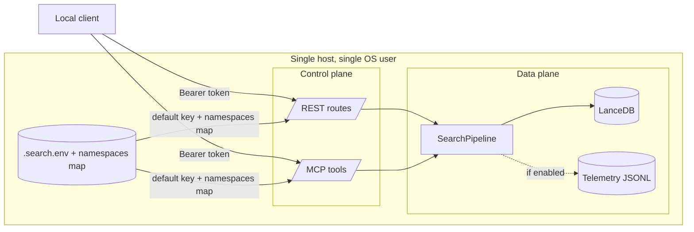

**Purpose**: Define the assets, trust boundaries, and explicit scope of the `archon-search` v1 threat model.
**Audience**: Security engineers, IT admins, and anyone signing off a deployment.
**Status**: Draft
**Last reviewed**: 2026-10-25
**Next review**: 2027-05-20

# Threat Model

`archon-search` is a local, single-tenant, single-process search server. The threat model below codifies that posture so reviewers can evaluate it against a concrete deployment rather than against assumed-cloud defaults.

For the broader security and privacy architecture this guide refines, see [`../Architecture/150_security_and_privacy_architecture.md`](../Architecture/150_security_and_privacy_architecture.md).

## Principles

1. **Local trust boundary.** Anything running as the same OS user is trusted. This is a design choice, not an oversight.
2. **Explicit scope beats implicit promises.** Threats outside this document are out of scope until a new ADR moves them in.
3. **Defenses are layered but minimal.** Bearer auth, the admin scope, collection ownership and per-chunk ACL exist to stop accidental or careless cross-client access between cooperating clients, not to harden against a hostile local user.
4. **Source of truth is code.** Every claim below points to a file path. If code and this doc disagree, the code wins and the doc is wrong.

## Assets

| Asset | On-disk location | Sensitivity | Notes |
| --- | --- | --- | --- |
| LanceDB tables (chunks, embeddings, ACL column, FTS) | `~/.archon-search/search/` | High — contains the indexed content verbatim in `source_path` and chunk text. | Schema in `archon_search/store.py`. ACL lives on every chunk row as a nullable `list<utf8>` (`pa.field("acl", pa.list_(pa.utf8()), nullable=True)`). The data directory and its subdirectories are created `0700`. |
| Collection metadata (descriptions, centroids, owning namespace) | `~/.archon-search/search/` (LanceDB) | Medium — descriptions may summarize sensitive content; the `namespace` column records which namespace owns each collection and gates every write. | Generated by `archon_search/description_generator.py`; ownership is enforced in `archon_search/store.py` (see `03_authorization_and_acl.md`). |
| API key file | `~/.archon-search/.search.env` (default) | High — the default key, which is also the admin key. | Owner-only `0600` (created `0600`, re-tightened on read). Override path with `ARCHON_SEARCH_KEY_FILE`. See `archon_search/key_manager.py`. |
| Per-namespace keys | `[namespaces]` block in `~/.archon-search/archon-search.toml`; managed keys in `~/.archon-search/keys.json` (SHA-256 digests only, `0600`) | High — each TOML entry is a static bearer token. | TOML tokens must be at least 32 printable ASCII characters without whitespace, are never admin, and authenticate on REST and `/mcp` alike (`create_app` and `create_mcp_http_app` both pass `namespaces=config.namespaces`). The config file holds them in plaintext: keep it owner-only. |
| Telemetry logs | `~/.archon-search/search-logs/<date>.jsonl` (only when enabled) | Medium — no raw queries, but `result_doc_ids` derive from paths. | Directory `0700`, files `0600`. See `04_telemetry_privacy.md`. |
| Indexing state | `~/.archon-search/search/.indexing_state.json` | Low — operational state, not content. | `archon_search/progress.py`. |
| Server log file | `~/.archon-search/logs/archon-search.log` | Low — application log; may include warnings naming paths. | `[logging].log_file`; created `0600` in a `0700` directory. |

## Trust boundaries

| Boundary | Where it is enforced | What crosses it |
| --- | --- | --- |
| Network → process | `uvicorn.run(host, port)` in `archon_search/server/app.py`; `[server].host` defaults to `127.0.0.1:8765`. `archon-search serve` inside the container image (`ARCHON_SEARCH_CONTAINER=1`) binds `0.0.0.0`, because a published port needs a non-loopback interface; the shipped compose file publishes only `127.0.0.1:<port>`. | HTTP requests only on loopback by default. |
| Process → bearer auth | `APIKeyMiddleware.dispatch` in `archon_search/server/middleware_auth.py`. A validated namespace and the `admin` flag are stamped onto `request.state`. The middleware exempts two paths: `/health` and `/ready` (`_EXEMPT_PATHS`); `/docs`, `/redoc` and `/openapi.json` are exempt only when `[server].docs_enabled = true` (default `false`). A 413 body-size check (`[server].max_request_body_mb`, default 32) runs before auth. | Bearer-validated HTTP requests (and the exempt paths). |
| REST vs MCP | Two ASGI apps in one process: the MCP `Starlette` app returned by `create_mcp_http_app` (`archon_search/server/mcp.py`) is mounted at `/mcp` on the REST FastAPI app by the `create_app` lifespan (`archon_search/server/app.py`). Each has its own `APIKeyMiddleware` instance, both built with `namespaces=config.namespaces` and the shared `key_store`; the MCP instance also gets `api_key_state=app.state`, so both read the same current default key (`app.state.api_key`). | MCP is not a privileged surface: managed keys, TOML `[namespaces]` tokens and the default key authenticate on `/mcp` exactly as on REST, each resolving to its own namespace, and a key rotation through either surface takes effect on both at once. MCP tools fail closed: a tool call that carries no authenticated request is refused (`unauthenticated`), never defaulted to the default namespace. |
| Control plane vs data plane | Control routes sit behind the same bearer check, and the server-wide ones additionally require an **admin** key (`archon_search/server/authz.py`): `/keys/rotate`, `/sync`, `/backup/trigger`, `/maintenance/trigger`, `/telemetry/*`, `POST /collections/` and the MCP `rotate_key`. Namespace-scoped routes (`/search`, `/route`, `/collections`, `/jobs`) are gated by the caller's namespace instead. | Admin = the default key and managed keys created with `admin`; TOML `[namespaces]` tokens are never admin. Non-admin keys get `403`. |
| Namespace → ACL | `archon_search/acl.py::apply_acl_filter` invoked from `SearchPipeline`. | Chunks tagged with an `acl` list (see `02_authentication_and_keys.md` and `03_authorization_and_acl.md`). |
| Host → outside world | None for telemetry — there is no transport. `[telemetry].export_enabled = true` is coerced to `false` in `archon_search/config.py` and a warning is logged. | Nothing in v1. |

## In scope

The v1 threat model considers and mitigates:

- **Casual misuse by a second local client without the API key.** Bearer auth blocks unauthenticated traffic on every endpoint except the two exempt paths declared in `middleware_auth.py::_EXEMPT_PATHS` — `/health` (body `{"status":"running"}` only) and `/ready`. `/docs`, `/redoc` and `/openapi.json` are off unless `[server].docs_enabled = true`; `/openapi.json` then needs no token either, because Swagger UI fetches it without credentials. See `02_authentication_and_keys.md`.
- **Cross-namespace access between cooperating local clients.** Collection ownership (each collection belongs to the namespace that created it; another namespace's ingest, delete, import and export are refused), the admin scope on server-wide operations, per-chunk ACL (which fails closed) and namespace-scoped listings. See `03_authorization_and_acl.md`.
- **A namespace key used to read files off the host.** Path-based ingest is refused for credential locations (`.ssh`, `.aws`, `.env`, `*.pem`, the data directory, `/etc/shadow`, ...) for every caller, and for a non-admin key unless `[ingest].allowed_roots` is set. See `06_hardening_checklist.md`.
- **Resource exhaustion through one request.** Request body cap (413), ingest concurrency cap (503 `ingest_busy`), parse timeout, zip-bomb limits and a discovery cap on directory ingest. See `06_hardening_checklist.md`.
- **Accidental persistence of raw query text in telemetry.** Structural — `TelemetryEntry` has no `query` field and no factory accepts one (`archon_search/telemetry/entry.py`). Log fingerprints of a query are HMAC-keyed, not a bare hash. See `04_telemetry_privacy.md`.
- **Drift of the API key file permissions.** `_parse_key_file` re-tightens the mode to `0600` on every read (`archon_search/key_manager.py`). The data directory, its subdirectories, `keys.json`, the job store, telemetry, logs and export/backup archives are created `0700` / `0600`.
- **Timing side channel on key comparison.** `hmac.compare_digest` over the UTF-8 bytes, with a deliberately non-short-circuiting loop over the TOML `[namespaces]` tokens (`middleware_auth.py::authenticate_token`).

## Out of scope (deliberate non-goals)

The following are explicit non-goals in v1. They are recorded so a reviewer does not treat their absence as an oversight; they are also not unpaid debt — they are design choices anchored in ADRs and the debt register.

- **Hostile processes running as the same OS user.** They can read `.search.env`, the LanceDB directory, and the logs directly; no in-process control would help.
- **Multi-tenant SaaS isolation.** The server is single-process, single default key with an optional per-namespace map. **D7** adds a durable multi-key store (`KeyStore`) so multiple managed keys can be issued, revoked, and rotated live. Collection ownership and the admin scope are enforced, but the isolation model remains cooperating-clients-only, not hostile-tenant: tables are shared (one LanceDB table per collection name, so a taken name is observable), all namespaces share one model cache and one CPU, and an ingest by one namespace can slow searches of another. `SEC-1` (resolved by D7) is recorded in [`../Architecture/530_technical_debt_refactoring_roadmap.md`](../Architecture/530_technical_debt_refactoring_roadmap.md).
- **Distributed deployment / horizontal scale.** LanceDB is opened by a single process; runtime state under `~/.archon-search/` is host-local. See ADR [`../ADRs/01_lancedb_as_local_vector_store.md`](../ADRs/01_lancedb_as_local_vector_store.md).
- **Supply-chain integrity of dependencies.** Out of scope at the application layer; relies on the operator's package manager. A one-off `pip-audit` of the locked dependency set on 2026-10-25 reported no known vulnerabilities (83 in 12 packages before the dependency bump); `pip-audit` is not a CI gate, so rerun it when you upgrade. The container image installs unlocked latest versions of the dependencies, and the extras install on first container start (`ARCHON_EXTRAS`) pins the exact artifacts its own resolve chose but does not verify hashes: a hash-pinned install would need a hash catalog generated at build time for every extras combination, which is not implemented.
- **Integrity of the Hugging Face model hosting.** Embedder and reranker weights are downloaded from Hugging Face at the revision pinned per model in `archon_search/model_specs.py`, and only `model.safetensors`, `config.json` and `tokenizer.json` are fetched (`model_store.py`); models load with `use_safetensors=True`, so a pickle-only checkpoint is refused, and no remote code is executed (`trust_remote_code` is never passed). The graph NER (GLiNER) checkpoint is likewise a pinned revision fetched through an allow-list of seven files and then loaded offline. Archon does not verify the weight files against a separate checksum beyond what the hub client does. Air-gapped hosts copy the `models--<org>--<name>` directories into `<data dir>/models` and set `HF_HUB_OFFLINE=1`.
- **Network-level attacks against the loopback interface.** Treated as outside the host trust boundary; if the operator binds to a non-loopback interface, see `05_network_exposure_and_tls.md`.
- **Backup secrecy.** The operator is responsible for encrypting backups that include `~/.archon-search/`.
- **Defending against operators who set `[server].host = "0.0.0.0"` without a reverse proxy.** Not in scope; documented as a configuration footgun in `05_network_exposure_and_tls.md`. The container image binds `0.0.0.0` by design and relies on the published-port interface (`127.0.0.1:` in the shipped compose file).

## Single-tenant, single-process assumption

Two invariants together define "single tenant" here:

1. **One default key per process.** `load_or_generate_key()` returns a single `(key, source)` tuple — i.e. exactly one default key, held as `app.state.api_key` and shared by REST and `/mcp`. The optional `[namespaces]` map adds *additional* keys, but each entry is still a static, long-lived string.
2. **One LanceDB process owner.** ADR-01 commits to LanceDB as a single-process embedded store. Concurrent processes opening the same directory is not supported.

If either invariant is violated (shared key file across hosts, multiple `archon-search` processes against the same `db_path`), the threat model no longer applies.

## Related documents

- [`02_authentication_and_keys.md`](./02_authentication_and_keys.md) — key bootstrap and bearer enforcement.
- [`03_authorization_and_acl.md`](./03_authorization_and_acl.md) — namespace and per-chunk ACL semantics.
- [`04_telemetry_privacy.md`](./04_telemetry_privacy.md) — telemetry guarantees and accepted risks.
- [`05_network_exposure_and_tls.md`](./05_network_exposure_and_tls.md) — exposure beyond localhost.
- [`06_hardening_checklist.md`](./06_hardening_checklist.md) — pre-production checklist.
- [`../Architecture/150_security_and_privacy_architecture.md`](../Architecture/150_security_and_privacy_architecture.md) — broader security/privacy architecture.
- [`../Architecture/530_technical_debt_refactoring_roadmap.md`](../Architecture/530_technical_debt_refactoring_roadmap.md) — `SEC-1`, `SEC-2`, `SEC-3`, `TEL-1`. #Unverified (cross-references to specific debt-register IDs not validated against the register in this review)
- [`../Backlog/03_world_class_roadmap.md`](../Backlog/03_world_class_roadmap.md) — items D7, D8, E4.
