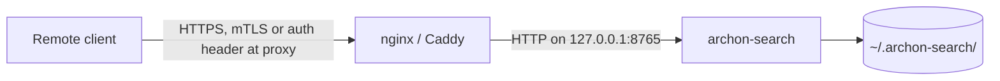

**Purpose**: Describe how `archon-search` is exposed on the network, the absence of native TLS, and how to harden a non-loopback deployment.
**Audience**: Security engineers and IT admins deploying the service on multi-user or remote-accessible hosts.
**Status**: Draft
**Last reviewed**: 2026-10-25
**Next review**: 2027-05-20

# Network Exposure and TLS

`archon-search` ships as a plain HTTP server that binds the loopback interface. There is no native TLS and no built-in rate limiting. CORS is off: no cross-origin header is sent unless the operator lists an origin in `[server].cors_origins`. Any deployment that exposes the port beyond `127.0.0.1` must terminate TLS and enforce rate limits externally.

For threat-model context, see [`01_threat_model.md`](./01_threat_model.md). For bearer auth that runs over this transport, see [`02_authentication_and_keys.md`](./02_authentication_and_keys.md).

## Principles

1. **Loopback by default.** The default `[server].host` is `127.0.0.1`, for `archon-search serve`, `archon-search start` and `python -m archon_search.server` alike. The one exception is the container image (below).
2. **No native TLS.** Uvicorn is started without TLS arguments; the server speaks `http://`.
3. **Reverse-proxy for everything off-host.** TLS termination, rate limiting and access logging all live in front of `archon-search`, not in it.
4. **Browsers get nothing by default.** The API authenticates with a Bearer header and never with cookies, and no CORS middleware is installed unless `[server].cors_origins` is set, so a page on another origin cannot call the API from a browser.
5. **The unauthenticated surface is minimal.** `/health` returns `{"status":"running"}` and `/ready` returns three check states; the version, the MCP bind address, collection names and counts are only in authenticated responses.

## Defaults

| Setting | Default | Source |
| --- | --- | --- |
| `[server].host` | `127.0.0.1`; `0.0.0.0` for `archon-search serve` when `ARCHON_SEARCH_CONTAINER=1` (set by the image) | `archon_search/config.py` `SearchConfig.host`, `load_config(serve=True)` |
| `[server].port` | `8765` | `archon_search/config.py` `SearchConfig.port` |
| `ARCHON_SEARCH_HOST` / `[server].host` | Win over both defaults above (env beats TOML) | `archon_search/config.py` |
| TLS | not supported natively | `archon_search/server/app.py::run_server` calls `uvicorn.run` with no `ssl_certfile`/`ssl_keyfile` |
| CORS | off: no CORS headers | `[server].cors_origins = []` (`archon_search/server/app.py`) |
| `[server].docs_enabled` | `false`: `/docs` and `/redoc` are not served and `/openapi.json` needs a key | `archon_search/constants.py` `DEFAULT_DOCS_ENABLED` |
| `[server].max_request_body_mb` | `32`: a larger body (declared by `Content-Length` or streamed) gets `413 {"detail", "code": "request_body_too_large"}` before authentication and before it is buffered | `archon_search/server/middleware_body_limit.py` |
| `[server].graceful_shutdown_seconds` | `25`: how long open requests may finish after SIGTERM | `archon_search/config.py` |

## CORS

By default the server sends no `Access-Control-*` headers, so a browser blocks every cross-origin call. To let a browser application on another origin use the API, list the origin:

```toml
[server]
cors_origins = ["https://app.example.com"]
```

Entries must be explicit origins (`scheme://host[:port]`, no path, no wildcard); `*` is a config error. A configured origin may use the methods `GET`, `POST`, `PATCH`, `DELETE`, `OPTIONS` and the headers `Authorization`, `Content-Type`, `X-Request-ID` and `X-Ingested-By`; credentials are never allowed. The CORS middleware sits outside the authentication middleware, so a preflight `OPTIONS` request from a listed origin is answered without a token (browsers cannot send one); the actual request still needs the Bearer token. The 413 body-limit response is produced inside the CORS layer, so a browser client of a listed origin can read it. Command-line and server-to-server clients are unaffected by this setting.

The former wildcard (`Access-Control-Allow-Origin: *`, tracked as `CORS-1`) no longer exists.

## The container image

The image runs `archon-search serve` with `ARCHON_SEARCH_CONTAINER=1`, which makes `serve` bind `0.0.0.0` inside the container, because a published port needs a non-loopback interface. What is reachable from outside is decided by the publish flag. The shipped `docker-compose.yml` publishes `127.0.0.1:8765:8765` (prod), `127.0.0.1:18765:8765` (dev) and `127.0.0.1:18766:8765` (test), so nothing is reachable from another host until you add a `ports:` entry for another interface (compose appends it) or put a reverse proxy in front. The `claude-proxy` helper for the dev override requires `CLAUDE_PROXY_TOKEN` and accepts only loopback or `host.docker.internal` `Host` headers and no `Origin` header.

## Recommended topology for non-loopback deployments



Concrete rules for the proxy:

- **Bind `archon-search` to loopback** (`[server].host = "127.0.0.1"`, the default). The reverse proxy is the only thing that talks to it.
- **Terminate TLS at the proxy** with a certificate from a trusted CA (or your internal PKI). Disable plaintext on the public listener.
- **Leave CORS to the server.** If you have browser clients, list their origins in `[server].cors_origins`; if you have none, set nothing. Do not add a wildcard at the proxy.
- **Pass the `Authorization` header through unchanged.** The bearer token must reach `archon-search`; the proxy must not strip or replace it.
- **Do not forward `/docs`, `/redoc` and `/openapi.json`** unless you set `docs_enabled = true` on purpose: with it on they are served without a token.
- **Add rate limiting.** `archon-search` has none built in. Choose a budget that aligns with `[search].max_fanout` and reranker capacity. The server's own limits are the 32 MiB body cap and `[ingest].max_concurrent_tasks` (503 `ingest_busy`).
- **Log at the proxy.** Server-side access logs are uvicorn's default and do not include the request body; `view_token`, `token`, `api_key` and `access_token` query values are redacted in them. Application logs (`archon_search` loggers, file and container stderr) also have URL credentials, query strings, `hf_…`/bearer tokens and `key=value` secrets redacted, including a credential in `HF_ENDPOINT` echoed by a hub error; the install wizard, which does not call `configure_logging`, is not covered. If you need centralized audit, do it at the proxy.

### Minimal nginx example

```nginx
server {
    listen 443 ssl;
    server_name search.example.internal;
    ssl_certificate     /etc/ssl/search.crt;
    ssl_certificate_key /etc/ssl/search.key;

    # The body cap is enforced by archon-search (413); keep the proxy's cap at or above it.
    client_max_body_size 32m;

    location / {
        proxy_pass http://127.0.0.1:8765;
        proxy_set_header Host              $host;
        proxy_set_header X-Forwarded-For   $remote_addr;
        proxy_set_header X-Forwarded-Proto $scheme;
    }
}
```

The exact directives will depend on the proxy. The point is that **TLS and rate limiting both happen here, not in `archon-search`**.

## What you do not get from binding to `0.0.0.0` without a proxy

Operators occasionally set `[server].host = "0.0.0.0"` for quick remote testing. This combination has well-known problems:

- **Plaintext bearer tokens on the wire.** Every authenticated request leaks the token to any device on the network path.
- **No rate limiting.** A single misbehaving client can saturate the reranker.
- **No isolation from neighbours.** The threat model assumes loopback; binding to `0.0.0.0` invalidates that assumption.

This configuration is documented as a footgun and is explicitly out of scope for the v1 threat model (see `01_threat_model.md` — "Out of scope").

## Verifying the network posture

```bash
# Confirm the server is bound to loopback only
ss -ltnp | grep :8765    # Linux
lsof -nP -iTCP:8765 -sTCP:LISTEN   # macOS
# Expected: 127.0.0.1:8765 (not 0.0.0.0:8765 and not [::]:8765)

# Confirm there is no listener for TLS
curl -k https://127.0.0.1:8765/health
# Expected: connection refused or SSL error — archon-search does not serve TLS.

# Confirm CORS is off. Starlette's CORSMiddleware only answers an OPTIONS request
# as a preflight when BOTH `Origin` and `Access-Control-Request-Method` are present.
curl -i -H "Origin: https://evil.example" \
        -H "Access-Control-Request-Method: POST" \
        -X OPTIONS http://127.0.0.1:8765/search
# Expected with no cors_origins: 401, and no Access-Control-Allow-Origin header.
# Expected for a listed origin: 200 with that origin (never *) in Access-Control-Allow-Origin.

# Confirm the body cap (a body above [server].max_request_body_mb)
head -c 40000000 /dev/zero | curl -i -X POST --data-binary @- http://127.0.0.1:8765/ingest
# Expected: 413 with "request_body_too_large", with or without a token.

# Confirm the docs pages are off
curl -i http://127.0.0.1:8765/docs
# Expected: 404 with a key (401 without); with docs_enabled = true: 200 without a key.
```

If the posture differs from the expected one, a reverse proxy may already be in front of the service — verify it matches your intended topology.

## Related documents

- [`01_threat_model.md`](./01_threat_model.md) — trust boundaries.
- [`02_authentication_and_keys.md`](./02_authentication_and_keys.md) — bearer auth that runs over this transport.
- [`06_hardening_checklist.md`](./06_hardening_checklist.md) — pre-production checklist.
- [`../Architecture/150_security_and_privacy_architecture.md`](../Architecture/150_security_and_privacy_architecture.md) — broader architecture.
- [`../Architecture/160_operational_readiness_monitoring_and_reliability.md`](../Architecture/160_operational_readiness_monitoring_and_reliability.md) — operational posture.
- [`../Architecture/530_technical_debt_refactoring_roadmap.md`](../Architecture/530_technical_debt_refactoring_roadmap.md) — `CORS-1` entry (the wildcard it tracked is gone).
